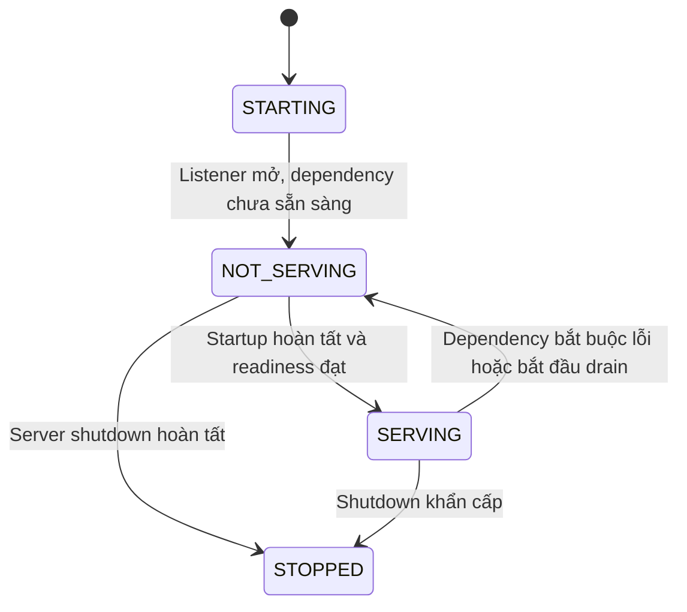

# Cấu hình health service và reflection

## Mục tiêu bài học

Trong **SPRING_GRPC**, một server cần cung cấp tín hiệu rõ ràng để client, load balancer và nền tảng triển khai biết khi nào service có thể nhận traffic. gRPC định nghĩa Health Checking Protocol với hai RPC là Check và Watch. Bên cạnh đó, gRPC Server Reflection cho phép công cụ như grpcurl khám phá service, method và Protobuf descriptors mà không cần người dùng cung cấp trước toàn bộ file proto.

Bài học tập trung vào **cấu hình health service và reflection**: đăng ký health service và cập nhật trạng thái theo vòng đời ứng dụng, phân biệt liveness với readiness, hỗ trợ client health checking qua Watch, bật reflection ở phạm vi phù hợp, tích hợp cả hai service vào server do Spring quản lý và kiểm thử bằng grpcurl.

Sau bài này, bạn có thể:

1. Giải thích vai trò của gRPC Health Checking Protocol và các trạng thái phục vụ.
2. Cấu hình HealthStatusManager và đăng ký Health service.
3. Cập nhật trạng thái tổng thể và theo từng gRPC service khi startup, readiness thay đổi và shutdown.
4. Phân biệt liveness, readiness và health của dependency.
5. Hiểu cách client health checking dùng Watch.
6. Đăng ký Server Reflection để khám phá Protobuf service/method.
7. Giới hạn reflection theo môi trường và chính sách bảo mật.
8. Tích hợp health/reflection với Spring gRPC server factory và kiểm thử hành vi thực tế.

> **Phạm vi:** Ví dụ dùng gRPC Java và Spring gRPC. HealthStatusManager và ProtoReflectionService thuộc gRPC Java services artifact. Cách đưa BindableService vào server phụ thuộc extension point của Spring gRPC starter/transport đang dùng; bean được tạo không đồng nghĩa service đã được đăng ký vào listener.

## 1. Hai service vận hành có mục đích khác nhau

Health service và reflection service đều là gRPC service bổ trợ, nhưng phục vụ các nhu cầu khác nhau:

| Thành phần | Mục đích | Người dùng điển hình |
| --- | --- | --- |
| gRPC Health service | Báo service đang SERVING hay NOT_SERVING | Load balancer, gRPC client, orchestrator, probe |
| Server Reflection | Cung cấp danh sách service và Protobuf descriptors | grpcurl, grpcui, công cụ debug và client động |

Health service là tín hiệu runtime về khả năng nhận traffic. Reflection là khả năng khám phá contract của server. Reflection không phải health check và không xác nhận service đang sẵn sàng xử lý request.

Cả hai đều được expose như RPC trên gRPC server. Nếu server dùng authentication interceptor, TLS và network policy, hãy xác định rõ health probe và công cụ reflection được phép truy cập theo cùng chính sách hoặc theo ngoại lệ có kiểm soát.

## 2. gRPC Health Checking Protocol

gRPC định nghĩa service chuẩn với package và service name:

```proto
package grpc.health.v1;

service Health {
  rpc Check(HealthCheckRequest) returns (HealthCheckResponse);
  rpc Watch(HealthCheckRequest) returns (stream HealthCheckResponse);
}

message HealthCheckRequest {
  string service = 1;
}

message HealthCheckResponse {
  enum ServingStatus {
    UNKNOWN = 0;
    SERVING = 1;
    NOT_SERVING = 2;
    SERVICE_UNKNOWN = 3;
  }
  ServingStatus status = 1;
}
```

Hai RPC có semantics khác nhau:

- **Check:** trả về trạng thái hiện tại của service được yêu cầu. Phù hợp với probe dạng request/response hoặc công cụ kiểm tra một lần.
- **Watch:** mở server streaming RPC. Server gửi trạng thái hiện tại và tiếp tục gửi cập nhật khi trạng thái thay đổi. Client có thể giữ stream để theo dõi readiness liên tục.

Trường service là tên đầy đủ của gRPC service, ví dụ `commerce.v1.InventoryService`. Chuỗi rỗng thường đại diện trạng thái tổng thể của server. Nếu muốn health theo từng service, phải cập nhật trạng thái bằng đúng full service name, không dùng tên class Java hoặc tên bean Spring.

Các trạng thái:

| Trạng thái | Ý nghĩa vận hành |
| --- | --- |
| UNKNOWN | Chưa xác định được trạng thái |
| SERVING | Service có thể nhận và xử lý traffic |
| NOT_SERVING | Service hiện không nên nhận traffic |
| SERVICE_UNKNOWN | Server không có trạng thái cho service được hỏi theo semantics của protocol |

Không dùng SERVING chỉ vì process đã mở port. Service có thể chưa hoàn tất startup, chưa kết nối được dependency bắt buộc hoặc đang drain để shutdown.

## 3. Cấu hình HealthStatusManager trong gRPC Java

gRPC Java cung cấp HealthStatusManager trong artifact grpc-services. Dependency phải dùng cùng dòng version với các thư viện gRPC Java còn lại:

```xml
<dependency>
    <groupId>io.grpc</groupId>
    <artifactId>grpc-services</artifactId>
</dependency>
```

Quản lý trạng thái bằng HealthStatusManager:

```java
import io.grpc.protobuf.services.HealthStatusManager;
import io.grpc.health.v1.HealthCheckResponse.ServingStatus;

HealthStatusManager healthStatusManager =
        new HealthStatusManager();

healthStatusManager.setStatus(
        "",
        ServingStatus.NOT_SERVING);

healthStatusManager.setStatus(
        "commerce.v1.InventoryService",
        ServingStatus.NOT_SERVING);
```

Khởi tạo ở trạng thái NOT_SERVING giúp tránh cửa sổ ngắn mà listener đã mở nhưng service chưa sẵn sàng. Khi ứng dụng hoàn tất startup và readiness policy cho phép nhận traffic, cập nhật status:

```java
healthStatusManager.setStatus(
        "",
        ServingStatus.SERVING);

healthStatusManager.setStatus(
        "commerce.v1.InventoryService",
        ServingStatus.SERVING);
```

Nếu có nhiều service, cập nhật status riêng cho từng service. Trạng thái tổng thể rỗng và trạng thái theo service cần được giữ nhất quán theo policy của ứng dụng.

### 3.1. Đăng ký Health service vào server

HealthStatusManager cung cấp BindableService qua getHealthService(). Service đó phải được đăng ký vào chính server đang phục vụ RPC:

```java
ServerBuilder<?> builder = obtainSpringManagedServerBuilder();

builder.addService(healthStatusManager.getHealthService());
```

Đây là thao tác trên gRPC Java builder để minh họa việc đăng ký. Trong Spring gRPC, server thường được starter tạo và quản lý. Hãy đặt thao tác addService vào server builder customizer/configurer hoặc factory extension point được tài liệu của đúng phiên bản starter công bố.

Không tự tạo một Server độc lập trong cấu hình chỉ để đăng ký Health service nếu Spring đã quản lý listener chính. Server phụ có thể có port, TLS, interceptors, service registration và lifecycle khác với server thật mà load balancer đang kiểm tra.

### 3.2. Đăng ký bằng Spring lifecycle

Có thể để HealthStatusManager là Spring bean để service, lifecycle coordinator và readiness integration cùng dùng một instance:

```java
@Configuration(proxyBeanMethods = false)
class GrpcHealthConfiguration {

    @Bean
    HealthStatusManager healthStatusManager() {
        HealthStatusManager manager = new HealthStatusManager();
        manager.setStatus("", ServingStatus.NOT_SERVING);
        manager.setStatus(
                "commerce.v1.InventoryService",
                ServingStatus.NOT_SERVING);
        return manager;
    }
}
```

Bean này chỉ tạo và quản lý status manager. Cần đăng ký getHealthService() vào Spring-managed gRPC server bằng extension point của phiên bản đang dùng. Không giả định mọi starter tự động phát hiện một bean HealthStatusManager hoặc tự thêm service.

## 4. Cập nhật health status theo vòng đời ứng dụng

Một vòng đời cơ bản:



Một coordinator nên là nơi duy nhất tổng hợp các điều kiện readiness và cập nhật health status. Ví dụ:

```java
public final class GrpcReadinessCoordinator {

    private final HealthStatusManager health;

    public GrpcReadinessCoordinator(HealthStatusManager health) {
        this.health = health;
    }

    public void markReady() {
        health.setStatus("", ServingStatus.SERVING);
        health.setStatus(
                "commerce.v1.InventoryService",
                ServingStatus.SERVING);
    }

    public void markNotReady() {
        health.setStatus("", ServingStatus.NOT_SERVING);
        health.setStatus(
                "commerce.v1.InventoryService",
                ServingStatus.NOT_SERVING);
    }
}
```

Đây là lớp minh họa logic điều phối; gọi markReady sau khi startup và các điều kiện readiness bắt buộc đã đạt. Gọi markNotReady trước khi ngừng nhận traffic hoặc bắt đầu drain.

Nếu service có dependency độc lập, không nhất thiết một dependency tùy chọn lỗi sẽ khiến mọi gRPC service NOT_SERVING. Xác định dependency nào là bắt buộc cho từng service và tránh health check gây cascade khi một hệ thống downstream gặp sự cố ngắn hạn.

### 4.1. Liveness khác readiness

- **Liveness:** process còn sống và không bị treo đến mức cần restart hay không.
- **Readiness:** instance có thể nhận traffic mới hay không.
- **Startup:** ứng dụng đã hoàn tất khởi tạo hay chưa.

gRPC Health service chủ yếu cung cấp tín hiệu serving cho client/load balancer. Không nên biến mọi lỗi dependency tạm thời thành liveness failure khiến orchestrator restart hàng loạt instance và khuếch đại sự cố.

Nếu Spring Boot Actuator cũng cung cấp readiness/liveness state, có thể đồng bộ readiness state với HealthStatusManager bằng một adapter rõ ràng. Tránh hai nguồn trạng thái độc lập cập nhật trái ngược nhau. Một readiness coordinator nên tổng hợp trạng thái và phát cùng quyết định tới Spring availability và gRPC health.

## 5. Check và Watch trong vận hành

### 5.1. Check cho probe dạng unary

Check phù hợp với công cụ cần hỏi trạng thái tại một thời điểm. Ví dụ:

```bash
grpcurl -plaintext \
  -d '{"service":"commerce.v1.InventoryService"}' \
  localhost:9090 \
  grpc.health.v1.Health/Check
```

Nếu endpoint dùng TLS, bỏ plaintext và cấu hình CA/hostname đúng. Không tắt xác minh certificate để làm probe pass.

Một probe gọi Check định kỳ tạo một RPC cho mỗi lần kiểm tra. Đặt timeout ngắn, chu kỳ phù hợp và tránh chạy quá dày khiến probe trở thành nguồn tải phụ.

### 5.2. Watch cho client health checking

Watch giữ một stream mở và gửi cập nhật khi status đổi. Đây là nền tảng cho gRPC client-side health checking khi client library và service config hỗ trợ.

Service config có thể khai báo service cần theo dõi:

```json
{
  "healthCheckConfig": {
    "serviceName": "commerce.v1.InventoryService"
  }
}
```

Khi health checking được bật và transport/client implementation hỗ trợ, client tạo Watch tới health service. Client chỉ chuyển RPC tới backend khi trạng thái được báo là SERVING; khi nhận NOT_SERVING, client có thể ngừng gửi call mới tới backend đó theo implementation.

Không phải mọi language/runtime hoặc phiên bản client đều bật health checking mặc định. Kiểm tra khả năng hỗ trợ, cách cung cấp service config và behavior khi Watch kết thúc. Health checking không thay thế retry, load balancing hoặc deadline; nó bổ sung tín hiệu readiness cho client.

### 5.3. Watch và thay đổi trạng thái

Khi readiness chuyển từ SERVING sang NOT_SERVING, các Watch stream đang mở cần nhận cập nhật. Client có thể loại backend khỏi lựa chọn cho call mới. RPC đang chạy vẫn cần được xử lý theo graceful shutdown/cancellation policy; NOT_SERVING không tự hủy mọi RPC in-flight.

Khi service trở lại SERVING, Watch client có thể nhận cập nhật và cho phép backend được chọn lại. Hãy kiểm thử chuyển trạng thái trên kết nối đang tồn tại, không chỉ gọi Check riêng lẻ.

## 6. Cấu hình Server Reflection

Server Reflection là một gRPC service chuẩn cho phép client hỏi server về các service và Protobuf descriptors mà server hỗ trợ. Trong gRPC Java, implementation phổ biến là ProtoReflectionService trong grpc-services.

Đăng ký reflection service:

```java
import io.grpc.protobuf.services.ProtoReflectionService;

builder.addService(ProtoReflectionService.newInstance());
```

Giống Health service, reflection phải được thêm vào đúng Spring-managed server builder. Đăng ký bean hoặc tạo object ProtoReflectionService chưa đủ nếu service không được bind vào server đang lắng nghe.

Reflection cung cấp thông tin như:

- Tên đầy đủ của service.
- Danh sách method và request/response message type.
- Protobuf file descriptors và dependency descriptors.
- Các định nghĩa message, enum và service cần để tạo dynamic client.

Reflection không tự thực thi method và không thay thế authorization của service nghiệp vụ. Nó chỉ cho client biết contract; caller vẫn phải có quyền gọi RPC tương ứng.

### 6.1. Khám phá bằng grpcurl

Liệt kê service:

```bash
grpcurl -plaintext localhost:9090 list
```

Xem các method của service:

```bash
grpcurl -plaintext localhost:9090 \
  describe commerce.v1.InventoryService
```

Xem message type:

```bash
grpcurl -plaintext localhost:9090 \
  describe commerce.v1.GetStockRequest
```

Gọi method bằng JSON được grpcurl ánh xạ sang Protobuf message:

```bash
grpcurl -plaintext \
  -d '{"sku":"SKU-100"}' \
  localhost:9090 \
  commerce.v1.InventoryService/GetStock
```

Các ví dụ dùng plaintext chỉ dành cho local test server không TLS. Với môi trường TLS, dùng CA phù hợp, hostname đúng và SNI/authority phù hợp. Không sử dụng tùy chọn bỏ xác minh certificate trong production.

### 6.2. Không có reflection vẫn gọi được gRPC

Reflection là tiện ích khám phá, không phải điều kiện để gRPC hoạt động. Nếu reflection bị tắt, client vẫn có thể gọi service bằng:

- Code client được sinh từ file .proto.
- Descriptor set được build cùng ứng dụng.
- File proto và dependency import được cung cấp cho công cụ như grpcurl.

Ví dụ dùng descriptor set:

```bash
grpcurl -protoset api-descriptors.protoset \
  -d '{"sku":"SKU-100"}' \
  grpc.example.com:443 \
  commerce.v1.InventoryService/GetStock
```

Descriptor set nên được version cùng API contract để tránh dùng schema cũ khi service đã thay đổi.

## 7. Bảo mật reflection và health endpoint

Reflection có thể tiết lộ tên service nội bộ, cấu trúc message, method và API chưa công bố. Dù không trả dữ liệu nghiệp vụ, thông tin schema có thể giúp người ngoài lập bản đồ bề mặt tấn công.

Các lựa chọn triển khai:

| Môi trường | Health service | Reflection |
| --- | --- | --- |
| Local development | Bật để kiểm tra | Bật thuận tiện |
| Integration/staging | Bật và kiểm thử như production | Bật có kiểm soát |
| Production nội bộ | Bật cho probe/client được phép | Chỉ bật nếu có nhu cầu vận hành và kiểm soát truy cập |
| Public internet | Chỉ expose theo thiết kế health/probe | Thường tắt hoặc giới hạn mạnh |

Nếu reflection được bật production:

- Chỉ cho phép truy cập từ network/operator identity được phê duyệt.
- Áp dụng authentication/authorization phù hợp nếu transport và client tooling hỗ trợ.
- Kiểm tra global interceptor có chặn reflection hay không.
- Không cho rằng một port nội bộ tự động an toàn nếu network boundary không được kiểm soát.
- Theo dõi truy cập reflection và giới hạn tần suất nếu cần.
- Cân nhắc tắt reflection trong production và dùng descriptor set cho công cụ vận hành.

Health endpoint cũng cần được thiết kế cẩn thận. Nếu health không yêu cầu credential để load balancer kiểm tra, giới hạn đường truy cập bằng network policy và chỉ trả trạng thái tối thiểu. Không đưa thông tin chi tiết về database host, secret hoặc stack trace vào health response.

### 7.1. Interceptor và service bổ trợ

Nếu authentication interceptor áp dụng toàn server, health probe và reflection call cũng có thể đi qua interceptor đó. Điều này có thể đúng với policy bảo mật nhưng làm probe thất bại nếu probe không có credential.

Xác định rõ:

- Health probe được miễn authentication ở phạm vi nào, nếu có.
- Reflection có cần operator authentication không.
- Các method nghiệp vụ vẫn luôn yêu cầu authentication/authorization phù hợp.
- Service bổ trợ không được dùng làm đường vòng để truy cập dữ liệu nghiệp vụ.

Nếu cần ngoại lệ, dựa trên full method name cụ thể và policy rõ ràng; không bỏ qua authentication cho toàn bộ package hoặc mọi RPC.

## 8. Tích hợp health/reflection vào Spring gRPC

Spring gRPC quản lý server lifecycle và service registration. Để đăng ký service bổ trợ:

1. Tạo HealthStatusManager thành bean dùng chung.
2. Tạo ProtoReflectionService khi môi trường cho phép reflection.
3. Dùng builder customizer/configurer hoặc factory extension point của đúng phiên bản starter.
4. Thêm health service và reflection service vào cùng server builder đang bind các @GrpcService.
5. Đảm bảo interceptors, TLS, metrics và graceful shutdown áp dụng đúng phạm vi.
6. Cập nhật HealthStatusManager từ readiness/lifecycle coordinator.
7. Xác minh bằng kết nối tới đúng port/listener mà client và probe sử dụng.

Một helper thể hiện phần đăng ký gRPC Java:

```java
void registerOperationalServices(
        ServerBuilder<?> builder,
        HealthStatusManager health,
        boolean reflectionEnabled) {

    builder.addService(health.getHealthService());

    if (reflectionEnabled) {
        builder.addService(ProtoReflectionService.newInstance());
    }
}
```

Đây là helper thuần gRPC Java, không phải tên API Spring cố định. Đặt nó trong callback/customizer do phiên bản Spring gRPC công bố. Không tự tạo server thứ hai, không thay thế service registration hiện tại và không giả định cấu hình TLS của HTTP servlet server tự áp dụng cho native gRPC listener.

## 9. Shutdown và drain traffic

Trước khi server dừng:

1. Đưa readiness tổng thể và từng service sang NOT_SERVING.
2. Cho load balancer/client health checker nhận Watch update hoặc lần Check kế tiếp.
3. Ngừng nhận traffic mới theo cơ chế graceful shutdown của server.
4. Chờ RPC in-flight trong grace period.
5. Đóng worker pool và downstream resources theo thứ tự.
6. Kết thúc server sau khi drain hoàn tất hoặc hết timeout.

Nếu chỉ dừng process mà chưa cập nhật NOT_SERVING, probe có thể tiếp tục xem instance là healthy cho tới khi connection thất bại. Nếu cập nhật NOT_SERVING quá muộn, load balancer có thể tiếp tục gửi request mới trong lúc server đã drain.

Không coi health status là cơ chế đóng socket. Health service phát tín hiệu; server lifecycle vẫn phải thực hiện graceful shutdown thực tế.

## 10. Kiểm thử health service và reflection

Một integration test nên xác minh service được đăng ký thật trên server Spring quản lý, không chỉ kiểm tra bean tồn tại.

| Trường hợp | Cách kiểm tra | Kết quả mong đợi |
| --- | --- | --- |
| Startup chưa ready | Gọi Check service rỗng và service cụ thể | NOT_SERVING |
| Startup hoàn tất | Gọi Check lại | SERVING |
| Service riêng không sẵn sàng | Check full service name | Service đó NOT_SERVING |
| Watch mở trước khi status đổi | Mở Watch rồi cập nhật status | Nhận cập nhật status |
| Shutdown bắt đầu | Cập nhật readiness rồi gọi Check/Watch | NOT_SERVING |
| Reflection bật | grpcurl list/describe | Hiện service và descriptor |
| Reflection tắt | grpcurl list | Reflection unavailable; RPC typed client vẫn hoạt động |
| TLS bật | grpcurl với CA và hostname đúng | Health/reflection truy cập theo policy |
| Auth interceptor bật | Probe/operator không có credential | Kết quả đúng theo policy, không vô tình chặn probe hợp lệ |
| Unknown service | Check/Watch tên không đăng ký | Hành vi đúng với semantics health implementation |

Dùng test in-process để kiểm tra status logic và interceptor nếu phù hợp; vẫn cần ít nhất một integration test qua transport thật để xác minh TLS, ALPN, proxy và server builder wiring.

### 10.1. Kiểm thử Watch

Watch là stream dài nên test cần quản lý subscription và timeout:

- Mở Watch cho một service.
- Xác minh trạng thái ban đầu.
- Cập nhật status sang NOT_SERVING.
- Chờ response mới trong thời hạn giới hạn.
- Cập nhật lại SERVING và xác minh event tiếp theo.
- Hủy stream và xác minh tài nguyên được giải phóng.

Không dùng sleep cố định để giả định event đã tới; dùng latch/observer và timeout có giới hạn.

## 11. Lỗi thường gặp và cách xử lý

| Triệu chứng | Nguyên nhân | Cách xử lý |
| --- | --- | --- |
| HealthStatusManager bean tồn tại nhưng Check trả UNIMPLEMENTED | Health service chưa được đăng ký vào server | Thêm getHealthService() vào đúng server builder |
| Check luôn trả NOT_SERVING | Readiness coordinator chưa cập nhật status hoặc service name sai | Kiểm tra lifecycle event và full service name |
| Overall health SERVING nhưng service cụ thể không SERVING | Chỉ cập nhật status rỗng | Cập nhật status cho từng service theo policy |
| Watch không nhận update | Client gọi Check thay vì Watch hoặc stream bị đóng | Kiểm tra method, stream lifecycle và implementation |
| Client health checking không loại backend | Chưa cấu hình healthCheckConfig hoặc client không hỗ trợ | Kiểm tra service config và client library |
| grpcurl list không hoạt động | Reflection chưa đăng ký hoặc bị interceptor/network policy chặn | Kiểm tra ProtoReflectionService và quyền truy cập |
| Reflection hoạt động local nhưng fail staging | TLS/auth/proxy policy khác môi trường | Kiểm tra CA, SNI, credential, ALPN và route |
| Reflection lộ schema nội bộ | Đã bật public mà không giới hạn truy cập | Tắt hoặc giới hạn bằng network/auth policy |
| Probe fail sau khi bật auth interceptor | Probe không có credential | Thiết kế quyền health probe rõ ràng |
| Health trả SERVING dù dependency bắt buộc lỗi | Status không đồng bộ với readiness policy | Dùng coordinator tổng hợp readiness |
| Shutdown đột ngột làm request mới lỗi | Chưa chuyển NOT_SERVING và drain | Cập nhật status trước graceful shutdown |
| Check pass nhưng RPC fail | Health chỉ phản ánh readiness, không chứng minh mọi method hoạt động | Chạy smoke RPC và kiểm tra dependency/service registration |

## 12. Bài tập thực hành

1. Thêm grpc-services dependency cùng version với gRPC Java runtime.
2. Tạo HealthStatusManager bean và khởi tạo overall/service status là NOT_SERVING.
3. Đăng ký getHealthService() vào server builder do Spring gRPC quản lý.
4. Khi readiness đạt, cập nhật overall và service-specific status thành SERVING.
5. Dùng grpcurl gọi Health/Check cho service rỗng và full service name.
6. Mở Health/Watch, đổi trạng thái và xác minh client nhận update.
7. Đăng ký ProtoReflectionService trong profile development/staging.
8. Dùng grpcurl list, describe và gọi một method bằng reflection.
9. Tắt reflection ở profile production hoặc giới hạn truy cập bằng policy đã chọn; xác minh typed client vẫn gọi RPC được.
10. Kiểm thử startup NOT_SERVING, readiness SERVING, dependency failure, shutdown NOT_SERVING và TLS/auth behavior.
11. Viết runbook vận hành nêu cách kiểm tra health, khám phá descriptor khi được phép và cách xử lý khi reflection bị tắt.

### Câu hỏi tự kiểm tra

- Health Check và Watch khác nhau như thế nào?
- Chuỗi service trong HealthCheckRequest phải dùng tên nào?
- Vì sao cần khởi động ở NOT_SERVING?
- Liveness khác readiness ra sao?
- HealthStatusManager phải được đăng ký ở đâu để Check không trả UNIMPLEMENTED?
- Client-side health checking sử dụng Watch như thế nào?
- Reflection cung cấp thông tin nào và không cung cấp điều gì?
- Vì sao reflection không cần thiết để typed gRPC client hoạt động?
- Những rủi ro nào phát sinh khi bật reflection trên public endpoint?
- Authentication interceptor có thể ảnh hưởng health probe ra sao?
- Vì sao phải chuyển NOT_SERVING trước khi graceful shutdown?
- Làm thế nào kiểm thử Watch mà không dựa vào sleep cố định?

## Tài liệu tham khảo

- [gRPC — Health Checking](https://grpc.io/docs/guides/health-checking/): health protocol và client health checking.
- [gRPC — Server Reflection](https://grpc.io/docs/guides/reflection/): service discovery và Protobuf descriptors.
- [gRPC Java — HealthStatusManager](https://grpc.github.io/grpc-java/javadoc/io/grpc/protobuf/services/HealthStatusManager.html): cập nhật status và lấy Health service.
- [gRPC Java — ProtoReflectionService](https://grpc.github.io/grpc-java/javadoc/io/grpc/protobuf/services/ProtoReflectionService.html): đăng ký reflection service.
- [gRPC Java — ServerBuilder](https://grpc.github.io/grpc-java/javadoc/io/grpc/ServerBuilder.html): thêm service vào server.
- [grpcurl](https://github.com/fullstorydev/grpcurl): CLI khám phá service, descriptor và gọi gRPC method.
- [Spring Boot — Actuator Endpoints](https://docs.spring.io/spring-boot/reference/actuator/endpoints.html): health endpoint và vận hành ứng dụng Spring.
- [Spring Boot — Application Availability](https://docs.spring.io/spring-boot/reference/features/spring-application.html): readiness/liveness state trong vòng đời Spring Boot.

**Kết quả mong đợi:** Người học cấu hình được gRPC Health service và Server Reflection trên Spring-managed server, cập nhật readiness theo startup/dependency/shutdown, hiểu Check/Watch và client health checking, dùng grpcurl khám phá Protobuf contract, đồng thời giới hạn reflection và health access theo chính sách bảo mật của môi trường.
