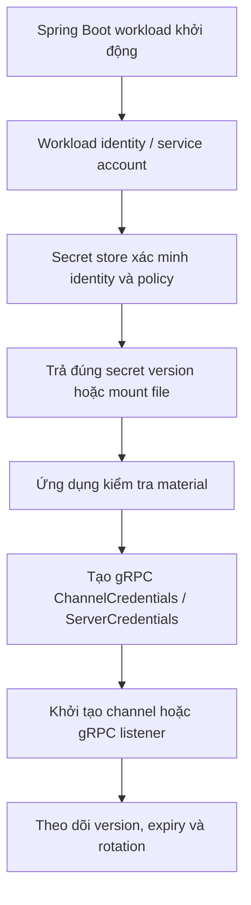
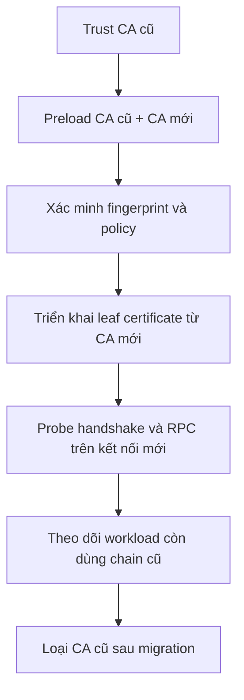

# Secret và certificate từ secret store

## Mục tiêu bài học

Trong **SPRING_GRPC**, client và server thường cần private key, certificate chain, CA trust bundle, token hoặc mật khẩu để thiết lập kết nối và xác thực peer. Các giá trị này thay đổi theo môi trường, có vòng đời riêng và cần được bảo vệ khỏi source control, image, log và người dùng không có quyền. Đưa secret vào đúng secret store chỉ là bước đầu; ứng dụng còn phải xác thực danh tính để đọc secret, nạp đúng material vào gRPC credentials, kiểm tra certificate và xử lý rotation.

Bài học tập trung vào **secret và certificate từ secret store**: phân biệt cấu hình với secret và trust material, sử dụng workload identity với quyền tối thiểu, tham chiếu secret theo tên/phiên bản, nạp material qua file mount hoặc provider, cấu hình TLS/mTLS cho gRPC client và server, tích hợp với Spring lifecycle, và xoay vòng credential mà không làm gián đoạn kết nối ngoài kế hoạch.

Sau bài này, bạn có thể:

1. Phân biệt secret, certificate công khai, private key và CA trust anchor.
2. Thiết kế quyền đọc secret theo workload identity và least privilege.
3. Giữ secret reference trong cấu hình và lấy secret value từ provider runtime.
4. Nạp PEM chain, private key và trust bundle cho gRPC client/server.
5. Tích hợp secret provider với Spring configuration và lifecycle.
6. Xác minh chain, SAN, EKU, validity và cặp certificate/private key.
7. Thực hiện rotation có versioning, overlap, channel replacement và rollback.
8. Kiểm thử việc thiếu secret, sai quyền, certificate lỗi và rotation.

> **Phạm vi:** Ví dụ dùng Spring Boot, gRPC Java và TLS credentials API. Secret store có thể là Vault, cloud secret manager, Kubernetes secret volume hoặc hệ thống nội bộ. Interface SecretMaterialProvider trong bài là abstraction do ứng dụng định nghĩa, không phải API Spring có sẵn. Cách đưa ServerCredentials vào native gRPC listener phải theo extension point của đúng Spring gRPC starter/transport đang dùng.

## 1. Phân biệt configuration, secret và trust material

Không phải mọi dữ liệu liên quan TLS đều là secret, nhưng tất cả đều cần quản lý tính toàn vẹn và quyền truy cập.

| Loại dữ liệu | Ví dụ | Tính chất và cách quản lý |
| --- | --- | --- |
| Configuration | gRPC target, port, deadline, secret identifier | Có thể commit nếu không tiết lộ thông tin nhạy cảm |
| Secret | Bearer token, keystore password, database password | Bí mật; lấy từ secret store hoặc workload identity |
| Private key | Server/client private key PEM hoặc key handle | Bí mật có giá trị cao; giới hạn đọc và audit |
| Leaf certificate | Certificate của server/client | Thường công khai, nhưng phải bảo vệ tính toàn vẹn và đúng identity |
| Intermediate/root CA | Chain và trust anchor | Thường không bí mật; cần xác minh nguồn và fingerprint |
| Trust bundle | CA certificates được client/server tin | Không nhất thiết bí mật, nhưng thay đổi có thể mở rộng trust boundary |

Một certificate public không cần được bảo mật như private key, nhưng certificate giả mạo hoặc trust bundle bị sửa có thể khiến client tin nhầm peer. Vì vậy, xác minh fingerprint và nguồn phân phối là bắt buộc trước khi cài CA mới.

Không commit private key, token hoặc password vào repository, Docker image, Helm values công khai, sample config hay ticket. Không dùng Base64 như một cơ chế mã hóa; Base64 chỉ đổi cách biểu diễn dữ liệu.

## 2. Kiến trúc lấy secret từ runtime

Ứng dụng nên biết **secret nào cần lấy**, còn quyền đọc và giá trị thật do môi trường runtime cấp. Một luồng điển hình:



Các nguyên tắc:

- Dùng workload identity, service account hoặc cơ chế xác thực ngắn hạn của nền tảng.
- Tránh lưu static secret-store credential trong application.yml hoặc environment variable.
- Cấp quyền chỉ đọc đúng secret path/secret version mà workload cần.
- Tách identity của client workload và server workload nếu quyền của chúng khác nhau.
- Bật audit log ở secret store để biết workload nào đọc secret, lúc nào và version nào.
- Không tải toàn bộ secret collection về ứng dụng nếu chỉ cần một vài material.
- Khi secret store không truy cập được, xử lý theo policy rõ ràng; không tự fallback sang credential mặc định hoặc plaintext.

Secret store nên cung cấp encryption at rest, versioning, access policy và audit theo khả năng của nền tảng. Với Kubernetes Secret, cần cấu hình RBAC, hạn chế quyền đọc/list, bảo vệ node và bật encryption at rest cho backing store nếu nền tảng yêu cầu. Việc object được gọi là Secret không có nghĩa nó tự động an toàn trong mọi cluster.

## 3. Lưu reference trong Spring configuration

Application configuration nên giữ tên secret, version hoặc mount path; không giữ nội dung private key/token.

Ví dụ application.yml:

```yaml
app:
  grpc:
    security:
      server:
        certificate-secret: secret/grpc/inventory/server-chain
        private-key-secret: secret/grpc/inventory/server-key
        client-ca-secret: secret/grpc/inventory/client-ca
      inventory-client:
        target: dns:///inventory.internal:443
        trust-bundle-secret: secret/grpc/inventory/server-ca
        client-certificate-secret: secret/grpc/inventory/client-chain
        client-private-key-secret: secret/grpc/inventory/client-key
```

Các tên secret ở trên là identifier minh họa. Chúng không phải đường dẫn bắt buộc của Vault, Kubernetes hay cloud provider. Quy ước path/version phải được thống nhất với nhóm vận hành và policy của secret store.

Bind reference thành cấu hình có kiểu:

```java
@ConfigurationProperties(prefix = "app.grpc.security")
@Validated
public record GrpcSecurityProperties(
        @Valid Server server,
        @Valid InventoryClient inventoryClient) {

    public record Server(
            @NotBlank String certificateSecret,
            @NotBlank String privateKeySecret,
            @NotBlank String clientCaSecret) {}

    public record InventoryClient(
            @NotBlank String target,
            @NotBlank String trustBundleSecret,
            String clientCertificateSecret,
            String clientPrivateKeySecret) {}
}
```

Đăng ký properties bằng @ConfigurationPropertiesScan hoặc @EnableConfigurationProperties. Thêm validation theo mode TLS/mTLS: nếu client yêu cầu mTLS thì cả client certificate và private key reference phải có; nếu server yêu cầu mTLS thì client CA trust bundle phải có. Không để một nửa credential pair được chấp nhận rồi mới lỗi ở lần RPC đầu.

Tên prefix app.grpc.security là namespace ứng dụng tự định nghĩa. Nó không tự cấu hình gRPC server/channel cho tới khi code đọc properties và tạo credentials.

## 4. Các cách cung cấp secret cho ứng dụng

Có hai kiểu phổ biến: secret được mount thành file và ứng dụng gọi secret provider API.

### 4.1. Mounted files

Nền tảng có thể mount certificate, key và trust bundle vào filesystem với quyền đọc giới hạn. Cấu hình chỉ lưu path:

```yaml
app:
  grpc:
    security:
      server:
        certificate-file: /var/run/grpc-secrets/server-chain.pem
        private-key-file: /var/run/grpc-secrets/server-key.pem
        client-ca-file: /var/run/grpc-secrets/client-ca.pem
```

Ưu điểm:

- Ứng dụng dùng API InputStream/Path quen thuộc.
- Không cần đưa nội dung PEM vào Environment hoặc log cấu hình.
- Secret agent/operator có thể quản lý mount và version.
- Có thể kiểm tra file permission và fingerprint trước khi tạo TLS context.

Cần giới hạn quyền file theo user/group của process, không mount secret vào container không cần dùng, và không copy key vào image layer hoặc thư mục tạm không được bảo vệ. Nếu provider cập nhật file atomically, ứng dụng vẫn phải biết TLS context hiện tại có reload hay không.

### 4.2. Spring Boot config tree

Spring Boot hỗ trợ import thư mục cấu hình dạng tree, trong đó tên file ánh xạ thành property key. Ví dụ:

```yaml
spring:
  config:
    import: "configtree:/run/secrets/"
```

Cách này phù hợp với giá trị cấu hình dạng text ngắn được mount thành file, chẳng hạn password hoặc token mà ứng dụng thực sự cần bind. Không nên đưa private key PEM lớn vào object cấu hình hoặc log binding. Với certificate/key material, thường giữ file riêng và chỉ bind path/reference.

Không thêm tiền tố optional cho secret bắt buộc ở production nếu việc thiếu secret phải làm ứng dụng fail startup. Nếu secret là tùy chọn theo profile, biểu diễn điều kiện đó rõ ràng và validate theo profile.

### 4.3. Secret provider API

Nếu workload cần lấy secret trực tiếp từ Vault hoặc cloud secret manager, bọc SDK cụ thể sau một interface nhỏ:

```java
public interface SecretMaterialProvider {
    InputStream open(String secretId, String version)
            throws IOException;
}
```

Interface này do ứng dụng định nghĩa. Implementation thực hiện xác thực bằng workload identity, gọi provider, lấy đúng version và trả stream cho caller. Không tạo một provider singleton có quyền đọc mọi secret nếu service chỉ cần một vài path.

Một helper đọc material có thể dùng try-with-resources:

```java
try (InputStream certificate =
         secretProvider.open(certificateSecret, version);
     InputStream privateKey =
         secretProvider.open(privateKeySecret, version)) {

    // Tạo credential từ hai stream trong phạm vi khởi tạo.
}
```

Không log stream content hoặc chuyển exception provider thành thông báo có chứa secret identifier nhạy cảm nếu identifier cũng được xem là confidential. Log mã lỗi, workload identity, operation và correlation ID đã chuẩn hóa.

## 5. Nạp TLS credentials cho gRPC client

Client TLS cần trust roots để xác minh server. Nếu dùng mTLS, client còn trình client certificate và private key.

Ví dụ đọc PEM từ mounted files:

```java
ChannelCredentials credentials;

try (InputStream serverRoots =
         Files.newInputStream(Path.of(serverCaPath))) {

    credentials = TlsChannelCredentials.newBuilder()
            .trustManager(serverRoots)
            .build();
}

ManagedChannel channel =
        Grpc.newChannelBuilder(target, credentials).build();
```

Nếu client cần mTLS, bổ sung certificate chain và private key:

```java
ChannelCredentials credentials;

try (InputStream serverRoots =
         Files.newInputStream(Path.of(serverCaPath));
     InputStream clientChain =
         Files.newInputStream(Path.of(clientCertificatePath));
     InputStream clientKey =
         Files.newInputStream(Path.of(clientPrivateKeyPath))) {

    credentials = TlsChannelCredentials.newBuilder()
            .trustManager(serverRoots)
            .keyManager(clientChain, clientKey)
            .build();
}
```

Trust manager phía client xác minh server chain; key manager cung cấp client identity khi server yêu cầu mTLS. Hostname verification vẫn phải được giữ. Target DNS name phải khớp SAN của server certificate; trust chain hợp lệ không thay thế hostname verification.

Đảm bảo certificate chain có leaf và intermediate cần thiết, key tương ứng với leaf certificate, EKU phù hợp và validity còn hạn. Không dùng trust-all manager hoặc bỏ kiểm tra hostname để chữa lỗi cấu hình.

## 6. Nạp TLS credentials cho gRPC server

Server cần certificate chain và private key. Với mTLS, server còn cần CA trust bundle để xác minh client certificate.

Ví dụ tạo ServerCredentials:

```java
ServerCredentials serverCredentials;

try (InputStream serverChain =
         Files.newInputStream(Path.of(serverCertificatePath));
     InputStream serverKey =
         Files.newInputStream(Path.of(serverPrivateKeyPath));
     InputStream clientCa =
         Files.newInputStream(Path.of(clientCaPath))) {

    serverCredentials = TlsServerCredentials.newBuilder()
            .keyManager(serverChain, serverKey)
            .trustManager(clientCa)
            .clientAuth(TlsServerCredentials.ClientAuth.REQUIRE)
            .build();
}
```

Trong cấu hình TLS một chiều, server trình certificate/key và không bắt buộc client certificate. Trong mTLS, clientAuth REQUIRE yêu cầu client gửi certificate được server trust manager xác minh.

Đây là phần tạo credential của gRPC Java. Spring gRPC starter thường quản lý việc tạo server và listener. Đưa ServerCredentials vào server factory/builder bằng extension point được phiên bản starter/transport công bố; không tự tạo một Server thứ hai và không giả định property của servlet server áp dụng cho native gRPC listener.

Nếu server certificate và private key không khớp, server có thể không khởi động hoặc handshake thất bại. Kiểm tra cặp key trước khi chuyển traffic.

## 7. Xác minh certificate và private key

Trước khi nạp material, xác minh các thuộc tính:

| Thuộc tính | Điều cần kiểm tra |
| --- | --- |
| Subject Alternative Name | DNS/IP SAN khớp target hostname |
| Extended Key Usage | Server có serverAuth; client có clientAuth khi policy yêu cầu |
| Key Usage | Digital signature/key encipherment phù hợp loại key và TLS version |
| Validity | notBefore/notAfter hợp lệ theo đồng hồ runtime |
| Chain | Leaf nối tới intermediate và trust anchor được phê duyệt |
| Key pair | Public key trong certificate khớp private key |
| Algorithm/size | Tuân theo policy mật mã của tổ chức |
| Issuer/fingerprint | Đúng CA và version đã được phê duyệt |

Có thể xem certificate public bằng OpenSSL:

```bash
openssl x509 -in server-chain.pem -noout \
  -subject -issuer -serial -dates \
  -fingerprint -sha256 \
  -ext subjectAltName -ext extendedKeyUsage
```

So sánh public key digest của certificate và private key mà không in private key:

```bash
openssl x509 -in server-chain.pem -pubkey -noout \
  | openssl pkey -pubin -outform DER \
  | openssl dgst -sha256

openssl pkey -in server-key.pem -pubout -outform DER \
  | openssl dgst -sha256
```

Hai digest phải giống nhau. Chạy lệnh trong môi trường được bảo vệ; không gửi private key qua command line, ticket hoặc chat. Nếu private key nằm trong HSM/KMS và không export được, xác minh theo cơ chế key handle/provider hỗ trợ; không giả định mọi gRPC transport đều nhận trực tiếp key handle.

## 8. Tích hợp secret provider với Spring lifecycle

Secret cần được lấy trước khi tạo channel/server credential, và resource cần được đóng theo lifecycle.

Một thiết kế đơn giản:

- GrpcSecurityProperties giữ target và secret reference.
- SecretMaterialProvider đọc secret theo workload identity.
- TlsCredentialFactory xác minh và tạo ChannelCredentials/ServerCredentials.
- Spring channel factory tạo ManagedChannel và đóng channel khi context dừng.
- Server factory của Spring gRPC dùng server credentials đã tạo.
- Rotation coordinator theo dõi version và điều phối thay credential.

Ví dụ cấu trúc factory cho client:

```java
@Bean(destroyMethod = "shutdown")
ManagedChannel inventoryChannel(
        GrpcSecurityProperties properties,
        TlsCredentialFactory credentialFactory) throws IOException {

    ChannelCredentials credentials =
            credentialFactory.forInventoryClient(
                    properties.inventoryClient());

    return Grpc.newChannelBuilder(
            properties.inventoryClient().target(),
            credentials)
            .build();
}
```

TlsCredentialFactory là component của ứng dụng. Nó gọi SecretMaterialProvider hoặc đọc mounted files, sau đó tạo credentials. Không để service method tự đọc secret store cho mỗi RPC; điều đó làm tăng latency, tạo quyền truy cập rộng và khiến lỗi secret provider trở thành lỗi nghiệp vụ khó kiểm soát.

Nếu secret provider không sẵn sàng hoặc certificate không hợp lệ, workload cần fail startup hoặc không chuyển readiness sang SERVING. Không fallback âm thầm sang plaintext hay CA mặc định.

## 9. Rotation và versioning

Secret store nên giữ version để ứng dụng và vận hành biết chính xác credential nào đang được sử dụng. Không ghi đè mù lên cùng một version mà không có audit/rollback.

### 9.1. Rotation leaf certificate cùng CA

Nếu server leaf certificate được cấp lại bởi CA đang được client tin cậy:

1. Cấp certificate mới với SAN/EKU/validity đúng.
2. Xác minh certificate và private key pair.
3. Đưa version mới vào secret store.
4. Nạp credential mới vào server instance mới hoặc cơ chế reload được hỗ trợ.
5. Mở kết nối mới và xác minh certificate endpoint đang trình.
6. Chuyển traffic, drain instance cũ rồi loại key/certificate cũ theo retention policy.

Client trust bundle thường không cần đổi nếu chain vẫn nối tới CA hiện được tin cậy.

### 9.2. Rotation CA có overlap

Khi đổi CA, cần giai đoạn mà client/server tin cả CA cũ và mới:



Với server CA rotation, client trust bundle cần chứa CA mới trước khi server đổi leaf. Với client CA rotation trong mTLS, server trust bundle cần tin CA mới trước khi client chuyển certificate. Không xóa CA cũ khi vẫn còn workload hợp lệ sử dụng chain cũ, trừ trường hợp compromise buộc phải thu hồi khẩn cấp.

### 9.3. Secret version mới không tự cập nhật TLS context

Một channel/server thường giữ credential hoặc TLS context được tạo tại thời điểm khởi tạo. Việc secret store có version mới hoặc file mount được cập nhật không bảo đảm kết nối đang chạy tự nạp material mới.

- **Client:** tạo ManagedChannel mới với credentials mới, xác minh kết nối, chuyển các RPC mới sang channel mới, drain channel cũ rồi shutdown.
- **Server:** dùng reload mechanism nếu transport/factory hỗ trợ rõ ràng; nếu không, triển khai server instance mới hoặc rolling restart.
- **Proxy:** kiểm tra semantics reload của proxy và xác minh certificate qua kết nối mới.
- **Rollback:** giữ version cũ trong thời gian cho phép, trừ khi key cũ đã compromise và phải bị thu hồi.

Không dùng kết nối TLS cũ để kết luận rotation thành công; cần handshake mới.

## 10. Quyền truy cập, audit và bảo vệ secret

Secret policy nên áp dụng least privilege:

- Mỗi workload có identity riêng hoặc nhóm identity có ranh giới rõ.
- Client chỉ đọc trust roots và client identity cần cho downstream mà nó gọi.
- Server chỉ đọc server key/certificate và client CA bundle cần để phục vụ listener.
- CI chỉ được cấp secret test; không dùng quyền đọc secret production.
- Operator truy cập secret qua quy trình audit và thời hạn được phê duyệt.
- Thu hồi identity hoặc quyền đọc khi workload ngừng hoạt động.

Log audit của secret store nên cho biết identity, secret path, version, thời điểm và kết quả truy cập. Ứng dụng chỉ log metadata không nhạy cảm như secret version ID đã chuẩn hóa, issuer/serial/fingerprint khi cần điều tra. Không log secret value, PEM private key, token hoặc password.

Không expose secret qua Actuator env/configprops endpoint, heap dump, exception message hoặc startup banner. Hạn chế quyền đọc heap dump và thread dump vì object có thể giữ credential trong bộ nhớ.

## 11. Lỗi thường gặp và cách xử lý

| Triệu chứng | Nguyên nhân | Cách xử lý |
| --- | --- | --- |
| Startup báo access denied khi lấy secret | Workload identity hoặc policy sai | Kiểm tra service account, IAM/ACL và đúng secret path |
| Không tìm thấy secret version | Reference sai hoặc version đã bị retire | Kiểm tra identifier/version và rollout manifest |
| TLS builder báo lỗi PEM | Secret chứa sai định dạng hoặc encoding | Xác minh PEM, newline, chain và loại key |
| Server không khởi động | Certificate/key không khớp hoặc key không đọc được | So public key digest, file permission và secret version |
| Client báo unknown CA | Trust bundle sai/thiếu CA mới | Xác minh fingerprint, chain và preload CA |
| Hostname mismatch | SAN không chứa target DNS | Cấp lại certificate đúng SAN; giữ hostname verification |
| mTLS handshake fail | Client cert sai CA/EKU/expiry hoặc server trust bundle thiếu CA | Kiểm tra client chain và server client-CA trust |
| Secret đổi nhưng channel vẫn dùng certificate cũ | Channel giữ credential đã nạp | Tạo channel mới hoặc dùng reload được hỗ trợ |
| File mount đổi nhưng server vẫn trình cert cũ | TLS context chưa reload | Rolling restart hoặc reload theo transport |
| Ứng dụng chạy plaintext khi thiếu key | Có fallback không an toàn | Fail startup/readiness; bỏ fallback |
| Private key xuất hiện trong log | Log exception/config object hoặc dump | Redact, hạn chế dump và rà soát quyền truy cập |
| Rotation CA làm gián đoạn | Đổi leaf trước khi preload trust mới | Thực hiện overlap đúng phía client/server |

## 12. Kiểm thử secret và certificate

Không dùng secret production trong unit test, integration test hoặc CI. Dùng fake provider và certificate fixture được tạo riêng.

Các test quan trọng:

1. **Provider success:** workload identity có quyền đọc đúng secret version; credentials được tạo thành công.
2. **Access denied:** provider từ chối; ứng dụng không chuyển readiness sang SERVING.
3. **Missing secret:** thiếu key/CA bắt buộc; startup fail-fast.
4. **Malformed PEM:** certificate/key sai định dạng; lỗi có thông báo an toàn, không chứa nội dung secret.
5. **Key mismatch:** certificate và private key không cùng cặp; credential creation hoặc handshake thất bại.
6. **Expired certificate:** client/server từ chối chain hết hạn.
7. **Wrong SAN/EKU:** xác minh hostname hoặc certificate purpose thất bại.
8. **mTLS:** client hợp lệ được chấp nhận; client certificate sai CA/expired bị từ chối.
9. **Rotation:** channel mới dùng version mới; channel cũ được drain và đóng đúng lúc.
10. **No secret leakage:** log, test report và exception không chứa private key, token hay password.
11. **Rollback:** khôi phục version cũ khi version mới lỗi, trừ khi credential cũ đã bị thu hồi do compromise.

Với test TLS transport thật, dùng port ngẫu nhiên và CA test riêng. Xác minh server certificate qua kết nối mới, kiểm tra SAN và gọi generated stub. Một unit test chỉ kiểm tra bean credentials được tạo không chứng minh TLS handshake và RPC thực sự hoạt động.

## 13. Bài tập thực hành

1. Tạo secret references trong application configuration cho server chain, server key, client CA và downstream trust bundle.
2. Viết GrpcSecurityProperties có validation để mTLS yêu cầu đủ certificate/key/trust reference.
3. Tạo SecretMaterialProvider abstraction; viết fake implementation cho test và một adapter tới secret store/mounted files.
4. Dùng workload identity với quyền chỉ đọc các secret cần thiết; xác minh access denied khi dùng identity khác.
5. Tạo ChannelCredentials cho client TLS và mTLS từ trust bundle/client identity.
6. Tạo ServerCredentials cho server TLS và mTLS; nối vào Spring-managed server factory đúng phiên bản.
7. Kiểm tra SAN, EKU, validity, chain và public key digest trước khi chuyển readiness sang SERVING.
8. Xoay leaf certificate cùng CA; xác minh client trust hiện tại vẫn hoạt động.
9. Xoay CA với overlap; kiểm tra cả server CA rotation và client CA rotation trong mTLS.
10. Tạo channel mới từ secret version mới, chuyển traffic, drain channel cũ và kiểm tra shutdown.
11. Kiểm thử secret missing, provider access denied, malformed PEM và không rò secret vào log.
12. Viết runbook nêu owner, secret path/version, thời gian overlap, rollback và điều kiện thu hồi khẩn cấp.

### Câu hỏi tự kiểm tra

- Private key khác public certificate và trust anchor như thế nào?
- Vì sao trust bundle không nhất thiết là secret nhưng vẫn cần bảo vệ tính toàn vẹn?
- Workload identity giúp tránh static secret-store credential ra sao?
- Vì sao application.yml nên giữ secret reference thay vì secret value?
- Khi nào nên dùng mounted files và khi nào dùng secret provider API?
- Vì sao không nên đưa private key PEM vào property object hoặc log?
- Client trust manager và server trust manager xác minh certificate của phía nào?
- Trong mTLS, server cần material nào để xác minh client?
- Vì sao thay secret version không bảo đảm channel/server tự reload?
- Khi đổi server CA và client CA, phía nào phải preload trust bundle mới?
- Những kiểm tra nào cần đạt trước khi chuyển readiness sang SERVING?
- Khi key cũ bị compromise, vì sao có thể phải bỏ qua overlap thông thường?

## Tài liệu tham khảo

- [Spring Boot — Externalized Configuration](https://docs.spring.io/spring-boot/reference/features/external-config.html): property sources, config data và external configuration.
- [Spring Boot — Config Trees](https://docs.spring.io/spring-boot/reference/features/external-config.html#features.external-config.files.configtree): bind file mount thành property.
- [gRPC Java — TlsChannelCredentials](https://grpc.github.io/grpc-java/javadoc/io/grpc/TlsChannelCredentials.html): trust roots và client key material.
- [gRPC Java — TlsServerCredentials](https://grpc.github.io/grpc-java/javadoc/io/grpc/TlsServerCredentials.html): server certificate, private key và client authentication.
- [gRPC Java — ChannelCredentials](https://grpc.github.io/grpc-java/javadoc/io/grpc/ChannelCredentials.html): credentials cho channel.
- [gRPC Java — ServerCredentials](https://grpc.github.io/grpc-java/javadoc/io/grpc/ServerCredentials.html): credentials cho server.
- [Java — X509Certificate](https://docs.oracle.com/en/java/javase/17/docs/api/java.base/java/security/cert/X509Certificate.html): validity, SAN và certificate metadata.
- [Java — KeyStore](https://docs.oracle.com/en/java/javase/17/docs/api/java.base/java/security/KeyStore.html): quản lý key và certificate entries.
- [RFC 5280 — Internet X.509 PKI Certificate and CRL Profile](https://www.rfc-editor.org/rfc/rfc5280): certificate path, validity và trust anchors.
- [Kubernetes — Secrets](https://kubernetes.io/docs/concepts/configuration/secret/): phân phối secret, volume mount và kiểm soát truy cập.

**Kết quả mong đợi:** Người học lấy được secret và certificate theo workload identity từ secret store, tạo gRPC TLS/mTLS credentials cho client/server, xác minh chain và identity, tích hợp với Spring lifecycle, xoay vòng theo version có overlap, và kiểm thử được lỗi quyền truy cập, certificate cùng khả năng reload mà không để lộ secret.
