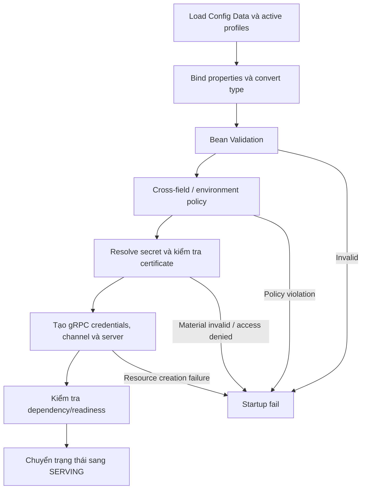

# Kiểm tra cấu hình khi context khởi động

## Mục tiêu bài học

Trong **SPRING_GRPC**, cấu hình sai có thể khiến ứng dụng kết nối nhầm downstream, mở listener không có TLS, nạp certificate không hợp lệ, dùng deadline vô hạn hoặc khởi động với executor không có giới hạn. Nếu lỗi chỉ xuất hiện khi request đầu tiên tới, instance có thể đã được load balancer đưa vào phục vụ và gây lỗi cho người dùng.

Bài học tập trung vào **kiểm tra cấu hình khi context khởi động**: hiểu thời điểm Spring Boot nạp và hợp nhất property sources, bind cấu hình có kiểu, dùng Jakarta Bean Validation cho ràng buộc cơ bản và liên trường, kiểm tra policy theo profile, xác minh secret/certificate material trước khi tạo gRPC resource, và giữ readiness ở NOT_SERVING cho tới khi các điều kiện bắt buộc đạt.

Sau bài này, bạn có thể:

1. Phân biệt lỗi cú pháp, lỗi binding, lỗi validation và lỗi runtime khi khởi tạo gRPC.
2. Tổ chức cấu hình Spring Boot và kiểm tra giá trị hiệu lực sau khi override.
3. Dùng @ConfigurationProperties, @Validated và Jakarta Bean Validation.
4. Viết cross-field validation cho target, deadline, TLS/mTLS và executor.
5. Áp dụng policy riêng cho production profile và fail-fast khi cấu hình không an toàn.
6. Xác minh secret reference, file mount, certificate chain, SAN, EKU và key pair.
7. Đảm bảo channel/server không được tạo từ cấu hình chưa hợp lệ.
8. Kiểm thử context startup, profile, secret missing, certificate lỗi và readiness.

> **Phạm vi:** Ví dụ dùng Spring Boot, Jakarta Bean Validation và gRPC Java. Namespace app.grpc.* là cấu hình do ứng dụng định nghĩa trong bài, không phải property mặc định của mọi Spring gRPC starter. Phần đăng ký credentials vào native gRPC server phải đi qua factory/customizer được phiên bản starter đang dùng công bố.

## 1. Vì sao cần kiểm tra ngay khi context khởi động?

Spring Boot có thể khởi tạo nhiều thành phần trước khi ứng dụng nhận traffic: configuration properties, client channel, server factory, executor, interceptor và service bean. Nếu cấu hình không được kiểm tra sớm, lỗi có thể chỉ lộ ra ở lần gọi RPC đầu tiên.

Ví dụ:

- Target sai định dạng khiến channel không kết nối được.
- Deadline bằng 0 hoặc âm làm call thất bại ngay lập tức.
- TLS bật nhưng trust bundle thiếu.
- mTLS yêu cầu client certificate nhưng không có key pair.
- Server private key không khớp certificate.
- Production vô tình dùng plaintext hoặc bật reflection công khai.
- Queue/executor không có giới hạn và làm process cạn tài nguyên.
- Secret store từ chối workload identity nhưng ứng dụng vẫn đánh dấu readiness là SERVING.

Một quy trình startup nên có các giai đoạn rõ ràng:



Mục tiêu là phát hiện lỗi trước khi instance nhận traffic. Không phải mọi kiểm tra đều có thể thực hiện chỉ bằng annotation; cần phân lớp kiểm tra theo dữ liệu và resource liên quan.

## 2. Các lớp kiểm tra cấu hình

| Lớp | Ví dụ | Cơ chế phù hợp |
| --- | --- | --- |
| Binding/type conversion | Port không phải số, Duration sai format | Spring Boot Binder |
| Required fields | Thiếu target hoặc deadline | @NotBlank, @NotNull |
| Range/format | Port ngoài 1–65535, pool size âm | @Min, @Max, @Positive |
| Cross-field | TLS bật nhưng không có trust bundle | @AssertTrue hoặc class-level constraint |
| Environment policy | Production không được dùng plaintext | Startup policy validator |
| External material | File CA không tồn tại, secret store access denied | Secret/material provider |
| Certificate semantics | SAN sai, certificate hết hạn, key mismatch | X.509/TLS material verifier |
| Runtime connectivity | Handshake, ALPN hoặc downstream không hoạt động | Integration probe/health check |

Binding validation và certificate validation giải quyết các vấn đề khác nhau. Một Path có thể không null nhưng file không tồn tại; một PEM có thể parse được nhưng SAN không khớp target; certificate có thể hợp lệ nhưng server chưa nạp nó vào listener thực tế.

## 3. Nguồn cấu hình và giá trị hiệu lực

Spring Boot hợp nhất cấu hình từ nhiều property sources. Các nguồn thường gặp:

- application.yml và application-{profile}.yml.
- Environment variables.
- Java system properties.
- Command-line arguments.
- External config hoặc mounted config tree.
- Test overrides và dynamic properties.

Giá trị cuối cùng là kết quả của precedence, không nhất thiết là giá trị trong file YAML. Ví dụ application-prod.yml đặt TLS nhưng environment variable có thể override security mode nếu binding được thiết kế như vậy.

Kích hoạt profile qua runtime:

```bash
SPRING_PROFILES_ACTIVE=production
```

Hoặc:

```bash
java -jar inventory-grpc.jar --spring.profiles.active=production
```

Cần kiểm tra active profile thực tế và các giá trị sau binding. Không in toàn bộ Environment hoặc toàn bộ properties object ra log vì có thể chứa secret/reference nội bộ. Chỉ tạo startup summary theo allowlist, ví dụ profile, target đã chuẩn hóa, TLS mode, deadline, port, pool limits và reflection policy.

## 4. Bind cấu hình bằng @ConfigurationProperties

Không rải Environment.getProperty trong service hoặc factory. Gom cấu hình liên quan vào một object có kiểu để Spring bind và validate tập trung.

Ví dụ cấu hình:

```yaml
app:
  grpc:
    inventory-client:
      target: dns:///inventory.internal:443
      deadline: 2s
      security-mode: TLS
      trust-bundle: /var/run/grpc-secrets/server-ca.pem
    server:
      port: 9090
      tls-enabled: true
      certificate-chain: /var/run/grpc-secrets/server-chain.pem
      private-key: /var/run/grpc-secrets/server-key.pem
      require-client-auth: true
      client-ca: /var/run/grpc-secrets/client-ca.pem
    executor:
      core-threads: 8
      max-threads: 32
      queue-capacity: 100
    operations:
      reflection-enabled: false
```

Các path trên là ví dụ mount runtime. Không commit private key hoặc certificate material vào repository. Cấu hình chỉ chứa đường dẫn/reference; provider chịu trách nhiệm cấp file hoặc secret.

Ví dụ properties record:

```java
@ConfigurationProperties(
        prefix = "app.grpc",
        ignoreUnknownFields = false)
@Validated
public record GrpcRuntimeProperties(
        @Valid @NotNull InventoryClient inventoryClient,
        @Valid @NotNull Server server,
        @Valid @NotNull Executor executor,
        @Valid @NotNull Operations operations) {

    public enum SecurityMode {
        TLS, PLAINTEXT
    }

    public record InventoryClient(
            @NotBlank String target,
            @NotNull Duration deadline,
            @NotNull SecurityMode securityMode,
            Path trustBundle) {

        @AssertTrue(message = "deadline phải lớn hơn 0")
        public boolean isDeadlinePositive() {
            return deadline != null
                    && !deadline.isNegative()
                    && !deadline.isZero();
        }

        @AssertTrue(message = "TLS client cần trust bundle")
        public boolean isTrustBundleConfigured() {
            return securityMode != SecurityMode.TLS
                    || trustBundle != null;
        }
    }

    public record Server(
            @Min(1) @Max(65535) int port,
            boolean tlsEnabled,
            Path certificateChain,
            Path privateKey,
            boolean requireClientAuth,
            Path clientCa) {

        @AssertTrue(message = "TLS server cần certificate và private key")
        public boolean isServerKeyPairConfigured() {
            return !tlsEnabled
                    || (certificateChain != null && privateKey != null);
        }

        @AssertTrue(message = "mTLS cần TLS và client CA")
        public boolean isClientCaConfigured() {
            return !requireClientAuth
                    || (tlsEnabled && clientCa != null);
        }
    }

    public record Executor(
            @Min(1) int coreThreads,
            @Min(1) int maxThreads,
            @Min(0) int queueCapacity) {

        @AssertTrue(message = "maxThreads phải >= coreThreads")
        public boolean isThreadRangeValid() {
            return maxThreads >= coreThreads;
        }
    }

    public record Operations(boolean reflectionEnabled) {}
}
```

Đăng ký properties:

```java
@SpringBootApplication
@ConfigurationPropertiesScan
public class InventoryGrpcApplication {
    public static void main(String[] args) {
        SpringApplication.run(
                InventoryGrpcApplication.class, args);
    }
}
```

Cần dependency validation tương ứng, thường là spring-boot-starter-validation. @Validated kích hoạt validation khi bind; @Valid ở record component cho phép validate tiếp các object lồng nhau. ignoreUnknownFields=false giúp phát hiện typo trong namespace app.grpc thay vì âm thầm bỏ qua field lạ.

Các method boolean có @AssertTrue kiểm tra quan hệ giữa nhiều field. Với policy phức tạp hơn, dùng custom class-level constraint và ConstraintValidator để lỗi có property path rõ ràng.

## 5. Kiểm tra deadline, target và executor

### 5.1. Deadline phải hữu hạn và dương

Deadline null, zero hoặc âm đều không hợp lệ. Nên đặt upper bound theo SLA của hệ thống, ví dụ một RPC nội bộ không được vượt quá một giới hạn đã thống nhất. Có thể thêm custom constraint cho Duration hoặc kiểm tra trong policy validator.

Không dùng deadline rất dài để che lỗi downstream. Deadline cần phù hợp latency budget tổng và thời gian còn lại của request cha.

### 5.2. Target phải được kiểm tra theo security mode

Target gRPC có thể là DNS target, URI resolver hoặc authority tùy channel builder. Kiểm tra format theo loại target mà ứng dụng cho phép; không chỉ dùng regex quá đơn giản rồi giả định mọi URI đều đúng.

Ví dụ policy:

- Production chỉ cho phép DNS target thuộc domain nội bộ đã duyệt.
- Local có thể cho phép localhost/loopback.
- Test có thể dùng in-process name hoặc test target riêng.
- PLAINTEXT chỉ được phép ở profile local/test theo policy.
- TLS phải có trust material hợp lệ và hostname verification được giữ.

Nếu target chứa username/password hoặc query token, từ chối cấu hình và không log nguyên target. Không fallback sang plaintext khi TLS credential creation thất bại.

### 5.3. Executor cần giới hạn

Kiểm tra:

- coreThreads >= 1.
- maxThreads >= coreThreads.
- queueCapacity >= 0 và nằm trong giới hạn vận hành.
- Queue không vượt latency budget của deadline.
- Pool size phù hợp connection pool và capacity của downstream.
- Rejection policy có semantics rõ.

Validation startup chỉ kiểm tra cấu hình tĩnh. Pool saturation và downstream latency cần được giám sát sau khi ứng dụng chạy.

## 6. Kiểm tra policy theo profile

Bean Validation không biết toàn bộ policy vận hành. Ví dụ, securityMode=PLAINTEXT có thể hợp lệ ở local nhưng không hợp lệ ở production. Có thể tạo startup policy guard:

```java
@Component
@Lazy(false)
public final class GrpcStartupPolicy {

    public GrpcStartupPolicy(
            GrpcRuntimeProperties properties,
            Environment environment) {

        boolean production = Arrays.asList(
                environment.getActiveProfiles())
                .contains("production");

        if (production
                && properties.inventoryClient().securityMode()
                        != GrpcRuntimeProperties.SecurityMode.TLS) {
            throw new IllegalStateException(
                    "Production yêu cầu TLS cho gRPC client");
        }

        if (production && !properties.server().tlsEnabled()) {
            throw new IllegalStateException(
                    "Production yêu cầu TLS cho gRPC server");
        }

        if (production && properties.operations().reflectionEnabled()) {
            throw new IllegalStateException(
                    "Reflection phải tắt theo policy production");
        }
    }
}
```

Ví dụ này thể hiện policy của ứng dụng, không phải quy tắc bắt buộc của mọi hệ thống. Nếu production cần reflection nội bộ, thay điều kiện bằng policy kiểm soát truy cập phù hợp. @Lazy(false) giúp guard được khởi tạo ngay cả khi ứng dụng bật lazy initialization toàn cục.

Đảm bảo các factory tạo channel, credentials và server phụ thuộc vào guard hoặc cùng một validated configuration path. Như vậy resource không được tạo trước khi policy check chạy. Với server do Spring gRPC starter quản lý, đưa guard vào builder customizer/factory integration đúng phiên bản thay vì tự tạo listener riêng.

Profile không phải security boundary. Environment variables hoặc command-line arguments vẫn có thể override giá trị; policy phải kiểm tra giá trị hiệu lực sau binding.

## 7. Kiểm tra secret và certificate material

Một Path khác null chưa chứng minh file đã mount và process có quyền đọc. Trước khi tạo credentials, kiểm tra:

1. File tồn tại và là regular file.
2. Process có quyền đọc.
3. PEM/keystore parse được.
4. Certificate còn hiệu lực theo đồng hồ runtime.
5. SAN khớp hostname target ở phía client.
6. EKU/key usage phù hợp serverAuth/clientAuth.
7. Chain nối tới trust anchor được phê duyệt.
8. Private key khớp certificate leaf.
9. mTLS có client CA trust bundle và client identity theo đúng phía.
10. Secret version đúng với rollout đang triển khai.

Ví dụ kiểm tra path:

```java
static void requireReadableFile(Path path, String propertyName) {
    if (path == null
            || !Files.isRegularFile(path)
            || !Files.isReadable(path)) {
        throw new IllegalStateException(
                "Material bắt buộc không sẵn sàng: " + propertyName);
    }
}
```

Thông báo chỉ nêu tên property logic, không in secret value hoặc PEM content. Nếu path chứa tên nội bộ nhạy cảm, cũng không đưa path đầy đủ vào log production.

Có thể dùng X509Certificate.checkValidity() để kiểm tra thời hạn sau khi parse certificate. Kiểm tra SAN/EKU và chain cần thực hiện theo role của certificate; certificate server và client có purpose khác nhau. Việc tạo TLS credentials chưa chắc chứng minh handshake thành công; một integration probe với target và trust material thực tế vẫn cần thiết.

### 7.1. Kiểm tra certificate ngoài ứng dụng

Có thể dùng OpenSSL trong môi trường vận hành được bảo vệ:

```bash
openssl x509 -in server-chain.pem -noout \
  -subject -issuer -dates -fingerprint -sha256 \
  -ext subjectAltName -ext extendedKeyUsage
```

Xác minh chain và hostname:

```bash
openssl verify -purpose sslserver \
  -CAfile root-ca.pem \
  -untrusted intermediate-ca.pem \
  -verify_hostname grpc.example.com \
  server-chain.pem
```

So sánh public key digest của certificate và private key mà không in private key:

```bash
openssl x509 -in server-chain.pem -pubkey -noout \
  | openssl pkey -pubin -outform DER \
  | openssl dgst -sha256

openssl pkey -in server-key.pem -pubout -outform DER \
  | openssl dgst -sha256
```

Hai digest phải giống nhau. Không copy private key vào log, ticket hoặc chat; không đưa secret vào command-line argument nếu shell history/process inspection có thể làm lộ.

## 8. Chỉ tạo gRPC resource sau khi validation đạt

Khi properties và material đã hợp lệ, factory mới tạo ChannelCredentials hoặc ServerCredentials.

Ví dụ client TLS credentials từ mounted trust bundle:

```java
ChannelCredentials channelCredentials(Path trustBundle)
        throws IOException {

    try (InputStream roots =
                 Files.newInputStream(trustBundle)) {
        return TlsChannelCredentials.newBuilder()
                .trustManager(roots)
                .build();
    }
}
```

Ví dụ server credentials:

```java
ServerCredentials serverCredentials(
        Path certificateChain,
        Path privateKey) throws IOException {

    try (InputStream chain =
                 Files.newInputStream(certificateChain);
         InputStream key =
                 Files.newInputStream(privateKey)) {
        return TlsServerCredentials.newBuilder()
                .keyManager(chain, key)
                .build();
    }
}
```

Nếu bật mTLS, thêm trustManager(clientCa) và clientAuth(REQUIRE) theo policy. Với client mTLS, thêm keyManager(clientChain, clientKey) vào TlsChannelCredentials.

Đây là các API credentials của gRPC Java. Spring gRPC starter thường quản lý ManagedChannel và native server lifecycle; credentials phải được nối vào channel/server factory hoặc builder extension point mà đúng phiên bản starter công bố. Không giả định cấu hình SSL của servlet container tự áp dụng cho native gRPC listener.

Không tạo channel/server từ cấu hình mặc định rồi thay credentials sau khi nhận request đầu tiên. Resource nên được tạo từ validated properties và secret version đã xác minh.

## 9. Fail-fast và readiness

Có hai kết quả khác nhau:

- **Startup fail:** cấu hình hoặc material bắt buộc không hợp lệ; process không thể phục vụ an toàn.
- **Started but NOT_SERVING:** process có thể khởi động nhưng dependency/readiness chưa đạt; instance chưa nhận traffic.

Các lỗi thường nên fail startup:

- Thiếu target/deadline bắt buộc.
- Production bật plaintext trái policy.
- TLS/mTLS thiếu key, certificate hoặc trust bundle.
- Secret store từ chối workload identity.
- Certificate hết hạn, sai SAN/EKU hoặc key mismatch.
- Executor có giới hạn không hợp lệ.
- Server/channel không thể tạo do credentials/configuration invalid.

Các dependency có thể phục hồi sau startup có thể giữ instance NOT_SERVING cho tới khi readiness đạt, tùy kiến trúc. Không biến mọi lỗi dependency tạm thời thành process crash loop; chọn policy theo mức độ bắt buộc và khả năng recovery.

Health service nên khởi tạo NOT_SERVING. Chỉ chuyển SERVING sau khi:

1. Configuration binding và validation hoàn tất.
2. Secret/certificate material hợp lệ.
3. gRPC listener/channel được tạo với security mode đúng.
4. Các dependency bắt buộc đã sẵn sàng.
5. Readiness coordinator xác nhận service có thể nhận traffic.

Không dùng liveness để báo mọi lỗi downstream; điều đó có thể làm orchestrator restart hàng loạt instance và khuếch đại incident.

## 10. Startup summary an toàn

Một startup summary giúp vận hành biết ứng dụng đã nhận cấu hình nào mà không lộ secret.

Có thể ghi:

- Active profiles.
- Service name và listener port.
- Downstream target đã chuẩn hóa.
- TLS mode và mTLS enabled/disabled.
- Deadline.
- Executor core/max/queue limits.
- Health/reflection policy.
- Secret version identifier đã được phép hiển thị.
- Certificate issuer/serial hoặc fingerprint nếu cần audit.

Không ghi:

- Private key, bearer token, password hoặc secret value.
- Nội dung PEM.
- Toàn bộ Environment hoặc properties object.
- Raw metadata của request.
- Secret path đầy đủ nếu path cũng được xem là nhạy cảm.

Tạo một DTO summary riêng có allowlist field; không gọi toString() trên object properties chứa credential/path nhạy cảm. Redaction cần được áp dụng cả cho exception message và startup failure logs.

## 11. Kiểm thử cấu hình khi context khởi động

Kiểm thử nên xác minh cả binding lẫn hành vi khi Spring tạo resource.

| Test case | Setup | Kết quả mong đợi |
| --- | --- | --- |
| Thiếu target | Bỏ inventory-client.target | Context fail với property path rõ |
| Deadline bằng 0 | deadline: 0s | Bean Validation fail |
| TLS thiếu trust bundle | security-mode TLS, trust-bundle null | Cross-field validation fail |
| Server TLS thiếu key | tls-enabled true, private-key thiếu | Context fail trước khi listener nhận traffic |
| mTLS thiếu client CA | require-client-auth true, client-ca thiếu | Validation fail |
| Pool max nhỏ hơn core | max-threads < core-threads | Validation fail |
| Production plaintext | Active production, mode PLAINTEXT | Startup policy guard fail |
| Production reflection | Reflection bật trái policy | Startup policy guard fail |
| Secret access denied | Fake provider trả access denied | Không tạo credential, không SERVING |
| File không đọc được | Mounted path sai permission | Startup fail với thông báo đã redaction |
| Certificate hết hạn/sai SAN | Dùng fixture test lỗi | Material verifier/handshake fail |
| Key mismatch | Certificate và private key khác cặp | Credential validation hoặc TLS integration fail |
| Property typo | Thêm key lạ dưới app.grpc | Binding fail nếu ignoreUnknownFields=false |
| Environment override | Override deadline/target | Summary và resource dùng giá trị hiệu lực |
| Valid configuration | Cấu hình đầy đủ | Context khởi động và readiness đạt theo policy |

### 11.1. ApplicationContextRunner

ApplicationContextRunner hữu ích để kiểm tra binding và validation mà không phải khởi động toàn bộ server:

```java
new ApplicationContextRunner()
        .withUserConfiguration(TestPropertiesConfiguration.class)
        .withPropertyValues(
                "app.grpc.inventory-client.target=dns:///localhost:9090",
                "app.grpc.inventory-client.deadline=2s",
                "app.grpc.inventory-client.security-mode=TLS",
                "app.grpc.inventory-client.trust-bundle=/tmp/test-ca.pem")
        .run(context -> {
            assertThat(context).hasNotFailed();
            assertThat(context)
                    .hasSingleBean(GrpcRuntimeProperties.class);
        });
```

Ví dụ chỉ minh họa pattern; cần cung cấp các property bắt buộc khác của record và file fixture trong test configuration. Negative test thay một giá trị để xác minh context startup fail và kiểm tra root cause/property path.

### 11.2. Integration test với gRPC transport

Sau khi unit/context tests đạt, chạy integration test qua transport thực:

- Khởi động Spring gRPC server với TLS fixture.
- Tạo client channel dùng đúng CA và hostname.
- Xác minh handshake và ALPN h2.
- Gọi generated stub và xác minh RPC thành công.
- Thử CA sai, hostname mismatch và certificate hết hạn.
- Kiểm tra server readiness vẫn NOT_SERVING khi material invalid.
- Đóng context và xác minh channel/server shutdown.

Một test chỉ xác nhận properties bean tồn tại không chứng minh listener đang dùng đúng TLS credentials.

## 12. Lỗi thường gặp và cách xử lý

| Triệu chứng | Nguyên nhân | Cách xử lý |
| --- | --- | --- |
| Ứng dụng khởi động dù property bắt buộc bị thiếu | Properties chưa được bind/validate hoặc nested object thiếu @Valid | Dùng @ConfigurationProperties, @Validated và @Valid |
| Property typo bị bỏ qua | Unknown fields được cho phép | Cân nhắc ignoreUnknownFields=false cho namespace riêng |
| Validation không chạy | Thiếu validation starter hoặc chưa bật @Validated | Thêm Jakarta validation dependency và annotation |
| TLS bật nhưng client không trust server | Chỉ kiểm tra path khác null, không kiểm tra file/CA | Kiểm tra readable file, chain và handshake |
| Production dùng plaintext | Policy chỉ nằm trong YAML, bị override | Validate active profile và giá trị hiệu lực |
| Channel được tạo trước khi policy guard chạy | Resource factory không phụ thuộc validated guard/config | Inject guard vào factory/customizer và đảm bảo eager validation |
| Certificate hợp lệ nhưng hostname sai | Chỉ kiểm tra chain, bỏ qua SAN | Verify hostname theo target thực tế |
| Secret store access denied nhưng app vẫn SERVING | Startup/readiness không phụ thuộc material resolution | Fail startup hoặc giữ NOT_SERVING |
| Lỗi chỉ xuất hiện ở request đầu | Credentials/resource được tạo lazy quá muộn | Tạo và kiểm tra resource trước readiness |
| Startup summary làm lộ secret | Log toàn bộ properties/Environment | Dùng allowlist DTO và redaction |
| Health SERVING trước khi TLS hoàn tất | Readiness cập nhật quá sớm | Chỉ SERVING sau khi credentials/listener/dependencies đạt |
| Context test pass nhưng transport fail | Test không mở gRPC listener thật | Bổ sung TLS/HTTP2 integration test |

## 13. Bài tập thực hành

1. Tạo GrpcRuntimeProperties với target, deadline, client TLS, server TLS/mTLS, executor và reflection settings.
2. Thêm @Validated, @Valid và constraint cho field bắt buộc, port, deadline và thread range.
3. Viết cross-field validation để TLS yêu cầu trust bundle/certificate/key và mTLS yêu cầu client CA.
4. Viết startup policy guard cấm plaintext và reflection theo production policy.
5. Tạo material verifier kiểm tra file mount, certificate validity, SAN, EKU, chain và key pair.
6. Dùng fake SecretMaterialProvider để kiểm thử success, missing secret và access denied.
7. Đảm bảo credential/channel/server factory phụ thuộc vào validated configuration.
8. Giữ health status NOT_SERVING cho tới khi material và listener/dependency bắt buộc sẵn sàng.
9. Viết ApplicationContextRunner tests cho invalid properties và valid configuration.
10. Viết integration test qua TLS/HTTP2 để xác minh handshake và generated stub.
11. Tạo startup summary chỉ chứa allowlisted fields; kiểm tra log không có token/PEM/password.
12. Diễn tập một lần production startup fail vì certificate hết hạn và ghi runbook khắc phục.

### Câu hỏi tự kiểm tra

- Binding, Bean Validation, cross-field policy và runtime material validation khác nhau thế nào?
- Vì sao @ConfigurationProperties phù hợp hơn Environment.getProperty rải rác?
- @Valid có vai trò gì với record lồng nhau?
- Khi nào dùng @AssertTrue và khi nào cần class-level ConstraintValidator?
- Vì sao Path khác null chưa chứng minh certificate đã sẵn sàng?
- Làm thế nào ngăn production dùng PLAINTEXT dù environment variable override YAML?
- Vì sao factory tạo channel/server phải phụ thuộc vào startup policy guard?
- Những lỗi nào nên fail startup và lỗi nào có thể giữ NOT_SERVING?
- Vì sao certificate chain hợp lệ chưa chứng minh hostname đúng?
- Vì sao không nên log toàn bộ properties hoặc Environment?
- ApplicationContextRunner kiểm tra được điều gì và không chứng minh được điều gì?
- Cần kiểm tra gì qua transport thật trước khi readiness chuyển SERVING?

## Tài liệu tham khảo

- [Spring Boot — Configuration Properties Validation](https://docs.spring.io/spring-boot/reference/features/external-config.html#features.external-config.typesafe-configuration-properties.validation): bind và validate cấu hình có kiểu.
- [Spring Boot — Externalized Configuration](https://docs.spring.io/spring-boot/reference/features/external-config.html): property source precedence và Config Data.
- [Spring Boot — Profiles](https://docs.spring.io/spring-boot/reference/features/profiles.html): profile-specific configuration và active profiles.
- [Jakarta Bean Validation](https://jakarta.ee/specifications/bean-validation/): constraint, validation groups và custom validators.
- [Spring Boot — Testing](https://docs.spring.io/spring-boot/reference/testing/index.html): ApplicationContextRunner và application tests.
- [gRPC Java — TlsChannelCredentials](https://grpc.github.io/grpc-java/javadoc/io/grpc/TlsChannelCredentials.html): client trust roots và key material.
- [gRPC Java — TlsServerCredentials](https://grpc.github.io/grpc-java/javadoc/io/grpc/TlsServerCredentials.html): server certificate, private key và mTLS.
- [Java — X509Certificate](https://docs.oracle.com/en/java/javase/17/docs/api/java.base/java/security/cert/X509Certificate.html): validity, SAN và certificate metadata.
- [RFC 5280 — Internet X.509 PKI Certificate and CRL Profile](https://www.rfc-editor.org/rfc/rfc5280): certificate path validation và trust anchor.

**Kết quả mong đợi:** Người học kiểm tra được cấu hình Spring gRPC ngay khi context khởi động, phát hiện lỗi binding/validation/policy/secret/certificate trước khi nhận traffic, tạo channel và listener từ material đã xác minh, giữ readiness ở NOT_SERVING khi điều kiện bắt buộc chưa đạt, và kiểm thử được cả cấu hình lẫn TLS transport thực tế.
