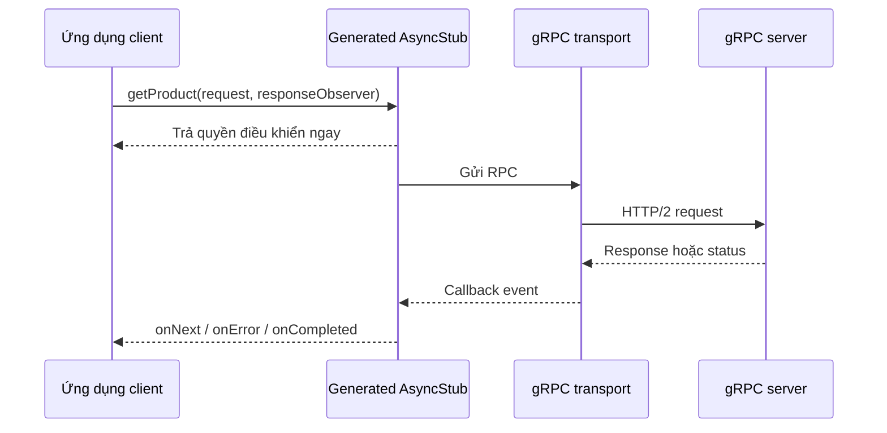

# AsyncStub và StreamObserver

## 1. Vì sao cần AsyncStub?

gRPC Java sinh các kiểu stub từ protobuf service. Mỗi kiểu phục vụ một cách gọi khác nhau:

- **Blocking stub** chờ kết quả RPC rồi trả response trực tiếp. Cách dùng đơn giản nhưng thread gọi bị giữ trong thời gian chờ.
- **Future stub** trả về future cho các RPC unary có kiểu kết quả tương thích.
- **Async stub** nhận callback qua `StreamObserver`. Phương thức gọi RPC trả quyền điều khiển ngay; kết quả đến sau qua callback.

Async stub phù hợp khi ứng dụng cần xử lý nhiều RPC đồng thời, tích hợp với event-driven flow hoặc dùng streaming. Nó không có nghĩa mọi đoạn code bên trong service tự động chạy bất đồng bộ; ứng dụng vẫn phải quản lý thread, tài nguyên và thứ tự xử lý.

Với generated stub tên `ProductQueryServiceGrpc`, Java thường sinh lớp async stub `ProductQueryServiceStub` và factory `newStub(channel)`. Tên cụ thể được tạo từ service trong file proto.



## 2. Hợp đồng của StreamObserver

`StreamObserver<T>` là callback interface cơ bản của gRPC Java:

```java
public interface StreamObserver<V> {
    void onNext(V value);
    void onError(Throwable t);
    void onCompleted();
}
```

Ba phương thức có ý nghĩa khác nhau:

- `onNext(value)` gửi hoặc nhận một message. Một stream có thể có zero, một hoặc nhiều message tùy kiểu RPC.
- `onError(error)` kết thúc stream với lỗi. Sau lời gọi này không được gửi thêm message hoặc gọi `onCompleted()`.
- `onCompleted()` kết thúc stream bình thường. Sau lời gọi này không được gửi thêm message hoặc lỗi.

`onError` và `onCompleted` là hai tín hiệu terminal loại trừ nhau. Mỗi hướng stream chỉ có một lần kết thúc. Với unary RPC, response thành công thường có đúng một `onNext` rồi `onCompleted`; lỗi thì chỉ có `onError`.

Không xem `onNext` là tín hiệu hoàn tất. Client chỉ nên công bố kết quả cuối cùng sau `onCompleted` nếu luồng xử lý phụ thuộc vào việc biết toàn bộ response đã tới.

## 3. Unary RPC bằng AsyncStub

Giả sử protobuf định nghĩa:

```protobuf
service ProductQueryService {
  rpc GetProduct(GetProductRequest) returns (GetProductResponse);
}
```

Async stub gọi method bằng request và response observer:

```java
ProductQueryServiceGrpc.ProductQueryServiceStub asyncStub =
        ProductQueryServiceGrpc.newStub(channel);

StreamObserver<GetProductResponse> responseObserver =
        new StreamObserver<>() {
            @Override
            public void onNext(GetProductResponse response) {
                renderProduct(response);
            }

            @Override
            public void onError(Throwable error) {
                Status status = Status.fromThrowable(error);
                reportFailure(status.getCode(), status.getDescription());
            }

            @Override
            public void onCompleted() {
                markRequestFinished();
            }
        };

asyncStub.withDeadlineAfter(500, TimeUnit.MILLISECONDS)
        .getProduct(request, responseObserver);

// Ứng dụng tiếp tục xử lý công việc khác trong khi RPC đang chạy.
continueWorkflow();
```

Phương thức `getProduct(...)` không trả response. Kết quả được chuyển tới observer sau đó. Với unary response, `onNext` được gọi tối đa một lần; thành công kết thúc bằng `onCompleted`. Nếu server trả status lỗi, client nhận `onError`.

Không gọi `await()` hoặc chờ latch trên thread event loop để biến async call thành blocking call. Nếu cần chờ trong test, chỉ chờ ở test thread và luôn đặt timeout.

## 4. Triển khai unary service ở phía server

Generated base class nhận `StreamObserver<Response>` để trả kết quả về client. Service phải phát đúng một response rồi hoàn tất, hoặc phát lỗi:

```java
@Override
public void getProduct(
        GetProductRequest request,
        StreamObserver<GetProductResponse> responseObserver) {

    if (request.getProductId().isBlank()) {
        responseObserver.onError(
                Status.INVALID_ARGUMENT
                        .withDescription("product_id không được để trống")
                        .asRuntimeException());
        return;
    }

    Product product = productRepository.findById(request.getProductId())
            .orElse(null);

    if (product == null) {
        responseObserver.onError(
                Status.NOT_FOUND
                        .withDescription("Không tìm thấy sản phẩm")
                        .asRuntimeException());
        return;
    }

    GetProductResponse response = GetProductResponse.newBuilder()
            .setProductId(product.id())
            .setName(product.name())
            .build();

    responseObserver.onNext(response);
    responseObserver.onCompleted();
}
```

Không gọi cả `onError` và `onCompleted` cho cùng một RPC. Sau khi đã gửi terminal signal, không phát thêm response. Lỗi nghiệp vụ nên được ánh xạ sang gRPC status phù hợp; không gửi stack trace hoặc thông tin nhạy cảm trong description.

Trong ví dụ, repository được giả định trả kết quả nhanh. Nếu xử lý cần I/O dài, nên dùng cơ chế async phù hợp hoặc đưa việc xử lý sang executor được quản lý; không giữ thread transport trong một thao tác blocking kéo dài.

## 5. Server-streaming RPC

Với server streaming, client gửi một request nhưng server có thể phát nhiều response:

```protobuf
rpc WatchProductStock(WatchStockRequest)
    returns (stream StockUpdate);
```

Generated async stub nhận một response observer giống unary:

```java
asyncStub.watchProductStock(
        request,
        new StreamObserver<StockUpdate>() {
            @Override
            public void onNext(StockUpdate update) {
                updateStockView(update);
            }

            @Override
            public void onError(Throwable error) {
                showStreamFailure(Status.fromThrowable(error));
            }

            @Override
            public void onCompleted() {
                closeStockFeed();
            }
        });
```

Server gọi `onNext` cho mỗi update rồi gọi `onCompleted` khi nguồn dữ liệu kết thúc. Nếu nguồn lỗi, gọi `onError` và dừng phát. Với subscription vô thời hạn, server có thể giữ stream mở cho tới khi client hủy hoặc server áp dụng chính sách kết thúc; phải có cơ chế dọn subscription khi RPC bị cancel.

Không tích lũy mọi update vào một list vô hạn ở client. Xử lý từng message, giới hạn buffer và dùng flow control khi tốc độ producer có thể vượt consumer.

## 6. Client-streaming và bidirectional streaming

Với client streaming, client gửi nhiều request qua một request observer và nhận một response cuối cùng:

```protobuf
rpc UploadEvents(stream EventChunk) returns (UploadSummary);
```

```java
StreamObserver<EventChunk> requestObserver =
        asyncStub.uploadEvents(new StreamObserver<UploadSummary>() {
            @Override
            public void onNext(UploadSummary summary) {
                showUploadSummary(summary);
            }

            @Override
            public void onError(Throwable error) {
                reportUploadFailure(Status.fromThrowable(error));
            }

            @Override
            public void onCompleted() {
                finishUpload();
            }
        });

requestObserver.onNext(firstChunk);
requestObserver.onNext(secondChunk);
requestObserver.onNext(finalChunk);
requestObserver.onCompleted(); // Half-close chiều gửi của client.
```

Sau `requestObserver.onCompleted()`, client không gửi thêm chunk. Server có thể xử lý phần dữ liệu đã nhận và trả summary; response stream kết thúc riêng bằng `onCompleted` phía client.

Bidirectional streaming có request stream và response stream độc lập:

```protobuf
rpc Exchange(stream ClientMessage) returns (stream ServerMessage);
```

```java
StreamObserver<ClientMessage> outbound = asyncStub.exchange(
        new StreamObserver<ServerMessage>() {
            @Override
            public void onNext(ServerMessage message) {
                handleServerMessage(message);
            }

            @Override
            public void onError(Throwable error) {
                closeConversationWithError(error);
            }

            @Override
            public void onCompleted() {
                closeServerResponseStream();
            }
        });

outbound.onNext(firstMessage);
outbound.onNext(secondMessage);
outbound.onCompleted(); // Chỉ đóng chiều gửi.
```

Half-close chiều gửi không tự động kết thúc chiều nhận. Server có thể tiếp tục gửi response cho tới khi hoàn tất hoặc lỗi. Hai hướng stream có thể tiến triển độc lập, nhưng thứ tự message trong mỗi hướng được giữ theo thứ tự gửi.

## 7. Server-side StreamObserver cho streaming

Trong client-streaming hoặc bidi streaming, generated service base method trả về một observer để nhận request message. Ví dụ:

```java
@Override
public StreamObserver<EventChunk> uploadEvents(
        StreamObserver<UploadSummary> responseObserver) {

    return new StreamObserver<>() {
        private long received;
        private boolean failed;

        @Override
        public void onNext(EventChunk chunk) {
            if (failed) {
                return;
            }
            try {
                eventProcessor.accept(chunk);
                received += chunk.getEventsCount();
            } catch (RuntimeException error) {
                failed = true;
                responseObserver.onError(
                        Status.INVALID_ARGUMENT
                                .withDescription("Chunk không hợp lệ")
                                .asRuntimeException());
            }
        }

        @Override
        public void onError(Throwable error) {
            // Client hủy hoặc kết thúc chiều gửi bằng lỗi.
            releaseUploadResources();
        }

        @Override
        public void onCompleted() {
            if (failed) {
                return;
            }

            responseObserver.onNext(
                    UploadSummary.newBuilder()
                            .setReceivedEvents(received)
                            .build());
            responseObserver.onCompleted();
            releaseUploadResources();
        }
    };
}
```

Ví dụ minh họa cần được mở rộng với transaction, giới hạn kích thước, validation và cleanup phù hợp với nghiệp vụ. Khi xử lý một chunk thất bại, server phát một terminal error và không tiếp tục ghi response. Cleanup phải an toàn khi stream bị cancel hoặc lỗi.

Với bidi streaming, server có thể phát response trong mỗi lần `onNext` request, hoặc xử lý bất đồng bộ rồi phát response sau. Không giả định phải đợi client half-close mới gửi response; điều đó phụ thuộc giao thức ứng dụng.

## 8. Threading và an toàn khi gọi observer

`StreamObserver` không tự đảm bảo thread-safe. Các lời gọi `onNext`, `onError` và `onCompleted` trên cùng observer cần được tuần tự hóa.

Các nguyên tắc quan trọng:

- Không gọi cùng một response observer đồng thời từ nhiều worker thread.
- Nếu nhiều nguồn dữ liệu cùng phát message, đưa chúng qua một hàng đợi và một writer executor duy nhất.
- Không thực hiện CPU work nặng hoặc blocking I/O trong callback client; chuyển việc đó sang executor phù hợp.
- Không giữ lock lâu trong khi xử lý message; lock chỉ bảo vệ thứ tự phát event nếu thật sự cần.
- Không dùng mutable field trong singleton service để giữ state của từng RPC. Đặt state trong object riêng cho stream.

Callbacks của gRPC được gọi trên executor do runtime quản lý; không dựa vào một thread name cố định hoặc giả định callback chạy trên thread đã gọi stub. Nếu ứng dụng cần cập nhật UI, MDC, tracing hoặc security context, phải chuyển context cần thiết qua cơ chế được hỗ trợ.

## 9. Flow control và backpressure

Trong streaming, producer có thể phát message nhanh hơn consumer xử lý. Nếu không giới hạn tốc độ hoặc buffer, bộ nhớ có thể tăng liên tục và làm giảm độ ổn định.

`StreamObserver` cơ bản không cung cấp đầy đủ API điều khiển flow ở phía client. Với tải lớn, gRPC Java có các observer chuyên biệt như `ClientResponseObserver` và `ClientCallStreamObserver` để kiểm soát inbound demand, trạng thái sẵn sàng gửi và callback on-ready. Phía server có `ServerCallStreamObserver` cho các cơ chế tương ứng.

Thiết kế cần:

1. Giới hạn số message hoặc byte được buffer.
2. Chỉ đọc/đẩy thêm dữ liệu khi phía nhận có khả năng xử lý.
3. Dùng on-ready notification để tiếp tục gửi khi transport sẵn sàng, thay vì vòng lặp bận.
4. Định nghĩa hành vi khi queue đầy: pause producer, drop theo policy hoặc kết thúc stream với status phù hợp.
5. Theo dõi message size, queue depth, thời gian xử lý và cancellation.

Flow control của HTTP/2 điều tiết truyền dữ liệu ở transport; nó không thay thế giới hạn hàng đợi và backpressure trong logic ứng dụng.

## 10. Deadline, cancellation và cleanup

Async không có nghĩa RPC được phép chạy vô hạn. Đặt deadline theo SLA:

```java
ProductQueryServiceGrpc.ProductQueryServiceStub boundedStub =
        asyncStub.withDeadlineAfter(700, TimeUnit.MILLISECONDS);

boundedStub.getProduct(request, responseObserver);
```

Khi deadline hết hạn hoặc caller hủy call, callback thường nhận lỗi có status tương ứng, ví dụ `DEADLINE_EXCEEDED` hoặc `CANCELLED`. Server nên dừng công việc không còn cần thiết và giải phóng subscription, timer, queue hoặc tài nguyên liên quan.

Phía server có thể dùng `ServerCallStreamObserver` để nhận biết cancellation và readiness. Đăng ký cancellation handler để hủy tác vụ hoặc subscription nền; không tiếp tục phát message sau khi client đã rời stream.

Không chỉ dừng ở việc nhận callback `onError` ở client. Cần đảm bảo cancellation lan tới tác vụ nền và cleanup chạy đúng một lần. Nếu có nhiều đường kết thúc (complete, error, cancel), dùng state rõ ràng hoặc cơ chế idempotent để tránh giải phóng tài nguyên lặp.

## 11. Tích hợp AsyncStub trong Spring gRPC

Spring nên quản lý channel theo lifecycle ứng dụng. Tạo async stub từ channel có tên thông qua channel factory:

```java
import org.springframework.context.annotation.Bean;
import org.springframework.context.annotation.Configuration;
import org.springframework.grpc.client.GrpcChannelFactory;

@Configuration
public class ProductGrpcClientConfiguration {

    @Bean
    ProductQueryServiceGrpc.ProductQueryServiceStub productAsyncStub(
            GrpcChannelFactory channelFactory) {

        return ProductQueryServiceGrpc.newStub(
                channelFactory.createChannel("catalog"));
    }
}
```

Channel `catalog` cần được cấu hình target, resolver và TLS theo phiên bản Spring gRPC starter đang dùng. Không tạo channel mới trong mỗi request. Nếu cần Bearer token thay đổi theo RPC, gắn `CallCredentials` vào stub dẫn xuất hoặc call; không lưu token người dùng vào singleton field.

Khi ứng dụng shutdown, để Spring quản lý việc đóng channel theo lifecycle. Nếu tự tạo channel ngoài factory, phải sở hữu và đóng channel đó rõ ràng; không đóng channel dùng chung do Spring quản lý từ một service bất kỳ.

## 12. Kiểm thử AsyncStub và StreamObserver

Callback bất đồng bộ cần test theo event, không dùng sleep để đoán khi nào callback chạy. Dùng `CountDownLatch` với timeout, `AtomicReference` để lưu response/status và luôn kiểm tra terminal event.

Các tình huống cần có:

| Kịch bản | Điều cần xác minh |
| --- | --- |
| Unary thành công | Một `onNext`, sau đó `onCompleted`. |
| Unary NOT_FOUND | `onError` có status `NOT_FOUND`; không có `onCompleted`. |
| Server streaming | Nhận nhiều message đúng thứ tự rồi terminal event. |
| Client streaming | Gửi nhiều request, half-close, nhận summary cuối. |
| Bidi streaming | Hai chiều hoạt động độc lập; half-close request không kết thúc response ngay. |
| Deadline | Client nhận `DEADLINE_EXCEEDED` và server dừng công việc phù hợp. |
| Cancellation | Subscription/tác vụ nền được cleanup. |
| Producer đồng thời | Observer vẫn nhận message tuần tự, không có concurrent write. |
| Consumer chậm | Buffer bị giới hạn và flow control/backpressure hoạt động. |

Ví dụ khung test unary với in-process transport:

```java
CountDownLatch terminal = new CountDownLatch(1);
AtomicReference<GetProductResponse> result = new AtomicReference<>();
AtomicReference<Status> failure = new AtomicReference<>();

asyncStub.getProduct(request, new StreamObserver<>() {
    @Override
    public void onNext(GetProductResponse response) {
        result.set(response);
    }

    @Override
    public void onError(Throwable error) {
        failure.set(Status.fromThrowable(error));
        terminal.countDown();
    }

    @Override
    public void onCompleted() {
        terminal.countDown();
    }
});

assertTrue(terminal.await(2, TimeUnit.SECONDS));
assertNull(failure.get());
assertNotNull(result.get());
```

In-process transport hữu ích để test observer lifecycle và status mapping. Nó không kiểm tra DNS, TCP, TLS hoặc HTTP/2 proxy; bổ sung integration test trên Netty khi cần xác minh network transport. Không dùng latch vô hạn và không để test thread chờ mà thiếu timeout.

## 13. Lỗi thường gặp

1. **Chờ kết quả trực tiếp từ AsyncStub.** Async method không trả response. Xử lý qua observer hoặc chọn blocking/future stub nếu phù hợp.
2. **Quên gọi onCompleted sau onNext.** Client không nhận được tín hiệu stream hoàn tất. Kết thúc thành công đúng một lần.
3. **Gọi onNext sau onError/onCompleted.** Vi phạm lifecycle và có thể làm hỏng stream. Dùng state terminal rõ ràng.
4. **Coi client half-close là kết thúc cả bidi stream.** Hai hướng độc lập. Chờ response observer nhận terminal event.
5. **Gọi observer đồng thời từ nhiều thread.** StreamObserver không thread-safe. Tuần tự hóa writer.
6. **Blocking I/O trong callback.** Làm nghẽn executor xử lý callback. Offload công việc nặng.
7. **Buffer vô hạn khi consumer chậm.** Dễ cạn bộ nhớ. Dùng flow control và giới hạn queue.
8. **Không đặt deadline hoặc xử lý cancellation.** RPC/subscription có thể tồn tại quá lâu. Đặt deadline và cleanup khi cancel.
9. **Đóng channel do Spring quản lý từ service.** Làm hỏng các stub khác đang dùng channel. Để factory/lifecycle quản lý.
10. **Dùng sleep trong async test.** Test chập chờn theo timing. Đồng bộ bằng latch/future có timeout.

## 14. Bài thực hành

Triển khai client async cho `ProductQueryService` và một RPC streaming:

1. Tạo channel `catalog` bằng `GrpcChannelFactory` và sinh `ProductQueryServiceStub` bằng `newStub(channel)`.
2. Gọi unary `GetProduct` với deadline; xử lý response, status lỗi và completion bằng `StreamObserver`.
3. Triển khai server-streaming `WatchProductStock`; hiển thị từng update mà không tích lũy vô hạn.
4. Thêm client-streaming `UploadEvents` để gửi nhiều chunk và nhận summary sau khi half-close.
5. Thêm bidi `Exchange`; chứng minh request half-close không tự kết thúc response stream.
6. Tuần tự hóa các lần gọi observer khi có nhiều producer; xử lý consumer chậm bằng flow control/backpressure.
7. Viết test cho success, NOT_FOUND, deadline, cancellation, message order và terminal event; dùng timeout thay cho sleep.

**Tự kiểm tra:** AsyncStub khởi tạo RPC và chuyển kết quả qua StreamObserver. Mỗi hướng stream phát zero hoặc nhiều onNext rồi kết thúc đúng một lần bằng onCompleted hoặc onError. Client-streaming và bidi có request observer riêng; half-close chỉ đóng chiều gửi. Muốn triển khai ổn định cần tuần tự hóa observer, giới hạn buffer, đặt deadline, xử lý cancellation và quản lý channel theo lifecycle của Spring.

