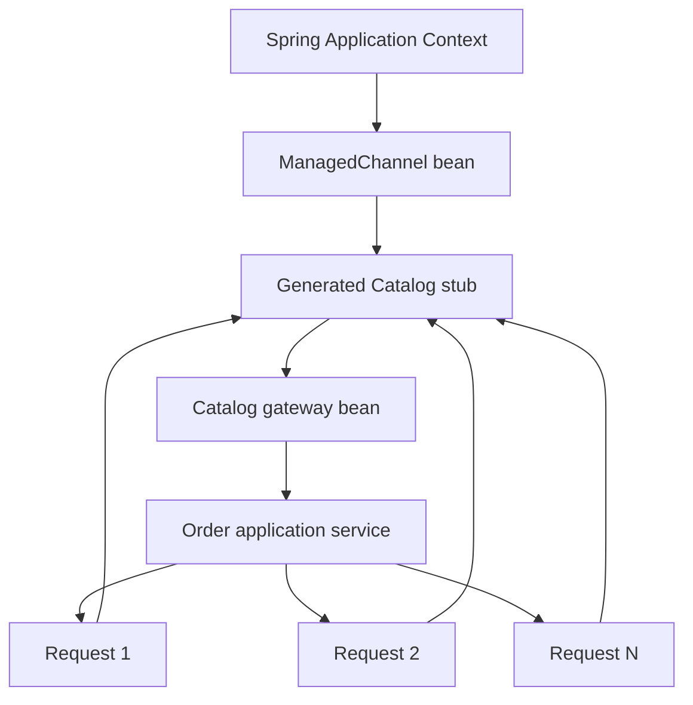

# Tái sử dụng stub trong application service

## 1. Mục tiêu

Trong ứng dụng Spring gRPC, nhiều request nghiệp vụ có thể cùng gọi một RPC service từ cùng một server đích. Nếu mỗi request lại tạo `ManagedChannel` và generated stub mới, ứng dụng sẽ lặp lại cấu hình transport, tăng số kết nối và làm channel lifecycle khó kiểm soát.

**Tái sử dụng stub trong application service** là tạo client stub từ channel đã được quản lý, đưa stub vào Spring bean qua dependency injection và dùng lại nó cho nhiều lần gọi RPC. Generated stub của gRPC Java là immutable; nhiều thread có thể dùng chung stub. Khi một call cần deadline hoặc call options riêng, tạo stub dẫn xuất cho call đó thay vì sửa trạng thái của stub dùng chung.

Sau bài học, bạn có thể:

- Đưa generated stub vào application service bằng constructor injection.
- Tái sử dụng channel và stub giữa nhiều request đồng thời.
- Phân biệt cấu hình dùng chung với call options riêng của từng RPC.
- Quản lý deadline, metadata và credentials mà không rò state giữa các call.
- Chọn blocking hoặc asynchronous stub theo execution model của ứng dụng.
- Giữ channel lifecycle ở component sở hữu và shutdown đúng lúc.
- Kiểm thử application service mà không phụ thuộc trực tiếp vào transport.

## 2. Vì sao nên tái sử dụng stub?

Giả sử `OrderApplicationService` cần gọi Catalog để lấy thông tin sản phẩm. Nếu mỗi lần `getOrderDetails()` lại tạo channel và stub:

```java
public Product getProduct(String id) {
    ManagedChannel channel = ManagedChannelBuilder
            .forAddress("catalog.internal", 9090)
            .useTransportSecurity()
            .build();

    try {
        var stub = CatalogServiceGrpc.newBlockingStub(channel);
        return stub.getProduct(
                GetProductRequest.newBuilder()
                        .setProductId(id)
                        .build());
    } finally {
        channel.shutdown();
    }
}
```

Cách này tạo và đóng transport cho từng lời gọi. Nó làm tăng chi phí kết nối, TLS handshake, name resolution và shutdown; các request đồng thời còn có thể tạo nhiều channel không cần thiết.

Thiết kế phù hợp hơn:

1. Một component tạo và sở hữu `ManagedChannel` cho target Catalog.
2. Một client configuration tạo generated stub từ channel.
3. Spring inject stub vào gateway/application service.
4. Mỗi request gọi lại stub đã inject.
5. Mỗi call tạo request riêng và có thể tạo stub dẫn xuất với deadline riêng.



Nhiều RPC có thể dùng chung một channel và multiplex trên kết nối HTTP/2. Tạo stub không có nghĩa tạo socket mới.

## 3. Stub và channel có thể dùng chung an toàn

Generated stub của gRPC Java kế thừa `AbstractStub`. Stub là immutable: các cấu hình call options không thay đổi object gốc mà trả về một stub mới cùng loại.

Ví dụ:

```java
CatalogServiceGrpc.CatalogServiceBlockingStub baseStub =
        CatalogServiceGrpc.newBlockingStub(channel);

var shortCallStub =
        baseStub.withDeadlineAfter(300, TimeUnit.MILLISECONDS);

var normalCallStub =
        baseStub.withDeadlineAfter(2, TimeUnit.SECONDS);
```

`baseStub` không bị thay đổi. `shortCallStub` và `normalCallStub` cùng dùng channel ban đầu nhưng mang call options khác nhau.

Channel và generated stub được thiết kế để dùng chung giữa nhiều thread. Vì vậy, một Spring singleton gateway có thể giữ stub trong field `final` và phục vụ nhiều request đồng thời.

Những đối tượng không nên dùng chung mutable giữa các call:

- Protobuf request builder đang được sửa.
- `Metadata` chứa dữ liệu riêng của request.
- `StreamObserver` của một streaming call.
- Danh sách kết quả hoặc buffer gắn với một caller.
- Correlation ID, tenant ID hoặc token được lưu trong field singleton.

Tạo request, metadata và observer riêng cho mỗi call. Không lưu dữ liệu request-specific trong field mutable của application service hoặc interceptor singleton.

## 4. Tạo channel và stub trong Spring configuration

Channel cần được quản lý theo vòng đời application context. Ví dụ cấu hình một channel cho Catalog:

```java
@Configuration
public class CatalogGrpcClientConfiguration {

    @Bean(name = "catalogChannel", destroyMethod = "shutdown")
    ManagedChannel catalogChannel() {
        return ManagedChannelBuilder
                .forAddress("catalog.internal", 9090)
                .useTransportSecurity()
                .build();
    }

    @Bean
    CatalogServiceGrpc.CatalogServiceBlockingStub catalogBlockingStub(
            @Qualifier("catalogChannel") ManagedChannel channel) {
        return CatalogServiceGrpc.newBlockingStub(channel);
    }
}
```

Bean stub được tạo một lần từ channel và có thể được inject vào nhiều bean. Tên host, port, trust configuration và transport phải lấy từ cấu hình môi trường phù hợp. Với hệ thống dùng Spring gRPC starter có channel factory hoặc client auto-configuration, hãy dùng lifecycle/configuration API của starter thay vì tạo channel cạnh tranh cho cùng target.

`destroyMethod = "shutdown"` yêu cầu Spring gọi `shutdown()` khi bean bị hủy. Nếu cần graceful shutdown với thời gian chờ, có thể dùng một lifecycle bean chuyên trách hoặc cơ chế shutdown được starter hỗ trợ để gọi `awaitTermination()` trước khi buộc `shutdownNow()`.

Không để gateway tự đóng channel nếu gateway chỉ nhận channel qua constructor. Component tạo hoặc được giao quyền sở hữu channel mới chịu trách nhiệm đóng nó.

## 5. Inject stub vào application service

Application service tập trung vào use case nghiệp vụ. Nó không cần biết cách tạo TLS channel hoặc generated stub:

```java
@Service
public class OrderApplicationService {

    private final CatalogServiceGrpc.CatalogServiceBlockingStub catalogStub;
    private final OrderRepository orderRepository;

    public OrderApplicationService(
            CatalogServiceGrpc.CatalogServiceBlockingStub catalogStub,
            OrderRepository orderRepository) {
        this.catalogStub = catalogStub;
        this.orderRepository = orderRepository;
    }

    public OrderDetails getOrderDetails(String orderId) {
        Order order = orderRepository.findById(orderId)
                .orElseThrow(() ->
                        new OrderNotFoundException(orderId));

        GetProductRequest request = GetProductRequest.newBuilder()
                .setProductId(order.productId())
                .build();

        Product product = catalogStub
                .withDeadlineAfter(700, TimeUnit.MILLISECONDS)
                .getProduct(request);

        return OrderDetails.from(order, product);
    }
}
```

Mỗi lần gọi `getOrderDetails()` tạo request mới và dùng một stub dẫn xuất với deadline 700 ms. Stub được inject vẫn là base stub dùng chung.

Trong hệ thống lớn, có thể đặt generated stub sau một gateway như `CatalogGrpcClient`. Cách này giúp application service phụ thuộc vào interface hoặc API nội bộ, trong khi gateway chịu trách nhiệm chuyển đổi domain request/response, gRPC status và call options. Lợi ích rõ nhất là khi nhiều use case cùng gọi một service hoặc khi cần thay generated contract mà không lan thay đổi ra application layer.

## 6. Dùng gateway để cô lập generated API

Ví dụ một gateway nhỏ:

```java
public interface CatalogClient {
    ProductDetails getProduct(String productId);
}
```

Implementation:

```java
@Component
public class GrpcCatalogClient implements CatalogClient {

    private final CatalogServiceGrpc.CatalogServiceBlockingStub baseStub;

    public GrpcCatalogClient(
            CatalogServiceGrpc.CatalogServiceBlockingStub baseStub) {
        this.baseStub = baseStub;
    }

    @Override
    public ProductDetails getProduct(String productId) {
        var request = GetProductRequest.newBuilder()
                .setProductId(productId)
                .build();

        try {
            Product response = baseStub
                    .withDeadlineAfter(700, TimeUnit.MILLISECONDS)
                    .getProduct(request);

            return new ProductDetails(
                    response.getProductId(),
                    response.getName());
        } catch (StatusRuntimeException ex) {
            throw CatalogCallException.from(ex);
        }
    }
}
```

Application service inject `CatalogClient`, không phụ thuộc `CatalogServiceGrpc` hoặc Protobuf generated class. Gateway chuyển lỗi transport thành exception phù hợp với application layer.

Đây là ranh giới hữu ích khi domain không nên phụ thuộc transport. Tuy nhiên, nếu module nhỏ và chỉ có một caller, inject stub trực tiếp cũng có thể hợp lý; không cần tạo nhiều lớp chỉ để bọc một dòng code.

## 7. Deadline riêng cho mỗi call

Base stub nên giữ cấu hình chung. Deadline thường phụ thuộc vào latency budget của use case, vì vậy đặt trên stub dẫn xuất:

```java
Product fastProduct = catalogStub
        .withDeadlineAfter(250, TimeUnit.MILLISECONDS)
        .getProduct(request);

Product normalProduct = catalogStub
        .withDeadlineAfter(900, TimeUnit.MILLISECONDS)
        .getProduct(request);
```

Không đặt deadline một lần lên shared stub rồi gán lại cho request tiếp theo. Stub immutable khiến việc tạo bản dẫn xuất an toàn và tránh call này ảnh hưởng call khác.

Deadline của downstream phải nằm trong budget còn lại của request hiện tại. Nếu request inbound chỉ còn 200 ms, không nên tạo call Catalog với deadline 2 giây. Có thể lấy deadline còn lại từ context của request hoặc truyền budget từ application layer, rồi giới hạn theo policy của dependency.

Khi deadline hết, gRPC thường trả `DEADLINE_EXCEEDED`. Application layer cần quyết định có thể retry, dùng cache hay trả lỗi cho caller. Không retry tự động nếu operation có side effect hoặc không có idempotency guarantee.

## 8. Metadata và credentials theo từng call

Metadata thường chứa correlation ID, tenant context hoặc thông tin điều khiển. Dữ liệu này thay đổi theo request nên phải gắn ở phạm vi call, không lưu trên field của shared stub.

Một client interceptor có thể đọc context hiện tại và thêm metadata cho mỗi call. Ví dụ đơn giản minh họa việc tạo metadata riêng:

```java
Metadata headers = new Metadata();
headers.put(
        Metadata.Key.of(
                "x-request-id",
                Metadata.ASCII_STRING_MARSHALLER),
        requestId);

var callStub = catalogStub.withInterceptors(
        MetadataUtils.newAttachHeadersInterceptor(headers));
```

Đoạn này phù hợp khi `headers` được tạo riêng cho một call và không bị sửa sau khi interceptor sử dụng. Với application nhiều request đồng thời, không giữ `headers` trong field singleton rồi ghi đè request ID cho từng caller.

Với bearer token hoặc credential cần refresh, ưu tiên `CallCredentials` hoặc cơ chế credential provider được thiết kế cho gRPC. Không hard-code token trong stub bean. Credential cần được lấy đúng identity của caller hoặc service account theo policy bảo mật.

Nếu metadata được thêm bởi interceptor singleton, interceptor phải xử lý state theo call; không dùng biến instance để giữ request ID, user ID hoặc token.

## 9. Interceptor dùng chung và interceptor theo client

Các concern xuyên suốt như tracing, metrics và logging thường được gắn vào channel wrapper trước khi tạo stub:

```java
Channel observedChannel = ClientInterceptors.intercept(
        channel,
        tracingInterceptor,
        metricsInterceptor);

CatalogServiceGrpc.CatalogServiceBlockingStub stub =
        CatalogServiceGrpc.newBlockingStub(observedChannel);
```

Nếu nhiều gateway dùng chung channel wrapper, các call đi qua wrapper đều được quan sát. Interceptor không thay thế stub; nó bọc call lifecycle của channel.

Phân biệt:

| Concern | Vị trí phù hợp |
|---|---|
| TLS, target, load balancing | Channel configuration |
| Tracing/metrics chung cho mọi RPC | Channel interceptor |
| Deadline theo use case | Stub dẫn xuất/call options |
| Metadata thay đổi theo request | Call interceptor hoặc call credentials |
| Request/response mapping | Gateway/application adapter |
| Nghiệp vụ | Application/domain service |

Tránh đăng ký cùng interceptor ở nhiều lớp nếu khiến một RPC bị ghi metric hoặc span hai lần. Xác định thứ tự interceptor và test behavior khi channel được bọc nhiều lớp.

## 10. Blocking hay asynchronous stub trong application service?

Tái sử dụng stub không đồng nghĩa mọi application service phải dùng blocking stub. Chọn loại stub theo execution model:

| Loại stub | Phù hợp | Lưu ý |
|---|---|---|
| Blocking | Luồng xử lý đồng bộ, có thread chờ riêng | Không block event-loop hoặc thread pool quá nhỏ |
| Async | Streaming hoặc callback/event-driven | Cần xử lý observer lifecycle và error |
| Future | Unary RPC cần `ListenableFuture` | Future stub không hỗ trợ streaming |

Với Spring MVC chạy trên servlet thread pool, blocking stub có thể phù hợp nếu deadline và concurrency được giới hạn. Với WebFlux hoặc event loop, không block thread xử lý event; dùng async API hoặc chuyển blocking call sang scheduler/executor dành riêng.

Ví dụ async stub cũng có thể được inject và tái sử dụng:

```java
@Component
public class CatalogAsyncClient {

    private final CatalogServiceGrpc.CatalogServiceStub baseStub;

    public CatalogAsyncClient(
            CatalogServiceGrpc.CatalogServiceStub baseStub) {
        this.baseStub = baseStub;
    }

    public void getProduct(
            String productId,
            StreamObserver<Product> observer) {
        var request = GetProductRequest.newBuilder()
                .setProductId(productId)
                .build();

        baseStub.withDeadlineAfter(700, TimeUnit.MILLISECONDS)
                .getProduct(request, observer);
    }
}
```

Observer phải thuộc call hiện tại. Không dùng chung một observer cho nhiều RPC độc lập, trừ khi nó được thiết kế rõ ràng để phối hợp các kết quả đó.

## 11. Xử lý lỗi ở ranh giới application

Stub có thể ném `StatusRuntimeException` với status gRPC. Không nên để mọi application service tự phân tích status và tự quyết định mapping khác nhau.

Gateway có thể chuẩn hóa:

```java
static CatalogCallException from(StatusRuntimeException error) {
    return switch (error.getStatus().getCode()) {
        case NOT_FOUND ->
                new CatalogProductNotFoundException(error);
        case INVALID_ARGUMENT ->
                new CatalogRequestRejectedException(error);
        case UNAVAILABLE, DEADLINE_EXCEEDED ->
                new CatalogTemporarilyUnavailableException(error);
        case UNAUTHENTICATED, PERMISSION_DENIED ->
                new CatalogAccessDeniedException(error);
        default ->
                new CatalogCallException(error);
    };
}
```

Mapping phải phù hợp semantics của Catalog và application. Không coi mọi `UNAVAILABLE` là có thể retry; retry còn phụ thuộc operation, idempotency, deadline còn lại và retry policy. Không đưa description nội bộ hoặc metadata nhạy cảm của server trực tiếp cho end user.

## 12. Kiểm thử application service khi stub được tái sử dụng

Nếu application service inject generated stub trực tiếp, unit test có thể inject stub được tạo từ fake/test channel hoặc mock theo API phù hợp. Nếu dùng gateway interface, có thể mock interface mà không phụ thuộc gRPC runtime.

Ví dụ với gateway interface:

```java
@ExtendWith(MockitoExtension.class)
class OrderApplicationServiceTest {

    @Mock
    CatalogClient catalogClient;

    @Mock
    OrderRepository orderRepository;

    @Test
    void loadsProductThroughReusableCatalogClient() {
        when(orderRepository.findById("order-7"))
                .thenReturn(Optional.of(order("order-7", "product-42")));
        when(catalogClient.getProduct("product-42"))
                .thenReturn(new ProductDetails("product-42", "Keyboard"));

        var service = new OrderApplicationService(
                catalogClient, orderRepository);

        OrderDetails result = service.getOrderDetails("order-7");

        assertEquals("Keyboard", result.productName());
        verify(catalogClient).getProduct("product-42");
    }
}
```

Đây là unit test cho application orchestration; nó không kiểm tra gRPC transport. Cần integration test riêng để xác minh:

- Stub được tạo từ channel đúng target.
- Server method được đăng ký và gọi được.
- Interceptor được áp dụng đúng một lần.
- Deadline và credentials được gửi như cấu hình.
- Channel vẫn dùng được qua nhiều request liên tiếp.
- Application shutdown đóng channel do Spring sở hữu.

Một test hữu ích là thực hiện nhiều RPC liên tiếp và đồng thời qua cùng gateway, rồi xác minh request ID, tenant metadata và deadline không rò giữa các call.

## 13. Lỗi thường gặp

| Hiện tượng | Nguyên nhân | Cách xử lý |
|---|---|---|
| Mỗi request tạo thêm kết nối | Tạo channel/stub trong method nghiệp vụ | Quản lý channel và stub bằng Spring bean |
| Request đồng thời dùng nhầm metadata | Lưu metadata trong field mutable | Tạo metadata theo từng call |
| Deadline của call này ảnh hưởng call khác | Cố thay đổi shared configuration | Dùng immutable stub dẫn xuất |
| Channel bị đóng quá sớm | Gateway tự shutdown channel được inject | Chỉ channel owner quản lý lifecycle |
| Channel không được đóng khi app dừng | Không có owner hoặc destroy lifecycle | Đăng ký bean lifecycle/graceful shutdown |
| WebFlux bị nghẽn | Gọi blocking stub trên event loop | Dùng async hoặc executor riêng |
| Retry tạo side effect trùng | Retry không xét idempotency | Xác định retry policy theo operation |
| Metrics/tracing bị ghi hai lần | Interceptor đăng ký ở nhiều lớp | Chuẩn hóa nơi bọc channel |
| Application service phụ thuộc generated model quá sâu | Gọi gRPC trực tiếp khắp nơi | Dùng gateway để cô lập contract nếu có lợi |
| Unit test pass nhưng transport lỗi | Chỉ mock gateway/stub | Bổ sung integration test qua server thật |

## 14. Bài tập thực hành

**Tình huống:** `OrderApplicationService` gọi Catalog để lấy product và Pricing để tính giá. Nhiều request đồng thời sử dụng hai dependency; mỗi dependency có deadline, TLS identity và tracing policy riêng.

Hãy thực hiện:

1. Tạo channel bean cho Catalog và Pricing; mỗi channel có target và TLS configuration đúng.
2. Tạo generated stub bean từ từng channel và inject qua constructor.
3. Đưa lời gọi RPC vào gateway riêng nếu application service cần tách transport/domain model.
4. Tái sử dụng base stub giữa nhiều request; không tạo channel trong method nghiệp vụ.
5. Tạo stub dẫn xuất với deadline riêng cho Catalog và Pricing.
6. Gắn tracing/metrics interceptor ở channel wrapper; tạo metadata theo từng call.
7. Viết test nhiều request đồng thời để xác minh request ID, deadline và response không lẫn nhau.
8. Kiểm thử status mapping, timeout và retry có điều kiện.
9. Đóng Spring context và xác minh channel được shutdown bởi owner, sau khi các call đang chạy có cơ hội hoàn tất.

**Tiêu chí hoàn thành:** application service tái sử dụng stub an toàn; mỗi call có state và deadline riêng; channel lifecycle có owner rõ; transport concern được cô lập; test phân biệt unit orchestration với gRPC integration.

## 15. Ghi nhớ

Tạo generated stub từ channel một lần trong cấu hình client, rồi inject và tái sử dụng stub trong application service hoặc gateway. Stub gRPC Java là immutable và thread-safe; nhiều request có thể dùng chung base stub. Deadline, metadata và credentials riêng phải được gắn theo call bằng stub dẫn xuất, interceptor hoặc call credentials, không lưu state request-specific trong singleton. Channel do component sở hữu quản lý lifecycle và shutdown khi application dừng. Blocking/async/future stub được chọn theo cardinality và execution model. Tái sử dụng stub giúp giảm chi phí kết nối, làm rõ trách nhiệm Spring bean và giúp kiểm thử application logic độc lập với transport.
