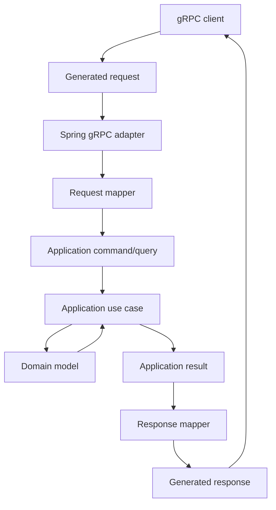

# Mapping generated type sang application type

## 1. Mục tiêu

Trong Spring gRPC, Protobuf compiler và gRPC Java plugin sinh Java class cho request, response, enum và service. Những class này mô tả wire contract mà client/server trao đổi. Application service và domain model lại cần kiểu dữ liệu phản ánh nghiệp vụ, invariant và quy tắc của hệ thống.

**Mapping generated type sang application type** là chuyển đổi dữ liệu giữa Protobuf generated class và kiểu dữ liệu mà application/domain layer sử dụng. Việc chuyển đổi thường nằm ở gRPC adapter hoặc gateway, tại ranh giới giữa transport và application. Adapter nhận generated request, kiểm tra và chuyển thành command/query; sau khi use case trả kết quả, adapter chuyển application result thành generated response.

Tách hai loại model giúp contract Protobuf có thể tiến hóa mà không buộc domain model thay đổi theo mọi field, package hay generator option. Nó cũng ngăn các khái niệm transport như ByteString, Timestamp, generated enum và StatusRuntimeException lan vào nghiệp vụ.

Sau bài học, bạn có thể:

- Phân biệt generated Protobuf type với application/domain type.
- Thiết kế mapper hai chiều tại gRPC adapter.
- Chuyển đổi scalar, repeated, map, bytes, timestamp và duration.
- Bảo toàn field presence, oneof và unknown enum semantics.
- Áp dụng validation khi chuyển request thành application command.
- Tránh làm mất dữ liệu hoặc tạo default sai khi map response.
- Kiểm thử mapper độc lập và kiểm thử mapping qua RPC thật.

## 2. Vì sao cần application type riêng?

Giả sử Protobuf định nghĩa:

```proto
syntax = "proto3";

package catalog.v1;
option java_package = "dev.example.catalog.v1";
option java_multiple_files = true;

service CatalogService {
  rpc GetProduct(GetProductRequest) returns (Product);
}

message GetProductRequest {
  string product_id = 1;
}

message Product {
  string product_id = 1;
  string display_name = 2;
  ProductStatus status = 3;
}

enum ProductStatus {
  PRODUCT_STATUS_UNSPECIFIED = 0;
  PRODUCT_STATUS_ACTIVE = 1;
  PRODUCT_STATUS_DISCONTINUED = 2;
}
```

Generated Java API sẽ chứa GetProductRequest, Product, ProductStatus và builder/accessor tương ứng. Nếu domain dùng trực tiếp các class này, nghiệp vụ sẽ phụ thuộc vào:

- Tên package Protobuf và Java package.
- Quy tắc đặt tên field/accessor của generator.
- Kiểu biểu diễn enum và giá trị UNRECOGNIZED.
- Cách Protobuf thể hiện presence, default và oneof.
- Runtime Protobuf và generated API version.

Application model có thể diễn đạt cùng thông tin theo ngôn ngữ nghiệp vụ:

```java
public record ProductId(String value) {
    public ProductId {
        if (value == null || value.isBlank()) {
            throw new IllegalArgumentException(
                    "product id must not be blank");
        }
    }
}

public enum ProductState {
    ACTIVE,
    DISCONTINUED,
    UNKNOWN
}

public record ProductDetails(
        ProductId id,
        String displayName,
        ProductState state) {
}
```

Domain không cần import generated class. Nếu schema đổi tên display_name nhưng ý nghĩa nghiệp vụ vẫn giống nhau, mapper có thể hấp thụ thay đổi mà không làm mọi application service phải sửa.

## 3. Đặt mapper ở ranh giới transport

Một cấu trúc thường dùng:



Mapper thuộc adapter layer vì nó biết cả hai phía: generated Protobuf type và application type. Domain layer không nên phụ thuộc Protobuf để tự chuyển đổi. Application use case cũng không nên nhận Message, ByteString hoặc generated request nếu mục tiêu là giữ ranh giới độc lập với transport.

Một gRPC service implementation có thể điều phối các bước:

1. Nhận generated request.
2. Chuyển request sang application command/query.
3. Gọi use case.
4. Chuyển kết quả thành generated response.
5. Gửi response hoặc gRPC status qua StreamObserver.

Với hệ thống nhỏ, mapper có thể là method private trong adapter. Khi nhiều method dùng chung quy tắc, tách thành class mapper để dễ kiểm thử và tránh mapping lặp.

## 4. Mapping scalar và value object

Các scalar Protobuf thường sinh ra kiểu Java primitive hoặc wrapper tương ứng:

| Protobuf | Java generated API thường gặp | Application type có thể dùng |
|---|---|---|
| string | String | String, ProductId, EmailAddress |
| bool | boolean | boolean hoặc value object |
| int32 | int | int, quantity, bounded integer |
| int64 | long | long, sequence hoặc identifier theo quy ước |
| float | float | float nếu nghiệp vụ chấp nhận precision |
| double | double | double cho phép đo phù hợp |
| bytes | ByteString | byte array, immutable binary value |

Không phải scalar nào cũng nên được giữ nguyên kiểu. Ví dụ product_id là string trên wire nhưng có thể là ProductId trong application model. Mapper tạo value object và để constructor/factory kiểm tra invariant:

```java
static ProductId toProductId(GetProductRequest request) {
    return new ProductId(request.getProductId());
}
```

Kiểu số cũng cần ý nghĩa nghiệp vụ rõ. int32 quantity có thể phải không âm và có giới hạn; long account_id không nhất thiết nên được dùng như một số để cộng trừ. Mapper hoặc factory tạo application type cần kiểm tra range và invariant trước khi gọi use case.

Đừng tự động chuyển chuỗi rỗng thành null nếu contract không quy định điều đó. Với proto3 scalar không có presence, chuỗi rỗng có thể là giá trị mặc định; nếu nghiệp vụ cần phân biệt absent với empty, schema phải biểu diễn presence rõ ràng.

## 5. Mapping repeated và map fields

Repeated field được generated API cung cấp như collection chỉ đọc từ message:

```proto
message SearchResponse {
  repeated Product products = 1;
  map<string, int32> stock_by_warehouse = 2;
}
```

Application model có thể dùng List và Map:

```java
public record SearchResult(
        List<ProductDetails> products,
        Map<String, Integer> stockByWarehouse) {
    public SearchResult {
        products = List.copyOf(products);
        stockByWarehouse = Map.copyOf(stockByWarehouse);
    }
}
```

Mapping response:

```java
static SearchResult toApplication(SearchResponse response) {
    List<ProductDetails> products = response.getProductsList()
            .stream()
            .map(ProductMapper::toApplication)
            .toList();

    Map<String, Integer> stock =
            Map.copyOf(response.getStockByWarehouseMap());

    return new SearchResult(products, stock);
}
```

Generated repeated/map accessor trả collection do Protobuf quản lý. Nếu application model cần tính bất biến, tạo collection độc lập hoặc dùng List.copyOf()/Map.copyOf(). Các collection factory này từ chối phần tử/key/value null; điều đó thường phù hợp với dữ liệu Protobuf nhưng phải nhất quán với model.

Khi map từ application sang Protobuf, dùng builder:

```java
SearchResponse.Builder response = SearchResponse.newBuilder();

result.products().stream()
        .map(ProductMapper::toProto)
        .forEach(response::addProducts);

response.putAllStockByWarehouse(result.stockByWarehouse());
```

Không giữ builder dùng chung giữa nhiều request. Builder mutable và thuộc về một lần mapping.

## 6. Field presence và default value

Đây là một trong những khác biệt quan trọng nhất khi chuyển generated type sang application type.

Với proto3 scalar không khai báo optional, generated API thường trả default khi field không được gửi:

- string → chuỗi rỗng.
- bool → false.
- Số → 0.
- Enum → giá trị số 0.

Application không thể biết caller bỏ field hay gửi đúng giá trị default chỉ từ getter. Nếu cần phân biệt, khai báo optional:

```proto
message UpdateProductRequest {
  string product_id = 1;
  optional string display_name = 2;
  optional int32 reorder_level = 3;
}
```

Generated API có method presence như hasDisplayName() và hasReorderLevel():

```java
Optional<String> displayName =
        request.hasDisplayName()
                ? Optional.of(request.getDisplayName())
                : Optional.empty();

OptionalInt reorderLevel =
        request.hasReorderLevel()
                ? OptionalInt.of(request.getReorderLevel())
                : OptionalInt.empty();
```

Application command:

```java
public record UpdateProductCommand(
        ProductId productId,
        Optional<String> displayName,
        OptionalInt reorderLevel) {
}
```

Với update API, absence thường có nghĩa “không thay đổi field”, còn explicit empty hoặc zero có thể có nghĩa “xóa tên” hoặc “đặt mức reorder về 0”. Nếu mapper chỉ gọi getter mà bỏ qua presence, hai ý nghĩa này bị nhập làm một.

Message field như Timestamp hoặc nested message có presence; kiểm tra hasX() trước khi chuyển thành Optional. Repeated và map không có presence theo từng field: empty collection thường đại diện cho không có phần tử.

## 7. Mapping oneof sang kiểu application

Protobuf oneof biểu diễn một trong nhiều lựa chọn loại trừ nhau:

```proto
message SearchFilter {
  oneof criterion {
    string category = 1;
    string seller_id = 2;
  }
}
```

Generated Java cung cấp enum case, ví dụ getCriterionCase(). Application có thể biểu diễn bằng sealed interface:

```java
public sealed interface SearchCriterion
        permits CategoryCriterion, SellerCriterion {
}

public record CategoryCriterion(String value)
        implements SearchCriterion {
}

public record SellerCriterion(String sellerId)
        implements SearchCriterion {
}
```

Mapper:

```java
static Optional<SearchCriterion> toApplication(
        SearchFilter filter) {
    return switch (filter.getCriterionCase()) {
        case CATEGORY -> Optional.of(
                new CategoryCriterion(filter.getCategory()));
        case SELLER_ID -> Optional.of(
                new SellerCriterion(filter.getSellerId()));
        case CRITERION_NOT_SET -> Optional.empty();
    };
}
```

Nếu nghiệp vụ không cho phép thiếu criterion, mapper hoặc use case phải từ chối Optional.empty() bằng validation rõ ràng. Không tự chọn một nhánh mặc định vì điều đó có thể làm query rộng hơn dự kiến.

Khi schema mới thêm oneof alternative, generated code mới biết case đó nhưng code cũ có thể parse field mới như unknown field và báo CRITERION_NOT_SET. Nếu cần tương thích giữa version, đừng diễn giải NOT_SET là “caller chắc chắn không chọn filter” khi request có thể đến từ client mới. Cân nhắc capability/version routing hoặc giữ semantics an toàn.

## 8. Mapping enum và giá trị chưa biết

Không nên đưa generated enum thẳng vào domain. Application enum có thể dùng tên nghiệp vụ ổn định:

```java
static ProductState toApplication(ProductStatus status) {
    return switch (status) {
        case PRODUCT_STATUS_ACTIVE -> ProductState.ACTIVE;
        case PRODUCT_STATUS_DISCONTINUED ->
                ProductState.DISCONTINUED;
        case PRODUCT_STATUS_UNSPECIFIED, UNRECOGNIZED ->
                ProductState.UNKNOWN;
    };
}
```

Trong Protobuf Java proto3, generated enum có UNRECOGNIZED cho numeric value chưa biết. Nếu cần giữ numeric value để log hoặc xử lý forward-compatible, getter dạng getStatusValue() có thể cung cấp số thô. Không ép một enum value mới thành ACTIVE hoặc trạng thái có ý nghĩa khác.

Tùy nghiệp vụ, lựa chọn an toàn có thể là:

- Map sang UNKNOWN để tiếp tục xử lý ở chế độ giới hạn.
- Từ chối request/response nếu trạng thái không biết làm thay đổi quyền hoặc tiền.
- Giữ raw numeric value trong một wrapper application type nếu cần round-trip.

Khi map ngược từ application enum sang Protobuf enum, mapping phải exhaustive và xác định. Nếu application có UNKNOWN, hãy chọn giá trị wire tương ứng đã được contract định nghĩa; không dựa vào ordinal Java enum.

## 9. Mapping Timestamp và Duration

Protobuf có well-known types cho thời gian:

- google.protobuf.Timestamp biểu diễn thời điểm UTC.
- google.protobuf.Duration biểu diễn khoảng thời gian.

Trong Java, com.google.protobuf.util.Timestamps và Durations cung cấp chuyển đổi sang java.time:

```java
Instant createdAt =
        Timestamps.toInstant(product.getCreatedAt());

Duration cacheTtl =
        Durations.toDuration(policy.getCacheTtl());
```

Nếu message field có presence, kiểm tra hasCreatedAt() hoặc hasCacheTtl() trước khi chuyển. Không mặc định timestamp epoch hoặc duration zero là “không có giá trị” nếu schema cho phép caller gửi chính những giá trị đó.

Khi map ngược một Instant, giữ cả giây và nano thay vì chuyển qua milliseconds:

```java
Timestamp timestamp = Timestamp.newBuilder()
        .setSeconds(createdAt.getEpochSecond())
        .setNanos(createdAt.getNano())
        .build();

com.google.protobuf.Duration protoDuration =
        Durations.fromNanos(cacheTtl.toNanos());
```

Ví dụ Durations.fromNanos giả định TTL dương và nằm trong miền mà Duration.toNanos() biểu diễn được bằng long; với khoảng thời gian lớn hơn, cần chuyển đổi seconds/nanos có kiểm tra range. Chuyển đổi phải tôn trọng range hợp lệ của Protobuf Timestamp/Duration và giới hạn của Instant/Duration. Không ép thời điểm qua milliseconds nếu nghiệp vụ cần giữ precision nano.

## 10. Mapping bytes và binary data

Protobuf bytes được generated Java biểu diễn bằng ByteString. Application có thể dùng byte array hoặc một binary value object:

```java
byte[] content = request.getContent().toByteArray();
```

toByteArray() tạo mảng byte có thể được application sở hữu. Không giả định ByteString là byte[]; hai kiểu có API và semantics khác nhau.

Khi map ngược:

```java
ByteString content = ByteString.copyFrom(binaryContent);
```

Với payload lớn, chú ý memory copy. Không chuyển mọi chunk streaming thành một byte array khổng lồ. Với upload/download, map theo từng message/chunk và áp dụng giới hạn kích thước, flow control và cancellation.

Nếu bytes chứa UUID, hash, ảnh hoặc document, application type nên biểu đạt đúng ý nghĩa đó và kiểm tra kích thước/format tại boundary. Không dùng bytes tùy tiện làm nơi nhét JSON hoặc object serialization không có contract rõ ràng.

## 11. Mapping tiền và số thập phân

Protobuf không có scalar decimal chuẩn. Không dùng double để biểu diễn tiền nếu cần chính xác thập phân.

Một contract có thể dùng cấu trúc:

```proto
message Money {
  string currency_code = 1;
  int64 units = 2;
  int32 nanos = 3;
}
```

Application có thể dùng BigDecimal kèm currency:

```java
public record MoneyAmount(
        Currency currency,
        BigDecimal amount) {
}
```

Khi mapping, cần kiểm tra currency code, quy tắc scale của currency và invariant sign/range của units/nanos. Với representation kiểu units+nanos, có thể tính giá trị decimal chính xác bằng phép cộng BigDecimal với phần nanos scale 9; không đi qua double.

Nếu hệ thống dùng google.type.Money, áp dụng đúng semantics và range của type đó. Không giả định mọi currency có cùng số chữ số thập phân hoặc chấp nhận mọi scale.

## 12. Mapping request và validation

Generated message chứng minh bytes đã parse theo schema; nó không chứng minh dữ liệu hợp lệ về nghiệp vụ. Mapper hoặc request validator cần kiểm tra:

- ID không rỗng và đúng format.
- Enum không ở trạng thái bắt buộc phải biết nhưng lại là UNRECOGNIZED.
- Số lượng, giá trị tiền và range hợp lệ.
- Timestamp nằm trong miền nghiệp vụ cho phép.
- Oneof có lựa chọn bắt buộc.
- Collection không vượt giới hạn số phần tử.
- String không vượt độ dài và không chứa giá trị cấm.

Ví dụ mapper tạo command:

```java
static CreateProductCommand toCommand(
        CreateProductRequest request) {
    ProductId id = new ProductId(request.getProductId());
    String name = request.getDisplayName().strip();

    if (name.isEmpty()) {
        throw new InvalidProductRequest(
                "display name must not be blank");
    }

    return new CreateProductCommand(id, name);
}
```

Exception validation cần được adapter chuyển thành gRPC status phù hợp, thường là INVALID_ARGUMENT. Không để exception kỹ thuật hoặc stack trace nội bộ bị gửi thẳng về client.

## 13. Mapping response ngược sang generated type

Response mapper chuyển application result thành Protobuf builder:

```java
static Product toProto(ProductDetails details) {
    return Product.newBuilder()
            .setProductId(details.id().value())
            .setDisplayName(details.displayName())
            .setStatus(toProto(details.state()))
            .build();
}

static ProductStatus toProto(ProductState state) {
    return switch (state) {
        case ACTIVE -> ProductStatus.PRODUCT_STATUS_ACTIVE;
        case DISCONTINUED ->
                ProductStatus.PRODUCT_STATUS_DISCONTINUED;
        case UNKNOWN ->
                ProductStatus.PRODUCT_STATUS_UNSPECIFIED;
    };
}
```

Response mapper không nên tự truy vấn database hoặc gọi service khác. Nó chỉ chuyển representation. Use case phải hoàn tất nghiệp vụ trước khi mapper tạo response.

Với optional field, chỉ gọi setter khi application value hiện diện:

```java
UpdateProductResponse.Builder response =
        UpdateProductResponse.newBuilder()
                .setProductId(result.id().value());

result.displayName().ifPresent(response::setDisplayName);
if (result.reorderLevel().isPresent()) {
    response.setReorderLevel(result.reorderLevel().getAsInt());
}
```

Không gọi setter với null. Protobuf builder không dùng null như cách biểu diễn absence; hãy bỏ qua setter hoặc dùng clear method phù hợp.

## 14. Mapping lỗi và status ở adapter

Mapping dữ liệu và mapping lỗi là hai trách nhiệm liên quan nhưng khác nhau. Mapper chuyển type; gRPC adapter chuyển exception của application thành status:

| Application outcome | gRPC status thường dùng |
|---|---|
| Request sai format hoặc invariant | INVALID_ARGUMENT |
| Resource không tồn tại | NOT_FOUND |
| Caller chưa xác thực | UNAUTHENTICATED |
| Caller không có quyền | PERMISSION_DENIED |
| Conflict theo nghiệp vụ | ALREADY_EXISTS hoặc FAILED_PRECONDITION |
| Dependency tạm thời không khả dụng | UNAVAILABLE |
| Lỗi không dự kiến | INTERNAL |

Chọn status theo semantics contract. Không map mọi exception thành INTERNAL, cũng không trả INVALID_ARGUMENT cho lỗi hệ thống. Description nên hữu ích nhưng không tiết lộ query, token, SQL hay stack trace nhạy cảm.

## 15. Kiểm thử mapper và adapter

### Unit test mapper

Test mapper không cần khởi động gRPC server. Tạo generated message bằng builder rồi kiểm tra application type:

```java
@Test
void mapsGeneratedProductToApplicationModel() {
    Product proto = Product.newBuilder()
            .setProductId("p-42")
            .setDisplayName("Keyboard")
            .setStatus(ProductStatus.PRODUCT_STATUS_ACTIVE)
            .build();

    ProductDetails result = ProductMapper.toApplication(proto);

    assertEquals("p-42", result.id().value());
    assertEquals("Keyboard", result.displayName());
    assertEquals(ProductState.ACTIVE, result.state());
}
```

Các case cần kiểm tra riêng:

- Field optional absent và present với giá trị default.
- Empty string so với absent nếu contract phân biệt.
- Mỗi nhánh oneof và NOT_SET.
- Enum UNSPECIFIED và UNRECOGNIZED.
- Timestamp/duration biên và precision nano.
- Collection rỗng, collection lớn và map.
- Bytes rỗng và payload vượt giới hạn.
- Giá trị tiền âm, currency sai và scale không hợp lệ.

### Adapter integration test

Khởi động fake/in-process gRPC server hoặc Spring context để xác minh:

- Generated request được map đúng thành command.
- Use case nhận đúng value object và presence semantics.
- Application result được map thành response đúng.
- Validation exception trở thành status đúng.
- Unknown enum/oneof không làm server áp dụng nhầm default.

Unit test mapper không chứng minh service bean đã đăng ký đúng method hoặc response thực sự đi qua gRPC marshaller. Vì vậy, giữ ít nhất một RPC integration test cho adapter.

## 16. Lỗi thường gặp

| Hiện tượng | Nguyên nhân | Cách xử lý |
|---|---|---|
| Domain phụ thuộc generated class | Dùng Protobuf message làm domain entity | Map ở adapter sang application type |
| Absent bị hiểu thành empty/zero | Chỉ đọc getter scalar proto3 | Dùng optional/presence khi semantics cần |
| Update vô tình xóa field | Không phân biệt absent và explicit default | Map presence sang Optional/patch semantics |
| Enum mới bị map thành trạng thái hợp lệ sai | Không xử lý UNRECOGNIZED | Có UNKNOWN hoặc reject theo policy |
| Oneof mới bị hiểu thành không chọn filter | Code cũ thấy NOT_SET | Capability/version policy và test forward compatibility |
| Timestamp mất độ chính xác | Chuyển qua milliseconds | Giữ nano precision khi cần |
| Tiền sai vài đơn vị nhỏ | Dùng double | Dùng BigDecimal và representation decimal chính xác |
| Payload bytes gây tăng memory | Copy toàn bộ stream thành byte array | Xử lý chunk và giới hạn buffer |
| Mapper chứa nghiệp vụ/database access | Trộn mapping với use case | Giữ mapper thuần, để use case xử lý nghiệp vụ |
| Test mapper pass nhưng RPC sai | Không test adapter/transport | Bổ sung generated stub integration test |

## 17. Bài tập thực hành

**Tình huống:** Catalog có RPC UpdateProduct. Protobuf request dùng product_id, optional display_name, optional reorder_level và enum ProductStatus. Application layer dùng ProductId, Optional<String>, OptionalInt và ProductState.

Hãy thực hiện:

1. Tạo application command không phụ thuộc generated Protobuf class.
2. Viết mapper request sang command, giữ đúng absent/present semantics của optional fields.
3. Kiểm tra ID, tên, reorder level và enum value trước khi gọi use case.
4. Xử lý UNRECOGNIZED theo policy đã chọn; không map tùy tiện sang ACTIVE.
5. Viết use case nhận command và trả application result.
6. Viết response mapper từ application result sang generated response builder.
7. Kiểm tra timestamp, bytes hoặc money nếu contract có các field tương ứng.
8. Viết unit test cho mapper với optional absent, explicit empty/zero, enum unknown và invalid input.
9. Viết integration test gọi generated stub tới adapter và xác minh response/status.
10. Xác nhận domain/application module không cần import generated package.

**Tiêu chí hoàn thành:** mapping hai chiều rõ ràng; application type giữ invariant và semantics; presence/oneof/unknown enum không bị mất; tiền và thời gian được chuyển đổi chính xác; validation và status được xử lý ở boundary; test bao phủ mapper lẫn RPC adapter.

## 18. Ghi nhớ

Generated Protobuf type là representation của wire contract; application type biểu đạt dữ liệu và invariant của use case/domain. Đặt mapper ở gRPC adapter hoặc gateway để chuyển request thành command và application result thành response. Chú ý presence của proto3 scalar, optional field, oneof case và enum UNRECOGNIZED; getter default không luôn có nghĩa caller đã gửi giá trị đó. Dùng Instant/Duration cho thời gian, ByteString conversion có kiểm soát và BigDecimal cho tiền thay vì double. Mapper nên thuần và không chứa nghiệp vụ hay truy cập repository. Kiểm thử mapper độc lập, sau đó kiểm thử adapter qua generated stub để xác minh mapping thực sự hoạt động trên RPC boundary.
