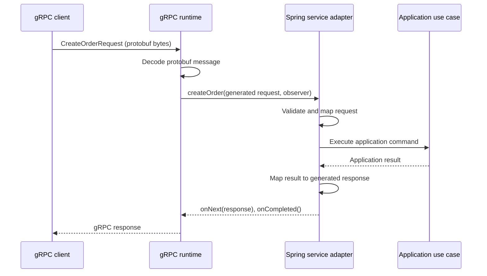

# Service adapter nhận generated request

**Chương:** Spring service adapter  
**Phạm vi:** Spring gRPC (`SPRING_GRPC`) sử dụng hợp đồng Protocol Buffers, mã Java được sinh và các RPC unary hoặc streaming. Bài này tập trung vào thời điểm server service adapter nhận một generated request, cách đọc message đã được gRPC giải mã, chuyển nó thành input của application layer và tạo generated response trả về client.

## 1. Generated request được tạo và chuyển tới adapter như thế nào?

Trong gRPC, file `.proto` mô tả service và message. Plugin Protocol Buffers sinh các lớp Java cho message cùng lớp service base. Khi client gửi request qua HTTP/2, gRPC runtime đọc frame, giải mã payload protobuf thành đối tượng Java tương ứng rồi gọi method của service implementation.

Với RPC unary, generated service base có method nhận generated request và response observer:

```java
public void createOrder(
        CreateOrderRequest request,
        StreamObserver<CreateOrderResponse> responseObserver)
```

Đối số `request` đã là một đối tượng protobuf có kiểu cụ thể. Adapter không cần tự đọc socket, tách HTTP/2 frame hoặc parse byte array. Nhiệm vụ của adapter là hiểu hợp đồng transport, kiểm tra dữ liệu đầu vào ở biên API, chuyển nó sang mô hình ứng dụng và gửi kết quả theo đúng kiểu response được sinh.

Luồng xử lý:



Generated request là mô hình của API protobuf. Nó không nên trở thành mô hình domain của toàn ứng dụng; adapter là nơi chuyển đổi giữa hai thế giới.

## 2. Khai báo hợp đồng và nhận biết các lớp Java được sinh

Ví dụ hợp đồng tạo đơn hàng:

```proto
syntax = "proto3";

package orders.v1;

option java_package = "com.example.orders.grpc";
option java_multiple_files = true;

service OrderService {
  rpc CreateOrder(CreateOrderRequest)
      returns (CreateOrderResponse);
}

message CreateOrderRequest {
  string customer_id = 1;
  repeated OrderLine items = 2;
  optional string note = 3;
}

message OrderLine {
  string product_id = 1;
  int32 quantity = 2;
}

message CreateOrderResponse {
  string order_id = 1;
  OrderStatus status = 2;
}

enum OrderStatus {
  ORDER_STATUS_UNSPECIFIED = 0;
  ORDER_STATUS_CREATED = 1;
}
```

Với `java_package` và `java_multiple_files` như trên, code Java thường sử dụng:

- `CreateOrderRequest`, `OrderLine`, `CreateOrderResponse`: generated message classes.
- `OrderStatus`: generated enum.
- `OrderServiceGrpc.OrderServiceImplBase`: base class có method server cần override.
- `OrderServiceGrpc.OrderServiceBlockingStub` hoặc `OrderServiceGrpc.OrderServiceStub`: client stub tương ứng.

Tên package và lớp cụ thể do cấu hình protobuf quyết định. Hãy dùng đúng generated sources của hợp đồng trong dự án; không tự tạo một lớp Java khác rồi giả định gRPC runtime sẽ gọi lớp đó.

## 3. Spring adapter kế thừa generated service base

Trong Spring gRPC, service implementation thường là Spring bean được đánh dấu bằng annotation do starter cung cấp, ví dụ `@GrpcService`. Adapter kế thừa generated base class và nhận các dependency của application layer qua constructor injection:

```java
import io.grpc.Status;
import io.grpc.stub.StreamObserver;
import net.devh.boot.grpc.server.service.GrpcService;

@GrpcService
public class OrderGrpcService
        extends OrderServiceGrpc.OrderServiceImplBase {

    private final CreateOrderUseCase createOrderUseCase;
    private final OrderRequestMapper requestMapper;
    private final OrderResponseMapper responseMapper;

    public OrderGrpcService(
            CreateOrderUseCase createOrderUseCase,
            OrderRequestMapper requestMapper,
            OrderResponseMapper responseMapper) {
        this.createOrderUseCase = createOrderUseCase;
        this.requestMapper = requestMapper;
        this.responseMapper = responseMapper;
    }

    @Override
    public void createOrder(
            CreateOrderRequest request,
            StreamObserver<CreateOrderResponse> responseObserver) {
        try {
            CreateOrderCommand command = requestMapper.toCommand(request);
            OrderResult result = createOrderUseCase.execute(command);
            CreateOrderResponse response = responseMapper.toProto(result);

            responseObserver.onNext(response);
            responseObserver.onCompleted();
        } catch (RequestValidationException invalid) {
            responseObserver.onError(
                    Status.INVALID_ARGUMENT
                            .withDescription("Dữ liệu tạo đơn không hợp lệ")
                            .asRuntimeException());
        } catch (CustomerNotFoundException missing) {
            responseObserver.onError(
                    Status.NOT_FOUND
                            .withDescription("Không tìm thấy khách hàng")
                            .asRuntimeException());
        }
    }
}
```

Ví dụ dùng package annotation của Spring gRPC starter phổ biến; import thực tế phụ thuộc starter/version dự án. Vai trò kiến trúc không đổi: Spring quản lý vòng đời adapter, gRPC runtime gọi method generated base, còn adapter điều phối mapper và use case.

Adapter không nên tự thực hiện truy vấn database hoặc chứa toàn bộ quy tắc nghiệp vụ. Nó nên giữ trách nhiệm ở biên giao thức: nhận request, xác thực hình dạng dữ liệu, chuyển đổi, gọi use case và kết thúc RPC.

## 4. Đọc generated request đúng cách

Generated protobuf message là đối tượng immutable. Sau khi được tạo, adapter đọc giá trị qua getter; không sửa trực tiếp request nhận từ runtime.

### Scalar fields

Với field scalar proto3 thông thường, getter trả giá trị mặc định nếu client không gửi field:

```java
String customerId = request.getCustomerId();
int quantity = request.getItems(0).getQuantity();
```

Ví dụ `getCustomerId()` có thể trả chuỗi rỗng. Vì vậy, nếu hợp đồng yêu cầu giá trị không rỗng, server phải validate trước khi gọi use case.

### Field có presence

Proto3 scalar thông thường không luôn phân biệt được “không gửi” với “gửi giá trị mặc định”. Với `optional`, generated API cung cấp phương thức presence:

```java
if (!request.hasNote()) {
    // Client không gửi note.
} else {
    String note = request.getNote();
    // Client đã gửi note, kể cả khi chuỗi rỗng.
}
```

Không dùng `getNote().isBlank()` để suy ra client có gửi field hay không; đó là hai câu hỏi khác nhau.

### Repeated fields

Field `repeated` được đọc qua list getter:

```java
List<OrderLine> lines = request.getItemsList();
for (OrderLine line : lines) {
    String productId = line.getProductId();
    int requestedQuantity = line.getQuantity();
}
```

List do generated message cung cấp là immutable. Adapter có thể duyệt và map sang collection/command của ứng dụng; không cố thêm hoặc xóa phần tử trên list đó.

### Enum và giá trị chưa biết

Nếu client gửi một numeric enum value mới mà server hiện tại chưa biết, generated enum accessor có thể trả `UNRECOGNIZED`. Không mặc định mọi enum đều là một trong các giá trị server đã biên dịch:

```java
if (request.getRequestedMode() == RequestedMode.UNRECOGNIZED) {
    throw new RequestValidationException("Unsupported requested mode");
}
```

Với enum dùng trong request, hãy xác định rõ cách xử lý giá trị mới để hỗ trợ tiến hóa API. Không âm thầm diễn giải một giá trị không nhận diện thành mode mặc định nếu điều đó làm thay đổi ý nghĩa thao tác.

### Oneof

Nếu protobuf dùng `oneof`, generated API có case enum để biết nhánh nào được gửi:

```java
switch (request.getDestinationCase()) {
    case ACCOUNT_ID -> useAccount(request.getAccountId());
    case EXTERNAL_ADDRESS -> useAddress(request.getExternalAddress());
    case DESTINATION_NOT_SET ->
            throw new RequestValidationException(
                    "A destination is required");
}
```

Đọc qua case giúp adapter phân biệt các lựa chọn thay thế và trường hợp không có nhánh nào được gửi.

## 5. Map generated request sang application command

Application layer nên nhận một command có kiểu dữ liệu và ngữ nghĩa của ứng dụng, thay vì phụ thuộc trực tiếp vào generated protobuf class:

```java
public record CreateOrderLine(String productId, int quantity) {}

public record CreateOrderCommand(
        String customerId,
        List<CreateOrderLine> items,
        Optional<String> note) {}
```

Mapper chuyển protobuf message sang command:

```java
@Component
public class OrderRequestMapper {

    public CreateOrderCommand toCommand(CreateOrderRequest request) {
        if (request.getCustomerId().isBlank()) {
            throw new RequestValidationException(
                    "customer_id must not be blank");
        }
        if (request.getItemsCount() == 0) {
            throw new RequestValidationException(
                    "at least one order item is required");
        }

        List<CreateOrderLine> items = request.getItemsList().stream()
                .map(this::toCommandLine)
                .toList();

        Optional<String> note = request.hasNote()
                ? Optional.of(request.getNote())
                : Optional.empty();

        return new CreateOrderCommand(
                request.getCustomerId(),
                items,
                note);
    }

    public CreateOrderLine toCommandLine(OrderLine line) {
        if (line.getProductId().isBlank()) {
            throw new RequestValidationException(
                    "product_id must not be blank");
        }
        if (line.getQuantity() <= 0) {
            throw new RequestValidationException(
                    "quantity must be greater than zero");
        }
        return new CreateOrderLine(
                line.getProductId(),
                line.getQuantity());
    }
}
```

Đây là validation ở API boundary: field bắt buộc, số lượng phần tử, giá trị dương và presence. Quy tắc như khách hàng có tồn tại hay sản phẩm còn hàng thuộc application/domain layer vì chúng cần đọc trạng thái hệ thống.

Nếu dùng Java version chưa hỗ trợ `Stream.toList()`, thay bằng collector phù hợp. Không cần để generated protobuf class đi sâu vào repository hoặc domain entity.

## 6. Map application result thành generated response

Chiều chuyển đổi ngược dùng builder của generated message:

```java
@Component
public class OrderResponseMapper {

    public CreateOrderResponse toProto(OrderResult result) {
        return CreateOrderResponse.newBuilder()
                .setOrderId(result.orderId())
                .setStatus(OrderStatus.ORDER_STATUS_CREATED)
                .build();
    }
}
```

Generated message thường được xây dựng bằng `newBuilder()`, đặt các field rồi gọi `build()`. Không khởi tạo generated message bằng constructor tùy ý hoặc sửa nó sau khi build.

Mapper response cũng cần xử lý có chủ đích:

- Không đưa field nội bộ của domain entity vào response nếu API không công bố field đó.
- Chuyển enum domain sang enum protobuf bằng bảng mapping tường minh.
- Chuyển thời gian sang `google.protobuf.Timestamp` hoặc `google.protobuf.Duration` theo semantics của hợp đồng.
- Chuyển binary sang `ByteString` và không đưa dữ liệu lớn không cần thiết vào response.
- Chọn rõ cách biểu diễn field optional/oneof khi kết quả không có giá trị.

## 7. Request protobuf và gRPC metadata là hai đầu vào khác nhau

Generated request đại diện cho message payload được khai báo trong `.proto`. Metadata là phần thông tin của RPC call, ví dụ bearer token, correlation ID hoặc tracing headers. Service adapter không nên tìm token trong field protobuf nếu hợp đồng xác thực quy định credential nằm trong metadata.

Thông thường, authentication interceptor đọc metadata, xác thực credential và gắn principal vào gRPC Context. Adapter nhận generated request cùng response observer; nếu cần danh tính, nó lấy từ Context hoặc application security abstraction theo thiết kế server.

Tách hai phần giúp:

- Message protobuf tập trung vào dữ liệu nghiệp vụ của RPC.
- Interceptor xử lý thông tin call-wide như identity và tracing.
- Client không phải lặp token thành field trong mọi message, đặc biệt trong streaming.
- Log request payload không vô tình ghi credential.

## 8. Adapter cho streaming request

Với client-streaming RPC, generated service base có method nhận response observer và trả về một inbound `StreamObserver`:

```java
import io.grpc.Status;
import io.grpc.stub.StreamObserver;
import java.util.ArrayList;
import java.util.List;
import java.util.concurrent.atomic.AtomicBoolean;

@Override
public StreamObserver<OrderLine> uploadOrderLines(
        StreamObserver<UploadSummary> responseObserver) {

    List<CreateOrderLine> lines = new ArrayList<>();
    AtomicBoolean terminated = new AtomicBoolean(false);

    return new StreamObserver<>() {
        @Override
        public void onNext(OrderLine requestLine) {
            if (terminated.get()) {
                return;
            }
            try {
                lines.add(requestMapper.toCommandLine(requestLine));
            } catch (RequestValidationException invalid) {
                if (terminated.compareAndSet(false, true)) {
                    responseObserver.onError(
                            Status.INVALID_ARGUMENT
                                    .withDescription("Dòng đơn hàng không hợp lệ")
                                    .asRuntimeException());
                }
            }
        }

        @Override
        public void onError(Throwable error) {
            // Inbound stream đã kết thúc bằng lỗi/hủy; giải phóng state.
            terminated.set(true);
            lines.clear();
        }

        @Override
        public void onCompleted() {
            if (!terminated.compareAndSet(false, true)) {
                return;
            }
            UploadSummary summary;
            try {
                summary = applicationService.finishUpload(lines);
            } catch (Exception failure) {
                responseObserver.onError(exceptionMapper.map(failure));
                return;
            }
            responseObserver.onNext(toProto(summary));
            responseObserver.onCompleted();
        }
    };
}
```

Đây là skeleton để minh họa việc mỗi message inbound cũng là generated request message. Code thực tế phải có terminal-state guard để không tiếp tục xử lý sau validation error, không gọi `onError` nhiều lần, và không chạy `onCompleted` sau terminal error. Nếu batch có thể lớn, không giữ toàn bộ message trong memory; dùng bounded buffer hoặc ghi theo batch với transaction/cleanup phù hợp.

Đối với bidirectional streaming, request observer và response observer có thể hoạt động trong suốt vòng đời call. State phải thuộc từng RPC, không lưu vào field mutable của singleton Spring service. Nếu offload xử lý sang worker, serialize các lời gọi response observer và áp dụng flow control/backpressure.

## 9. Lỗi adapter thường gặp

| Lỗi | Hậu quả | Cách xử lý |
| --- | --- | --- |
| Dùng generated request làm domain object | Domain phụ thuộc transport và protobuf | Map sang command/DTO nội bộ |
| Tin giá trị mặc định là client đã gửi field | Bỏ sót field thiếu | Dùng presence với `optional`/oneof khi cần |
| Không kiểm tra enum `UNRECOGNIZED` | Xử lý sai giá trị từ client mới | Xác định policy cho enum chưa biết |
| Sửa repeated list từ generated message | Lỗi do collection immutable | Tạo collection mới khi cần biến đổi |
| Đưa token vào request payload | Trộn authentication với business data | Dùng gRPC metadata và interceptor |
| Đặt business logic/database query trong adapter | Khó tái sử dụng và kiểm thử | Gọi application use case |
| Gọi cả `onError` và `onCompleted` | RPC có nhiều terminal signal | Bảo vệ terminal state |
| Dùng state của streaming trong field singleton | Dữ liệu nhiều RPC có thể lẫn nhau | Tạo state trong method/call scope |

## 10. Kiểm thử service adapter

Nên kiểm thử ở ba mức:

| Mức | Điều cần xác nhận |
| --- | --- |
| Mapper unit test | Generated request được map đúng command; presence, repeated, enum và oneof được xử lý đúng |
| Adapter unit/in-process test | RPC gọi đúng use case, trả generated response hoặc status mong đợi |
| Contract/integration test | Client dùng generated stub thực sự gửi request; server trả đúng message/status theo protobuf contract |

Ví dụ kiểm tra request mapping:

```java
class OrderRequestMapperTest {

    private final OrderRequestMapper mapper = new OrderRequestMapper();

    @Test
    void mapsOptionalNotePresence() {
        CreateOrderRequest request = CreateOrderRequest.newBuilder()
                .setCustomerId("customer-1")
                .addItems(OrderLine.newBuilder()
                        .setProductId("product-1")
                        .setQuantity(2))
                .setNote("")
                .build();

        CreateOrderCommand command = mapper.toCommand(request);

        assertTrue(command.note().isPresent());
        assertEquals("", command.note().orElseThrow());
    }

    @Test
    void rejectsRequestWithoutItems() {
        CreateOrderRequest request = CreateOrderRequest.newBuilder()
                .setCustomerId("customer-1")
                .build();

        assertThrows(
                RequestValidationException.class,
                () -> mapper.toCommand(request));
    }
}
```

Test presence đặc biệt quan trọng: `note` không được gửi và `note` được gửi với chuỗi rỗng có thể mang hai ý nghĩa khác nhau. Test adapter qua in-process channel cần xác nhận `INVALID_ARGUMENT` được chuyển thành status đúng và use case không bị gọi khi request vi phạm validation.

## 11. Tự luyện tập

1. Vì sao service adapter nhận `CreateOrderRequest` thay vì tự parse protobuf bytes?
2. Phân biệt `getNote()` với `hasNote()` khi field được khai báo `optional`.
3. Một client mới gửi enum numeric value mà server chưa biết. Adapter nên xử lý `UNRECOGNIZED` ra sao?
4. Thiết kế mapper chuyển `CreateOrderRequest` thành command mà không để generated class đi vào domain layer.
5. Với client streaming, vì sao state nhận message phải được tạo trong method của từng RPC thay vì lưu ở field singleton?

**Ghi nhớ:** gRPC runtime giải mã payload protobuf và gọi service implementation bằng generated request có kiểu cụ thể. Spring service adapter kế thừa generated service base, đọc và validate request, map sang application command, gọi use case rồi map kết quả thành generated response. Giữ protobuf ở biên transport; chú ý field presence, repeated/enum/oneof, metadata tách khỏi payload và terminal lifecycle của streaming.
