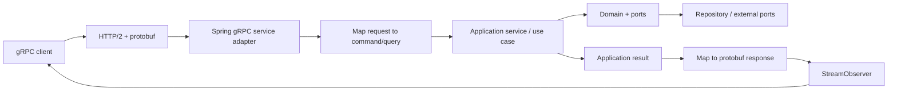

# Gọi application service

## 1. Vai trò của Spring service adapter

Trong Spring gRPC, service adapter là điểm vào của ứng dụng qua giao thức gRPC. Nó nhận protobuf request, chuyển dữ liệu sang mô hình use case của ứng dụng, gọi application service và chuyển kết quả hoặc lỗi thành protobuf response/gRPC status.

Adapter giữ ranh giới giữa transport và nghiệp vụ:

- gRPC layer hiểu service/method, metadata, protobuf, StreamObserver và io.grpc.Status.
- Application layer hiểu command/query, use case, quy tắc nghiệp vụ và transaction.
- Domain layer giữ mô hình và invariant cốt lõi, không phụ thuộc gRPC hay Spring transport.

Không đặt truy vấn repository, tính giá, kiểm tra quyền nghiệp vụ hoặc điều phối nhiều use case trực tiếp trong adapter. Adapter điều phối lời gọi application service và chuyển đổi dữ liệu ở biên.



Ví dụ xuyên suốt dùng unary RPC GetProduct: client gửi GetProductRequest, adapter gọi use case tra cứu sản phẩm, rồi trả GetProductResponse.

## 2. Định nghĩa application service độc lập với gRPC

Application service nên nhận kiểu dữ liệu thuộc application layer thay vì protobuf generated class. Nhờ đó, use case có thể được gọi từ REST adapter, message consumer, scheduler hoặc test mà không phụ thuộc gRPC.

Ví dụ contract:

```java
public record GetProductQuery(String productId) {}

public record ProductView(
        String productId,
        String name,
        long priceInMinorUnit,
        String currency) {}

public interface GetProductUseCase {
    ProductView execute(GetProductQuery query);
}
```

Use case triển khai quy trình ứng dụng: xác thực input ở mức nghiệp vụ, gọi domain service/port, kiểm tra điều kiện và trả kết quả. Nó không cần biết request ban đầu đến từ protobuf, HTTP JSON hay một message queue.

Một implementation Spring có thể đặt transaction boundary tại application service:

```java
import org.springframework.stereotype.Service;
import org.springframework.transaction.annotation.Transactional;

@Service
public class GetProductService implements GetProductUseCase {

    private final ProductRepository productRepository;

    public GetProductService(ProductRepository productRepository) {
        this.productRepository = productRepository;
    }

    @Override
    @Transactional(readOnly = true)
    public ProductView execute(GetProductQuery query) {
        Product product = productRepository.findById(query.productId())
                .orElseThrow(() ->
                        new ProductNotFoundException(query.productId()));

        return new ProductView(
                product.id(),
                product.name(),
                product.priceInMinorUnit(),
                product.currency());
    }
}
```

Ví dụ giả định ProductRepository là port được application service sử dụng và Product là domain model. Transaction thuộc use case vì đây là ranh giới của thao tác nghiệp vụ; adapter không cần mở transaction riêng chỉ để chuyển protobuf.

Với thao tác ghi, application service thường quản lý transaction read-write, kiểm tra invariant và phối hợp domain behavior. Không để adapter tự gọi nhiều repository rồi tạo một transaction nghiệp vụ rời rạc.

## 3. Gọi application service từ generated gRPC service

Generated gRPC code cung cấp base class cho service. Adapter kế thừa base class và inject application service qua constructor:

```java
import io.grpc.Status;
import io.grpc.stub.StreamObserver;
import org.springframework.grpc.server.service.GrpcService;

@GrpcService
public class ProductQueryGrpcAdapter
        extends ProductQueryServiceGrpc.ProductQueryServiceImplBase {

    private final GetProductUseCase getProductUseCase;

    public ProductQueryGrpcAdapter(
            GetProductUseCase getProductUseCase) {
        this.getProductUseCase = getProductUseCase;
    }

    @Override
    public void getProduct(
            GetProductRequest request,
            StreamObserver<GetProductResponse> responseObserver) {

        try {
            GetProductQuery query = toQuery(request);
            ProductView result = getProductUseCase.execute(query);

            responseObserver.onNext(toResponse(result));
            responseObserver.onCompleted();

        } catch (ProductNotFoundException notFound) {
            responseObserver.onError(
                    Status.NOT_FOUND
                            .withDescription("Product was not found")
                            .asRuntimeException());

        } catch (InvalidProductQueryException invalid) {
            responseObserver.onError(
                    Status.INVALID_ARGUMENT
                            .withDescription("Product query is invalid")
                            .asRuntimeException());
        }
    }

    private GetProductQuery toQuery(GetProductRequest request) {
        String productId = request.getProductId();

        if (productId.isBlank()) {
            throw new InvalidProductQueryException();
        }
        return new GetProductQuery(productId);
    }

    private GetProductResponse toResponse(ProductView product) {
        return GetProductResponse.newBuilder()
                .setProductId(product.productId())
                .setName(product.name())
                .setPriceInMinorUnit(product.priceInMinorUnit())
                .setCurrency(product.currency())
                .build();
    }
}
```

GrpcService đăng ký adapter vào Spring gRPC server theo cơ chế của starter. Import package và cách đăng ký cần khớp phiên bản Spring gRPC đang dùng. Nếu framework quản lý server, không tự tạo server thứ hai chỉ để đăng ký service.

Luồng xử lý trong method có bốn bước:

1. Đọc và kiểm tra cấu trúc request ở ranh giới transport.
2. Chuyển protobuf request sang query/command.
3. Gọi đúng một application use case cho thao tác đó.
4. Chuyển application result sang protobuf response và kết thúc observer.

Adapter không nên biết repository cụ thể hoặc cách use case lấy dữ liệu. Nó phụ thuộc vào interface application service, giúp thay implementation hoặc mock trong test dễ dàng.

## 4. Mapping protobuf request sang command/query

Protobuf là contract bên ngoài, vì vậy mapping cần có chủ đích:

- Chuyển field, enum, timestamp, decimal representation và nested message sang kiểu application phù hợp.
- Kiểm tra dữ liệu bắt buộc và định dạng ở boundary; ví dụ ID rỗng, enum không được hỗ trợ hoặc timestamp ngoài phạm vi.
- Giữ nguyên ý nghĩa presence. Trong proto3, field scalar không có optional thường trả default value khi vắng mặt; nếu cần phân biệt không gửi với gửi giá trị mặc định, dùng presence-aware field hoặc oneof theo contract.
- Không chuyển nguyên protobuf message vào domain hoặc repository.
- Không đưa quy tắc nghiệp vụ vào mapper. Ví dụ format ID có hợp lệ về cấu trúc không thuộc transport; sản phẩm có được phép bán hay không thuộc use case/domain.

Với RPC ghi dữ liệu, map request thành command thể hiện ý định:

```java
public record CreateOrderCommand(
        String customerId,
        List<OrderLineCommand> lines,
        String idempotencyKey) {}

public record OrderLineCommand(
        String productId,
        int quantity) {}
```

Adapter đọc protobuf, map các line thành OrderLineCommand rồi gọi CreateOrderUseCase. Application service chịu trách nhiệm kiểm tra số lượng, tồn kho, quyền mua, giá và invariant của đơn hàng.

Không dùng protobuf generated object làm object nội bộ xuyên suốt hệ thống. Việc đó khiến thay đổi wire contract lan sang application/domain và làm các lớp khó kiểm thử độc lập.

## 5. Mapping application result sang protobuf response

Response mapper chuyển kết quả use case sang wire contract. Đây cũng là nơi quyết định field nào được công bố ra ngoài:

```java
private GetProductResponse toResponse(ProductView result) {
    return GetProductResponse.newBuilder()
            .setProductId(result.productId())
            .setName(result.name())
            .setPriceInMinorUnit(result.priceInMinorUnit())
            .setCurrency(result.currency())
            .build();
}
```

Không serialize trực tiếp entity JPA hoặc domain aggregate thành protobuf. Entity có thể chứa lazy relation, internal field, dữ liệu cá nhân hoặc cấu trúc không phải public API. Tạo response DTO rõ ràng để kiểm soát dữ liệu trả ra.

Nếu application result có field nullable, cần quyết định cách biểu diễn trong protobuf: optional, oneof, wrapper type hoặc một message con. Không biến null thành chuỗi rỗng hay số 0 một cách âm thầm nếu hai trạng thái có ý nghĩa khác nhau.

Mapping enum cũng cần xử lý giá trị chưa hỗ trợ. Không ép ordinal enum Java sang numeric enum protobuf vì thứ tự hai enum có thể khác và protobuf enum có quy tắc số riêng. Dùng mapping tường minh và có fallback được định nghĩa.

## 6. Ánh xạ lỗi application sang gRPC Status

Application service không nên phụ thuộc io.grpc.StatusRuntimeException. Use case phát ra exception có ý nghĩa nghiệp vụ; adapter ánh xạ các exception đó sang status ở transport boundary.

Ví dụ mapping:

| Application outcome | gRPC status thường dùng | Ý nghĩa với client |
| --- | --- | --- |
| Input không hợp lệ theo contract/use case | INVALID_ARGUMENT | Client cần sửa request. |
| Không tìm thấy tài nguyên | NOT_FOUND | Tài nguyên được yêu cầu không tồn tại. |
| Tài nguyên đã tồn tại hoặc vi phạm unique constraint đã biết | ALREADY_EXISTS | Xung đột với trạng thái hiện tại. |
| Trạng thái hiện tại không cho phép thao tác | FAILED_PRECONDITION | Cần thay đổi trạng thái trước khi thử lại. |
| Caller đã xác thực nhưng không có quyền | PERMISSION_DENIED | Không được phép thực hiện hành động. |
| Thiếu hoặc sai credential | UNAUTHENTICATED | Cần xác thực lại. Thường được xử lý ở auth interceptor. |
| Quá tải hoặc quota bị vượt | RESOURCE_EXHAUSTED | Client cần giảm tải hoặc chờ theo policy. |
| Dependency tạm thời không sẵn sàng | UNAVAILABLE | Có thể retry nếu RPC và policy cho phép. |
| Hết deadline | DEADLINE_EXCEEDED | Kết quả không hoàn tất trong thời gian cho phép. |
| Lỗi không dự kiến | INTERNAL | Lỗi phía server; không tiết lộ chi tiết nội bộ. |

Nên gom mapping vào một mapper riêng khi nhiều adapter dùng chung chính sách:

```java
public final class GrpcStatusMapper {

    private GrpcStatusMapper() {}

    public static Status toStatus(Throwable error) {
        if (error instanceof ProductNotFoundException) {
            return Status.NOT_FOUND
                    .withDescription("Product was not found");
        }
        if (error instanceof InvalidProductQueryException) {
            return Status.INVALID_ARGUMENT
                    .withDescription("Product query is invalid");
        }
        if (error instanceof ProductAlreadyExistsException) {
            return Status.ALREADY_EXISTS
                    .withDescription("Product already exists");
        }
        if (error instanceof ProductAccessDeniedException) {
            return Status.PERMISSION_DENIED
                    .withDescription("Access is denied");
        }
        return Status.INTERNAL
                .withDescription("Internal server error");
    }
}
```

Adapter dùng mapper để kết thúc call:

```java
catch (RuntimeException error) {
    Status status = GrpcStatusMapper.toStatus(error);
    if (status.getCode() == Status.Code.INTERNAL) {
        log.error("Unexpected failure while handling GetProduct", error);
    }
    responseObserver.onError(status.asRuntimeException());
}
```

Trong code production, đặt các catch theo exception cụ thể và log một lần tại ranh giới thích hợp. Không log token, metadata nhạy cảm, payload chứa dữ liệu cá nhân hoặc trả stack trace trong status description. Không ánh xạ mọi RuntimeException thành INVALID_ARGUMENT; lỗi lập trình và lỗi hạ tầng phải được phân loại đúng.

## 7. Transaction boundary và thời điểm gửi response

Với unary RPC đồng bộ, adapter gọi application service và chỉ gửi response sau khi lời gọi use case trả về thành công. Nếu use case được Spring proxy với @Transactional, transaction interceptor hoàn tất commit/rollback trước khi lời gọi trở về adapter. Nhờ đó adapter không gửi response thành công trước khi transaction commit.

Không mở transaction ở adapter chỉ để bao quanh onNext/onCompleted. Callback có thể chạy sau khi method trả về hoặc trên thread khác; transaction thread-bound không tự kéo dài qua callback. Với streaming, càng không nên giữ một transaction database mở trong toàn bộ vòng đời stream nếu không có yêu cầu nghiệp vụ đặc biệt.

Với command cần bảo đảm idempotency, application service xử lý idempotency key và transaction. Adapter chỉ chuyển key từ metadata/request theo contract đã định nghĩa. Retry ở client có thể gửi lại command; nếu thao tác không idempotent, phải thiết kế chống tạo dữ liệu trùng trước khi bật retry.

## 8. Deadline, cancellation và công việc downstream

Client nên đặt deadline hữu hạn. Server adapter cần tôn trọng cancellation và không tiếp tục công việc tốn tài nguyên khi caller đã hủy RPC.

Với xử lý đồng bộ nhanh, deadline/cancellation được gRPC quản lý ở call; nhưng một lời gọi repository hoặc HTTP blocking không tự động dừng chỉ vì client hủy. Application service và các outbound port cần timeout, cancellation hoặc deadline propagation phù hợp.

Có thể kiểm tra context trong quá trình xử lý dài:

```java
if (io.grpc.Context.current().isCancelled()) {
    return;
}
```

Đây chỉ là điểm kiểm tra trạng thái. Nếu tác vụ blocking không kiểm tra cancellation, nó vẫn tiếp tục chạy. Với công việc dài, dùng API hỗ trợ timeout/cancel hoặc thiết kế async để cancellation được truyền xuống dependency.

Không bắt CANCELLED rồi trả một response nghiệp vụ thành công. Khi RPC đã terminal hoặc client đã rời stream, adapter không được tiếp tục ghi observer.

## 9. Gọi application service bất đồng bộ

Nếu application service trả CompletionStage, adapter có thể hoàn tất observer trong callback. Cần chụp gRPC context trước khi chuyển thread và bảo đảm chỉ phát một terminal event:

```java
Context rpcContext = Context.current();

getProductUseCase.executeAsync(query)
        .whenComplete((result, failure) -> rpcContext.run(() -> {
            if (rpcContext.isCancelled()) {
                return;
            }

            if (failure != null) {
                Throwable cause = unwrap(failure);
                responseObserver.onError(
                        GrpcStatusMapper.toStatus(cause)
                                .asRuntimeException());
                return;
            }

            responseObserver.onNext(toResponse(result));
            responseObserver.onCompleted();
        }));
```

executeAsync, unwrap và mapper là API/helper ứng dụng minh họa. Context được chụp giúp callback đọc đúng RPC context dù chạy trên executor khác. Tuy vậy, hủy RPC không tự động hủy CompletionStage; cần đăng ký cancellation listener và hủy tác vụ nguồn nếu API downstream hỗ trợ.

Không phát response đồng thời từ nhiều callback. Nếu nhiều tác vụ cùng góp dữ liệu cho một stream, dùng một writer/serialization point để giữ thứ tự và terminal semantics của StreamObserver.

## 10. Kiểm thử adapter và application service

Kiểm thử adapter nên xác minh chuyển đổi và điều phối, còn application service có test riêng cho nghiệp vụ.

**Unit test adapter** dùng mock GetProductUseCase để kiểm tra:

- Request protobuf được map thành đúng GetProductQuery.
- Use case được gọi đúng một lần.
- Application result được map đủ field sang protobuf response.
- Exception nghiệp vụ được ánh xạ đúng status.
- Lỗi không dự kiến không làm lộ exception detail cho client.
- Observer nhận đúng terminal sequence: response rồi completion, hoặc error.

Ví dụ kiểm tra unary observer:

```java
@Test
void mapsApplicationResultToGrpcResponse() {
    when(getProductUseCase.execute(
            new GetProductQuery("p-100")))
            .thenReturn(new ProductView(
                    "p-100", "Keyboard", 12900, "USD"));

    RecordingObserver<GetProductResponse> observer =
            new RecordingObserver<>();

    adapter.getProduct(
            GetProductRequest.newBuilder()
                    .setProductId("p-100")
                    .build(),
            observer);

    assertEquals(1, observer.values().size());
    assertEquals("p-100", observer.values().get(0).getProductId());
    assertTrue(observer.completed());
    assertNull(observer.error());
    verify(getProductUseCase).execute(
            new GetProductQuery("p-100"));
}
```

RecordingObserver là test helper ghi lại onNext, onError và onCompleted. Thêm test khi use case ném ProductNotFoundException, request rỗng và lỗi nội bộ. Kiểm tra không có onNext sau onError và không gọi cả hai terminal signal.

**Integration test** khởi tạo Spring context, đăng ký adapter trong gRPC server test và gọi qua generated stub. Test này xác minh annotation/registration, constructor injection, protobuf serialization, interceptor chain và status đi qua transport đúng như cấu hình. Nếu cần kiểm tra TLS, dùng Netty TCP transport; in-process transport không kiểm tra TLS handshake.

## 11. Lỗi thường gặp

1. **Đưa toàn bộ nghiệp vụ vào gRPC adapter.** Adapter khó test và phụ thuộc transport. Chuyển quy tắc vào application service/domain.
2. **Cho application service nhận protobuf generated class.** Application layer bị khóa vào wire contract. Map sang command/query nội bộ.
3. **Adapter gọi repository trực tiếp.** Bỏ qua use case và transaction boundary. Inject application service/port phù hợp.
4. **Trả entity JPA trực tiếp thành protobuf.** Có thể lộ field nội bộ hoặc kéo lazy relation. Map sang response DTO rõ ràng.
5. **Gửi response trước khi transaction commit.** Client có thể nhận thành công dù commit thất bại. Để application service quản lý transaction và chỉ gửi response sau khi nó trả về.
6. **Đổi mọi exception thành INVALID_ARGUMENT.** Che lỗi server và làm client xử lý sai. Ánh xạ exception có chủ đích.
7. **Đưa stack trace vào status description.** Làm lộ implementation và dữ liệu nội bộ. Trả mô tả an toàn, log chi tiết ở server.
8. **Không xử lý cancellation/deadline.** Tác vụ downstream vẫn chạy sau khi client rời đi. Propagate timeout/cancel tới port có hỗ trợ.
9. **Mở transaction trong toàn bộ streaming lifetime.** Có thể giữ connection và lock lâu. Chia thao tác thành transaction ngắn theo nghiệp vụ.
10. **Chỉ unit test mapper.** Không phát hiện lỗi Spring service registration hoặc transport. Bổ sung integration test qua gRPC server thực.

## 12. Bài thực hành

Tạo adapter cho unary GetProduct:

1. Định nghĩa GetProductUseCase, GetProductQuery và ProductView trong application layer.
2. Viết application service gọi repository port và đặt transaction read-only tại use case.
3. Tạo ProductQueryGrpcAdapter kế thừa generated ProductQueryServiceImplBase, inject use case qua constructor.
4. Map GetProductRequest sang query; map ProductView sang GetProductResponse.
5. Ánh xạ ProductNotFoundException sang NOT_FOUND, input không hợp lệ sang INVALID_ARGUMENT, lỗi ngoài dự kiến sang INTERNAL.
6. Đăng ký adapter bằng Spring gRPC service mechanism của phiên bản đang dùng.
7. Viết unit test mapping/exception và integration test gọi qua generated stub.
8. Kiểm tra deadline, cancellation và log không làm lộ dữ liệu nhạy cảm.

**Tự kiểm tra:** Spring gRPC service adapter nhận protobuf request, map sang command/query, gọi application service qua dependency injection và chuyển result/error thành protobuf response hoặc gRPC status. Application service giữ nghiệp vụ và transaction boundary; adapter giữ trách nhiệm transport. Kiểm thử cả mapping ở unit test lẫn đăng ký/call thực tế ở integration test để bảo đảm ranh giới giữa gRPC và application layer được duy trì.

