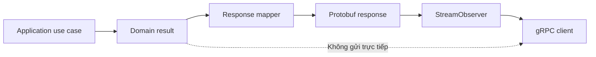

# Chuyển domain result thành protobuf response

## 1. Vì sao cần lớp chuyển đổi response?

Trong Spring gRPC, application service xử lý use case và trả về kết quả thuộc application/domain model. gRPC adapter chuyển kết quả đó thành protobuf message để gửi qua wire. Đây là ranh giới giữa mô hình nội bộ và API mà client nhìn thấy.

Hai mô hình có mục đích khác nhau:

- **Domain result** biểu diễn khái niệm và quy tắc của nghiệp vụ. Nó có thể chứa value object, aggregate, trạng thái nội bộ và các quan hệ phục vụ logic.
- **Protobuf response** là hợp đồng truyền thông ổn định. Nó chỉ nên công bố dữ liệu mà client cần và có thể hiểu theo version của API.

Không serialize trực tiếp JPA entity hoặc domain aggregate thành protobuf. Việc đó dễ làm lộ field nội bộ, lazy relationship, dữ liệu nhạy cảm và cấu trúc domain chưa từng được thiết kế như public API. Hãy viết mapper tường minh để chọn field, chuyển kiểu và định nghĩa semantics cho từng giá trị.



Ví dụ xuyên suốt là use case `GetProduct`: application service trả một product view; adapter chuyển nó thành `ProductResponse` rồi gọi `responseObserver.onNext(...)`.

## 2. Thiết kế protobuf response theo nhu cầu client

Protobuf contract nên mô tả dữ liệu công khai, không sao chép nguyên cấu trúc class Java. Ví dụ:

```protobuf
syntax = "proto3";

package catalog.v1;

import "google/protobuf/timestamp.proto";

enum ProductStatus {
  PRODUCT_STATUS_UNSPECIFIED = 0;
  PRODUCT_STATUS_ACTIVE = 1;
  PRODUCT_STATUS_OUT_OF_STOCK = 2;
  PRODUCT_STATUS_DISCONTINUED = 3;
}

message Money {
  int64 amount_minor_units = 1;
  string currency_code = 2;
}

message ProductImage {
  string url = 1;
  string alt_text = 2;
}

message ProductResponse {
  string product_id = 1;
  string name = 2;
  Money price = 3;
  ProductStatus status = 4;
  google.protobuf.Timestamp created_at = 5;
  optional string description = 6;
  repeated ProductImage images = 7;
}
```

Contract này biểu diễn những thông tin client cần để hiển thị sản phẩm. Nó không để lộ entity version, database key nội bộ, trạng thái kiểm duyệt riêng hoặc quan hệ persistence.

Một số quyết định thiết kế quan trọng:

- Dùng message con như `Money` và `ProductImage` khi một khái niệm có nhiều field hoặc semantics riêng.
- Dùng enum có giá trị zero mang nghĩa unspecified/unknown. Không gán một trạng thái nghiệp vụ cụ thể vào zero.
- Dùng `optional` khi client cần phân biệt field vắng mặt với field có giá trị mặc định.
- Dùng `repeated` cho danh sách có thứ tự; chỉ dùng `map` khi thứ tự phần tử không có ý nghĩa.
- Với các dạng response loại trừ nhau, cân nhắc `oneof` để biểu diễn rõ trạng thái nào đang có mặt.

Response contract nên phục vụ use case client, không cần phản chiếu toàn bộ domain object. Hai use case có thể trả các response DTO khác nhau dù cùng đọc một aggregate.

## 3. Định nghĩa domain result độc lập với protobuf

Application layer có thể trả kiểu dữ liệu riêng:

```java
import java.time.Instant;
import java.util.List;
import java.util.Optional;
import java.util.Objects;

public record ProductDetails(
        String id,
        String name,
        Money price,
        ProductStatus status,
        Instant createdAt,
        Optional<String> description,
        List<ProductImageDetails> images) {

    public ProductDetails {
        Objects.requireNonNull(description);
        images = List.copyOf(images);
    }
}

public record Money(
        long amountMinorUnits,
        String currencyCode) {}

public enum ProductStatus {
    ACTIVE,
    OUT_OF_STOCK,
    DISCONTINUED
}

public record ProductImageDetails(
        String url,
        String altText) {}
```

Ví dụ dùng `amountMinorUnits` để tránh sai số số thực khi truyền tiền. Đơn vị minor phụ thuộc currency và quy tắc tiền tệ; không mặc định mọi currency đều có hai chữ số thập phân. Value object `Money` cần bảo đảm amount và currency đã hợp lệ theo policy domain.

`ProductDetails` là application result dành cho use case. Nó không import protobuf generated class và không phụ thuộc gRPC. Nhờ đó, cùng use case có thể được dùng bởi adapter khác mà không kéo theo wire contract.

Không nhất thiết phải trả domain aggregate trực tiếp. Thường nên tạo result/view chứa đúng dữ liệu use case cần công bố. Điều này giúp giới hạn dữ liệu đi ra và tránh mapper phải duyệt cả object graph lớn.

## 4. Viết response mapper tường minh

Mapper chịu trách nhiệm chuyển từng field từ domain/application result sang protobuf builder. Ví dụ:

```java
import com.google.protobuf.Timestamp;
import com.google.protobuf.util.Timestamps;
import catalog.v1.ProductResponse;
import com.example.catalog.application.ProductDetails;
import com.example.catalog.application.ProductImageDetails;

public final class ProductResponseMapper {

    public ProductResponse toResponse(ProductDetails product) {
        ProductResponse.Builder response = ProductResponse.newBuilder()
                .setProductId(product.id())
                .setName(product.name())
                .setPrice(toProtoMoney(product.price()))
                .setStatus(toProtoStatus(product.status()))
                .setCreatedAt(toProtoTimestamp(product.createdAt()));

        product.description().ifPresent(response::setDescription);

        product.images().stream()
                .map(this::toProtoImage)
                .forEach(response::addImages);

        return response.build();
    }

    private catalog.v1.Money toProtoMoney(
            com.example.catalog.application.Money money) {
        return catalog.v1.Money.newBuilder()
                .setAmountMinorUnits(money.amountMinorUnits())
                .setCurrencyCode(money.currencyCode())
                .build();
    }

    private catalog.v1.ProductStatus toProtoStatus(
            com.example.catalog.application.ProductStatus status) {
        return switch (status) {
            case ACTIVE -> catalog.v1.ProductStatus.PRODUCT_STATUS_ACTIVE;
            case OUT_OF_STOCK ->
                    catalog.v1.ProductStatus.PRODUCT_STATUS_OUT_OF_STOCK;
            case DISCONTINUED ->
                    catalog.v1.ProductStatus.PRODUCT_STATUS_DISCONTINUED;
        };
    }

    private Timestamp toProtoTimestamp(java.time.Instant instant) {
        Timestamp timestamp = Timestamp.newBuilder()
                .setSeconds(instant.getEpochSecond())
                .setNanos(instant.getNano())
                .build();

        try {
            return Timestamps.checkValid(timestamp);
        } catch (IllegalArgumentException invalidTimestamp) {
            throw new ResponseMappingException(
                    "created_at is outside protobuf Timestamp range",
                    invalidTimestamp);
        }
    }

    private catalog.v1.ProductImage toProtoImage(
            ProductImageDetails image) {
        return catalog.v1.ProductImage.newBuilder()
                .setUrl(image.url())
                .setAltText(image.altText())
                .build();
    }
}
```

`ResponseMappingException` là exception nội bộ của adapter, dùng để biểu diễn kết quả domain không thể chuyển thành wire contract. Nó không được đưa nguyên văn ra client:

```java
public final class ResponseMappingException extends RuntimeException {

    public ResponseMappingException(String message, Throwable cause) {
        super(message, cause);
    }
}
```

Đoạn code minh họa giả định generated Java classes nằm trong package `catalog.v1` và domain types nằm trong package application riêng. Nếu cả protobuf và domain đều có class tên `Money` hoặc `ProductStatus`, dùng import đầy đủ hoặc đặt tên Java khác nhau để tránh nhầm kiểu.

`Timestamps.checkValid(...)` thuộc artifact `protobuf-java-util`; thêm dependency này nếu dự án chưa có. Hàm kiểm tra seconds/nanos nằm trong miền giá trị hợp lệ của `google.protobuf.Timestamp`, tránh gửi một thời điểm Java mà protobuf không biểu diễn được.

Mapper nên là thành phần thuần: nhận result, tạo response và không gọi repository, network hoặc application service. Có thể đăng ký mapper thành Spring bean nếu cần inject; không bắt buộc phải là singleton có mutable state.

## 5. Chuyển đổi các kiểu dữ liệu có semantics riêng

### Tiền tệ và số thập phân

Không chuyển tiền qua `float` hoặc `double`. Số thực nhị phân có thể không biểu diễn chính xác nhiều giá trị thập phân. Dùng integer minor units hoặc biểu diễn decimal có quy tắc scale rõ ràng.

Với contract dùng `amount_minor_units`, domain và API phải thống nhất cách diễn giải theo currency. Ví dụ 1299 minor units có ý nghĩa khác nhau tùy currency. Nếu nghiệp vụ hỗ trợ currency có scale đặc biệt, quy tắc scale phải nằm trong currency metadata/domain policy chứ không hard-code phép chia cho 100 ở adapter.

### Thời gian

Dùng `google.protobuf.Timestamp` cho thời điểm tuyệt đối. Chuyển từ `Instant` bằng seconds và nanos để giữ độ chính xác; không dùng local date-time không kèm timezone như thể đó là một thời điểm UTC.

Nếu nghiệp vụ cần ngày lịch như ngày sinh hoặc ngày giao hàng, dùng `google.type.Date` nếu dependency contract có hỗ trợ hoặc định nghĩa message year/month/day phù hợp. Không chuyển ngày lịch thành midnight UTC một cách tùy tiện.

### Enum

Dùng mapping `switch` tường minh giữa domain enum và protobuf enum. Không dựa vào ordinal của Java enum vì thứ tự enum không phải wire contract.

Proto enum có thể nhận numeric value mới từ server tương lai. Client cũ có thể thấy `UNRECOGNIZED`; client nên xử lý nhánh này thay vì giả định mọi giá trị đều được biết. Ở chiều server response, mapper phải có quyết định rõ ràng khi domain xuất hiện trạng thái chưa được API hỗ trợ: nâng cấp contract, ánh xạ sang một trạng thái public tương đương đã định nghĩa, hoặc báo lỗi mapping nội bộ. Không âm thầm biến trạng thái không hiểu thành ACTIVE.

### Optional và field presence

Với `optional string description`, generated Java cung cấp `hasDescription()`. Mapper chỉ gọi `setDescription(...)` khi domain có giá trị. Nếu description vắng mặt, không gọi setter; nếu có chuỗi rỗng và contract cho phép, trạng thái presence vẫn được giữ.

Không nhầm default value của proto3 với dữ liệu domain thực. Với field scalar không có presence, client không phân biệt được “không gửi” và “gửi zero/empty”. Chọn `optional`, wrapper hoặc message con khi sự khác biệt đó quan trọng.

## 6. Mapping collection, nested message và oneof

Danh sách domain cần được map thành protobuf `repeated` theo thứ tự có ý nghĩa:

```java
List<catalog.v1.ProductImage> images = product.images().stream()
        .map(image -> catalog.v1.ProductImage.newBuilder()
                .setUrl(image.url())
                .setAltText(image.altText())
                .build())
        .toList();

ProductResponse response = ProductResponse.newBuilder()
        .addAllImages(images)
        .build();
```

Giữ thứ tự nếu client dùng thứ tự đó để hiển thị hoặc xác định ưu tiên. Nếu thứ tự không được bảo đảm bởi domain query, hãy sắp xếp theo một quy tắc công khai trước khi map; không dựa vào thứ tự tình cờ của database.

Với quan hệ có thể rất lớn, không chuyển toàn bộ collection vào một response. Dùng pagination hoặc streaming RPC theo contract. Giới hạn kích thước message và số phần tử để tránh response quá lớn.

`oneof` phù hợp khi response có nhiều dạng dữ liệu loại trừ nhau, ví dụ kết quả định giá có thể là giá cố định hoặc giá theo khoảng. Mapper phải set đúng một nhánh. Nếu gọi setter của nhánh khác, protobuf builder sẽ thay thế nhánh đang được chọn; hãy viết test cho từng variant.

## 7. Giữ ranh giới domain và không làm lộ dữ liệu nội bộ

Mapper là điểm kiểm soát dữ liệu được công bố. Chỉ map field cần thiết cho client:

- Không trả password hash, internal database ID, access token, private note hoặc audit detail nội bộ.
- Không serialize toàn bộ aggregate chỉ vì protobuf có field tương tự.
- Không gọi getter gây lazy-loading hàng loạt khi transaction đã kết thúc.
- Không trả stack trace hoặc exception detail trong response.
- Không để client phụ thuộc vào tên class, package hoặc cấu trúc bảng database.

Nếu domain result chứa dữ liệu nhạy cảm, tạo một application response model đã được lọc theo quyền trước khi adapter map sang protobuf. Authorization quyết định caller có được xem field hay không; mapper không nên tự đoán quyền dựa trên dữ liệu request.

Không dùng reflection mapper hoặc BeanUtils như cơ chế mặc định cho public API. Mapping ngầm có thể tự động đưa field mới của domain ra wire response mà không qua review. Mapper tường minh giúp reviewer thấy chính xác dữ liệu nào được công bố.

## 8. Gọi mapper trong Spring gRPC adapter

Adapter nhận kết quả application service, gọi mapper rồi hoàn tất unary response:

```java
@GrpcService
public class ProductQueryGrpcAdapter
        extends ProductQueryServiceGrpc.ProductQueryServiceImplBase {

    private final GetProductUseCase getProductUseCase;
    private final ProductResponseMapper responseMapper;

    public ProductQueryGrpcAdapter(
            GetProductUseCase getProductUseCase,
            ProductResponseMapper responseMapper) {
        this.getProductUseCase = getProductUseCase;
        this.responseMapper = responseMapper;
    }

    @Override
    public void getProduct(
            GetProductRequest request,
            StreamObserver<ProductResponse> responseObserver) {

        try {
            GetProductQuery query =
                    new GetProductQuery(request.getProductId());

            ProductDetails result = getProductUseCase.execute(query);
            ProductResponse response =
                    responseMapper.toResponse(result);

            responseObserver.onNext(response);
            responseObserver.onCompleted();

        } catch (ProductNotFoundException notFound) {
            responseObserver.onError(
                    Status.NOT_FOUND
                            .withDescription("Product was not found")
                            .asRuntimeException());

        } catch (ResponseMappingException mappingFailure) {
            log.error("Could not map product response", mappingFailure);
            responseObserver.onError(
                    Status.INTERNAL
                            .withDescription("Could not create response")
                            .asRuntimeException());
        }
    }
}
```

Ví dụ tập trung vào luồng thành công và hai lỗi đã biết. Trong production, adapter hoặc exception mapper chung cần xử lý lỗi input, lỗi use case và lỗi ngoài dự kiến theo chính sách status của hệ thống. Không gửi response trước khi application service hoàn tất transaction. Nếu use case bất đồng bộ, phải bảo đảm callback chỉ phát một terminal event và giữ đúng gRPC Context.

Mapper không nên gọi `onNext` hoặc `onCompleted`; nó chỉ trả protobuf message. Adapter giữ quyền điều khiển lifecycle của `StreamObserver`, giúp mapping có thể test độc lập và dùng lại cho nhiều transport handler.

## 9. Tương thích và tiến hóa protobuf response

Domain model có thể thay đổi thường xuyên hơn public API. Protobuf response cần tiến hóa tương thích:

- Không đổi số field đã phát hành và không tái sử dụng field number đã xóa.
- Khi bỏ field, dùng `reserved` cho số và tên cũ.
- Thêm field mới theo hướng additive; client cũ sẽ bỏ qua field chưa biết theo semantics protobuf.
- Không đổi ý nghĩa của enum numeric value đã phát hành và không tái sử dụng số enum cũ.
- Giữ zero enum value là trạng thái unspecified/unknown.
- Không thay đổi đơn vị hoặc timezone semantics của field mà không versioning/migration rõ ràng.

Khi mapper chuyển domain result sang response, nó là nơi áp dụng contract version. Nếu có API v1 và v2 với cấu trúc khác nhau, có thể dùng mapper riêng cho từng response type thay vì làm một mapper chứa nhiều nhánh version rối rắm.

Một điểm cần lưu ý: chuyển protobuf thành domain rồi build lại response có thể làm mất unknown fields mà client trung gian không hiểu. Nếu service đóng vai trò proxy cần giữ nguyên field chưa biết, cân nhắc giữ protobuf message/UnknownFieldSet hoặc thiết kế pass-through phù hợp. Với adapter nghiệp vụ bình thường, mapper domain-to-protobuf là chủ đích chọn public fields; không hứa bảo toàn dữ liệu wire chưa biết.

## 10. Kiểm thử response mapper

Mapper là thành phần thuần nên có thể unit test mà không cần Spring context hoặc gRPC server.

Các trường hợp nên kiểm tra:

| Trường hợp | Điều cần xác minh |
| --- | --- |
| Domain result đầy đủ | ID, name, price, status và created_at được map đúng. |
| Description vắng mặt | hasDescription() là false. |
| Description có chuỗi rỗng nhưng present | Presence được giữ theo contract nếu domain cho phép. |
| Timestamp có nanos | Seconds và nanos không bị mất độ chính xác. |
| Mỗi domain enum | Ánh xạ đúng protobuf enum numeric value. |
| Danh sách ảnh | Số lượng và thứ tự phần tử được giữ đúng. |
| Field nhạy cảm trong domain | Không xuất hiện trong protobuf response. |
| Domain state không thể biểu diễn | Mapping báo lỗi rõ, không âm thầm chọn trạng thái sai. |

Ví dụ test:

```java
@Test
void mapsDomainProductToPublicResponse() {
    ProductDetails product = new ProductDetails(
            "p-100",
            "Keyboard",
            new Money(1299, "USD"),
            ProductStatus.ACTIVE,
            Instant.parse("2026-01-02T03:04:05.123456789Z"),
            Optional.empty(),
            List.of());

    ProductResponse response = mapper.toResponse(product);

    assertEquals("p-100", response.getProductId());
    assertEquals(1299, response.getPrice().getAmountMinorUnits());
    assertEquals("USD", response.getPrice().getCurrencyCode());
    assertEquals(
            catalog.v1.ProductStatus.PRODUCT_STATUS_ACTIVE,
            response.getStatus());
    assertFalse(response.hasDescription());
    assertEquals(123456789, response.getCreatedAt().getNanos());
}
```

Ngoài mapper unit test, adapter test cần xác minh use case được gọi, mapper được dùng và observer nhận đúng response rồi completion. Integration test qua gRPC server kiểm tra protobuf serialization, service registration và status thực tế. Không cần chạy network test cho mọi phép map đơn giản; chọn test ở đúng ranh giới cần xác minh.

## 11. Lỗi thường gặp

1. **Trả JPA entity hoặc domain aggregate trực tiếp.** Dễ lộ dữ liệu và phụ thuộc persistence. Tạo response mapper rõ ràng.
2. **Cho domain import protobuf generated class.** Domain bị khóa vào wire contract. Chuyển đổi tại adapter boundary.
3. **Dùng double cho tiền.** Có sai số biểu diễn. Dùng integer minor units hoặc decimal contract có scale xác định.
4. **Chuyển Instant thành local date-time.** Có thể mất timezone hoặc độ chính xác. Dùng Timestamp với seconds/nanos.
5. **Map enum bằng ordinal.** Thay đổi thứ tự làm sai wire value. Dùng switch mapping tường minh.
6. **Không xử lý field presence.** Client không phân biệt absent với default. Dùng optional/wrapper/oneof đúng semantics.
7. **Map collection không giới hạn.** Response có thể quá lớn hoặc gây lazy-loading. Dùng pagination/streaming và giới hạn phần tử.
8. **Dùng mapper reflection cho public API.** Field nội bộ mới có thể bị công bố ngoài ý muốn. Map tường minh.
9. **Đổi field number hoặc enum number đã phát hành.** Phá tương thích wire. Giữ số cũ và reserve khi xóa.
10. **Gộp mapper với observer lifecycle.** Khó test và dễ gửi terminal event sai. Mapper chỉ tạo message; adapter điều khiển observer.

## 12. Bài thực hành

Xây dựng response mapping cho `GetProduct`:

1. Định nghĩa `ProductDetails`, `Money`, `ProductStatus` và `ProductImageDetails` trong application/domain model.
2. Thiết kế `ProductResponse` protobuf với money, enum, timestamp, optional description và repeated images.
3. Viết `ProductResponseMapper` chuyển từng value object sang protobuf message.
4. Giữ chính xác currency minor units, timestamp nanos, enum mapping và field presence.
5. Không map internal database field hoặc dữ liệu nhạy cảm ra response.
6. Inject mapper vào `ProductQueryGrpcAdapter`; chỉ gọi observer sau khi use case và mapper hoàn tất.
7. Viết unit test cho đầy đủ field, optional presence, timestamp, enum, list order và field redaction.
8. Viết adapter/integration test xác minh response được serialize và gửi đúng qua generated stub.

**Tự kiểm tra:** Application/domain result biểu diễn nghiệp vụ; protobuf response là public wire contract. Response mapper tường minh chọn và chuyển field, value object, enum, tiền tệ, thời gian, presence và collection. Giữ transaction và nghiệp vụ trong application service, giữ observer lifecycle trong gRPC adapter, và kiểm thử mapping cũng như tính tương thích của protobuf để domain có thể tiến hóa mà không vô tình phá API.

