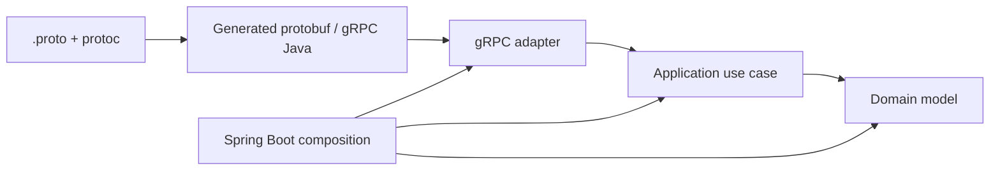

# Không để generated class lan vào domain

Trong **SPRING_GRPC**, mã Java sinh từ Protocol Buffers cung cấp message class, enum, descriptor và gRPC stub. Các class này hữu ích tại biên giao tiếp, nhưng nếu đưa chúng vào domain model hoặc application use case, quy tắc nghiệp vụ sẽ phụ thuộc vào schema và generator. Một thay đổi trong hợp đồng proto khi đó có thể buộc sửa cả domain, persistence và các adapter không liên quan đến gRPC.

Nguyên tắc kiến trúc là **giữ generated class ở lớp giao tiếp**. gRPC adapter nhận protobuf request, chuyển thành command hoặc value object thuần Java, gọi application service, rồi chuyển kết quả nghiệp vụ thành protobuf response. Domain không import `com.google.protobuf`, `io.grpc` hay package chứa generated code.

## 1. Vì sao generated class không thuộc domain?

Generated class mô tả hợp đồng truyền dữ liệu. Domain mô tả khái niệm và quy tắc nghiệp vụ. Hai mô hình có mục đích và vòng đời khác nhau.

Ví dụ, schema có thể khai báo:

```proto
message ReserveStockRequest {
  string sku = 1;
  int64 quantity = 2;
  optional string idempotency_key = 3;
}
```

Generator tạo `ReserveStockRequest` cùng builder, getter, parser, descriptor và API presence. Nếu domain nhận trực tiếp request này:

```java
// Không nên đặt chữ ký này trong domain/application service.
Reservation reserve(ReserveStockRequest request);
```

domain đã phụ thuộc vào package Java được quyết định bởi `java_package`, cách generator biểu diễn optional/enum/oneof, runtime `protobuf-java` và API của generated code. Domain model khi đó có thể phải đổi chỉ vì đội API đổi package protobuf hoặc thêm một field vận chuyển.

## 2. Đặt generated code ở đúng ranh giới

Một cách chia module điển hình:

```text
inventory-domain/
  Sku.java
  Quantity.java
  Stock.java
  StockNotFoundException.java

inventory-application/
  ReserveStockCommand.java
  ReservationResult.java
  ReserveStockUseCase.java

inventory-grpc-adapter/
  proto/inventory.proto
  generated/
  InventoryProtoMapper.java
  InventoryGrpcService.java

inventory-boot/
  Spring Boot configuration
```

Hướng phụ thuộc:



`inventory-grpc-adapter` phụ thuộc application và generated code. Application có thể phụ thuộc domain. Domain không phụ thuộc adapter, Spring, gRPC hay protobuf.

Nếu generated code được đóng gói thành contract JAR dùng chung, chỉ các adapter cần compile với JAR đó. Không thêm contract JAR vào domain chỉ để tiện dùng một message class.

## 3. Dùng command và value object thuần Java

Schema ở biên có `string sku` và `int64 quantity`. Domain có thể biểu diễn chúng bằng value object để giữ invariant:

```java
public record Sku(String value) {
    public Sku {
        if (value == null || value.isBlank()) {
            throw new InvalidSkuException();
        }
        value = value.trim();
        if (!value.matches("[A-Z0-9-]{3,32}")) {
            throw new InvalidSkuException();
        }
    }
}

public record Quantity(long value) {
    public Quantity {
        if (value <= 0) {
            throw new InvalidQuantityException();
        }
    }
}
```

Application command và result chỉ chứa kiểu Java/domain:

```java
public record ReserveStockCommand(
        Sku sku,
        Quantity quantity,
        Optional<String> idempotencyKey) {
}

public record ReservationResult(
        String reservationId,
        Sku sku,
        long remainingQuantity) {
}

public interface ReserveStockUseCase {
    ReservationResult reserve(ReserveStockCommand command);
}
```

Các kiểu này không biết protobuf field number, generated builder hoặc gRPC transport. Use case có thể được gọi từ gRPC, REST, message consumer, scheduler hoặc test mà không cần dựng protobuf message.

## 4. Chuyển đổi tại gRPC adapter

Mapper là nơi chuyển protobuf request thành application command và chuyển kết quả nghiệp vụ thành protobuf response.

```java
import org.springframework.stereotype.Component;

@Component
public class InventoryProtoMapper {

    public ReserveStockCommand toCommand(
            ReserveStockRequest request) {

        Optional<String> key = request.hasIdempotencyKey()
                ? Optional.of(request.getIdempotencyKey())
                : Optional.empty();

        return new ReserveStockCommand(
                new Sku(request.getSku()),
                new Quantity(request.getQuantity()),
                key);
    }

    public ReserveStockReply toProto(
            ReservationResult result) {

        return ReserveStockReply.newBuilder()
                .setReservationId(result.reservationId())
                .setSku(result.sku().value())
                .setRemaining(result.remainingQuantity())
                .build();
    }
}
```

Service adapter điều phối mapper và use case:

```java
@Service
public class InventoryGrpcService
        extends InventoryServiceGrpc.InventoryServiceImplBase {

    private final ReserveStockUseCase reserveStock;
    private final InventoryProtoMapper mapper;

    public InventoryGrpcService(
            ReserveStockUseCase reserveStock,
            InventoryProtoMapper mapper) {
        this.reserveStock = reserveStock;
        this.mapper = mapper;
    }

    @Override
    public void reserveStock(
            ReserveStockRequest request,
            StreamObserver<ReserveStockReply> observer) {
        try {
            ReserveStockCommand command = mapper.toCommand(request);
            ReservationResult result = reserveStock.reserve(command);

            observer.onNext(mapper.toProto(result));
            observer.onCompleted();
        } catch (InvalidSkuException | InvalidQuantityException error) {
            observer.onError(Status.INVALID_ARGUMENT
                    .withDescription("Invalid stock request")
                    .asRuntimeException());
        } catch (RuntimeException error) {
            observer.onError(Status.INTERNAL
                    .withDescription("Internal server error")
                    .asRuntimeException());
        }
    }
}
```

Ví dụ rút gọn này minh họa vị trí của mapping. Trong ứng dụng thực tế, lỗi domain đã biết cần được ánh xạ theo error contract của service; lỗi bất ngờ cần được log ở adapter/interceptor với correlation ID. Điểm kiến trúc quan trọng là `ReserveStockUseCase` không nhận `ReserveStockRequest`, không trả `ReserveStockReply` và không biết `StreamObserver`.

## 5. Xử lý presence, oneof và enum ở biên

Generated API có những semantics mà domain không nên phải kế thừa nguyên trạng.

### Optional scalar

Với proto3 scalar thông thường, getter trả giá trị mặc định khi field vắng mặt. Nếu nghiệp vụ cần phân biệt “không gửi” với “gửi giá trị mặc định”, khai báo `optional` và kiểm tra `hasX()` trong mapper.

```proto
message SearchRequest {
  optional int32 page_size = 1;
}
```

Mapper chuyển thành `OptionalInt` hoặc kiểu tương đương của application. Không truyền cả protobuf request vào domain để domain tự gọi `hasPageSize()`.

### Oneof

`oneof` tạo API case/accessor riêng. Chuyển nó thành kiểu nghiệp vụ rõ ràng:

```proto
message PaymentMethod {
  oneof method {
    CardPayment card = 1;
    BankTransfer bank_transfer = 2;
  }
}
```

Domain có thể dùng sealed interface hoặc value object:

```java
public sealed interface PaymentInstrument
        permits CardInstrument, BankInstrument {
}

public record CardInstrument(String tokenReference)
        implements PaymentInstrument {
}

public record BankInstrument(String accountReference)
        implements PaymentInstrument {
}
```

Mapper switch theo `getMethodCase()` rồi tạo đúng loại domain. Nhánh `METHOD_NOT_SET` phải được xử lý rõ: từ chối request nếu nghiệp vụ yêu cầu phương thức thanh toán, hoặc ánh xạ thành trạng thái chưa chọn nếu use case cho phép.

### Enum và giá trị chưa biết

Không dùng `ordinal()` để ánh xạ protobuf enum sang domain enum. Numeric value trong protobuf là một phần wire contract; thứ tự enum trong Java không phải hợp đồng ổn định.

Dùng switch tường minh và xử lý `UNRECOGNIZED`/giá trị mới theo chính sách tương thích. Nếu client mới gửi enum value mà server cũ chưa biết, adapter có thể trả `INVALID_ARGUMENT` hoặc dùng fallback nghiệp vụ được định nghĩa. Domain không nên chứa enum generated chỉ để giữ giá trị chưa nhận diện.

## 6. Chuyển các kiểu protobuf đặc biệt

| Protobuf type | Kiểu phù hợp ở application/domain | Lưu ý |
| --- | --- | --- |
| `string` | `String` hoặc value object | Chuẩn hóa và validate tại biên/domain |
| `int32`, `int64` | `int`, `long` hoặc value object | Kiểm tra overflow khi chuyển sang kiểu hẹp hơn |
| `repeated T` | `List<T>` | Copy thành collection bất biến nếu cần |
| `map<K,V>` | `Map<K,V>` | Không giữ generated map view |
| `Timestamp` | `Instant` | Giữ chính xác seconds/nanos |
| `Duration` | `java.time.Duration` | Xác định quy tắc âm/dương theo nghiệp vụ |
| `ByteString` | `byte[]` hoặc binary value object | Copy dữ liệu và bảo vệ tính bất biến |
| `Any` | Kiểu nghiệp vụ đã biết hoặc payload adapter riêng | Không để domain phụ thuộc type URL tùy ý |
| `FieldMask` | Tập field/path nghiệp vụ | Validate path và quyền cập nhật |

Ví dụ chuyển `Timestamp` ở adapter:

```java
Instant toInstant(com.google.protobuf.Timestamp value) {
    return Instant.ofEpochSecond(
            value.getSeconds(),
            value.getNanos());
}
```

Nếu dùng protobuf utility có sẵn, có thể dùng `Timestamps.toInstant(value)` trong module adapter. Không đưa `com.google.protobuf.Timestamp` vào entity hoặc repository domain.

Với `ByteString`, `toByteArray()` tạo mảng byte để truyền qua ranh giới. Nếu domain lưu binary data, value object cần defensive copy để caller không sửa dữ liệu sau khi tạo object.

## 7. Không đưa gRPC API vào application contract

Các kiểu sau cũng thuộc transport/adapter, không thuộc domain:

- `StreamObserver`, `Status`, `StatusRuntimeException`.
- `Metadata`, `CallOptions`, `Channel`, `ManagedChannel`.
- `ServerCall`, `ServerInterceptor`, `Context`.
- `Message`, `GeneratedMessageV3`, `Descriptors`.
- `ByteString`, `UnknownFieldSet` và protobuf descriptor.

Application streaming contract có thể trả về `Iterable<StockSnapshot>`, `Flow.Publisher<StockSnapshot>` hoặc abstraction phù hợp với kiến trúc ứng dụng. Adapter chịu trách nhiệm chuyển từng item thành protobuf message và gửi qua observer. Không truyền `StreamObserver` vào use case để domain điều khiển lifecycle gRPC.

Tương tự, cancellation/deadline từ gRPC có thể được adapter chuyển thành cancellation signal hoặc deadline abstraction của application. Domain không cần đọc `io.grpc.Context.current()`.

## 8. Giữ persistence model độc lập với protobuf

Không dùng generated message làm entity JPA hoặc document persistence chỉ vì các field hiện tại giống nhau.

Nếu entity được tạo trực tiếp từ protobuf:

- Schema transport đổi có thể kéo theo migration persistence.
- Presence/default semantics của protobuf có thể khác nullability của database.
- Generated message bất biến và builder-oriented, trong khi persistence cần lifecycle/identity riêng.
- Field phục vụ API có thể không thuộc dữ liệu cần lưu.
- Domain validation dễ bị bỏ qua khi parse message trực tiếp.

Hãy map theo chuỗi:

`protobuf request → application command → domain model → persistence model`

Ở chiều trả về:

`persistence/domain result → application result → protobuf response`

Không nhất thiết phải tạo một DTO riêng cho mỗi lớp nếu mô hình thực sự trùng nhau và không tạo coupling. Nhưng ranh giới domain/application không nên nhận generated type chỉ để tiết kiệm vài dòng mapping.

## 9. Kiểm thử mapper và ranh giới kiến trúc

### Unit test cho mapper

Test mapping cả giá trị hợp lệ lẫn presence:

```java
@Test
void mapsRequestToApplicationCommand() {
    ReserveStockRequest request = ReserveStockRequest.newBuilder()
            .setSku("BOOK-101")
            .setQuantity(3)
            .setIdempotencyKey("req-123")
            .build();

    ReserveStockCommand command = mapper.toCommand(request);

    assertEquals(new Sku("BOOK-101"), command.sku());
    assertEquals(new Quantity(3), command.quantity());
    assertEquals(Optional.of("req-123"), command.idempotencyKey());
}

@Test
void preservesAbsentOptionalField() {
    ReserveStockRequest request = ReserveStockRequest.newBuilder()
            .setSku("BOOK-101")
            .setQuantity(3)
            .build();

    ReserveStockCommand command = mapper.toCommand(request);

    assertEquals(Optional.empty(), command.idempotencyKey());
}
```

Domain unit tests chỉ dựng `Sku`, `Quantity` và domain objects thuần Java. Không cần protobuf runtime hoặc gRPC test server.

### Architecture test với ArchUnit

Có thể thêm rule để ngăn domain/application phụ thuộc transport:

```java
@AnalyzeClasses(packages = "com.example.inventory")
class ArchitectureRulesTest {

    @ArchTest
    static final ArchRule domainAndApplicationDoNotDependOnGrpc =
            noClasses()
                    .that().resideInAnyPackage(
                            "..domain..",
                            "..application..")
                    .should().dependOnClassesThat()
                    .resideInAnyPackage(
                            "io.grpc..",
                            "com.google.protobuf..",
                            "com.example.inventory.grpc.v1..");
}
```

Thay `com.example.inventory.grpc.v1..` bằng package Java thực tế được đặt trong `java_package`. Rule này phát hiện import trực tiếp và dependency bytecode tới generated code. Nếu module có nhiều contract package, liệt kê tất cả hoặc tổ chức generated code dưới một namespace riêng.

### Integration test cho adapter

Khởi động gRPC server test, gọi generated stub và xác nhận:

- Request protobuf được mapper thành command đúng.
- Use case nhận domain value object, không nhận protobuf message.
- Response protobuf phản ánh kết quả application.
- Domain exception được adapter chuyển thành status theo contract.
- Streaming adapter chuyển từng domain item thành message và kết thúc đúng lifecycle.

Integration test chứng minh adapter wiring; architecture test bảo vệ hướng phụ thuộc lâu dài.

## 10. Quy tắc module và build dependency

Trong multi-module Gradle/Maven, đặt dependency theo hướng:

| Module | Được phụ thuộc vào | Không nên phụ thuộc vào |
| --- | --- | --- |
| `inventory-domain` | JDK và thư viện domain thuần | gRPC, protobuf, Spring, generated contract |
| `inventory-application` | domain và application ports | generated protobuf, `io.grpc` |
| `inventory-grpc-adapter` | application, domain, generated code, grpc runtime | — |
| `inventory-boot` | các adapter và application để composition | Không đặt nghiệp vụ vào bootstrap |

Generated source nên được tạo trong module adapter hoặc contract module riêng. Nếu contract module là artifact độc lập, adapter client/server phụ thuộc vào nó; domain/application vẫn không cần biết artifact đó.

Có thể kiểm tra dependency graph bằng Gradle `dependencies` hoặc Maven `dependency:tree`. Nếu `inventory-domain` kéo `protobuf-java` hoặc `grpc-api` theo đường transitive, tìm dependency gây ra và sửa hướng phụ thuộc thay vì chỉ exclude tùy tiện.

## 11. Khi nào có thể chia sẻ protobuf type?

Có những hệ thống nhỏ dùng protobuf message trực tiếp trong application layer để giảm mapping. Đây là lựa chọn kiến trúc có đánh đổi, không phải quy tắc mặc định.

Chỉ cân nhắc khi:
- Ứng dụng có một transport duy nhất và protobuf được chọn làm application contract có chủ đích.
- Team chấp nhận domain/application gắn với schema, generator và runtime protobuf.
- Schema được quản lý như API nội bộ ổn định, có compatibility policy.
- Không có nhu cầu tái sử dụng use case từ REST, message consumer hoặc batch mà không mang protobuf runtime vào.

Ngay cả khi chọn cách này, không nên để entity và domain invariant phụ thuộc generated class nếu chúng có vòng đời độc lập. Với hệ thống có domain model rõ ràng hoặc nhiều adapter, giữ mapping ở biên thường giúp thay đổi transport ít ảnh hưởng hơn.

## 12. Bài tập thực hành

1. Tạo module `inventory-domain`, `inventory-application` và `inventory-grpc-adapter`.
2. Sinh `ReserveStockRequest` và `ReserveStockReply` trong adapter.
3. Tạo `Sku`, `Quantity`, command và result bằng Java thuần.
4. Viết mapper protobuf-to-command và result-to-protobuf.
5. Thêm `optional` field và kiểm tra mapper phân biệt absent với giá trị mặc định.
6. Thêm `oneof` và enum; xử lý case chưa chọn và enum chưa nhận diện.
7. Viết ArchUnit rule cấm domain/application phụ thuộc `io.grpc`, `com.google.protobuf` và package generated.
8. Chạy dependency report để xác nhận domain module không kéo protobuf/grpc runtime.
9. Viết integration test gọi generated stub và xác minh application use case chỉ nhận command/domain types.
10. Thay đổi `java_package` hoặc thêm field transport-only; xác nhận domain module không cần sửa.

### Ghi nhớ

**Generated class là mô hình của giao thức, không phải mô hình domain.** Giữ protobuf message, gRPC stub, observer, status và metadata trong adapter. Chuyển request thành command/value object thuần Java trước khi gọi use case; chuyển kết quả nghiệp vụ thành response protobuf sau khi use case hoàn tất. Dùng mapper, module dependency direction và architecture tests để bảo đảm thay đổi proto không lan vào domain.

## Tài liệu tham khảo

- [Protocol Buffers — Java Generated Code](https://protobuf.dev/reference/java/java-generated/)
- [Protocol Buffers — Proto3 Language Guide](https://protobuf.dev/programming-guides/proto3/)
- [gRPC Java — Generated Code](https://grpc.io/docs/languages/java/generated-code/)
- [ArchUnit — User Guide](https://www.archunit.org/userguide/html/000_Index.html)
