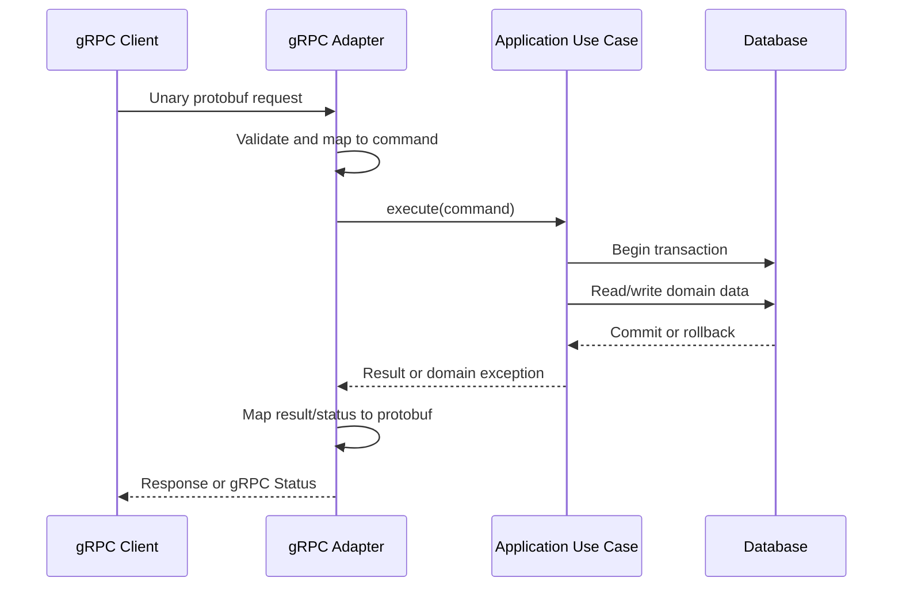

# Transaction trong adapter

Trong **SPRING_GRPC**, gRPC service adapter nhận request protobuf, chuyển thành lệnh ứng dụng, gọi use case và gửi response qua `StreamObserver`. Khi use case đọc hoặc ghi database, cần xác định transaction bao quanh phần nghiệp vụ nào và thời điểm transaction commit so với việc trả kết quả RPC.

Một RPC không tự động là một database transaction. gRPC quản lý vòng đời lời gọi và truyền status/message; Spring transaction quản lý tính nhất quán của tài nguyên như database. Bài này tập trung vào ranh giới transaction cho unary và streaming RPC, cách đặt `@Transactional`, xử lý rollback khi chuyển lỗi thành gRPC Status, và kiểm thử commit/rollback trong ứng dụng Spring gRPC.

## 1. Transaction thuộc application operation, không thuộc transport

Một luồng unary thường có các bước:

1. Nhận protobuf request và kiểm tra cấu trúc/định dạng.
2. Chuyển request thành command hoặc value object.
3. Gọi application use case thực hiện nghiệp vụ.
4. Use case đọc/ghi repository trong transaction.
5. Sau khi use case kết thúc, adapter chuyển kết quả thành protobuf response.
6. Adapter gửi response hoặc status cho client.

Transaction nên bao quanh đơn vị nghiệp vụ cần nguyên tử, thường là application use case. Adapter là điểm vào của transport và không nên giữ transaction trong lúc chờ network, gửi response hoặc xử lý metadata.



Tách boundary theo use case có các lợi ích:

- Domain và application không phụ thuộc gRPC.
- Cùng use case có thể được gọi từ REST, message consumer hoặc batch.
- Transaction có thể được kiểm thử độc lập với transport.
- Adapter chỉ chuyển đổi protocol và điều phối lời gọi.
- Thời gian transaction không bị kéo dài bởi việc gửi response qua mạng.

## 2. Đặt `@Transactional` ở application service

Ví dụ use case reserve tồn kho cần đọc số lượng hiện tại, kiểm tra invariant và cập nhật tồn kho. Những thao tác này phải nằm trong cùng transaction:

```java
@Service
public class ReserveStockService implements ReserveStockUseCase {

    private final StockRepository stocks;
    private final ReservationRepository reservations;

    public ReserveStockService(
            StockRepository stocks,
            ReservationRepository reservations) {
        this.stocks = stocks;
        this.reservations = reservations;
    }

    @Override
    @Transactional
    public ReservationResult reserve(ReserveStockCommand command) {
        Stock stock = stocks.findBySku(command.sku())
                .orElseThrow(() ->
                        new StockNotFoundException(command.sku()));

        stock.reserve(command.quantity());

        Reservation reservation =
                Reservation.create(command.sku(), command.quantity());

        stocks.save(stock);
        reservations.save(reservation);

        return ReservationResult.from(reservation, stock);
    }
}
```

Spring mở transaction khi lời gọi đi qua transaction proxy. Khi method kết thúc bình thường, transaction commit; nếu unchecked exception thoát ra ngoài, mặc định Spring đánh dấu rollback. Repository sử dụng cùng transaction manager/data source sẽ tham gia transaction đang hoạt động theo propagation mặc định `REQUIRED`.

Đọc dữ liệu có thể dùng:

```java
@Transactional(readOnly = true)
public StockSnapshot findStock(Sku sku) {
    return stocks.findBySku(sku)
            .map(StockSnapshot::from)
            .orElseThrow(() -> new StockNotFoundException(sku));
}
```

`readOnly = true` là hint cho transaction manager/provider và có thể tối ưu cách truy cập dữ liệu. Nó không thay thế authorization, validation hoặc bảo đảm rằng mọi database đều chặn ghi.

## 3. Adapter gọi use case và chuyển kết quả sau transaction

Adapter không cần tự mở transaction nếu use case đã xác định đúng boundary:

```java
@Service
public class StockGrpcService
        extends StockServiceGrpc.StockServiceImplBase {

    private final ReserveStockUseCase reserveStock;
    private final StockProtoMapper mapper;
    private final GrpcStatusMapper statuses;

    public StockGrpcService(
            ReserveStockUseCase reserveStock,
            StockProtoMapper mapper,
            GrpcStatusMapper statuses) {
        this.reserveStock = reserveStock;
        this.mapper = mapper;
        this.statuses = statuses;
    }

    @Override
    public void reserve(
            ReserveStockRequest request,
            StreamObserver<ReserveStockReply> observer) {
        try {
            ReserveStockCommand command = mapper.toCommand(request);
            ReservationResult result = reserveStock.reserve(command);

            observer.onNext(mapper.toProto(result));
            observer.onCompleted();
        } catch (StockDomainException error) {
            observer.onError(statuses.map(error));
        }
    }
}
```

Khi `reserveStock.reserve()` trả về, transaction của use case đã commit. Adapter sau đó mới dựng protobuf response và gọi observer. Nếu việc serialize/gửi response thất bại sau commit, database transaction không tự rollback vì RPC transport và database không có một transaction phân tán chung.

Đây là hành vi cần thiết kế có chủ đích: server có thể đã hoàn tất nghiệp vụ nhưng client không nhận được response do network interruption. Với lệnh có side effect như tạo order, thanh toán hoặc reserve stock, hãy dùng idempotency key để client có thể gửi lại mà không tạo tác động trùng.

## 4. Khi nào đặt `@Transactional` trên adapter?

Có thể đặt `@Transactional` trên public method của gRPC adapter nếu adapter thực sự là application boundary và lời gọi được thực hiện qua Spring proxy. Tuy nhiên, cách này làm transaction gắn với transport handler và dễ tạo khác biệt khi use case được gọi từ entry point khác.

Nếu chọn cách này, cần kiểm tra:

- Adapter là Spring-managed bean.
- Invocation từ gRPC runtime đi qua Spring AOP proxy.
- Method có visibility và cấu trúc tương thích với loại proxy đang dùng.
- Không gọi method transactional qua self-invocation trong cùng object.
- Không giữ transaction trong lúc chờ callback, network hoặc stream kéo dài.

Không đặt `@Transactional` lên private method rồi kỳ vọng Spring proxy áp dụng. Cũng không nên đánh dấu cả class adapter transactional nếu một số RPC chỉ đọc, một số RPC streaming hoặc không truy cập database.

Quy tắc thực tế: đặt transaction ở application service/use case; chỉ đặt ở adapter khi có lý do rõ ràng và đã kiểm tra proxy/lifecycle của server.

## 5. Rollback khi adapter chuyển exception thành Status

Đây là lỗi dễ gặp: exception bị bắt bên trong method đang có transaction, adapter chuyển nó thành `observer.onError(...)`, rồi method trả về bình thường. Spring thấy method kết thúc bình thường nên có thể commit transaction.

Ví dụ không an toàn:

```java
@Transactional
public void reserve(
        ReserveStockRequest request,
        StreamObserver<ReserveStockReply> observer) {
    try {
        applicationService.reserve(mapper.toCommand(request));
        observer.onCompleted();
    } catch (StockDomainException error) {
        observer.onError(statuses.map(error));
        // Method kết thúc bình thường: transaction có thể commit.
    }
}
```

Cách tốt hơn là để exception thoát khỏi transactional use case. Transaction interceptor xử lý rollback trước khi adapter nhận exception và map thành status:

```java
@Transactional
public ReservationResult reserve(ReserveStockCommand command) {
    Stock stock = stocks.findBySku(command.sku())
            .orElseThrow(() -> new StockNotFoundException(command.sku()));

    stock.reserve(command.quantity());
    reservations.save(Reservation.create(command));

    return ReservationResult.from(stock);
}
```

Adapter bắt exception sau lời gọi use case:

```java
try {
    ReservationResult result = useCase.reserve(command);
    observer.onNext(mapper.toProto(result));
    observer.onCompleted();
} catch (StockDomainException error) {
    observer.onError(statuses.map(error));
}
```

Nếu buộc phải bắt exception trong cùng transaction method, cần chủ động đánh dấu rollback-only hoặc ném lại exception theo rollback rule. Không dựa vào việc gọi `observer.onError()` để Spring tự biết phải rollback; observer là API của gRPC, không phải transaction API.

## 6. Quy tắc rollback và checked exception

Mặc định, Spring rollback transaction khi unchecked exception (`RuntimeException`) hoặc `Error` thoát khỏi transactional method. Checked exception không tự động kích hoạt rollback trong cấu hình mặc định.

Nếu use case ném checked exception mà cần rollback:

```java
@Transactional(rollbackFor = Exception.class)
public ReservationResult reserve(ReserveStockCommand command)
        throws StockOperationException {
    // Đọc/ghi trong cùng transaction.
}
```

Chỉ thêm `rollbackFor` theo semantics thực tế. Nếu một checked exception biểu thị kết quả nghiệp vụ được phép commit một phần, không nên rollback mọi checked exception. Với domain exception, nhiều ứng dụng chọn hierarchy kế thừa `RuntimeException` để transaction rollback mặc định phù hợp với lỗi nghiệp vụ làm operation thất bại.

Nếu dùng `noRollbackFor`, phải chắc chắn trạng thái dữ liệu sau exception vẫn hợp lệ. Đừng thay đổi rollback rule chỉ để status mapping ở adapter dễ viết hơn.

## 7. Nhiều repository và transaction manager

Một use case có thể ghi nhiều bảng hoặc aggregate trong cùng database. Các repository cần tham gia cùng transaction manager để tính nguyên tử được bảo đảm.

Ví dụ:

```java
@Transactional
public OrderResult placeOrder(PlaceOrderCommand command) {
    Order order = orderRepository.save(Order.create(command));
    inventoryRepository.reserve(command.items());
    paymentAttemptRepository.save(PaymentAttempt.pending(order.id()));

    return OrderResult.from(order);
}
```

Nếu ba repository cùng dùng một relational database và cùng transaction manager, các thay đổi có thể commit/rollback cùng nhau. Nếu mỗi repository dùng data source/transaction manager khác nhau, `@Transactional` đơn lẻ không tự tạo distributed transaction.

Không gọi một service bên ngoài hoặc một gRPC downstream trong khi đang giữ transaction database lâu nếu có thể tránh. Network call có độ trễ và lỗi độc lập; transaction mở lâu sẽ giữ lock/connection và làm tăng contention. Các phương án thường dùng là ghi outbox trong cùng transaction rồi publish sau commit, hoặc thiết kế saga/compensation cho quy trình nhiều service.

## 8. Transaction trong streaming RPC

Streaming có vòng đời khác unary. Một server-streaming RPC có thể giữ connection mở trong vài giây hoặc vài phút; client-streaming có thể gửi nhiều message theo tốc độ không đều. Không nên mở một transaction database rồi giữ nó xuyên suốt toàn bộ stream.

Rủi ro khi giữ transaction quá lâu:

- Giữ connection và lock database trong lúc chờ network.
- Tăng nguy cơ deadlock và transaction timeout.
- Giữ persistence context lớn khi stream nhiều message.
- Cancellation của client không nhất thiết rollback mọi công việc đã hoàn tất.
- Một lỗi ở cuối stream khó đảo ngược các side effect đã gửi ra ngoài.

### 8.1. Server streaming: đọc theo trang, transaction ngắn

Application service đọc một trang dữ liệu trong transaction rồi trả snapshot thuần Java:

```java
@Transactional(readOnly = true)
public List<StockSnapshot> loadPage(Sku sku, PageRequest page) {
    return repository.findSnapshots(sku, page);
}
```

Adapter gọi từng trang và gửi message sau khi transaction đọc trang đã kết thúc:

```java
PageRequest page = PageRequest.first(100);

while (page.hasNext()) {
    List<StockSnapshot> items = queryService.loadPage(sku, page);
    if (items.isEmpty()) {
        break;
    }

    for (StockSnapshot item : items) {
        observer.onNext(mapper.toProto(item));
    }

    page = page.next();
}
observer.onCompleted();
```

Ví dụ này cần bổ sung xử lý cancellation, backpressure và lỗi ở từng trang trong ứng dụng thực tế. Nếu cần snapshot nhất quán xuyên nhiều trang, phải chọn chiến lược phù hợp như snapshot/version token hoặc isolation level có chủ đích; không mặc định giữ transaction mở trong toàn bộ thời gian gửi stream.

### 8.2. Client streaming: chọn transaction theo message hoặc batch

Với client-streaming, mỗi `onNext` có thể gọi một application operation ngắn có transaction riêng:

```java
@Override
public StreamObserver<UploadChunk> upload(
        StreamObserver<UploadResult> responseObserver) {

    return new StreamObserver<>() {
        @Override
        public void onNext(UploadChunk chunk) {
            uploadUseCase.storeChunk(toCommand(chunk));
        }

        @Override
        public void onError(Throwable error) {
            uploadUseCase.markInterrupted(uploadId);
        }

        @Override
        public void onCompleted() {
            UploadResult result = uploadUseCase.complete(uploadId);
            responseObserver.onNext(mapper.toProto(result));
            responseObserver.onCompleted();
        }
    };
}
```

Trong ví dụ, `storeChunk` và `complete` là các application method có transaction độc lập. Đây là mô hình commit từng chunk; nếu stream bị ngắt giữa chừng, các chunk đã commit vẫn tồn tại và cần trạng thái upload để resume hoặc cleanup.

Nếu yêu cầu toàn bộ upload phải nguyên tử, không thể mặc định dùng transaction mở từ `onNext` đầu tiên đến `onCompleted` cuối cùng. Hãy ghi dữ liệu vào staging/session, validate khi hoàn tất rồi commit trạng thái cuối trong một transaction ngắn; hoặc dùng một quy trình workflow có compensation. Giới hạn kích thước, thời gian và số chunk để tránh buffer không kiểm soát.

## 9. Thread boundary, async callback và reactive transaction

Spring transaction thông thường với JDBC/JPA gắn với thread hiện tại. Khi code chuyển sang executor khác, transaction không tự truyền sang thread mới.

Ví dụ, nếu adapter nhận callback rồi gửi công việc sang executor:

- Đừng mở transaction trên callback thread rồi kỳ vọng worker thread dùng chung transaction đó.
- Hãy gọi một public application method có `@Transactional` từ worker thread để transaction được mở trên đúng thread.
- Không chia sẻ `EntityManager`, JDBC connection hoặc persistence entity đang managed giữa các thread.
- Khi xử lý callback streaming, mỗi lần gọi use case cần có transaction boundary rõ ràng.

Với reactive stack dùng R2DBC, transaction thường được quản lý qua Reactor Context và `ReactiveTransactionManager`, không phải thread-bound như JDBC/JPA. Cần dùng reactive transaction operator hoặc `@Transactional` trên reactive pipeline theo cấu hình Spring phù hợp. Không trộn blocking JPA trong event-loop rồi kỳ vọng reactive context tự quản lý transaction.

## 10. Deadline, cancellation và transaction timeout

gRPC deadline giới hạn thời gian client chờ RPC. Database transaction timeout giới hạn thời gian transaction có thể tồn tại. Hai loại timeout liên quan nhưng không tự động đồng nhất.

- Đặt deadline cho RPC từ client.
- Đặt timeout phù hợp cho application/database operation.
- Khi request bị hủy, dừng công việc có thể dừng an toàn và không tiếp tục tạo side effect.
- Kiểm tra cancellation trước khi bắt đầu bước ghi tiếp theo trong streaming workflow.
- Không giả định client timeout đồng nghĩa server transaction đã rollback.

Một tình huống quan trọng: server commit thành công nhưng response bị trễ hơn deadline. Client nhận `DEADLINE_EXCEEDED` và không biết chắc operation đã commit hay chưa. Với operation không idempotent, cần idempotency key hoặc API truy vấn trạng thái để client xác định kết quả trước khi retry.

## 11. Retry và transaction boundary

Retry thường phải tạo transaction mới cho mỗi lần thử. Nếu một exception đã đánh dấu transaction hiện tại rollback-only, bắt lỗi rồi retry tiếp trong cùng transaction có thể dẫn tới commit thất bại hoặc `UnexpectedRollbackException`.

Thiết kế an toàn:

1. Xác định lỗi có thể retry và operation có idempotent không.
2. Để một lần thực thi use case chạy trong transaction riêng.
3. Nếu transaction rollback, thực hiện retry ở lớp điều phối bên ngoài transaction.
4. Áp dụng backoff, giới hạn số lần thử và tôn trọng deadline.
5. Với side effect ngoài database, dùng outbox, idempotency hoặc compensation.

Không tự retry `INVALID_ARGUMENT`, `PERMISSION_DENIED` hoặc lỗi nghiệp vụ cố định. `UNAVAILABLE`/`ABORTED` có thể cần retry tùy semantics và khả năng lặp lại an toàn.

## 12. Kiểm thử transaction qua gRPC

Unit test application service kiểm tra logic nghiệp vụ và rollback có thể dùng transaction manager test. Nhưng integration test qua gRPC có một điểm khác: lời gọi server thường chạy trên thread khác với thread test.

Nếu test method có `@Transactional`, transaction của test không tự bao trùm transaction được mở trên server thread. Vì vậy, không dựa vào rollback cuối test để dọn dữ liệu mà RPC đã commit.

Một integration test nên kiểm tra trạng thái database sau RPC:

- RPC thành công: dữ liệu liên quan được commit đầy đủ.
- Domain exception sau một số thao tác ghi: mọi thay đổi trong use case transaction bị rollback.
- Exception bất ngờ: không để lại trạng thái ghi dở.
- Response mapping thất bại sau commit: kiểm tra idempotency/query status vì transaction đã kết thúc.
- Streaming bị hủy giữa chừng: xác nhận chính sách partial commit/resume/cleanup đúng như thiết kế.

Ví dụ khung kiểm thử:

```java
@SpringBootTest
class StockGrpcTransactionTest {

    @Autowired
    StockServiceGrpc.StockServiceBlockingStub client;

    @Autowired
    StockRepository stocks;

    @Test
    void successfulRpcCommitsReservation() {
        client.reserve(validRequest());

        assertThat(stocks.findBySku(new Sku("BOOK-101")))
                .get()
                .extracting(Stock::available)
                .isEqualTo(7);
    }

    @Test
    void failedUseCaseRollsBackAllWrites() {
        assertThatThrownBy(() -> client.reserve(requestThatFails()))
                .isInstanceOf(StatusRuntimeException.class);

        assertThat(stocks.findBySku(new Sku("BOOK-101")))
                .get()
                .extracting(Stock::available)
                .isEqualTo(10);
    }
}
```

Đây là khung minh họa; cần chuẩn bị fixture và database state độc lập cho từng test. Nếu server chạy trên thread riêng, dọn dữ liệu bằng transaction riêng hoặc reset fixture rõ ràng sau mỗi test.

## 13. Những lỗi transaction thường gặp

| Lỗi thiết kế | Hậu quả | Cách xử lý |
| --- | --- | --- |
| Đặt transaction quanh toàn bộ stream | Giữ lock/connection quá lâu | Transaction ngắn theo page, chunk hoặc finalize |
| Bắt exception rồi chỉ gọi `observer.onError` trong transactional method | Method trả bình thường, có thể commit | Để exception thoát khỏi use case hoặc đánh dấu rollback-only |
| Gọi transactional method qua self-invocation | Không đi qua proxy nên annotation không có hiệu lực như mong đợi | Tách bean/use case hoặc gọi qua proxy |
| Dùng transaction test để bao RPC server thread | Dữ liệu server commit ngoài transaction của test | Assert database state và cleanup riêng |
| Gọi downstream gRPC khi đang giữ DB transaction | Lock/connection bị giữ trong lúc network chậm | Outbox, saga hoặc tách bước |
| Retry trong transaction đã rollback-only | Retry vẫn ở trạng thái transaction lỗi | Retry bên ngoài boundary, mỗi lần thử một transaction mới |
| Cho rằng deadline hết thì transaction rollback | Server có thể đã commit | Idempotency key và truy vấn trạng thái |
| Chia sẻ entity/JPA session giữa callback threads | Lỗi thread-safety và persistence context | Truyền command/value object, mở transaction theo thread |

## 14. Bài tập thực hành

1. Viết `ReserveStockUseCase` có `@Transactional` để cập nhật tồn kho và lưu reservation trong cùng transaction.
2. Giữ gRPC adapter không truy cập repository trực tiếp; adapter chỉ map request/response và gọi use case.
3. Tạo domain exception phát sinh sau một thao tác ghi; xác nhận transaction rollback.
4. Bắt exception ở adapter sau khi use case trả lỗi và map thành gRPC Status; xác nhận database không có ghi dở.
5. Thử bắt exception bên trong transactional method rồi trả bình thường; quan sát vì sao rollback mặc định không xảy ra nếu không đánh dấu rollback-only.
6. Viết server-streaming use case đọc theo page và gửi từng page ngoài transaction.
7. Viết client-streaming upload theo chunk, ghi rõ chính sách partial commit và resume khi stream bị hủy.
8. Thử một application call chạy trên executor khác; xác nhận transaction được mở trong worker thread.
9. Viết integration test gọi generated stub và assert trạng thái database sau thành công/thất bại.
10. Thử client deadline hết sau khi server commit; dùng idempotency key để xác định operation đã được thực hiện hay chưa.

### Ghi nhớ

**Transaction nên bao quanh application operation cần tính nguyên tử, không bao quanh thời gian sống của kết nối gRPC.** Để use case quản lý `@Transactional`, để exception thoát qua transaction boundary trước khi adapter chuyển thành Status, và giữ transaction ngắn cho streaming. Deadline, network response và database commit là các sự kiện độc lập; hãy dùng idempotency, outbox và integration tests để xử lý trường hợp kết quả RPC không phản ánh chắc chắn trạng thái commit.

## Tài liệu tham khảo

- [Spring Framework — Declarative Transaction Management](https://docs.spring.io/spring-framework/reference/data-access/transaction/declarative.html)
- [Spring Framework — Transaction Propagation](https://docs.spring.io/spring-framework/reference/data-access/transaction/declarative/tx-propagation.html)
- [Spring Framework — Transaction Rollback Rules](https://docs.spring.io/spring-framework/reference/data-access/transaction/declarative/rolling-back.html)
- [gRPC — Deadlines](https://grpc.io/docs/guides/deadlines/)
- [gRPC — Cancellation](https://grpc.io/docs/guides/cancellation/)
