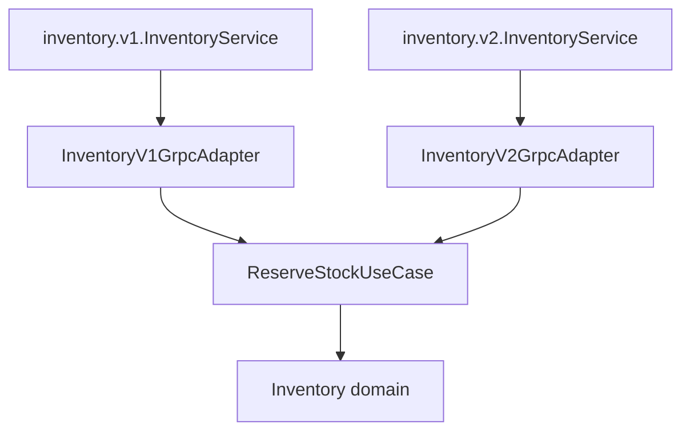

# Tách adapter theo service

Trong **SPRING_GRPC**, mỗi service được công bố bằng một gRPC contract có service name, RPC method và message riêng. Khi ứng dụng có nhiều service như tồn kho, đơn hàng và thanh toán, nên tổ chức gRPC adapter theo từng service contract. Mỗi adapter chịu trách nhiệm triển khai một generated service base class, chuyển request/response protobuf và gọi đúng application use case.

Cách tách này làm rõ quyền sở hữu API, mapper, authorization và kiểm thử. Các adapter vẫn có thể dùng chung domain model, application service và thành phần hạ tầng phù hợp. Mục tiêu là giữ mỗi service adapter nhỏ, có trách nhiệm rõ ràng và không biến một lớp gRPC duy nhất thành nơi chứa toàn bộ API của hệ thống.

## 1. Ranh giới của một service adapter

Một gRPC service được định danh bởi protobuf package và service name. Ví dụ:

```proto
syntax = "proto3";

package inventory.v1;

option java_package = "com.acme.contract.inventory.v1";
option java_multiple_files = true;

service InventoryService {
  rpc GetStock(GetStockRequest) returns (GetStockReply);
  rpc ReserveStock(ReserveStockRequest) returns (ReserveStockReply);
}
```

Service tồn kho có hai RPC nhưng vẫn là một service contract: **inventory.v1.InventoryService**. Generated code tạo base class và message types tương ứng. Adapter triển khai base class đó, thực hiện mapping và gọi application layer.

Một service khác có contract độc lập:

```proto
syntax = "proto3";

package pricing.v1;

option java_package = "com.acme.contract.pricing.v1";
option java_multiple_files = true;

service PricingService {
  rpc GetPrice(GetPriceRequest) returns (GetPriceReply);
}
```

Hai contract có thể cùng chạy trong một Spring Boot process, nhưng có hai adapter riêng. Mỗi adapter được đăng ký như một gRPC service độc lập trên server.

## 2. Cấu trúc package theo service

Một cách tổ chức dễ tìm và dễ mở rộng:

```text
com.acme.store
├── domain
│   ├── inventory
│   ├── pricing
│   └── order
├── application
│   ├── inventory
│   │   ├── GetStockUseCase.java
│   │   └── ReserveStockUseCase.java
│   ├── pricing
│   │   └── GetPriceUseCase.java
│   └── order
└── adapter
    └── grpc
        ├── inventory
        │   ├── InventoryGrpcService.java
        │   ├── InventoryProtoMapper.java
        │   └── InventoryStatusMapper.java
        ├── pricing
        │   ├── PricingGrpcService.java
        │   └── PricingProtoMapper.java
        └── common
            ├── GrpcErrorMapper.java
            └── RequestMetadata.java
```

Có thể dùng package riêng cho contract generated, ví dụ **com.acme.contract.inventory.v1** và **com.acme.contract.pricing.v1**. Không đặt generated source chung vào package domain hoặc application.

Tên package nên phản ánh service/contract, không nhất thiết phản ánh tên class implementation. Điều quan trọng là developer có thể lần từ protobuf service tới adapter, mapper và use case mà không phải tìm trong một lớp lớn.

## 3. Một adapter triển khai một generated service

Ví dụ adapter tồn kho:

```java
import io.grpc.Status;
import io.grpc.stub.StreamObserver;
import org.springframework.grpc.server.service.GrpcService;

@GrpcService
public class InventoryGrpcService
        extends InventoryServiceGrpc.InventoryServiceImplBase {

    private final GetStockUseCase getStock;
    private final ReserveStockUseCase reserveStock;
    private final InventoryProtoMapper mapper;
    private final GrpcErrorMapper errors;

    public InventoryGrpcService(
            GetStockUseCase getStock,
            ReserveStockUseCase reserveStock,
            InventoryProtoMapper mapper,
            GrpcErrorMapper errors) {
        this.getStock = getStock;
        this.reserveStock = reserveStock;
        this.mapper = mapper;
        this.errors = errors;
    }

    @Override
    public void getStock(
            GetStockRequest request,
            StreamObserver<GetStockReply> observer) {
        try {
            StockView result =
                    getStock.execute(mapper.toQuery(request));

            observer.onNext(mapper.toProto(result));
            observer.onCompleted();
        } catch (RuntimeException error) {
            observer.onError(errors.toStatus(error));
        }
    }

    @Override
    public void reserveStock(
            ReserveStockRequest request,
            StreamObserver<ReserveStockReply> observer) {
        try {
            ReservationView result =
                    reserveStock.execute(mapper.toCommand(request));

            observer.onNext(mapper.toProto(result));
            observer.onCompleted();
        } catch (RuntimeException error) {
            observer.onError(errors.toStatus(error));
        }
    }
}
```

Adapter pricing có trách nhiệm riêng:

```java
import io.grpc.stub.StreamObserver;
import org.springframework.grpc.server.service.GrpcService;

@GrpcService
public class PricingGrpcService
        extends PricingServiceGrpc.PricingServiceImplBase {

    private final GetPriceUseCase getPrice;
    private final PricingProtoMapper mapper;
    private final GrpcErrorMapper errors;

    public PricingGrpcService(
            GetPriceUseCase getPrice,
            PricingProtoMapper mapper,
            GrpcErrorMapper errors) {
        this.getPrice = getPrice;
        this.mapper = mapper;
        this.errors = errors;
    }

    @Override
    public void getPrice(
            GetPriceRequest request,
            StreamObserver<GetPriceReply> observer) {
        try {
            PriceView result =
                    getPrice.execute(mapper.toQuery(request));

            observer.onNext(mapper.toProto(result));
            observer.onCompleted();
        } catch (RuntimeException error) {
            observer.onError(errors.toStatus(error));
        }
    }
}
```

Hai class là hai Spring bean và hai gRPC service registration. Chúng không gọi trực tiếp lẫn nhau; nếu nghiệp vụ tồn kho cần giá, use case tồn kho gọi application port phù hợp hoặc một downstream client gateway, tùy ranh giới triển khai.

Ví dụ đã rút gọn phần logging và phân loại exception. Trong production, chỉ map lỗi đã biết theo error contract; lỗi bất ngờ cần được log ở một điểm có correlation ID rồi trả status an toàn. Không bắt exception chỉ để trả cùng một status cho mọi trường hợp.

## 4. Chia theo service contract, không chia tùy tiện theo method

Một service contract thường gom các RPC cùng một capability và cùng quyền sở hữu API. Ví dụ **InventoryService** có **GetStock** và **ReserveStock** vì cả hai thao tác trên capability tồn kho.

Không nên tách hai method của cùng một protobuf service thành hai implementation độc lập cùng đăng ký full service name. Server cần một service definition cho mỗi service name. Hai implementation cùng bind **inventory.v1.InventoryService** sẽ gây xung đột đăng ký hoặc hành vi không xác định theo cách cấu hình server.

Nếu class implementation quá lớn, giữ một façade triển khai generated base class rồi ủy quyền nội bộ:

```java
@GrpcService
public class InventoryGrpcService
        extends InventoryServiceGrpc.InventoryServiceImplBase {

    private final StockQueryRpcHandler queries;
    private final StockCommandRpcHandler commands;

    public InventoryGrpcService(
            StockQueryRpcHandler queries,
            StockCommandRpcHandler commands) {
        this.queries = queries;
        this.commands = commands;
    }

    @Override
    public void getStock(
            GetStockRequest request,
            StreamObserver<GetStockReply> observer) {
        queries.getStock(request, observer);
    }

    @Override
    public void reserveStock(
            ReserveStockRequest request,
            StreamObserver<ReserveStockReply> observer) {
        commands.reserveStock(request, observer);
    }
}
```

**StockQueryRpcHandler** và **StockCommandRpcHandler** là collaborator nội bộ, không đăng ký như service gRPC riêng. Cách này tách code theo nhóm thao tác mà vẫn giữ đúng một implementation cho contract **InventoryService**.

Khi capability có vòng đời, owner, security policy hoặc tốc độ thay đổi khác hẳn, cân nhắc tách thành protobuf service độc lập. Đừng tạo service mới chỉ để giảm vài method trong một class.

## 5. Giữ adapter mỏng và dùng chung application layer

Mỗi adapter nên làm các việc thuộc protocol boundary:

- Nhận protobuf request và kiểm tra các điều kiện hình thức.
- Map request thành application query/command.
- Gọi use case phù hợp.
- Map kết quả application thành protobuf response.
- Chuyển exception thành gRPC status.
- Phối hợp metadata, deadline, cancellation và streaming lifecycle ở tầng adapter.

Quy tắc nghiệp vụ, transaction và authorization nghiệp vụ nên nằm ở application/domain layer. Ví dụ **ReserveStockUseCase** không nhận **ReserveStockRequest**, không trả **ReserveStockReply** và không biết **StreamObserver**.

Nếu REST và gRPC cùng cung cấp thao tác reserve, cả hai adapter gọi cùng **ReserveStockUseCase**. Không copy logic reserve vào **InventoryGrpcService** rồi tạo một phiên bản khác trong REST controller.

## 6. Mapper và error policy theo service

Mỗi service có thể có mapper riêng vì protobuf schema và semantics khác nhau:

```java
@Component
public class InventoryProtoMapper {

    public ReserveStockCommand toCommand(
            ReserveStockRequest request) {
        return new ReserveStockCommand(
                new Sku(request.getSku()),
                new Quantity(request.getQuantity()));
    }

    public ReserveStockReply toProto(ReservationView result) {
        return ReserveStockReply.newBuilder()
                .setReservationId(result.id())
                .setSku(result.sku())
                .setReserved(result.quantity())
                .build();
    }
}
```

**PricingProtoMapper** có thể chuyển currency, price breakdown hoặc promotion fields theo contract pricing. Không dùng một mapper khổng lồ với hàng chục overload và điều kiện dựa trên service name.

Có thể chia sẻ error mapper cho các lỗi kỹ thuật phổ biến như validation, unauthenticated hoặc internal failure. Tuy nhiên, mapping domain error nên tôn trọng semantics của từng capability. Ví dụ **StockNotFound** có thể là **NOT_FOUND** trong Inventory API; **PriceUnavailable** có thể là **FAILED_PRECONDITION** hoặc **UNAVAILABLE** tùy đó là trạng thái nghiệp vụ cố định hay dependency tạm thời.

Đừng để một service adapter phụ thuộc mapper của service khác. Nếu có mapping chung thực sự, chuyển thành component dùng chung ở adapter layer, không kéo generated type của service A vào package service B.

## 7. Interceptor và policy theo service

Một server có thể có cross-cutting policy chung và policy riêng cho service:

| Phạm vi | Ví dụ | Cách tổ chức |
| --- | --- | --- |
| Toàn server | Trace propagation, request ID, logging | Global server interceptor |
| Một nhóm service | Authentication cho API nội bộ | Interceptor/policy gắn theo nhóm service |
| Một service | Quyền reserve tồn kho khác quyền đọc giá | Authorization theo full method name hoặc service policy |
| Một RPC | Validation đặc thù method | Adapter hoặc application validator |

Không nhân bản authentication, tracing và metrics trong từng method. Nhưng cũng không áp dụng một rule authorization quá rộng cho mọi service nếu quyền khác nhau.

Khi đăng ký interceptor theo service, dùng cơ chế registration mà phiên bản Spring gRPC của ứng dụng hỗ trợ và xác nhận interceptor thực sự chạy cho đúng service/method. Dù policy đặt ở đâu, application service vẫn phải bảo vệ invariant và quyền nghiệp vụ quan trọng; adapter interceptor không thay thế kiểm tra ở use case khi use case được gọi từ entry point khác.

## 8. Chia module theo service khi cần ranh giới triển khai

Trong ứng dụng nhỏ, nhiều adapter có thể nằm trong cùng module **grpc-adapter**. Khi các service có owner, release cadence hoặc dependency khác nhau, có thể tách module:

```text
inventory-contract/
inventory-application/
inventory-grpc-adapter/

pricing-contract/
pricing-application/
pricing-grpc-adapter/

store-boot/
  -> inventory-grpc-adapter
  -> pricing-grpc-adapter
  -> shared infrastructure
```

Không phải service nào cũng cần module riêng. Chỉ tách khi nó tạo ranh giới dependency, ownership hoặc deployment có giá trị. Nếu mọi module vẫn phụ thuộc vòng tròn hoặc phải release cùng nhau, việc chia module chỉ làm build phức tạp.

Các contract module chỉ chứa proto, generated code và metadata build cần thiết. Adapter module phụ thuộc application API và contract tương ứng. Domain/application không phụ thuộc generated contract chỉ vì cùng repository.

## 9. Tách client adapter theo downstream service

Nguyên tắc tương tự áp dụng ở phía gọi. Nếu ứng dụng gọi Inventory API và Pricing API, tạo gateway/client adapter riêng cho từng contract:

```java
public interface InventoryGateway {
    StockView getStock(Sku sku);
}

@Component
class GrpcInventoryGateway implements InventoryGateway {

    private final InventoryServiceGrpc.InventoryServiceBlockingStub stub;

    GrpcInventoryGateway(
            InventoryServiceGrpc.InventoryServiceBlockingStub stub) {
        this.stub = stub;
    }

    @Override
    public StockView getStock(Sku sku) {
        StockReply reply = stub.getStock(
                StockRequest.newBuilder()
                        .setSku(sku.value())
                        .build());

        return new StockView(reply.getSku(), reply.getAvailable());
    }
}
```

Pricing có gateway riêng và channel/configuration riêng nếu endpoint, TLS, credential, deadline hoặc load balancing khác nhau. Application use case phụ thuộc interface **InventoryGateway**/**PricingGateway**, không phụ thuộc generated stub.

Không dùng một **GrpcClientFacade** khổng lồ chứa mọi stub và expose generated request/response ra application. Gateway giúp cô lập wire contract, retry/deadline policy và mapping theo từng downstream.

## 10. Naming, versioning và service registration

Tên protobuf package và service là một phần của RPC path. Ví dụ **inventory.v1.InventoryService/GetStock**. Tổ chức Java package theo service/version để tránh generated class trùng tên và giúp nhận diện contract.

Khi phát hành v2, cân nhắc service name/package version mới nếu thay đổi không tương thích. Adapter v1 và v2 có thể cùng gọi một application use case, nhưng có mapper riêng cho từng contract:



Không đăng ký hai adapter cho cùng full service name để thay thế lẫn nhau. Nếu cần chạy song song version, mỗi version phải có service name riêng và contract tương ứng. Kiểm tra server startup logs hoặc reflection để xác nhận service được đăng ký đúng một lần.

## 11. Kiểm thử từng adapter độc lập

Tách adapter theo service giúp test tập trung vào contract tương ứng:

**Unit test mapper**
- Protobuf request hợp lệ chuyển thành command/query đúng.
- Optional/presence, enum, oneof và default value được xử lý đúng.
- Application result chuyển thành response protobuf không mất dữ liệu.
- Domain error được map thành status theo service contract.

**Adapter integration test**
- Khởi động Spring context và gRPC server test.
- Gọi generated stub của **InventoryService**; xác nhận đúng use case tồn kho được gọi.
- Gọi **PricingService**; xác nhận adapter pricing không đi qua use case tồn kho.
- Xác nhận hai service cùng đăng ký trên server mà không trùng full service name.
- Kiểm tra interceptor và authorization riêng theo service/method.
- Kiểm tra deadline, cancellation và streaming lifecycle cho các RPC cần thiết.

Có thể dùng in-process transport cho mapper/interceptor/service wiring. Với TLS, HTTP/2, load balancer hoặc proxy behavior, cần integration test trên transport mạng thật.

## 12. Những lỗi tổ chức thường gặp

| Lỗi | Hậu quả | Cách sửa |
| --- | --- | --- |
| Một class triển khai mọi service | Class lớn, dependency và policy lẫn nhau | Một adapter riêng cho mỗi service contract |
| Tách một protobuf service thành nhiều implementation cùng service name | Trùng service registration | Một façade implementation, ủy quyền cho handler nội bộ |
| Adapter gọi adapter khác | Coupling giữa transport boundary | Gọi application use case/port hoặc downstream gateway |
| Mapper dùng chung mọi schema | Điều kiện rẽ nhánh và generated types trộn lẫn | Mapper riêng theo contract, chỉ chia sẻ helper thật sự chung |
| Copy business logic vào từng adapter | Hành vi REST/gRPC không nhất quán | Dùng chung application use case |
| Global authorization áp dụng đồng loạt | Quyền giữa service bị sai | Policy theo service/method và kiểm tra nghiệp vụ |
| Tách module quá sớm | Build/dependency phức tạp | Bắt đầu bằng package boundary, tách module khi có lợi ích |
| Một client facade trả generated types cho application | Wire contract lan vào application | Gateway riêng và mapping sang kiểu nội bộ |

## 13. Bài tập thực hành

1. Tạo hai protobuf service **InventoryService** và **PricingService** với package/version riêng.
2. Sinh Java code cho từng contract và đặt generated package độc lập.
3. Tạo **InventoryGrpcService** và **PricingGrpcService**, mỗi class triển khai đúng generated base class.
4. Đăng ký cả hai adapter trong cùng Spring Boot gRPC server; xác nhận không trùng full service name.
5. Tạo mapper riêng và application use case tương ứng cho từng service.
6. Cho hai use case dùng chung domain component mà không gọi trực tiếp adapter của nhau.
7. Thêm authorization policy khác nhau cho **ReserveStock** và **GetPrice**.
8. Viết unit test mapper và integration test generated stub cho từng service.
9. Thêm một handler collaborator nội bộ cho Inventory nhưng giữ một service façade đăng ký trên server.
10. Nếu cần API v2, tạo contract/service name mới và cho adapter v1/v2 gọi cùng application use case qua mapper riêng.

### Ghi nhớ

**Tách adapter theo service nghĩa là mỗi protobuf service có một implementation và boundary giao tiếp rõ ràng.** Adapter riêng chịu trách nhiệm mapping, error/status và policy ở biên; application/domain được chia sẻ qua use case và port. Không tách nhiều implementation cùng đăng ký một service name, không để adapter gọi adapter khác và chỉ tách module khi ranh giới ownership/dependency thực sự cần thiết.

## Tài liệu tham khảo

- [Spring gRPC — Server Services](https://docs.spring.io/spring-grpc/reference/server.html)
- [Spring gRPC — Client Configuration](https://docs.spring.io/spring-grpc/reference/client.html)
- [gRPC — Concepts: Services and RPCs](https://grpc.io/docs/what-is-grpc/core-concepts/)
- [Protocol Buffers — Packages and Java Generated Code](https://protobuf.dev/reference/java/java-generated/)
- [gRPC — Versioning and API Evolution](https://grpc.io/docs/guides/api-evolution/)
