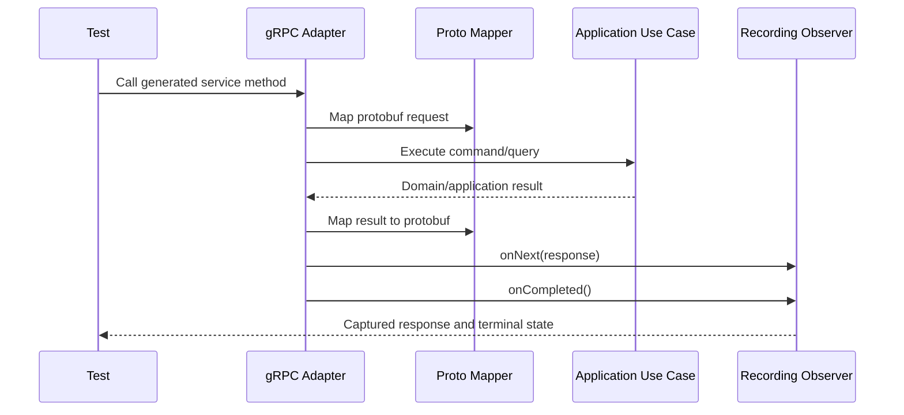

# Kiểm thử adapter độc lập với transport

Trong **SPRING_GRPC**, gRPC service adapter là ranh giới giữa protobuf contract và application use case. Adapter nhận generated request, chuyển thành query/command, gọi nghiệp vụ, ánh xạ kết quả hoặc exception rồi kết thúc RPC qua `StreamObserver`.

Có thể kiểm thử phần lớn hành vi của adapter mà không khởi động gRPC server, tạo channel hay mở socket. Bài kiểm thử gọi trực tiếp method của generated service implementation, dùng application port giả và một observer ghi nhận response/status. Cách này nhanh, xác định và tập trung vào trách nhiệm của adapter. Các hành vi phụ thuộc HTTP/2, TLS, marshalling hoặc network vẫn cần kiểm thử ở tầng transport riêng.

## 1. Xác định ranh giới cần kiểm thử

Một unary RPC đi qua nhiều lớp:



Trong unit test trực tiếp, test gọi adapter như một Java object. Không có server runtime, transport executor, HTTP/2 connection hoặc client stub. Vì vậy test có thể tập trung vào:

- Request protobuf được chuyển thành application input đúng.
- Use case phù hợp được gọi đúng số lần.
- Response protobuf phản ánh kết quả application.
- Domain/application exception được chuyển thành gRPC status đúng.
- Adapter phát đúng thứ tự message và chỉ kết thúc một lần.
- Streaming adapter xử lý completion và lỗi theo contract.

Đây là kiểm thử adapter boundary, không phải kiểm thử transport. Không dùng kết quả của test này để kết luận TLS, interceptor registration, deadline propagation qua network hoặc protobuf marshalling trên wire hoạt động đúng.

## 2. Phân biệt các tầng kiểm thử

| Tầng kiểm thử | Thành phần được kiểm tra | Có cần server/channel không? |
| --- | --- | --- |
| Mapper unit test | Protobuf ↔ command/result | Không |
| Adapter unit test | Generated service implementation, use case invocation, observer signals | Không |
| Spring wiring test | Bean creation, dependency injection, conditional configuration | Spring context; thường không cần socket |
| In-process gRPC test | Service registration, stub, interceptor, gRPC call pipeline | Có server/channel in-process |
| Network integration test | HTTP/2, TLS, port, proxy, load balancing, keepalive | Có transport mạng |

Không cần khởi động toàn bộ Spring Boot context cho mỗi mapper hoặc adapter unit test. Khởi tạo class adapter trực tiếp qua constructor giúp test nhanh và làm dependency của adapter hiện rõ.

## 3. Giữ adapter có dependency rõ ràng

Ví dụ contract có một unary RPC:

```proto
syntax = "proto3";

package catalog.v1;

option java_package = "com.acme.catalog.grpc.v1";
option java_multiple_files = true;

service CatalogService {
  rpc GetItem(GetItemRequest) returns (GetItemReply);
  rpc WatchItems(WatchItemsRequest) returns (stream ItemReply);
  rpc Upload(stream UploadChunk) returns (UploadResult);
}

message GetItemRequest {
  string item_id = 1;
}

message GetItemReply {
  string item_id = 1;
  string name = 2;
}

message WatchItemsRequest {
  string category = 1;
}

message UploadChunk {
  bytes data = 1;
}

message UploadResult {
  int64 bytes_received = 1;
}
```

Application layer dùng kiểu riêng:

```java
public record GetItemQuery(String itemId) {}

public record ItemView(String itemId, String name) {}

public interface GetItemUseCase {
    ItemView execute(GetItemQuery query);
}

public record WatchItemsQuery(String category) {}

public interface WatchItemsUseCase {
    Iterable<ItemView> execute(WatchItemsQuery query);
}
```

Mapper chuyển đổi ở biên:

```java
@Component
public class CatalogProtoMapper {

    public GetItemQuery toQuery(GetItemRequest request) {
        return new GetItemQuery(request.getItemId());
    }

    public GetItemReply toProto(ItemView item) {
        return GetItemReply.newBuilder()
                .setItemId(item.itemId())
                .setName(item.name())
                .build();
    }
}
```

Adapter phụ thuộc use case, mapper và error mapper qua constructor:

```java
@GrpcService
public class CatalogGrpcService
        extends CatalogServiceGrpc.CatalogServiceImplBase {

    private final GetItemUseCase getItem;
    private final CatalogProtoMapper mapper;
    private final GrpcErrorMapper errors;

    public CatalogGrpcService(
            GetItemUseCase getItem,
            CatalogProtoMapper mapper,
            GrpcErrorMapper errors) {
        this.getItem = getItem;
        this.mapper = mapper;
        this.errors = errors;
    }

    @Override
    public void getItem(
            GetItemRequest request,
            StreamObserver<GetItemReply> observer) {
        try {
            ItemView item = getItem.execute(mapper.toQuery(request));
            observer.onNext(mapper.toProto(item));
            observer.onCompleted();
        } catch (RuntimeException error) {
            observer.onError(errors.toStatus(error));
        }
    }
}
```

Trong unit test, tạo class này trực tiếp bằng constructor. Annotation `@GrpcService` phục vụ đăng ký service trong Spring gRPC runtime; nó không cần thiết để gọi method Java trực tiếp.

## 4. Tạo RecordingObserver để thu kết quả

Với unary RPC, test cần biết adapter đã gửi bao nhiêu response, có lỗi không và có gọi completion không. Một observer nhỏ giúp kiểm tra các điều kiện này:

```java
import io.grpc.stub.StreamObserver;
import java.util.ArrayList;
import java.util.List;

final class RecordingObserver<T> implements StreamObserver<T> {

    private final List<T> values = new ArrayList<>();
    private Throwable error;
    private boolean completed;

    @Override
    public void onNext(T value) {
        if (error != null || completed) {
            throw new AssertionError("onNext after terminal signal");
        }
        values.add(value);
    }

    @Override
    public void onError(Throwable error) {
        if (this.error != null || completed) {
            throw new AssertionError("Multiple terminal signals");
        }
        this.error = error;
    }

    @Override
    public void onCompleted() {
        if (error != null || completed) {
            throw new AssertionError("Multiple terminal signals");
        }
        completed = true;
    }

    List<T> values() {
        return List.copyOf(values);
    }

    Throwable error() {
        return error;
    }

    boolean completed() {
        return completed;
    }
}
```

Observer này cố ý đơn giản và chỉ dùng cho lời gọi đồng bộ trong unit test. Nếu adapter phát response từ executor khác, dùng latch/condition hoặc observer thread-safe; không đọc list trong khi worker vẫn đang ghi.

Các assertion cơ bản:

- Thành công: đúng một value, error bằng null và completed là true.
- Thất bại: error khác null và completed là false.
- Server-streaming: số lượng và thứ tự value đúng; sau đó có đúng một terminal signal.
- Không có response nào được phát sau onError hoặc onCompleted.

## 5. Unit test cho unary success

Dùng JUnit 5 và Mockito để thay application use case bằng mock. Test gọi method adapter trực tiếp:

```java
@ExtendWith(MockitoExtension.class)
class CatalogGrpcServiceTest {

    @Mock
    GetItemUseCase getItem;

    @Mock
    GrpcErrorMapper errors;

    private CatalogProtoMapper mapper;
    private CatalogGrpcService service;

    @BeforeEach
    void setUp() {
        mapper = new CatalogProtoMapper();
        service = new CatalogGrpcService(getItem, mapper, errors);
    }

    @Test
    void mapsRequestCallsUseCaseAndEmitsReply() {
        when(getItem.execute(new GetItemQuery("item-42")))
                .thenReturn(new ItemView("item-42", "Keyboard"));

        RecordingObserver<GetItemReply> observer =
                new RecordingObserver<>();

        service.getItem(
                GetItemRequest.newBuilder()
                        .setItemId("item-42")
                        .build(),
                observer);

        assertEquals(1, observer.values().size());
        assertEquals("item-42", observer.values().get(0).getItemId());
        assertEquals("Keyboard", observer.values().get(0).getName());
        assertNull(observer.error());
        assertTrue(observer.completed());

        verify(getItem).execute(new GetItemQuery("item-42"));
        verifyNoMoreInteractions(getItem);
    }
}
```

Test xác nhận luồng adapter từ protobuf request tới response protobuf. Nó không cần generated client stub vì mục tiêu là kiểm tra method implementation và mapping, không kiểm tra call pipeline.

Nếu mapper phức tạp, kiểm thử riêng mapper để phân biệt lỗi chuyển đổi với lỗi điều phối. Không mock mapper trong mọi test nếu việc dùng mapper thật đơn giản và giúp test xác minh contract thực tế.

## 6. Kiểm thử domain error và status mapping

Giả sử application use case ném `ItemNotFoundException` và error mapper chuyển thành `NOT_FOUND`. Test có thể kiểm tra status mà observer nhận:

```java
@Test
void mapsMissingItemToNotFound() {
    ItemNotFoundException domainError =
            new ItemNotFoundException("item-404");

    StatusRuntimeException grpcError =
            Status.NOT_FOUND
                    .withDescription("Item not found")
                    .asRuntimeException();

    when(getItem.execute(new GetItemQuery("item-404")))
            .thenThrow(domainError);
    when(errors.toStatus(domainError)).thenReturn(grpcError);

    RecordingObserver<GetItemReply> observer =
            new RecordingObserver<>();

    service.getItem(
            GetItemRequest.newBuilder()
                    .setItemId("item-404")
                    .build(),
            observer);

    assertTrue(observer.values().isEmpty());
    assertFalse(observer.completed());
    assertEquals(
            Status.Code.NOT_FOUND,
            Status.fromThrowable(observer.error()).getCode());

    verify(errors).toStatus(domainError);
}
```

Nên có test cho các nhóm lỗi quan trọng:

- Validation/request error → `INVALID_ARGUMENT`.
- Domain resource missing → `NOT_FOUND`.
- State conflict → `FAILED_PRECONDITION` hoặc `ABORTED` theo semantics.
- Authentication/authorization → `UNAUTHENTICATED` hoặc `PERMISSION_DENIED`.
- Lỗi bất ngờ → `INTERNAL` với description an toàn.

Không assert stack trace hoặc message nội bộ trong response. Test status code và structured details mà client contract cam kết; description chỉ nên được assert khi đó là một phần contract ổn định.

## 7. Kiểm thử mapper riêng

Mapper là thành phần thuần chuyển đổi nên thường không cần Mockito hoặc Spring context. Kiểm tra các semantics protobuf có thể bị bỏ sót:

```java
@Test
void preservesOptionalFieldPresence() {
    SearchRequest request = SearchRequest.newBuilder()
            .setPageSize(0)
            .build();

    SearchQuery query = mapper.toQuery(request);

    assertTrue(query.pageSize().isPresent());
    assertEquals(0, query.pageSize().getAsInt());
}

@Test
void distinguishesAbsentOptionalField() {
    SearchRequest request = SearchRequest.newBuilder().build();

    SearchQuery query = mapper.toQuery(request);

    assertTrue(query.pageSize().isEmpty());
}
```

Các trường hợp nên kiểm tra tùy schema:

- Optional scalar: absent khác với giá trị mặc định được gửi rõ ràng.
- Oneof: đúng case và trường hợp chưa chọn.
- Enum: mapping tường minh và giá trị chưa nhận diện.
- Timestamp/Duration: giữ seconds, nanos và quy tắc biên.
- Repeated/map: thứ tự hoặc tính bất biến theo contract.
- Field mask: path hợp lệ và path không được hỗ trợ.

Mapper test giúp phát hiện lỗi schema-to-domain trước khi lỗi xuất hiện trong server runtime.

## 8. Kiểm thử server-streaming trực tiếp

Adapter server-streaming thường phát nhiều response rồi hoàn tất:

```java
@Override
public void watchItems(
        WatchItemsRequest request,
        StreamObserver<ItemReply> observer) {
    try {
        for (ItemView item : watchItems.execute(
                new WatchItemsQuery(request.getCategory()))) {
            observer.onNext(mapper.toProto(item));
        }
        observer.onCompleted();
    } catch (RuntimeException error) {
        observer.onError(errors.toStatus(error));
    }
}
```

Test trực tiếp method và xác minh thứ tự:

```java
@Test
void emitsAllItemsInOrderThenCompletes() {
    when(watchItems.execute(any()))
            .thenReturn(List.of(
                    new ItemView("a", "Alpha"),
                    new ItemView("b", "Beta")));

    RecordingObserver<ItemReply> observer =
            new RecordingObserver<>();

    service.watchItems(
            WatchItemsRequest.newBuilder()
                    .setCategory("office")
                    .build(),
            observer);

    assertEquals(
            List.of("a", "b"),
            observer.values().stream()
                    .map(ItemReply::getItemId)
                    .toList());
    assertNull(observer.error());
    assertTrue(observer.completed());
}
```

Cũng cần test lỗi khi stream đang phát. Nếu một phần tử đã được gửi rồi iterator phát sinh exception, adapter phải kết thúc bằng onError và không gọi onCompleted. Các message đã gửi không thể thu hồi; client phải biết status cuối cùng của stream.

Observer giả kiểm tra thứ tự callback do adapter gọi. Nó không xác minh HTTP/2 flow control, `isReady()` hoặc scheduling của transport.

## 9. Kiểm thử client-streaming và bidirectional streaming

Client-streaming adapter trả về một observer để nhận các request message. Test có thể gọi observer đó trực tiếp:

```java
StreamObserver<UploadChunk> input =
        service.upload(responseObserver);

input.onNext(firstChunk);
input.onNext(secondChunk);
input.onCompleted();
```

Xác minh adapter:
- Chuyển từng chunk thành application command.
- Không xử lý chunk sau terminal signal.
- Gọi finalize đúng một lần khi input hoàn tất.
- Trả đúng một response và gọi completion.
- Chuyển lỗi input/application thành terminal status.
- Dừng hoặc cleanup khi input observer nhận onError.

Với bidirectional streaming, kiểm thử riêng hai hướng input/output và trạng thái terminal. Không giả định callback luôn chạy trên một thread trong mọi cấu hình runtime. Nếu adapter có xử lý bất đồng bộ, test phải đồng bộ hóa việc chờ kết quả thay vì đọc observer ngay sau khi submit task.

## 10. Test async adapter một cách xác định

Nếu adapter offload công việc sang executor, unit test không nên dựa vào sleep. Có hai cách:

1. Inject abstraction executor và dùng direct executor trong test để task chạy ngay trên thread gọi.
2. Dùng executor test có thể điều khiển, latch hoặc future để chờ task hoàn tất.

Ví dụ abstraction đơn giản:

```java
interface RpcTaskExecutor {
    void execute(Runnable task);
}

final class DirectRpcTaskExecutor implements RpcTaskExecutor {
    @Override
    public void execute(Runnable task) {
        task.run();
    }
}
```

Trong production, adapter nhận implementation backed by bounded executor; trong unit test, dùng direct implementation. Nếu test cần xác minh rejection, dùng fake executor ném exception có kiểm soát và assert adapter trả status overload.

Nếu adapter dùng gRPC Context, capture Context trước khi submit và wrap task. Unit test nên tạo context có key cụ thể, gọi adapter trong scope đó rồi xác nhận worker thấy đúng value. Cần test cancellation/race riêng nếu logic này thuộc trách nhiệm adapter.

## 11. Xác minh Spring wiring mà không mở network port

Unit test khởi tạo trực tiếp class không kiểm tra Spring có phát hiện bean hay inject đúng dependency. Nếu component scanning hoặc conditional configuration quan trọng, thêm một Spring context test nhỏ.

Context test nên xác minh:
- Adapter bean được tạo.
- Các mapper/use case collaborator được inject.
- Không có hai bean cùng triển khai một generated service definition gây registration conflict.
- Profile/configuration mong đợi tạo đúng adapter.

Có thể dùng Spring test context hoặc `ApplicationContextRunner` tùy cấu hình. Không cần mở port thật chỉ để kiểm tra constructor injection hoặc component scanning. Việc service có được gRPC server đăng ký và nhận RPC thực tế thuộc integration test với gRPC runtime.

## 12. Những điều unit test không thể xác minh

| Hành vi | Kiểm thử phù hợp |
| --- | --- |
| Mapping request/response và status | Mapper/adapter unit test |
| Use case được gọi đúng | Adapter unit test |
| Spring bean discovery và dependency injection | Spring context test |
| Generated service được đăng ký trên server | In-process/server integration test |
| Protobuf marshalling trên wire | In-process hoặc network integration test |
| HTTP/2, ALPN, TLS/mTLS và certificate validation | Network integration test |
| Deadline/cancellation qua transport thật | gRPC integration test |
| Load balancing, proxy idle timeout, keepalive | Environment/network test |
| Flow control và client đọc chậm | Streaming integration/load test |

Không cố mock `ServerCall`, `Channel`, `ManagedChannel` và mọi lớp transport trong unit test adapter nếu test chỉ cần kiểm tra mapping và observer contract. Mock sâu transport dễ tạo test phụ thuộc implementation và khó bảo trì.

## 13. Lỗi kiểm thử thường gặp

| Lỗi | Hậu quả | Cách sửa |
| --- | --- | --- |
| Khởi động Spring Boot server cho mọi unit test | Test chậm và lỗi do port/configuration | Gọi adapter trực tiếp qua constructor |
| Chỉ assert response mà bỏ terminal state | Bỏ sót onCompleted/onError sai | Kiểm tra cả values, error và completed |
| Mock mapper trong mọi test | Không phát hiện lỗi mapping thật | Dùng mapper thật khi phù hợp; test mapper riêng |
| Dùng sleep để chờ async task | Test flaky và chậm | Direct executor, latch hoặc future |
| Dùng observer không thread-safe cho async test | Race khi đọc kết quả | Đồng bộ hóa observer/test |
| Chỉ test happy path | Không phát hiện status mapping và lỗi stream | Test domain error, unexpected error và terminal behavior |
| Cho rằng direct method test xác minh TLS | Bỏ sót lỗi certificate/HTTP2 | Có network integration test riêng |
| Dùng test transaction bao RPC server thread | Không quan sát đúng commit thực tế | Assert database state sau lời gọi transport |
| Dùng một test khổng lồ cho mọi RPC | Khó xác định nguyên nhân lỗi | Tách test theo method và contract behavior |

## 14. Bộ test tối thiểu cho một service adapter

Trước khi thêm transport integration test, mỗi service adapter nên có tối thiểu:

- Unit test thành công cho từng unary RPC quan trọng.
- Test mapping domain error sang status.
- Test lỗi bất ngờ không lộ chi tiết nội bộ.
- Mapper test cho presence, oneof, enum và field đặc biệt nếu schema sử dụng.
- Streaming test cho thứ tự message và terminal signal.
- Test cancellation/rejection nếu adapter tự quản lý executor hoặc cancellation.
- Spring context test nếu bean discovery/conditional registration có rủi ro.

Không cần nhân bản cùng một test cho mọi getter đơn giản. Ưu tiên contract behavior, nhánh lỗi, mapping có semantics và những phần adapter thực sự điều phối.

### Ghi nhớ

**Kiểm thử adapter độc lập với transport bằng cách gọi trực tiếp generated service implementation, thay application dependency bằng mock/fake và thu callback qua RecordingObserver.** Cách này kiểm tra mapping, use case invocation, status và lifecycle của observer nhanh mà không cần server/channel/network. Giữ riêng Spring wiring test và transport integration test cho những hành vi mà unit test không thể quan sát.

## Tài liệu tham khảo

- [gRPC Java — Generated Code](https://grpc.io/docs/languages/java/generated-code/)
- [gRPC Java — StreamObserver](https://grpc.github.io/grpc-java/javadoc/io/grpc/stub/StreamObserver.html)
- [Spring gRPC — Server Services](https://docs.spring.io/spring-grpc/reference/server.html)
- [JUnit 5 — User Guide](https://junit.org/junit5/docs/current/user-guide/)
- [Mockito — Documentation](https://javadoc.io/doc/org.mockito/mockito-core/latest/org/mockito/Mockito.html)
