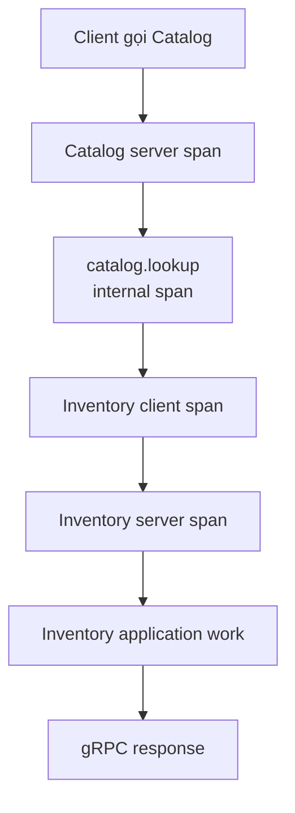
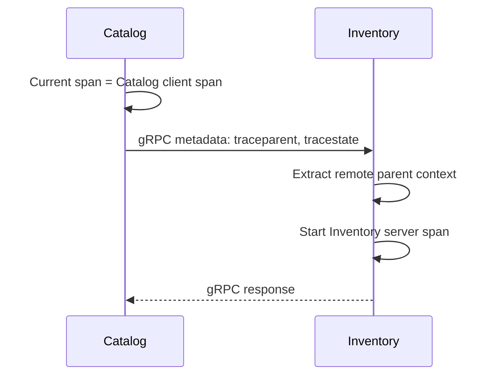
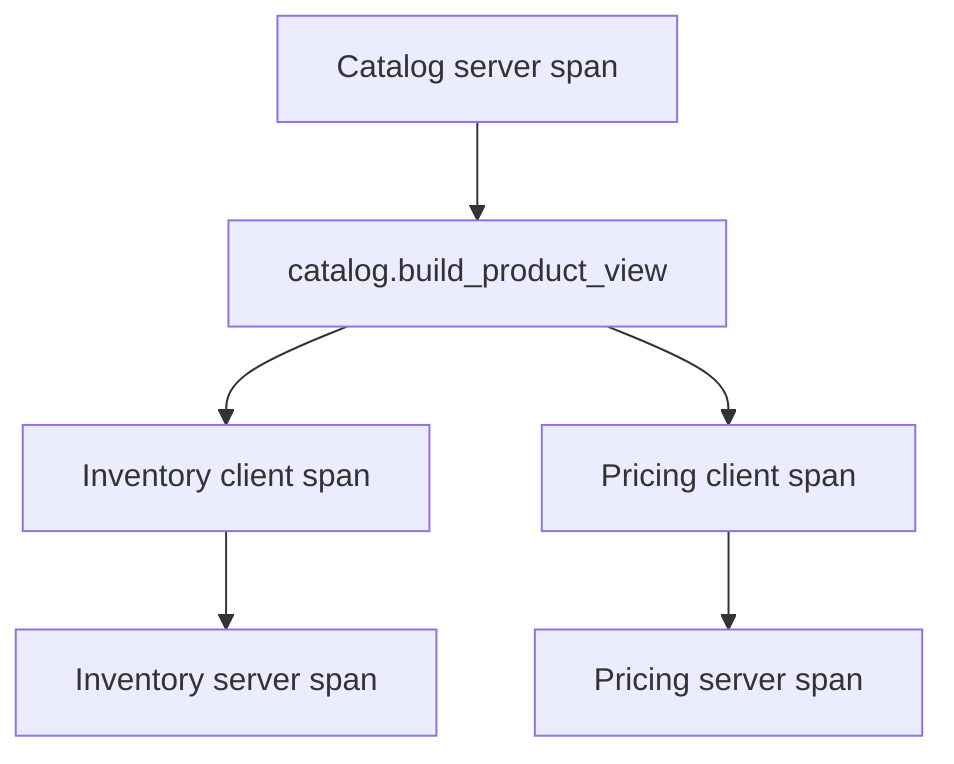

# Parent-child relationship qua downstream call

## 1. Vì sao cần parent-child relationship?

Trong hệ thống Spring gRPC, một request thường đi qua nhiều service trước khi tạo ra response cuối cùng. Ví dụ API Catalog nhận yêu cầu đọc sản phẩm, gọi Inventory để lấy tồn kho, rồi trả dữ liệu tổng hợp cho client. Nếu mỗi service tự tạo trace riêng mà không truyền context, hệ thống quan sát sẽ thấy nhiều trace rời rạc và khó xác định request ban đầu đã đi qua những thành phần nào.

OpenTelemetry mô hình hóa luồng xử lý bằng **trace** và **span**:

- **Trace** đại diện cho toàn bộ hành trình của một operation xuyên qua nhiều process.
- **Span** đại diện cho một đơn vị công việc có thời điểm bắt đầu/kết thúc, tên, kind, attributes, events và status.
- **Parent-child relationship** biểu diễn quan hệ nhân quả: span con được tạo trong context của span cha và mang parent span ID của span đó.
- **Trace context** mang trace ID, span ID và sampling flags qua ranh giới process.

Khi Catalog gọi Inventory bằng gRPC, outbound client span của Catalog là cha của inbound server span ở Inventory. Nhờ đó, trace hiển thị được cả thời gian chờ network, xử lý ở service gọi và xử lý ở service nhận.

## 2. Cây span qua downstream gRPC call

Một luồng điển hình có thể có bốn span:

1. Catalog/GetProduct — server span nhận request từ client bên ngoài.
2. catalog.lookup — internal span bao quanh bước điều phối use case trong Catalog.
3. Inventory/GetAvailability — client span được tạo khi Catalog gọi Inventory.
4. Inventory/GetAvailability — server span tại Inventory, nhận context từ client span ở Catalog.



Các span trong cùng trace dùng chung trace ID nhưng có span ID riêng. Parent span ID của mỗi span con trỏ tới span cha trực tiếp. Trong ví dụ, Inventory server span có parent là Inventory client span, không phải trực tiếp là Catalog server span. Cấu trúc này phản ánh chính xác call boundary.

Không tạo một trace mới cho mỗi downstream call nếu đó là phần tiếp nối của request hiện tại. Cũng không dùng chung một span ID cho nhiều operation; mỗi span là một đơn vị độc lập.

## 3. W3C Trace Context đi qua gRPC metadata

OpenTelemetry dùng propagator để chuyển trace context qua process boundary. W3C Trace Context định nghĩa các header phổ biến:

- traceparent: chứa version, trace ID, parent span ID và trace flags.
- tracestate: mang thông tin vendor-specific bổ sung theo chuẩn W3C.

Với gRPC, các giá trị này được truyền qua HTTP/2 metadata. Metadata key phải ở dạng ASCII lowercase; traceparent và tracestate là các key hợp lệ. OpenTelemetry propagator chịu trách nhiệm serialize và parse định dạng chuẩn.

Khi client instrumentation gọi downstream, nó inject context hiện tại vào metadata outbound. Server instrumentation đọc metadata inbound, extract context và dùng nó làm parent của server span mới.



Không tự tạo chuỗi traceparent bằng cách ghép trace ID và span ID. Cần dùng OpenTelemetry TextMapPropagator để tránh sai format, sampling flag hoặc xử lý version tương lai.

## 4. Ưu tiên gRPC auto instrumentation

Khi dùng OpenTelemetry Java agent hoặc instrumentation phù hợp với gRPC Java, instrumentation có thể tự động:

- Tạo server span khi nhận inbound gRPC call.
- Tạo client span khi generated stub gọi downstream qua instrumented channel.
- Extract/inject W3C Trace Context qua gRPC metadata.
- Ghi nhận method, status, error và timing theo semantic conventions của phiên bản instrumentation.
- Kết nối span với context hiện tại của request.

Trong Spring gRPC, hãy bảo đảm channel và server thực sự nằm trong phạm vi instrumentation. Nếu dùng custom channel factory, shaded Netty transport hoặc một transport khác, kiểm tra phiên bản agent/instrumentation hỗ trợ đúng implementation đó.

Chọn một chiến lược rõ ràng:

- **Auto instrumentation:** để agent/starter tạo gRPC client/server spans và propagation.
- **Manual instrumentation:** tự tạo spans và tự inject/extract context khi transport không được instrument.

Không cài manual client/server interceptor tạo cùng loại spans bên cạnh auto instrumentation nếu chưa có chủ đích. Nếu cả hai cùng tạo span cho một gRPC call, trace sẽ có duplicate spans, thời lượng khó hiểu và parent chain sai. Manual internal span cho bước nghiệp vụ riêng vẫn hữu ích khi auto instrumentation đã tạo transport spans.

## 5. Tạo internal span quanh application operation

Auto instrumentation thường tạo server span và outbound client span. Có thể bổ sung internal span để đo một bước điều phối có ý nghĩa trong application service, ví dụ lấy thông tin tồn kho trước khi hoàn tất kết quả sản phẩm.

Ví dụ dùng OpenTelemetry API với blocking stub:

```java
import io.grpc.StatusRuntimeException;
import io.grpc.Status;
import io.opentelemetry.api.trace.Span;
import io.opentelemetry.api.trace.SpanKind;
import io.opentelemetry.api.trace.StatusCode;
import io.opentelemetry.api.trace.Tracer;
import io.opentelemetry.context.Scope;

import java.util.concurrent.TimeUnit;

public final class ProductAvailabilityService {

    private final Tracer tracer;
    private final InventoryServiceGrpc.InventoryServiceBlockingStub inventoryStub;

    public ProductAvailabilityService(
            Tracer tracer,
            InventoryServiceGrpc.InventoryServiceBlockingStub inventoryStub) {
        this.tracer = tracer;
        this.inventoryStub = inventoryStub;
    }

    public AvailabilityResponse getAvailability(
            AvailabilityRequest request) {

        Span span = tracer.spanBuilder("catalog.lookup_inventory")
                .setSpanKind(SpanKind.INTERNAL)
                .setParent(io.opentelemetry.context.Context.current())
                .startSpan();

        try (Scope scope = span.makeCurrent()) {
            return inventoryStub
                    .withDeadlineAfter(400, TimeUnit.MILLISECONDS)
                    .getAvailability(request);

        } catch (StatusRuntimeException error) {
            span.recordException(error);
            if (Status.fromThrowable(error).getCode() != Status.Code.NOT_FOUND) {
                span.setStatus(StatusCode.ERROR);
            }
            throw error;

        } finally {
            span.end();
        }
    }
}
```

Khi gọi stub bên trong scope của internal span, gRPC client auto instrumentation nhìn thấy internal span là current context và tạo client span làm con của nó. Khi Inventory nhận call, server instrumentation extract client span context và tạo server span tiếp theo.

Ví dụ giả định gRPC client instrumentation đang hoạt động và Tracer được cung cấp từ OpenTelemetry SDK/autoconfiguration của ứng dụng. Nếu không có auto instrumentation cho client, cần tự tạo client span và propagation theo mục 7.

Ví dụ trên coi các downstream status khác `NOT_FOUND` là lỗi của operation. Đây chỉ là policy minh họa: nếu `NOT_FOUND` cũng là lỗi theo contract của use case, hãy đánh dấu span ERROR; nếu đó là kết quả nghiệp vụ dự kiến, giữ status theo semantics của ứng dụng. Không áp dụng một bảng ánh xạ status máy móc cho mọi RPC.

Trong code production, import thêm java.util.concurrent.TimeUnit; AvailabilityRequest và AvailabilityResponse là protobuf types của ví dụ. Không giữ scope mở qua một operation không đồng bộ.

## 6. Parent-child qua nhiều downstream calls

Một application operation có thể gọi nhiều dependency. Nếu Catalog gọi Inventory và Pricing song song, hai client spans có thể cùng là con của internal span catalog.build_product_view:



Đây là hai nhánh con song song, không phải Inventory span là cha của Pricing span. Parent relationship biểu diễn quan hệ tạo span, không phải thứ tự hoàn tất hoặc thứ tự trong source code.

Nếu công việc được tách thành message hoặc job chạy độc lập sau khi request hiện tại kết thúc, cần cân nhắc tạo trace/span mới và dùng span link để thể hiện quan hệ nhân quả. Không kéo dài một request span qua thời gian chờ queue hoặc tác vụ nền nhiều phút nếu lifecycle của chúng độc lập.

## 7. Khi cần propagation thủ công

Nếu transport chưa được auto instrument, có thể dùng TextMapPropagator để inject/extract context qua io.grpc.Metadata. Không tự parse header bằng string logic riêng.

Carrier setter cho metadata ASCII:

```java
import io.grpc.Metadata;
import io.opentelemetry.context.propagation.TextMapGetter;
import io.opentelemetry.context.propagation.TextMapSetter;

static final TextMapSetter<Metadata> METADATA_SETTER =
        (carrier, key, value) -> {
            Metadata.Key<String> metadataKey =
                    Metadata.Key.of(
                            key,
                            Metadata.ASCII_STRING_MARSHALLER);
            carrier.put(metadataKey, value);
        };
```

Server side cần getter tương ứng để đọc metadata ASCII. Bỏ qua binary metadata keys vì W3C trace headers là ASCII:

```java
static final TextMapGetter<Metadata> METADATA_GETTER =
        new TextMapGetter<>() {
            @Override
            public Iterable<String> keys(Metadata carrier) {
                return carrier.keys().stream()
                        .filter(key -> !key.endsWith("-bin"))
                        .toList();
            }

            @Override
            public String get(Metadata carrier, String key) {
                return carrier.get(Metadata.Key.of(
                        key, Metadata.ASCII_STRING_MARSHALLER));
            }
        };
```

Extraction dùng cùng propagator:

```java
io.opentelemetry.context.Context extracted = propagator.extract(
        io.opentelemetry.context.Context.current(),
        headers,
        METADATA_GETTER);
```

Ở outbound client interceptor, inject current OpenTelemetry context vào metadata trước khi call được gửi:

```java
propagator.inject(
        io.opentelemetry.context.Context.current(),
        headers,
        METADATA_SETTER);
```

Ở inbound server interceptor, dùng TextMapGetter<Metadata> để đọc các key W3C rồi gọi propagator.extract(...). Context được extract phải được đặt current trong lúc dispatch service và trong các callback của server call. Khi tự triển khai interceptor, cần wrap listener callbacks như onMessage, onHalfClose, onCancel, onComplete và onReady để khôi phục đúng OpenTelemetry context trên thread callback.

Đây là phần dễ làm sai khi tự viết propagation: mở Scope quanh next.startCall(...) rồi đóng ngay không đủ để giữ context cho callback xảy ra sau đó. Ưu tiên gRPC OpenTelemetry instrumentation đã xử lý lifecycle này. Chỉ tự viết interceptor khi có lý do cụ thể và đã test đầy đủ các callback.

Propagation và span creation là hai việc riêng. Nếu tự instrument client, `ClientInterceptor` cần tạo một span `CLIENT` với current context làm parent, inject context chứa span đó vào metadata, rồi giữ span mở tới terminal callback `ClientCall.Listener.onClose(...)`. Tại terminal callback, ghi status/error phù hợp và gọi `end()` đúng một lần. Không tạo client span rồi kết thúc ngay sau `start(...)`, vì thời lượng khi đó chỉ đo thời điểm khởi tạo chứ không đo downstream call.

Không truyền trace context bằng protobuf field nghiệp vụ. Trace context là transport metadata, có thể được thay đổi bởi proxy và instrumentation theo chuẩn propagation.

## 8. OpenTelemetry Context và thread bất đồng bộ

io.opentelemetry.context.Context lưu context hiện tại của trace. Khi code chạy trên executor khác, context có thể không tự đi theo nếu executor không được instrument hoặc wrap.

Có thể chụp context và wrap tác vụ:

```java
io.opentelemetry.context.Context parent =
        io.opentelemetry.context.Context.current();

executor.execute(parent.wrap(() -> {
    inventoryRefreshService.refresh(productId);
}));
```

Context.wrap(...) khôi phục context đã chụp trong lúc runnable chạy rồi khôi phục context thread trước đó khi kết thúc. Với CompletableFuture, callback hoặc scheduler, dùng executor đã được instrument hoặc wrap từng callback theo cùng nguyên tắc.

Phân biệt hai context:

- io.opentelemetry.context.Context mang span/baggage và context propagation của OpenTelemetry.
- io.grpc.Context mang call context của gRPC, gồm deadline, cancellation và dữ liệu gắn với RPC.

Hai loại context có thể được tích hợp bởi instrumentation, nhưng không phải cùng một class và không thay thế lẫn nhau. Không lưu trace context vào ThreadLocal tự quản hoặc field mutable của singleton.

## 9. Baggage không thay thế trace context

W3C Baggage có thể truyền một số metadata nghiệp vụ xuyên service, nhưng nó không xác định parent span. Parent-child relationship được tạo từ trace context, chủ yếu là trace ID và span ID.

Chỉ đưa vào baggage các giá trị không nhạy cảm và có kích thước nhỏ, ví dụ tenant tier hoặc rollout cohort nếu policy cho phép. Không truyền access token, email, dữ liệu cá nhân, payment information hoặc payload lớn trong baggage. Baggage có thể được forward tới nhiều downstream service và xuất hiện trong telemetry.

Không dùng baggage để quyết định authorization. Quyền truy cập phải dựa trên credential và policy đã xác minh.

## 10. Status, exception, deadline và cancellation

Client span và server span nên phản ánh kết quả thực của gRPC call. Instrumentation thường ghi method, status code và error theo semantic conventions:

- RPC thành công kết thúc bình thường.
- Lỗi transport hoặc gRPC status không thành công được ghi nhận theo quy tắc instrumentation.
- Exception có thể được ghi dưới dạng event/exception attributes trên span phù hợp.
- Deadline và cancellation kết thúc call; server cần dừng công việc downstream khi có thể.

Không tự động đánh dấu mọi kết quả nghiệp vụ như NOT_FOUND là lỗi hệ thống. Ý nghĩa status cần phù hợp contract API và semantic conventions đang dùng. Tránh ghi request/response payload, metadata bí mật hoặc exception message chứa dữ liệu nhạy cảm vào span attributes.

Deadline propagation và trace propagation là hai cơ chế khác nhau. gRPC quản lý deadline/cancellation của call; OpenTelemetry quản lý trace context. Một call có thể có trace context hợp lệ nhưng deadline quá ngắn, hoặc có deadline mà không được tracing. Instrumentation nên tạo span với duration phản ánh call thực tế và không kéo dài sau khi call kết thúc.

## 11. Sampling và dữ liệu trace

Parent-based sampling thường giúp các span con tuân theo quyết định sampling được truyền từ upstream. Nếu request không được sample, downstream có thể vẫn nhận trace context nhưng không xuất span đã sample. Điều này giúp giữ nhất quán trace khi có nhiều service.

Sampling policy cần cân bằng khả năng điều tra và chi phí telemetry. Có thể dùng ratio sampling cho lưu lượng thông thường và tail sampling ở collector nếu hạ tầng hỗ trợ, để giữ lại trace có lỗi hoặc latency cao. Tail sampling cần giữ các span liên quan đủ lâu tại collector và phải được cấu hình phù hợp với lưu lượng.

Không tự tạo trace ID mới cho downstream call đang thuộc request hiện tại. Nếu trace bị đứt, kiểm tra propagator, instrumentation scope, custom channel và metadata trước khi thay sampling policy.

## 12. Tích hợp và kiểm thử trong Spring gRPC

Trong Spring Boot, OpenTelemetry SDK/agent cần được khởi tạo đúng lifecycle và gRPC server/client phải nằm trong phạm vi instrumentation. Ứng dụng có thể inject Tracer để tạo internal spans; transport spans và propagation nên do agent/starter hoặc instrumentation library tương ứng quản lý.

Kiểm thử parent-child cần xác minh quan hệ ID, không chỉ kiểm tra rằng exporter có span:

| Kiểm tra | Kết quả mong đợi |
| --- | --- |
| Inbound request vào Catalog | Có server span với trace ID mới hoặc trace ID từ upstream. |
| Internal span trong Catalog | Cùng trace ID, parent span ID là Catalog server span. |
| Outbound gRPC call | Có client span, parent là internal span đang current. |
| Request tới Inventory | Server span ở Inventory cùng trace ID, parent là client span của Catalog. |
| Gọi nhiều downstream song song | Các client spans cùng parent internal span, mỗi span có span ID riêng. |
| Gọi qua executor | Callback vẫn có trace context đúng khi context được wrap/instrument. |
| RPC lỗi hoặc timeout | Span kết thúc, status/error được ghi theo policy; không có span bị bỏ mở. |

Có thể dùng InMemorySpanExporter trong test SDK để thu span đã kết thúc và kiểm tra traceId, spanId, parentSpanId, SpanKind và status. Với propagation qua gRPC network, bổ sung integration test dùng Netty transport; in-process test không chứng minh metadata được serialize qua HTTP/2 như production.

Một test hữu ích là gọi Catalog qua gRPC client instrumented, để Catalog gọi Inventory, rồi kiểm tra Inventory server span có parent span ID bằng Catalog client span ID. Nếu trace ID khác nhau, kiểm tra extract/inject và current context ở thời điểm tạo downstream call.

## 13. Lỗi thường gặp

1. **Mỗi service tự tạo trace mới.** Trace bị tách rời. Dùng propagator để truyền context qua metadata.
2. **Chỉ tạo internal span mà không instrument gRPC client.** Không thấy thời gian và status của outbound RPC. Bật client instrumentation hoặc tạo client span thủ công.
3. **Bật auto instrumentation và thêm interceptor tạo duplicate client/server spans.** Trace có các span trùng. Chọn một cơ chế cho transport spans.
4. **Inject context trước khi span cha được current.** Client span có parent sai hoặc không có parent. Mở scope quanh downstream call.
5. **Đóng Scope quá sớm trong async flow.** Callback mất trace context. Wrap callback hoặc dùng executor instrumentation.
6. **Chỉ wrap startCall mà không wrap server listener callbacks.** Context biến mất khi callback chạy trên thread khác. Dùng instrumentation đã hỗ trợ lifecycle.
7. **Nhầm OpenTelemetry Context với gRPC Context.** Deadline/cancellation và trace context bị xử lý sai. Hiểu rõ hai loại context.
8. **Dùng baggage để truyền token hoặc quyết định quyền.** Dữ liệu nhạy cảm lan qua downstream. Giữ baggage nhỏ, không nhạy cảm và không dùng cho authorization.
9. **Không kết thúc span khi RPC lỗi/cancel.** Trace có span tồn tại lâu bất thường. Dùng finally hoặc terminal callback để end đúng một lần.
10. **Chỉ kiểm tra trace ID.** Không xác nhận parent-child chain. Assert cả parent span ID và span kind.

## 14. Bài thực hành

Thiết lập trace xuyên hai service Catalog và Inventory:

1. Bật OpenTelemetry instrumentation cho gRPC server và client trong cả hai ứng dụng.
2. Gửi một unary request tới Catalog qua generated stub.
3. Tạo internal span catalog.lookup_inventory quanh bước điều phối application service.
4. Trong scope của internal span, gọi Inventory bằng generated stub có deadline.
5. Xác minh traceparent được inject vào gRPC metadata và Inventory tạo server span từ context đó.
6. Dùng in-memory exporter hoặc collector test để kiểm tra cùng trace ID và đúng parent span ID qua bốn span.
7. Thử lỗi UNAVAILABLE, DEADLINE_EXCEEDED, cancellation và downstream call chạy qua executor.
8. Kiểm tra không có duplicate spans, span bị bỏ mở hoặc metadata nhạy cảm trong attributes/baggage.

**Tự kiểm tra:** Parent-child relationship qua downstream call được hình thành khi outbound gRPC client span dùng context hiện tại làm parent và truyền W3C Trace Context qua metadata. Server downstream extract context đó để tạo server span con. Trong Spring gRPC, ưu tiên auto instrumentation cho transport; thêm internal spans cho application operation có ý nghĩa, propagate context qua async callbacks và kiểm tra cả trace ID lẫn parent span ID để chứng minh trace liên tục.

