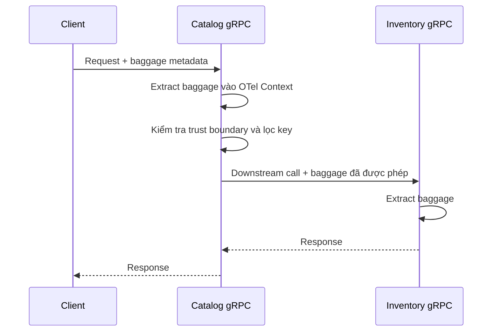

# Baggage và rủi ro truyền dữ liệu

## 1. Baggage là gì?

OpenTelemetry Baggage là tập hợp các cặp key-value đi theo execution context và có thể được truyền từ service này sang service khác. Ứng dụng dùng baggage để mang một lượng nhỏ thông tin xuyên suốt request, chẳng hạn phân nhóm rollout hoặc tier dịch vụ, khi các thành phần downstream cần cùng ngữ cảnh đó.

Baggage thường được truyền qua W3C Baggage header. Với gRPC, propagator chuyển header này thành metadata ASCII có key `baggage`. Khi client gọi downstream, instrumentation inject baggage hiện tại vào metadata; server nhận extract nó vào OpenTelemetry Context.

Baggage hữu ích nhưng có phạm vi lan truyền rộng. Mỗi downstream nhận được baggage có thể tiếp tục forward nó. Vì vậy, chỉ đưa dữ liệu đã được phê duyệt, không nhạy cảm, nhỏ và có giá trị hữu hạn vào baggage.

## 2. Baggage khác Trace Context như thế nào?

Trace Context và Baggage cùng nằm trong OpenTelemetry Context nhưng giải quyết hai vấn đề khác nhau:

| Thành phần | Mục đích | Ví dụ |
| --- | --- | --- |
| Trace Context | Xác định trace, span hiện tại và quan hệ parent-child | trace ID, span ID, sampling flags |
| Baggage | Mang các cặp key-value bổ sung xuyên service | tenant tier, deployment ring, experiment group |

Trace Context giúp nối các span thành một trace. Baggage không tạo trace, không chọn parent span và không thay thế span ID. Một request có thể có trace context mà không có baggage; ngược lại, baggage có thể được truyền trong context mà không có trace được sample.

Baggage cũng không phải nơi lưu authentication hoặc authorization. Một giá trị như `tenant.id` do client gửi có thể bị giả mạo; server không được dùng nó để quyết định caller thuộc tenant nào. Quyền phải dựa trên credential đã xác minh và policy ở application layer.

## 3. Baggage đi qua gRPC metadata

W3C Baggage định nghĩa header `baggage` để mang các member dạng key-value cùng metadata tùy chọn. Trong gRPC, header này được truyền qua HTTP/2 metadata. Các key metadata ASCII phải viết thường.

Luồng downstream điển hình:



OpenTelemetry propagator chịu trách nhiệm encode, decode và áp dụng quy tắc W3C. Không tự ghép chuỗi header hoặc parse bằng split dấu phẩy; giá trị có thể cần escaping và format có thể mở rộng theo chuẩn.

Baggage chỉ được truyền nếu propagator và instrumentation được cấu hình hỗ trợ nó. Việc bật traceparent không tự động bảo đảm baggage cũng được inject/extract.

## 4. Cấu hình W3C Baggage trong OpenTelemetry Java

Khi dùng OpenTelemetry Java agent hoặc SDK autoconfiguration, cấu hình propagator gồm Trace Context và Baggage. Với Java agent, biến môi trường thường dùng là:

```bash
OTEL_PROPAGATORS=tracecontext,baggage
```

Tên và giá trị cấu hình cần khớp phiên bản agent/SDK trong ứng dụng. Nếu ứng dụng tự tạo SDK, cấu hình composite propagator tương ứng thay vì giả định global SDK đã có baggage propagator.

Trong hệ thống đã bật gRPC auto instrumentation, client instrumentation có thể inject baggage khi tạo outbound call và server instrumentation extract baggage khi nhận call. Kiểm tra transport và channel thực tế có nằm trong phạm vi instrumentation, nhất là khi dùng custom channel factory hoặc shaded Netty.

Không cài thêm interceptor manual chỉ để inject cùng baggage nếu auto instrumentation đã làm việc đó. Hai cơ chế cùng inject có thể gây metadata lặp hoặc ghi đè không mong muốn.

## 5. Tạo baggage từ dữ liệu đã được xác minh

Chỉ tạo baggage từ nguồn đáng tin cậy, ví dụ principal đã được authentication layer xác minh hoặc cấu hình deployment. Không sao chép toàn bộ request metadata của client sang baggage.

Ví dụ application đã có principal với tier được policy xác minh:

```java
import io.opentelemetry.api.baggage.Baggage;
import io.opentelemetry.context.Context;
import io.opentelemetry.context.Scope;

import java.util.concurrent.TimeUnit;

public AvailabilityResponse getAvailability(
        AvailabilityRequest request,
        AuthenticatedPrincipal principal) {

    Baggage baggage = Baggage.builder()
            .put("tenant.tier", principal.tenantTier())
            .put("deployment.ring", "stable")
            .build();

    Context requestContext =
            baggage.storeInContext(Context.current());

    try (Scope scope = requestContext.makeCurrent()) {
        return inventoryStub
                .withDeadlineAfter(400, TimeUnit.MILLISECONDS)
                .getAvailability(request);
    }
}
```

Trong ví dụ, tier đến từ principal đã xác minh; nó không được lấy trực tiếp từ protobuf request hoặc metadata tùy ý. Giá trị deployment ring đến từ cấu hình của service. Khi outbound gRPC client instrumentation chạy trong scope này, propagator có thể inject baggage vào metadata downstream.

Baggage builder mới chỉ chứa các key được thêm vào. Khi lưu vào context hiện tại, baggage này thay thế baggage hiện có trong context đó, giúp không forward các key inbound chưa được duyệt. Nếu ứng dụng cần giữ thêm key, hãy thêm từng key qua allowlist rõ ràng.

Không dùng baggage để mang access token, refresh token, API key, password, session cookie, email, số điện thoại, địa chỉ, payment data hoặc payload nghiệp vụ.

## 6. Đọc baggage ở downstream service

Khi server instrumentation đã extract baggage, application code có thể đọc giá trị hiện tại:

```java
import io.opentelemetry.api.baggage.Baggage;

String tenantTier =
        Baggage.current().getEntryValue("tenant.tier");

if (tenantTier == null) {
    tenantTier = "unspecified";
}
```

Giá trị baggage là dữ liệu context do upstream chuyển tới. Hãy kiểm tra format, chiều dài và tập giá trị cho phép trước khi dùng. Ví dụ tenant tier có thể chỉ chấp nhận standard, premium hoặc enterprise.

Baggage có thể hỗ trợ quyết định kỹ thuật như chọn mức cache hoặc phân nhóm telemetry nếu policy cho phép. Nó không được dùng làm bằng chứng danh tính, quyền truy cập hoặc ranh giới tenant. Nếu downstream cần tenant identity, hãy lấy từ authenticated principal hoặc credential đã được xác minh độc lập.

## 7. Allowlist và sanitize tại trust boundary

Baggage inbound có thể đến từ client bên ngoài, gateway hoặc service không hoàn toàn tin cậy. Coi tất cả key/value nhận từ remote baggage là input chưa xác minh.

Một quy trình an toàn ở ingress:

1. Extract baggage theo W3C propagator.
2. Đọc các key nằm trong allowlist.
3. Kiểm tra nguồn, format, chiều dài và tập giá trị.
4. Tạo baggage mới chỉ gồm các key được chấp nhận.
5. Đặt baggage đã lọc làm current trước khi gọi downstream.

Ví dụ lọc tenant tier theo giá trị cho phép:

```java
Baggage inbound = Baggage.current();

String tier = inbound.getEntryValue("tenant.tier");
String approvedTier = switch (tier == null ? "" : tier) {
    case "standard", "premium", "enterprise" -> tier;
    default -> "unspecified";
};

Baggage sanitized = Baggage.builder()
        .put("tenant.tier", approvedTier)
        .put("deployment.ring", deploymentRing)
        .build();

Context downstreamContext =
        sanitized.storeInContext(Context.current());

try (Scope scope = downstreamContext.makeCurrent()) {
    return inventoryStub.getAvailability(request);
}
```

Ví dụ chỉ giữ hai key được định nghĩa; baggage key khác từ inbound không được forward. Trong production, có thể bỏ hẳn key không hợp lệ thay vì thay bằng unspecified, tùy contract. Nếu một giá trị ảnh hưởng quyết định bảo mật, phải lấy lại từ principal đã xác thực chứ không chỉ validate cú pháp của baggage.

Sanitize cần thực hiện ở mỗi trust boundary. Không giả định mọi service trong mạng nội bộ đều an toàn để nhận toàn bộ baggage từ upstream.

## 8. Rủi ro bảo mật và quyền riêng tư

Baggage có thể lan qua nhiều hop, kể cả các service mà caller ban đầu không biết. Rủi ro chính gồm:

- **Lộ dữ liệu nhạy cảm:** downstream, proxy hoặc hệ thống telemetry có thể đọc metadata.
- **Giả mạo context:** caller có thể tự gửi key như tenant hoặc role để gây hiểu nhầm.
- **Header amplification:** mỗi hop forward thêm key làm metadata ngày càng lớn.
- **Log leakage:** middleware hoặc proxy có thể log metadata nguyên bản.
- **Untrusted values:** value chứa ký tự điều khiển, chuỗi quá dài hoặc dữ liệu gây lỗi parser/log.
- **Cross-boundary propagation:** dữ liệu nội bộ có thể đi sang service/vendor ngoài phạm vi dự kiến.

TLS bảo vệ dữ liệu trên đường truyền giữa hai đầu TLS, nhưng không ngăn endpoint nhận đọc baggage. TLS cũng không ngăn service ghi baggage vào log hoặc export nó sang telemetry backend.

Không đặt bí mật vào baggage với giả định nó được mã hóa hoặc chỉ người tạo mới đọc được. Baggage không phải secret store và không có chữ ký xác thực nguồn gốc.

## 9. Giới hạn kích thước và cardinality

Baggage là metadata trên mỗi request. Danh sách quá dài hoặc value quá lớn làm tăng header size, băng thông, chi phí parse và nguy cơ vượt giới hạn metadata/header list của gRPC, HTTP/2 hoặc proxy.

Đặt budget ở cấp ứng dụng:

- Giới hạn số key được phép.
- Giới hạn chiều dài key và value.
- Giới hạn tổng kích thước baggage sau encoding.
- Từ chối hoặc loại bỏ key không thuộc allowlist.
- Không lặp lại cùng thông tin ở nhiều key hoặc nhiều hop.
- Đo tỷ lệ request có baggage bị loại bỏ hoặc vượt budget mà không log raw value.

Không dựa vào một con số giới hạn mặc định cho mọi deployment. gRPC transport, reverse proxy và gateway có thể có giới hạn khác nhau; cấu hình budget của ứng dụng thấp hơn giới hạn thấp nhất trong đường đi.

Cardinality cũng quan trọng khi baggage được chuyển thành span attributes hoặc dùng để phân nhóm metrics. Các giá trị như user ID, request ID hoặc order ID có cardinality rất cao. Không tạo metric label từ các giá trị đó; metrics cần dimension hữu hạn, ổn định. Chỉ thêm baggage vào span attribute khi thực sự cần và đã đánh giá quyền riêng tư, kích thước và cardinality.

Baggage không tự động trở thành span attribute hay metric label trong mọi cấu hình. Việc export phụ thuộc instrumentation, processor và cấu hình ứng dụng. Tuy vậy, hãy coi baggage là dữ liệu có thể bị downstream quan sát và có thể được instrumentation ghi nhận nếu được bật.

## 10. Baggage trong async flow và downstream call

OpenTelemetry Context chứa baggage và span context. Khi chuyển sang executor hoặc callback bất đồng bộ, context có thể không tự truyền nếu executor không được instrument.

Chụp context trước khi chuyển thread:

```java
Context captured = Context.current();

executor.execute(captured.wrap(() -> {
    inventoryRefreshService.refresh(productId);
}));
```

Khi callback thực hiện downstream gRPC call bên trong wrapper, instrumentation có thể thấy đúng baggage và span context. Với CompletableFuture, scheduler hoặc callback framework, dùng executor có instrumentation hoặc wrap callback theo cùng nguyên tắc.

Phân biệt OpenTelemetry Context với io.grpc.Context. OpenTelemetry Context mang span và baggage; gRPC Context mang deadline, cancellation và call-scoped data. Instrumentation có thể tích hợp hai context nhưng chúng là hai API khác nhau.

Không giữ baggage trong field mutable của singleton hoặc ThreadLocal tự quản. Các RPC đồng thời có thể làm rò context giữa request nếu ứng dụng tự quản lý state theo thread không đúng cách.

## 11. Baggage và observability

Baggage có thể giúp phân nhóm telemetry theo một thuộc tính có cardinality thấp, ví dụ tenant.tier hoặc deployment.ring. Tuy nhiên, không nên tự động sao chép toàn bộ baggage thành span attributes hoặc log fields.

Nếu cần ghi một giá trị lên span, chọn rõ key và thời điểm:

```java
Span.current().setAttribute(
        "app.tenant.tier",
        approvedTier);
```

Chỉ ghi giá trị đã được allowlist và không nhạy cảm. Dùng namespace attribute của ứng dụng để phân biệt với semantic convention chuẩn. Không ghi user ID hoặc raw tenant ID chỉ để tìm kiếm trace dễ hơn; cân nhắc correlation ID được kiểm soát và chính sách truy cập telemetry.

Metrics nên dùng dimension có tập giá trị hữu hạn. Nếu cần phân tích theo tenant, có thể tổng hợp ở backend hoặc dùng dimension tier thay cho từng tenant identifier.

## 12. Kiểm thử baggage propagation

Test cần chứng minh cả việc truyền đúng key và việc dữ liệu không được phép bị loại bỏ.

| Kịch bản | Kết quả mong đợi |
| --- | --- |
| Client gửi baggage được allowlist | Downstream đọc được đúng giá trị sau extraction. |
| Client gửi key lạ | Key không được forward qua trust boundary. |
| Client gửi tenant tier không hợp lệ | Giá trị bị loại hoặc thay bằng fallback theo policy. |
| Baggage value quá dài | Request bị giới hạn hoặc key bị loại theo budget. |
| Không có baggage | RPC vẫn chạy với default behavior. |
| Hai RPC đồng thời có baggage khác nhau | Không có context của request này lọt sang request kia. |
| Callback chạy trên executor | Baggage được giữ khi context đã được wrap. |
| Baggage chứa dữ liệu nhạy cảm giả lập | Không xuất hiện trong log, span attribute hoặc response. |

Với integration test, dùng Netty gRPC transport để xác minh W3C baggage thực sự đi qua HTTP/2 metadata. Test server có thể đọc Baggage.current().getEntryValue(...) và ghi giá trị quan sát được vào test fixture. In-process transport hữu ích cho application context nhưng không đủ để chứng minh propagation trên network.

Có thể dùng test propagator hoặc exporter để kiểm tra trace/baggage, nhưng đừng suy luận baggage đã được export chỉ vì trace span tồn tại. Nếu test span attribute, ứng dụng phải chủ động gắn attribute hoặc cấu hình instrumentation có hành vi đó.

## 13. Lỗi thường gặp

1. **Dùng baggage như authentication.** Client có thể giả mạo giá trị. Xác minh danh tính bằng credential và policy.
2. **Forward toàn bộ baggage inbound.** Key không tin cậy lan tới mọi downstream. Dùng allowlist và tạo baggage mới ở trust boundary.
3. **Đưa PII hoặc secret vào baggage.** Nhiều service và telemetry backend có thể nhìn thấy. Chỉ truyền dữ liệu không nhạy cảm đã được phê duyệt.
4. **Tự parse hoặc nối chuỗi baggage header.** Có thể sai escaping và format. Dùng W3C propagator.
5. **Cho rằng bật tracecontext đã bật baggage.** Propagator có thể chỉ có trace context. Cấu hình tracecontext và baggage rõ ràng.
6. **Thêm manual interceptor bên cạnh auto instrumentation.** Có thể duplicate hoặc ghi đè metadata. Chọn một cơ chế propagation.
7. **Để baggage tăng không giới hạn qua nhiều hop.** Header lớn và tốn tài nguyên. Giới hạn key, value và tổng budget.
8. **Dùng user/request ID làm metric label.** Tạo cardinality lớn. Chỉ dùng dimension hữu hạn.
9. **Cho rằng TLS làm baggage bí mật với service nhận.** TLS chỉ bảo vệ đường truyền. Không gửi dữ liệu không nên được endpoint đọc.
10. **Không truyền OTel Context qua executor.** Downstream mất baggage hoặc span parent. Dùng Context.wrap hoặc executor instrumentation.

## 14. Bài thực hành

Thiết lập baggage an toàn cho luồng Catalog gọi Inventory:

1. Bật W3C Trace Context và Baggage propagators trong OpenTelemetry Java agent/SDK.
2. Tạo baggage tenant.tier từ authenticated principal và deployment.ring từ cấu hình service.
3. Đặt baggage vào OpenTelemetry Context trước khi gọi Inventory bằng generated gRPC stub.
4. Tại ingress, chỉ giữ key trong allowlist và kiểm tra value theo tập giá trị, chiều dài và budget.
5. Ở Inventory, đọc baggage để phục vụ phân nhóm kỹ thuật; không dùng nó để xác định tenant hoặc authorization.
6. Chuyển một downstream call qua executor và xác minh context được wrap.
7. Viết Netty integration test cho propagation, unknown key stripping, invalid value, oversized baggage và hai request đồng thời.
8. Kiểm tra logs, spans và metrics không chứa token, PII hoặc identifier có cardinality cao.

**Tự kiểm tra:** Baggage là dữ liệu key-value được truyền cùng OpenTelemetry Context qua các service; nó bổ sung ngữ cảnh chứ không xác định trace parent hoặc danh tính caller. Với Spring gRPC, dùng W3C propagator để truyền qua metadata, tạo baggage từ nguồn đã xác minh, lọc theo allowlist tại trust boundary, giới hạn kích thước/cardinality và không đưa secret hoặc PII vào baggage. Kiểm thử cả propagation đúng lẫn khả năng ngăn dữ liệu không được phép lan xuống downstream.

