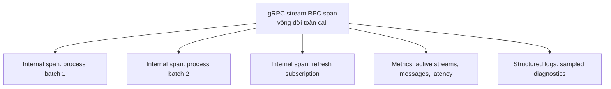

# Trace streaming dài

## 1. Đặc điểm của streaming RPC dài

Một gRPC streaming RPC có thể giữ kết nối và trao đổi message trong thời gian dài. Ví dụ Catalog mở stream theo dõi tồn kho từ Inventory; client gửi subscription request một lần rồi nhận nhiều update cho tới khi đóng stream. Với unary RPC, thời gian sống của span thường gần với một thao tác ngắn. Với streaming dài, span có thể tồn tại hàng phút hoặc hàng giờ.

OpenTelemetry thường tạo một client span hoặc server span cho **một RPC**, không tự tạo một span mới cho từng message. Span bắt đầu khi RPC được khởi tạo hoặc nhận và chỉ kết thúc khi call hoàn tất, lỗi hoặc bị hủy. Vì vậy, một stream dài có thể tạo span rất dài.

Cần tách ba câu hỏi quan sát:

- **Vòng đời RPC:** stream được mở lúc nào, kéo dài bao lâu, kết thúc bình thường hay do lỗi/cancel?
- **Hoạt động message:** có bao nhiêu message, tốc độ đến/đi, kích thước và độ trễ xử lý ra sao?
- **Công việc con:** một batch hoặc một message quan trọng được xử lý qua những bước nào?

Không giải quyết cả ba bằng cách tạo một span cho từng message. Cách đó có thể tạo lượng span lớn, tăng chi phí collector và làm trace khó đọc. Dùng span cho vòng đời RPC và operation có ý nghĩa; dùng metrics cho số lượng/tốc độ và log có kiểm soát cho chi tiết cần điều tra.

## 2. Một span đại diện cho toàn bộ streaming RPC

Với server-streaming RPC:

```protobuf
rpc WatchStock(WatchStockRequest) returns (stream StockUpdate);
```

Client gửi một request; server có thể phát nhiều response. Server span của RPC bao phủ toàn bộ thời gian xử lý call, từ khi nhận request tới khi stream kết thúc. Client span tương ứng bao phủ thời gian client chờ stream kết thúc hoặc hủy nó.

Với client-streaming:

```protobuf
rpc UploadEvents(stream EventChunk) returns (UploadSummary);
```

Client gửi nhiều message, sau đó half-close chiều gửi. Server trả một response cuối cùng. Span của RPC vẫn mở cho tới khi call hoàn tất; client half-close không đồng nghĩa response đã hoàn tất.

Với bidirectional streaming:

```protobuf
rpc Exchange(stream ClientMessage) returns (stream ServerMessage);
```

Hai hướng message tiến triển độc lập nhưng thuộc cùng một RPC. Span chỉ kết thúc khi call terminal: hoàn tất, lỗi, cancellation hoặc deadline. Một phía ngừng gửi không nhất thiết đóng phía còn lại.

| Kiểu RPC | Sự kiện kết thúc thông thường |
| --- | --- |
| Unary | Response hoàn tất hoặc lỗi |
| Server-streaming | Server đóng response stream hoặc call lỗi/cancel |
| Client-streaming | Client half-close, server trả response cuối và call hoàn tất |
| Bidirectional | Cả call đi tới terminal state; half-close một hướng chưa đủ |

Không tự kết thúc span ngay sau khi method handler trả về nếu stream vẫn đang mở. Với streaming, method khởi tạo có thể trả về sớm trong khi callback tiếp tục phát message.

## 3. Mô hình quan sát cho stream dài

Một mô hình thực tế gồm ba lớp:

1. **RPC span:** một span client/server bao trọn vòng đời stream, ghi method, peer, status, duration và terminal reason phù hợp.
2. **Metrics:** đo active streams, message count, byte count, processing latency, queue depth, reconnect và cancellation.
3. **Child spans hoặc linked spans:** ghi lại batch hoặc bước xử lý quan trọng, không tạo span cho mọi message một cách mặc định.



RPC span cho biết phiên stream sống bao lâu và kết thúc ra sao. Metrics cho biết stream hoạt động thế nào trong suốt thời gian đó. Child spans giúp tìm một batch xử lý chậm mà không làm trace phình ra theo từng message.

Đặt tên span ổn định, ví dụ `inventory.watch_stock`. Không đưa product ID, user ID hoặc stream ID duy nhất vào span name; giá trị định danh động có thể làm trace khó nhóm và tăng chi phí lưu trữ.

## 4. Auto instrumentation và trách nhiệm lifecycle

OpenTelemetry Java agent hoặc gRPC instrumentation có thể tự tạo client/server span cho streaming RPC và inject/extract Trace Context qua gRPC metadata. Khi đã bật auto instrumentation, hãy để instrumentation sở hữu vòng đời transport span.

Không thêm một `ServerInterceptor` hoặc `ClientInterceptor` khác để tạo cùng loại span cho cùng RPC. Nếu auto instrumentation và manual interceptor cùng tạo transport span, trace có thể xuất hiện duplicate spans và parent-child chain khó hiểu.

Manual instrumentation vẫn hữu ích cho operation nghiệp vụ bên trong stream, ví dụ `inventory.process_batch`. Span này là `INTERNAL` và là con của context hiện tại; nó không thay thế server/client RPC span.

Trước khi kết luận stream không có span, kiểm tra:

- gRPC server/channel có nằm trong phạm vi agent instrumentation không;
- transport đang dùng có được phiên bản instrumentation hỗ trợ không;
- propagator có bật `tracecontext` không;
- span đã kết thúc chưa — SDK/exporter thường chỉ export span sau khi `end()` được gọi;
- sampler có giữ trace đó không.

Với stream chưa kết thúc, việc chưa thấy span hoàn chỉnh trong backend không nhất thiết có nghĩa instrumentation bị lỗi.

## 5. Theo dõi vòng đời stream bằng manual span

Chỉ tạo span thủ công cho transport khi không có auto instrumentation. Nếu đã có server span tự động, hãy dùng `Span.current()` để thêm thông tin phù hợp hoặc tạo internal span cho công việc ứng dụng.

Ví dụ dưới đây minh họa một internal span bao quanh quá trình xử lý subscription dài. Span được kết thúc ở terminal callback, không kết thúc ngay sau khi đăng ký nguồn dữ liệu:

```java
import io.opentelemetry.api.trace.Span;
import io.opentelemetry.api.trace.SpanKind;
import io.opentelemetry.api.trace.StatusCode;
import io.opentelemetry.context.Context;
import io.grpc.stub.ServerCallStreamObserver;
import io.grpc.stub.StreamObserver;

import java.util.concurrent.atomic.AtomicBoolean;

Span streamWork = tracer.spanBuilder("inventory.watch_stock")
        .setSpanKind(SpanKind.INTERNAL)
        .startSpan();

Context streamContext =
        streamWork.storeInContext(Context.current());

AtomicBoolean ended = new AtomicBoolean();

@SuppressWarnings("unchecked")
ServerCallStreamObserver<StockUpdate> serverCallObserver =
        (ServerCallStreamObserver<StockUpdate>) responseObserver;

serverCallObserver.setOnCancelHandler(
        streamContext.wrap(() -> {
            if (ended.compareAndSet(false, true)) {
                streamWork.addEvent("stream.cancelled");
                try {
                    cancelSubscription();
                } finally {
                    streamWork.end();
                }
            }
        }));

subscription.onNext(update -> streamContext.wrap(() -> {
    if (!ended.get() && !serverCallObserver.isCancelled()) {
        responseObserver.onNext(toProto(update));
    }
}).run());

subscription.onError(error -> streamContext.wrap(() -> {
    if (ended.compareAndSet(false, true)) {
        streamWork.recordException(error);
        streamWork.setStatus(StatusCode.ERROR);
        try {
            responseObserver.onError(toGrpcError(error));
        } finally {
            streamWork.end();
        }
    }
}).run());

subscription.onComplete(() -> streamContext.wrap(() -> {
    if (ended.compareAndSet(false, true)) {
        try {
            responseObserver.onCompleted();
        } finally {
            streamWork.end();
        }
    }
}).run());
```

Đây là skeleton minh họa; `serverCallObserver` là `ServerCallStreamObserver` lấy từ response observer, còn `subscription` là abstraction của nguồn dữ liệu có callback và thao tác cancel. Code thực tế phải đăng ký callback đúng API publisher đang dùng, xử lý lỗi khi đăng ký subscription và bảo đảm terminal cleanup được gọi đúng một lần ở mọi đường kết thúc.

`streamContext.wrap(...)` khôi phục OpenTelemetry context khi callback chạy trên thread khác. `AtomicBoolean` bảo vệ terminal transition khi cancel, error và complete cạnh tranh nhau. Khi client cancel, cần hủy subscription/tác vụ nguồn để dừng công việc downstream, không chỉ kết thúc span.

Nếu framework đã tạo server span cho RPC, internal span trên là con của server span. Không đặt `SpanKind.SERVER` lần nữa cho cùng call.

## 6. Half-close, completion, error và cancellation

Streaming có nhiều tín hiệu dễ nhầm:

- `onCompleted()` ở request observer phía client đóng chiều gửi request.
- `onCompleted()` ở response observer báo response stream kết thúc bình thường.
- `onError()` kết thúc hướng stream bằng lỗi.
- Cancellation có thể đến từ client, server hoặc deadline.
- `ServerCallStreamObserver.setOnCancelHandler(...)` giúp server dọn tài nguyên khi client hủy call.

Span không nên kết thúc khi chỉ có client half-close nếu server vẫn còn xử lý và chuẩn bị response cuối. Với bidi, half-close request direction cũng không kết thúc response direction.

Khi call kết thúc, ghi terminal reason có giá trị chẩn đoán, chẳng hạn `completed`, `cancelled`, `deadline_exceeded` hoặc status code. Tránh ghi payload message, token hoặc metadata nhạy cảm vào event.

Cancellation không phải lúc nào cũng là lỗi server. Client có thể đóng stream vì màn hình rời đi hoặc subscription không còn cần thiết. Ghi nhận cancellation như một kết quả riêng; chỉ đánh dấu span `ERROR` theo semantics và policy thích hợp, không biến mọi cancellation thành sự cố hệ thống.

## 7. Đo message flow bằng metrics

Một span dài không cho biết đủ chi tiết về tốc độ message theo thời gian. Metrics phù hợp hơn cho số lượng và phân phối:

| Metric gợi ý | Instrument | Mục đích |
| --- | --- | --- |
| `grpc.stream.active` | UpDownCounter | Số stream đang mở |
| `grpc.stream.messages.received` | Counter | Tổng message nhận |
| `grpc.stream.messages.sent` | Counter | Tổng message gửi |
| `grpc.stream.message.processing.duration` | Histogram | Độ trễ xử lý một message hoặc batch |
| `grpc.stream.duration` | Histogram | Thời lượng một stream đã kết thúc |
| `grpc.stream.cancelled` | Counter | Số stream bị hủy |
| `grpc.stream.queue.depth` | Observable gauge hoặc callback gauge | Độ sâu hàng đợi xử lý |

Ví dụ khai báo metric:

```java
LongUpDownCounter activeStreams = meter
        .upDownCounterBuilder("grpc.stream.active")
        .setDescription("Number of active streaming RPCs")
        .build();

LongCounter messagesReceived = meter
        .counterBuilder("grpc.stream.messages.received")
        .build();

LongHistogram messageProcessingTime = meter
        .histogramBuilder("grpc.stream.message.processing.duration")
        .ofLongs()
        .setUnit("ms")
        .build();
```

Khi stream bắt đầu, tăng active stream; khi kết thúc ở bất kỳ terminal path nào, giảm đúng một lần. Tăng message counter khi message thực sự được nhận hoặc gửi theo định nghĩa metric thống nhất. Ghi processing duration quanh công việc xử lý, không tính thời gian chờ network nếu mục tiêu là đo application processing.

Attributes của metrics phải có cardinality thấp: service, method, status class hoặc stream direction. Không dùng stream ID, message ID, user ID, product ID hoặc tenant ID làm metric label. Không dùng một metric label cho mỗi connection.

## 8. Events và child spans: chọn mức chi tiết hợp lý

Span event phù hợp cho milestone ít xảy ra, ví dụ:

- `subscription.started`;
- `first.message.received`;
- `stream.backpressure.enabled`;
- `stream.reconnected`;
- `stream.cancelled`.

Không thêm event cho mọi message trong một stream tốc độ cao. Event list của span tăng theo thời gian và có thể làm tăng kích thước export hoặc bị giới hạn bởi SDK/backend.

Tạo child span cho batch hoặc giai đoạn có ý nghĩa:

```java
import io.opentelemetry.context.Scope;

Span batchSpan = tracer.spanBuilder("inventory.process_batch")
        .setSpanKind(SpanKind.INTERNAL)
        .setParent(Context.current())
        .startSpan();

try (Scope scope = batchSpan.makeCurrent()) {
    processBatch(batch);
} catch (RuntimeException error) {
    batchSpan.recordException(error);
    batchSpan.setStatus(StatusCode.ERROR);
    throw error;
} finally {
    batchSpan.end();
}
```

Ví dụ trên giả định context của stream đã được khôi phục trước khi xử lý batch. Batch span là child của stream context. Nếu một message độc lập được đưa vào queue và xử lý sau khi stream đã kết thúc, xem xét tạo span riêng có link tới stream span context thay vì giữ parent span mở hoặc giữ context request lâu hơn cần thiết.

## 9. Span links cho công việc sống lâu hơn stream

Parent-child phù hợp khi công việc con nằm trong lifecycle và quan hệ thực thi của span cha. Nhưng một stream có thể enqueue công việc nền sẽ chạy sau khi RPC đã đóng. Nếu giữ span stream làm parent cho công việc chạy hàng giờ, trace tree sẽ gắn chặt hai lifecycle không còn cùng thời gian.

Trong trường hợp đó, tạo span cho job/batch độc lập và thêm link tới stream span context:

```java
import io.opentelemetry.api.trace.SpanContext;

SpanContext source = streamWork.getSpanContext();

Span backgroundWork = tracer.spanBuilder("inventory.process_queued_batch")
        .setNoParent()
        .addLink(source)
        .setSpanKind(SpanKind.CONSUMER)
        .startSpan();

try (Scope scope = backgroundWork.makeCurrent()) {
    processQueuedBatch(batch);
} catch (RuntimeException error) {
    backgroundWork.recordException(error);
    backgroundWork.setStatus(StatusCode.ERROR);
    throw error;
} finally {
    backgroundWork.end();
}
```

Span link thể hiện quan hệ nhân quả mà không buộc job phải là child trong lifecycle của stream. Link phải được thêm khi tạo span. Nếu cần giữ context cho job, chỉ truyền `SpanContext` hoặc correlation metadata cần thiết, không giữ toàn bộ request object hoặc credentials.

Không dùng link thay parent-child cho mọi trường hợp. Nếu batch được xử lý trực tiếp như một phần đồng bộ của stream callback, child span thường dễ hiểu hơn. Link hữu ích khi công việc tách rời, fan-in hoặc chạy độc lập.

## 10. Async context và callback thread

Streaming callback thường chạy trên transport executor hoặc executor ứng dụng. OpenTelemetry Context không nên được giả định tự truyền qua mọi thread boundary.

Chụp context khi tạo operation và wrap callback:

```java
Context streamContext = Context.current();

executor.execute(streamContext.wrap(() -> {
    Span.current().addEvent("stream.batch.processing");
    processNextBatch();
}));
```

Nếu tạo internal span cho stream, hãy dùng context đã chứa span đó. Mỗi callback phải chạy trong context đúng để child span có parent đúng và log correlation không bị mất.

OpenTelemetry Context khác `io.grpc.Context`. gRPC Context mang deadline, cancellation và call-scoped values; OpenTelemetry Context mang span và baggage. Instrumentation có thể tích hợp hai loại context, nhưng ứng dụng cần dùng đúng API cho từng mục đích.

Không lưu span hoặc baggage của stream vào field mutable của singleton service. Nhiều stream chạy đồng thời có thể ghi đè context của nhau. State riêng của mỗi stream nên nằm trong object lifecycle riêng, được tạo cho call đó.

## 11. Sampling và export của span dài

SDK thường export span sau khi span kết thúc. Với stream sống lâu, span có thể chưa xuất hiện trong backend cho tới khi RPC đóng. Điều này ảnh hưởng cách điều tra stream đang hoạt động.

Head sampling quyết định giữ span từ lúc bắt đầu dựa trên thông tin ban đầu. Nếu sampler bỏ qua trace lúc đầu, lỗi xảy ra nhiều giờ sau có thể không có trace đầy đủ. Sampling policy cần cân bằng tỷ lệ lưu trace và chi phí.

Tail sampling ở collector thường cần giữ các span của trace trong bộ nhớ để quyết định sau khi thấy kết quả. Một stream rất dài có thể khiến collector phải giữ state lâu, tiêu tốn memory và vượt giới hạn trace retention. Khi trace chưa kết thúc, collector chưa có đủ dữ liệu cuối để quyết định giữ/bỏ theo latency hoặc error.

Với stream dài:

- Dùng metrics để quan sát trạng thái hiện tại và xu hướng message flow.
- Dùng span events có giới hạn cho milestone quan trọng.
- Dùng child spans cho batch hoặc operation có thời lượng đáng kể.
- Cân nhắc head sampling phù hợp với traffic và policy.
- Nếu cần trace cho từng giai đoạn dài, tạo bounded operation spans hoặc job spans riêng; không giả lập kết thúc transport span khi RPC vẫn mở.
- Kiểm tra giới hạn memory, trace timeout và incomplete trace behavior của tail sampler/collector.

Không giả định việc bật tail sampling tự động giải quyết mọi trace dài. Collector và exporter cần cấu hình giới hạn phù hợp với thời lượng stream thực tế.

## 12. Spring gRPC và chiến lược instrumentation

Trong Spring gRPC, ưu tiên dùng OpenTelemetry Java agent hoặc instrumentation starter tương thích để tạo transport spans và propagation cho server/client. Tạo internal spans trong application service cho các giai đoạn có ý nghĩa như đọc snapshot, xử lý batch hoặc ghi kết quả.

Khi cấu hình thực tế:

1. Xác nhận gRPC server và named client channels do Spring quản lý đều được instrument.
2. Dùng cùng OpenTelemetry SDK/provider trong ứng dụng; tránh tạo SDK riêng cho mỗi service bean.
3. Không tạo manual server/client span trùng với auto instrumentation.
4. Wrap executor/callback để giữ OTel Context.
5. Kết thúc span và cập nhật active-stream metric đúng một lần khi complete/error/cancel.
6. Đặt deadline, idle timeout hoặc subscription lifetime policy phù hợp; stream vô hạn vẫn cần cơ chế reconnect và cleanup.
7. Không đưa message payload, credential hoặc identifier nhạy cảm vào span attributes/events.

Với stream có thể kéo dài hơn vòng đời của pod hoặc deploy, cần xác định hành vi khi server shutdown: ngừng nhận stream mới, báo client reconnect, drain stream hiện tại trong thời gian giới hạn và kết thúc call theo policy. Observability cần ghi nhận shutdown/drain reason để phân biệt deploy bình thường với lỗi mạng.

## 13. Kiểm thử trace streaming dài

Kiểm thử cần xác minh span tồn tại trong suốt call và kết thúc đúng khi stream terminal. `InMemorySpanExporter` thường chỉ nhận span sau khi `end()` được gọi; vì vậy, test stream đang mở phải kiểm tra trạng thái active qua fixture hoặc instrumentation hook, không chờ exporter có span hoàn chỉnh.

Các kịch bản nên có:

| Kịch bản | Điều cần xác minh |
| --- | --- |
| Server-streaming phát nhiều message | Một RPC span bao toàn bộ call; message count tăng đúng |
| Client half-close | Request direction đóng nhưng call span chưa kết thúc nếu server còn xử lý |
| Bidi streaming | Hai hướng hoạt động độc lập; span chỉ kết thúc ở terminal state |
| Complete bình thường | Span kết thúc một lần, status theo success policy |
| Server error | Span ghi status/error và kết thúc |
| Client cancel | Server hủy subscription, giảm active stream đúng một lần |
| Deadline exceeded | Call kết thúc, công việc downstream được dừng khi có thể |
| Callback qua executor | Child span giữ đúng parent context |
| Batch xử lý nền sau stream | Job span có link tới stream span context theo thiết kế |
| Stream chạy lâu | Không tạo event/span vô hạn; metrics tiếp tục phản ánh trạng thái |

Dùng in-process transport cho logic observer và lifecycle nếu phù hợp. Dùng Netty integration test để xác minh gRPC transport instrumentation, metadata propagation và cancellation thực tế. Tránh `Thread.sleep()` để đợi callback; dùng latch, future hoặc test synchronization có timeout.

## 14. Lỗi thường gặp

1. **Tạo span mới cho từng message.** Tạo quá nhiều span và tăng chi phí telemetry. Dùng một RPC span, metrics và child spans theo batch.
2. **Kết thúc span khi handler method vừa trả về.** Stream có thể vẫn mở. Kết thúc ở complete/error/cancel terminal event.
3. **Nhầm client half-close với kết thúc toàn call.** Server có thể còn gửi response. Theo dõi lifecycle từng hướng và terminal call.
4. **Giữ Scope mở trên một thread trong suốt stream.** Callback có thể chạy trên thread khác. Wrap từng callback bằng captured Context.
5. **Tạo manual transport span bên cạnh auto instrumentation.** Trace có duplicate spans. Chọn một cơ chế sở hữu transport span.
6. **Ghi mọi message thành span event.** Span tăng không giới hạn. Ghi milestone và dùng metrics cho message volume.
7. **Không cleanup khi client cancel.** Subscription và worker tiếp tục chạy. Hủy nguồn và giải phóng tài nguyên idempotently.
8. **Chỉ dựa vào trace để theo dõi stream đang mở.** Span có thể chưa export. Dùng active-stream gauge và message metrics.
9. **Dùng tail sampling mà không xét stream duration.** Collector giữ trace state quá lâu. Đặt timeout/budget và dùng bounded operation spans.
10. **Dùng stream ID hoặc message ID làm metric label.** Cardinality tăng mạnh. Dùng service/method/status/direction có tập giá trị hữu hạn.

## 15. Bài thực hành

Thiết lập quan sát cho `WatchStock` giữa Catalog và Inventory:

1. Bật OpenTelemetry gRPC client/server instrumentation trong cả hai ứng dụng Spring.
2. Gọi server-streaming RPC `WatchStock` và xác minh một RPC span bao trọn lifecycle.
3. Tạo internal span cho `inventory.watch_stock` nếu cần đo riêng subscription work, không tạo duplicate server span.
4. Đếm active streams, messages received/sent, stream duration và message processing duration bằng metrics.
5. Gửi nhiều update và xác minh message volume không làm span event list tăng vô hạn.
6. Thử complete, error, client cancel, deadline và server shutdown/drain; xác minh span end và cleanup đúng một lần.
7. Đẩy một batch sang executor; xác minh child span giữ parent context. Nếu job chạy độc lập sau stream, kiểm tra span link.
8. Dùng exporter test để kiểm tra trace ID, parent span ID, status và duration sau khi stream kết thúc; dùng Netty integration test cho transport.
9. Kiểm tra collector/tail sampler với stream dài và xác minh metrics vẫn quan sát được stream đang mở trước khi trace export.

**Tự kiểm tra:** Một streaming RPC dài thường được biểu diễn bằng một client/server span kéo dài tới terminal event của call. Không tạo span cho từng message theo mặc định: dùng metrics cho volume/latency, event cho milestone và child span cho batch có ý nghĩa. Với công việc sống lâu hơn stream, cân nhắc span link. Trong Spring gRPC, kết hợp auto instrumentation, context propagation qua callback, cancellation cleanup và sampling phù hợp để trace vừa liên tục vừa có chi phí kiểm soát được.

