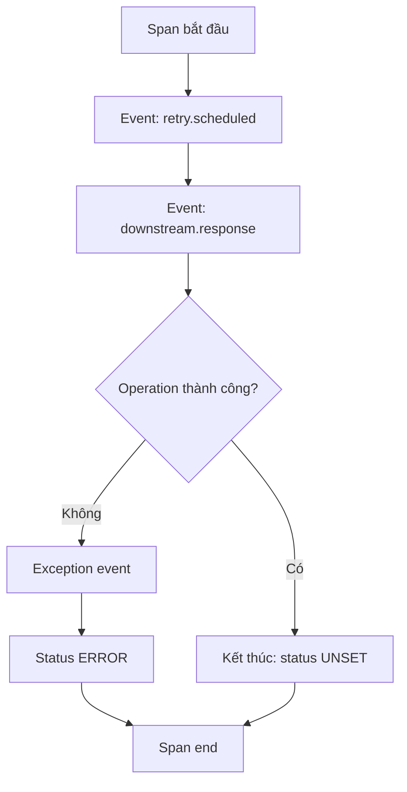

# Span event cho status và exception

## 1. Phân biệt span status và span event

Trong OpenTelemetry, span status và span event mô tả hai khía cạnh khác nhau của một operation:

- **Status** cho biết kết quả tổng quát của span: chưa xác định, thành công hoặc lỗi.
- **Event** ghi lại một mốc đã xảy ra trong vòng đời span, kèm thời điểm và attributes tùy chọn.
- **Exception event** là event theo quy ước OpenTelemetry dùng để ghi nhận exception có liên quan tới operation.

Status trả lời câu hỏi “operation kết thúc thế nào?”. Event trả lời “điều gì đã xảy ra trong lúc operation chạy?”. Một span có thể có nhiều event nhưng chỉ có một status cuối cùng.

Ví dụ một RPC gọi Inventory có thể ghi event `retry.scheduled`, sau đó `cache.fallback`, rồi kết thúc thành công. Nếu retry cuối cùng vẫn thất bại, span có thể kết thúc với status ERROR và ghi exception event cho lỗi khiến operation thất bại.



Không dùng event thay cho status. Một event exception không tự động làm span có status ERROR; ngược lại, status ERROR không chứa đầy đủ loại exception, message hay stack trace.

## 2. Ba giá trị của span status

OpenTelemetry định nghĩa ba status code:

| Status | Ý nghĩa | Cách dùng |
| --- | --- | --- |
| `UNSET` | Chưa đặt status rõ ràng | Giá trị mặc định; thường giữ nguyên cho operation thành công |
| `OK` | Operation được xác nhận thành công | Chỉ đặt khi có lý do cần biểu thị thành công tường minh |
| `ERROR` | Operation kết thúc với lỗi | Đặt khi operation thực sự thất bại |

Span mới bắt đầu có status `UNSET`. Với operation thành công, thường không cần gọi `setStatus(OK)`; giữ `UNSET` là cách dùng thông thường theo OpenTelemetry.

Khi operation thất bại, đặt `ERROR`. Không đặt `OK` sau khi span đã được đánh dấu `ERROR` để “xóa” lỗi. Status phản ánh kết quả của chính operation được span đại diện, không nhất thiết phản ánh toàn bộ request bên ngoài.

Một request có thể có nhiều span con: một dependency call thất bại nhưng được retry thành công. Span của lần thử có thể là ERROR, trong khi span tổng thể kết thúc bình thường. Không ép tất cả span trong trace có cùng status.

## 3. Exception event theo OpenTelemetry

Exception event có tên chuẩn là `exception`. Các attributes thường dùng gồm:

| Attribute | Nội dung |
| --- | --- |
| `exception.type` | Tên class hoặc loại exception |
| `exception.message` | Message của exception nếu có |
| `exception.stacktrace` | Stack trace dạng chuỗi nếu được ghi nhận |

OpenTelemetry Java API cung cấp `Span.recordException(Throwable)` để ghi exception event:

```java
span.recordException(error);
```

Phương thức này ghi event theo quy ước exception; nó không tự đặt span status thành `ERROR`. Nếu exception làm operation thất bại, ứng dụng cần đặt status riêng:

```java
span.recordException(error);
span.setStatus(StatusCode.ERROR);
```

Không cần tự gọi `addEvent("exception", ...)` khi đã dùng `recordException`. Ghi cùng một exception hai lần làm trace nhiễu và có thể khiến người đọc tưởng có hai lỗi độc lập.

Chỉ ghi exception event khi exception có ý nghĩa đối với operation và cần được quan sát. Exception được xử lý hoàn toàn bằng fallback hoặc retry không nhất thiết phải ghi như lỗi cuối cùng; dùng custom event như `cache.fallback` hoặc `retry.scheduled` để diễn tả quá trình phục hồi.

## 4. Khi nào ghi exception và khi nào chỉ ghi event?

Phân biệt exception được xử lý và exception làm operation thất bại:

- **Unhandled failure:** exception làm operation kết thúc lỗi. Ghi exception event và đặt span status ERROR.
- **Handled exception:** ứng dụng bắt exception, thực hiện fallback và trả kết quả hợp lệ. Ghi custom event nếu cần theo dõi fallback; không nhất thiết ghi exception event hoặc đặt ERROR cho span tổng thể.
- **Retry attempt thất bại nhưng retry sau thành công:** span của attempt có thể ghi exception và ERROR; span tổng thể có thể kết thúc thành công.
- **Expected business outcome:** ví dụ sản phẩm không tồn tại theo contract. Ghi outcome phù hợp; không tự động xem mọi business result khác OK là sự cố hạ tầng.
- **Cancellation:** caller đóng stream hoặc hủy RPC. Ghi nhận cancellation theo nhu cầu; không mặc định coi mọi cancellation là lỗi server.

Quy tắc quan trọng là status phải phù hợp với operation mà span mô tả. Nếu span mô tả một lần gọi downstream và lần gọi đó trả lỗi, span downstream có thể ERROR dù application service cuối cùng phục hồi thành công.

Không ghi exception ở mọi tầng khi cùng một exception được truyền qua nhiều lớp. Chọn span đại diện cho nơi lỗi phát sinh hoặc nơi operation thất bại; các span cha có thể nhận status ERROR nếu toàn bộ operation của chúng cũng thất bại, nhưng không cần lặp stack trace ở từng span.

## 5. Ghi exception trong application service

Ví dụ một application operation gọi repository hoặc downstream service. Span nội bộ được tạo để đo use case; nếu lỗi không được xử lý và làm use case thất bại, ghi exception và status:

```java
import io.opentelemetry.api.trace.Span;
import io.opentelemetry.api.trace.StatusCode;
import io.opentelemetry.api.trace.Tracer;
import io.opentelemetry.context.Scope;

public ProductView getProduct(GetProductQuery query) {
    Span span = tracer.spanBuilder("catalog.get_product")
            .startSpan();

    try (Scope scope = span.makeCurrent()) {
        return getProductUseCase.execute(query);

    } catch (RuntimeException error) {
        span.recordException(error);
        span.setStatus(StatusCode.ERROR);
        throw error;

    } finally {
        span.end();
    }
}
```

`startSpan()` kế thừa current context làm parent theo mặc định. Nếu gRPC server span đã được auto instrumentation tạo, span `catalog.get_product` là child của server span đó. Scope làm span hiện tại trong lúc use case chạy; `finally` bảo đảm span được kết thúc cả khi thành công hoặc lỗi.

Ví dụ chỉ ghi exception một lần tại span của application operation. Nếu adapter bắt exception để map sang gRPC status, không nên ghi lại cùng stack trace vào một custom event khác. Transport instrumentation có thể ghi status của RPC riêng theo semantic conventions.

## 6. Ghi custom event cho các mốc nghiệp vụ

Custom event dùng để ghi một mốc có ý nghĩa, không phải để thay exception event. Ví dụ khi retry được lên lịch:

```java
import io.opentelemetry.api.common.Attributes;
import io.opentelemetry.api.trace.Span;

Span.current().addEvent(
        "retry.scheduled",
        Attributes.builder()
                .put("retry.attempt", 2L)
                .put("retry.delay_ms", 100L)
                .put("retry.reason", "unavailable")
                .build());
```

Các event hữu ích trong Spring gRPC có thể gồm:

- `retry.scheduled`: một lần retry được lên lịch;
- `cache.fallback`: application chuyển sang cache;
- `authorization.denied`: request bị từ chối theo policy;
- `stream.cancelled`: streaming RPC bị hủy;
- `response.mapping.failed`: không thể chuyển application result thành protobuf response.

Tên event nên ổn định, mô tả hành động đã xảy ra và dùng cùng convention trong toàn hệ thống. Attributes nên là dữ liệu có kiểu, giới hạn và không nhạy cảm.

Không tạo event cho mọi message trong streaming tốc độ cao. Dùng metrics để đếm message, byte và latency; event chỉ ghi milestone hoặc chuyển trạng thái cần điều tra.

## 7. Ghi event với attributes

Mỗi span event có timestamp. Khi gọi overload `addEvent(name, attributes)`, SDK tự ghi thời điểm hiện tại:

```java
span.addEvent(
        "subscription.first_message",
        Attributes.builder()
                .put("message.count", 1L)
                .build());
```

Đây là cách phù hợp cho phần lớn event phát sinh ngay trong luồng xử lý. Chỉ dùng overload timestamp tường minh khi ứng dụng có thời điểm sự kiện đáng tin cậy và đã chuyển đổi đúng clock/time unit theo API. Không dùng `System.nanoTime()` như epoch timestamp; đây là đồng hồ monotonic dùng để đo khoảng thời gian.

Event attributes có thể giúp giải thích sự kiện, ví dụ retry attempt hoặc queue size. Tránh đưa nguyên protobuf request, response, metadata map hoặc object lớn vào event. Event không phải nơi lưu payload.

## 8. Gắn gRPC status với span status

gRPC có `io.grpc.Status` và các code như `OK`, `INVALID_ARGUMENT`, `NOT_FOUND`, `UNAVAILABLE`, `DEADLINE_EXCEEDED`, `CANCELLED` và `INTERNAL`. Đây là kết quả ở tầng RPC; OpenTelemetry span status là tín hiệu tổng quát hơn.

| gRPC outcome | Cách diễn giải quan sát |
| --- | --- |
| `OK` | RPC hoàn tất thành công; thường giữ span status UNSET |
| `INVALID_ARGUMENT` | Request không hợp lệ; có thể là lỗi contract phía caller |
| `NOT_FOUND` | Resource không tồn tại; có thể là business outcome hợp lệ |
| `ALREADY_EXISTS` | Xung đột dữ liệu theo contract |
| `UNAUTHENTICATED` / `PERMISSION_DENIED` | Request bị từ chối; phân biệt policy denial với lỗi hệ thống |
| `CANCELLED` | Call bị hủy; thường cần phân biệt caller cancellation với server failure |
| `DEADLINE_EXCEEDED` | Call vượt quá thời hạn; thường là lỗi của operation call |
| `UNAVAILABLE` | Dependency hoặc server không sẵn sàng; có thể retry theo policy |
| `INTERNAL` / `UNKNOWN` | Lỗi phía server hoặc lỗi chưa phân loại được |

Nếu gRPC auto instrumentation đã tạo transport span và đặt status theo semantic conventions, không tự ghi đè status đó bằng policy riêng thiếu nhất quán. Application span có thể mô tả outcome nghiệp vụ khác với transport span.

Ví dụ `NOT_FOUND` có thể là kết quả hợp lệ của use case “tìm sản phẩm”; span application có thể ghi `app.outcome=not_found` mà không coi đó là lỗi nội bộ. Transport span vẫn phản ánh gRPC status theo convention của instrumentation. Ngược lại, `UNAVAILABLE` từ Inventory thường là lỗi của downstream call và cần được quan sát như một failure.

Không đưa nguyên văn gRPC status description hoặc trailers vào span attributes nếu chúng có thể chứa thông tin nội bộ hoặc dữ liệu do upstream kiểm soát.

## 9. Xử lý exception ở gRPC adapter

Adapter thường bắt application exception rồi chuyển thành gRPC status. Cần quyết định span nào ghi exception:

```java
try {
    ProductView product = getProductUseCase.execute(query);
    responseObserver.onNext(toResponse(product));
    responseObserver.onCompleted();

} catch (ProductNotFoundException notFound) {
    // Business outcome đã biết; không ghi stack trace như lỗi hạ tầng.
    responseObserver.onError(
            Status.NOT_FOUND
                    .withDescription("Product was not found")
                    .asRuntimeException());

} catch (RuntimeException error) {
    Span span = Span.current();
    span.recordException(error);
    span.setStatus(StatusCode.ERROR);

    responseObserver.onError(
            Status.INTERNAL
                    .withDescription("Internal server error")
                    .asRuntimeException());
}
```

Đây là ví dụ minh họa policy: `ProductNotFoundException` được coi là business outcome đã biết; lỗi ngoài dự kiến được ghi exception và status ERROR. Nếu application span riêng đã ghi cùng exception trước khi rethrow, adapter không nên ghi thêm một exception event trùng lặp trên cùng operation span. Transport instrumentation có thể tự ghi gRPC status trên server span.

Không trả exception message hoặc stack trace cho client. `Status.INTERNAL` có description an toàn; chi tiết kỹ thuật nằm trong telemetry/log nội bộ đã kiểm soát quyền truy cập.

## 10. Exception trong retry và fallback

Một exception ở attempt đầu không nhất thiết làm operation tổng thể thất bại. Ví dụ Catalog gọi Inventory, nhận `UNAVAILABLE`, chờ backoff và retry thành công.

Cách biểu diễn có thể là:

- Span của mỗi downstream attempt phản ánh kết quả riêng.
- Attempt thất bại có thể ghi exception event và status ERROR.
- Span tổng thể ghi `retry.scheduled`, số attempt và kết quả cuối.
- Nếu retry thành công, span tổng thể không cần kết thúc với ERROR.

Nếu retry xảy ra trong cùng một client span do instrumentation quản lý, dùng event để ghi attempt nếu instrumentation không cung cấp chi tiết đó. Nếu mỗi attempt là một RPC riêng, client span tương ứng nên biểu diễn kết quả từng call.

Khi fallback thành công, ghi event `cache.fallback` hoặc `inventory.fallback_used`. Không đánh dấu span tổng thể ERROR chỉ vì một nguồn dữ liệu phụ thất bại nếu kết quả nghiệp vụ vẫn đáp ứng contract.

Đặt giới hạn số event và không ghi một event cho từng vòng lặp retry vô hạn. Retry policy phải có giới hạn attempts, backoff và deadline tổng.

## 11. Exception và streaming RPC dài

Với streaming RPC, exception có thể xảy ra sau khi nhiều message đã được gửi. Span của RPC cần sống tới terminal event; exception event phải được ghi trước khi span kết thúc.

Ví dụ server stream:

```java
subscription.onError(error -> streamContext.wrap(() -> {
    if (ended.compareAndSet(false, true)) {
        streamSpan.recordException(error);
        streamSpan.setStatus(StatusCode.ERROR);

        try {
            responseObserver.onError(toGrpcError(error));
        } finally {
            streamSpan.end();
        }
    }
}).run());
```

Đảm bảo error callback chỉ kết thúc span một lần, kể cả khi cancellation và error cạnh tranh nhau. Dùng atomic terminal guard hoặc state machine của stream. Khi client cancel, cancellation thường được ghi bằng event như `stream.cancelled`; không nhất thiết ghi exception event nếu không có exception thực sự.

Không ghi exception event cho từng message lỗi có thể phục hồi trong stream. Nếu message bị từ chối nhưng stream tiếp tục bình thường, ghi custom event hoặc metric theo policy. Nếu lỗi làm toàn bộ stream kết thúc, ghi exception event tại span đại diện cho operation thất bại.

## 12. Bảo vệ dữ liệu trong exception event

`recordException(Throwable)` có thể ghi exception type, message và stack trace. Những giá trị này không phải lúc nào cũng an toàn để export:

- Message có thể chứa email, token, SQL, tên bảng, customer ID hoặc dữ liệu request.
- Stack trace có thể để lộ package nội bộ, tên service, đường dẫn và implementation detail.
- Exception cause có thể chứa response body hoặc thông tin từ dependency bên ngoài.
- Status description có thể do upstream cung cấp và chứa dữ liệu không tin cậy.

Không tạo exception message bằng cách nối toàn bộ request hoặc response. Dùng thông báo kỹ thuật ngắn, không nhạy cảm. Nếu exception gốc chứa dữ liệu nhạy cảm, cân nhắc ghi một exception wrapper đã làm sạch hoặc chỉ ghi event an toàn với `exception.type` đã được kiểm soát.

Span processor có thể lọc attributes trước khi export, nhưng không nên dựa hoàn toàn vào processor để bảo vệ bí mật. Hạn chế dữ liệu ngay từ nơi ghi nhận và kiểm thử dữ liệu thực tế mà exporter nhận được.

Không dùng exception message làm metric label. Message và stack trace có cardinality cao, kích thước lớn và có thể chứa dữ liệu riêng tư.

## 13. Giới hạn event và cardinality

Span event phù hợp cho timeline có kích thước hữu hạn. Một stream hoặc retry loop chạy lâu có thể tạo hàng nghìn event. SDK/exporter/backend có giới hạn số event và attributes; event vượt giới hạn có thể bị drop hoặc bị truncate.

Nguyên tắc:

1. Ghi event cho milestone có ý nghĩa, không ghi mọi message.
2. Dùng metrics cho số lượng và phân phối.
3. Dùng child span cho batch hoặc operation có thời lượng đáng kể.
4. Giữ event name và attribute key ổn định.
5. Tránh ID duy nhất hoặc raw exception message trong metric dimensions.
6. Kiểm tra dropped event/attribute counters hoặc thông tin giới hạn nếu backend không hiển thị event như mong đợi.

Không giả định event được giữ vô hạn chỉ vì span còn mở. Đặt budget phù hợp cho stream dài và không đưa payload lớn vào attributes.

## 14. Kiểm thử span status và exception event

Dùng OpenTelemetry SDK test exporter để xác minh dữ liệu span sau khi kết thúc. Kiểm thử cần xem cả status lẫn event, không chỉ kiểm tra có span:

| Kịch bản | Điều cần xác minh |
| --- | --- |
| Operation thành công | Status thường là UNSET; không có exception event |
| Unhandled exception | Có event exception, type phù hợp và status ERROR |
| Fallback thành công | Có custom event fallback; span tổng thể không bị đánh dấu ERROR |
| Retry attempt lỗi, retry thành công | Attempt span phản ánh lỗi; span tổng thể kết thúc thành công |
| Business NOT_FOUND | Outcome/status phù hợp policy; không ghi stack trace không cần thiết |
| gRPC UNAVAILABLE | Transport span có status theo instrumentation; lỗi không bị mất |
| Cancellation | Có event hoặc status phù hợp; cleanup và span end đúng một lần |
| Exception chứa dữ liệu nhạy cảm | Không có secret/PII trong event attributes được export |
| Nhiều event | Event limit và dropped count được hiểu đúng |

Ví dụ kiểm tra span data:

```java
SpanData data = exporter.getFinishedSpanItems().get(0);

assertEquals(StatusCode.ERROR, data.getStatus().getStatusCode());

assertTrue(data.getEvents().stream()
        .anyMatch(event -> event.getName().equals("exception")));
```

Để test exception attributes, kiểm tra `exception.type` và bảo đảm `exception.message`/`exception.stacktrace` đã được xử lý theo privacy policy. Để test custom event, xác minh tên và các attributes ổn định như `retry.attempt`.

Với gRPC integration test, gọi qua generated stub và kiểm tra status nhận ở client cùng span data thu được ở server. In-process test phù hợp cho logic span; Netty transport test xác minh instrumentation và metadata thực tế. Dùng timeout/latch thay vì `Thread.sleep()`.

## 15. Lỗi thường gặp

1. **Nghĩ recordException tự đặt status ERROR.** Nó ghi exception event; phải đặt status riêng khi operation thất bại.
2. **Dùng status ERROR cho mọi exception được bắt và phục hồi.** Span tổng thể có thể vẫn thành công. Ghi custom event cho fallback/retry.
3. **Ghi exception ở mọi tầng.** Một lỗi xuất hiện lặp lại trong trace. Chọn span đại diện và tránh duplicate recording.
4. **Dùng addEvent(exception) tùy tiện.** Có thể thiếu semantic attributes. Dùng recordException cho Throwable.
5. **Coi gRPC status và OTel span status là một.** Một cái là kết quả RPC, một cái là kết quả span. Ánh xạ theo semantics và instrumentation.
6. **Đánh dấu mọi CANCELLED là lỗi server.** Caller có thể chủ động hủy. Phân biệt cancellation với failure.
7. **Đưa stack trace hoặc status description ra client.** Làm lộ implementation. Chỉ trả mô tả an toàn.
8. **Ghi payload hoặc token vào exception message.** Telemetry có thể phát tán dữ liệu nhạy cảm. Làm sạch dữ liệu từ nguồn.
9. **Ghi event cho từng message.** Trace phình lớn. Dùng metrics và milestone events.
10. **Không kiểm tra event limit.** Event có thể bị drop. Kiểm tra exporter và giới hạn SDK/backend.

## 16. Bài thực hành

Tạo observability cho unary RPC `GetProduct` và downstream call `GetAvailability`:

1. Bật OpenTelemetry gRPC auto instrumentation để tạo transport spans.
2. Tạo internal span cho use case `catalog.get_product`.
3. Khi Inventory trả `UNAVAILABLE`, ghi exception event ở span phù hợp và đặt status ERROR cho downstream attempt.
4. Retry có giới hạn; ghi `retry.scheduled` với attempt và delay, không ghi payload.
5. Nếu fallback cache thành công, ghi `cache.fallback`; span tổng thể kết thúc thành công theo outcome của use case.
6. Với `ProductNotFoundException`, map sang `NOT_FOUND` và xác định đây là business outcome hay failure theo contract.
7. Kiểm tra cancellation và streaming error chỉ kết thúc span một lần.
8. Dùng test exporter xác minh status code, exception event, custom event và dữ liệu nhạy cảm đã được loại bỏ.
9. Gọi qua generated stub trong integration test để xác minh gRPC status và telemetry cùng phản ánh đúng kết quả.

**Tự kiểm tra:** Span status biểu thị kết quả tổng quát của operation; span event ghi lại mốc xảy ra trong lifecycle. `recordException` tạo event `exception` nhưng không tự đặt status ERROR. Chỉ ghi exception cho lỗi có ý nghĩa với operation, tránh duplicate recording, phân biệt lỗi cuối cùng với retry/fallback đã phục hồi và bảo vệ message/stack trace khỏi rò rỉ dữ liệu. Với Spring gRPC, kết hợp status gRPC, span status, custom events và metrics theo đúng semantics để trace có ích khi điều tra.

