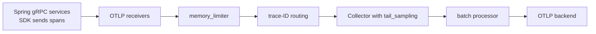

# Sampling trong hệ thống lưu lượng cao

## 1. Vì sao cần sampling?

OpenTelemetry có thể tạo span cho mỗi operation trong ứng dụng. Trong hệ thống Spring gRPC có lưu lượng lớn, một request thường đi qua nhiều service và tạo ra nhiều span: inbound server span, internal span, outbound client span và các span con cho batch hoặc dependency. Nếu giữ toàn bộ trace, lượng telemetry tăng nhanh theo request rate, số hop và số operation bên trong mỗi service.

Sampling quyết định trace nào được ghi nhận và xuất đi. Mục tiêu là giảm chi phí CPU, bộ nhớ, network và lưu trữ, đồng thời vẫn giữ đủ dữ liệu để điều tra lỗi, latency và hành vi bất thường.

Sampling tác động lên telemetry, không thay đổi kết quả RPC hoặc quyền truy cập nghiệp vụ. Không dùng sampling để che lỗi, thay authorization hay làm cơ chế tuân thủ lưu trữ dữ liệu.

Một chiến lược tốt cần cân bằng:

- **Chi phí:** số span được tạo, xử lý, export và lưu.
- **Giá trị điều tra:** khả năng giữ trace lỗi, chậm hoặc thuộc operation quan trọng.
- **Tính nhất quán:** các service trong cùng trace phải có quyết định sampling phù hợp để parent-child chain không bị đứt.

## 2. Head sampling và tail sampling

Có hai thời điểm chính để quyết định giữ trace:

| Cơ chế | Thời điểm quyết định | Thông tin có thể dùng | Điểm mạnh | Giới hạn |
| --- | --- | --- | --- | --- |
| Head sampling | Khi span gốc bắt đầu | Trace ID, parent sampled flag, thông tin có sẵn lúc bắt đầu | Quyết định sớm, giảm chi phí export ngay tại SDK | Chưa biết kết quả cuối, khó ưu tiên trace chỉ vì lỗi hoặc chậm xảy ra sau đó |
| Tail sampling | Sau khi Collector nhận các span của trace | Status, duration, attributes và span đã nhận | Có thể giữ trace lỗi/chậm dựa trên kết quả thực | Cần nhận và buffer nhiều span, tốn bộ nhớ và hạ tầng Collector |

Head sampling phù hợp khi cần giảm mạnh volume ngay tại service. Tail sampling phù hợp khi cần chọn trace dựa trên kết quả cuối như ERROR hoặc latency cao.

Tail sampling không thể khôi phục span đã bị SDK head sampler loại bỏ trước khi gửi. Nếu Collector cần tự quyết định giữ trace lỗi/chậm, các service phải gửi đủ span cần thiết tới Collector; cấu hình head sampler loại bỏ phần lớn trace sẽ làm tail sampling thiếu dữ liệu.

## 3. Trace-based sampling và parent-based sampling

Sampling nên được quyết định nhất quán ở cấp trace thay vì ngẫu nhiên độc lập trên từng span. Nếu mỗi service tự quyết định riêng, một trace có thể giữ server span nhưng mất client span hoặc ngược lại.

Parent-based sampler tuân theo sampled flag của parent:

- Nếu parent remote/local đã được sample, child span tiếp tục được sample.
- Nếu parent đã bị loại, child span thường cũng bị loại.
- Nếu span không có parent, root sampler quyết định theo policy, ví dụ trace ID ratio.

Cách này giữ tính nhất quán parent-child qua các service khi trace context được truyền đúng.

Với trace ID ratio sampler, quyết định dựa trên trace ID nên ổn định cho các service dùng cùng policy. Một tỷ lệ 5% có nghĩa xấp xỉ 5% trace gốc được chọn, không phải chính xác 5% request trong mọi cửa sổ thời gian nhỏ.

Không dùng sampler độc lập cho từng span nếu muốn giữ một trace đầy đủ. Cũng không tạo trace ID mới ở downstream chỉ để tăng tỷ lệ sample.

## 4. Cấu hình head sampling cho Spring gRPC

Khi dùng OpenTelemetry Java agent, có thể cấu hình parent-based trace ID ratio sampler qua environment:

```bash
OTEL_TRACES_SAMPLER=parentbased_traceidratio
OTEL_TRACES_SAMPLER_ARG=0.05
OTEL_PROPAGATORS=tracecontext,baggage
```

Ví dụ này chọn khoảng 5% trace gốc; các span con tuân theo sampled flag của parent. Tên sampler và cấu hình cần khớp phiên bản OpenTelemetry Java agent/SDK đang dùng.

Nếu cấu hình SDK trực tiếp, ý tưởng tương đương là:

```java
Sampler sampler = Sampler.parentBased(
        Sampler.traceIdRatioBased(0.05));

SdkTracerProvider tracerProvider = SdkTracerProvider.builder()
        .setSampler(sampler)
        .build();
```

Đoạn code minh họa cần các lớp SDK tương ứng từ OpenTelemetry SDK. Trong Spring Boot, nên để một SDK/provider được quản lý thống nhất bởi Java agent hoặc autoconfiguration; tránh tạo nhiều SDK riêng trong các bean.

Tỷ lệ sampling nên được cấu hình theo môi trường và tải thực tế. Ví dụ local có thể dùng tỷ lệ cao để debug, staging dùng tỷ lệ trung bình, production dùng tỷ lệ thấp hơn. Không hard-code tỷ lệ khác nhau tùy tiện giữa các service trong cùng trace vì điều đó có thể làm mất tính nhất quán.

## 5. Sampled flag được truyền qua gRPC như thế nào?

W3C Trace Context mang trace ID, parent span ID và trace flags trong metadata traceparent. Bit sampled trong trace flags cho downstream biết trace đã được chọn hay chưa.

Khi Catalog gọi Inventory:

1. Catalog có current span và trace context.
2. gRPC client instrumentation inject trace context vào metadata.
3. Inventory server instrumentation extract context.
4. Parent-based sampler ở Inventory dùng remote parent sampled flag để quyết định child span.

Nếu trace gốc không được sample, downstream parent-based sampler thường không ghi child span. Điều này tránh trace bị ghi từng đoạn không liên quan.

Bật trace propagation không đồng nghĩa mọi span đều được export. Trace context vẫn có thể được truyền để giữ quan hệ nhân quả ngay cả khi sampled flag là false.

Không tự sửa sampled flag trong metadata để ép downstream ghi span. Nếu thay đổi sampling decision, cần policy thống nhất ở root hoặc cơ chế tail sampling được thiết kế rõ ràng.

## 6. Chọn tỷ lệ head sampling theo lưu lượng

Ước lượng volume giúp chọn tỷ lệ ban đầu. Một phép tính gần đúng:

```text
Exported spans/second
  = incoming traces/second
  × average spans per trace
  × sampling ratio
```

Ví dụ hệ thống nhận 2.000 trace/giây, trung bình 8 span/trace, sampling ratio 5%:

```text
2.000 × 8 × 0,05 = 800 spans/second
```

Đây là ước lượng trung bình. Lưu lượng burst, trace có nhiều downstream calls và span nội bộ có thể làm volume thực tế cao hơn.

Cần theo dõi:

- số span được tạo và export;
- số span bị drop do sampling hoặc queue/export failure;
- exporter queue size, retry và timeout;
- Collector ingest/export rate;
- backend ingestion, storage và query cost.

Không chọn tỷ lệ chỉ dựa trên phần trăm. Hãy dựa trên ngân sách span/giây, chi phí lưu trữ, yêu cầu điều tra và phân bố trace thực tế.

## 7. Khi nào nên dùng tail sampling?

Tail sampling cho phép giữ trace dựa trên kết quả đã xảy ra. Ví dụ:

- Giữ trace có span status ERROR.
- Giữ trace có latency vượt ngưỡng.
- Giữ một số RPC method quan trọng.
- Giữ trace có thuộc tính chỉ xuất hiện sau khi xử lý request.
- Giữ một tỷ lệ nhỏ trace bình thường để có baseline.

Một policy có thể kết hợp nhiều điều kiện. Ví dụ giữ mọi trace lỗi, trace chậm hơn 1 giây và sample 1% trace còn lại. Chính sách cụ thể cần được đánh giá theo volume và khả năng của Collector.

Tail sampling đặc biệt hữu ích khi lỗi chỉ biết ở cuối request. Head sampler không thể biết trước request sẽ trả UNAVAILABLE hay vượt deadline.

Tail sampling chỉ quyết định trên các span nhận được. Nếu một service không instrument, bị cấu hình head sampling drop hoặc gửi span sang Collector khác, trace có thể thiếu nhánh. Do đó, completeness của trace và routing là điều kiện thiết kế bắt buộc.

## 8. Pipeline tail sampling trong OpenTelemetry Collector

Tail sampling thường chạy trong OpenTelemetry Collector Contrib vì processor này cần giữ trạng thái trace và áp dụng policy. Một pipeline khái niệm:



Tất cả span của cùng trace phải tới cùng một tail-sampling Collector. Nếu span của Catalog tới collector A còn span của Inventory tới collector B, mỗi collector chỉ thấy một phần trace và có thể đưa ra quyết định sai.

Khi chạy nhiều Collector replicas, cần routing theo trace ID trước tail sampling, thường qua load-balancing exporter/collector tier có routing key theo trace ID. Sau đó, collector nhận đủ span mới chạy tail_sampling.

Processor memory limiter nên được đặt trước processor tốn bộ nhớ. Batch thường đặt sau tail sampling để gom những span đã được chọn trước khi export. Thứ tự và cấu hình chính xác phụ thuộc phiên bản Collector Contrib.

## 9. Ví dụ cấu hình tail sampling

Ví dụ rút gọn dưới đây minh họa Collector Contrib nhận OTLP, giữ trace lỗi hoặc chậm, đồng thời sample một tỷ lệ nhỏ trace bình thường:

```yaml
receivers:
  otlp:
    protocols:
      grpc:
      http:

processors:
  memory_limiter:
    check_interval: 1s
    limit_mib: 2048
    spike_limit_mib: 512

  tail_sampling:
    decision_wait: 10s
    num_traces: 50000
    expected_new_traces_per_sec: 1000
    policies:
      - name: keep-errors
        type: status_code
        status_code:
          status_codes: [ERROR]

      - name: keep-slow
        type: latency
        latency:
          threshold_ms: 1000

      - name: baseline
        type: probabilistic
        probabilistic:
          sampling_percentage: 1

  batch: {}

exporters:
  otlp:
    endpoint: telemetry-backend:4317
    tls:
      insecure: true

service:
  pipelines:
    traces:
      receivers: [otlp]
      processors: [memory_limiter, tail_sampling, batch]
      exporters: [otlp]
```

Đây là cấu hình minh họa, không phải file production dùng nguyên trạng. Cần xác minh schema của Collector Contrib version đang triển khai, TLS/auth của exporter, memory budget và tên policy được hỗ trợ. Giá trị insecure true chỉ phù hợp môi trường thử nghiệm cô lập; production phải cấu hình TLS và xác thực phù hợp.

Policy baseline giúp có một mẫu trace bình thường để so sánh. Nếu policy được cấu hình theo kiểu OR, trace khớp bất kỳ policy nào cũng có thể được giữ. Kiểm tra semantics policy và composite policy của phiên bản Collector trước khi triển khai.

## 10. Bộ nhớ, decision wait và trace dài

Tail sampler phải giữ span trong bộ nhớ cho tới khi đủ điều kiện ra quyết định hoặc hết decision wait. Ba cấu hình ảnh hưởng lớn:

- decision_wait: khoảng thời gian Collector chờ thêm span trước khi quyết định.
- num_traces: số trace tối đa mà processor giữ trong state.
- expected_new_traces_per_sec: gợi ý dung lượng state theo tốc độ trace mới.

Nếu decision wait quá ngắn, span đến muộn có thể không được xét trong quyết định ban đầu. Nếu quá dài, memory usage và độ trễ xuất telemetry tăng.

Một ước lượng thô cho số trace cần giữ:

```text
Buffered trace count
  ≈ new traces per second × decision wait in seconds
```

Ví dụ 1.000 trace mới/giây và decision wait 10 giây cần state cho khoảng 10.000 trace đồng thời, chưa tính burst, trace dài và overhead. Đây chỉ là ước lượng khởi đầu; phải đo memory thực tế theo số span và kích thước attributes trên mỗi trace.

Streaming RPC dài có thể giữ span mở lâu hơn decision wait. Tail sampling không thể đánh giá kết quả cuối của span chưa kết thúc. Dùng metrics để quan sát stream đang hoạt động và cân nhắc các operation span có vòng đời ngắn hơn cho batch hoặc giai đoạn xử lý.

## 11. Routing và scaling cho tail sampling

Trong triển khai phân tán, routing theo trace ID là điều kiện để một trace được đánh giá như một đơn vị. Một mô hình phổ biến:

1. Các application Collector nhận OTLP từ service.
2. Load-balancing exporter chọn tail-sampling Collector theo trace ID.
3. Tail-sampling Collector giữ toàn bộ span của trace đó.
4. Processor quyết định giữ/bỏ trace.
5. Batch exporter gửi span đã chọn tới backend.

Khi scale Collector, thay đổi membership có thể làm cùng trace bị route tới replica khác trong thời gian ngắn nếu consistent hashing/routing không được quản lý phù hợp. Cần xem xét trace affinity, rollout strategy và cách xử lý late spans.

Tail-sampling tier cần được giám sát riêng: incoming spans, trace state count, memory, dropped spans, late spans, decision latency, exporter queue và export failures. Nếu Collector quá tải, policy giữ trace lỗi có thể không còn hoạt động như mong muốn.

Không gửi trực tiếp từng service tới một trong nhiều tail-sampling replicas bằng round-robin thông thường. Round-robin theo request không bảo đảm các span của cùng trace tới cùng replica.

## 12. Kết hợp head và tail sampling

Có thể dùng head và tail sampling ở các tầng khác nhau, nhưng cần hiểu giới hạn:

- Head sampling ở SDK giảm volume trước Collector.
- Tail sampling ở Collector chọn trace dựa trên spans nhận được.
- Trace bị head sampler loại bỏ không thể được tail sampler giữ lại.
- Nếu muốn tail sampling giữ lỗi, phải bảo đảm các span có thể chứa lỗi được gửi tới tail tier.

Một thiết kế phổ biến cho tail sampling là cấu hình SDK gửi toàn bộ trace tới Collector và để Collector quyết định. Ví dụ Java agent:

```bash
OTEL_TRACES_SAMPLER=always_on
OTEL_EXPORTER_OTLP_ENDPOINT=http://otel-gateway:4317
```

Dùng always_on làm tăng đáng kể traffic từ application tới Collector. Mọi service tham gia trace cần được cấu hình để gửi span tới tail-sampling tier; nếu một downstream service tự head-sample và drop span, Collector vẫn thiếu nhánh đó. Chỉ chọn cách này khi Collector tier có đủ capacity, có backpressure/buffering phù hợp và đã thử tải.

Nếu hạ tầng không đủ sức nhận toàn bộ span, dùng parent-based head sampling với tỷ lệ được kiểm soát và chấp nhận rằng tail sampler chỉ phân loại được tập trace đã được head sampler chuyển tiếp. Không tuyên bố giữ mọi trace lỗi nếu trace lỗi có thể đã bị head sampling drop.

## 13. Adaptive sampling và policy theo service

Trong hệ thống lưu lượng biến động, tỷ lệ sampling cố định có thể không tối ưu. Có thể thay đổi sampling ratio theo môi trường hoặc giai đoạn tải, nhưng cần tránh mỗi service tự thay đổi độc lập.

Một số hướng:

- Dùng tỷ lệ thấp hơn cho traffic bình thường có volume rất lớn.
- Giữ tỷ lệ cao hơn cho service hoặc operation quan trọng, nếu policy được truyền nhất quán theo trace.
- Dùng tail policy để ưu tiên lỗi/chậm khi Collector đủ capacity.
- Điều chỉnh tỷ lệ theo ngân sách telemetry đã đo, không dựa trên cảm giác.
- Ghi lại sampling configuration/version để hiểu vì sao trace được giữ hoặc bị drop.

Không thay đổi sampling ratio liên tục theo từng request. Quyết định phải ổn định theo trace và tránh tạo bias khó giải thích. Nếu có nhiều tier policy, hãy xác định rõ root sampler, remote parent behavior và propagation.

Sampling không bảo đảm mọi lỗi đều có trace. Với yêu cầu điều tra hoặc kiểm toán, kết hợp logs/metrics và các cơ chế audit có retention riêng; không phụ thuộc trace sampling làm nguồn dữ liệu duy nhất.

## 14. Metrics, exemplars và trace correlation

Metrics thường được thu thập độc lập với trace sampling. Một ứng dụng vẫn có thể đo request rate, error rate, latency histogram và active streams ngay cả khi chỉ một phần trace được export.

Exemplar có thể liên kết một observation trong metric histogram với trace/span context đã sample. Điều này giúp từ latency bucket tìm tới một trace đại diện mà không cần đưa trace ID thành metric label.

Không thêm trace ID, request ID, user ID hoặc tenant ID làm metric dimension. Những giá trị có cardinality cao làm tăng chi phí time-series và có thể gây mất ổn định backend metrics.

Với Spring gRPC, nên duy trì:

- Metrics cho mọi request/stream theo aggregation có cardinality thấp.
- Traces theo sampling policy.
- Logs có cấu trúc cho lỗi cần chi tiết, với dữ liệu nhạy cảm được lọc.
- Correlation context để liên kết log/trace khi trace được sample.

Không giả định metrics và traces có cùng sampling rate. Sampling trace không nên làm mất số liệu tổng hợp về error rate hoặc latency.

## 15. Bảo mật và quyền riêng tư khi sampling

Sampling không phải cơ chế kiểm soát dữ liệu nhạy cảm. Nếu span chứa token hoặc PII, ngay cả trace được sample với tỷ lệ 1% vẫn có thể làm lộ dữ liệu.

Lọc dữ liệu trước export:

- Không ghi credential, access token, password hoặc private key.
- Không đưa protobuf payload đầy đủ vào span attributes/events.
- Dùng attribute allowlist và redaction ở nơi instrumentation tạo dữ liệu.
- Hạn chế quyền truy cập backend telemetry và đặt retention theo policy.
- Kiểm tra dữ liệu thực tế bằng exporter test, kể cả trace được giữ do ERROR policy.

Tail sampling theo attribute cũng có thể vô tình ưu tiên trace dựa trên dữ liệu nhạy cảm. Chỉ dùng attribute đã được phê duyệt, có cardinality phù hợp và không tiết lộ danh tính.

## 16. Kiểm thử sampling trong Spring gRPC

Kiểm thử cần xác minh cả quyết định sampling và trace continuity:

| Kịch bản | Điều cần xác minh |
| --- | --- |
| Root trace với ratio sampler | Tỷ lệ gần với cấu hình qua tập trace đủ lớn |
| Child span có sampled parent | Child được sample theo parent-based policy |
| Child span có unsampled parent | Child tuân theo remote sampled flag |
| Trace lỗi với tail sampling | Trace được giữ theo status ERROR policy |
| Trace chậm | Trace được giữ khi vượt latency threshold |
| Trace bình thường | Chỉ baseline ratio được giữ |
| Nhiều Collector replicas | Các span cùng trace tới cùng tail sampler |
| Span đến muộn | Hành vi late span đúng policy và được quan sát |
| Collector quá tải | Memory limiter, queue và dropped telemetry được giám sát |
| PII trong attributes | Dữ liệu bị loại bỏ trước export |

Với head sampling, dùng SDK test sampler hoặc cấu hình ratio thấp/cao có thể kiểm tra sampled flag và recording state. Đừng kiểm tra tỷ lệ bằng vài trace; dùng tập đủ lớn và dung sai thống kê.

Với tail sampling, dùng Collector Contrib integration test hoặc môi trường test có OTLP receiver. Gửi nhiều span cùng trace với status/duration khác nhau, đợi decision wait và kiểm tra trace nào được export. Xác minh cả parent-child spans được giữ cùng nhau.

Trong gRPC integration test, gọi qua generated stub để kiểm tra propagation thực tế qua metadata. In-process transport phù hợp với logic application nhưng không chứng minh routing, OTLP export hoặc behavior của Collector production.

## 17. Lỗi thường gặp

1. **Dùng head sampling nhưng kỳ vọng giữ mọi trace lỗi.** Quyết định được đưa ra trước khi biết kết quả. Dùng tail sampling hoặc chấp nhận giới hạn của head sampler.
2. **Bật tail sampling sau SDK sampler loại phần lớn trace.** Collector không thể khôi phục spans đã bị drop. Gửi đủ spans cần thiết tới tail tier.
3. **Dùng round-robin tới nhiều tail-sampling replicas.** Span của cùng trace bị chia ra. Route theo trace ID.
4. **Không tính memory cho decision wait.** Collector giữ quá nhiều trace state. Ước lượng trace/giây × decision wait và kiểm thử burst.
5. **Đặt decision wait quá ngắn.** Span đến muộn bị bỏ khỏi quyết định. Chọn wait theo network delay và duration thực tế.
6. **Đặt decision wait quá dài cho stream dài.** State tồn tại lâu và tốn memory. Dùng metrics cho stream active và operation spans bounded.
7. **Coi sampling là cơ chế bảo mật.** Trace được giữ vẫn có thể chứa PII. Redact trước export.
8. **Dùng trace ID làm metric label.** Cardinality tăng mạnh. Dùng exemplar hoặc correlation ngoài metric dimensions.
9. **Tự thay tỷ lệ mỗi service.** Trace bị sample không nhất quán. Dùng parent-based policy và quản lý cấu hình tập trung.
10. **Chỉ kiểm tra số trace export.** Không biết trace có đủ span hay parent chain. Assert trace ID, parent span ID và policy outcome.

## 18. Bài thực hành

Thiết kế sampling cho Catalog gọi Inventory và Pricing trong môi trường production:

1. Đo trace/giây, span trung bình mỗi trace, kích thước span và exporter throughput hiện tại.
2. Chọn head sampling parentbased_traceidratio làm baseline hoặc chọn tail sampling nếu cần giữ trace theo kết quả.
3. Nếu dùng tail sampling, cấu hình SDK gửi đủ spans, triển khai Collector Contrib và route theo trace ID.
4. Tạo policy giữ trace ERROR, latency cao và một tỷ lệ nhỏ trace bình thường.
5. Đặt memory limiter, decision wait, trace capacity và batch/export limits theo load test.
6. Kiểm tra trace dài/streaming, late spans và hành vi khi Collector replica restart.
7. Duy trì metrics request/error/latency độc lập với trace sampling; dùng exemplar để liên kết trace khi có.
8. Redact PII/secret trước export và kiểm thử trace được giữ theo error policy.
9. Viết integration test xác minh toàn bộ span trong trace được giữ hoặc loại theo policy thống nhất.

**Tự kiểm tra:** Head sampling quyết định sớm tại SDK và giảm volume trước khi export; tail sampling quyết định sau khi Collector quan sát spans và có thể ưu tiên trace lỗi/chậm. Tail sampling chỉ hoạt động trên spans được gửi tới nó, cần buffer và routing theo trace ID để nhận đủ một trace. Trong Spring gRPC lưu lượng cao, chọn parent-based head sampling khi cần tiết kiệm chi phí, hoặc tail sampling khi cần chọn theo outcome; đo memory/throughput, giữ metrics độc lập và lọc dữ liệu nhạy cảm trước export.

