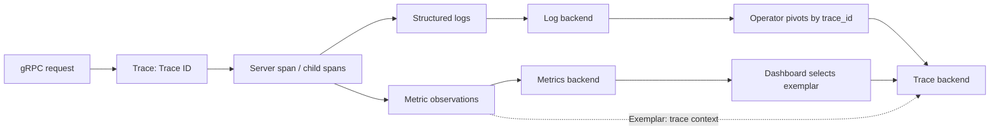

# Liên kết trace với log và metric

## Mục tiêu bài học

Trong **SPRING_GRPC**, một request có thể đi qua client, gateway, gRPC server, interceptor, service, database và các downstream RPC. Trace cho biết request đi qua đâu và mất thời gian ở span nào; log ghi lại sự kiện cùng chi tiết xử lý; metric cho biết xu hướng về latency, throughput và lỗi trên toàn hệ thống. Nếu ba tín hiệu không chia sẻ cùng ngữ cảnh, người vận hành khó chuyển từ một spike trên dashboard sang đúng trace và log giải thích nguyên nhân.

Bài học tập trung vào **liên kết trace với log và metric**: dùng trace ID/span ID trong structured logs, giữ OpenTelemetry Context qua gRPC và async boundary, liên kết metric sample với trace bằng exemplars, tránh đưa trace ID vào metric labels, và kiểm thử toàn bộ đường đi từ RPC tới backend quan sát.

Sau bài này, bạn có thể:

1. Phân biệt trace ID, span ID, log correlation và metric exemplar.
2. Tạo log có trace_id/span_id từ span context hiện hành.
3. Giữ OpenTelemetry Context khi chuyển thread hoặc gọi downstream gRPC.
4. Kết hợp gRPC Context, OTel Context và MDC mà không để rò dữ liệu giữa request.
5. Ghi metric latency/error với dimensions có cardinality thấp.
6. Dùng exemplars để điều hướng từ metric sample tới trace tương ứng.
7. Tránh duplicate spans, forged trace context và lộ dữ liệu nhạy cảm.
8. Kiểm thử trace-log-metric correlation qua một RPC end-to-end.

> **Phạm vi:** Ví dụ dùng OpenTelemetry API/SDK, gRPC Java và Spring. Việc tự động tạo gRPC spans phụ thuộc instrumentation/agent hoặc integration được bật trong ứng dụng. Tên semantic-convention attributes và khả năng export exemplars phụ thuộc phiên bản SDK, exporter và backend.

## 1. Ba tín hiệu và mối liên hệ

| Tín hiệu | Trả lời câu hỏi | Định danh/đặc điểm |
| --- | --- | --- |
| Trace | Một request đi qua những service/span nào và mất thời gian ở đâu? | Trace ID chung; mỗi span có Span ID |
| Log | Sự kiện cụ thể nào xảy ra, với thông tin xử lý nào? | Timestamp, severity, trace_id, span_id và event fields |
| Metric | Hệ thống đang có latency, throughput, error rate và saturation ra sao? | Aggregated time series với dimensions có cardinality kiểm soát |
| Exemplar | Một sample metric cụ thể liên hệ với trace nào? | Trace context gắn với một observation/sample |

Một trace thường gồm nhiều span. Các span trong cùng trace chia sẻ trace ID, còn mỗi span có span ID riêng. Log được ghi trong một span có thể chứa cả hai ID để người vận hành mở đúng trace và định vị span tạo ra log.

Metric thường tổng hợp nhiều request. Không nên tạo một time series riêng cho mỗi trace ID; thay vào đó, histogram/counter giữ dimensions ổn định như service, method và status class. Exemplar có thể lưu trace context của một observation được chọn để liên kết sample metric với trace.



Trace ID là khóa tương quan giữa các span/log thuộc cùng trace; span ID giúp định vị một operation cụ thể. Exemplar không biến metric thành trace và không thay thế log. Mỗi tín hiệu vẫn cần sampling, retention và access policy riêng.

## 2. Trace context trong gRPC

Khi instrumentation được cấu hình đúng, client và server gRPC có thể tạo client/server spans và truyền trace context qua metadata theo propagator, thường là W3C Trace Context. Ứng dụng nên ưu tiên instrumentation đã được hỗ trợ của OpenTelemetry Java agent hoặc gRPC instrumentation tương thích với version đang dùng.

Một luồng phổ biến:

1. Client bắt đầu client span.
2. Instrumentation inject trace context vào outbound gRPC metadata.
3. Server instrumentation extract context và tạo server span làm child của client span.
4. Service và downstream calls tạo child spans trong cùng trace.
5. Log/metric được ghi trong execution context đang active.

Không tự tạo thêm một server span trong interceptor nếu instrumentation đã tạo server span cho cùng RPC. Việc tạo span trùng lặp làm trace có hai span biểu diễn một operation và gây sai lệch latency. Chỉ tạo manual span cho một business operation có ý nghĩa riêng, nằm bên trong RPC span.

### 2.1. Trace ID và Span ID

Trong OpenTelemetry Java API, lấy span context hiện tại:

```java
SpanContext spanContext =
        Span.current().getSpanContext();

if (spanContext.isValid()) {
    String traceId = spanContext.getTraceId();
    String spanId = spanContext.getSpanId();
    boolean sampled = spanContext.isSampled();
}
```

Chỉ dùng ID từ SpanContext hợp lệ. Không tự tạo trace ID ngẫu nhiên rồi ghi vào log như thể nó đại diện cho trace được backend thu thập. Nếu không có active span, log có thể không có trace fields; đó là trạng thái hợp lệ cho công việc ngoài tracing scope.

Một span context hợp lệ không đồng nghĩa trace chắc chắn được lưu. Sampling decision có thể không sampled, exporter có thể lỗi hoặc trace backend có retention khác. Nếu sampled=false, trace ID vẫn có thể giúp tương quan giữa các thành phần nhưng backend có thể không có bản trace để mở.

## 3. Structured logging với trace_id và span_id

Log correlation hiệu quả nhất khi log được xuất dưới dạng structured fields thay vì chỉ nối ID vào một chuỗi message. Với SLF4J/Logback, có thể đưa trace_id và span_id vào MDC để JSON encoder xuất thành field.

Ví dụ helper đặt MDC trong một execution scope:

```java
public final class TraceMdc {

    private TraceMdc() {}

    public static void runWithCurrentSpan(Runnable task) {
        SpanContext spanContext =
                Span.current().getSpanContext();

        Map<String, String> previous =
                MDC.getCopyOfContextMap();

        try {
            if (spanContext.isValid()) {
                MDC.put("trace_id", spanContext.getTraceId());
                MDC.put("span_id", spanContext.getSpanId());
                MDC.put(
                        "trace_sampled",
                        Boolean.toString(spanContext.isSampled()));
            } else {
                MDC.remove("trace_id");
                MDC.remove("span_id");
                MDC.remove("trace_sampled");
            }

            task.run();
        } finally {
            if (previous == null) {
                MDC.clear();
            } else {
                MDC.setContextMap(previous);
            }
        }
    }
}
```

Helper minh họa capture/restore MDC cho task đồng bộ đang chạy trong OTel Context hiện hành. Trong code thực tế, nếu task chuyển thread, phải capture OTel Context tại thread submit và activate nó trong worker trước khi đọc Span.current(); chỉ bọc MDC mà không truyền OTel Context sẽ lấy span của worker (có thể không tồn tại hoặc sai).

Nếu dùng OpenTelemetry log appender/bridge hoặc logging instrumentation đã tự thêm trace fields, không cần tự thêm MDC lần nữa. Chọn một cơ chế thống nhất để tránh field trùng tên hoặc giá trị khác nhau.

### 3.1. Log tại interceptor và service

Interceptor phù hợp để ghi event chung như RPC started/completed, method, status và duration. Service log business event có ý nghĩa như inventory lookup result hoặc validation failure. Cả hai cần dùng cùng trace context.

Không log toàn bộ request/response Protobuf mặc định. Payload có thể chứa token, personal data hoặc thông tin nghiệp vụ. Ghi method, status, duration và một số identifier đã được cho phép; redaction phải áp dụng trước khi gửi log backend.

### 3.2. Trường log nên có

| Field | Ý nghĩa |
| --- | --- |
| timestamp | Thời điểm event |
| severity | Mức độ log |
| service.name | Service tạo log |
| rpc.method | Full method hoặc method name theo convention |
| rpc.status_code | Kết quả RPC |
| trace_id | Liên kết tới trace |
| span_id | Span tạo log |
| trace_sampled | Gợi ý trace có được chọn sample |
| request_id | Correlation ID ứng dụng nếu cần |
| duration_ms | Thời gian operation |

Ưu tiên semantic conventions của OpenTelemetry và schema thống nhất của tổ chức. Không tự đặt nhiều biến thể như traceId, trace_id, traceID trong các service khác nhau nếu log backend cần truy vấn xuyên hệ thống.

## 4. Truyền OpenTelemetry Context qua thread

OTel Context là execution context của OpenTelemetry; nó độc lập với io.grpc.Context và Java ThreadLocal. Khi dùng executor tự quản lý, không giả định OTel Context tự động đi theo task.

Ví dụ capture và wrap task bằng OTel Context:

```java
io.opentelemetry.context.Context otelContext =
        io.opentelemetry.context.Context.current();

workerPool.execute(otelContext.wrap(() -> {
    SpanContext current =
            Span.current().getSpanContext();

    log.info("Processing async gRPC work");
    performWork();
}));
```

Context.wrap kích hoạt context đã capture khi task chạy và khôi phục context trước đó sau khi task hoàn tất. Nếu task cũng cần gRPC Context, bọc cả hai cơ chế theo đúng thứ tự và giữ cleanup tự động:

```java
io.grpc.Context grpcContext =
        io.grpc.Context.current();

io.opentelemetry.context.Context otelContext =
        io.opentelemetry.context.Context.current();

Runnable task = grpcContext.wrap(
        otelContext.wrap(this::performWork));

workerPool.execute(task);
```

Hai context phục vụ các mục đích khác nhau: gRPC Context mang deadline/cancellation và application values của gRPC; OTel Context mang active span, baggage và các OTel context values. Không chuyển object của một context sang context kia bằng cast hoặc giả định chúng đồng nhất.

Với Spring ThreadPoolTaskExecutor, có thể cấu hình TaskDecorator để capture/restore MDC hoặc tích hợp Micrometer Context Propagation. Cần xác định rõ ai chịu trách nhiệm propagate OTel Context và ai quản lý MDC; tránh hai decorator cùng ghi đè state theo thứ tự không xác định.

## 5. Gắn log correlation vào gRPC lifecycle

Khi server instrumentation đã tạo server span, interceptor hoặc service có thể đọc Span.current() trong callback nếu instrumentation/context bridge đang hoạt động. Với callback bất đồng bộ, phải xác minh context còn active ở thread thực thi callback.

Một nguyên tắc triển khai:

- Dùng gRPC instrumentation để tạo client/server spans và inject/extract trace context.
- Dùng server interceptor để ghi RPC-level event hoặc đặt request-scoped metadata.
- Dùng OTel Context propagation khi offload sang worker.
- Dùng MDC bridge hoặc OTel logging integration để thêm trace_id/span_id vào log.
- Khôi phục MDC sau mỗi task để tránh rò dữ liệu giữa request.

Không tự lấy traceparent từ request rồi ghi nó vào MDC mà không qua propagator. Header đến từ caller có thể được kiểm soát bởi caller; trace context dùng để correlation, không phải identity hoặc authorization credential.

### 5.1. Manual span cho business operation

Nếu cần đo một operation riêng trong service, tạo child span trong active trace:

```java
Tracer tracer = openTelemetry.getTracer("inventory-service");

Span span = tracer.spanBuilder("inventory.repository.load")
        .startSpan();

try (Scope scope = span.makeCurrent()) {
    return repository.load(sku);
} catch (RuntimeException ex) {
    span.recordException(ex);
    span.setStatus(StatusCode.ERROR);
    throw ex;
} finally {
    span.end();
}
```

Tên operation nên ổn định và có ý nghĩa, không gắn SKU/user/request ID vào span name. Dữ liệu định danh có thể là attribute nếu được phép và cardinality/PII policy cho phép; thường nên tránh ID người dùng hoặc dữ liệu nhạy cảm.

Nếu instrumentation tự tạo database span, không tạo thêm một span manual trùng chức năng chỉ để đo cùng query. Manual span nên bao quanh business operation mà instrumentation tự động không mô tả.

## 6. Liên kết metric với trace bằng exemplars

Metric là số liệu tổng hợp. Ví dụ histogram RPC duration lưu nhiều observations theo method/status/service. Exemplar chọn một observation và đính kèm trace context để người vận hành có thể mở trace tương ứng từ metric sample.

Luồng điển hình:

1. RPC chạy trong active sampled span.
2. Instrumentation ghi duration vào histogram.
3. OTel SDK exemplar reservoir/filter chọn observation phù hợp.
4. Exemplar mang trace ID/span context theo hỗ trợ của SDK.
5. Metrics exporter gửi exemplar tới backend.
6. Dashboard hiển thị exemplar và cho phép mở trace nếu metrics/trace backends được liên kết.

Exemplar không phải một metric label. Nó giữ liên kết tới một sample mà không tạo time series riêng cho mỗi trace.

### 6.1. Ghi metric có dimensions ổn định

Ví dụ ghi RPC duration:

```java
LongHistogram rpcDuration =
        meter.histogramBuilder("app.grpc.server.duration")
                .ofLongs()
                .setUnit("ms")
                .setDescription("Duration of completed gRPC calls")
                .build();

rpcDuration.record(
        durationMillis,
        Attributes.of(
                AttributeKey.stringKey("rpc.method"), method,
                AttributeKey.stringKey("rpc.status"), status));
```

Tên metric và attribute trong ví dụ là schema do ứng dụng định nghĩa. Khi dùng semantic conventions, chọn tên/attribute tương thích version của instrumentation và backend. Method và status thường có tập giá trị hữu hạn; không thêm trace ID, span ID, request ID, user ID hoặc raw target vào attributes.

Exemplar selection được quản lý bởi SDK/exporter configuration, không phải bằng cách tự thêm trace ID vào Attributes. Cấu hình exemplar filter/reservoir phù hợp và xác minh exporter/backend thực sự giữ exemplar.

### 6.2. Vì sao không dùng trace ID làm metric label?

Nếu mỗi RPC có trace ID riêng, mỗi observation có thể tạo một time series riêng. Cardinality tăng rất nhanh, làm tăng bộ nhớ, chi phí ingest và độ trễ truy vấn của metrics backend.

Dùng các dimensions có cardinality thấp:

- service name đã chuẩn hóa.
- RPC method từ danh sách service contract.
- gRPC status code/status class.
- deployment environment.
- region hoặc cluster theo danh sách kiểm soát.

Dùng trace ID/span ID trong logs và exemplars, không dùng làm metric labels. Request ID cũng thường có cardinality cao và không phù hợp làm label.

## 7. Sampling và khả năng điều hướng từ metric

Exemplar trace link chỉ hữu ích nếu trace tương ứng có thể được tìm thấy trong trace backend. Sampling quyết định trace nào được export; metrics thường vẫn ghi observation dù trace bị drop.

Các trường hợp:

| Trường hợp | Metric | Log | Trace |
| --- | --- | --- | --- |
| Sampled trace | Observation bình thường, có thể có exemplar | Có trace/span ID | Thường có nếu export thành công |
| Unsampled trace | Observation vẫn được ghi; thường không có trace-based exemplar | Có thể có trace ID, sampled=false | Không có bản trace trong backend |
| Exporter lỗi | Metric có thể vẫn được gửi | Log có thể vẫn có ID | Trace có thể thiếu |
| Log sampling/drop | Metric vẫn có | Event có thể không được lưu | Trace vẫn có thể tồn tại |
| Exemplar backend không hỗ trợ | Metric vẫn có | Log correlation vẫn dùng được | Mở trace bằng trace ID từ log nếu có |

Với head sampling, quyết định sampling có thể được đưa ra sớm khi trace bắt đầu. Tail sampling có thể giữ trace dựa trên kết quả sau khi thu thập spans; cần bảo đảm trace backend và collector pipeline được cấu hình để giữ trace có exemplar được tham chiếu.

Không giả định mọi metrics backend hỗ trợ exemplar hoặc mọi dashboard tự động liên kết trace. Kiểm tra end-to-end trên exporter, collector, storage và UI thực tế.

## 8. Correlation qua downstream gRPC

Khi service gọi downstream gRPC, trace context cần được inject vào outbound metadata và extract ở service tiếp theo. Dùng gRPC instrumentation tương thích để tự động thực hiện propagation.

Ví dụ tạo stub có deadline; instrumentation sẽ gắn client span/context nếu đã được cấu hình:

```java
InventoryGrpc.InventoryBlockingStub downstream =
        InventoryGrpc.newBlockingStub(channel)
                .withDeadlineAfter(800, TimeUnit.MILLISECONDS);

GetStockResponse response =
        downstream.getStock(request);
```

Đoạn code không tự inject trace metadata nếu instrumentation chưa được bật. Hãy xác minh client/server spans có cùng trace ID trong trace backend. Nếu cần propagate qua protocol không được instrument, dùng OpenTelemetry propagator để inject/extract theo chuẩn thay vì tự nối chuỗi traceparent.

Baggage có thể mang metadata cần xuyên nhiều service, nhưng phải giới hạn key/value, kích thước và lifetime. Không đưa token, email, customer data hoặc thông tin nhạy cảm vào baggage. Baggage không phải cơ chế authorization.

## 9. Metrics, logs và traces cần cùng service identity

Để truy vấn xuyên tín hiệu, thống nhất resource attributes cho các pipeline:

- service.name: tên service ổn định.
- service.namespace: nhóm/domain nếu tổ chức sử dụng.
- service.version: phiên bản build/release.
- deployment.environment.name: môi trường triển khai theo convention đang dùng.
- service.instance.id: định danh instance nếu cần và có cardinality policy.

Resource attributes giúp phân biệt service/version/instance giữa trace, log và metric. Đừng dùng pod UID hoặc instance ID làm label trên mọi metric nếu tạo cardinality quá cao; cân nhắc chỉ dùng ở resource metadata hoặc logs/traces.

Cấu hình resource một lần tại OTel SDK/agent và đảm bảo logs/metrics/traces dùng cùng resource identity. Tránh mỗi module tự gán service.name khác nhau.

## 10. Bảo mật và quyền riêng tư khi correlation

Trace ID và span ID thường không phải secret, nhưng logs/traces có thể chứa metadata nội bộ và thông tin người dùng. Áp dụng:

- Redact authorization header, cookie, token và private data.
- Không ghi raw Protobuf request/response nếu không có policy rõ.
- Không đặt PII/secret vào span attributes, baggage hoặc metric labels.
- Giới hạn quyền truy cập trace/log backend và retention.
- Không tin trace context do caller cung cấp để quyết định quyền truy cập.
- Kiểm soát sampling để tránh thu thập quá nhiều payload/attributes.
- Dùng trace ID chỉ để correlation; authentication vẫn dựa trên credential đã xác minh.

Nếu request có traceparent hợp lệ nhưng được caller giả mạo, nó vẫn không chứng minh caller identity. Propagator đảm bảo định dạng và truyền context, không xác thực danh tính.

## 11. Lỗi thường gặp và cách xử lý

| Triệu chứng | Nguyên nhân | Cách xử lý |
| --- | --- | --- |
| Log không có trace_id | Không có active span hoặc logging bridge chưa cấu hình | Kiểm tra gRPC instrumentation và log correlation integration |
| Log có trace_id nhưng span_id trống | Chỉ copy trace ID hoặc đọc ngoài active scope | Đọc SpanContext hợp lệ trong scope thực thi |
| Server span không cùng trace client | Propagator/metadata không được inject hoặc extract | Kiểm tra gRPC instrumentation và W3C propagation |
| Async log có ID của request khác | OTel Context/MDC không được capture/restore | Dùng Context.wrap và MDC cleanup trong finally |
| Trace có hai server spans cho một RPC | Manual instrumentation trùng auto instrumentation | Chỉ tạo manual span cho business operation riêng |
| Dashboard metric không mở được trace | Exemplar bị drop hoặc backend không hỗ trợ | Kiểm tra SDK exemplar filter, exporter, collector và UI |
| Metric cardinality tăng đột biến | Trace ID/request ID/user ID được thêm làm label | Loại bỏ high-cardinality attributes, dùng exemplar |
| Trace ID có trong log nhưng trace không tìm thấy | Trace unsampled, exporter lỗi hoặc retention | Kiểm tra sampled flag, exporter health và retention |
| Log backend không parse correlation fields | MDC không được xuất thành structured JSON | Cấu hình encoder/OTel log bridge và kiểm tra schema |
| Downstream span tách thành trace khác | Context không được propagate qua client call | Bật instrumentation hoặc inject/extract bằng propagator |
| Baggage phình to | Copy quá nhiều metadata xuyên service | Allowlist key, giới hạn kích thước và TTL |
| Log chứa token hoặc payload | Log toàn bộ metadata/request | Redaction và allowlist fields |

## 12. Kiểm thử trace-log-metric correlation

Một integration test nên đi qua client, server interceptor, service, worker executor và downstream RPC nếu có.

Các kiểm tra quan trọng:

1. Gửi một RPC với tracing instrumentation đang bật.
2. Xác nhận client/server spans có cùng trace ID và quan hệ parent-child đúng.
3. Ghi log trong interceptor và service; xác nhận trace_id/span_id khớp span đang active.
4. Offload một task sang worker; xác nhận OTel Context được giữ và MDC được restore sau task.
5. Gọi downstream gRPC; xác nhận downstream server span thuộc cùng trace.
6. Ghi histogram duration; xác nhận metric dimensions chỉ chứa các giá trị có cardinality thấp.
7. Kiểm tra exemplar có trace context khi SDK sampling/configuration hỗ trợ.
8. Kiểm tra trace ID không xuất hiện trong metric labels.
9. Tắt sampling hoặc tạo unsampled trace; xác nhận log/metric vẫn hợp lệ và không kỳ vọng trace backend có bản trace.
10. Tạo lỗi RPC; xác nhận status, log event và span status có thể đối chiếu.
11. Xác minh token, authorization metadata và payload nhạy cảm không xuất hiện trong log/trace/metric.
12. Kiểm tra resource attributes service.name/version nhất quán trên ba pipeline.

Dùng in-process gRPC test để kiểm tra service/interceptor behavior, nhưng cần integration test với instrumentation và exporter thực để xác minh propagation/exemplar. Có thể dùng in-memory exporter hoặc test collector để assert span/log/metric data mà không phụ thuộc dashboard production.

## 13. Bài tập thực hành

1. Bật OpenTelemetry gRPC instrumentation cho Spring gRPC client và server; xác minh chỉ có một client/server span cho mỗi RPC attempt.
2. Cấu hình structured JSON logging có trace_id, span_id và trace_sampled.
3. Viết MDC bridge capture/restore và kiểm thử trên single-thread executor dùng chung.
4. Dùng OTel Context.wrap cho async task; kết hợp gRPC Context khi task cần deadline/cancellation.
5. Tạo manual child span cho một business operation chưa được auto instrumentation đo.
6. Tạo histogram RPC duration với method/status dimensions có cardinality hữu hạn.
7. Cấu hình SDK exemplar sampling và kiểm tra exemplar được export tới metrics backend.
8. Mở dashboard, chọn exemplar và điều hướng tới trace tương ứng.
9. Tạo unsampled request; xác minh metric/log vẫn có thể quan sát nhưng trace backend có thể không có bản trace.
10. Gọi downstream gRPC và xác minh trace context được propagate qua metadata.
11. Thử đưa trace ID vào metric attribute để quan sát cardinality, sau đó loại bỏ và dùng exemplar.
12. Viết test redaction bảo đảm token, PII và raw payload không xuất hiện trong telemetry.

### Câu hỏi tự kiểm tra

- Trace ID và Span ID khác nhau như thế nào?
- Vì sao log nên có cả trace_id và span_id?
- OTel Context khác gRPC Context và MDC ra sao?
- Vì sao phải capture/restore context khi chuyển thread?
- Exemplar liên kết metric observation với trace như thế nào?
- Vì sao trace ID không được dùng làm metric label?
- Trace unsampled có thể xuất hiện trong log nhưng không có ở trace backend vì sao?
- Khi nào cần manual span và khi nào instrumentation tự động đã đủ?
- Làm thế nào xác minh client/server/downstream spans thuộc cùng trace?
- Baggage khác authorization metadata ở điểm nào?
- Vì sao resource attributes cần nhất quán giữa logs, metrics và traces?
- Cần kiểm thử những gì để chứng minh correlation hoạt động end-to-end?

## Tài liệu tham khảo

- [OpenTelemetry — Context Propagation](https://opentelemetry.io/docs/concepts/context-propagation/): truyền trace context qua process và service boundary.
- [OpenTelemetry — Signals](https://opentelemetry.io/docs/concepts/signals/): traces, metrics và logs.
- [OpenTelemetry — Exemplars](https://opentelemetry.io/docs/specs/otel/metrics/data-model/#exemplars): liên kết metric sample với trace context.
- [OpenTelemetry Java — API](https://opentelemetry.io/docs/languages/java/api/): Tracer, Span, Context và Meter.
- [OpenTelemetry Java — Instrumentation](https://opentelemetry.io/docs/zero-code/java/agent/): tự động instrument Java application.
- [OpenTelemetry — Semantic Conventions](https://opentelemetry.io/docs/specs/semconv/): chuẩn hóa attributes cho RPC và service resource.
- [W3C Trace Context](https://www.w3.org/TR/trace-context/): traceparent và tracestate propagation.
- [gRPC — Metadata](https://grpc.io/docs/guides/metadata/): metadata truyền qua RPC.
- [gRPC Java — Context](https://grpc.github.io/grpc-java/javadoc/io/grpc/Context.html): context và executor propagation trong gRPC Java.

**Kết quả mong đợi:** Người học liên kết được trace của Spring gRPC với structured logs và metric exemplars, giữ đúng OpenTelemetry Context qua async/downstream boundaries, truy vấn từ metric hoặc log tới trace tương ứng, kiểm soát cardinality và sampling, đồng thời bảo vệ dữ liệu nhạy cảm trong cả ba tín hiệu.
