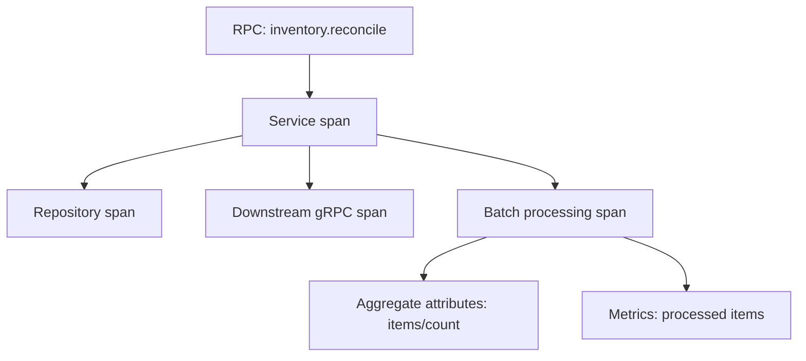

# Không tạo span lồng vô hạn

## Mục tiêu bài học

Trong **SPRING_GRPC**, OpenTelemetry giúp quan sát một RPC qua client, server, interceptor, service, executor và downstream. Mỗi span bổ sung một đơn vị thông tin về thời gian và quan hệ nhân quả. Tuy nhiên, nếu tạo span ở mọi helper method, mọi vòng lặp, mỗi message streaming hoặc mỗi lần interceptor gọi lại chính nó, một request có thể sinh ra cây span quá sâu hoặc quá lớn. Trace trở nên khó đọc, tốn CPU/bộ nhớ và làm tăng chi phí ingest.

Bài học tập trung vào **không tạo span lồng vô hạn**: chọn ranh giới span theo logical operation, nhận diện recursion và re-entrant instrumentation, giới hạn span ở retry/fan-out/streaming, dùng event/metric cho chi tiết lặp lại, propagate context đúng scope và kiểm thử giới hạn số lượng/độ sâu span.

Sau bài này, bạn có thể:

1. Phân biệt logical operation với helper call, recursion và instrumentation boundary.
2. Thiết kế cây span có độ sâu và số lượng phù hợp.
3. Tránh tạo child span trong mỗi vòng lặp hoặc mỗi node đệ quy.
4. Giới hạn span cho retry, fan-out, batch và streaming RPC.
5. Phát hiện double instrumentation và vòng lặp do interceptor/telemetry pipeline.
6. Dùng span event, attributes, metrics và span links đúng mục đích.
7. Hiểu giới hạn span, sampling và tác động tới chi phí telemetry.
8. Viết test xác minh span count, parentage, cleanup và isolation.

> **Phạm vi:** Ví dụ dùng OpenTelemetry Java API/SDK và gRPC Java. Tên instrumentation API phụ thuộc version. Các ngưỡng trong bài là policy minh họa, cần điều chỉnh theo latency, throughput và ngân sách telemetry của hệ thống.

## 1. Vì sao span có thể phình thành cây quá lớn?

Span biểu diễn một operation có ý nghĩa về thời gian và quan hệ nhân quả. Cây span nên cho thấy các ranh giới giúp trả lời câu hỏi vận hành: RPC nào chậm, downstream nào lỗi, bước nghiệp vụ nào chiếm thời gian.

Cây span phình ra khi code tạo span theo cấu trúc triển khai thay vì theo operation:

- Mỗi method helper đều tạo span dù chỉ gọi vài dòng code.
- Hàm đệ quy tạo một child span ở mỗi lần gọi.
- Vòng lặp tạo span cho từng record hoặc từng message.
- Một streaming RPC tạo span cho mọi message dù stream có hàng triệu message.
- Retry tạo span cho cả attempt, backoff, timer và từng helper bên trong attempt.
- Java agent và manual instrumentation cùng tạo span cho một gRPC call.
- Interceptor vô tình gọi một RPC khác đi qua chính interceptor đó, tạo chuỗi lồng nhau.
- Exporter/telemetry pipeline bị instrument như traffic nghiệp vụ và sinh trace không cần thiết.

Ví dụ, xử lý cây có N node bằng cách tạo span cho mỗi lần đệ quy sẽ tạo khoảng N span chỉ cho một operation. Nếu mỗi node lại gọi M helper có instrumentation, số span còn tăng theo số lần gọi helper.



Cây bên phải biểu diễn operation-level tracing. Chi tiết của từng record được tổng hợp bằng attributes/metrics thay vì tạo một nhánh span cho mỗi record.

## 2. Chọn ranh giới span theo logical operation

Một span nên đại diện cho một operation có ý nghĩa với người vận hành, thường có ít nhất một trong các đặc điểm:

- Có thời lượng đáng kể hoặc latency budget riêng.
- Có dependency hoặc resource boundary riêng như database, HTTP/gRPC downstream.
- Có retry/failure semantics cần quan sát.
- Có thể được phân tích độc lập trong trace.
- Có thể được đặt tên ổn định và có attributes hữu ích.

Không cần span cho mọi method Java. Một helper thuần tính toán, getter, mapper nhỏ hoặc hàm đệ quy nội bộ thường không cần span riêng nếu không tạo một ranh giới quan sát hữu ích.

Một RPC được auto instrumentation thường đã có client/server span. Manual span có thể bổ sung operation nghiệp vụ bên trong, nhưng không tạo lại một span khác cho cùng RPC.

### 2.1. Một span bao quanh toàn bộ thuật toán đệ quy

Ví dụ, một RPC tính toán cây tồn kho. Tạo một span cho operation cấp cao, còn hàm đệ quy chỉ thực hiện logic:

```java
public Result evaluateTree(Node root) {
    Span span = tracer.spanBuilder("inventory.tree.evaluate")
            .startSpan();

    try (Scope scope = span.makeCurrent()) {
        Result result = evaluateNode(root);

        span.setAttribute("inventory.nodes.visited", result.visited());
        span.setAttribute("inventory.result.count", result.count());

        return result;
    } catch (RuntimeException ex) {
        span.recordException(ex);
        span.setStatus(StatusCode.ERROR);
        throw ex;
    } finally {
        span.end();
    }
}

private Result evaluateNode(Node node) {
    // Có thể gọi đệ quy nhiều lần.
    // Không tạo span mới cho từng node.
    Result left = node.left() == null
            ? Result.empty()
            : evaluateNode(node.left());

    Result right = node.right() == null
            ? Result.empty()
            : evaluateNode(node.right());

    return combine(node, left, right);
}
```

Đoạn code minh họa cách đặt một span ở ranh giới nghiệp vụ. Trong implementation thực tế, Result có thể mang số node đã xử lý hoặc dùng accumulator. Quan trọng là số lần gọi evaluateNode không làm tăng số span.

Không giới hạn độ sâu thuật toán chỉ để giới hạn tracing. Nếu domain có giới hạn cây, áp dụng validation nghiệp vụ riêng. Telemetry phải có chi phí bị giới hạn mà không âm thầm thay đổi semantics của phép tính.

### 2.2. Không tạo span cho mọi helper method

Một pattern dễ gây quá mức:

```java
Result execute(Request request) {
    return withSpan("execute", () ->
            validate(request));
}

Result validate(Request request) {
    return withSpan("validate", () ->
            normalize(request));
}

Result normalize(Request request) {
    return withSpan("normalize", () ->
            mapFields(request));
}
```

Nếu các helper chỉ là các bước nhỏ, cây span tạo ra nhiều tầng mà không giúp chẩn đoán. Thay vào đó, tạo một span cho operation chính, rồi ghi kết quả hoặc thời lượng của các bước quan trọng bằng event/metric khi thật sự cần.

Tách span khi bước đó có latency, dependency hoặc failure semantics độc lập; không tách chỉ vì code được chia thành method riêng.

## 3. Recursion và re-entrant instrumentation

Recursion trong business code là một hàm gọi lại chính nó. Re-entrant instrumentation xảy ra khi code instrumented kích hoạt lại chính đường instrument đó, ví dụ:

- Interceptor ghi telemetry rồi gọi một gRPC endpoint dùng chung channel/interceptor chain.
- Wrapper client gọi lại wrapper của chính nó thay vì delegate xuống channel gốc.
- Service gọi một downstream RPC có cùng instrumentation nhưng logic downstream lại gọi ngược về service ban đầu.
- Java agent và manual interceptor cùng instrument một RPC.

Không phải mọi nested span đều sai. Một RPC gọi downstream tạo child span là quan hệ mong muốn. Vấn đề là vòng lặp không có điều kiện dừng hoặc tạo span ở mỗi bước nội bộ không có giá trị quan sát.

### 3.1. Kiểm tra call graph và instrumentation ownership

Với mỗi loại operation, xác định một thành phần chịu trách nhiệm tạo span:

| Operation | Nguồn span nên được chọn |
| --- | --- |
| Inbound gRPC server call | gRPC server instrumentation |
| Outbound gRPC client call | gRPC client instrumentation |
| Database query | JDBC/database instrumentation hoặc manual span nếu chưa được instrument |
| Business workflow | Manual span tại ranh giới workflow |
| Helper/mapper/recursive node | Thường không tạo span riêng |
| Telemetry exporter call | Không coi là business operation; áp dụng suppression/configuration theo instrumentation được hỗ trợ |

Nếu Java agent đã tạo gRPC client/server spans, không thêm một interceptor manual để tạo lại cùng span. Nếu cần thêm metadata hoặc business event, dùng interceptor không tạo span mới hoặc thêm dữ liệu vào span hiện hành theo policy.

### 3.2. Không gọi lại chính wrapper/interceptor

Một client interceptor phải delegate tới Channel tiếp theo trong chain. Nếu nó gọi stub được tạo từ channel đã bọc bởi chính interceptor thay vì delegate, có thể tạo vòng lặp đệ quy.

Quy tắc review:

- Wrapper gọi next.newCall(...) đúng một lần cho mỗi call.
- Không gọi lại public stub của chính client wrapper bên trong interceptCall.
- Telemetry/export path không dùng nhầm business channel nếu điều đó tạo recursion.
- Test số lần interceptCall và số span cho một logical RPC.
- Nếu cần loại telemetry nội bộ khỏi auto instrumentation, dùng cơ chế suppression/configuration được tài liệu của agent/instrumentation công bố; không phụ thuộc internal key không ổn định.

## 4. Giới hạn span cho retry

Retry có thể tạo một span cho mỗi attempt, đây là cách hữu ích để phân tích attempt nào chậm hoặc lỗi. Nhưng số attempt phải hữu hạn và có policy rõ ràng.

Ví dụ: một logical operation có tối đa ba attempt. Có thể tạo một workflow span và child span cho mỗi attempt:

```java
Span operation = tracer.spanBuilder("inventory.lookup")
        .startSpan();

try (Scope operationScope = operation.makeCurrent()) {
    for (int attempt = 1; attempt <= 3; attempt++) {
        Span attemptSpan = tracer
                .spanBuilder("inventory.lookup.attempt")
                .startSpan();

        try (Scope attemptScope = attemptSpan.makeCurrent()) {
            return callDownstream();
        } catch (RuntimeException ex) {
            attemptSpan.recordException(ex);
            attemptSpan.setStatus(StatusCode.ERROR);

            if (attempt == 3) {
                throw ex;
            }
        } finally {
            attemptSpan.setAttribute("retry.attempt", attempt);
            attemptSpan.end();
        }
    }

    throw new IllegalStateException("Unreachable");
} finally {
    operation.end();
}
```

Đây là ví dụ minh họa; trong code thật, chỉ retry lỗi được policy cho phép và thêm backoff/deadline budget. Nếu gRPC retry instrumentation đã tạo attempt spans, không tự tạo thêm attempt spans trùng lặp.

Không tạo span riêng cho mỗi lần ngủ backoff hoặc mỗi lần kiểm tra retry condition. Ghi retry count bằng attribute/metric; chỉ tạo attempt span khi attempt là đơn vị chẩn đoán có ý nghĩa và số attempt bị giới hạn.

Nếu retry count không bị giới hạn, đó trước hết là lỗi policy retry. Sampling không thể thay thế giới hạn số lần gọi.

## 5. Fan-out, batch và span links

Một request có thể gọi nhiều downstream service hoặc xử lý một batch gồm nhiều item. Tạo một child span cho mỗi downstream call có thể phù hợp khi fan-out nhỏ và bị giới hạn. Với fan-out rất lớn, cần cân nhắc nhóm operation:

- Một span cho batch operation.
- Một span cho mỗi partition hoặc nhóm downstream có giới hạn.
- Metrics theo service/status/duration để quan sát tổng thể.
- Event có giới hạn cho một số mốc quan trọng.
- Span links khi operation tổng hợp có nhiều causal parents độc lập.

Span link phù hợp khi một operation có nhiều nguồn nhân quả và không thể biểu diễn chính xác bằng một parent duy nhất, ví dụ worker xử lý batch gom từ nhiều message trace. Không tạo một cây span giả chỉ để ép nhiều parent vào một parent.

Khi dùng links, đặt giới hạn số link và chọn các context có ý nghĩa. Không thêm link cho mọi record của batch lớn; dùng aggregate metrics hoặc trace sampling cho tập đại diện.

## 6. Streaming RPC và message volume lớn

Một streaming RPC có thể tồn tại lâu và truyền hàng nghìn hoặc hàng triệu message. Thông thường một client span và một server span đại diện cho vòng đời stream; không tạo span mới cho từng message theo mặc định.

Nên dùng:

- RPC span cho vòng đời stream.
- Span cho một batch/window xử lý nếu batch có thời gian và failure semantics riêng.
- Counter/histogram cho message count, processing latency và error count.
- Một số span events có giới hạn cho mốc quan trọng như first message, flow-control stall hoặc terminal error.
- Sampling hoặc diagnostic mode giới hạn thời gian để điều tra message-level issue.

Event cũng có thể tăng không giới hạn. Không gọi addEvent cho mỗi message mà không có cap. Ghi tổng message count hoặc một số mẫu đại diện thay vì giữ một event cho mỗi item.

### 6.1. Ví dụ gom số liệu thay vì tạo span mỗi message

```java
final class StreamTelemetry {
    private final LongAdder messages = new LongAdder();
    private final LongAdder failures = new LongAdder();

    void onMessage() {
        messages.increment();
    }

    void onFailure() {
        failures.increment();
    }

    void finish(Span rpcSpan) {
        rpcSpan.setAttribute(
                "app.grpc.messages.count",
                messages.sum());
        rpcSpan.setAttribute(
                "app.grpc.messages.failed",
                failures.sum());
    }
}
```

Đây là accumulator theo stream; trong hệ thống nhiều thread, dùng thread-safe counter hoặc serialize callbacks theo contract của observer. Với metric dài hạn, ghi counter/histogram qua Meter thay vì chỉ đặt attribute trên span. Tránh đặt message payload hoặc message ID làm span attribute.

## 7. Span event, attribute và metric: chọn đúng công cụ

| Nhu cầu | Công cụ nên dùng | Lưu ý |
| --- | --- | --- |
| Ranh giới operation có thời gian | Span | Số lượng có chủ đích |
| Mốc đáng chú ý trong một operation | Span event | Có giới hạn số event |
| Giá trị mô tả operation | Span attribute | Tránh dữ liệu nhạy cảm/high cardinality |
| Đếm item/request/retry | Counter hoặc aggregate attribute | Không tạo span cho mỗi item |
| Phân bố latency | Histogram | Dimensions có cardinality thấp |
| Liên kết metric sample tới trace | Exemplar | Không dùng trace ID làm metric label |
| Nhiều causal parent | Span links | Giới hạn số link |

Span attributes không phải nơi lưu toàn bộ request. Không đặt payload Protobuf lớn, token, email, user ID hoặc dữ liệu nhạy cảm vào span. Các attribute có giá trị duy nhất theo từng request cũng có thể làm backend khó truy vấn; dùng trace ID/span ID cho correlation thay vì custom label.

## 8. Span limits và sampling không thay thế thiết kế tốt

OpenTelemetry SDK cho phép giới hạn số attributes, events và links trên mỗi span. Các giới hạn này bảo vệ kích thước dữ liệu của một span, nhưng **không giới hạn tổng số span được tạo**.

Ví dụ cấu hình giới hạn ở SDK:

```java
SpanLimits limits = SpanLimits.builder()
        .setMaxNumberOfAttributes(64)
        .setMaxNumberOfEvents(32)
        .setMaxNumberOfLinks(32)
        .build();

SdkTracerProvider tracerProvider = SdkTracerProvider.builder()
        .setSpanLimits(limits)
        .build();
```

Các con số là ví dụ. Chọn giới hạn theo nhu cầu chẩn đoán và kiểm tra semantics của phiên bản SDK đang dùng; khi vượt giới hạn, dữ liệu attributes/events/links có thể bị loại bớt.

Sampling giảm số span được record/export theo policy. Tuy nhiên:

- Span creation code vẫn có thể chạy và tiêu tốn CPU.
- Parent-based sampling có thể truyền quyết định sampled xuống child.
- Một trace được sample có thể vẫn tạo rất nhiều child spans.
- Tail sampling lọc trace sau khi collector đã nhận dữ liệu, không ngăn ứng dụng tạo và gửi spans.
- Exporter/batch queue có thể bị quá tải trước khi backend lưu trace.

Do đó, giải pháp chính là giới hạn operation được instrument và số span phát sinh. Span limits và sampling là lớp bảo vệ bổ sung.

### 8.1. Kiểm tra recording trước khi tính attribute đắt

Nếu tính attribute tốn chi phí, có thể kiểm tra span có đang recording hay không:

```java
Span span = Span.current();

if (span.isRecording()) {
    String diagnostic = buildExpensiveDiagnostic();
    span.setAttribute("app.diagnostic.summary", diagnostic);
}
```

Điều này tránh tạo một số dữ liệu attribute không cần thiết khi span không được record. Nó không thay thế việc giới hạn span count; span object và các bước instrumentation vẫn có thể tồn tại.

## 9. Giữ context đúng scope và kết thúc span

Span cần được kết thúc đúng một lần, kể cả khi operation ném exception hoặc bị cancel. Scope cần được đóng để khôi phục context trước đó.

```java
Span span = tracer.spanBuilder("inventory.reserve")
        .startSpan();

try (Scope scope = span.makeCurrent()) {
    return reserveInventory(request);
} catch (RuntimeException ex) {
    span.recordException(ex);
    span.setStatus(StatusCode.ERROR);
    throw ex;
} finally {
    span.end();
}
```

Không giữ Span hoặc Scope trong field của singleton service để tái sử dụng cho request khác. Mỗi operation có lifecycle riêng. Khi chuyển thread, capture OpenTelemetry Context tại submit boundary và dùng context-aware wrapper; không gọi makeCurrent trên một span đã kết thúc.

Trong async/streaming code, xác định rõ ai sở hữu span và ai kết thúc nó. Nếu RPC instrumentation sở hữu server span, service không được end span đó. Manual child span phải được end bởi code đã tạo nó.

## 10. Đặt tên span ổn định và giới hạn attributes

Span name nên mô tả operation, không chứa dữ liệu thay đổi theo request:

- Tốt: inventory.lookup, inventory.reserve, inventory.batch.reconcile.
- Không tốt: inventory.lookup.SKU-100, inventory.lookup.user-123 hoặc tên chứa request ID.

Attributes nên có schema ổn định và giá trị có cardinality được kiểm soát. Với số lượng item, dùng numeric count. Với trạng thái, dùng enum/status class. Với dependency, dùng service name đã chuẩn hóa.

Không dùng dynamic span name để phân biệt từng node đệ quy hoặc từng message. Trace UI sẽ có quá nhiều span khó lọc và backend có thể tốn chi phí index.

## 11. Kiểm thử span count và nesting depth

Dùng OpenTelemetry SDK với InMemorySpanExporter để assert cấu trúc span. Test nên đặt giới hạn cụ thể cho một workload biết trước.

Ví dụ test cho thuật toán đệ quy: với cây có hàng nghìn node, kỳ vọng chỉ có một span operation (hoặc một số span cố định theo boundary đã chọn), không phải hàng nghìn span.

Các assertion quan trọng:

1. Số span tổng thể không tăng tuyến tính theo số helper/node nếu helper không phải operation boundary.
2. Độ sâu parent-child nằm trong ngưỡng thiết kế.
3. Mỗi span có parent hợp lệ hoặc root theo ý định.
4. Không có duplicate CLIENT/SERVER spans cho một RPC attempt.
5. Retry span count không vượt max attempts cộng span operation.
6. Streaming span count không tăng theo số message.
7. Exception/cancellation vẫn end span và đóng Scope.
8. Request đồng thời không chia sẻ span hoặc context.
9. Attributes/events/links không vượt policy.
10. Unsampled trace không bị test coi là lỗi propagation.

Độ sâu trace có thể tính bằng cách lần theo parent span ID trong SpanData của cùng trace. Cần xử lý root span có parent ID rỗng và trường hợp parent không được export do sampling.

## 12. Kiểm thử recursion, retry và streaming

Một test suite hữu ích gồm ba workload:

| Workload | Input | Kỳ vọng span |
| --- | --- | --- |
| Recursion | Cây tăng từ 10 tới 10.000 node | Span count giữ cố định theo operation boundary |
| Retry | Tối đa 3 attempt | Một workflow span và không quá 3 attempt spans nếu instrumentation do app sở hữu |
| Streaming | 1.000.000 message | RPC spans không tăng theo message; metrics ghi message count |

Không chỉ assert tổng span count. Cần xác minh trace ID, parent ID, SpanKind và span name để chắc rằng số span còn lại đại diện đúng operation.

Chạy test dưới sampling alwaysOn để quan sát đầy đủ cấu trúc. Sau đó chạy một test riêng với sampler drop để xác minh business behavior không phụ thuộc vào việc trace được export.

## 13. Quan sát chi phí instrumentation

Theo dõi các chỉ số của telemetry pipeline:

- Spans created/started/ended theo service và instrumentation source nếu có.
- Spans exported/dropped.
- Export queue utilization và export failures.
- Trace size hoặc spans per trace ở collector/backend.
- CPU và allocation rate khi tracing bật/tắt.
- RPC latency/throughput trước và sau thay đổi instrumentation.

Nếu spans per trace tăng đột biến, kiểm tra code recursion, retry, fan-out, streaming và double instrumentation. Nếu spans created cao nhưng exported thấp, sampling có thể đang drop nhiều nhưng vẫn còn chi phí tạo span.

Không dùng trace ID hoặc span ID làm metric labels. Metric dimensions cần cardinality thấp như service, method, status và environment.

## 14. Lỗi thường gặp và cách xử lý

| Triệu chứng | Nguyên nhân | Cách xử lý |
| --- | --- | --- |
| Trace có hàng nghìn tầng | Tạo span trong hàm đệ quy hoặc helper | Chuyển span về logical operation boundary |
| Một RPC có hai server spans | Java agent và manual interceptor cùng instrument | Chọn một instrumentation owner |
| Streaming trace có quá nhiều spans | Tạo span cho mỗi message | Dùng RPC span, batch span và metrics |
| Retry tạo trace rất lớn | Attempt/backoff/helper đều tạo span | Giới hạn attempt và chỉ instrument attempt có ý nghĩa |
| Fan-out tạo hàng nghìn child spans | Một span cho mỗi item/downstream nhỏ | Gom theo batch/partition, dùng metrics hoặc links có giới hạn |
| Span events cũng tăng vô hạn | addEvent cho từng message/node | Giới hạn event và ghi aggregate |
| Sampling bật nhưng app vẫn tốn CPU | Span vẫn được tạo trước khi drop/export | Giảm instrumentation boundaries và tạo ít spans hơn |
| Exporter queue đầy | Span volume vượt khả năng export | Giảm span volume, điều chỉnh batch/export capacity và sampling |
| Interceptor tự gọi lại chính nó | Wrapper dùng stub/channel đã bọc thay vì delegate | Delegate tới next channel và test invocation count |
| Parent-child sai sau async | Context không được propagate hoặc Scope bị giữ sai thread | Capture Context tại submit và đóng Scope trong task |
| Span không kết thúc khi exception | Thiếu finally/end | End span trong finally |
| Trace khó tìm vì span name thay đổi | Gắn ID vào span name | Dùng tên operation ổn định và attributes được kiểm soát |

## 15. Bài tập thực hành

1. Tạo một operation span cho service method xử lý cây đệ quy; xác minh số node không làm tăng span count.
2. Thêm metric counter cho node count và histogram cho operation duration.
3. Tạo retry policy tối đa ba attempt; kiểm tra span count và parentage.
4. Bật auto gRPC instrumentation, sau đó thử thêm manual interceptor để nhận diện duplicate spans; giữ lại đúng một owner.
5. Tạo streaming test với số message lớn; xác minh span count không tăng theo message count.
6. Giới hạn số span events và links; ghi aggregate attributes cho số lượng item.
7. Tạo fan-out nhỏ và fan-out lớn; so sánh child spans với batch spans/metrics.
8. Dùng InMemorySpanExporter để assert tổng span count và nesting depth.
9. Chạy test với alwaysOn và sampler drop để phân biệt span creation với span export.
10. Tạo test exception/cancellation bảo đảm Scope được đóng và span kết thúc.
11. Chạy concurrent requests trên cùng executor; xác minh không trộn parent context.
12. Ghi benchmark CPU/allocation/RPC latency trước và sau khi bỏ span không cần thiết.

### Câu hỏi tự kiểm tra

- Vì sao một span cho mỗi helper method có thể làm trace khó đọc?
- Khi nào recursion cần một span operation thay vì một span cho mỗi lần gọi?
- Re-entrant instrumentation khác nested business span như thế nào?
- Vì sao retry attempts có thể có child spans nhưng backoff timer không nhất thiết cần span?
- Khi nào nên dùng span links cho fan-in?
- Vì sao không tạo span cho mọi message của streaming RPC?
- Span limits khác sampling và giới hạn tổng span count như thế nào?
- Vì sao tail sampling không ngăn ứng dụng tạo spans?
- Làm thế nào phát hiện Java agent và manual instrumentation bị trùng?
- Vì sao Scope phải đóng và span phải end trong mọi đường exception?
- Những assertion nào chứng minh cây span có độ sâu hữu hạn?
- Nên dùng metric nào thay cho span per item?

## Tài liệu tham khảo

- [OpenTelemetry — Traces](https://opentelemetry.io/docs/concepts/signals/traces/): span, trace và quan hệ parent-child.
- [OpenTelemetry — Java API](https://opentelemetry.io/docs/languages/java/api/): Tracer, Span, Scope, Context và SpanBuilder.
- [OpenTelemetry — Java SDK](https://opentelemetry.io/docs/languages/java/sdk/): sampler, span processor và span limits.
- [OpenTelemetry — Sampling](https://opentelemetry.io/docs/concepts/sampling/): head/tail sampling và trade-off.
- [OpenTelemetry — Span Links](https://opentelemetry.io/docs/specs/otel/trace/api/#link): liên kết các span có quan hệ nhân quả nhiều nguồn.
- [OpenTelemetry — Semantic Conventions](https://opentelemetry.io/docs/specs/semconv/): quy ước đặt tên và attributes.
- [OpenTelemetry Java — Testing](https://github.com/open-telemetry/opentelemetry-java/tree/main/sdk/testing): in-memory exporter và test utilities.
- [gRPC — Java](https://grpc.io/docs/languages/java/): client/server và interceptor trong gRPC Java.

**Kết quả mong đợi:** Người học thiết kế được span tree hữu hạn và có ý nghĩa cho Spring gRPC, tránh span theo từng helper/recursive node/message không cần thiết, giới hạn retry/fan-out/streaming instrumentation, phát hiện double instrumentation và re-entry, dùng metrics/events/links phù hợp, đồng thời kiểm thử được span count, nesting depth, cleanup và context isolation.
