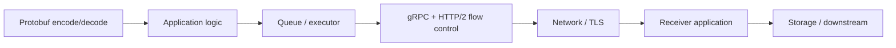

# Streaming throughput

**Streaming throughput** là lượng dữ liệu hoặc số message mà một gRPC stream xử lý thành công trong một đơn vị thời gian. Với **SPRING_GRPC**, throughput ảnh hưởng trực tiếp đến các luồng đồng bộ dữ liệu, truyền file/chunk, event feed, xử lý batch và giao tiếp hai chiều giữa service. Muốn tăng throughput, cần nhìn toàn bộ đường đi từ Protobuf serialization, application logic, HTTP/2 flow control, executor, network đến khả năng tiêu thụ của phía nhận.

Throughput cao không tự động đồng nghĩa hệ thống tốt. Một stream có thể đạt nhiều message mỗi giây nhưng tạo latency lớn, queue tăng không giới hạn, tiêu thụ heap quá mức hoặc làm các RPC khác bị starvation. Thiết kế cần cân bằng throughput, latency, memory, fairness và khả năng hủy/khôi phục.

## 1. Định nghĩa và cách đo throughput

Có hai chỉ số thường dùng:

- **Message throughput:** số message ứng dụng xử lý thành công mỗi giây, đơn vị messages/s.
- **Payload throughput (goodput):** số byte payload ứng dụng xử lý thành công mỗi giây, đơn vị bytes/s hoặc MiB/s.

Với một khoảng đo có thời lượng \(T\):

\[
\text{Message throughput} =
\frac{\text{Số message hoàn tất thành công}}{T}
\]

\[
\text{Payload goodput} =
\frac{\text{Tổng byte payload hoàn tất thành công}}{T}
\]

Ví dụ, một stream truyền 120.000 message trong 60 giây đạt 2.000 messages/s. Nếu payload trung bình 8 KiB, goodput xấp xỉ 15,6 MiB/s. Đây là payload ứng dụng; lưu lượng trên wire còn có HTTP/2 frame, gRPC message prefix, TLS record, metadata và protocol overhead.

### 1.1. Đo đúng sự kiện hoàn tất

Không nên xem một lần gọi `onNext()` là bằng chứng message đã được xử lý thành công ở server hoặc client. `onNext()` chuyển message vào gRPC runtime; message có thể vẫn đang chờ ghi lên network, được buffer hoặc chưa được application phía bên kia xử lý.

Nếu cần đo dữ liệu đã được xử lý bền vững, protocol ứng dụng nên có acknowledgement hoặc checkpoint. Ví dụ server gửi `Ack(sequence)` sau khi đã commit record. Khi đó có thể đo:

- Messages được gửi.
- Messages được nhận.
- Messages được xử lý.
- Messages được commit/acknowledge.

Các số liệu này khác nhau khi có queue, retry, cancellation hoặc lỗi giữa stream. Dashboard cần nêu rõ throughput đang đo ở ranh giới nào.

## 2. Các kiểu streaming và đặc tính tải

gRPC hỗ trợ ba kiểu streaming bên cạnh unary:

| Kiểu RPC | Luồng message | Đặc điểm throughput |
| --- | --- | --- |
| Server streaming | Một request, nhiều response | Server là nguồn phát; cần điều tiết tốc độ producer theo client/network |
| Client streaming | Nhiều request, một response | Server tiêu thụ liên tục; cần kiểm soát inbound flow và batch/aggregation |
| Bidirectional streaming | Nhiều request và nhiều response độc lập | Hai hướng có thể chạy đồng thời; mỗi hướng cần flow control và queue riêng |

Streaming giảm chi phí thiết lập RPC lặp lại và cho phép pipeline nhiều message trên một HTTP/2 stream. Tuy nhiên, một stream dài giữ tài nguyên lâu hơn, có thể tạo head-of-line pressure ở cấp connection, và cần semantics rõ cho cancellation, timeout, retry, partial result và resume.

Không nên chọn streaming chỉ vì muốn tăng tốc. Nếu operation độc lập, nhỏ và cần load balancing/retry riêng từng request, unary có thể đơn giản và công bằng hơn. Streaming phù hợp khi có một chuỗi dữ liệu liên quan hoặc cần giao tiếp liên tục.

## 3. Các yếu tố quyết định throughput

Throughput thực tế bị giới hạn bởi mắt xích chậm nhất:



Những yếu tố thường ảnh hưởng nhiều nhất:

- **Message size:** message nhỏ chịu tỷ lệ overhead lớn; message quá lớn làm tăng allocation, latency và áp lực bộ nhớ.
- **Serialization:** Protobuf encode/decode, copy byte array và tạo object có thể tiêu tốn CPU/heap.
- **Compression:** giảm byte truyền qua network nhưng tiêu tốn CPU và có thể làm tăng latency.
- **Flow control:** giới hạn lượng dữ liệu đang được gửi mà phía nhận chưa tiêu thụ.
- **Concurrency:** số stream đồng thời, số channel và cách phân phối stream lên HTTP/2 connection.
- **Application work:** database, validation, mapping, encryption và downstream call.
- **Executor:** số thread, hàng đợi, context switching và blocking.
- **Network:** bandwidth, RTT, packet loss, TLS và vị trí địa lý giữa hai service.

Tối ưu một tầng khi tầng khác đang là bottleneck thường không cải thiện throughput tổng thể. Ví dụ tăng thread không giúp khi network đã bão hòa hoặc database chỉ xử lý được một lượng nhỏ transaction mỗi giây.

## 4. HTTP/2 flow control và backpressure

gRPC chạy trên HTTP/2. HTTP/2 có flow control ở hai cấp:

- **Stream-level window:** giới hạn dữ liệu đang được gửi trên một stream.
- **Connection-level window:** giới hạn tổng dữ liệu đang được gửi qua một connection.

Receiver cập nhật window khi tiêu thụ dữ liệu. Sender chỉ có thể tiếp tục truyền trong giới hạn window còn khả dụng. gRPC Java quản lý flow control transport ở bên dưới; application nên tôn trọng readiness và inbound demand thay vì tự giả định rằng `onNext()` có thể được gọi vô hạn mà không tạo buffer.

Backpressure là cơ chế để tốc độ producer không vượt quá khả năng tiêu thụ của consumer trong thời gian dài. Nếu producer nhanh hơn consumer và ứng dụng giữ mọi message trong một queue không giới hạn, heap sẽ tăng cho đến khi GC pressure hoặc OutOfMemoryError làm hệ thống suy giảm.

### 4.1. Quy tắc vận hành

- Dùng queue có giới hạn và xác định hành vi khi queue đầy: pause producer, giảm tốc, từ chối, hoặc lưu bền vững.
- Chỉ phát message khi gRPC stream sẵn sàng.
- Với inbound streaming, yêu cầu thêm message theo khả năng xử lý nếu dùng manual flow control.
- Không block gRPC callback/event-loop thread để chờ queue hoặc database.
- Hủy producer và giải phóng tài nguyên khi stream bị cancel.
- Đặt giới hạn message size và tổng lượng dữ liệu mỗi operation.

Flow control của HTTP/2 không thay thế backpressure ở application. Transport có thể điều tiết byte, nhưng ứng dụng vẫn có thể tạo hàng triệu object trước khi đưa chúng vào transport.

## 5. Kiểm soát outbound stream bằng readiness

Trong gRPC Java, `ServerCallStreamObserver` cung cấp `isReady()` và `setOnReadyHandler()`. Server nên phát message khi stream sẵn sàng, rồi tiếp tục khi callback báo khả năng ghi đã tăng.

Ví dụ khung server-streaming:

```java
@Override
public void streamEvents(
        StreamRequest request,
        StreamObserver<Event> responseObserver) {

    ServerCallStreamObserver<Event> observer =
        (ServerCallStreamObserver<Event>) responseObserver;

    EventProducer producer = eventService.openProducer(request);

    observer.setOnCancelHandler(producer::cancel);
    observer.setOnReadyHandler(producer::drainWhenReady);

    producer.start();
    producer.drainWhenReady();
}
```

`EventProducer` ở đây là thành phần ứng dụng minh họa. Nó cần bảo đảm:

- `drainWhenReady` chỉ lấy một lượng message giới hạn từ queue.
- Kiểm tra `observer.isReady()` trước mỗi lần `onNext`.
- Không chạy một vòng lặp dài hoặc blocking trên callback thread.
- Đồng bộ trạng thái giữa producer và callback để không phát trùng hoặc phát sau khi stream đóng.
- Gọi `onCompleted` khi nguồn dữ liệu kết thúc bình thường; gọi `onError` khi có lỗi.
- Dừng nguồn dữ liệu khi client cancel.

Không gọi `onNext` đồng thời từ nhiều thread trên cùng một observer. Nếu producer chạy trên executor riêng, cần serialize thao tác phát message để giữ thứ tự và tuân thủ stream observer contract.

### 5.1. isReady không phải acknowledgement

`isReady()` chỉ cho biết gRPC runtime hiện có khả năng nhận thêm dữ liệu outbound mà không vượt ngưỡng readiness nội bộ. Nó không chứng minh peer đã nhận, decode hoặc commit message. Nếu cần xác nhận nghiệp vụ, dùng acknowledgement trong protocol.

## 6. Kiểm soát inbound flow của client/server

Với client-streaming hoặc bidirectional streaming, server có thể dùng manual inbound flow control để chỉ yêu cầu thêm message sau khi đã xử lý một lượng message trước đó. Trong gRPC Java, `ServerCallStreamObserver` hỗ trợ tắt auto inbound flow control và gọi `request(n)` để cấp demand.

Ví dụ khung xử lý:

```java
public StreamObserver<UploadChunk> upload(
        StreamObserver<UploadResult> responseObserver) {

    ServerCallStreamObserver<UploadResult> serverObserver =
        (ServerCallStreamObserver<UploadResult>) responseObserver;

    serverObserver.disableAutoRequest();
    UploadSession session = uploadService.openSession();

    return new StreamObserver<>() {
        @Override
        public void onNext(UploadChunk chunk) {
            session.accept(chunk);
            serverObserver.request(1);
        }

        @Override
        public void onError(Throwable error) {
            session.abort(error);
        }

        @Override
        public void onCompleted() {
            UploadResult result = session.commit();
            responseObserver.onNext(result);
            responseObserver.onCompleted();
        }
    };
}
```

Đây là skeleton minh họa; code production cần kiểm tra API flow-control của đúng phiên bản gRPC Java, xử lý exception từ `accept`/`commit`, cancellation, transaction và giới hạn chunk. Chỉ gọi `request(1)` sau khi message hiện tại đã được xử lý hoặc được đưa vào một queue có giới hạn. Nếu gọi request trước khi consumer sẵn sàng, backpressure bị vô hiệu hóa ở tầng ứng dụng.

Với client nhận response streaming, `ClientResponseObserver.beforeStart` và `ClientCallStreamObserver` cho phép cấu hình manual inbound demand theo API gRPC Java. Cần đọc đúng contract phiên bản đang dùng và chỉ gọi `request(n)` khi consumer có capacity.

## 7. Batch và lựa chọn message size

Batching có thể tăng throughput bằng cách gom nhiều record nhỏ vào một message hoặc một transaction:

**Lợi ích:**

- Giảm số lần framing và callback trên mỗi record.
- Giảm chi phí serialization/dispatch cố định.
- Tăng hiệu quả ghi database theo batch.
- Có thể tận dụng network payload lớn hơn trên mỗi lần gửi.

**Chi phí:**

- Message lớn làm tăng thời gian chờ gom batch.
- Tăng memory cần thiết để giữ batch.
- Một lỗi có thể ảnh hưởng nhiều record cùng lúc.
- Giảm fairness giữa các stream nếu một batch chiếm nhiều tài nguyên.
- Có thể chạm giới hạn message size của client/server.

Kích thước batch nên được xác định bằng benchmark với payload và workload thật. Một chiến lược phổ biến là flush khi đạt một trong hai ngưỡng: số record tối đa hoặc thời gian chờ tối đa. Điều này giữ latency có giới hạn trong khi vẫn gom đủ dữ liệu khi tải cao.

Không đặt batch size quá lớn chỉ để tối đa hóa bytes/s. Với hệ thống tương tác, latency p95/p99 và thời gian từ lúc record được tạo đến lúc consumer nhìn thấy nó có thể quan trọng hơn throughput đỉnh.

## 8. Compression và serialization

Compression hữu ích khi payload có nhiều dữ liệu lặp hoặc văn bản. Dữ liệu đã nén, ảnh/video hoặc payload entropy cao có thể không giảm nhiều, thậm chí tăng CPU và latency.

| Tình huống | Hướng cân nhắc |
| --- | --- |
| Payload văn bản/lặp nhiều | Thử gzip hoặc compressor phù hợp |
| Payload đã nén | Thường tắt compression để tránh CPU thừa |
| CPU đã là bottleneck | Đo kỹ trước khi bật compression |
| Network bandwidth là bottleneck | Compression có thể tăng goodput hữu ích |
| Message nhỏ | Overhead compression có thể lớn hơn lợi ích |

Trong gRPC Java, có thể cấu hình compression cho call hoặc message tùy API/stub. Ví dụ:

```java
asyncStub.withCompression("gzip").streamEvents(request, observer);
```

Tên compressor và khả năng hỗ trợ phụ thuộc runtime. Compression phải được benchmark hai phía; server có thể tốn CPU giải nén nhiều hơn mức network tiết kiệm được. Tránh nén payload đã nén hoặc dữ liệu không phù hợp.

Về Protobuf, giữ message schema gọn, tránh lồng object không cần thiết và hạn chế copy payload lớn. Với byte payload, cân nhắc chunking có giới hạn thay vì tạo một message cực lớn. Không hy sinh khả năng tương thích schema chỉ để giảm vài byte nếu lợi ích chưa được đo.

## 9. Channel, connection và số stream đồng thời

Một `ManagedChannel` có thể multiplex nhiều RPC trên HTTP/2 connection. Tạo channel mới cho từng message hoặc từng RPC thường làm tăng chi phí DNS, TCP, TLS, thread và socket.

Nguyên tắc:

- Tái sử dụng `ManagedChannel` theo endpoint/lifecycle phù hợp.
- Tạo stub theo nhu cầu từ channel dùng chung; stub gRPC Java là immutable và có thể tái sử dụng.
- Đo số stream đồng thời và số connection thực tế.
- Khi một HTTP/2 connection đạt giới hạn concurrent streams, RPC mới có thể phải chờ hoặc dùng connection khác tùy channel/load balancing.
- Dùng nhiều channel chỉ khi benchmark cho thấy cần tăng connection-level parallelism hoặc tách traffic/failure domain.
- Đóng channel đúng lifecycle khi ứng dụng dừng.

Một stream kéo dài có thể chiếm một slot concurrent stream lâu. Nếu service có nhiều stream dài và nhiều unary RPC, cân nhắc tách channel/pool hoặc cấu hình load balancing để tránh stream dài làm tăng latency của traffic ngắn.

## 10. Executor và tránh blocking callback

Throughput có thể giảm mạnh nếu callback gRPC bị block bởi database, file I/O hoặc chờ lock. Khi một thread xử lý callback bị giữ quá lâu, nhiều stream khác có thể phải đợi, gây queueing và tail latency tăng.

Thiết kế nên:

- Giữ callback ngắn, tránh blocking I/O trực tiếp trên transport/event-loop thread.
- Dùng executor có giới hạn và capacity rõ ràng cho công việc blocking.
- Giới hạn số task đang chờ; không chuyển vấn đề từ gRPC queue sang một queue ứng dụng vô hạn.
- Tách CPU-bound và I/O-bound workload khi cần.
- Truyền cancellation/deadline đến task và downstream.
- Không tạo một thread mới cho mỗi message.

Tăng thread count không luôn tăng throughput. Khi CPU, database connection pool hoặc network đã bão hòa, thêm thread chỉ tăng context switching và tranh chấp.

## 11. Đo benchmark có thể lặp lại

Benchmark streaming cần cố định workload và đo nhiều tầng:

1. Chọn kiểu RPC và kích thước payload đại diện cho production.
2. Định nghĩa throughput theo message nhận, message xử lý hay message commit.
3. Chạy warm-up để JVM JIT, connection và TLS ổn định.
4. Tăng dần số stream đồng thời, giữ tải đủ lâu để quan sát steady state.
5. Ghi messages/s, MiB/s, latency p50/p95/p99, CPU, heap, GC và network.
6. Thay đổi từng yếu tố: batch size, payload size, compression, concurrency, executor.
7. Chạy lại nhiều lần và so sánh cùng môi trường.
8. Kiểm tra correctness, ordering, loss/duplicate và cancellation trong suốt benchmark.

Không đo chỉ vài giây ngay sau khi process khởi động. Startup, class loading, JIT và TLS handshake có thể làm kết quả không đại diện cho steady state. Cũng cần đo cold start riêng nếu latency khởi tạo quan trọng với workload.

### 11.1. Throughput và latency

Throughput và latency liên quan nhưng không đồng nghĩa. Một hệ thống có thể tăng throughput bằng batching nhưng làm mỗi message chờ lâu hơn trước khi flush. Khi tải tăng, latency thường tăng nhanh khi hệ thống tiến gần saturation.

Theo dõi ít nhất:

- Throughput ở mức tải ổn định.
- Latency end-to-end và latency xử lý từng message.
- Queue depth và queue wait time.
- Error/cancel rate.
- CPU, memory, GC pause và network utilization.

Đừng chỉ tối ưu throughput trung bình nếu p99 latency vượt SLO.

## 12. Load test và phát hiện điểm bão hòa

Một load test hữu ích tăng tải theo từng bước:

```text
streams: 10 -> 25 -> 50 -> 100 -> 200
payload: 1 KiB, 8 KiB, 64 KiB
duration: warm-up + steady-state window
record: messages/s, MiB/s, p50/p95/p99, CPU, heap, GC, queue
```

Đây là ma trận ví dụ, không phải ngưỡng mặc định cho mọi hệ thống. Cần chọn số stream, payload và duration dựa trên production profile.

Điểm bão hòa thường thể hiện qua một hoặc nhiều dấu hiệu:

- Throughput không tăng dù concurrency tăng.
- p95/p99 latency tăng nhanh.
- Queue depth liên tục tăng.
- CPU gần 100% hoặc GC pause tăng.
- Network đạt giới hạn bandwidth.
- Database/downstream latency và connection wait tăng.
- `isReady()` ở outbound stream thường xuyên false hoặc inbound demand không theo kịp.

Khi thấy saturation, xác định bottleneck trước khi tăng concurrency hoặc buffer. Tăng buffer chỉ trì hoãn thời điểm thất bại nếu consumer không thể xử lý đủ nhanh.

## 13. Observability cho streaming throughput

Nên có metric theo service/method và loại stream:

| Metric | Mục đích |
| --- | --- |
| Messages sent/received/processed per second | Đo tốc độ message ở từng ranh giới |
| Payload bytes per second | Đo goodput ứng dụng |
| Active streams | Theo dõi concurrency và resource occupancy |
| Message size histogram | Nhìn phân bố payload |
| Stream duration | Phát hiện stream quá dài hoặc bị treo |
| Queue depth / wait time | Phát hiện producer-consumer imbalance |
| Readiness / flow-control wait | Nhận biết outbound bị backpressure |
| Retry/cancel/error count | Đo độ ổn định và chi phí phục hồi |
| CPU, heap, allocation, GC | Xác định bottleneck runtime |

Không gắn stream ID, user ID hoặc resource ID có cardinality cao làm metric label. Có thể dùng trace ID trong log/trace để điều tra một stream cụ thể, còn metric nên dùng service, method, outcome và nhóm payload size có giới hạn.

Với stream dài, một trace duy nhất có thể quá lớn. Có thể dùng span theo batch/checkpoint hoặc event metric để giữ chi phí tracing trong giới hạn. Log không nên ghi toàn bộ payload.

## 14. Những lỗi tối ưu thường gặp

| Sai lầm | Hậu quả | Cách làm tốt hơn |
| --- | --- | --- |
| Gọi `onNext()` liên tục không xét readiness | Buffer tăng, memory pressure và latency | Dùng `isReady()`/`onReady` và queue bounded |
| Queue ứng dụng không giới hạn | Heap tăng theo consumer lag | Giới hạn queue và định nghĩa overflow policy |
| Block callback thread bằng database I/O | Stream khác bị starvation | Dùng bounded executor cho blocking work |
| Tạo channel cho từng RPC | Tốn socket, TLS handshake và thread | Tái sử dụng ManagedChannel |
| Bật compression mặc định cho mọi payload | CPU tăng mà byte giảm ít | Benchmark theo payload profile |
| Batch quá lớn | Latency, memory và fairness xấu | Flush theo size hoặc time threshold |
| Chỉ đo số lần onNext | Đánh giá cao dữ liệu thực sự được xử lý | Đo receive/process/commit hoặc acknowledgement |
| Tăng concurrency vô hạn | Saturation, queueing và retry storm | Tìm bottleneck, giới hạn admission |
| Tăng HTTP/2 window mà không đo | Tăng in-flight memory và không chắc tăng goodput | Điều chỉnh sau khi đo RTT, bandwidth và flow-control wait |

## 15. Checklist cải thiện streaming throughput

Trước khi thay đổi cấu hình hoặc code, hãy xác định:

1. **Metric:** đang đo messages/s, payload goodput hay wire throughput?
2. **Completion boundary:** message được gửi, nhận, xử lý hay commit?
3. **Workload:** kiểu streaming, payload size và số stream đồng thời đại diện production chưa?
4. **Bottleneck:** CPU, serialization, queue, flow control, network hay downstream?
5. **Backpressure:** outbound readiness và inbound demand có được tôn trọng không?
6. **Queue:** có giới hạn và overflow policy rõ ràng không?
7. **Batch:** batch size/flush interval có cân bằng throughput và latency không?
8. **Compression:** lợi ích bandwidth có lớn hơn CPU cost không?
9. **Channel:** ManagedChannel có được tái sử dụng và lifecycle được quản lý không?
10. **Executor:** callback có bị block, thread/queue có bị tăng vô hạn không?
11. **Correctness:** ordering, duplicate, loss, cancellation và resume có được test không?
12. **Benchmark:** có warm-up, steady-state, nhiều lần chạy và p95/p99 không?
13. **Observability:** active streams, queue, flow-control wait, goodput, CPU/GC có được theo dõi không?

## 16. Ghi nhớ

Streaming throughput là tốc độ message hoặc payload mà ứng dụng thực sự xử lý trong một đơn vị thời gian. Tăng throughput cần tối ưu toàn pipeline: Protobuf, application logic, executor, HTTP/2 flow control, network, compression và consumer. `onNext()` không đồng nghĩa message đã được xử lý hoặc commit; nếu cần xác nhận nghiệp vụ, hãy dùng acknowledgement/checkpoint.

Trong Spring gRPC, tái sử dụng channel, dùng queue có giới hạn, tôn trọng `isReady()`/`onReady` và inbound demand, tránh block callback thread, chọn batch/compression dựa trên benchmark và theo dõi cả throughput lẫn p95/p99 latency. Khi tải tăng mà throughput không tăng, queue phình hoặc latency tăng mạnh, hệ thống đã tiến gần saturation; cần tìm bottleneck thay vì chỉ tăng buffer hoặc thread. Thiết kế backpressure và đo lường đúng ranh giới giúp stream đạt goodput cao mà vẫn kiểm soát memory, latency và độ tin cậy.

### Tài liệu tham khảo

- [gRPC – Flow control](https://grpc.io/docs/guides/flow-control/)
- [gRPC – Performance](https://grpc.io/docs/guides/performance/)
- [gRPC Java – Generated code reference](https://grpc.io/docs/languages/java/generated-code/)
- [gRPC Java – API documentation](https://grpc.github.io/grpc-java/javadoc/)
- [Protocol Buffers – Encoding](https://protobuf.dev/programming-guides/encoding/)
