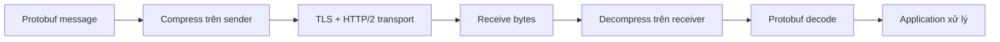

# Compression và CPU trade-off

Compression trong gRPC giảm số byte payload phải truyền qua network bằng cách mã hóa message thành dạng nhỏ hơn. Đổi lại, sender phải tiêu tốn CPU để nén và receiver phải tiêu tốn CPU để giải nén. Vì vậy, bật compression có thể tăng goodput khi network là bottleneck, nhưng cũng có thể làm throughput giảm nếu CPU, latency hoặc garbage collection đã là giới hạn.

Trong **SPRING_GRPC**, compression cần được chọn theo đặc điểm payload và workload của từng RPC. Event nhỏ, dữ liệu đã nén hoặc service đang CPU-bound thường không hưởng lợi từ việc nén mọi message. Với stream truyền nhiều record có cấu trúc lặp, compression có thể giảm bandwidth đáng kể, nhưng phải đo cả CPU ở client/server, latency p95/p99, memory và lượng byte thực sự tiết kiệm.

## 1. gRPC compression hoạt động ở đâu?

gRPC chạy trên HTTP/2 và có framing riêng cho từng message. Compression của gRPC áp dụng ở **message payload**, không phải nén toàn bộ HTTP/2 connection. Metadata và HTTP/2 frame không được biến thành một khối payload nén chung với message.

Về khái niệm, một gRPC message có:

- Một byte flag cho biết message có được nén hay không.
- Độ dài message payload trên wire.
- Payload Protobuf, có thể ở dạng identity hoặc đã nén.

Ở cấp call, sender có thể chọn một compression algorithm như gzip. Metadata gRPC dùng trường grpc-encoding để chỉ thuật toán nén được dùng cho message và grpc-accept-encoding để công bố các thuật toán receiver hỗ trợ. Message cũng có cờ riêng cho biết payload cụ thể có được nén hay không.

Điều này cho phép một call streaming mang nhiều message, mỗi message có kích thước và đặc tính khác nhau. Compression không đồng nghĩa mọi message chắc chắn nhỏ hơn; payload vốn đã nén hoặc quá nhỏ có thể không có lợi khi nén.

## 2. CPU trade-off: tiết kiệm network bằng chi phí tính toán

Một luồng dữ liệu có compression thường đi qua các bước:



Compression chuyển một phần chi phí từ network sang CPU:

| Tài nguyên | Không compression | Có compression |
| --- | --- | --- |
| Network bytes | Cao hơn | Thường thấp hơn nếu payload nén tốt |
| CPU sender | Ít công việc nén | Tăng do encode/compress |
| CPU receiver | Ít công việc giải nén | Tăng do decompress |
| Latency mỗi message | Ít bước hơn | Có thêm thời gian nén/giải nén |
| Memory/allocation | Phụ thuộc message và transport | Có thêm buffer trung gian, tùy implementation |
| Goodput khi network-bound | Có thể bị giới hạn bandwidth | Có thể tăng nếu tiết kiệm byte lớn hơn chi phí CPU |
| Throughput khi CPU-bound | Có thể cao hơn | Có thể giảm do CPU bị bão hòa |

Không có một kết luận đúng cho mọi workload. Nếu network đang bão hòa nhưng CPU còn dư, compression có thể cải thiện tổng throughput. Nếu CPU đã gần bão hòa, nén có thể làm cả latency và throughput xấu đi dù số byte truyền giảm.

### 2.1. Ví dụ định lượng

Giả sử một message Protobuf có kích thước 100 KiB:

- Không nén: truyền gần 100 KiB payload.
- Nén còn 30 KiB: tiết kiệm khoảng 70 KiB payload.
- Sender phải tiêu tốn CPU để nén; receiver tiêu tốn CPU để giải nén.

Tỷ lệ kích thước sau nén:

\[
\text{Compression ratio} =
\frac{\text{Compressed bytes}}{\text{Original bytes}}
\]

Với ví dụ trên, ratio là 0,30, tương đương giảm khoảng 70% payload bytes. Nhưng con số này không cho biết compression có đáng bật hay không. Cần biết thời gian CPU để nén/giải nén, RTT, bandwidth, số stream đồng thời và latency SLO.

## 3. Payload nào nén tốt?

Khả năng nén phụ thuộc entropy và cấu trúc dữ liệu:

| Payload | Khả năng nén thường gặp | Lý do |
| --- | --- | --- |
| JSON/text có field và từ khóa lặp | Tốt | Có nhiều chuỗi lặp |
| Log/event có cấu trúc tương tự | Thường tốt | Tên field và mẫu dữ liệu lặp |
| Protobuf chứa nhiều giá trị tương tự | Có thể tốt | Byte pattern và nội dung lặp |
| Dữ liệu số nhỏ, packed repeated fields | Tùy phân bố | Protobuf vốn đã mã hóa khá gọn |
| JPEG, PNG, ZIP, gzip hoặc payload đã nén | Thường thấp | Dữ liệu đã loại bỏ phần dư thừa |
| Dữ liệu mã hóa hoặc entropy cao | Thường thấp | Ít cấu trúc lặp để khai thác |
| Message rất nhỏ | Lợi ích thường thấp | Compression framing và CPU có thể lớn hơn phần byte tiết kiệm |

Không nên quyết định chỉ dựa vào định dạng Protobuf. Protobuf đã có encoding nhị phân hiệu quả cho nhiều kiểu dữ liệu, nhưng message vẫn có thể chứa text, field lặp hoặc payload có thể nén. Hãy benchmark mẫu đại diện, không suy luận từ tên message hoặc schema.

## 4. Message size và ngưỡng compression

Nén message rất nhỏ có thể không có lợi vì:

- Thuật toán cần khởi tạo và xử lý buffer.
- Compression header/framing làm tăng một phần overhead.
- CPU time có thể lớn hơn thời gian tiết kiệm trên network.
- Payload nhỏ có thể không có đủ dữ liệu lặp để đạt compression ratio tốt.

Một chiến lược thực tế là chỉ nén khi message đủ lớn và loại payload đã được chứng minh có thể nén tốt. Ngưỡng byte không có giá trị phổ quát; cần benchmark trên phần cứng, JVM, thuật toán và network thực tế.

Nếu một stream chứa cả message nhỏ và lớn, có thể cân nhắc chính sách compression theo call hoặc theo message nếu API/runtime đang dùng hỗ trợ. Tránh tạo nhiều policy phức tạp trước khi có số liệu chứng minh lợi ích.

## 5. Chọn compression algorithm

gRPC dùng tên encoding để hai đầu thống nhất thuật toán. Gzip là lựa chọn phổ biến và có hỗ trợ rộng trong gRPC Java. Runtime có thể hỗ trợ các compressor khác tùy implementation và cấu hình.

Khi lựa chọn, xem xét:

- Compression ratio trên payload thật.
- CPU encode và decode.
- Latency ở message size nhỏ và lớn.
- Memory allocation và GC.
- Khả năng tương thích giữa client/server runtime.
- Khả năng quan sát và vận hành thuật toán trong môi trường triển khai.

Không giả định client và server hỗ trợ cùng một compressor chỉ vì cả hai đều dùng gRPC. Receiver cần quảng bá thuật toán hỗ trợ và sender chỉ nên chọn encoding tương thích. Nếu thuật toán không được đăng ký hoặc không được peer hỗ trợ, call có thể thất bại ở transport/protocol layer.

## 6. Bật compression ở gRPC Java client

Với gRPC Java, stub có thể chọn compression cho một call bằng phương thức withCompression. Ví dụ unary:

```java
OrderReply reply = blockingStub
    .withCompression("gzip")
    .getOrder(request);
```

Với client-streaming hoặc bidirectional streaming, stub được cấu hình compression trước khi mở call:

```java
OrderServiceGrpc.OrderServiceStub compressedStub =
    asyncStub.withCompression("gzip");

StreamObserver<OrderEvent> requestObserver =
    compressedStub.publishEvents(responseObserver);
```

Trong ví dụ này, withCompression("gzip") chọn compressor cho message request do client gửi trong call. Nó không tự động quyết định cách server nén response. Compression của response là quyết định riêng ở phía server.

Stub được tạo từ ManagedChannel có thể được tái sử dụng theo semantics immutable của generated stub; withCompression trả về một stub cấu hình call options mới. Không tạo channel mới cho từng message chỉ để bật compression.

### 6.1. Chọn compression có điều kiện

Nếu có nhiều loại RPC, có thể chỉ dùng compressed stub cho method truyền payload lớn:

```java
if (payloadSize >= compressionThresholdBytes) {
    return blockingStub
        .withCompression("gzip")
        .upload(request);
}

return blockingStub.upload(request);
```

compressionThresholdBytes cần được xác định từ benchmark và chính sách message size. Kích thước request trước nén có thể được ước lượng bằng serialized size của Protobuf message; không dùng kích thước object Java hoặc chỉ tính riêng byte payload.

Không nên bật compression cho mọi RPC một cách mặc định khi workload có nhiều message nhỏ, CPU nhạy cảm hoặc payload đã nén.

## 7. Compression ở phía server

Request compression và response compression là hai hướng độc lập:

- Client nén request; server cần hỗ trợ giải nén encoding mà client gửi.
- Server nén response; client cần quảng bá encoding mà nó chấp nhận.

Trong gRPC Java, server có thể chọn response compressor trước khi gửi response headers bằng API ServerCall.setCompression. Ví dụ interceptor minh họa:

```java
public final class GzipResponseInterceptor
        implements ServerInterceptor {

    @Override
    public <ReqT, RespT> ServerCall.Listener<ReqT> interceptCall(
            ServerCall<ReqT, RespT> call,
            Metadata headers,
            ServerCallHandler<ReqT, RespT> next) {

        call.setCompression("gzip");
        return next.startCall(call, headers);
    }
}
```

Đây là ví dụ chọn gzip cho response của các call đi qua interceptor. Trong production, chỉ đăng ký interceptor cho service/method có payload phù hợp, bảo đảm compressor được hỗ trợ và kiểm thử client thực tế. Không nên áp dụng global compression cho mọi response nếu phần lớn response nhỏ hoặc không nén được.

Nếu service cần policy chi tiết theo method hoặc message, hãy đặt quyết định tại đúng call boundary và dùng API compression của phiên bản gRPC Java đang triển khai. Compression của response không được suy ra từ việc client đã nén request.

## 8. Compression trong streaming

Với streaming, một call có thể truyền rất nhiều message. Compression có thể giảm tổng byte đáng kể, nhưng tác động CPU tích lũy theo số message và kích thước payload.

Các yếu tố cần đánh giá:

- Kích thước trung bình và phân bố kích thước message.
- Payload có lặp nhiều giữa các message hay không.
- Số message mỗi giây và số stream đồng thời.
- CPU sender và receiver khi tải tăng.
- Message nhỏ xen lẫn message lớn.
- Backpressure và thời gian chờ flow control.
- Khả năng xử lý message lỗi hoặc stream bị cancel giữa chừng.

gRPC message compression không có nghĩa compressor được giữ một dictionary chung xuyên suốt toàn bộ stream. Không giả định rằng các message trước giúp message sau nén tốt hơn như một continuous archive; hãy đo theo semantics của compressor/runtime thực tế.

Nếu một stream gửi hàng nghìn message nhỏ, nén từng message có thể tốn CPU đáng kể. Có thể gom record thành batch ở tầng ứng dụng trước khi nén, nhưng batching sẽ tạo trade-off latency, memory và partial failure riêng. Chỉ kết hợp hai kỹ thuật khi benchmark cho thấy tổng thể tốt hơn.

## 9. Compression và TLS

Trong kiến trúc gRPC thông thường, message được nén ở tầng gRPC trước khi dữ liệu được bảo vệ bằng TLS. TLS mã hóa dữ liệu trên wire; TLS không tự động nén payload ứng dụng.

Điều này có nghĩa:

- Compression có thể giảm số byte mà TLS phải bảo vệ và network phải truyền.
- TLS vẫn cần CPU để mã hóa/giải mã record.
- Compression thêm CPU ở sender và receiver ngoài chi phí TLS.
- Nếu CPU đã bị chiếm nhiều bởi TLS, compression có thể làm saturation đến sớm hơn.

Không tắt TLS để tăng throughput trong production. Hãy benchmark cấu hình thực tế có TLS, certificate validation và compression như môi trường triển khai. Benchmark plaintext có thể giúp cô lập một bottleneck trong môi trường kiểm thử, nhưng không đại diện đầy đủ cho chi phí production.

## 10. Message size limit và bảo vệ tài nguyên

Compression làm payload trên wire nhỏ hơn, nhưng dữ liệu sau giải nén có thể lớn hơn nhiều. Vì vậy, không được dùng compressed byte count làm giới hạn duy nhất.

Trong gRPC Java, client và server có thể cấu hình giới hạn inbound message size bằng API của builder, ví dụ maxInboundMessageSize. Giá trị cụ thể cần phù hợp với contract và bộ nhớ sẵn có:

```java
ManagedChannel channel = NettyChannelBuilder
    .forAddress("grpc.example.com", 8443)
    .useTransportSecurity()
    .maxInboundMessageSize(8 * 1024 * 1024)
    .build();
```

Ví dụ giới hạn 8 MiB là minh họa, không phải mặc định khuyến nghị. Cần cấu hình tương ứng ở server và client theo chiều nhận message. Giới hạn inbound phải bảo vệ kích thước message sau giải nén mà runtime đưa lên application; không để một payload nén nhỏ chiếm heap lớn sau decompression.

Ngoài message size, cần giới hạn:

- Số message và tổng byte trong một stream.
- Thời gian xử lý và deadline.
- Số stream đồng thời trên mỗi caller/tenant.
- Queue và buffer trong application.
- Tốc độ request nếu service có quota/rate limit.

Đây là các biện pháp bảo vệ trước decompression bomb và resource exhaustion. Compression không được phép trở thành cách vượt qua quota hoặc giới hạn payload.

Compression cũng cần được xem xét trong threat model. Nếu một message chứa đồng thời secret và dữ liệu do caller kiểm soát, kích thước sau nén có thể thay đổi theo mức độ trùng lặp giữa hai phần; attacker quan sát được độ dài response có thể suy luận thông tin về secret trong một số thiết kế. Với response có dữ liệu nhạy cảm được trộn cùng nội dung phản chiếu từ caller, cân nhắc không nén message đó hoặc tách secret khỏi dữ liệu do caller kiểm soát. TLS bảo vệ nội dung nhưng không che hoàn toàn kích thước traffic.

## 11. Đo compression ratio và CPU cost

Một benchmark hữu ích cần đo cả lợi ích network lẫn chi phí CPU:

| Chỉ số | Cách diễn giải |
| --- | --- |
| Original payload bytes | Kích thước message trước nén |
| Compressed payload bytes | Kích thước message sau nén |
| Compression ratio | Compressed/original; càng thấp thường càng tiết kiệm byte |
| CPU time/message | Chi phí nén hoặc giải nén trên mỗi message |
| CPU utilization | Mức sử dụng CPU sender và receiver |
| Messages/s | Số message xử lý mỗi giây |
| Payload goodput | Byte payload gốc được xử lý mỗi giây |
| Wire bytes/s | Lưu lượng thực tế qua network |
| Latency p50/p95/p99 | Tác động tới thời gian phản hồi |
| Allocation/GC | Chi phí buffer và object trung gian |

Không chỉ nhìn compression ratio. Một thuật toán có thể giảm 80% byte nhưng làm CPU tăng mạnh và giảm messages/s. Một thuật toán khác chỉ giảm 40% byte nhưng giữ latency và CPU ổn định hơn, phù hợp hơn với SLO.

### 11.1. So sánh các cấu hình

Nên chạy tối thiểu các trường hợp:

| Thử nghiệm | Compression | Payload |
| --- | --- | --- |
| A | identity | Message nhỏ |
| B | gzip | Message nhỏ |
| C | identity | Message lớn, có cấu trúc lặp |
| D | gzip | Message lớn, có cấu trúc lặp |
| E | identity | Payload đã nén |
| F | gzip | Payload đã nén |

Chạy warm-up trước khi đo steady-state. Giữ nguyên số stream, dữ liệu, TLS, JVM options, CPU quota và network giữa các lần chạy. Thay đổi một yếu tố mỗi lần để biết compression tạo ra khác biệt nào.

### 11.2. Quyết định theo bottleneck

- **Network-bound, CPU còn dư:** thử gzip trên payload lớn/nén tốt.
- **CPU-bound:** ưu tiên identity hoặc nén chọn lọc; profile encode/decode trước.
- **Latency-bound với message nhỏ:** tránh nén message nhỏ nếu chi phí lớn hơn lợi ích.
- **Memory/GC-bound:** xem buffer allocation, message size và số stream đồng thời.
- **Payload đã nén:** thường dùng identity để tránh CPU không cần thiết.

Đây là hướng quyết định ban đầu. Kết quả cuối cùng phải đến từ benchmark trong môi trường gần production.

## 12. Compression và observability

Nên theo dõi compression ở cả hai phía:

- Số call/message dùng từng encoding.
- Original bytes và compressed bytes theo method/payload class.
- Compression ratio theo phân bố message size.
- CPU nén ở sender và CPU giải nén ở receiver.
- Messages/s, payload goodput và wire bytes/s.
- Latency p50/p95/p99.
- Allocation rate, heap và GC pause.
- Lỗi unsupported compressor, decompression và message size limit.
- Số stream active và queue/flow-control wait.

Không dùng user ID, request ID hoặc message ID có cardinality cao làm metric label. Có thể phân loại theo service, method, encoding và nhóm payload size. Nếu runtime không cung cấp metric compression trực tiếp, có thể đo ở application boundary hoặc benchmark harness; phải ghi rõ số byte là payload estimate hay wire bytes thực.

Không log nội dung payload chỉ để đo compression. Dùng byte counters, histogram và trace metadata an toàn.

## 13. Các lỗi cấu hình và hiểu nhầm thường gặp

| Sai lầm | Hậu quả | Cách làm tốt hơn |
| --- | --- | --- |
| Bật gzip cho mọi RPC | CPU tăng trên message nhỏ hoặc payload không nén được | Chọn theo method/size và benchmark |
| Chỉ đo byte sau nén | Không biết chi phí CPU/latency | Đo ratio, CPU, p95/p99 và goodput |
| Nghĩ TLS tự nén dữ liệu | Hiểu sai vị trí compression | Compression ở gRPC message layer, TLS bảo vệ transport |
| Nghĩ nén request tự nén response | Cấu hình một chiều nhưng kỳ vọng hai chiều | Cấu hình request/response độc lập |
| Chỉ giới hạn compressed bytes | Payload sau giải nén có thể lớn | Đặt inbound message size và quota phù hợp |
| Nén payload đã gzip/ZIP/JPEG | CPU tăng nhưng tiết kiệm byte thấp | Dùng identity cho payload đã nén |
| Giả định dictionary được chia sẻ toàn stream | Ước lượng ratio sai | Benchmark theo message/runtime semantics |
| Benchmark không có TLS hoặc tải thực | Kết quả không đại diện production | Đo trên cấu hình gần production |
| Tự đăng ký compressor nhưng peer không hỗ trợ | Call có thể thất bại | Kiểm tra negotiation và runtime compatibility |

## 14. Checklist chọn compression trong Spring gRPC

Trước khi bật compression cho một method, hãy xác định:

1. **Payload:** dữ liệu có lặp/nén tốt hay đã được nén/mã hóa?
2. **Kích thước:** message đủ lớn để lợi ích vượt overhead chưa?
3. **Bottleneck:** network, CPU, latency, memory hay downstream đang giới hạn?
4. **Hướng truyền:** cần nén request, response hay cả hai?
5. **Algorithm:** client và server có hỗ trợ cùng encoding không?
6. **Streaming:** số message/giây và số stream đồng thời có làm CPU tăng quá mức không?
7. **Limits:** inbound size sau giải nén, stream byte quota và deadline có được giới hạn không?
8. **Security:** có nguy cơ decompression bomb hoặc nén chung secret với dữ liệu do caller kiểm soát không?
9. **Benchmark:** đã so sánh identity/gzip trên payload thật với TLS chưa?
10. **SLO:** throughput, p95/p99 latency và CPU có đạt mục tiêu không?
11. **Observability:** có ratio, byte counters, CPU, GC và compression errors không?
12. **Fallback:** hành vi khi peer không hỗ trợ compressor đã được kiểm tra chưa?

## 15. Ghi nhớ

Compression trong gRPC giảm byte truyền bằng cách nén từng message payload; nó không nén toàn bộ HTTP/2 connection và không thay thế TLS. Gzip có thể cải thiện goodput khi network là bottleneck và payload có nhiều cấu trúc lặp, nhưng sender phải trả CPU để nén và receiver trả CPU để giải nén. Message nhỏ, payload đã nén hoặc service CPU-bound thường không phù hợp với compression mặc định.

Trong Spring gRPC, chọn compression theo method, hướng request/response, message size và workload. withCompression("gzip") cấu hình compressor cho call từ client; response compression cần được cấu hình riêng ở server và chỉ dùng encoding peer hỗ trợ. Giới hạn message sau giải nén, số stream và buffer để bảo vệ tài nguyên. Benchmark identity với gzip trong điều kiện có TLS, đo compression ratio cùng CPU, goodput, p95/p99 và GC. Chỉ giữ compression khi lợi ích tổng thể vượt chi phí CPU và không làm vi phạm latency SLO.

### Tài liệu tham khảo

- [gRPC – Compression](https://grpc.io/docs/guides/compression/)
- [gRPC – Performance](https://grpc.io/docs/guides/performance/)
- [gRPC Java – API documentation](https://grpc.github.io/grpc-java/javadoc/)
- [gRPC – Flow control](https://grpc.io/docs/guides/flow-control/)
- [Protocol Buffers – Encoding](https://protobuf.dev/programming-guides/encoding/)
