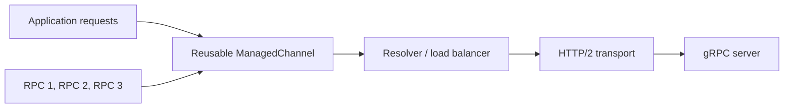

# Connection reuse

**Connection reuse** là duy trì và tái sử dụng hạ tầng kết nối gRPC cho nhiều RPC thay vì tạo rồi đóng kết nối sau từng request. Trong **SPRING_GRPC**, cách làm này giúp giảm chi phí DNS resolution, TCP connect, TLS handshake, cấp phát socket và khởi tạo transport. Nó đặc biệt quan trọng với service có nhiều unary RPC ngắn hoặc nhiều stream được mở liên tục.

Trong gRPC Java, đối tượng ứng dụng thường tái sử dụng là **ManagedChannel** và stub được tạo từ channel đó. Cần hiểu rằng ManagedChannel là abstraction phía client, không đồng nghĩa luôn luôn với đúng một TCP connection. Channel có thể quản lý resolver, load balancing, subchannel và một hoặc nhiều transport connection tùy target, policy và trạng thái mạng.

## 1. Vì sao cần tái sử dụng channel?

Nếu mỗi RPC tạo channel mới, client có thể phải lặp lại nhiều bước tốn kém:

1. Phân giải tên service qua DNS hoặc name resolver.
2. Tạo TCP socket và thiết lập kết nối.
3. Thực hiện TLS handshake, xác minh certificate và thương lượng giao thức.
4. Khởi tạo HTTP/2 connection và các trạng thái transport.
5. Gửi một RPC rồi đóng channel/connection.

Với request ngắn, chi phí thiết lập có thể chiếm tỷ lệ đáng kể trong tổng latency. Tái sử dụng channel giữ transport sẵn sàng cho các RPC tiếp theo và cho phép HTTP/2 multiplex nhiều RPC trên cùng một connection khi transport hỗ trợ.



Sơ đồ thể hiện channel là điểm vào logic dùng chung. Resolver và load balancer có thể tạo hoặc quản lý nhiều subchannel/transport; không nên suy luận số TCP connection chỉ từ số đối tượng ManagedChannel.

## 2. Phân biệt channel, connection và stub

| Thành phần | Vai trò | Có nên tái sử dụng? |
| --- | --- | --- |
| ManagedChannel | Entry point logic của client; quản lý resolver, load balancing và transport | Có, thường sống theo lifecycle của ứng dụng hoặc client service |
| HTTP/2 connection | Kết nối transport thực tế, mang nhiều stream/RPC | Được gRPC runtime quản lý và tái sử dụng |
| Subchannel | Đại diện đường kết nối tới backend trong mô hình load balancing | Do channel/load balancer quản lý |
| Generated stub | API typed để gọi một service trên channel | Có; stub gRPC Java là immutable và thread-safe |
| RPC call | Một lần gọi method cụ thể | Không tái sử dụng; mỗi RPC có deadline, metadata và trạng thái riêng |

Một channel không phải một request. Một stub cũng không phải một socket. Nhiều stub có thể cùng dùng một channel, và một channel có thể phục vụ nhiều method hoặc nhiều stub cùng target.

Generated stub trong gRPC Java là immutable. Những phương thức như withDeadlineAfter, withCallCredentials hoặc withCompression trả về stub mới với CallOptions tương ứng; chúng không tạo channel mới. Có thể giữ stub dùng chung và tạo biến thể theo từng call khi cần.

## 3. HTTP/2 multiplexing giúp reuse như thế nào?

HTTP/2 cho phép nhiều stream độc lập cùng tồn tại trên một connection. Mỗi gRPC RPC được ánh xạ vào một HTTP/2 stream. Khi channel được tái sử dụng:

- Nhiều unary RPC có thể chạy đồng thời mà không cần tạo TCP connection riêng cho từng request.
- Một stream dài có thể tồn tại trong khi các RPC khác tiếp tục dùng connection.
- TLS handshake và TCP setup được chia sẻ cho nhiều RPC.
- Connection-level flow control và concurrent stream limit được quản lý ở transport.

Multiplexing giảm connection churn, nhưng không tạo concurrency vô hạn. Server có thể quảng bá giới hạn concurrent streams; khi đạt giới hạn, RPC mới có thể phải chờ, được phân phối sang transport khác hoặc được xử lý theo chính sách của channel/load balancer.

Vì vậy, reuse channel thường là điểm khởi đầu đúng. Chỉ tăng số channel/connection khi số liệu cho thấy một transport đang trở thành bottleneck hoặc cần cô lập traffic.

## 4. Tạo ManagedChannel dùng chung trong Spring

Một cấu hình Spring có thể tạo channel thành bean và inject vào các service cần gọi downstream:

```java
@Configuration
class GrpcClientConfiguration {

    @Bean(destroyMethod = "shutdown")
    ManagedChannel inventoryChannel() {
        return ManagedChannelBuilder
            .forTarget("dns:///inventory.internal:8443")
            .useTransportSecurity()
            .build();
    }

    @Bean
    InventoryServiceGrpc.InventoryServiceBlockingStub inventoryStub(
            ManagedChannel inventoryChannel) {
        return InventoryServiceGrpc.newBlockingStub(inventoryChannel);
    }
}
```

Ví dụ dùng DNS target và TLS. inventory.internal là hostname logic của service; certificate server phải xác minh được theo hostname đó. Nếu ứng dụng dùng Spring gRPC starter có channel factory hoặc property riêng, có thể cấu hình qua cơ chế của starter, nhưng nguyên tắc lifecycle và reuse vẫn giữ nguyên.

Service chỉ cần inject stub:

```java
@Service
class InventoryClient {

    private final InventoryServiceGrpc.InventoryServiceBlockingStub stub;

    InventoryClient(
            InventoryServiceGrpc.InventoryServiceBlockingStub stub) {
        this.stub = stub;
    }

    ItemReply getItem(String itemId) {
        ItemRequest request = ItemRequest.newBuilder()
            .setItemId(itemId)
            .build();

        return stub.withDeadlineAfter(800, TimeUnit.MILLISECONDS)
            .getItem(request);
    }
}
```

Mỗi request vẫn có deadline riêng. Việc dùng chung channel không có nghĩa các RPC dùng chung timeout hoặc metadata. CallOptions và metadata cần được đặt theo từng call để tránh rò rỉ context giữa request.

## 5. Không tạo channel cho từng RPC

Anti-pattern thường gặp:

```java
ItemReply getItem(ItemRequest request) {
    ManagedChannel channel = ManagedChannelBuilder
        .forAddress("inventory.internal", 8443)
        .useTransportSecurity()
        .build();
    try {
        return InventoryServiceGrpc.newBlockingStub(channel)
            .getItem(request);
    } finally {
        channel.shutdownNow();
    }
}
```

Cách này tạo connection churn và lặp lại setup cost. Khi traffic tăng, nó có thể làm tăng:

- Số TCP connection và socket ở cả client/server.
- TLS handshake và CPU cryptography.
- DNS lookup và load balancer churn.
- Thread, timer, buffer và object allocation.
- TIME_WAIT socket và áp lực lên ephemeral port.
- Tail latency do request phải chờ kết nối mới.

Hãy tạo channel một lần theo target/configuration, tái sử dụng trong các RPC và đóng khi application lifecycle kết thúc.

## 6. Lifecycle và graceful shutdown

ManagedChannel cần được đóng khi ứng dụng dừng. Gọi shutdown() yêu cầu channel ngừng nhận RPC mới và cho các call đang chạy cơ hội hoàn tất. shutdownNow() buộc đóng channel và hủy các call còn lại.

Một quy trình shutdown có kiểm soát:

1. Ngừng nhận request mới từ application hoặc bắt đầu draining.
2. Gọi shutdown() trên channel.
3. Chờ các RPC đang chạy hoàn tất trong một khoảng thời gian hữu hạn.
4. Nếu quá thời hạn, gọi shutdownNow().
5. Ghi nhận call bị hủy và giải phóng tài nguyên.

Spring có thể gọi shutdown thông qua destroyMethod như ví dụ bean ở trên. Nếu cần đợi channel termination trước khi process thoát, hãy bổ sung lifecycle coordinator có timeout thay vì chặn vô hạn trong destroy callback.

Không gọi shutdown sau từng RPC. Cũng không giữ channel trong static global không có lifecycle rõ ràng, vì việc đóng, test isolation và cấu hình nhiều môi trường sẽ khó kiểm soát.

## 7. Channel nên được chia theo tiêu chí nào?

Thông thường nên có một channel dùng chung cho mỗi logical target và cấu hình transport/security tương ứng. Những yếu tố có thể khiến ứng dụng cần channel riêng:

- Target hoặc service khác nhau.
- Trust configuration, TLS authority hoặc client certificate khác nhau.
- Load balancing policy hoặc resolver khác nhau.
- Executor/transport isolation được chứng minh là cần thiết.
- Traffic class có yêu cầu cô lập tài nguyên hoặc failure domain.

Không tạo channel cho mỗi user hoặc mỗi access token. Bearer token thường nên được gắn qua CallCredentials hoặc client interceptor theo từng RPC; channel vẫn dùng chung nếu target và transport identity giống nhau. Nếu credential là client certificate ở tầng TLS, đó là cấu hình transport và có thể cần channel riêng theo identity/certificate.

Một registry channel có thể được tổ chức theo key gồm target và các thuộc tính transport bất biến. Không đưa secret thô vào key/log. Cần giới hạn số channel được tạo và đóng channel khi cấu hình tương ứng hết hiệu lực.

## 8. Có nên tạo channel pool?

Pool nhiều ManagedChannel đôi khi giúp tăng số HTTP/2 connection và tránh một connection trở thành nút thắt, nhưng cũng có chi phí:

| Lợi ích tiềm năng | Chi phí/rủi ro |
| --- | --- |
| Tăng số transport connection và khả năng song song | Tăng socket, TLS session và memory |
| Tách nhóm traffic dài/ngắn | Tăng độ phức tạp cấu hình và shutdown |
| Cô lập một failure/traffic domain | Có thể làm load balancing lệch hoặc phân phối không đều |
| Có thể tránh chờ khi concurrent stream limit đã đạt | Tăng connection churn và áp lực server |

Không tạo pool chỉ vì một channel có vẻ chậm. Trước tiên đo active streams, pending calls, connection utilization, latency, server concurrent-stream limit, CPU và network. gRPC Java channel/load balancer có thể quản lý nhiều subchannel hoặc transport tùy cấu hình; pool ở application layer có thể nhân đôi cơ chế phân phối sẵn có.

Nếu benchmark chứng minh cần nhiều channel, pool phải có kích thước hữu hạn, lifecycle rõ, chọn channel công bằng và shutdown tất cả channel. Tránh tạo channel mới mỗi khi pool bận; đó chỉ là connection churn có kiểm soát kém hơn.

## 9. Reuse với load balancing và service discovery

Khi target là DNS hoặc service name, channel có thể duy trì resolver và load balancer để cập nhật backend. Ví dụ:

```java
ManagedChannel channel = ManagedChannelBuilder
    .forTarget("dns:///catalog.internal:8443")
    .defaultLoadBalancingPolicy("round_robin")
    .useTransportSecurity()
    .build();
```

Khả năng và tên policy phụ thuộc phiên bản gRPC Java và resolver được cài đặt. Channel tái sử dụng vẫn có thể cập nhật backend khi DNS/service discovery thay đổi; không cần tạo channel mới cho mỗi lần backend đổi IP.

Một số điểm cần nhớ:

- DNS TTL và refresh behavior phụ thuộc resolver/runtime.
- Load balancer chọn subchannel/backend theo policy.
- Một channel có thể có nhiều transport connection nếu policy và resolver tạo nhiều subchannel.
- Certificate identity phải khớp hostname/authority mà client xác minh.
- Khi backend bị loại khỏi service discovery, channel có thể chuyển traffic sang backend còn healthy theo policy.

Không hard-code IP backend vào client nếu kiến trúc yêu cầu service discovery. Cũng không giả định round_robin luôn khả dụng nếu resolver chỉ cung cấp một địa chỉ hoặc policy không được đăng ký.

## 10. Connection reuse và keepalive

Keepalive dùng HTTP/2 PING để kiểm tra hoặc duy trì hoạt động của connection theo policy. Nó khác với gRPC health checking:

- **Keepalive:** kiểm tra trạng thái transport connection và phát hiện peer/network không phản hồi.
- **Health checking:** hỏi service health API để biết service có sẵn sàng nhận request hay không.

Không bật keepalive interval quá ngắn cho mọi client. PING quá thường xuyên có thể tạo tải cho server, load balancer và network; server có thể từ chối nếu client vi phạm policy. Cần cấu hình client/server phối hợp theo hạ tầng và traffic.

Channel reuse không đồng nghĩa phải giữ connection sống bằng ping liên tục. Nếu traffic thưa, connection có thể idle hoặc bị proxy đóng; gRPC channel có thể reconnect khi có RPC tiếp theo. Chỉ cấu hình keepalive khi có yêu cầu vận hành rõ ràng như phát hiện connection chết trong stream dài hoặc giữ đường truyền qua proxy có idle timeout.

## 11. GOAWAY, reconnect và stream đang chạy

HTTP/2 server có thể gửi GOAWAY khi muốn đóng connection một cách graceful, ví dụ trước khi restart. gRPC runtime xử lý transport shutdown và có thể thiết lập connection mới cho RPC tiếp theo.

Tuy nhiên:

- Reconnect transport không đồng nghĩa tự khôi phục mọi RPC đang chạy.
- Unary RPC chưa được xử lý có thể được retry theo semantics/runtime/policy phù hợp.
- Streaming RPC đang mở có thể kết thúc lỗi khi transport bị đóng.
- Application cần cursor, sequence, acknowledgement hoặc resume protocol nếu stream phải tiếp tục sau reconnect.
- Không retry operation có side effect nếu không có idempotency protection.

Với stream dài, thiết kế reconnect ở application layer: client lưu checkpoint đã được xác nhận, mở stream mới và yêu cầu tiếp tục từ sequence/cursor phù hợp. Connection reuse giúp giảm setup cost trong hoạt động bình thường; nó không thay thế khả năng phục hồi stream.

## 12. Deadline, cancellation và metadata vẫn thuộc từng call

Tái sử dụng channel không có nghĩa các RPC dùng chung state nghiệp vụ. Mỗi call vẫn cần:

- Deadline phù hợp với operation.
- Metadata/correlation ID riêng.
- Authentication credential theo caller.
- Cancellation khi caller không còn cần kết quả.
- Retry policy và idempotency theo method.

Không lưu mutable request metadata trong singleton client rồi sửa trước mỗi call, vì các RPC đồng thời có thể ghi đè context của nhau. Dùng stub CallOptions hoặc metadata interceptor tạo context riêng cho call.

Ví dụ gắn correlation metadata theo call bằng client interceptor hoặc CallCredentials phù hợp. Không tạo channel mới chỉ để thay đổi request ID, trace context hay Bearer token.

## 13. Benchmark reuse so với tạo channel mới

Để chứng minh lợi ích, benchmark hai cách với cùng server, payload và tải:

| Thử nghiệm | Cách gọi |
| --- | --- |
| A | Tạo channel, gọi một RPC, đóng channel |
| B | Tạo channel một lần, gọi nhiều RPC tuần tự |
| C | Tạo channel một lần, gọi nhiều RPC đồng thời |
| D | Tái sử dụng channel qua DNS/load balancing với backend thay đổi |
| E | Nhiều channel hữu hạn, chỉ khi cần đánh giá connection parallelism |

Đo:

- Latency p50/p95/p99 và thời gian call đầu tiên.
- TCP connect/TLS handshake count và duration.
- RPC throughput và pending call count.
- Active connection, active stream và socket count.
- CPU client/server, allocation, heap và GC.
- DNS resolution và thời gian reconnect.
- Error/cancel rate khi backend restart hoặc gửi GOAWAY.

Warm-up JVM và channel trước khi đo steady-state. Tách cold-start latency khỏi latency của RPC khi channel đã sẵn sàng. Giữ TLS, certificate validation, load balancing và network tương tự production. Nếu benchmark reuse bằng plaintext nhưng production dùng TLS, kết quả không phản ánh setup và CPU cost thực tế.

## 14. Observability cho channel reuse

Nên theo dõi theo target/service và method:

| Metric | Ý nghĩa |
| --- | --- |
| Channel count | Phát hiện tạo channel không giới hạn |
| Active transport connections | Số kết nối thực tế được quản lý |
| Active/pending RPC | Concurrency và call đang chờ |
| Connection state | IDLE, CONNECTING, READY, TRANSIENT_FAILURE, SHUTDOWN |
| Connection/TLS setup duration | Chi phí khởi tạo transport |
| Reconnect/GOAWAY count | Độ ổn định kết nối |
| RPC latency p50/p95/p99 | Tác động của connection reuse |
| RPC throughput/error/cancel | Năng lực và độ tin cậy |
| Shutdown duration/in-flight calls | Chất lượng graceful shutdown |

Không dùng user ID, request ID hoặc access token làm metric label. Dùng target/service name có cardinality giới hạn và trace ID trong log/trace khi điều tra một call cụ thể. Không ghi credential hoặc TLS private key.

## 15. Những lỗi thường gặp

| Sai lầm | Hậu quả | Cách làm tốt hơn |
| --- | --- | --- |
| Tạo ManagedChannel cho từng RPC | Tăng TCP/TLS setup, socket và latency | Tái sử dụng channel theo target/configuration |
| Gọi shutdown sau từng call | Call tiếp theo phải tạo channel mới | Đóng channel theo application lifecycle |
| Tạo một channel cho mọi target/security identity | Dùng sai authority, trust hoặc credential context | Chia channel theo cấu hình transport bất biến |
| Tạo channel theo từng user/token | Tăng tài nguyên và connection churn | Dùng CallCredentials/metadata per call |
| Giả định một channel bằng một TCP connection | Hiểu sai load balancing/subchannel | Theo dõi transport thực tế |
| Tạo pool không giới hạn | Tăng socket, memory và tải server | Chỉ pool khi benchmark chứng minh cần; giới hạn kích thước |
| Bật keepalive quá thường xuyên | PING storm hoặc bị server/proxy từ chối | Cấu hình theo policy hạ tầng |
| Nghĩ reconnect tự resume streaming RPC | Mất dữ liệu hoặc xử lý trùng | Dùng sequence, ack và resume protocol |
| Dùng static channel không lifecycle | Khó shutdown và test isolation | Quản lý channel bằng Spring bean/lifecycle |

## 16. Checklist production

Trước khi phát hành gRPC client trong Spring, hãy xác nhận:

1. **Lifecycle:** channel được tạo một lần và đóng khi application dừng.
2. **Reuse:** không tạo channel theo từng request hoặc message.
3. **Target:** channel được chia theo logical target và transport/security config.
4. **Stub:** generated stub được tái sử dụng; CallOptions riêng cho từng RPC.
5. **Concurrency:** hiểu giới hạn concurrent streams và pending calls.
6. **Load balancing:** resolver/policy được cấu hình và quan sát đúng.
7. **Credentials:** Bearer token per call không làm phát sinh channel theo user.
8. **TLS:** hostname, trust store, authority và client certificate phù hợp.
9. **Keepalive:** chỉ bật theo nhu cầu và policy server/proxy.
10. **Reconnect:** có hành vi rõ khi connection reset, GOAWAY hoặc backend thay đổi.
11. **Streaming:** có checkpoint/ack/resume nếu stream cần phục hồi.
12. **Shutdown:** draining, timeout và xử lý in-flight RPC được xác định.
13. **Benchmark:** có so sánh cold start, warm channel, concurrency và p95/p99.
14. **Observability:** channel count, connection state, reconnect và RPC metrics được theo dõi.

## 17. Ghi nhớ

Connection reuse giúp gRPC tránh lặp lại DNS, TCP và TLS setup cho từng RPC. Trong gRPC Java, hãy tái sử dụng ManagedChannel và generated stub theo lifecycle của Spring. Channel là abstraction logic quản lý resolver/load balancing/transport, không phải cam kết một channel tương ứng đúng một TCP connection. HTTP/2 multiplex nhiều RPC trên connection nhưng vẫn có giới hạn concurrent streams và tài nguyên.

Không tạo channel cho từng request, không shutdown sau từng call và không tạo pool vô hạn. Chia channel theo target hoặc transport/security identity thực sự khác nhau; dùng CallCredentials hoặc metadata per call cho Bearer token thay vì channel theo user. Cấu hình keepalive có kiểm soát, hiểu GOAWAY/reconnect không tự resume stream và dùng checkpoint khi cần phục hồi. Benchmark cùng TLS và tải production, theo dõi connection state, active/pending RPC, setup latency và p95/p99 để xác định khi nào một channel là đủ hoặc cần isolation/pooling.

### Tài liệu tham khảo

- [gRPC – Performance](https://grpc.io/docs/guides/performance/)
- [gRPC – Keepalive](https://grpc.io/docs/guides/keepalive/)
- [gRPC – Custom Load Balancing](https://grpc.io/docs/guides/custom-load-balancing/)
- [gRPC Java – ManagedChannel API](https://grpc.github.io/grpc-java/javadoc/io/grpc/ManagedChannel.html)
- [gRPC Java – ManagedChannelBuilder API](https://grpc.github.io/grpc-java/javadoc/io/grpc/ManagedChannelBuilder.html)
