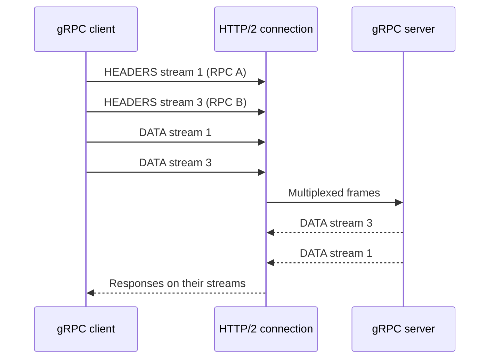

# HTTP/2 multiplexing

**HTTP/2 multiplexing** cho phép nhiều HTTP/2 stream cùng hoạt động trên một connection TCP. gRPC ánh xạ mỗi RPC vào một HTTP/2 stream, vì vậy nhiều RPC có thể truyền đồng thời qua cùng kết nối mà không cần mở một TCP connection riêng cho từng request. Đây là nền tảng giúp gRPC giảm connection churn, chia sẻ chi phí TLS và hỗ trợ giao tiếp đồng thời hiệu quả.

Trong **SPRING_GRPC**, multiplexing đặc biệt quan trọng khi một service gọi nhiều RPC ngắn, duy trì nhiều stream hoặc kết hợp unary với streaming. Tuy nhiên, multiplexing không tạo năng lực vô hạn: mỗi connection có giới hạn concurrent streams, flow-control windows, bandwidth và CPU dùng chung. TCP cũng vẫn có hiện tượng head-of-line blocking khi packet bị mất. Thiết kế cần cân bằng số stream, thời gian sống của stream, số connection, fairness và năng lực server.

## 1. RPC được ánh xạ thành HTTP/2 stream

Một gRPC call tương ứng với một HTTP/2 stream. Bên trong stream đó, gRPC có thể gửi một hoặc nhiều message:

- Unary RPC: một request message và một response message trên một stream.
- Server streaming: một request message và nhiều response message trên cùng một stream.
- Client streaming: nhiều request message và một response message trên cùng một stream.
- Bidirectional streaming: nhiều message ở cả hai hướng trên cùng một stream.

HTTP/2 chia dữ liệu thành các frame. Frame thuộc nhiều stream có thể được xen kẽ trên cùng connection, còn stream ID giúp hai phía phân biệt luồng logic. Ví dụ, client có thể gửi DATA frame của RPC A, rồi DATA frame của RPC B, sau đó tiếp tục RPC A mà không phải hoàn tất A trước khi bắt đầu B.



Thứ tự frame trên connection không làm thay đổi thứ tự message trong từng stream. RPC A và RPC B có lifecycle độc lập ở tầng gRPC, dù cùng chia sẻ transport.

## 2. Multiplexing giảm chi phí kết nối

Nếu mỗi RPC mở một TCP/TLS connection mới, client phải trả chi phí thiết lập lặp lại:

1. DNS hoặc service-name resolution.
2. TCP handshake.
3. TLS handshake và xác minh certificate.
4. Khởi tạo HTTP/2 connection và trạng thái flow control.
5. Gửi một RPC rồi đóng connection.

Khi tái sử dụng connection, nhiều RPC chia sẻ cùng transport:

- TCP/TLS setup được thực hiện một lần cho connection.
- Nhiều RPC có thể tiến hành đồng thời.
- Giảm số socket, handshake và connection churn.
- Channel có thể giữ resolver/load-balancing state và tái sử dụng transport.

Multiplexing và connection reuse bổ trợ nhau. Multiplexing cho phép nhiều stream dùng chung một connection; connection reuse giúp những RPC đến sau tiếp tục dùng hạ tầng đã được thiết lập.

## 3. Phân biệt channel, connection và stream

| Khái niệm | Ý nghĩa |
| --- | --- |
| ManagedChannel | Abstraction phía client; quản lý resolver, load balancing, subchannel và transport |
| Subchannel | Đường kết nối logic tới một backend trong mô hình load balancing |
| TCP connection | Kết nối byte stream thực tế giữa hai endpoint |
| HTTP/2 connection | HTTP/2 session chạy trên TCP (thường được bảo vệ bằng TLS) |
| HTTP/2 stream | Luồng hai chiều độc lập bên trong connection |
| gRPC RPC | Một lời gọi method, thường được vận chuyển trên một HTTP/2 stream |
| gRPC message | Request/response message bên trong một RPC stream |

Một ManagedChannel không nhất thiết tương ứng với đúng một TCP connection. Resolver và load balancer có thể tạo nhiều subchannel/transport tùy target, backend và policy. Ngược lại, một HTTP/2 connection có thể multiplex nhiều RPC stream.

Không nên lấy số channel làm đại diện cho số connection hoặc số RPC đồng thời. Khi điều tra performance, cần đo riêng channel, transport connection, active HTTP/2 streams và pending RPC.

## 4. Giới hạn concurrent streams

HTTP/2 server quảng bá giới hạn số stream đồng thời qua setting `SETTINGS_MAX_CONCURRENT_STREAMS`. Đây là giới hạn trên mỗi HTTP/2 connection, không phải giới hạn tổng RPC của toàn hệ thống.

Khi connection đã có số stream đang mở bằng giới hạn:

- RPC mới có thể phải chờ trước khi được gửi trên connection đó.
- Runtime/load balancer có thể chọn transport khác nếu topology và implementation cho phép.
- RPC có deadline ngắn có thể hết hạn trong lúc chờ.
- Stream dài có thể giữ slot lâu và làm RPC ngắn chờ lâu hơn.

Không giả định client luôn tự mở connection mới ngay khi hết slot. Hành vi phụ thuộc gRPC Java version, resolver, load-balancing policy và transport. Hãy quan sát active/pending calls và số connection thực tế.

### 4.1. Vì sao tăng concurrent-stream limit không phải lúc nào cũng tốt?

Tăng giới hạn có thể giảm thời gian chờ stream khi connection chưa tận dụng hết CPU/network. Nhưng nếu server đã bão hòa, nhiều stream hơn có thể làm tăng:

- Số callback và task đồng thời.
- Memory cho stream state, buffer và message đang chờ.
- Tranh chấp executor, lock và downstream connection pool.
- Queueing và tail latency.
- Tác động của một client gửi quá nhiều stream.

Giới hạn nên được chọn dựa trên năng lực handler, executor, memory và dependency. Giới hạn cao không làm database hoặc service downstream xử lý nhanh hơn.

## 5. Flow control ở cấp stream và connection

HTTP/2 có hai lớp flow control cho DATA frame:

- **Stream-level window:** giới hạn lượng dữ liệu đang được gửi trên một stream mà receiver chưa xác nhận đã tiêu thụ.
- **Connection-level window:** giới hạn tổng lượng DATA đang được gửi qua connection.

Hai giới hạn cùng có tác dụng. Một stream có thể còn stream window nhưng connection window đã cạn; khi đó sender vẫn phải chờ cập nhật connection window. Ngược lại, connection còn capacity nhưng một stream riêng có thể bị giới hạn bởi stream window.

Receiver gửi WINDOW_UPDATE khi tiêu thụ dữ liệu. Điều này giúp receiver không bị sender nhanh hơn làm tràn buffer.

gRPC Java còn cung cấp API flow-control ở tầng application, ví dụ readiness của outbound observer và manual inbound request. Flow control HTTP/2 không thay thế backpressure ở application: code vẫn có thể tạo nhiều object hoặc queue vô hạn trước khi giao message cho transport.

## 6. TCP head-of-line blocking vẫn tồn tại

HTTP/2 multiplexing loại bỏ kiểu chờ tuần tự ở tầng HTTP/1.1 request/response: một RPC chậm không bắt buộc ngăn RPC khác có stream riêng bắt đầu truyền frame. Tuy nhiên, HTTP/2 thường chạy trên một TCP connection, mà TCP cung cấp byte stream có thứ tự.

Nếu một TCP segment bị mất, các byte phía sau trên cùng TCP connection có thể chưa được giao lên HTTP/2 parser cho tới khi segment thiếu được truyền lại. Vì vậy, nhiều HTTP/2 stream trên cùng connection vẫn có thể chịu ảnh hưởng bởi packet loss ở tầng TCP. Đây là **TCP-level head-of-line blocking**.

Hệ quả thực tế:

- Multiplexing không đảm bảo một stream hoàn toàn độc lập với network impairment của stream khác.
- RTT cao và packet loss có thể làm latency của nhiều RPC trên cùng connection tăng.
- Mở thêm connection có thể tạo thêm congestion-control state và đôi khi giảm ảnh hưởng chung, nhưng cũng tăng socket/TLS/resource cost.
- Tối ưu cần dựa trên network telemetry và benchmark, không chỉ số RPC đồng thời.

Không nên nhầm TCP head-of-line blocking với việc server handler của RPC A block executor và làm RPC B chờ. Hai vấn đề nằm ở hai tầng khác nhau và cần chẩn đoán riêng.

## 7. Stream dài và fairness

Một bidirectional stream có thể tồn tại lâu và gửi hàng nghìn message, nhưng vẫn chỉ là một HTTP/2 stream. Nó không mở một stream mới cho mỗi message.

Stream dài có thể ảnh hưởng RPC khác theo nhiều cách:

- Chiếm một slot trong concurrent-stream limit.
- Dùng một phần connection-level flow-control window khi gửi dữ liệu liên tục.
- Tạo tải callback liên tục trên application executor.
- Giữ buffer, state và context trong thời gian dài.
- Cạnh tranh bandwidth với các RPC ngắn.

Để bảo đảm fairness:

- Giới hạn số stream dài trên mỗi client/tenant.
- Áp dụng backpressure và queue có giới hạn.
- Tránh một stream gửi batch quá lớn liên tục.
- Tách traffic class hoặc dùng channel/connection riêng khi có yêu cầu SLO và benchmark chứng minh cần.
- Theo dõi stream duration, message rate và bytes per stream.

Không tạo một connection riêng cho từng stream theo mặc định. Việc tách connection có thể cô lập traffic, nhưng sẽ tăng số socket, TLS session, keepalive và tải server.

## 8. Tái sử dụng ManagedChannel trong Spring

Spring application thường tạo channel thành bean và chia sẻ với các client service cùng target:

```java
@Configuration
class GrpcClientConfiguration {

    @Bean(destroyMethod = "shutdown")
    ManagedChannel catalogChannel() {
        return ManagedChannelBuilder
            .forTarget("dns:///catalog.internal:8443")
            .useTransportSecurity()
            .build();
    }

    @Bean
    CatalogServiceGrpc.CatalogServiceBlockingStub catalogStub(
            ManagedChannel catalogChannel) {
        return CatalogServiceGrpc.newBlockingStub(catalogChannel);
    }
}
```

Các service inject stub dùng chung:

```java
@Service
class CatalogClient {

    private final CatalogServiceGrpc.CatalogServiceBlockingStub stub;

    CatalogClient(CatalogServiceGrpc.CatalogServiceBlockingStub stub) {
        this.stub = stub;
    }

    ProductReply find(String productId) {
        ProductRequest request = ProductRequest.newBuilder()
            .setProductId(productId)
            .build();

        return stub.withDeadlineAfter(700, TimeUnit.MILLISECONDS)
            .findProduct(request);
    }
}
```

Channel reuse cho phép các RPC từ nhiều service bean chia sẻ transport. Mỗi call vẫn có deadline, metadata và CallOptions riêng. Generated stub gRPC Java là immutable; các phương thức như `withDeadlineAfter` trả về stub biến thể, không tạo connection mới.

Nếu dùng Spring gRPC starter, cấu hình channel có thể được quản lý bằng property hoặc channel factory của starter. Dù cách tạo bean khác nhau, cần giữ channel sống theo lifecycle ứng dụng và đóng đúng lúc.

## 9. Load balancing và nhiều connection

Một channel dùng DNS/service discovery có thể phân giải ra nhiều backend. Load-balancing policy quyết định cách chọn subchannel cho RPC. Mỗi subchannel có thể quản lý transport riêng, vì vậy một channel logic có thể sử dụng nhiều HTTP/2 connection.

Các yếu tố cần xem xét:

- Số backend đang healthy và kết quả resolver.
- Policy như pick-first hoặc round-robin có được hỗ trợ và cấu hình đúng không.
- Mỗi backend có concurrent-stream limit và năng lực riêng.
- Connection có phân phối đều RPC hay bị lệch do stream dài.
- DNS refresh và backend removal có ảnh hưởng các RPC đang mở không.

Không mặc định rằng một channel tự động tạo đủ connection để vượt mọi concurrent-stream limit. Hãy kiểm tra hành vi của resolver, load balancer và gRPC Java version đang dùng. Chỉ tăng channel pool khi benchmark cho thấy cần thêm transport parallelism hoặc traffic isolation.

## 10. Deadline, cancellation và queueing

RPC có thể phải chờ ở nhiều vị trí:

1. Chờ application executor.
2. Chờ channel chọn subchannel/transport.
3. Chờ concurrent-stream slot.
4. Chờ flow-control window.
5. Chờ server handler hoặc downstream.

Deadline bao trùm thời gian end-to-end của call, bao gồm cả thời gian chờ trước khi handler bắt đầu. Vì vậy, một RPC có deadline ngắn có thể kết thúc bằng `DEADLINE_EXCEEDED` dù handler chưa thực hiện nhiều công việc.

Khi caller hủy RPC, application nên dừng producer và công việc downstream nếu có thể. Đừng giữ message trong queue hoặc tiếp tục tính toán sau khi call đã cancel. Với stream cần resume, dùng sequence/checkpoint và mở RPC mới sau reconnect; HTTP/2 không tự khôi phục application stream.

## 11. Keepalive và health checking không phải multiplexing

Keepalive dùng HTTP/2 PING để kiểm tra hoặc duy trì connection theo policy. Health checking hỏi trạng thái service ở application level. Cả hai không làm tăng concurrent-stream limit và không thay thế flow control.

- PING không phải gRPC RPC nghiệp vụ.
- Health check có thể được gửi như RPC riêng.
- Keepalive interval quá ngắn có thể tạo tải và bị server/proxy từ chối.
- Một connection READY không bảo đảm mọi service method đều healthy.

Chọn keepalive theo idle timeout và yêu cầu phát hiện connection chết. Chọn health check theo readiness của service. Không bật PING liên tục với kỳ vọng giải quyết stream queue hoặc tăng throughput.

## 12. Khi nào cần nhiều connection?

Nhiều connection có thể hữu ích khi:

- Một connection thường xuyên đạt concurrent-stream limit.
- Long-lived streams gây ảnh hưởng đáng kể đến latency của unary RPC.
- Network path có packet loss và benchmark cho thấy tách connection cải thiện tail latency.
- Cần tách traffic theo security identity, target hoặc failure domain.
- Load-balancing topology yêu cầu nhiều transport.

Nhưng nhiều connection cũng làm tăng:

- TCP socket, file descriptor và ephemeral port usage.
- TLS handshake, certificate validation và cryptographic CPU.
- HTTP/2 connection state, flow-control windows và keepalive traffic.
- Memory, thread và tải trên load balancer/server.

Trước khi thêm connection, hãy kiểm tra executor saturation, server handler latency, flow-control wait, network loss và downstream bottleneck. Nếu vấn đề là database chậm, thêm connection thường chỉ đẩy nhiều request hơn vào hàng đợi database.

## 13. Benchmark multiplexing

Benchmark nên so sánh các mức concurrency và topology với cùng workload:

| Thử nghiệm | Cấu hình | Điều cần quan sát |
| --- | --- | --- |
| A | Một channel, tải thấp | Baseline setup và latency |
| B | Một channel, nhiều unary RPC đồng thời | Multiplexing và pending calls |
| C | Một channel, nhiều stream dài | Concurrent-stream limit và fairness |
| D | Nhiều channel hữu hạn | Tác động thêm connection/transport |
| E | Một số stream dài tách khỏi unary traffic | Cô lập traffic và tail latency |

Giữ TLS, certificate validation, payload, CPU quota và network giống môi trường triển khai. Chạy warm-up trước khi đo steady-state và tăng tải theo bước.

Đo:

- RPC throughput và latency p50/p95/p99.
- Active HTTP/2 streams và pending RPC.
- Số transport connection/subchannel.
- Thời gian chờ stream slot và flow-control wait nếu runtime/telemetry cung cấp.
- Bytes/s, packet loss, RTT và retransmission.
- CPU, heap, allocation, GC và executor queue.
- Error, cancellation, reconnect và GOAWAY.

Một benchmark chỉ đo requests/s mà không đo latency, queue và network có thể kết luận sai. Nếu throughput tăng nhưng p99 tăng mạnh hoặc memory vượt giới hạn, cấu hình đó chưa chắc phù hợp.

## 14. Observability cho HTTP/2 multiplexing

Nên theo dõi các chỉ số ở cả transport và application:

| Metric | Mục đích |
| --- | --- |
| Active RPC/HTTP2 streams | Đo concurrency đang sử dụng |
| Pending RPC | Phát hiện chờ slot hoặc transport |
| Active connection/subchannel | Hiểu topology kết nối thực tế |
| RPC latency theo method | Nhận biết method bị ảnh hưởng bởi contention |
| Stream duration | Phát hiện stream quá dài |
| Messages/s và bytes/s | Đo tải từng stream hoặc method |
| Flow-control/readiness wait | Phát hiện sender/receiver mất cân bằng |
| TCP RTT/retransmission/loss | Phát hiện network HOL và impairment |
| Executor queue/rejection | Phân biệt transport wait với application saturation |
| CPU/heap/GC | Đánh giá chi phí multiplexing ở tải cao |

Không dùng stream ID, request ID hoặc user ID làm metric label có cardinality cao. Dùng service, method, outcome và traffic class; trace/log có thể chứa correlation ID theo chính sách quan sát an toàn.

## 15. Những hiểu nhầm thường gặp

| Hiểu nhầm | Thực tế | Hướng xử lý |
| --- | --- | --- |
| Một RPC cần một TCP connection | Nhiều RPC có thể dùng các stream trên cùng HTTP/2 connection | Reuse ManagedChannel và transport |
| Một ManagedChannel luôn bằng một connection | Channel có thể quản lý nhiều subchannel/transport | Đo connection thực tế |
| Multiplexing loại bỏ mọi head-of-line blocking | TCP packet loss vẫn có thể chặn byte delivery trên connection | Theo dõi RTT, loss và retransmission |
| Stream dài mở connection mới cho mỗi message | Một RPC stream có thể mang nhiều message | Đo active stream và message rate riêng |
| Concurrent streams không giới hạn | Server quảng bá SETTINGS_MAX_CONCURRENT_STREAMS | Theo dõi pending RPC và giới hạn server |
| Tăng concurrent-stream limit luôn tăng throughput | Có thể làm tăng memory, executor và downstream contention | Benchmark theo capacity |
| Keepalive tăng concurrency | PING chỉ kiểm tra connection | Dùng flow control/load balancing đúng mục tiêu |
| Reconnect tự resume stream | Transport reconnect không khôi phục state nghiệp vụ | Thiết kế ack/sequence/checkpoint |

## 16. Checklist production

Trước khi tối ưu multiplexing trong Spring gRPC, hãy xác nhận:

1. **Mapping:** hiểu mỗi RPC là một HTTP/2 stream; message nằm bên trong stream.
2. **Reuse:** channel và transport được tái sử dụng theo lifecycle.
3. **Concurrency:** biết concurrent-stream limit và hành vi khi đạt giới hạn.
4. **Flow control:** hiểu stream window, connection window và application backpressure.
5. **Fairness:** stream dài không làm traffic ngắn vi phạm latency SLO.
6. **TCP:** theo dõi packet loss/retransmission vì multiplexing không loại bỏ TCP HOL.
7. **Topology:** hiểu channel, subchannel, resolver, load balancer và connection count.
8. **Deadlines:** thời gian chờ slot/transport nằm trong end-to-end deadline.
9. **Cancellation:** dừng công việc và giải phóng tài nguyên khi call bị hủy.
10. **Keepalive:** cấu hình theo policy; không dùng PING để thay flow control.
11. **Pooling:** chỉ tăng số channel/connection khi benchmark chứng minh cần.
12. **Recovery:** stream dài có sequence/ack/checkpoint nếu cần resume.
13. **Benchmark:** đo concurrency, active streams, p95/p99, network và executor.
14. **Observability:** phân biệt transport wait, application queue và downstream latency.

## 17. Ghi nhớ

HTTP/2 multiplexing cho phép nhiều gRPC RPC chạy trên các HTTP/2 stream độc lập cùng một TCP connection. Mỗi RPC dùng một stream; streaming RPC có thể truyền nhiều message trên stream đó. Cách tổ chức này giảm TCP/TLS setup và connection churn, nhưng bị giới hạn bởi concurrent-stream settings, stream/connection flow-control windows, bandwidth, CPU và năng lực server.

Multiplexing không loại bỏ TCP head-of-line blocking khi packet loss, cũng không tự tạo fairness giữa stream dài và RPC ngắn. Trong Spring gRPC, tái sử dụng ManagedChannel, theo dõi active/pending streams, đặt deadline, áp dụng backpressure và giới hạn stream theo capacity. Chỉ tăng số connection hoặc channel khi benchmark chỉ ra concurrent-stream contention, network impairment hoặc nhu cầu traffic isolation. Kết hợp transport metrics với executor, downstream và latency p95/p99 để xác định đúng bottleneck.

### Tài liệu tham khảo

- [gRPC – Performance](https://grpc.io/docs/guides/performance/)
- [gRPC – Flow control](https://grpc.io/docs/guides/flow-control/)
- [gRPC – Keepalive](https://grpc.io/docs/guides/keepalive/)
- [RFC 9113 – HTTP/2](https://www.rfc-editor.org/rfc/rfc9113)
- [gRPC Java – ManagedChannel API](https://grpc.github.io/grpc-java/javadoc/io/grpc/ManagedChannel.html)
