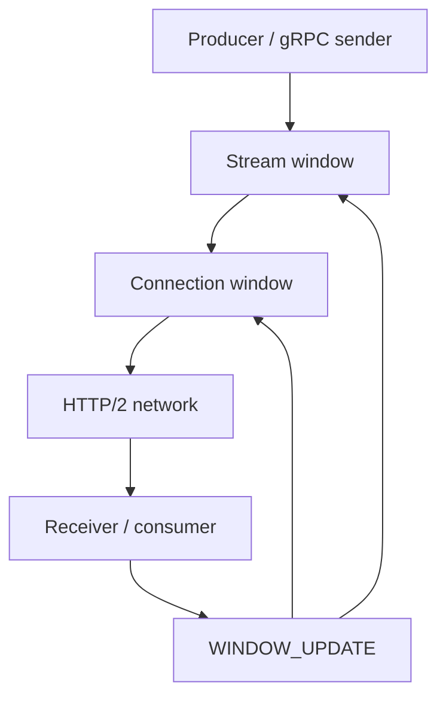

# Flow control và memory

Trong gRPC, **flow control** điều tiết lượng dữ liệu đang truyền để sender không làm receiver hoặc network bị quá tải. **Memory management** bảo đảm dữ liệu đang chờ gửi, đang nhận, đang xử lý và các buffer liên quan không tăng vượt ngân sách của process. Hai vấn đề gắn chặt với nhau: flow control tốt giúp giới hạn dữ liệu in-flight, nhưng không tự động giới hạn mọi queue và object mà application tạo ra.

Với **SPRING_GRPC**, chủ đề này đặc biệt quan trọng ở client-streaming, server-streaming và bidirectional streaming. Một stream có thể truyền hàng nghìn message; nhiều stream có thể đồng thời chia sẻ cùng HTTP/2 connection. Nếu producer nhanh hơn consumer, dữ liệu sẽ tích tụ ở transport buffer, application queue hoặc downstream. Không có giới hạn rõ ràng, heap/direct memory tăng, GC hoạt động nhiều và cuối cùng có thể gây OutOfMemoryError hoặc làm toàn bộ service mất khả năng phục vụ.

## 1. Flow control giải quyết vấn đề gì?

Giả sử một producer gửi 20.000 message mỗi giây nhưng consumer chỉ xử lý được 5.000 message mỗi giây. Nếu sender tiếp tục phát không giới hạn, chênh lệch 15.000 message mỗi giây sẽ tích tụ thành backlog. Khi message có payload lớn, memory tăng rất nhanh.

Flow control tạo cơ chế để receiver điều tiết tốc độ sender. Thay vì chỉ truyền theo khả năng phát của producer, sender phải quan sát lượng dữ liệu mà transport cho phép gửi và chờ khi receiver chưa tiêu thụ đủ dữ liệu.

Flow control hữu ích để:

- Giới hạn dữ liệu đang được truyền nhưng chưa được receiver tiêu thụ.
- Tránh một sender nhanh làm tràn buffer của receiver.
- Chia sẻ bandwidth và buffer giữa nhiều stream.
- Giảm queueing và latency kéo dài khi consumer chậm.
- Tạo tín hiệu để application giảm tốc hoặc tạm dừng producer.

Flow control không làm consumer xử lý nhanh hơn. Nếu downstream chậm, hệ thống vẫn cần giới hạn concurrency, queue và admission để giữ memory trong ngân sách.

## 2. HTTP/2 có flow control ở hai cấp

gRPC chạy trên HTTP/2. HTTP/2 áp dụng flow control cho DATA frame ở hai cấp:

1. **Stream-level window:** giới hạn lượng DATA đang được gửi trên một HTTP/2 stream mà receiver chưa cập nhật là đã tiêu thụ.
2. **Connection-level window:** giới hạn tổng lượng DATA đang được gửi qua toàn bộ HTTP/2 connection.

Sender chỉ được truyền khi cả stream window và connection window còn đủ credit. Receiver gửi frame `WINDOW_UPDATE` để tăng window sau khi dữ liệu được tiêu thụ.



Hai window phục vụ hai mục tiêu khác nhau. Stream window bảo vệ một stream riêng; connection window bảo vệ tổng dữ liệu trên connection. Một stream có thể còn credit riêng nhưng vẫn phải chờ connection window. Ngược lại, connection còn credit nhưng stream window của một stream cụ thể có thể đã cạn.

Flow control là cơ chế theo byte, không theo số message. Một message 1 MiB tiêu thụ nhiều window hơn message 1 KiB. Vì vậy, chỉ đếm số message không đủ để dự đoán lượng dữ liệu in-flight.

## 3. WINDOW_UPDATE và giới hạn dữ liệu in-flight

Khi receiver tiêu thụ DATA, nó có thể gửi WINDOW_UPDATE để cho phép sender tiếp tục. Nếu application hoặc transport không đọc dữ liệu, window không được cập nhật kịp và sender phải chờ.

Cần phân biệt:

- **Window size:** lượng byte transport cho phép đang in-flight.
- **Message size limit:** kích thước tối đa của một gRPC message mà endpoint chấp nhận.
- **Application queue capacity:** số record/byte application giữ chờ xử lý hoặc gửi.
- **Concurrent stream limit:** số HTTP/2 stream có thể mở đồng thời trên connection.

Các giới hạn này không thay thế nhau. Một message nhỏ hơn message-size limit vẫn có thể góp phần làm queue application tăng. Một HTTP/2 window lớn không có nghĩa application có đủ heap để giữ nhiều message cùng lúc.

Giá trị window mặc định và cách gRPC Java quản lý, cập nhật window có thể phụ thuộc phiên bản và transport. Không dựa vào một con số mặc định để tính memory production; hãy quan sát runtime, cấu hình transport thực tế và đo dưới tải.

## 4. Flow control của HTTP/2 khác backpressure của application

HTTP/2 flow control điều tiết DATA frame ở transport. **Application backpressure** điều tiết tốc độ producer theo khả năng xử lý thực tế của consumer trong code nghiệp vụ.

Ví dụ:

- Transport có thể chưa cho gửi thêm byte vì stream window đã cạn.
- Application vẫn có thể tiếp tục tạo hàng nghìn Protobuf object rồi đẩy vào queue.
- Những object đó chưa đi qua network nhưng vẫn chiếm heap.

Vì vậy, transport flow control không thay thế bounded queue và admission control. Application phải quyết định khi nào đọc thêm record, khi nào tạo batch, khi nào gửi và khi nào tạm dừng producer.

Một hệ thống có thể tuân thủ HTTP/2 flow control nhưng vẫn hết heap do queue application không giới hạn. Ngược lại, queue application có giới hạn nhưng window/transport buffer quá lớn cũng có thể làm tăng memory in-flight.

## 5. Outbound flow control trong gRPC Java

Với server-streaming hoặc bidirectional streaming, gRPC Java cung cấp `ServerCallStreamObserver`. Phương thức `isReady()` cho biết runtime hiện có khả năng nhận thêm dữ liệu outbound mà không vượt ngưỡng readiness nội bộ. `setOnReadyHandler()` đăng ký callback khi stream chuyển sang trạng thái có thể gửi thêm.

Ví dụ khung server-streaming:

```java
public void streamEvents(
        StreamRequest request,
        StreamObserver<Event> responseObserver) {

    ServerCallStreamObserver<Event> observer =
        (ServerCallStreamObserver<Event>) responseObserver;

    EventProducer producer = eventService.openProducer(request);
    observer.setOnCancelHandler(producer::cancel);
    observer.setOnReadyHandler(producer::scheduleDrain);

    producer.start();
    producer.scheduleDrain();
}
```

Producer cần dùng queue có giới hạn và chỉ drain khi stream sẵn sàng:

```java
void drain() {
    while (!cancelled && observer.isReady()) {
        Event next = pendingEvents.poll();
        if (next == null) {
            return;
        }
        observer.onNext(next);
    }
}
```

Đây là skeleton minh họa. Trong production, cần bảo đảm chỉ một drain loop chạy tại một thời điểm, observer không bị gọi đồng thời từ nhiều thread, và callback không chạy một vòng lặp dài trên transport thread. Có thể dùng một serial executor hoặc atomic work-in-progress guard để điều phối drain.

Nếu stream chưa ready, producer phải dừng lấy thêm dữ liệu hoặc giữ dữ liệu trong queue bounded. Không tiếp tục đọc toàn bộ nguồn vào một danh sách trong memory để chờ stream sẵn sàng.

### 5.1. isReady không phải acknowledgement

`isReady()` chỉ phản ánh khả năng nhận thêm outbound data của gRPC runtime. Nó không chứng minh peer đã nhận, decode, xử lý hoặc commit message. Nếu nghiệp vụ cần xác nhận, protocol phải có acknowledgement/checkpoint riêng.

Không gọi `onNext()` vô hạn với giả định runtime sẽ block producer cho tới khi peer xử lý. Hãy dùng readiness, bounded queue và acknowledgement theo yêu cầu nghiệp vụ.

## 6. Inbound flow control và manual demand

Với client-streaming hoặc bidirectional streaming, application có thể cần kiểm soát số message inbound được yêu cầu. Trên server, `ServerCallStreamObserver` hỗ trợ tắt auto inbound flow control bằng `disableAutoRequest()` và yêu cầu thêm message bằng `request(n)`.

Ví dụ khung xử lý một message mỗi lần:

```java
public StreamObserver<UploadChunk> upload(
        StreamObserver<UploadResult> responseObserver) {

    ServerCallStreamObserver<UploadResult> serverObserver =
        (ServerCallStreamObserver<UploadResult>) responseObserver;

    serverObserver.disableAutoRequest();
    UploadSession session = uploadService.openSession();
    serverObserver.request(1);

    return new StreamObserver<>() {
        @Override
        public void onNext(UploadChunk chunk) {
            session.accept(chunk);
            serverObserver.request(1);
        }

        @Override
        public void onError(Throwable error) {
            session.abort(error);
        }

        @Override
        public void onCompleted() {
            UploadResult result = session.commit();
            responseObserver.onNext(result);
            responseObserver.onCompleted();
        }
    };
}
```

Đây là skeleton đồng bộ để minh họa demand. Trong production, chỉ gọi `request(1)` sau khi message hiện tại đã được xử lý hoặc đã được đưa vào một queue có giới hạn. Nếu `session.accept` thực hiện blocking I/O, không giữ callback thread chờ database; hãy offload có giới hạn và chỉ yêu cầu message tiếp theo khi consumer còn capacity.

Khi dùng asynchronous processing, cần serialize trạng thái request/cancel/error và không gọi request thêm sau khi stream đã đóng. Phải xử lý exception từ accept/commit, cleanup session và truyền lỗi bằng status phù hợp.

Với client nhận response streaming, `ClientResponseObserver` và `ClientCallStreamObserver` hỗ trợ cấu hình inbound demand theo API gRPC Java. Chỉ yêu cầu thêm message khi application consumer có capacity.

## 7. Memory được sử dụng ở những đâu?

Memory của một gRPC streaming call không chỉ là payload Protobuf. Nó có thể gồm:

- **Transport buffers:** buffer đọc/ghi HTTP/2 và Netty; một phần có thể nằm ngoài Java heap.
- **In-flight message:** message đã nhận hoặc chuẩn bị gửi nhưng chưa hoàn tất xử lý.
- **Protobuf objects:** object graph được tạo khi parse message.
- **Byte arrays/copies:** dữ liệu được copy giữa application, serializer, compressor và transport.
- **Application queues:** record hoặc batch đang chờ xử lý/gửi.
- **Per-stream state:** observer, context, metadata, callback và state nghiệp vụ.
- **TLS/compression buffers:** buffer phục vụ mã hóa, giải mã, nén và giải nén.
- **Executor tasks:** closure, request context và payload được giữ trong task queue.

Netty có thể sử dụng direct memory ngoài heap. Do đó, heap usage thấp không chứng minh process còn nhiều memory an toàn. Cần theo dõi cả heap, direct memory và RSS/container memory.

## 8. Lập ngân sách memory theo concurrency

Một mô hình ước lượng đơn giản:

\[
M_{total} \approx M_{base} +
N_{active}\times M_{stream} +
M_{global\ queues} +
M_{shared}
\]

Trong đó:

- \(M_{base}\): memory nền của JVM, Spring, gRPC và các service.
- \(N_{active}\): số stream/RPC đồng thời.
- \(M_{stream}\): memory trung bình hoặc ngân sách bảo thủ cho state, buffer và message của một stream.
- \(M_{global\ queues}\): memory của queue dùng chung.
- \(M_{shared}\): cache, connection pool và các cấu trúc dùng chung khác.

Đây là mô hình lập ngân sách, không phải công thức chính xác của gRPC runtime. Một số buffer được chia sẻ, một số buffer thay đổi theo window, payload và transport; cần đo để hiệu chỉnh.

Ví dụ, nếu ứng dụng cho phép 400 stream đồng thời và dành ngân sách trung bình 256 KiB cho dữ liệu/state riêng mỗi stream, phần ngân sách tương ứng là khoảng 100 MiB. Con số này chưa bao gồm queue toàn cục, Protobuf object overhead, TLS, direct memory và JVM base. Khi sizing production, dùng phân bố p95/p99 của message size và queue occupancy thay vì chỉ lấy average.

### 8.1. Queue phải giới hạn cả count và bytes

Giới hạn 100 message chưa đủ nếu message có kích thước biến động lớn. Một queue tốt nên giới hạn:

- Số phần tử tối đa.
- Tổng serialized bytes tối đa.
- Kích thước tối đa của một message.
- Số batch/record đang xử lý đồng thời.

Ví dụ queue chứa 100 message, mỗi message 1 MiB, có thể giữ khoảng 100 MiB payload trước khi tính object overhead và bản sao. Nếu cùng lúc có 50 stream như vậy, memory tăng rất nhanh.

Khi queue đầy, hệ thống cần policy rõ: pause producer, giảm tốc, từ chối request mới, persist vào durable storage hoặc trả status overload. Không bỏ message âm thầm nếu contract yêu cầu bảo đảm dữ liệu.

## 9. Giới hạn message size và payload lớn

Một message quá lớn có thể tạo spike memory khi nhận, giải nén, parse Protobuf và xử lý. Hãy cấu hình inbound message size limit phù hợp ở client và server bằng API của builder/transport đang dùng, ví dụ `maxInboundMessageSize` trong gRPC Java.

Ví dụ client:

```java
ManagedChannel channel = NettyChannelBuilder
    .forAddress("upload.internal", 8443)
    .useTransportSecurity()
    .maxInboundMessageSize(8 * 1024 * 1024)
    .build();
```

Giới hạn 8 MiB chỉ là ví dụ. Cần đặt giới hạn phù hợp với contract, memory budget và cấu hình phía nhận. Kiểm tra API của đúng transport/version và cấu hình chiều nhận ở cả client lẫn server.

Với file hoặc payload lớn, thường nên chia thành chunk có giới hạn thay vì gửi một Protobuf message khổng lồ. Chunk cần có upload/session ID, sequence, offset hoặc checksum để phát hiện thiếu, trùng và sai thứ tự. Nếu cần resume sau reconnect, lưu checkpoint đã được xác nhận.

Compression làm giảm byte trên wire nhưng payload sau giải nén có thể lớn hơn đáng kể. Giới hạn message phải bảo vệ kích thước dữ liệu mà application thực sự nhận sau giải nén; đồng thời giới hạn tổng bytes mỗi stream để tránh decompression/resource exhaustion.

## 10. Tăng HTTP/2 window có thể tăng memory

Window lớn hơn có thể giúp tận dụng bandwidth trên network có RTT cao vì sender được phép giữ nhiều byte in-flight hơn trước khi cần WINDOW_UPDATE. Đây là một yếu tố trong việc tận dụng bandwidth-delay product.

Nhưng tăng window cũng có thể làm tăng:

- Dữ liệu đang in-flight trên mỗi stream.
- Tổng dữ liệu có thể đang in-flight trên connection.
- Buffer cần thiết ở transport và receiver.
- Áp lực memory khi nhiều stream hoạt động đồng thời.

Không tăng stream/connection window chỉ để xử lý triệu chứng consumer chậm. Nếu application không đọc message hoặc queue không được drain, window lớn hơn có thể trì hoãn backpressure và làm tăng memory peak.

Hãy điều chỉnh window sau khi đo RTT, bandwidth, flow-control stalls, active streams và memory. Thay đổi từng tham số, kiểm thử tải đồng thời và quan sát cả goodput lẫn peak memory.

## 11. Cancellation và giải phóng memory

Khi client cancel hoặc deadline hết hạn, application cần dừng producer và giải phóng tài nguyên gắn với stream:

- Hủy subscription, cursor, file handle hoặc producer.
- Ngừng timer và scheduled flush.
- Xóa queue pending nếu dữ liệu chưa được persist.
- Hủy task chưa chạy nếu có thể.
- Không phát message tiếp sau khi observer đã đóng.
- Đóng transaction/stream resource và trả connection về pool.

Server có thể dùng `setOnCancelHandler()` trên `ServerCallStreamObserver` để nhận tín hiệu cancellation. Handler nên ngắn và an toàn khi gọi nhiều lần hoặc cạnh tranh với completion.

Không giữ toàn bộ message của stream trong một list để phục vụ retry. Chỉ giữ checkpoint và dữ liệu pending trong giới hạn; nếu cần replay lớn, dùng durable storage thay vì heap.

## 12. Backpressure với downstream chậm

Giả sử gRPC server nhận upload nhanh nhưng database chỉ ghi được 2.000 record/s. Nếu server nhận 10.000 record/s và đẩy tất cả vào queue, queue sẽ tăng 8.000 record mỗi giây.

Các biện pháp:

1. Giới hạn số message inbound được request.
2. Giới hạn số record/byte đang chờ database.
3. Dùng batch insert có ngưỡng count/bytes/time.
4. Dùng semaphore hoặc concurrency limit theo database pool.
5. Tạm dừng demand khi queue đạt high-water mark.
6. Resume demand khi queue giảm dưới low-water mark.
7. Từ chối sớm nếu vượt quota hoặc deadline không còn đủ.

High-water/low-water mark giúp tránh bật/tắt producer liên tục quanh một ngưỡng duy nhất. Ví dụ pause ở 80% capacity và resume khi queue xuống dưới 50%; con số cần đo theo workload.

Nếu không thể pause nguồn upstream và dữ liệu phải được bảo toàn, cần durable queue hoặc protocol acknowledgement để upstream retry. Không dùng heap như một message broker không giới hạn.

## 13. Ví dụ bounded queue và byte budget

Một queue ứng dụng nên kiểm tra cả số message và tổng byte. Skeleton sau minh họa nguyên tắc:

```java
final class BoundedMessageQueue<T> {
    private static final class Entry<T> {
        final T value;
        final int bytes;

        Entry(T value, int bytes) {
            this.value = value;
            this.bytes = bytes;
        }
    }

    private final int maxItems;
    private final long maxBytes;
    private final Queue<Entry<T>> queue = new ArrayDeque<>();
    private long queuedBytes;

    BoundedMessageQueue(int maxItems, long maxBytes) {
        if (maxItems <= 0 || maxBytes <= 0) {
            throw new IllegalArgumentException("Limits must be positive");
        }
        this.maxItems = maxItems;
        this.maxBytes = maxBytes;
    }

    synchronized boolean offer(T item, int serializedBytes) {
        if (serializedBytes < 0 || serializedBytes > maxBytes) {
            return false;
        }
        if (queue.size() >= maxItems
                || queuedBytes > maxBytes - (long) serializedBytes) {
            return false;
        }
        queue.add(new Entry<>(item, serializedBytes));
        queuedBytes += serializedBytes;
        return true;
    }

    synchronized T poll() {
        Entry<T> entry = queue.poll();
        if (entry != null) {
            queuedBytes -= entry.bytes;
            return entry.value;
        }
        return null;
    }
}
```

Đây là ví dụ minh họa, không phải implementation hoàn chỉnh. Production code cần lưu kích thước từng phần tử ngay khi enqueue để không phải tính lại bằng hàm có thể khác; xử lý overflow, concurrency, wake-up, cancellation và policy khi offer thất bại. Nếu queue được dùng giữa nhiều thread, chọn cấu trúc phù hợp và tránh giữ lock trong lúc gọi network hoặc database.

Với Protobuf message, có thể dùng `getSerializedSize()` để ước lượng serialized bytes. Cần cộng thêm wrapper/metadata ứng dụng nếu ngân sách đang đo toàn bộ object hoặc wire representation. Serialized size không bao gồm toàn bộ object overhead trên heap.

## 14. Theo dõi memory và flow-control metrics

Nên quan sát ở cả transport và application:

| Metric | Mục đích |
| --- | --- |
| Active streams | Đo số stream đồng thời |
| In-flight messages/bytes | Ước lượng dữ liệu đang chờ hoàn tất |
| Stream/connection flow-control wait | Phát hiện sender bị chặn bởi window |
| Outbound readiness false duration | Đo thời gian stream chưa sẵn sàng gửi |
| Inbound demand outstanding | Theo dõi số message đã request nhưng chưa xử lý |
| Application queue items/bytes | Phát hiện backlog ở tầng ứng dụng |
| Message size histogram | Nhận biết payload lớn bất thường |
| Heap used/committed | Theo dõi Java heap |
| Direct buffer memory/RSS | Phát hiện memory ngoài heap |
| Allocation rate/GC pause | Đo áp lực object và garbage collection |
| Cancellation/cleanup count | Kiểm tra tài nguyên được giải phóng |
| Downstream pool wait | Xác định consumer chậm do dependency |

Không gắn stream ID, request ID hoặc user ID có cardinality cao vào metric label. Dùng service, method, traffic class và nhóm kích thước payload; trace/log có thể chứa correlation ID theo chính sách an toàn.

## 15. Kiểm thử flow control và memory

Integration test nên dùng TCP gRPC transport thật nếu cần kiểm tra hành vi HTTP/2. In-process transport hữu ích cho logic handler nhưng không đại diện đầy đủ cho network flow control, TLS và buffer transport.

Các kịch bản nên có:

| Kịch bản | Điều cần xác minh |
| --- | --- |
| Producer nhanh hơn consumer | Queue bị giới hạn, producer giảm tốc hoặc bị từ chối có kiểm soát |
| Consumer dừng đọc tạm thời | Outbound readiness giảm và producer không tiếp tục tích lũy vô hạn |
| Nhiều stream đồng thời | Tổng memory vẫn trong ngân sách |
| Message gần max size | Message được xử lý hoặc từ chối theo cấu hình |
| Message vượt max size | Call thất bại có kiểm soát, không làm process cạn memory |
| Compression ratio cao | Giới hạn sau giải nén vẫn được áp dụng |
| Client cancel/deadline | Producer, queue, timer và downstream resource được cleanup |
| Downstream chậm hoặc lỗi | Backpressure/admission hoạt động và hệ thống phục hồi |
| Stream reconnect/resume | Sequence/ack không gây mất hoặc xử lý trùng dữ liệu |

Trong load test, tăng dần active streams, message rate và payload size. Giữ tải đủ lâu để phát hiện memory tăng liên tục, queue không drain hoặc GC pause kéo dài. Theo dõi peak heap, direct memory và container RSS, không chỉ heap sau khi GC.

## 16. Những lỗi thường gặp

| Sai lầm | Hậu quả | Cách làm tốt hơn |
| --- | --- | --- |
| Nghĩ HTTP/2 flow control tự giới hạn toàn bộ heap | Application queue vẫn có thể tăng vô hạn | Bounded queue theo count và bytes |
| Gọi onNext liên tục không kiểm tra readiness | Runtime/app buffer và memory pressure tăng | Dùng isReady/onReady và drain có giới hạn |
| Request inbound quá nhiều message | Consumer chậm nhưng vẫn nhận thêm dữ liệu | Manual demand hoặc queue bounded |
| Chỉ giới hạn số message | Payload lớn làm memory vượt dự tính | Giới hạn serialized bytes và max message size |
| Tăng window để chữa consumer chậm | In-flight memory có thể tăng | Profile flow-control wait và downstream |
| Chỉ theo dõi heap | Bỏ sót Netty direct memory/RSS | Theo dõi heap, direct memory và container memory |
| Giữ toàn bộ stream để retry | Memory tăng theo độ dài stream | Ack/checkpoint và durable replay |
| Không cleanup khi cancel | Queue, timer và producer tiếp tục giữ object | Hủy công việc và giải phóng tài nguyên |
| Dùng in-process test để kết luận transport flow control | Bỏ qua hành vi HTTP/2 thực | Thêm TCP integration/load test |

## 17. Checklist production

Trước khi phát hành streaming service, hãy xác nhận:

1. **Transport flow control:** hiểu stream window, connection window và WINDOW_UPDATE.
2. **Application backpressure:** producer chỉ phát theo readiness/demand và consumer capacity.
3. **Outbound:** kiểm tra isReady, dùng onReady handler và serialize observer calls.
4. **Inbound:** dùng manual demand khi cần; chỉ request thêm sau khi consumer có capacity.
5. **Queue:** giới hạn cả item count và total bytes.
6. **Message size:** cấu hình inbound limit phù hợp ở client/server.
7. **Concurrency:** tính memory budget theo active streams và payload distribution.
8. **Direct memory:** theo dõi Netty buffers và container RSS ngoài heap.
9. **Window tuning:** chỉ tăng window sau khi đo RTT, bandwidth, flow-control stalls và memory.
10. **Downstream:** giới hạn concurrency theo DB/HTTP pool và capacity thực tế.
11. **Cancellation:** dừng producer, timer, queue và downstream task.
12. **Compression:** tính kích thước sau giải nén và giới hạn tổng bytes.
13. **Testing:** có slow-consumer, oversized-message, concurrent-stream và cancellation tests.
14. **Observability:** theo dõi active streams, in-flight bytes, queue bytes, readiness, heap/direct memory và GC.

## 18. Ghi nhớ

HTTP/2 flow control điều tiết DATA frame theo byte ở cấp stream và connection. gRPC Java bổ sung readiness và manual inbound demand để application phối hợp tốc độ gửi/nhận. Nhưng transport flow control không giới hạn mọi object hoặc queue mà application tạo ra; bounded queue, message-size limit, concurrency limit và backpressure vẫn là trách nhiệm của code nghiệp vụ.

Trong Spring gRPC, lập ngân sách memory theo số stream đồng thời, message in-flight, Protobuf object, buffer heap/direct, queue và downstream work. Giới hạn queue theo cả item count lẫn bytes, chỉ phát khi stream ready, chỉ request thêm khi consumer có capacity và cleanup ngay khi cancel. Tăng HTTP/2 window có thể cải thiện goodput trên RTT cao nhưng cũng tăng dữ liệu in-flight; chỉ điều chỉnh sau benchmark. Theo dõi heap cùng direct memory/RSS, queue depth, flow-control wait và GC để phát hiện áp lực trước khi process mất khả năng phục vụ.

### Tài liệu tham khảo

- [gRPC – Flow control](https://grpc.io/docs/guides/flow-control/)
- [gRPC – Performance](https://grpc.io/docs/guides/performance/)
- [gRPC Java – API documentation](https://grpc.github.io/grpc-java/javadoc/)
- [RFC 9113 – HTTP/2](https://www.rfc-editor.org/rfc/rfc9113)
- [Netty – Reference counted objects](https://netty.io/wiki/reference-counted-objects.html)
