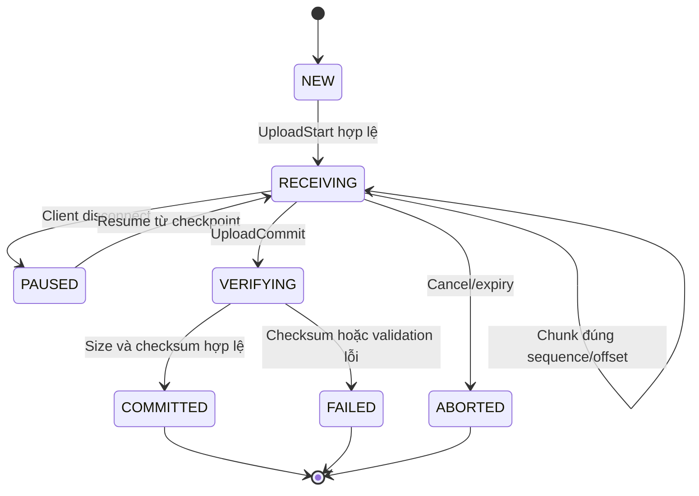

# Large message và chunking

gRPC truyền dữ liệu theo message Protobuf trên HTTP/2. Một message lớn có thể thuận tiện cho API, nhưng làm tăng memory cần để serialize, buffer, nhận, giải nén và parse; đồng thời phải nằm trong giới hạn inbound message size của peer. Với payload lớn như file, ảnh gốc, bản sao lưu hoặc tập dữ liệu, **chunking** thường giúp giới hạn memory, tạo backpressure và hỗ trợ resume khi kết nối bị gián đoạn.

Trong **SPRING_GRPC**, lựa chọn giữa một message lớn và nhiều chunk cần dựa trên kích thước payload, latency, throughput, giới hạn transport, khả năng downstream và yêu cầu phục hồi. Streaming không tự chia nhỏ một message lớn: mỗi lần gọi onNext vẫn gửi một gRPC message riêng, và message đó vẫn phải đáp ứng giới hạn của phía nhận. Muốn truyền payload lớn an toàn, application phải định nghĩa chunk contract và quản lý vòng đời upload/download.

## 1. Vì sao message lớn có thể gây vấn đề?

Một message Protobuf lớn tạo chi phí ở nhiều tầng:

- **Application heap:** byte array, Protobuf object và bản sao trung gian.
- **Serialization:** tạo encoded payload trước khi gửi.
- **Transport buffers:** gRPC/HTTP/2/Netty giữ dữ liệu đang chờ ghi hoặc đang nhận.
- **TLS/compression:** buffer mã hóa, giải mã, nén và giải nén.
- **Deserialization:** receiver tạo object graph từ payload.
- **Downstream:** database, object storage hoặc file system có thể cần buffer riêng.

Nếu một service nhận đồng thời 40 message, mỗi message 16 MiB, riêng payload thô đã tương đương 640 MiB trước khi tính object overhead, bản sao và transport buffers. Khi nhiều RPC cùng chạy, memory peak có thể vượt xa kích thước file gốc.

Message lớn còn làm tăng thời gian xử lý một đơn vị công việc. Một RPC có thể phải đợi serialize hoặc parse toàn bộ payload trước khi application sử dụng được nội dung. Khi cần xử lý tuần tự, xác nhận từng phần hoặc resume, một message duy nhất cũng khó quản lý hơn nhiều chunk.

## 2. Giới hạn message size trong gRPC

gRPC đặt giới hạn kích thước message nhận ở endpoint. Trong gRPC Java, có thể cấu hình inbound message size bằng API builder, ví dụ:

```java
ManagedChannel channel = NettyChannelBuilder
    .forAddress("files.internal", 8443)
    .useTransportSecurity()
    .maxInboundMessageSize(4 * 1024 * 1024)
    .build();
```

Ở server, builder tương ứng cũng có thể cấu hình giới hạn inbound:

```java
Server server = NettyServerBuilder
    .forPort(9090)
    .maxInboundMessageSize(4 * 1024 * 1024)
    .addService(objectTransferService)
    .build()
    .start();
```

Giá trị 4 MiB chỉ là ví dụ cấu hình. Giá trị mặc định và API khả dụng phụ thuộc gRPC Java version/transport. Phải kiểm tra đúng phiên bản và cấu hình ở **phía nhận**: server giới hạn request inbound; client giới hạn response inbound. Giới hạn này áp dụng cho từng gRPC message, không phải tổng kích thước của toàn bộ stream.

Tăng max inbound size không phải cách tối ưu mặc định. Nó cho phép một message lớn hơn đi vào process, đồng thời làm tăng lượng memory có thể bị tiêu thụ bởi một request. Chỉ tăng khi contract thực sự cần message lớn và đã có memory budget, quota, timeout cùng kiểm thử tải phù hợp.

## 3. Khi nào nên dùng chunking?

Chunking chia một payload logic thành các phần nhỏ hơn. Mỗi chunk là một gRPC message độc lập trong streaming RPC.

Nên cân nhắc chunking khi:

- Payload có thể vượt giới hạn message size.
- Không muốn giữ toàn bộ file trong heap.
- Muốn ghi dữ liệu tăng dần vào file hoặc object storage.
- Cần backpressure để consumer chậm có thể điều tiết producer.
- Cần xác nhận tiến độ, retry một phần hoặc resume sau reconnect.
- Muốn giới hạn memory theo số chunk đang in-flight.

Một message đơn lẻ vẫn phù hợp nếu payload nhỏ, giới hạn rõ, được xử lý nguyên tử và không cần resume. Chunking tạo thêm protocol state, sequence, checksum, commit và xử lý lỗi; không nên thêm nếu nó không giải quyết yêu cầu thực tế.

## 4. Chọn chunk size

Chunk quá lớn và quá nhỏ đều có chi phí:

| Chunk size | Ưu điểm | Nhược điểm |
| --- | --- | --- |
| Nhỏ | Memory mỗi chunk thấp, retry ít dữ liệu, dễ phản hồi tiến độ | Nhiều message, callback, framing và metadata; overhead CPU tăng |
| Vừa | Cân bằng memory, throughput và số lần gửi | Cần benchmark theo network và storage |
| Lớn | Giảm số message và có thể tăng hiệu quả ghi theo lô | Tăng memory in-flight, latency mỗi chunk và chi phí retry |

Có thể bắt đầu benchmark với chunk khoảng 256 KiB, 512 KiB hoặc 1 MiB, nhưng đây chỉ là điểm thử, không phải giá trị chuẩn. Chọn chunk dựa trên:

- Inbound message limit của cả client và server.
- Protobuf wrapper fields và serialized overhead.
- Số stream đồng thời.
- HTTP/2 flow-control window và bandwidth-delay product.
- Memory budget cho mỗi stream.
- Kích thước block phù hợp với object storage/file system.
- Thời gian chấp nhận được để retry một chunk.

Chunk phải nhỏ hơn giới hạn inbound message size với khoảng dự phòng cho metadata trong Protobuf message. Không đặt chunk bằng đúng max limit vì thay đổi schema hoặc thêm field có thể làm serialized size vượt ngưỡng.

## 5. Thiết kế Protobuf contract cho upload

Một giao thức upload nên mô tả rõ bắt đầu, chunk và hoàn tất. Ví dụ dùng client-streaming:

```protobuf
syntax = "proto3";

package transfer.v1;

service ObjectTransfer {
  rpc Upload(stream UploadFrame) returns (UploadResult);
  rpc GetUploadStatus(UploadStatusRequest) returns (UploadStatus);
  rpc Download(DownloadRequest) returns (stream DownloadChunk);
}

message UploadFrame {
  oneof frame {
    UploadStart start = 1;
    UploadChunk chunk = 2;
    UploadCommit commit = 3;
  }
}

message UploadStart {
  string upload_id = 1;
  string object_name = 2;
  uint64 total_size = 3;
  bytes expected_sha256 = 4;
  string idempotency_key = 5;
}

message UploadChunk {
  uint64 sequence = 1;
  uint64 offset = 2;
  bytes data = 3;
  bytes chunk_sha256 = 4;
}

message UploadCommit {
  uint64 total_chunks = 1;
  bytes final_sha256 = 2;
}

message UploadResult {
  string object_id = 1;
  uint64 committed_size = 2;
  bytes final_sha256 = 3;
}

message UploadStatusRequest {
  string upload_id = 1;
}

message UploadStatus {
  uint64 next_sequence = 1;
  uint64 committed_offset = 2;
  bool completed = 3;
}

message DownloadRequest {
  string object_id = 1;
  uint64 start_offset = 2;
}

message DownloadChunk {
  uint64 sequence = 1;
  uint64 offset = 2;
  bytes data = 3;
  bytes chunk_sha256 = 4;
  bool last = 5;
}
```

Đây là contract minh họa. Production cần xác định rõ quyền sở hữu upload_id, thời hạn session, giới hạn total_size, quy tắc sequence/offset, checksum algorithm và semantics của commit. Không dùng object_name làm đường dẫn filesystem trực tiếp; cần validate và phân quyền đối tượng đích.

oneof giúp server phân biệt frame khởi tạo, dữ liệu và commit. Server nên từ chối chunk trước start, commit sai thứ tự hoặc frame không phù hợp trạng thái session.

## 6. State machine của upload

Upload nên được quản lý như một state machine có trạng thái bền vững:



Một luồng xử lý cơ bản:

1. Xác thực caller và kiểm tra quyền ghi object.
2. Kiểm tra total_size, quota, upload_id và idempotency key.
3. Tạo staging object/file và lưu trạng thái RECEIVING.
4. Nhận chunk theo sequence/offset; kiểm tra kích thước và checksum.
5. Ghi chunk vào storage, chỉ cập nhật checkpoint sau khi dữ liệu được lưu bền vững.
6. Khi nhận commit, kiểm tra tổng size, số chunk và checksum toàn object.
7. Promote staging object thành object chính theo thao tác atomic phù hợp storage.
8. Trả UploadResult sau khi commit đã hoàn tất theo semantics đã công bố.

Không đánh dấu checkpoint trước khi dữ liệu chunk đã được persist. Nếu server crash giữa lúc ghi và cập nhật metadata, cần có cơ chế recovery để đối chiếu staging object với checkpoint.

## 7. Sequence, offset và checksum

Mỗi chunk nên có:

- **Sequence:** số thứ tự tăng dần, thường bắt đầu từ 0.
- **Offset:** vị trí byte đầu tiên của chunk trong object.
- **Data:** bytes của chunk.
- **Chunk checksum:** kiểm tra nội dung chunk.

Server xác minh sequence và offset theo checkpoint hiện tại. Nếu đang chờ sequence 12 tại offset 6 MiB, chunk tiếp theo phải khớp quy tắc đó. Chunk thiếu, trùng hoặc overlap phải được xử lý theo semantics rõ ràng.

Checksum từng chunk phát hiện lỗi cục bộ và hỗ trợ retry. Checksum toàn object xác nhận dữ liệu cuối cùng khớp nội dung mong đợi. SHA-256 thường phù hợp cho kiểm tra integrity; không dùng checksum thay cho authentication hoặc authorization.

TLS bảo vệ dữ liệu trên đường truyền, còn checksum end-to-end giúp phát hiện lỗi ở tầng ứng dụng/storage và xác minh object sau khi ghép. Nếu cần chống giả mạo từ caller không đáng tin, server phải tự xác minh checksum và quyền truy cập; checksum do client gửi không tự chứng minh dữ liệu hợp lệ.

## 8. Upload một chiều hay hai chiều?

**Client-streaming** phù hợp khi client gửi nhiều chunk và chỉ cần một kết quả tổng cuối cùng. Server nhận stream, ghi dần dữ liệu và trả UploadResult khi client hoàn tất.

**Bidirectional streaming** phù hợp khi cần acknowledgement hoặc tiến độ theo từng chunk. Client gửi chunk; server có thể trả ack chứa sequence/offset đã persist. Điều này giúp client giới hạn số chunk đang in-flight và resume chính xác hơn.

| Yêu cầu | RPC phù hợp |
| --- | --- |
| Gửi nhiều chunk, chỉ cần kết quả cuối | Client-streaming |
| Ack từng chunk hoặc báo tiến độ | Bidirectional streaming |
| Tải dữ liệu từ server theo chunk | Server-streaming |
| Gửi/nhận đồng thời theo protocol tương tác | Bidirectional streaming |

Nếu dùng client-streaming nhưng chỉ có response cuối, client không thể biết chính xác checkpoint server đã persist trước khi connection đứt. Có thể bổ sung GetUploadStatus để truy vấn checkpoint sau reconnect. Nếu cần ack tức thời trên cùng call, chọn bidi streaming.

## 9. Backpressure khi gửi chunk

Chunking giới hạn kích thước từng message, nhưng không tự giới hạn số chunk đang được tạo hoặc xếp hàng. Client có thể đọc toàn bộ file, tạo hàng nghìn byte array rồi giữ trong queue; memory vẫn tăng theo kích thước file.

Ở client gRPC Java, ClientResponseObserver cho phép lấy ClientCallStreamObserver trong beforeStart. Client có thể dùng isReady() và setOnReadyHandler() để chỉ gửi khi stream sẵn sàng:

```java
ClientResponseObserver<UploadFrame, UploadResult> responseObserver =
    new ClientResponseObserver<>() {
        private ClientCallStreamObserver<UploadFrame> requestStream;

        @Override
        public void beforeStart(
                ClientCallStreamObserver<UploadFrame> stream) {
            this.requestStream = stream;
            stream.setOnReadyHandler(this::scheduleDrain);
        }

        @Override
        public void onNext(UploadResult result) {
            handleUploadResult(result);
        }

        @Override
        public void onError(Throwable error) {
            handleUploadFailure(error);
        }

        @Override
        public void onCompleted() {
            markUploadComplete();
        }

        private void scheduleDrain() {
            uploadSenderExecutor.execute(this::drainWhenReady);
        }

        private void drainWhenReady() {
            while (requestStream.isReady() && hasNextFrame()) {
                requestStream.onNext(nextFrame());
            }
            if (!hasNextFrame() && !completedInput) {
                completedInput = true;
                requestStream.onCompleted();
            }
        }
    };

asyncStub.upload(responseObserver);
```

Đây là skeleton để minh họa readiness. nextFrame không nên đọc file hoặc thực hiện I/O blocking ngay trong readiness callback; hãy dùng bounded producer/queue và executor chuyên dụng. scheduleDrain cần chống chạy đồng thời nhiều drain loop, bảo đảm thứ tự frame và xử lý rejection/cancellation. hasNextFrame cũng cần phản ánh trạng thái producer đã kết thúc, tránh gọi onCompleted khi dữ liệu còn đang được đọc.

isReady() không phải acknowledgement rằng server đã persist chunk. Nếu cần biết chunk đã được lưu, protocol phải trả ack hoặc cho phép truy vấn checkpoint.

## 10. Manual inbound demand ở server

Server có thể dùng manual inbound flow control để chỉ nhận thêm chunk sau khi chunk hiện tại đã được xử lý hoặc persist. Trong gRPC Java, response observer phía server có thể được cast thành ServerCallStreamObserver, tắt auto request và gọi request(n).

Ví dụ khung:

```java
public StreamObserver<UploadFrame> upload(
        StreamObserver<UploadResult> responseObserver) {

    ServerCallStreamObserver<UploadResult> call =
        (ServerCallStreamObserver<UploadResult>) responseObserver;
    call.disableAutoRequest();

    UploadSession session = uploadService.openSession();
    call.request(1);

    return new StreamObserver<>() {
        @Override
        public void onNext(UploadFrame frame) {
            session.acceptAndPersist(frame);
            call.request(1);
        }

        @Override
        public void onError(Throwable error) {
            session.pauseOrAbort(error);
        }

        @Override
        public void onCompleted() {
            UploadResult result = session.verifyAndCommit();
            responseObserver.onNext(result);
            responseObserver.onCompleted();
        }
    };
}
```

Đây là skeleton đồng bộ. Trong production, acceptAndPersist có thể cần offload sang bounded I/O executor. Chỉ gọi request(1) sau khi chunk đã được persist hoặc được đưa vào queue bounded còn capacity. Khi chuyển sang async processing, phải serialize state transition, xử lý lỗi, cancel và completion; không gọi request thêm sau khi stream đóng.

Nếu dùng bidi streaming để gửi ack, server cũng cần điều tiết outbound response bằng readiness. Cả hai hướng phải có queue hữu hạn và semantics rõ ràng.

## 11. Resume sau reconnect

Một upload lớn có thể mất kết nối sau khi server đã persist một phần. Thay vì gửi lại từ đầu, client có thể:

1. Giữ upload_id và idempotency key ổn định.
2. Gọi GetUploadStatus sau reconnect.
3. Nhận next_sequence và committed_offset đã persist.
4. Mở stream upload mới và gửi tiếp từ offset đó.
5. Gửi commit khi toàn bộ dữ liệu đã được truyền.

Server chỉ xác nhận offset đã persist bền vững. Nếu chunk cuối đã ghi nhưng checkpoint chưa cập nhật, recovery phải xác định được dữ liệu đó để tránh append trùng. Có thể lưu chunk metadata và checkpoint trong một transaction hoặc dùng manifest/staging protocol phù hợp storage.

Không coi reconnect transport là resume tự động. Một gRPC stream đã đóng không tiếp tục từ vị trí cũ; application phải mở RPC mới và khôi phục state bằng protocol.

## 12. Retry và idempotency

Nếu client gửi chunk nhưng không nhận được ack, trạng thái commit có thể không rõ: server có thể đã persist chunk trước khi connection đứt. Retry phải an toàn:

- Giữ nguyên upload_id, sequence, offset và chunk checksum.
- Server nhận diện chunk trùng đã persist và trả lại checkpoint/ack phù hợp.
- Chunk có cùng sequence nhưng khác checksum phải bị từ chối.
- Chunk có offset overlap hoặc gap phải được xử lý theo quy tắc đã định nghĩa.
- Commit lặp lại phải trả kết quả nhất quán nếu object đã committed.

Đây thường là semantics at-least-once với deduplication/idempotency, không phải exactly-once tự nhiên của gRPC. Không retry operation có side effect nếu server không có idempotency key hoặc deduplication state.

Retry phải tuân thủ deadline, retry budget và backoff. Nếu server trả lỗi validation hoặc permission, client không nên retry vô hạn.

## 13. Download theo chunk

Server-streaming phù hợp khi server đọc object từ storage theo block và phát từng DownloadChunk. Server không cần đọc toàn bộ file vào byte array trước khi trả response.

Quy trình:

1. Xác thực quyền đọc object và kiểm tra offset.
2. Mở stream đọc từ storage tại offset yêu cầu.
3. Đọc một block có giới hạn.
4. Tạo chunk với sequence, offset và checksum.
5. Chỉ tiếp tục đọc khi gRPC stream ready và application queue còn capacity.
6. Đóng file/storage stream khi hoàn tất, lỗi hoặc client cancel.

Client có thể ghi chunk trực tiếp vào file tạm, kiểm tra sequence/offset/checksum rồi atomic rename sau khi xác minh final checksum. Nếu download cần resume, client gửi start_offset đã ghi bền vững trong request mới.

Không phát toàn bộ file bằng cách tạo một List<DownloadChunk> trong heap. Đọc tuần tự, phát theo readiness và giải phóng buffer sau khi chunk được tiêu thụ.

## 14. Chunking và memory budget

Memory peak phụ thuộc ít nhất vào:

\[
M_{peak} \approx M_{base}
 + N_{streams}\times
   (B_{inflight}+B_{queue}+B_{working})
 + M_{shared}
\]

Trong đó:

- \(N_{streams}\): số stream upload/download đồng thời.
- \(B_{inflight}\): dữ liệu đang chờ transport hoàn tất.
- \(B_{queue}\): dữ liệu đang nằm trong application queue.
- \(B_{working}\): buffer đang được ghi/đọc hoặc xử lý.
- \(M_{shared}\): JVM, Spring, connection pool, cache và memory dùng chung.

Ví dụ, 100 stream có queue tối đa 4 chunk, mỗi chunk 512 KiB. Riêng queue payload có thể đạt khoảng 200 MiB, chưa tính in-flight transport, object overhead, byte copies, TLS và direct memory. Vì vậy, giới hạn chunk size nhưng không giới hạn số chunk queued vẫn chưa đủ.

Đặt giới hạn đồng thời theo stream, tổng bytes, số chunk pending và storage capacity. Dùng buffer tái sử dụng khi phù hợp, nhưng không chia sẻ mutable byte array giữa các stream nếu có thể bị ghi đè trước khi transport hoàn tất.

## 15. Storage strategy: staging và commit

Không nên append trực tiếp dữ liệu upload chưa xác thực vào object cuối cùng. Một chiến lược an toàn hơn:

- Ghi vào staging object hoặc temporary file gắn với upload_id.
- Lưu manifest gồm sequence, offset, length, checksum và checkpoint.
- Chỉ cập nhật committed_offset sau khi chunk được persist.
- Khi nhận commit, kiểm tra total_size và final checksum.
- Promote staging object bằng thao tác atomic phù hợp storage.
- Dọn staging object hết hạn hoặc upload bị abort.

Với object storage hỗ trợ multipart upload, cân nhắc dùng multipart API của storage và lưu part number/ETag/checksum. gRPC chunk không nhất thiết phải có cùng kích thước với storage part; mapping giữa hai tầng cần được quản lý rõ.

Nếu storage không hỗ trợ atomic rename/commit, cần thiết kế manifest hoặc trạng thái visibility để consumer không đọc object chưa hoàn chỉnh.

## 16. Deadline, cancellation và quota

Upload/download lớn có thể kéo dài hơn RPC thông thường. Đặt deadline theo kích thước dự kiến, throughput tối thiểu và giới hạn nghiệp vụ. Không bỏ deadline hoàn toàn; session có thể có TTL riêng để giữ checkpoint qua reconnect.

Khi client cancel:

- Dừng đọc file hoặc producer.
- Dừng ghi chunk mới.
- Hủy task pending nếu có thể.
- Đóng file handle/storage stream.
- Giữ checkpoint đã persist nếu hỗ trợ resume; nếu không thì abort và cleanup.

Áp dụng quota cho:

- Tổng object size.
- Số upload đồng thời theo caller/tenant.
- Tổng bytes đang staging.
- Số chunk và tốc độ upload.
- Thời gian session tồn tại.
- Dung lượng lưu trữ và thời hạn staging.

Kiểm tra authentication/authorization trước khi cấp phát staging storage. Không tin total_size hoặc object_name do client gửi mà chưa validate.

## 17. Benchmark chunk size và throughput

Benchmark cần so sánh nhiều chunk size với cùng file, network, TLS và storage:

| Thử nghiệm | Chunk size | Mục tiêu |
| --- | ---: | --- |
| A | 64 KiB | Xem overhead khi chunk nhỏ |
| B | 256 KiB | Điểm so sánh thấp |
| C | 512 KiB | Điểm so sánh trung bình |
| D | 1 MiB | Kiểm tra chunk lớn hơn |
| E | 2 MiB | Đánh giá memory/latency và giới hạn |

Đây là ma trận thử nghiệm, không phải khuyến nghị cố định. Mỗi run cần đo:

- Payload goodput (MiB/s) và số chunk/s.
- End-to-end upload/download duration.
- Latency mỗi chunk và ack latency.
- CPU client/server, allocation rate, GC pause.
- Heap, direct memory và RSS.
- Active streams, in-flight bytes và queue bytes.
- Retry count, checksum failure và resume duration.
- Storage write/read throughput và latency.

Chạy warm-up, tăng dần số stream và giữ tải đủ lâu để quan sát memory ổn định. Một chunk size cho throughput cao nhất ở một stream có thể gây memory peak lớn khi có 100 stream đồng thời. Đánh giá cả throughput tổng và giới hạn tài nguyên ở concurrency production.

## 18. Observability và chẩn đoán

Các metric hữu ích:

| Metric | Ý nghĩa |
| --- | --- |
| Chunk size histogram | Phân bố kích thước chunk thực tế |
| Chunks/bytes sent and persisted | Phân biệt gửi với dữ liệu đã lưu |
| Upload/download throughput | Goodput theo object hoặc method |
| Active transfer sessions | Số phiên đang mở |
| In-flight/queued bytes | Áp lực memory |
| Flow-control wait/readiness | Producer bị điều tiết bao lâu |
| Checkpoint/ack latency | Thời gian từ gửi đến persist/ack |
| Resume/retry count | Mức độ gián đoạn và phục hồi |
| Checksum/sequence errors | Lỗi integrity/protocol |
| Staging bytes and expired sessions | Tài nguyên tạm và cleanup |
| Heap/direct memory/RSS | Memory thực tế của process |
| Storage latency/errors | Bottleneck ở tầng lưu trữ |

Không dùng upload_id, object_id hoặc user_id làm metric label có cardinality cao. Dùng trace/log có kiểm soát để điều tra từng transfer; không ghi payload hoặc credential.

## 19. Những lỗi thiết kế thường gặp

| Sai lầm | Hậu quả | Cách làm tốt hơn |
| --- | --- | --- |
| Tăng maxInboundMessageSize để gửi file lớn nguyên khối | Memory peak cao và request dễ gây OOM | Chia payload thành chunk có giới hạn |
| Nghĩ streaming tự chia nhỏ một message | Một onNext vẫn có thể vượt message limit | Định nghĩa chunk message trong Protobuf |
| Đọc toàn bộ file vào byte array | Heap tăng theo file size | Đọc/ghi theo block |
| Queue chunk không giới hạn | Memory tăng theo tốc độ producer | Bounded queue theo count và bytes |
| Chỉ kiểm tra sequence, không kiểm tra offset/checksum | Có thể ghép sai hoặc nhận dữ liệu hỏng | Xác minh sequence, offset và integrity |
| Ack trước khi persist | Client tưởng dữ liệu đã an toàn nhưng server crash có thể làm mất | Ack sau durable checkpoint |
| Retry chunk với ID mới | Duplicate hoặc append lặp | Idempotency theo upload_id/sequence |
| Reconnect và gửi lại từ đầu | Tốn bandwidth và storage I/O | Query checkpoint và resume |
| Không cleanup khi cancel/expiry | Staging file và buffer bị giữ lâu | TTL, abort và cleanup job |
| Chỉ benchmark một stream | Không thấy memory peak ở concurrency | Test nhiều stream và tổng bytes in-flight |

## 20. Checklist production

Trước khi phát hành API truyền payload lớn, hãy xác nhận:

1. **Message limit:** inbound size được cấu hình đúng ở client/server.
2. **Chunk contract:** có upload/session ID, sequence, offset, data và checksum.
3. **Chunk size:** có khoảng dự phòng dưới message limit.
4. **Streaming mode:** chọn client-streaming hay bidi theo nhu cầu ack.
5. **Backpressure:** client readiness và server inbound demand được điều tiết.
6. **Memory:** queue giới hạn cả item count lẫn bytes; không buffer toàn object.
7. **Integrity:** kiểm tra checksum chunk và final object.
8. **Durability:** checkpoint/ack chỉ xác nhận dữ liệu đã persist theo semantics.
9. **Resume:** reconnect dùng upload_id và committed_offset/next_sequence.
10. **Idempotency:** retry chunk/commit không tạo duplicate.
11. **Storage:** dùng staging và commit/promote object sau khi verify.
12. **Cancellation:** đóng file/storage handle, dừng producer và xử lý staging.
13. **Quota:** giới hạn total size, concurrent sessions, staged bytes và TTL.
14. **Benchmark:** đo chunk size ở nhiều concurrency với TLS và storage thật.
15. **Observability:** theo dõi goodput, in-flight bytes, ack, resume, checksum và memory.

## 21. Ghi nhớ

Message lớn làm tăng memory và chi phí serialize/parse; tăng inbound message limit chỉ chuyển thêm rủi ro vào receiver. Với payload lớn, chunking tạo đơn vị truyền có giới hạn, cho phép xử lý tuần tự, backpressure, checksum, retry và resume. Mỗi chunk vẫn là một gRPC message riêng và phải nằm dưới message-size limit của peer.

Trong Spring gRPC, thiết kế contract có upload_id, sequence, offset, checksum và commit semantics; ghi vào staging storage và chỉ ack sau khi persist. Dùng client-streaming nếu chỉ cần kết quả cuối, bidi nếu cần ack theo chunk; áp dụng readiness/manual demand và bounded queue theo cả số lượng lẫn byte. Resume phải dựa trên checkpoint bền vững và idempotency, vì reconnect không tự tiếp tục stream cũ. Benchmark chunk size cùng concurrency, TLS, storage, throughput, p95/p99 và memory peak trước khi chọn cấu hình production.

### Tài liệu tham khảo

- [gRPC – Flow control](https://grpc.io/docs/guides/flow-control/)
- [gRPC – Performance](https://grpc.io/docs/guides/performance/)
- [gRPC Java – API documentation](https://grpc.github.io/grpc-java/javadoc/)
- [Protocol Buffers – Language Guide (proto3)](https://protobuf.dev/programming-guides/proto3/)
- [Netty – Reference counted objects](https://netty.io/wiki/reference-counted-objects.html)
