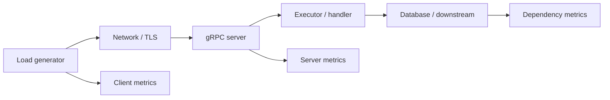
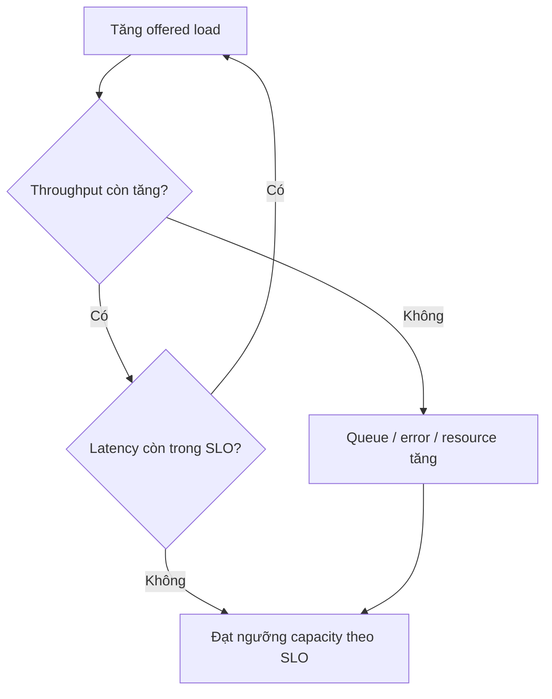

# Benchmark client-server

**Benchmark client-server** là phép đo có kiểm soát hiệu năng của một dịch vụ gRPC khi client gửi RPC tới server qua transport thực tế. Mục tiêu không chỉ là tìm số request mỗi giây cao nhất, mà còn xác định latency, throughput bền vững, mức sử dụng tài nguyên và điểm hệ thống bắt đầu bão hòa.

Trong **SPRING_GRPC**, benchmark cần phản ánh đúng kiểu RPC, payload Protobuf, TLS, compression, channel reuse, executor, downstream và topology triển khai. Một phép đo chỉ chạy client và server trên cùng máy, bỏ TLS hoặc dùng một request rất nhỏ có thể hữu ích để kiểm tra nhanh, nhưng không đại diện cho production nếu môi trường thật khác biệt.

## 1. Benchmark trả lời câu hỏi nào?

Trước khi chạy tải, hãy xác định quyết định kỹ thuật cần đưa ra:

- Một server instance xử lý được bao nhiêu RPC/s trong khi vẫn đạt latency SLO?
- Latency p95/p99 tăng ở mức concurrency hoặc arrival rate nào?
- Client, network, server executor hay downstream là bottleneck?
- Channel reuse, TLS hoặc compression ảnh hưởng ra sao?
- Unary và streaming có giới hạn throughput khác nhau thế nào?
- Cần bao nhiêu replica để phục vụ tải dự kiến và headroom?
- Khi quá tải, service từ chối request có kiểm soát hay queue tăng vô hạn?

Benchmark tốt bắt đầu bằng giả thuyết có thể kiểm chứng. Ví dụ: “Khi tăng concurrency từ 40 lên 80, throughput sẽ tăng nhưng p99 vẫn dưới 150 ms; nếu p99 vượt ngưỡng, cần xác định executor hay database đã bão hòa.” Giả thuyết này định hướng workload, metric và ngưỡng dừng.

## 2. Phân biệt benchmark, load test và stress test

Các loại kiểm thử có mục đích liên quan nhưng khác nhau:

| Loại kiểm thử | Mục tiêu | Kết quả cần thu |
| --- | --- | --- |
| Microbenchmark | Đo một thao tác nhỏ như serialize Protobuf, mapping hoặc checksum | Thời gian/op, allocation và CPU |
| Client-server benchmark | Đo RPC qua network giữa client và server | Latency, throughput, lỗi và tài nguyên hai phía |
| Load test | Kiểm tra service ở tải mục tiêu trong một khoảng thời gian | SLO, ổn định, queue và resource usage |
| Stress test | Tăng tải vượt năng lực dự kiến để tìm điểm gãy | Saturation point, failure mode và recovery |
| Soak test | Giữ tải ổn định trong thời gian dài | Memory leak, GC, connection churn và suy giảm theo thời gian |

JMH phù hợp cho microbenchmark trong JVM, chẳng hạn so sánh cách tạo Protobuf message hoặc transform payload. JMH không thay thế benchmark end-to-end vì không tự đo đầy đủ TCP, HTTP/2, TLS, network và server scheduling.

## 3. Xác định workload đại diện

Một workload phải mô tả rõ loại RPC, kích thước request/response, tần suất và phân bố dữ liệu. Không dùng một method nhỏ làm đại diện cho toàn bộ service nếu production có nhiều kiểu traffic.

| Kiểu RPC | Workload cần mô phỏng | Chỉ số đặc thù |
| --- | --- | --- |
| Unary | Một request, một response; tỷ lệ payload nhỏ/vừa/lớn | RPC/s, latency và error rate |
| Server-streaming | Một request mở stream và nhận nhiều response | Active streams, messages/s, bytes/s và stream duration |
| Client-streaming | Client gửi nhiều message, server trả kết quả cuối | Chunks/s, payload goodput và thời gian hoàn tất |
| Bidirectional streaming | Hai phía gửi/nhận đồng thời | Messages/s mỗi hướng, backpressure, queue và latency message |

Với mỗi method, ghi lại:

- Request và response serialized size.
- Phân bố payload, không chỉ một kích thước cố định.
- Tỷ lệ request hợp lệ, lỗi nghiệp vụ và cache hit/miss.
- Thời gian xử lý CPU và thời gian chờ dependency.
- Số RPC hoặc stream đồng thời.
- Deadline và timeout thực tế.
- Có compression, authentication, metadata hoặc interceptor nào trong đường đi.

Workload synthetic có thể dùng để cô lập chi phí gRPC. Workload end-to-end cần đi qua database, cache hoặc object storage giống production để tìm bottleneck toàn hệ thống. Nên phân biệt hai kết quả này trong báo cáo.

## 4. Chuẩn bị topology benchmark

Tốt nhất chạy load generator và server trên các máy hoặc container riêng để tránh client tranh CPU, memory và network với server. Nếu cả hai chạy trên cùng host, CPU saturation của load generator có thể bị nhầm là giới hạn server.



Trước khi chạy, ghi nhận:

- CPU quota, memory limit và số replica của client/server.
- JDK, gRPC Java, Spring gRPC starter và transport implementation.
- JVM options, GC collector và heap size.
- TLS certificate chain, cipher/protocol và authentication path.
- Compression algorithm và message-size limits.
- Channel count, load-balancing policy và connection reuse.
- Database pool, cache, storage và downstream limits.
- Network RTT, bandwidth, packet loss và vị trí các workload.

Giữ topology và cấu hình nhất quán giữa các lần so sánh. Nếu thay đổi TLS, payload hoặc database cùng lúc, sẽ khó xác định yếu tố nào tạo ra khác biệt.

## 5. Tách cold start và steady state

RPC đầu tiên có thể chịu thêm chi phí:

- JVM class loading và JIT compilation.
- Spring bean initialization hoặc lazy initialization.
- DNS resolution và TCP/TLS handshake.
- HTTP/2 connection establishment.
- Connection pool hoặc cache warm-up.
- Tạo serializer, reflection metadata và buffer ban đầu.

Không gộp các request warm-up vào kết quả steady-state nếu mục tiêu là đo năng lực ổn định. Hãy đo riêng cold-start latency nếu ứng dụng cần scale-to-zero, autoscaling nhanh hoặc thường xuyên tạo instance mới.

Một run điển hình có các pha:

1. Khởi động server và chờ readiness.
2. Tạo channel, xác minh TLS và warm-up các RPC cần đo.
3. Tăng tải từ thấp lên mức mục tiêu.
4. Giữ tải ổn định để thu steady-state metrics.
5. Tăng tải qua các mức để tìm saturation.
6. Giảm tải và quan sát khả năng phục hồi.

Thời lượng warm-up không nên chọn máy móc. Chờ tới khi throughput, CPU và latency ổn định; JVM có thể cần nhiều thời gian hơn với workload phức tạp.

## 6. Closed-loop và open-loop load

Hai mô hình phát tải có thể tạo ra kết quả rất khác:

**Closed-loop:** mỗi virtual user gửi request mới sau khi request trước hoàn tất. Số request đang chạy được kiểm soát bởi số worker. Khi server chậm, tốc độ gửi tự giảm.

**Open-loop:** load generator lên lịch request theo arrival rate mục tiêu, ví dụ 2.000 request/s, bất kể request trước đã hoàn tất hay chưa. Mô hình này giúp quan sát queueing khi offered load cao hơn năng lực xử lý.

| Mô hình | Ưu điểm | Hạn chế |
| --- | --- | --- |
| Closed-loop | Dễ kiểm soát concurrency và ổn định tải | Khi server chậm, offered load giảm; có thể che khuất queueing |
| Open-loop | Giữ arrival rate, phù hợp mô phỏng traffic theo thời gian | Cần kiểm soát scheduler của load generator và backlog phía client |

Closed-loop có thể gặp **coordinated omission**: khi server chậm, client chờ response rồi mới gửi request tiếp theo, nên những khoảng thời gian lẽ ra có request đến đã không được ghi nhận. Kết quả latency có thể lạc quan hơn trải nghiệm của traffic thực. Open-loop giúp tránh một phần sai lệch này, nhưng phải đo cả thời điểm request được lên lịch và thời điểm thực sự được gửi.

Trong thực tế, nên dùng cả hai:

- Closed-loop để so sánh năng lực ở các mức concurrency cố định.
- Open-loop để kiểm tra SLO tại arrival rate mục tiêu và tìm điểm queue bắt đầu tăng.

## 7. Concurrency không giống throughput

Concurrency là số RPC hoặc stream đang hoạt động cùng lúc. Throughput là số công việc hoàn tất trong một đơn vị thời gian. Tăng concurrency có thể tăng throughput cho tới khi tài nguyên bão hòa; sau điểm đó, queue và latency tăng nhưng throughput gần như không tăng.

Định luật Little cung cấp quan hệ cơ bản:

\[
L = \lambda \times W
\]

Trong đó:

- \(L\): số request trung bình đang ở trong hệ thống.
- \(\lambda\): throughput trung bình, tính bằng request/s.
- \(W\): thời gian trung bình trong hệ thống, tính bằng giây.

Ví dụ, nếu hệ thống hoàn tất 500 RPC/s và thời gian trung bình trong hệ thống là 0,1 giây, số RPC trung bình đang tồn tại là khoảng 50. Công thức này giúp kiểm tra tính nhất quán của số liệu; nó không thay thế việc đo queue, active calls và latency distribution.

Với streaming, phải phân biệt:

- Active streams: số stream đang mở.
- Messages/s: số message được gửi hoặc xử lý mỗi giây.
- Bytes/s: lượng dữ liệu truyền.
- Completed streams/s: số stream hoàn tất mỗi giây.

Một bidi stream có thể sống nhiều phút và gửi hàng nghìn message. Chỉ đo completed streams/s sẽ không phản ánh đủ throughput của stream.

## 8. Đo latency đúng cách

Latency cần đo ở phía client để phản ánh thời gian caller thực sự chờ. Với unary RPC, đo từ lúc client bắt đầu call tới lúc nhận response hoặc lỗi. Với streaming, xác định rõ đang đo:

- Thời gian mở stream tới khi stream sẵn sàng.
- Latency từ lúc gửi một message tới lúc nhận acknowledgement tương ứng.
- Khoảng cách giữa các message response.
- Thời gian hoàn tất toàn stream.

Không dùng một con số latency chung cho các semantics khác nhau. Với upload client-streaming, latency hoàn tất toàn call khác với latency xử lý từng chunk.

Luôn báo cáo phân vị:

- p50: trải nghiệm của request điển hình.
- p90/p95: phần đuôi đáng kể của phân bố.
- p99/p99.9: tail latency, nơi thường lộ ra queueing và contention.
- Max: hữu ích để phát hiện outlier, nhưng nhạy với thời lượng và số mẫu.

Average latency có thể che giấu tail latency. Ví dụ, đa số request mất 20 ms nhưng một phần nhỏ mất 2 giây; average có thể vẫn trông chấp nhận được trong khi người dùng gặp timeout.

Đo duration bằng monotonic clock ở cùng process, chẳng hạn System.nanoTime trong Java, thay vì trừ hai wall-clock timestamp có thể bị điều chỉnh. Nếu cần đối chiếu event giữa client và server, đồng bộ clock và hiểu sai số thời gian giữa các host.

## 9. Throughput, goodput và error rate

Không đồng nhất số request được gửi với số request xử lý thành công:

- **Offered load:** số RPC client định gửi trong một giây.
- **Attempted RPC/s:** số RPC thực sự bắt đầu.
- **Completed RPC/s:** số RPC kết thúc, gồm cả success và failure nếu metric định nghĩa như vậy.
- **Successful RPC/s:** số RPC kết thúc thành công.
- **Goodput:** lượng công việc nghiệp vụ hoặc payload hợp lệ được xử lý thành công mỗi giây.

Với upload, 1.000 RPC/s không cho biết server đã persist bao nhiêu MiB/s. Với streaming, messages/s không cho biết message có được xử lý/commit hay chỉ mới nhận vào buffer.

Phân loại lỗi theo gRPC status:

| Status | Cần điều tra |
| --- | --- |
| DEADLINE_EXCEEDED | Queueing, handler chậm, downstream hoặc deadline quá ngắn |
| RESOURCE_EXHAUSTED | Quota, message limit, memory hoặc admission control |
| UNAVAILABLE | Connection, server restart, load balancer hoặc dependency |
| CANCELLED | Caller hủy, timeout ở tầng trên hoặc shutdown |
| INTERNAL | Lỗi không mong đợi trong server; cần trace/log tương ứng |
| INVALID_ARGUMENT | Dữ liệu test hoặc validation không hợp lệ |

Không gộp tất cả status thành một error rate. Lỗi do workload sai khác với lỗi do saturation; cần phân loại để đọc kết quả đúng.

## 10. Xây dựng ma trận benchmark

Thay vì chạy một kịch bản duy nhất, hãy lập ma trận các yếu tố chính:

| Chiều thử nghiệm | Giá trị ví dụ |
| --- | --- |
| RPC style | Unary, server-streaming, client-streaming, bidi |
| Request/response size | 128 B, 4 KiB, 64 KiB, 512 KiB |
| Concurrency | 1, 10, 50, 100, 250 |
| Arrival rate | Từ tải thấp tới SLO target và cao hơn |
| Security | TLS production; plaintext chỉ để đối chiếu cô lập |
| Compression | Identity và gzip nếu payload phù hợp |
| Channel | Reuse channel; số channel hữu hạn nếu cần kiểm tra |
| Dependency | Stub/mock để cô lập gRPC; dependency thật để đo end-to-end |

Các giá trị chỉ minh họa. Chọn kích thước và mức tải theo traffic thực tế, giới hạn message, CPU quota và SLO. Không cần chạy toàn bộ tổ hợp nếu số chiều quá lớn; chọn các thử nghiệm giúp kiểm tra giả thuyết và tách bottleneck.

Một trình tự hữu ích:

1. Baseline unary nhỏ với một channel reuse và TLS.
2. Tăng concurrency để xác định đường cong throughput/latency.
3. Thay đổi payload size để tìm ảnh hưởng serialization/network.
4. So sánh compression khi payload có khả năng nén.
5. Chạy streaming và đo messages/s, bytes/s, active streams.
6. Thêm downstream thật để xác định năng lực end-to-end.
7. Chạy soak test và restart/failure test nếu cần đánh giá độ tin cậy.

## 11. Dùng công cụ load generator

Có thể dùng công cụ chuyên cho gRPC như ghz để tạo tải từ một client độc lập. Ví dụ minh họa cho unary method:

```bash
ghz --insecure \
  --proto ./proto/inventory.proto \
  --call inventory.v1.Inventory.GetItem \
  -d '{"item_id":"item-42"}' \
  -c 50 \
  -n 100000 \
  localhost:8443
```

Ví dụ dùng chế độ insecure chỉ phù hợp môi trường benchmark plaintext/test. Với production-like benchmark, cấu hình TLS certificate và authority theo phiên bản công cụ, đồng thời xác minh client thực hiện cùng authentication path như ứng dụng thật.

Load generator cần đủ năng lực để tạo offered load. Theo dõi CPU, GC, network và scheduler delay của chính client. Nếu client bão hòa trước server, kết quả chỉ đo giới hạn của load generator.

Với gRPC Java client tự viết, tái sử dụng ManagedChannel và stub, dùng async API để tạo concurrency có kiểm soát, đặt deadline cho từng RPC và thu latency vào histogram. Tránh tạo channel mới cho mỗi request vì khi đó benchmark chủ yếu đo DNS/TCP/TLS setup và connection churn.

## 12. Warm-up, JVM và tính ổn định

JVM có JIT compilation, class loading, allocation và GC. Kết quả trong vài giây đầu có thể khác đáng kể steady state. Trước khi ghi số liệu:

- Warm-up đủ lâu để code path nóng được JIT compile.
- Khởi tạo channel và TLS trước khi đo warm-channel latency.
- Tách thời gian cold start khỏi thời gian RPC ổn định.
- Giữ JDK, heap, GC và JVM flags nhất quán.
- Theo dõi GC pause và allocation rate trong mỗi run.
- Tránh chạy benchmark đồng thời với build, test hoặc job nền nặng.

Nếu benchmark container, ghi CPU throttling và memory pressure. JVM có thể nhìn thấy số CPU khác với CPU quota thực tế tùy JDK/container support. Cấu hình load generator và server phải được ghi riêng.

## 13. Đo tài nguyên ở cả client, server và downstream

Benchmark chỉ nhìn client latency không đủ để xác định bottleneck. Cần quan sát nhiều tầng:

| Tầng | Metric quan trọng |
| --- | --- |
| Client | Offered load, active calls, pending calls, latency, CPU, GC |
| gRPC transport | Channel/connection count, active streams, reconnect, flow-control wait |
| Server executor | Active threads, queue depth, queue wait, rejected tasks |
| Service handler | Handler duration, CPU time, validation và serialization |
| JVM | Heap, direct memory, allocation rate, GC pause, thread count |
| Network | RTT, bandwidth, retransmission, packet loss |
| Database/cache/storage | Active/pending connections, query latency, pool wait và error rate |

Đo cả client và server giúp phân biệt:

- Client không phát đủ tải.
- Network bị giới hạn.
- Server executor bị bão hòa.
- Handler CPU-bound hoặc blocking.
- Database pool hết connection.
- Flow control đang điều tiết sender.

Khi một metric thay đổi, so sánh cùng thời điểm với latency và throughput. Chỉ nhìn CPU trung bình toàn host có thể bỏ sót một core hoặc một executor queue đã bão hòa.

## 14. Xác định điểm bão hòa và capacity

Khi tăng arrival rate hoặc concurrency, throughput thường tăng tới một mức rồi chậm lại. Nếu offered load tiếp tục tăng nhưng successful throughput không tăng, trong khi queue wait, p99 latency và error rate tăng, hệ thống đã tiến tới hoặc vượt điểm bão hòa.



Capacity hữu ích không nhất thiết là throughput tối đa. Hãy định nghĩa **maximum sustainable throughput** là mức tải cao nhất duy trì trong khoảng thời gian đã chọn mà vẫn đạt:

- p95/p99 latency trong SLO.
- Error rate dưới ngưỡng.
- CPU, memory và downstream còn headroom.
- Queue không tăng liên tục.
- Không có resource leak hoặc GC pause bất thường.

Nếu throughput cực đại là 5.000 RPC/s nhưng p99 vượt SLO ở 4.000 RPC/s, capacity vận hành nên dựa trên mức 4.000 RPC/s hoặc thấp hơn, cộng headroom cho burst và failure.

## 15. Thống kê và khả năng lặp lại

Một run duy nhất có thể bị ảnh hưởng bởi JIT, GC, noisy neighbor, network jitter hoặc cache state. Để kết quả đáng tin:

1. Chạy warm-up trước mỗi cấu hình.
2. Lặp lại mỗi kịch bản nhiều lần trong điều kiện tương đương.
3. Ghi rõ thời lượng, số mẫu và số request lỗi.
4. So sánh histogram/percentile từ dữ liệu thô, không lấy trung bình các p99 của nhiều run.
5. Dùng cùng payload distribution và seed nếu cần tái lập.
6. Ghi lại thay đổi cấu hình giữa các lần chạy.
7. Báo cáo độ biến động giữa các run, không chỉ chọn run tốt nhất.

Với percentile, số mẫu phải đủ lớn để p99 có ý nghĩa. Một run có vài trăm request không đủ dữ liệu để đánh giá p99 ổn định. Nếu kết quả giữa các run khác biệt lớn, cần tìm nguyên nhân trước khi kết luận.

## 16. Ví dụ báo cáo benchmark

Một báo cáo có thể trình bày theo cấu trúc:

| Thuộc tính | Giá trị |
| --- | --- |
| Service/method | inventory.v1.Inventory.GetItem |
| RPC style | Unary |
| Environment | Client và server ở hai container riêng |
| Security | TLS bật |
| Compression | Identity |
| Channel | Một ManagedChannel tái sử dụng |
| Payload | Request 1 KiB, response 4 KiB |
| Load model | Open-loop, arrival rate tăng theo từng bước |
| Run duration | Warm-up riêng, đo steady state 5 phút mỗi mức |
| Concurrency | 10, 50, 100, 200 |

Kết quả giả định để minh họa:

| Arrival rate | Successful RPC/s | p95 | p99 | Error rate |
| ---: | ---: | ---: | ---: | ---: |
| 500/s | 499/s | 18 ms | 31 ms | 0,0% |
| 1.000/s | 998/s | 24 ms | 43 ms | 0,0% |
| 1.500/s | 1.493/s | 39 ms | 82 ms | 0,1% |
| 2.000/s | 1.720/s | 140 ms | 410 ms | 2,4% |

Đây là số liệu minh họa, không phải kết quả của một service thực tế. Trong ví dụ, mức 2.000 request/s không được xử lý bền vững: successful throughput thấp hơn offered load, latency tăng mạnh và error rate tăng. Mức capacity theo SLO cần được chọn từ ngưỡng thấp hơn, sau khi đối chiếu CPU, executor, network và downstream.

## 17. Những sai lầm thường gặp

| Sai lầm | Vì sao kết quả sai lệch | Cách làm tốt hơn |
| --- | --- | --- |
| Chạy client và server trên cùng host | Hai bên tranh CPU/memory/network | Tách load generator và server |
| Không warm-up JVM/channel | JIT và handshake làm nhiễu số liệu | Tách cold start và steady state |
| Chỉ đo average latency | Che giấu tail latency | Báo p50/p95/p99 và histogram |
| Chỉ dùng closed-loop | Offered load giảm khi server chậm | Bổ sung open-loop và đo scheduler lag |
| Không đo load generator | Client bão hòa bị hiểu nhầm là server limit | Theo dõi CPU/GC/network phía client |
| Tạo channel cho mỗi RPC | Đo connection churn thay vì reuse | Tái sử dụng channel như production |
| Benchmark plaintext nhưng production dùng TLS | Bỏ qua handshake và CPU TLS | Đo cấu hình TLS production-like |
| Payload quá nhỏ hoặc cố định | Không đại diện payload distribution | Dùng nhiều kích thước và dữ liệu thực |
| Không theo dõi downstream | Gán nhầm database bottleneck cho gRPC | Thu metric ở dependency |
| Chọn run có kết quả đẹp nhất | Bỏ qua biến động và noisy neighbor | Lặp run và báo độ biến động |
| Chỉ báo requests/s | Không biết request thành công hay dữ liệu đã commit | Báo successful RPC/s và goodput |

## 18. Checklist benchmark client-server

Trước khi chạy:

1. **Mục tiêu:** xác định SLO, giả thuyết và câu hỏi cần trả lời.
2. **Workload:** chọn RPC style, payload distribution, metadata và deadline đại diện.
3. **Topology:** tách load generator/server và ghi tài nguyên mỗi bên.
4. **Environment:** cố định JDK, gRPC/Spring version, TLS, compression và downstream.
5. **Warm-up:** tách cold start, connection setup và steady state.
6. **Load model:** chọn closed-loop, open-loop hoặc cả hai; ghi offered load.
7. **Concurrency:** đo active RPC/streams và pending calls.
8. **Metrics:** thu p50/p95/p99, throughput, goodput, errors và resource usage.
9. **Saturation:** xác định mức throughput cao nhất vẫn đạt SLO.
10. **Repeatability:** lặp run, giữ payload/configuration và báo độ biến động.
11. **Streaming:** đo messages/s, bytes/s, stream duration và backpressure.
12. **Dependencies:** theo dõi executor, database pool, cache và storage.
13. **Recovery:** kiểm tra behavior khi server restart, connection reset hoặc downstream chậm.
14. **Report:** lưu cấu hình, phiên bản, thời gian chạy, số mẫu, histogram và kết luận.

## 19. Ghi nhớ

Benchmark client-server phải đo workload gRPC qua transport thực tế và phản ánh đúng cách service được triển khai. Hãy xác định câu hỏi trước khi chạy, mô phỏng đúng unary/streaming, payload, TLS, compression, channel reuse và downstream. Tách load generator khỏi server, warm-up JVM/channel, dùng closed-loop để kiểm tra concurrency và open-loop để kiểm tra arrival rate cùng queueing.

Đánh giá bằng successful throughput và goodput cùng p50/p95/p99, error rate, queue, CPU, memory, GC, network và dependency metrics. Capacity vận hành là mức tải cao nhất vẫn đạt SLO và giữ headroom, không nhất thiết là throughput cực đại trong một run ngắn. Lặp lại phép đo, lưu cấu hình và histogram để kết quả có thể giải thích, so sánh và tái lập.

### Tài liệu tham khảo

- [gRPC – Performance](https://grpc.io/docs/guides/performance/)
- [gRPC – Benchmarking](https://grpc.io/docs/guides/benchmarking/)
- [gRPC – Flow control](https://grpc.io/docs/guides/flow-control/)
- [ghz – gRPC benchmarking tool](https://ghz.sh/)
- [OpenJDK – JMH](https://github.com/openjdk/jmh)
