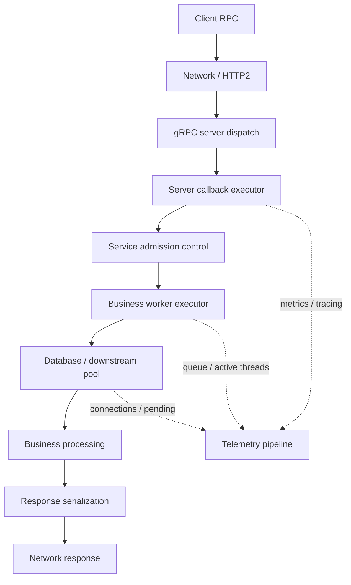

# Theo dõi tài nguyên khi tải tăng

## Mục tiêu bài học

Trong **SPRING_GRPC**, tải tăng làm thay đổi đồng thời số RPC đang xử lý, số thread hoạt động, queue chờ, kết nối downstream, bộ nhớ, CPU và thời gian phản hồi. Nếu chỉ theo dõi CPU hoặc số request, đội vận hành có thể bỏ lỡ bottleneck thật: worker pool bão hòa, database connection pool cạn, stream giữ tài nguyên quá lâu hoặc retry làm tải khuếch đại.

Bài học tập trung vào **theo dõi tài nguyên khi tải tăng**: chọn các tín hiệu RED và USE, đo concurrency/latency/status của gRPC, quan sát executor và downstream pools, theo dõi CPU/memory/GC/network, thiết kế dashboard và alert, dùng load test để tìm capacity knee, rồi điều chỉnh admission control, queue, autoscaling và graceful degradation.

Sau bài này, bạn có thể:

1. Phân biệt utilization, saturation và errors.
2. Xác định tài nguyên cần quan sát trong gRPC server và client.
3. Đo request rate, in-flight RPC, latency percentiles và status distribution.
4. Theo dõi worker pool, queue, connection pools, memory, GC và network.
5. Thiết kế metrics có cardinality thấp và dashboard theo service/method.
6. Tìm bottleneck bằng load test ramp, spike, stress và soak.
7. Ước lượng concurrency/capacity và nhận biết điểm latency bắt đầu tăng nhanh.
8. Đặt alert, admission control, backpressure và scaling policy dựa trên tín hiệu thực tế.

> **Phạm vi:** Ví dụ dùng Spring Boot, Micrometer, gRPC Java và OpenTelemetry. Tên metric tùy biến trong bài là tên do ứng dụng định nghĩa; metric có sẵn và semantic convention phụ thuộc instrumentation/version. Không giả định một property cụ thể của Spring gRPC starter.

## 1. Ba câu hỏi khi tải tăng

Quan sát tài nguyên cần trả lời ba câu hỏi khác nhau:

- **Utilization:** tài nguyên đang được sử dụng bao nhiêu phần trăm?
- **Saturation:** có bao nhiêu công việc phải chờ hoặc bị từ chối vì tài nguyên đã đầy?
- **Errors:** có bao nhiêu operation thất bại và thất bại vì lý do nào?

CPU 70% chưa chắc là bottleneck. Một service có thể dùng CPU thấp nhưng mọi worker đều đang chờ database, queue tăng và RPC deadline hết. Ngược lại, CPU 95% có thể là tải hợp lệ nếu latency vẫn nằm trong SLO và không có queue tăng kéo dài.

### 1.1. RED cho service

RED tập trung vào request:

| Tín hiệu | Ý nghĩa | Ví dụ gRPC |
| --- | --- | --- |
| Rate | Tốc độ request | RPC completed/second theo method |
| Errors | Tỷ lệ lỗi | Status code, RESOURCE_EXHAUSTED, INTERNAL |
| Duration | Thời gian xử lý | p50, p95, p99 RPC latency |

RED giúp phát hiện người dùng đang chịu ảnh hưởng. Nên đo cả request được nhận và request hoàn tất; chỉ đo completed rate có thể che mất request đang bị giữ trong queue.

### 1.2. USE cho tài nguyên

USE tập trung vào từng resource:

| Tín hiệu | Ý nghĩa | Ví dụ |
| --- | --- | --- |
| Utilization | Mức sử dụng | Active threads / max threads |
| Saturation | Công việc chờ | Executor queue depth, pending DB connections |
| Errors | Lỗi liên quan resource | Rejected task, connection timeout, allocation failure |

Áp dụng USE cho CPU, memory, executor, database pool, HTTP client pool, file descriptors và network. Kết hợp RED với USE giúp nối triệu chứng RPC chậm với tài nguyên gây ra nó.

## 2. Bản đồ tài nguyên của một gRPC request

Một unary RPC có thể sử dụng nhiều resource nối tiếp hoặc đồng thời:



Không phải mọi ứng dụng đều có hai executor hoặc database hop như sơ đồ. Điều quan trọng là xác định các điểm mà request có thể chờ, giữ tài nguyên hoặc bị từ chối. Với streaming RPC, thêm số stream đang mở, message rate, buffer bytes và thời gian stream tồn tại.

## 3. Metrics cốt lõi cho gRPC

Một bộ metrics khởi đầu nên bao gồm:

| Metric | Loại | Dimensions hữu ích |
| --- | --- | --- |
| RPC started/completed | Counter | service, method |
| RPC duration | Histogram/Timer | service, method, status |
| RPC in-flight | UpDownCounter/Gauge | service, method hoặc service |
| RPC status count | Counter | method, status code |
| Request/response size | Histogram | method, direction |
| Active streams | Gauge | service, method |
| Messages sent/received | Counter | method, direction |
| Admission rejected | Counter | method, reason class |
| Client retries | Counter | downstream, method, attempt class |
| Deadline exceeded | Counter | method, downstream |

Status code và method name thường là dimensions có tập giá trị hữu hạn. Không thêm trace ID, span ID, request ID, user ID, tenant ID hoặc raw target làm metric labels. Dữ liệu cần điều tra theo request nên nằm trong log/trace có access control.

### 3.1. Request rate và in-flight

Completed requests per second cho biết throughput thực tế. In-flight RPC cho biết số call đang giữ tài nguyên tại thời điểm đo. Khi request rate ổn định nhưng in-flight tăng liên tục, thời gian xử lý hoặc thời gian chờ đang tăng.

Với streaming RPC, một stream có thể sống lâu dù message rate thấp. Theo dõi active streams và stream duration riêng; chỉ đếm messages/second không cho biết số connection/stream đang chiếm tài nguyên.

### 3.2. Latency distribution

Không chỉ xem average. Một số ít request rất chậm có thể bị che khuất trong trung bình. Theo dõi p50, p90/p95 và p99, đồng thời phân tách theo method/status và workload class có cardinality thấp.

Histogram boundaries cần phù hợp latency SLO. Nếu mọi request đều dưới 10 ms hoặc nhiều request vượt 10 giây nhưng bucket không phù hợp, percentile có thể không hữu ích. Dùng cùng đơn vị và quy ước giữa dashboard, alert và SLO.

## 4. Đo RPC duration và status bằng ServerInterceptor

Một ServerInterceptor có thể bọc ServerCall để đo thời gian tới lúc RPC đóng. Ví dụ với Micrometer:

```java
public final class RpcMetricsInterceptor implements ServerInterceptor {

    private final MeterRegistry registry;

    public RpcMetricsInterceptor(MeterRegistry registry) {
        this.registry = registry;
    }

    @Override
    public <ReqT, RespT> ServerCall.Listener<ReqT> interceptCall(
            ServerCall<ReqT, RespT> call,
            Metadata headers,
            ServerCallHandler<ReqT, RespT> next) {

        Timer.Sample sample = Timer.start(registry);
        String method = call.getMethodDescriptor().getFullMethodName();

        ServerCall<ReqT, RespT> wrapped =
                new ForwardingServerCall
                        .SimpleForwardingServerCall<>(call) {
            @Override
            public void close(Status status, Metadata trailers) {
                Timer timer = Timer.builder("app.grpc.server.rpc.duration")
                        .tag("method", method)
                        .tag("status", status.getCode().name())
                        .register(registry);

                sample.stop(timer);
                super.close(status, trailers);
            }
        };

        return next.startCall(wrapped, headers);
    }
}
```

Đây là ví dụ instrumentation tối giản. Đảm bảo close chỉ được xử lý đúng một lần theo lifecycle của call và không để lỗi metrics làm hỏng RPC. Không thêm tag từ metadata tùy ý. Nếu dùng gRPC OpenTelemetry/Micrometer instrumentation đã có sẵn, không tạo một bộ metric trùng tên và trùng semantics.

Method full name có tập giá trị theo service contract; status code là enum hữu hạn. Với multi-tenant service, không tag tenant ID vào Timer.

### 4.1. In-flight gauge

Có thể đếm RPC đang mở bằng một counter tăng khi call bắt đầu và giảm khi call kết thúc. Với async/streaming, phải giảm ở terminal path duy nhất, kể cả cancel/error. Một implementation nên dùng atomic guard để tránh decrement hai lần nếu callback có nhiều đường kết thúc.

Nếu dùng instrumentation có sẵn đã cung cấp active calls, ưu tiên tái sử dụng metric đó. Mục tiêu là một định nghĩa in-flight nhất quán, không phải nhiều gauge gần giống nhau.

## 5. Theo dõi executor và queue

Với Spring ThreadPoolTaskExecutor, các tín hiệu hữu ích:

- Pool size hiện tại.
- Active thread count.
- Max pool size.
- Queue size và remaining capacity.
- Task completed/submitted/rejected.
- Queue wait duration và execution duration.

Ví dụ đăng ký gauge sau khi executor đã được khởi tạo:

```java
@Bean
MeterBinder grpcExecutorMetrics(
        @Qualifier("grpcBusinessExecutor")
        ThreadPoolTaskExecutor executor) {

    return registry -> {
        Gauge.builder(
                "app.grpc.executor.active",
                executor,
                ThreadPoolTaskExecutor::getActiveCount)
                .register(registry);

        Gauge.builder(
                "app.grpc.executor.pool.size",
                executor,
                ThreadPoolTaskExecutor::getPoolSize)
                .register(registry);

        Gauge.builder(
                "app.grpc.executor.queue.size",
                executor,
                pool -> pool.getThreadPoolExecutor()
                        .getQueue().size())
                .register(registry);
    };
}
```

Ví dụ giả định executor đã initialize trước khi gauge được đọc. Nếu bean chưa khởi tạo, getThreadPoolExecutor() có thể chưa sẵn sàng; bảo đảm lifecycle đúng hoặc dùng Micrometer executor binder phù hợp version. Trong production, bổ sung queue remaining capacity và rejection counter, không chỉ queue size.

Active threads gần max cùng queue tăng là tín hiệu saturation. Queue lớn nhưng active thấp có thể do worker bị block, executor chưa được cấu hình như mong muốn hoặc queue chứa task chưa được dispatch. Cần đối chiếu queue wait và thread dump.

### 5.1. Queue wait khác execution time

Queue wait đo thời gian từ submit đến khi worker bắt đầu; execution time đo thời gian worker thực thi task. Hai metric giúp phân biệt thiếu worker capacity với task/downstream chậm.

Nếu execution time tăng cùng DB latency, bottleneck có thể nằm ở database. Nếu queue wait tăng nhưng execution time ổn định, concurrency/worker count có thể thấp hơn nhu cầu. Nếu cả hai tăng, hệ thống có thể đã quá tải ở nhiều tầng.

## 6. Theo dõi downstream connection pools

Một gRPC service thường phụ thuộc database, HTTP service, cache hoặc message broker. Theo dõi:

- Active/idle/max connections.
- Pending acquire requests.
- Connection acquire wait time.
- Connection creation failures.
- Timeout và reset.
- Downstream request rate/latency/error.
- Retry attempts và circuit breaker state.

Nếu tất cả worker đang chờ connection pool, tăng worker count có thể làm tình hình tệ hơn vì thêm thread cùng tranh một số connection hữu hạn. Sizing business executor phải tương thích với downstream concurrency.

Đo cả latency từ lúc service bắt đầu call downstream tới khi có connection và thời gian thực hiện operation. Nếu chỉ đo tổng RPC duration, khó biết request chờ ở connection pool hay đang chạy query.

## 7. CPU, memory, GC và hệ điều hành

Metrics process/container cần được xem cùng với RPC metrics:

| Resource | Tín hiệu |
| --- | --- |
| CPU | Process CPU, container CPU usage và throttling |
| Heap | Used/committed/max, allocation rate |
| Garbage collection | Pause duration, frequency, reclaimed bytes |
| Native/off-heap memory | Direct buffers, Netty buffers, RSS |
| Threads | Live/daemon thread count, blocked/waiting threads |
| File descriptors | Open descriptors và giới hạn |
| Network | Throughput, retransmits, resets, connection count |
| Container | Memory working set, OOM events, CPU quota throttling |

gRPC Java Netty sử dụng network event loops và có thể dùng direct buffers. Heap ổn định không có nghĩa tổng memory an toàn; cần xem process RSS, direct memory và container working set.

CPU throttling trong container có thể làm latency tăng dù CPU usage trung bình không cao. Đối chiếu throttled time với p95/p99 và queue wait.

GC pause dài có thể làm nhiều RPC cùng timeout hoặc queue tăng trong một khoảng ngắn. Theo dõi pause distribution và allocation rate thay vì chỉ nhìn heap used tại một thời điểm.

## 8. Áp dụng Little's Law để ước lượng concurrency

Trong một hệ thống ổn định, Little's Law mô tả:

```math
L = λ × W
```

Trong đó:

- L là số operation trung bình đang ở trong hệ thống.
- λ là throughput trung bình (operation/second).
- W là thời gian trung bình trong hệ thống (second).

Ví dụ: service xử lý 200 RPC/second và thời gian trung bình trong hệ thống là 150 ms (0,15 second). Số RPC in-flight trung bình xấp xỉ:

```math
L = 200 × 0.15 = 30
```

Con số 30 là mức trung bình quan sát trong điều kiện ổn định, không phải max concurrency cần cấu hình. Cần thêm headroom cho burst, latency variance, retry và thời gian chờ downstream. Dùng p95/p99, tải đỉnh và SLO để xác định giới hạn admission/worker phù hợp.

Little's Law không dự đoán capacity tối đa nếu hệ thống đã mất ổn định và queue tăng vô hạn. Khi arrival rate vượt service rate, W và L tăng liên tục; cần giảm tải, tăng capacity hoặc từ chối sớm.

## 9. Load test để tìm capacity knee

Capacity knee là vùng tải mà tăng thêm một lượng nhỏ request làm latency hoặc error rate tăng nhanh. Tìm điểm này bằng load test có workload thực tế.

Một kế hoạch kiểm thử:

1. **Warm-up:** khởi tạo JVM, JIT, connection pools và cache.
2. **Baseline:** đo latency/throughput ở tải thấp.
3. **Ramp:** tăng request rate theo từng bậc và giữ mỗi bậc đủ lâu.
4. **Stress:** vượt capacity có kiểm soát để quan sát rejection và failure mode.
5. **Spike:** tăng tải đột ngột để kiểm tra burst handling.
6. **Soak:** giữ tải dài để phát hiện leak, memory growth và queue drift.
7. **Recovery:** giảm tải và xác minh queue, permits, connections và latency trở lại bình thường.

Workload phải phản ánh method mix, payload size, unary/streaming ratio, client concurrency, deadline và downstream latency. Một test chỉ gọi một RPC nhỏ có thể không đại diện production.

### 9.1. Open-loop và closed-loop load

Closed-loop load generator chờ response rồi mới gửi request tiếp; khi server chậm, generator tự giảm tốc và có thể che khuất overload. Open-loop generator phát request theo arrival rate định trước; nó cho thấy rõ hơn điều gì xảy ra khi arrival rate vượt service capacity, nhưng cần kiểm soát backlog ở chính load generator.

Chọn mô hình theo câu hỏi cần trả lời. Theo dõi dropped/queued requests của load generator để không nhầm generator saturation với server saturation.

### 9.2. Những gì cần ghi trong mỗi lần test

- Build/version và cấu hình profile.
- CPU/memory limits và số replica.
- Executor sizes, queue capacity, connection pool sizes.
- RPC rate, concurrency, method mix và payload distribution.
- p50/p95/p99 latency, status distribution và deadline errors.
- Queue wait, executor active/rejected và downstream pool wait.
- CPU throttling, GC pauses, RSS và network.
- Thời điểm autoscaling bắt đầu và số replica theo thời gian.

Không thay nhiều tham số cùng lúc nếu mục tiêu là tìm nguyên nhân. Thay một nhóm cấu hình có giả thuyết rõ, chạy lại cùng workload và so sánh.

## 10. Dashboard và alert

Dashboard nên có các tầng:

1. **Service RED:** rate, error ratio, latency percentiles theo method.
2. **Concurrency:** in-flight RPC, active streams, admission permits.
3. **Executor:** active/max threads, queue depth, queue wait, rejection.
4. **Downstream:** connection pool utilization, pending acquire, latency/errors.
5. **Process/container:** CPU, throttling, heap, RSS, GC, threads, file descriptors.
6. **Client behavior:** retries, retry delay, deadline exceeded và cancellation.
7. **Capacity:** replica count, per-instance load và autoscaling events.

Alert nên kết hợp impact với saturation. Ví dụ, p99 vượt SLO cùng queue wait và RESOURCE_EXHAUSTED tăng có ý nghĩa hơn một cảnh báo CPU cao đơn lẻ.

Dùng cửa sổ thời gian và threshold phù hợp với SLO. Với service quan trọng, có thể dùng multi-window/multi-burn-rate alert để phát hiện error budget burn nhanh. Không alert theo một spike ngắn nếu hệ thống tự phục hồi trong giới hạn đã chấp nhận.

## 11. Autoscaling và giới hạn an toàn

Autoscaling giúp thêm instance khi capacity tăng, nhưng không thay thế admission control. Scale-out có độ trễ; trong thời gian chờ, queue và in-flight vẫn có thể vượt giới hạn.

Các tín hiệu scale có thể gồm:

- CPU utilization/throttling.
- RPC rate hoặc in-flight per instance.
- Queue depth/queue wait.
- Active streams.
- p95/p99 latency nếu metric ổn định và được scale controller hỗ trợ.

CPU-only scaling không phù hợp workload chủ yếu chờ I/O. Ngược lại, scale theo queue mà không giới hạn replica có thể làm database/downstream bị quá tải vì mỗi replica mở thêm connection và worker.

Đặt min/max replicas, stabilization window, scale-up/down policy và per-instance resource limits. Khi downstream là bottleneck, cần scale downstream hoặc giới hạn concurrency thay vì chỉ tăng gRPC replicas.

## 12. Backpressure, overload và graceful degradation

Khi tải vượt capacity:

- Giới hạn concurrency và queue ở từng tầng.
- Từ chối sớm bằng RESOURCE_EXHAUSTED khi capacity cạn theo semantics phù hợp.
- Dùng deadline và cancellation để giải phóng công việc không còn hữu ích.
- Hạn chế retry bằng backoff, jitter và retry budget.
- Dùng circuit breaker/bulkhead để cô lập dependency chậm.
- Giảm chất lượng hoặc tắt tính năng tùy chọn nếu business policy cho phép.
- Với streaming, phối hợp flow control và bounded buffers.
- Khi shutdown, chuyển NOT_SERVING và drain RPC đang chạy.

Không dùng queue lớn để trì hoãn overload. Không retry đồng loạt ngay khi có lỗi; retry storm có thể khiến hệ thống không phục hồi. Giữ capacity cho health/management và các operation thiết yếu nếu kiến trúc cần.

## 13. Ví dụ metric cho executor và RPC

Tên metric trong ví dụ là custom metric của ứng dụng. Khi dự án đã có gRPC instrumentation, ưu tiên chuẩn hóa theo convention đang dùng và tránh duplicate.

Ví dụ Timer cho RPC:

```java
Timer.builder("app.grpc.server.rpc.duration")
        .description("Completed gRPC RPC duration")
        .tag("method", method)
        .tag("status", statusCode.name())
        .register(meterRegistry)
        .record(duration);
```

Ví dụ Counter cho admission rejection:

```java
Counter.builder("app.grpc.server.admission.rejected")
        .tag("method", method)
        .tag("reason", "capacity")
        .register(meterRegistry)
        .increment();
```

Không đưa exception message, tenant ID hoặc request ID vào tag. Nếu cần biết request cụ thể bị từ chối, ghi structured log với trace/request ID đã redaction; metric chỉ phản ánh aggregate.

Với executor, có thể dùng Micrometer binder tương thích version hoặc gauge đọc active count, pool size và queue size. Đăng ký gauge một lần khi bean đã initialize, không tạo meter mới cho từng task.

## 14. Lỗi thường gặp và cách xử lý

| Triệu chứng | Nguyên nhân có thể | Cách điều tra |
| --- | --- | --- |
| CPU thấp nhưng p99 tăng | Downstream wait, queue hoặc lock contention | Queue wait, DB pool pending, thread dump |
| CPU cao và throughput không tăng | CPU saturation hoặc quá nhiều context switching | CPU profile, active threads, allocation |
| In-flight tăng liên tục | Service time tăng hoặc arrival rate vượt capacity | So rate với duration và downstream latency |
| Executor active=max, queue tăng | Worker pool bão hòa | Queue wait, rejection, worker stack |
| Queue thấp nhưng RPC chậm | Worker đang chạy task chậm hoặc network/downstream chậm | Execution duration, downstream spans |
| DB pending connections tăng | Database pool/downstream là bottleneck | Acquire wait, active/max connections |
| Heap ổn nhưng container OOM | Native/direct memory hoặc RSS cao | Direct buffers, Netty, RSS và container metrics |
| Latency tăng theo CPU throttling | Container CPU quota quá thấp | Throttled time, CPU limits |
| RESOURCE_EXHAUSTED tăng | Admission control đang từ chối hoặc quota cạn | Reason class, permits, queue và quota |
| Retry tăng sau overload | Client retry khuếch đại tải | Attempts, backoff, retry budget |
| Streaming memory tăng | Buffer không giới hạn hoặc stream sống quá lâu | Active streams, buffer bytes, flow-control |
| Autoscaling không cải thiện | Downstream bottleneck hoặc scale metric sai | Dependency capacity và per-instance load |

## 15. Kiểm thử và bài tập thực hành

1. Thêm RPC duration histogram, request rate, status count và in-flight gauge.
2. Đo executor active threads, pool size, queue depth, queue wait và rejection.
3. Thu thập DB/HTTP connection pool active/pending/acquire latency.
4. Bật process/container metrics cho CPU throttling, heap, RSS, GC, threads và file descriptors.
5. Tạo load test có unary/streaming mix, payload distribution và downstream delay.
6. Chạy ramp test để tìm capacity knee; ghi p50/p95/p99 và status distribution.
7. Chạy spike test để quan sát admission control và bounded queue.
8. Chạy soak test để phát hiện queue drift, thread leak, memory growth và connection leak.
9. Giảm tải sau stress test và xác minh recovery.
10. So sánh open-loop với closed-loop load để hiểu hiệu ứng load generator.
11. Tạo dashboard RED/USE theo service/method và resource layer.
12. Đặt alert kết hợp p99, error ratio, queue wait và rejection rate.
13. Thử autoscaling theo CPU và queue/in-flight; kiểm tra tác động tới downstream.
14. Kiểm tra metric labels không chứa request ID, trace ID, tenant ID hoặc raw target.

### Câu hỏi tự kiểm tra

- Utilization, saturation và errors khác nhau như thế nào?
- RED và USE bổ sung cho nhau ra sao?
- Vì sao completed RPS một mình không đủ để phát hiện backlog?
- Queue wait khác execution time thế nào?
- Vì sao CPU thấp vẫn có thể đi kèm RPC latency cao?
- Little's Law ước lượng in-flight concurrency ra sao và giới hạn của nó là gì?
- Capacity knee được tìm bằng loại load test nào?
- Closed-loop load có thể che khuất overload ra sao?
- Khi nào nên scale theo queue/in-flight thay vì CPU?
- Vì sao tăng gRPC replicas có thể làm database quá tải hơn?
- Những metric nào giúp phân biệt executor bottleneck với downstream bottleneck?
- Làm thế nào kiểm tra recovery sau khi tải giảm?

## Tài liệu tham khảo

- [Micrometer — JVM Metrics](https://docs.micrometer.io/micrometer/reference/reference/jvm.html): JVM memory, GC và thread metrics.
- [Micrometer — Gauges](https://docs.micrometer.io/micrometer/reference/concepts/gauges.html): đo giá trị hiện thời như queue và active threads.
- [Micrometer — Timers](https://docs.micrometer.io/micrometer/reference/concepts/timers.html): latency và duration distribution.
- [Spring Boot — Actuator Metrics](https://docs.spring.io/spring-boot/reference/actuator/metrics.html): registry, binders và endpoint metrics.
- [OpenTelemetry — Metrics](https://opentelemetry.io/docs/concepts/signals/metrics/): counter, histogram và observable instruments.
- [gRPC — Performance](https://grpc.io/docs/guides/performance/): các yếu tố ảnh hưởng hiệu năng gRPC.
- [gRPC — Flow Control](https://grpc.io/docs/guides/flow-control/): điều tiết streaming.
- [gRPC — Health Checking](https://grpc.io/docs/guides/health-checking/): readiness và client health checking.
- [Google SRE — Monitoring Distributed Systems](https://sre.google/sre-book/monitoring-distributed-systems/): golden signals và monitoring strategy.
- [Google SRE — Handling Overload](https://sre.google/sre-book/handling-overload/): admission control, load shedding và overload management.

**Kết quả mong đợi:** Người học theo dõi được tài nguyên Spring gRPC khi tải tăng bằng RED/USE, xác định bottleneck từ RPC tới executor và downstream, tìm capacity knee bằng load test, thiết kế dashboard/alert có cardinality thấp, và điều chỉnh admission control, backpressure cùng autoscaling để giữ latency và độ tin cậy trong SLO.
