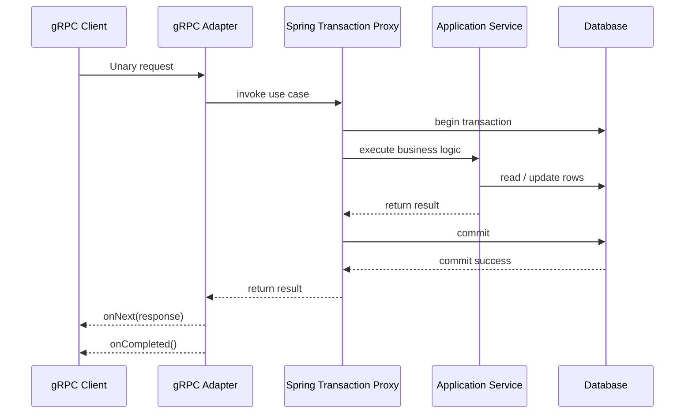

# Transaction trong unary RPC

## 1. Transaction bảo vệ điều gì trong unary RPC?

Trong **SPRING_GRPC**, unary RPC nhận một request và trả một response. Nhiều RPC thực hiện một đơn vị nghiệp vụ gồm nhiều thao tác database: đọc bản ghi, kiểm tra trạng thái, cập nhật nhiều hàng và ghi lịch sử. Nếu một thao tác giữa chừng thất bại, hệ thống cần rollback toàn bộ thay đổi để không để lại trạng thái một phần.

Spring quản lý transaction thông qua transaction manager và thường tích hợp với annotation @Transactional. Với unary RPC đồng bộ, ranh giới transaction nên bao quanh **use case/application service** thực hiện thao tác dữ liệu. gRPC adapter chịu trách nhiệm chuyển đổi request, gọi application service, ánh xạ kết quả và phát response.

Một điểm đặc biệt của gRPC Java là server method thường trả về void và nhận StreamObserver. Vì vậy, việc gọi onNext() hoặc onCompleted() bên trong method được Spring bọc transaction có thể xảy ra **trước khi transaction commit**. Nếu commit thất bại sau khi response đã được gửi, client có thể nhận thành công trong khi dữ liệu chưa được lưu.

Bài này tập trung vào:

- Ranh giới transaction giữa gRPC adapter và Spring application service.
- Thứ tự commit/rollback so với phát response.
- Ánh xạ exception thành gRPC status sau khi transaction kết thúc.
- Isolation, locking và concurrency khi nhiều unary request cùng cập nhật dữ liệu.
- Retry, idempotency, deadline, cancellation và external side effects.
- Cách kiểm thử transaction thực tế trong Spring gRPC.

## 2. Luồng xử lý và thời điểm commit

Một unary RPC điển hình có trình tự:

1. gRPC runtime nhận request và gọi server implementation.
2. Adapter kiểm tra request và tạo command nội bộ.
3. Adapter gọi application service qua Spring bean proxy.
4. Transaction interceptor mở transaction trước khi chạy method @Transactional.
5. Application service đọc/ghi database và trả về kết quả.
6. Spring transaction interceptor commit trước khi lời gọi qua proxy trả kết quả về adapter.
7. Adapter chuyển kết quả thành Protobuf response rồi gọi onNext() và onCompleted().



Khi commit thành công, adapter mới có kết quả từ lời gọi transactional và có thể phát response. Nếu commit ném exception, proxy không trả kết quả bình thường; adapter bắt exception và gửi lỗi gRPC.

Đây là lý do transaction nên kết thúc trước onNext() trong unary RPC có side effect.

## 3. Không đặt transaction trực tiếp quanh StreamObserver callback

Một cách triển khai dễ mắc lỗi là đánh dấu method gRPC adapter @Transactional rồi phát response ngay trong method:

```java
@GrpcService
@Transactional
public class PaymentGrpcService
        extends PaymentServiceGrpc.PaymentServiceImplBase {

    @Override
    public void capture(
            CaptureRequest request,
            StreamObserver<CaptureReply> observer) {

        paymentRepository.capture(request.getPaymentId());

        observer.onNext(CaptureReply.newBuilder()
                .setCaptured(true)
                .build());
        observer.onCompleted();
    }
}
```

Với Spring proxy transaction thông thường, transaction interceptor commit sau khi method target trả về. Nhưng onNext() và onCompleted() đã được gọi trước khi method kết thúc. Nếu commit thất bại do constraint, connection hoặc lỗi database, client có thể đã nhận response thành công.

Cách này còn làm gRPC adapter phụ thuộc trực tiếp vào repository, khiến transaction boundary và business logic khó tái sử dụng.

Thay vào đó, adapter nên gọi một application service đồng bộ có @Transactional; application service trả kết quả sau khi Spring hoàn tất commit. Adapter chỉ phát response sau lời gọi đó.

## 4. Đặt transaction ở application service

Ví dụ một use case chuyển tiền cần cập nhật hai tài khoản và tạo bản ghi giao dịch:

```java
@Service
@RequiredArgsConstructor
public class TransferApplicationService {
    private final AccountRepository accounts;
    private final TransferRepository transfers;

    @Transactional
    public TransferResult transfer(TransferCommand command) {
        Account source = accounts.findById(command.sourceId())
            .orElseThrow(AccountNotFoundException::new);

        Account target = accounts.findById(command.targetId())
            .orElseThrow(AccountNotFoundException::new);

        source.debit(command.amount());
        target.credit(command.amount());

        Transfer transfer = transfers.save(
            Transfer.create(source, target, command.amount())
        );

        return new TransferResult(
            transfer.getId(),
            source.getBalance(),
            target.getBalance()
        );
    }
}
```

Các thay đổi database nằm trong cùng transaction. Nếu debit, credit hoặc lưu transfer thất bại bằng exception khiến transaction rollback, toàn bộ thay đổi được hoàn tác.

Adapter gọi application service rồi mới phát response:

```java
@GrpcService
@RequiredArgsConstructor
public class TransferGrpcService
        extends TransferServiceGrpc.TransferServiceImplBase {

    private final TransferApplicationService applicationService;

    @Override
    public void transfer(
            TransferRequest request,
            StreamObserver<TransferReply> observer) {
        try {
            TransferResult result = applicationService.transfer(
                new TransferCommand(
                    request.getSourceId(),
                    request.getTargetId(),
                    request.getAmount()
                )
            );

            TransferReply reply = TransferReply.newBuilder()
                .setTransferId(result.transferId())
                .setSourceBalance(result.sourceBalance())
                .setTargetBalance(result.targetBalance())
                .build();

            observer.onNext(reply);
            observer.onCompleted();
        } catch (AccountNotFoundException ex) {
            observer.onError(
                Status.NOT_FOUND
                    .withDescription("Account not found")
                    .asRuntimeException()
            );
        } catch (InsufficientFundsException ex) {
            observer.onError(
                Status.FAILED_PRECONDITION
                    .withDescription("Insufficient funds")
                    .asRuntimeException()
            );
        } catch (RuntimeException ex) {
            // Log exception nội bộ; không gửi SQL hoặc dữ liệu nhạy cảm cho client.
            observer.onError(
                Status.INTERNAL
                    .withDescription("Unable to complete transfer")
                    .asRuntimeException()
            );
        }
    }
}
```

Tên annotation đăng ký service có thể khác theo Spring gRPC starter đang dùng; phần cốt lõi là adapter được Spring quản lý và gọi application service qua bean proxy.

Khi applicationService.transfer() trả về bình thường, transaction interceptor đã commit. Nếu commit thất bại, exception đi ngược về adapter và không có response thành công nào được phát.

## 5. Điều kiện để @Transactional thực sự có hiệu lực

@Transactional không tự mở transaction ở mọi lời gọi method. Trong cấu hình Spring proxy thông thường, lời gọi phải đi qua proxy do Spring tạo.

Các điểm cần kiểm tra:

- Application service là Spring bean, ví dụ @Service.
- Adapter inject bean đó qua constructor và gọi từ bean khác.
- Method transactional được gọi qua proxy; self-invocation trong cùng object thường không kích hoạt transaction interceptor.
- Transaction manager phù hợp với database đang dùng đã được cấu hình.
- Repository tham gia cùng transaction manager và datasource.
- Không bắt exception rồi trả kết quả bình thường khi muốn transaction rollback.

Ví dụ self-invocation dễ gây hiểu nhầm:

```java
@Service
public class OrderService {
    public void submit() {
        saveOrder(); // gọi nội bộ, có thể bypass Spring proxy
    }

    @Transactional
    public void saveOrder() {
        // database work
    }
}
```

Nếu submit() gọi trực tiếp saveOrder() trên cùng instance, proxy thông thường không chặn lời gọi nội bộ đó. Nên đặt use case transactional trong bean riêng và gọi qua dependency injection.

Mặc định Spring rollback với unchecked exception (RuntimeException) và Error. Checked exception không tự động rollback trong cấu hình mặc định; nếu nghiệp vụ dùng checked exception, khai báo rollbackFor phù hợp hoặc chuyển sang exception domain unchecked. Không nuốt exception trong transactional method nếu vẫn muốn rollback; nếu phải bắt, cần chủ động đánh dấu rollback-only theo transaction API.

## 6. Chọn transaction scope, propagation và read-only

Transaction nên bao quanh một use case có tính nguyên tử, không bao quanh toàn bộ vòng đời kết nối gRPC.

- Với unary query chỉ đọc, có thể dùng @Transactional(readOnly = true) nếu transaction manager/database hỗ trợ tối ưu phù hợp.
- Với command cập nhật nhiều bảng, propagation REQUIRED thường cho phép các repository tham gia cùng transaction hiện tại.
- Chỉ dùng REQUIRES_NEW khi thực sự cần một transaction độc lập; nó có thể commit dù transaction bên ngoài rollback.
- Tránh giữ transaction mở trong khi chờ gọi service từ xa, chờ người dùng hoặc chờ callback bất đồng bộ.
- Không dùng một transaction database để giả định có thể rollback một RPC đã gửi tới hệ thống khác.

Với unary RPC đồng bộ, transaction thường bắt đầu khi application service được gọi và kết thúc khi method trả kết quả hoặc ném exception. Không cần giữ transaction mở trong lúc gRPC gửi response qua network.

## 7. Isolation và concurrency khi nhiều RPC cập nhật cùng dữ liệu

Transaction bảo đảm các thao tác trong một transaction commit/rollback cùng nhau, nhưng không tự giải quyết mọi race condition giữa các request đồng thời.

Ví dụ, hai unary RPC cùng đọc số dư 100, mỗi request trừ 80. Nếu cả hai đọc cùng snapshot và ghi đè số dư, hệ thống có thể tạo lost update hoặc số dư âm tùy isolation và câu lệnh cập nhật.

Các biện pháp thường dùng:

- **Optimistic locking:** thêm version column (JPA @Version); một transaction cập nhật trước, transaction còn lại gặp optimistic lock conflict và cần retry theo policy.
- **Pessimistic locking:** khóa hàng cần cập nhật khi đọc, ví dụ SELECT FOR UPDATE, nếu DB và repository hỗ trợ.
- **Atomic conditional update:** thực hiện update có điều kiện như UPDATE account SET balance = balance - ? WHERE id = ? AND balance >= ?, sau đó kiểm tra số hàng bị ảnh hưởng.
- **Database constraints:** unique constraint, check constraint và foreign key bảo vệ invariant ở tầng dữ liệu.

Chọn isolation level theo invariant nghiệp vụ và database thực tế. Isolation cao hơn có thể giảm anomaly nhưng làm tăng lock contention, deadlock và retry. Với lỗi serialization/deadlock, có thể cần retry transaction có giới hạn; không retry mù quáng các lỗi validation hoặc business rule.

## 8. Transaction và gRPC status: rollback trước, ánh xạ sau

Adapter nên ánh xạ exception thành gRPC status sau khi lời gọi application service kết thúc. Khi proxy ném exception, transaction manager đã thực hiện rollback theo policy trước khi exception đến catch ở adapter.

| Tình huống | gRPC status thường dùng |
| --- | --- |
| Request sai định dạng/giá trị | INVALID_ARGUMENT |
| Không tìm thấy bản ghi | NOT_FOUND |
| Trạng thái nghiệp vụ không cho phép thao tác | FAILED_PRECONDITION |
| Xung đột đồng thời hoặc version conflict cần client thử lại | ABORTED |
| Lỗi ngoài dự kiến/database | INTERNAL |

Không trả thông tin SQL, tên bảng, connection string hoặc stack trace cho client. Log nội bộ cần correlation/request ID để truy vết.

Nếu application service bắt lỗi database rồi trả kết quả “thất bại” bình thường, transaction interceptor có thể commit các thay đổi đã thực hiện trước đó. Với lỗi cần rollback, hãy ném exception phù hợp hoặc đánh dấu transaction rollback-only. Đừng phát onError() rồi tiếp tục để transaction commit như thể use case hoàn tất bình thường.

## 9. Commit thành công nhưng client không nhận response: idempotency

Transaction database và việc gửi response qua mạng không phải một thao tác nguyên tử. Có thể xảy ra trình tự:

1. Server cập nhật database.
2. Database commit thành công.
3. Server gửi response nhưng kết nối bị ngắt hoặc client hết deadline trước khi nhận.
4. Client thấy DEADLINE_EXCEEDED hoặc UNAVAILABLE và retry.
5. Server nhận request lần nữa.

Nếu RPC tạo đơn hàng, chuyển tiền hoặc ghi thanh toán, retry có thể thực hiện side effect hai lần. Không thể rollback transaction đã commit chỉ vì response bị mất.

Với command unary có side effect, nên thiết kế idempotency key:

- Client tạo key ổn định cho một ý định nghiệp vụ và gửi trong request.
- Database lưu key cùng kết quả/operation ID, có unique constraint theo phạm vi phù hợp.
- Việc kiểm tra key, thực hiện side effect và lưu kết quả nằm trong cùng transaction.
- Nếu key đã tồn tại, trả lại kết quả đã lưu thay vì thực hiện operation lần nữa.
- Nếu cùng key nhưng payload khác, từ chối theo quy tắc rõ ràng.

Unique constraint ở database là lớp bảo vệ cuối cùng khi hai request cùng key đến đồng thời. Kiểm tra key chỉ bằng một câu SELECT trước khi insert không đủ để tránh race condition.

## 10. External side effects và transactional outbox

Một database transaction không tự rollback được email đã gửi, message đã publish lên broker hoặc RPC đã gọi tới service khác.

Nếu cần cập nhật database và phát event, có thể dùng **transactional outbox**:

1. Trong cùng transaction, cập nhật business tables và ghi một outbox record.
2. Commit database.
3. Worker riêng đọc outbox và publish event.
4. Đánh dấu event đã gửi hoặc dùng cơ chế retry/idempotent consumer.
5. Theo dõi outbox backlog và xử lý message lỗi.

Cách này bảo đảm thay đổi nghiệp vụ và ý định phát event được lưu cùng transaction. Việc publish có thể xảy ra nhiều lần, nên consumer vẫn cần idempotency.

Không giữ transaction database mở trong lúc gọi RPC từ xa hoặc chờ broker phản hồi. Điều đó kéo dài lock, tăng deadlock và làm thời gian transaction phụ thuộc mạng. Nếu workflow cần nhiều service cùng tham gia, xem xét saga/compensation thay vì giả định có distributed transaction tự động.

## 11. Deadline, cancellation và transaction timeout

gRPC deadline giới hạn thời gian client chờ RPC. Khi deadline hết hoặc client hủy request, server nhận tín hiệu cancellation qua gRPC context, nhưng điều đó **không tự động bảo đảm JDBC statement hoặc transaction đã rollback ngay lập tức**.

Cần phối hợp nhiều giới hạn:

- Đặt deadline hợp lý ở client và truyền ngân sách thời gian xuống các dependency.
- Cấu hình transaction timeout và database statement/query timeout phù hợp.
- Tránh query không giới hạn hoặc chờ lock vô hạn.
- Với tác vụ dài, kiểm tra cancellation ở các điểm an toàn và dừng công việc trước commit nếu nghiệp vụ cho phép.
- Nếu transaction đã commit, cancellation không thể đảo ngược commit; idempotency giúp client retry an toàn.
- Không giữ transaction trong lúc chờ callback bất đồng bộ hoặc một RPC khác.

Nếu chuyển database work sang executor/thread khác, transaction thread-bound của Spring không tự lan sang thread mới. Hãy mở transaction tại worker thread thông qua Spring bean proxy và chỉ phát response sau khi worker hoàn tất transaction. Không giả định @Transactional ở method khởi chạy async sẽ bao trùm công việc chạy sau khi method trả về.

## 12. Kiểm thử transaction trong Spring gRPC

Nên kiểm thử với database thật hoặc Testcontainers khi cần xác nhận locking, constraint và isolation; H2 có thể khác hành vi của database production.

| Test | Điều cần xác nhận |
| --- | --- |
| Unary command thành công | Dữ liệu được commit và response phản ánh kết quả đã commit |
| Exception giữa chừng | Tất cả thay đổi trong transaction được rollback |
| Commit thất bại | Adapter không phát response thành công trước commit |
| Checked exception | Rollback đúng với cấu hình rollbackFor |
| Hai request đồng thời | Invariant được bảo vệ bằng lock/version/constraint |
| Retry cùng idempotency key | Chỉ một side effect được tạo |
| Client deadline/cancel | Query/transaction dừng theo timeout và policy đã định |
| Outbox | Business update và outbox record cùng commit hoặc cùng rollback |

Để kiểm tra thứ tự commit, có thể tạo constraint/deferred failure phù hợp với database test, gọi RPC và xác nhận client nhận lỗi thay vì response thành công. Kiểm tra database bằng transaction/connection độc lập sau RPC để xác nhận trạng thái đã commit.

Không chỉ test method application service. Cần integration test qua gRPC server thật để xác nhận adapter bắt exception, ánh xạ status, gọi observer đúng một terminal signal và không phát onNext() trước khi application service commit xong.

## 13. Checklist review transaction boundary

- Unary RPC được phân loại rõ là query hay command có side effect.
- Transaction đặt ở application service đồng bộ, có Spring proxy quản lý.
- Adapter chỉ phát response sau khi lời gọi transactional trả về thành công.
- Không gọi onNext()/onCompleted() trước thời điểm commit.
- Exception cần rollback không bị nuốt hoặc biến thành return bình thường.
- Checked exception có rollback policy phù hợp.
- Transaction manager và repository dùng đúng datasource.
- Concurrency được bảo vệ bằng isolation, locking, optimistic version hoặc constraint phù hợp.
- Command có side effect có idempotency strategy.
- External event dùng outbox hoặc workflow compensation khi cần.
- Deadline, query timeout và transaction timeout được phối hợp.
- Async work mở transaction ở đúng worker thread.
- Integration tests xác nhận commit/rollback, status mapping và observer lifecycle.

Trong **SPRING_GRPC**, transaction của unary RPC nên kết thúc ở application service trước khi adapter phát response. Cách tách này giúp client chỉ nhận thành công sau khi database commit thành công, exception được ánh xạ sau rollback và business logic không phụ thuộc gRPC callback. Kết hợp concurrency control, idempotency, timeout và outbox để bảo vệ dữ liệu khi request chạy đồng thời, bị retry hoặc mất kết nối.
