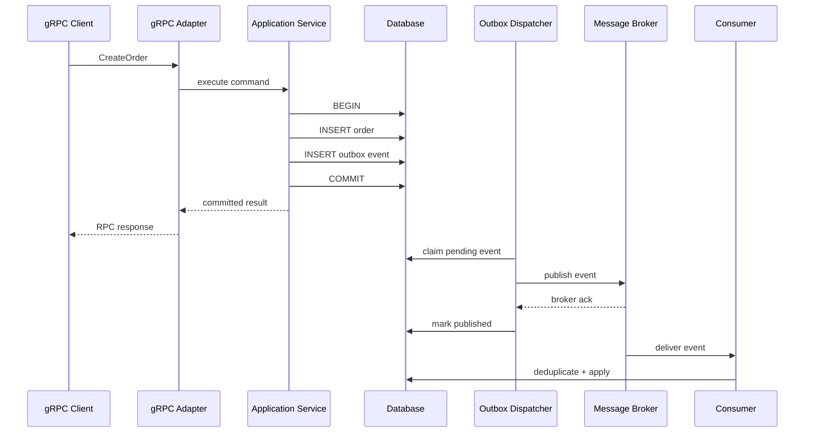

# Outbox cho event sau RPC

## 1. Vấn đề: database commit và publish event là hai thao tác khác nhau

Trong **SPRING_GRPC**, một unary RPC có thể cập nhật dữ liệu nghiệp vụ rồi cần phát event cho các hệ thống khác. Ví dụ CreateOrder tạo đơn hàng và cần phát OrderCreated để inventory, notification hoặc analytics xử lý.

Nếu server ghi database rồi publish event trực tiếp, hai hệ thống không cùng tham gia một transaction nguyên tử:

- Publish trước commit: consumer có thể nhận event trong khi database rollback; event mô tả một thay đổi chưa từng tồn tại.
- Commit trước publish: process có thể crash sau commit nhưng trước khi publish; dữ liệu đã đổi nhưng event bị mất.
- Publish thành công nhưng server crash trước khi ghi nhận đã gửi: lần chạy sau có thể publish trùng.

Đây là **dual-write problem**. Một transaction JDBC/JPA không thể tự commit nguyên tử cùng một broker như Kafka hoặc RabbitMQ. Gọi broker trong method transactional không biến broker thành participant của database transaction.

**Transactional outbox** giải quyết bằng cách lưu ý định phát event trong chính database transaction tạo ra thay đổi nghiệp vụ. Một dispatcher riêng đọc outbox và publish sau khi commit. Nhờ vậy, thay đổi nghiệp vụ và event cần phát cùng tồn tại hoặc cùng rollback trong database.

## 2. Luồng xử lý từ gRPC request tới event

Một command RPC có outbox thường đi theo trình tự:

1. gRPC server nhận request, xác thực và validate.
2. Adapter gọi application service qua Spring bean proxy.
3. Application service mở transaction.
4. Service cập nhật business tables.
5. Service tạo outbox record chứa event ID và payload/envelope.
6. Database commit business data và outbox record cùng nhau.
7. Transaction kết thúc; adapter gửi response thành công cho client.
8. Dispatcher độc lập đọc outbox chưa publish và gửi event tới broker.
9. Dispatcher ghi nhận delivery; consumer nhận event và xử lý idempotent.



Response RPC xác nhận command đã commit theo semantics của API. Nó không nhất thiết xác nhận consumer đã xử lý event. Đây là hai mốc khác nhau và cần được công bố rõ cho caller.

## 3. Vì sao không chỉ dùng after-commit callback?

Spring có cơ chế chạy callback sau khi transaction commit, ví dụ TransactionalEventListener với phase AFTER_COMMIT. Nó hữu ích để đánh thức dispatcher hoặc thực hiện tác vụ phụ sau commit, nhưng không thay thế outbox bền vững.

Nếu process crash sau commit nhưng trước khi callback chạy, callback bị mất. Nếu callback gọi broker và broker nhận event nhưng process crash trước khi ghi nhận, event có thể được gửi lại. Callback cũng không tạo ra một record durable để retry sau restart.

Có thể dùng after-commit signal để giảm độ trễ: khi outbox row được commit, phát tín hiệu đánh thức worker đang polling. Nhưng worker vẫn phải đọc outbox từ database; polling hoặc CDC mới là cơ chế phục hồi nếu tín hiệu bị mất.

## 4. Thiết kế bảng outbox

Một bảng outbox thường có các trường:

| Cột | Mục đích |
| --- | --- |
| event_id | ID duy nhất, ổn định cho event |
| aggregate_type | Loại aggregate, ví dụ Order |
| aggregate_id | ID aggregate phát event |
| aggregate_version | Version hoặc sequence để giữ thứ tự |
| event_type | Tên event, ví dụ OrderCreated |
| schema_version | Phiên bản payload/envelope |
| payload | Nội dung event đã serialize |
| created_at | Thời điểm tạo event |
| published_at | Thời điểm broker xác nhận nhận |
| attempts | Số lần thử publish |
| next_attempt_at | Thời điểm retry tiếp theo |
| lease_owner / lease_until | Worker đang claim và hạn lease nếu dùng polling |

Ví dụ DDL rút gọn:

```sql
CREATE TABLE outbox_event (
    event_id          UUID PRIMARY KEY,
    aggregate_type    VARCHAR(100) NOT NULL,
    aggregate_id      VARCHAR(200) NOT NULL,
    aggregate_version BIGINT,
    event_type        VARCHAR(200) NOT NULL,
    schema_version    INTEGER NOT NULL,
    payload           BYTEA NOT NULL,
    created_at        TIMESTAMP NOT NULL,
    published_at      TIMESTAMP NULL,
    attempts          INTEGER NOT NULL DEFAULT 0,
    next_attempt_at   TIMESTAMP NULL,
    lease_owner       VARCHAR(100) NULL,
    lease_until       TIMESTAMP NULL
);

CREATE INDEX ix_outbox_pending
ON outbox_event (next_attempt_at, created_at)
WHERE published_at IS NULL;
```

DDL trên là ví dụ PostgreSQL; kiểu UUID, binary payload, partial index và cách lấy thời gian cần điều chỉnh theo database thực tế. Không lưu secret hoặc dữ liệu cá nhân không cần thiết trong event payload.

## 5. Ghi business data và outbox trong cùng transaction

Application service tạo event cùng transaction với thay đổi nghiệp vụ:

```java
@Service
@RequiredArgsConstructor
public class CreateOrderService {
    private final OrderRepository orders;
    private final OutboxRepository outbox;
    private final EventSerializer serializer;

    @Transactional
    public CreateOrderResult create(CreateOrderCommand command) {
        Order order = orders.save(Order.create(command));

        OrderCreated event = new OrderCreated(
            order.getId(),
            order.getCustomerId(),
            order.getVersion()
        );

        outbox.save(OutboxRecord.pending(
            UUID.randomUUID(),
            "Order",
            order.getId(),
            order.getVersion(),
            "OrderCreated",
            1,
            serializer.serialize(event)
        ));

        return CreateOrderResult.from(order);
    }
}
```

Nếu lưu order thành công nhưng insert outbox thất bại, transaction rollback cả hai. Nếu transaction commit, cả business row và outbox row đều có mặt để dispatcher phục hồi sau restart.

Không publish broker trong method transactional. Nếu broker chậm, transaction sẽ giữ connection/lock lâu; nếu broker lỗi, business transaction có thể rollback dù domain update hợp lệ. Outbox tách thời điểm commit nghiệp vụ khỏi thời điểm truyền event.

Nếu command có idempotency key, lưu idempotency record, business update và outbox event trong cùng transaction. Khi client retry sau khi response mất, server replay kết quả đã commit mà không tạo order hoặc event mới.

## 6. Khi nào gRPC trả response?

Thông thường, adapter gửi response sau khi application service trả về qua Spring transaction proxy, nghĩa là commit đã hoàn tất. Response có thể chứa order ID và trạng thái ACCEPTED/CREATED; nó xác nhận thay đổi database và ý định phát event đã được lưu bền vững.

Không nên giữ transaction mở để đợi broker publish và consumer xử lý. Việc đó làm RPC phụ thuộc latency của broker/consumer, giữ connection database và ghép chặt hai hệ thống.

Nếu API thật sự cần đợi broker xác nhận trước khi trả, hãy xác định rõ semantics và giới hạn deadline; vẫn phải giữ outbox làm nguồn phục hồi vì kết quả publish có thể không rõ khi kết nối broker bị ngắt. Thường tốt hơn là trả operation/event ID để caller query trạng thái xử lý bất đồng bộ.

Các trạng thái có thể được biểu diễn riêng:

- COMMITTED: command và outbox đã commit.
- PENDING: event đang chờ dispatcher.
- PUBLISHED: broker đã xác nhận nhận event.
- PROCESSED: consumer nghiệp vụ đã hoàn tất, nếu hệ thống có cơ chế receipt.

Không đồng nhất PUBLISHED với PROCESSED.

## 7. Dispatcher dùng polling

Một dispatcher polling định kỳ tìm các event chưa publish. Với nhiều worker/replica, cần cơ chế claim để hai worker không cùng xử lý một batch một cách không kiểm soát.

Một chiến lược phổ biến:

1. Mở transaction ngắn.
2. Chọn một batch pending bằng row lock, ví dụ FOR UPDATE SKIP LOCKED trên PostgreSQL.
3. Gán lease owner/lease expiry hoặc chuyển state sang claimed.
4. Commit transaction claim.
5. Publish ra broker bên ngoài transaction database.
6. Khi broker ack, mở transaction ngắn và đánh dấu published.
7. Khi lỗi, tăng attempts và đặt next_attempt_at theo backoff.

Ví dụ query claim trên PostgreSQL:

```sql
SELECT event_id
FROM outbox_event
WHERE published_at IS NULL
  AND (next_attempt_at IS NULL OR next_attempt_at <= now())
  AND (lease_until IS NULL OR lease_until < now())
ORDER BY created_at
FOR UPDATE SKIP LOCKED
LIMIT 100;
```

Trong cùng transaction, cập nhật lease cho các event được chọn rồi commit. Không giữ row lock trong khi gọi broker; network call có thể chậm hoặc treo. Lease cho phép worker khác tiếp quản nếu process chết.

Batch size phải giới hạn để tránh giữ quá nhiều event trong memory và làm các event cũ chờ lâu. Lease duration cần lớn hơn thời gian publish dự kiến nhưng phải có recovery khi worker bị treo.

## 8. Publish rồi mới mark: vì sao vẫn có duplicate?

Giả sử dispatcher gửi event và broker xác nhận nhận thành công. Ngay sau đó process crash trước khi cập nhật published_at. Khi restart, outbox row vẫn pending và event sẽ được publish lại.

Đảo thứ tự cũng không đúng: nếu mark published trước rồi mới publish, crash ở giữa sẽ làm event bị mất vĩnh viễn.

Vì database và broker không cùng transaction, polling outbox thường cung cấp **at-least-once delivery**, không phải exactly-once end-to-end. Duplicate là một phần bình thường của mô hình và consumer phải xử lý an toàn.

Mỗi event cần event_id ổn định. Mọi lần publish lại cùng một outbox row phải dùng lại event_id đó; không tạo ID mới cho từng attempt.

## 9. Consumer deduplication bằng inbox

Consumer nên lưu event ID đã xử lý trong cùng transaction với side effect của consumer:

```sql
CREATE TABLE processed_event (
    consumer_name VARCHAR(150) NOT NULL,
    event_id UUID NOT NULL,
    processed_at TIMESTAMP NOT NULL,
    PRIMARY KEY (consumer_name, event_id)
);
```

Luồng consumer:

1. Nhận event.
2. Mở transaction.
3. Insert (consumer_name, event_id) vào inbox/processed_event.
4. Nếu unique conflict, event đã được xử lý; không chạy side effect lần nữa.
5. Nếu insert mới, áp dụng thay đổi nghiệp vụ của consumer.
6. Commit inbox record và business update cùng nhau.
7. Chỉ ack broker sau commit.

Ví dụ service:

```java
@Transactional
public void handle(OrderCreated event) {
    boolean firstDelivery =
        inboxRepository.insertIfAbsent(
            "inventory-projection",
            event.eventId()
        );

    if (!firstDelivery) {
        return;
    }

    inventoryProjection.apply(event);
}
```

insertIfAbsent cần được bảo vệ bằng unique constraint. Nếu consumer transaction rollback, inbox record cũng rollback nên broker redelivery có thể xử lý lại. Nếu commit thành công nhưng broker ack bị mất, redelivery sẽ bị deduplicate.

Nếu consumer side effect gọi một hệ thống ngoài database, inbox transaction không thể làm external call nguyên tử. Consumer cần outbox riêng, downstream idempotency key hoặc saga tương ứng.

## 10. Ordering theo aggregate

Nhiều event của cùng một aggregate có thể phải được xử lý đúng thứ tự, ví dụ OrderCreated trước OrderPaid rồi OrderShipped.

Không dựa vào created_at toàn cục để bảo đảm ordering khi có nhiều dispatcher. Cần xác định ordering key:

- Dùng aggregate_id làm partition key ở broker nếu broker hỗ trợ ordering theo partition.
- Tạo aggregate_version hoặc event sequence tăng đơn điệu trong transaction.
- Consumer kiểm tra sequence/version và phát hiện event thiếu hoặc đến sai thứ tự.
- Nếu cần strict ordering per aggregate, chỉ cho phép publish event tiếp theo sau event trước hoặc dùng partition/worker strategy giữ thứ tự.

Có thể nhiều aggregate được xử lý song song, trong khi event của cùng aggregate vẫn được tuần tự hóa. Không cần áp đặt một thứ tự toàn cục nếu nghiệp vụ không yêu cầu.

## 11. Retry, backoff và poison event

Khi broker không sẵn sàng, dispatcher giữ outbox row và retry. Dùng exponential backoff có jitter, giới hạn tốc độ và số lần xử lý đồng thời để tránh retry storm.

Sau nhiều lần thất bại:

- Ghi last_error an toàn và attempts.
- Đặt trạng thái cần can thiệp hoặc chuyển sang dead-letter workflow.
- Phát cảnh báo theo tuổi event pending và số lần lỗi.
- Cho phép operator replay sau khi sửa nguyên nhân.
- Giữ event ID ổn định khi replay để consumer deduplicate.

Không xóa event chỉ vì đã vượt số lần retry nếu đó là event nghiệp vụ quan trọng. Dead-letter là trạng thái chờ xử lý, không phải bằng chứng event có thể bị bỏ.

Khi broker ack không rõ do network timeout, dispatcher phải giả định event có thể đã được nhận và retry cùng event ID. Consumer inbox bảo vệ side effect khỏi duplicate.

## 12. CDC thay cho polling

Một lựa chọn khác là Change Data Capture (CDC): connector đọc transaction log của database và chuyển outbox row đã commit tới broker.

Ưu điểm:

- Không cần nhiều worker polling bảng liên tục.
- Có thể giảm query polling và độ trễ phát hiện event.
- Log-based capture đọc thay đổi đã commit, phù hợp với outbox table.

Đổi lại, CDC cần vận hành connector, quyền đọc transaction log, retention log, schema registry/serialization và xử lý connector restart/rebalance. Cần cấu hình chỉ capture outbox table và có policy cleanup phù hợp với tiến độ connector.

Polling và CDC là hai cách vận chuyển outbox; cả hai vẫn cần event ID, consumer idempotency, ordering strategy và monitoring. CDC không tự tạo exactly-once side effect ở hệ thống đích.

## 13. Event schema, versioning và bảo mật

Event là contract giữa các service, vì vậy cần versioning độc lập với RPC response nếu vòng đời consumer khác nhau.

- Dùng event type rõ ràng và schema version.
- Ưu tiên thay đổi additive, giữ tương thích reader cũ.
- Không tái sử dụng Protobuf field number đã xóa.
- Consumer phải xử lý unknown fields và event version chưa hỗ trợ theo policy.
- Giữ schema/decoder đủ lâu để replay event cũ.
- Không đưa dữ liệu nhạy cảm hoặc toàn bộ entity vào event nếu consumer chỉ cần một phần.
- Bảo vệ broker bằng authentication, authorization và TLS.
- Log event ID và aggregate ID theo policy; tránh log raw payload chứa dữ liệu cá nhân.

Event payload nên mang dữ liệu đủ cho consumer thực hiện nhiệm vụ, nhưng không biến outbox thành bản sao không kiểm soát của toàn bộ database.

## 14. Retention và cleanup outbox

Outbox table có thể tăng liên tục. Cần chính sách:

- Chỉ cleanup event đã publish và đã qua retention window.
- Giữ event pending/failed/dead-letter cho tới khi xử lý hoặc có quyết định vận hành.
- Xóa theo batch nhỏ để tránh lock dài và transaction cleanup quá lớn.
- Có index hỗ trợ lọc pending, next_attempt_at và partition theo thời gian nếu dữ liệu rất lớn.
- Theo dõi kích thước bảng, tuổi event pending lâu nhất và tốc độ tăng dữ liệu.
- Đảm bảo CDC connector đã đọc qua vị trí tương ứng trước khi xóa row nếu dùng CDC.

Nếu cần audit lâu dài, archive metadata/event theo chính sách riêng trước khi cleanup. Không dùng published_at làm điều kiện duy nhất nếu hệ thống cần biết consumer đã xử lý hay chưa; broker ack và consumer processing là hai mốc khác nhau.

## 15. Observability và vận hành

Theo dõi tối thiểu:

- Số outbox row pending, published, failed và dead-letter.
- Tuổi của event pending lâu nhất.
- Publish latency và broker ack latency.
- Attempts/retry rate theo event type.
- Lease hết hạn và số worker claim lại event.
- Consumer duplicate count, processing latency và failure rate.
- Event ordering gap/version conflict.
- Outbox table size và cleanup lag.

Đặt alert khi tuổi pending vượt SLO, backlog tăng liên tục, worker không heartbeat hoặc dead-letter xuất hiện. Metrics labels nên giới hạn ở event type, consumer và outcome; không dùng event ID hoặc aggregate ID làm label có cardinality vô hạn.

Correlation/trace context có thể được đưa vào event envelope để nối trace RPC với dispatcher và consumer, nhưng phải kiểm soát retention và dữ liệu nhạy cảm. Trace ID không thay thế event ID.

## 16. Kiểm thử outbox end-to-end

Kiểm thử qua database và broker test thật hoặc container tương ứng:

| Kịch bản | Điều cần xác nhận |
| --- | --- |
| Business update thành công | Business row và outbox row cùng commit |
| Outbox insert lỗi | Business update rollback |
| Transaction rollback | Không có event pending được tạo |
| Process crash sau commit | Dispatcher restart vẫn tìm thấy event |
| Broker publish lỗi | Event còn pending và được retry |
| Broker ack rồi worker crash trước mark | Event có thể publish lại cùng event ID |
| Consumer nhận duplicate | Side effect consumer chỉ xảy ra một lần |
| Consumer rollback trước commit | Redelivery có thể xử lý lại |
| Hai dispatcher cùng chạy | Claim/lease tránh xử lý đồng thời ngoài policy |
| Nhiều event cùng aggregate | Ordering/version được giữ theo contract |
| Event poison | Dead-letter/alert/replay hoạt động |
| gRPC response bị mất sau commit | Client retry không tạo business row/outbox event thứ hai |

Một test quan trọng là tạo order qua gRPC, xác nhận response chỉ sau commit, sau đó giả lập process không chạy dispatcher ngay. Khi dispatcher khởi động lại, event vẫn phải được publish từ outbox.

## 17. Checklist review

- Business update và outbox record được ghi trong cùng database transaction.
- Không publish broker trước commit hoặc giữ transaction mở khi chờ broker.
- gRPC response xác nhận rõ command committed hay event đã processed.
- Event ID ổn định qua mọi lần publish/replay.
- Dispatcher polling/CDC có recovery sau crash.
- Polling claim dùng transaction ngắn, lease/locking và batch giới hạn.
- Publish xong mới mark; chấp nhận duplicate và có consumer deduplication.
- Consumer inbox và business update commit cùng transaction.
- External side effect của consumer có outbox/idempotency riêng.
- Ordering theo aggregate/version được định nghĩa khi nghiệp vụ cần.
- Retry/backoff, poison event và dead-letter có policy.
- Event schema versioned và payload được tối thiểu hóa.
- Retention/cleanup không xóa event chưa xử lý hoặc CDC chưa đọc.
- Metrics theo dõi backlog, age, retry, duplicate và consumer lag.
- Có integration/fault-injection tests cho mọi failure window quan trọng.

Trong **SPRING_GRPC**, transactional outbox biến việc phát event thành một ý định bền vững được commit cùng thay đổi nghiệp vụ. RPC có thể trả sau khi database commit; dispatcher phát event sau đó và consumer xử lý idempotent vì delivery có thể lặp. Kết hợp event ID, inbox, ordering, retry và retention để event không bị mất khi process crash và không tạo side effect trùng khi broker redelivery.
