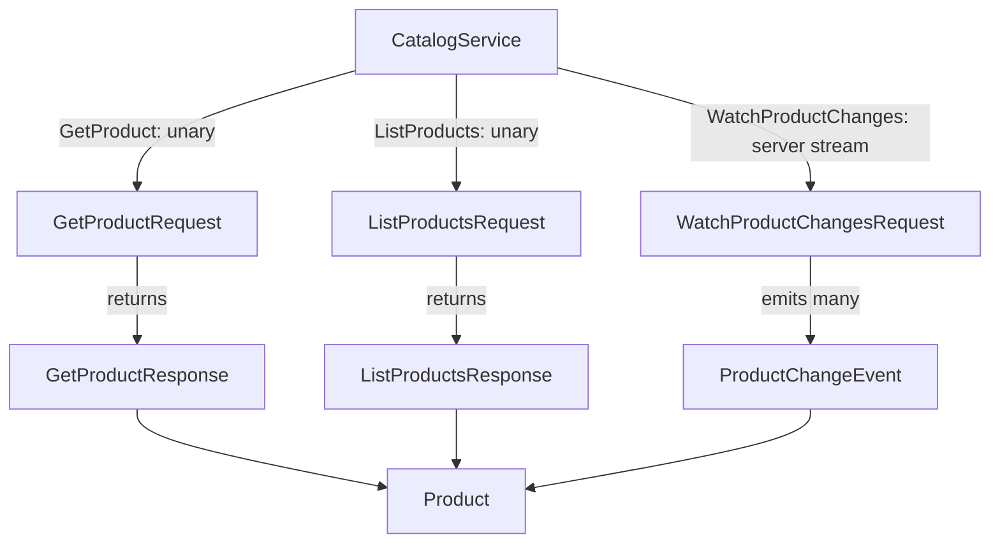

# Đặt tên message, field và service trong Spring gRPC

Trong **Spring gRPC**, hợp đồng `.proto` mô tả kiểu dữ liệu và các RPC mà client và server cùng sử dụng. Tên trong hợp đồng sẽ xuất hiện ở nhiều nơi: source code Java do Protocol Buffers sinh ra, tên phương thức gRPC trên mạng, dữ liệu ProtoJSON, tài liệu API và đôi khi cả log, metric hoặc trace. Một schema có tên dễ hiểu giúp nhóm phát triển triển khai unary và streaming RPC, xử lý lỗi, kiểm thử và vận hành thuận lợi hơn.

Bài này thuộc phần **Schema design** của module **SPRING_GRPC**. Trọng tâm là chọn tên nhất quán, có ý nghĩa nghiệp vụ cho `message`, `field` và `service`, sau đó hiểu những gì thay đổi khi cần đổi tên trong một API đã được sử dụng.

Sau bài học, bạn có thể:

- Áp dụng quy ước `UpperCamelCase` cho message, service và RPC; `snake_case` cho field.
- Phân biệt tên tài nguyên, tên request/response và tên thao tác; đặt tên rõ cho unary và streaming.
- Nhận ra sự khác nhau giữa tên trong proto, tên Java được sinh và khóa JSON mặc định.
- Đánh giá tác động tương thích khi đổi tên field, message, service hoặc RPC.
- Tự rà soát một hợp đồng `.proto` trước khi dùng để sinh mã Spring gRPC.

## 1. Quy ước đặt tên nền tảng

Giả sử ta phát triển dịch vụ danh mục sản phẩm. Một quy ước phổ biến, dễ đọc cho Protocol Buffers là:

| Thành phần | Kiểu đặt tên | Ví dụ nên dùng | Ví dụ khó bảo trì |
| --- | --- | --- | --- |
| `message` | `UpperCamelCase`, thường là danh từ hoặc cụm danh từ | `Product`, `GetProductRequest`, `ProductChangeEvent` | `product`, `Get_Data`, `Data1` |
| `field` | `lower_snake_case`, mô tả một thuộc tính | `product_id`, `display_name`, `updated_at` | `ProductId`, `name2`, `str1` |
| `service` | `UpperCamelCase`, tên năng lực hoặc miền nghiệp vụ; thường kết thúc bằng `Service` | `CatalogService`, `InventoryService` | `Service1`, `UtilsService` |
| `rpc` | `UpperCamelCase`, bắt đầu bằng động từ thể hiện hành động | `GetProduct`, `ListProducts`, `WatchProductChanges` | `ProductGet`, `Handle`, `DoAction` |
| `enum` | Tên kiểu `UpperCamelCase`, giá trị `UPPER_SNAKE_CASE` | `ProductAvailability`, `PRODUCT_AVAILABILITY_IN_STOCK` | `availability`, `OK` |
| Proto `package` | Các thành phần chữ thường, có miền và phiên bản | `shop.catalog.v1` | `Common`, `everything` |

Các tên nên có ý nghĩa tự thân: `product_id` cho biết đó là định danh sản phẩm; `display_name` cho biết chuỗi hiển thị; `GetProductRequest` chỉ rõ thông điệp thuộc RPC nào. Tránh viết tắt nội bộ chưa được thống nhất. Với chữ viết tắt phổ biến như ID, SKU, URL, ưu tiên một quy ước nhất quán trong toàn bộ schema (chẳng hạn `product_id`, `sku`).

**Quy tắc cú pháp:** định danh protobuf có thể dùng chữ cái, chữ số và dấu gạch dưới nhưng không được bắt đầu bằng chữ số; không được dùng từ khóa cú pháp vào vị trí định danh không hợp lệ. Quy ước chữ hoa/chữ thường ở bảng trên là khuyến nghị thiết kế, không phải mọi cách viết khác đều bị `protoc` từ chối.

### Tên gắn với ngữ nghĩa, không gắn với cách cài đặt

Ưu tiên `CatalogService` hơn `CatalogDatabaseService` nếu API dành cho các client nghiệp vụ: hôm nay dữ liệu có thể nằm trong database, ngày mai có thể đến từ cache hoặc hệ thống khác. Tương tự, tên message `Product` diễn tả tài nguyên, còn `ProductRow` làm lộ cách lưu trữ nội bộ. Tuy nhiên, hãy dùng tên chính xác cho trường hợp thật sự chuyên biệt, ví dụ `ImportProductsRequest` dành cho tác vụ nhập dữ liệu.

## 2. Thiết kế một hợp đồng .proto nhất quán

Ví dụ sau có cả RPC unary (lấy và liệt kê sản phẩm) lẫn server streaming (theo dõi thay đổi sản phẩm). Đặt trong `src/main/proto/catalog/v1/catalog.proto`:

```proto
syntax = "proto3";

package shop.catalog.v1;

option java_package = "com.myshop.grpc.catalog.v1";
option java_multiple_files = true;
option java_outer_classname = "CatalogProto";

import "google/protobuf/timestamp.proto";

service CatalogService {
  rpc GetProduct(GetProductRequest) returns (GetProductResponse);
  rpc ListProducts(ListProductsRequest) returns (ListProductsResponse);
  rpc WatchProductChanges(WatchProductChangesRequest)
      returns (stream ProductChangeEvent);
}

enum ProductAvailability {
  PRODUCT_AVAILABILITY_UNSPECIFIED = 0;
  PRODUCT_AVAILABILITY_IN_STOCK = 1;
  PRODUCT_AVAILABILITY_OUT_OF_STOCK = 2;
}

message Product {
  string product_id = 1;
  string display_name = 2;
  ProductAvailability availability = 3;
  google.protobuf.Timestamp updated_at = 4;
}

message GetProductRequest {
  string product_id = 1;
}

message GetProductResponse {
  Product product = 1;
}

message ListProductsRequest {
  int32 page_size = 1;
  string page_token = 2;
}

message ListProductsResponse {
  repeated Product products = 1;
  string next_page_token = 2;
}

message WatchProductChangesRequest {
  string product_id = 1;
}

message ProductChangeEvent {
  Product product = 1;
  google.protobuf.Timestamp changed_at = 2;
}
```

Các số `= 1`, `= 2`, ... là **field number (tag)** phục vụ mã hóa protobuf. Chúng khác tên field và có ý nghĩa thiết yếu đối với tương thích dữ liệu nhị phân. Mỗi field trong một message phải có số riêng; khi đã phát hành, không tự ý đổi số hoặc tái sử dụng số của field đã xóa.

Sơ đồ mối quan hệ trong hợp đồng:



### Vì sao các tên được chọn như vậy?

- `Product` là một **kiểu dữ liệu nghiệp vụ** có thể tái sử dụng trong nhiều kết quả; nó không bị gắn với riêng một thao tác.
- `GetProductRequest` và `GetProductResponse` cho biết chính xác cặp thông điệp của `GetProduct`. Cách đặt theo `<RpcName>Request` / `<RpcName>Response` giúp tìm kiếm và sinh mã dễ hơn khi số RPC tăng lên.
- `GetProduct` diễn tả hành động lấy một sản phẩm. Điều kiện tìm kiếm cụ thể nằm trong `GetProductRequest.product_id`, không cần lồng toàn bộ chi tiết vào tên RPC như `GetProductByProductIdFromDatabase`.
- `ListProducts` dùng danh từ số nhiều cho tập kết quả. `products` là field `repeated`, còn `page_size` và `page_token` thể hiện rõ hai tham số phân trang.
- `WatchProductChanges` biểu thị việc client đăng ký theo dõi; `ProductChangeEvent` mô tả mỗi sự kiện server phát ra trong stream. Tên phương thức giúp phân biệt “theo dõi nhiều sự kiện” với “lấy một kết quả”.
- `updated_at` và `changed_at` là thời điểm; kiểu `google.protobuf.Timestamp` nói rõ ngữ nghĩa hơn một số nguyên mơ hồ tên `time`.
- `ProductAvailability` mô tả một tập trạng thái hữu hạn; tên enum value được thêm tiền tố loại enum để tránh nhầm lẫn trong những ngôn ngữ có phạm vi tên khác nhau.

Vì gRPC định nghĩa các phương thức theo kiểu input/output message, kể cả khi thao tác không có tham số hay không cần dữ liệu trả về, vẫn nên thiết kế request/response rõ ràng. Với trường hợp thực sự rỗng, có thể dùng `google.protobuf.Empty` thay vì tự chế các kiểu `EmptyRequest1` hoặc `NothingResponse`.

## 3. Đặt tên message: tách tài nguyên, lệnh gọi và sự kiện

### Message mô tả đối tượng

Tên như `Product`, `Category`, `InventoryLevel` nói lên **dữ liệu là gì**. Ưu tiên danh từ số ít cho một đối tượng, dù có thể xuất hiện trong danh sách:

```proto
message Product {
  string product_id = 1;
  string display_name = 2;
}

message ListProductsResponse {
  repeated Product products = 1;
}
```

Không cần đặt tên kiểu là `Products` chỉ vì có RPC trả về nhiều sản phẩm; sự lặp lại được thể hiện bằng `repeated` và tên field số nhiều.

### Message mô tả request/response

Gắn tên message với RPC để tránh trùng `Request`/`Response` giữa nhiều service:

```proto
rpc GetProduct(GetProductRequest) returns (GetProductResponse);
rpc ListProducts(ListProductsRequest) returns (ListProductsResponse);
```

Với API lớn, một request có thể chứa bộ lọc, phân trang, ngôn ngữ hiển thị hoặc tùy chọn truy vấn. Tên `ListProductsRequest` vẫn hợp lý sau khi thêm các field tương thích. Không cần tạo `ProductQuery2` chỉ vì bản đầu tiên chỉ có một tiêu chí.

### Message mô tả sự kiện trong stream

Tên `ProductChangeEvent` nhấn mạnh từng phần tử của stream là một **sự kiện**, có thể bao gồm thời điểm và trạng thái sản phẩm. Nếu stream chỉ gửi các snapshot, tên `ProductSnapshot` sẽ chính xác hơn. Cách đặt tên phản ánh hợp đồng dữ liệu, tránh làm client suy đoán ý nghĩa của từng message.

Không phải mọi RPC streaming đều cần hậu tố `Stream` trong tên message. Kiểu truyền là phần khai báo `stream` của `rpc`; message nên được đặt theo nội dung thực tế.

## 4. Đặt tên field: rõ dữ liệu, số lượng và đơn vị

Một tên field tốt cho phép người đọc trả lời “giá trị này biểu thị điều gì?” mà ít cần giải thích bổ sung.

| Tình huống | Nên dùng | Tránh dùng | Lý do |
| --- | --- | --- | --- |
| Định danh | `product_id`, `order_id` | `id1`, `key` | Xác định đối tượng được tham chiếu. |
| Giá trị hiển thị | `display_name` | `name_str` | Nêu vai trò thay vì kiểu dữ liệu. |
| Danh sách | `products`, `product_ids` | `product_list_data` | Tên số nhiều cộng với `repeated` thể hiện rõ số lượng. |
| Số đếm | `item_count` | `number` | Nêu đối tượng đang được đếm. |
| Kích thước | `payload_size_bytes` | `size` | Cho biết đơn vị đo. |
| Độ trễ/thời lượng | `retry_delay` với kiểu `Duration` | `retry_time` | Phân biệt độ dài thời gian với thời điểm. |
| Thời điểm | `created_at`, `updated_at` với kiểu `Timestamp` | `date_value` | Biểu đạt thời điểm xảy ra sự kiện. |
| Phân trang | `page_size`, `next_page_token` | `limit1`, `next` | Thống nhất ý nghĩa request/response. |

Với trường Boolean, chọn một cách diễn đạt nhất quán, chẳng hạn `is_active`, `has_discount`, `allow_backorder`. Tránh tên phủ định kép như `is_not_disabled`. Không nên đặt hậu tố `_str`, `_int` chỉ để lặp lại kiểu trường đã có trong schema.

### Giá trị vắng mặt khác giá trị mặc định

Trong proto3, các scalar thông thường như `bool` và `int32` có giá trị mặc định khi chưa được gán. Nếu nghiệp vụ cần biết một giá trị **có được client gửi hay không**, hãy mô hình hóa sự hiện diện bằng `optional` hoặc cấu trúc phù hợp, thay vì đặt thêm field mơ hồ như `value_is_set`:

```proto
message UpdateProductRequest {
  string product_id = 1;
  optional string display_name = 2;
}
```

Ở đây `optional` giúp phân biệt trường `display_name` không được gửi với việc được gửi là chuỗi rỗng. Với thao tác cập nhật nhiều field, có thể cân nhắc `google.protobuf.FieldMask` để mô tả các field được phép cập nhật. Quy ước tên và cách biểu diễn sự hiện diện là hai quyết định thiết kế có liên quan nhưng không thay thế cho nhau.

### Field name và tên JSON có thể khác nhau

Proto dùng `snake_case`:

```proto
message GetProductRequest {
  string product_id = 1;
}
```

Trong **ProtoJSON** (JSON mapping chuẩn của Protocol Buffers), khóa được xuất ra mặc định là `productId`:

```json
{
  "productId": "P-100"
}
```

Đây là ánh xạ theo quy tắc ProtoJSON, không phải vì có một field `productId` khác trong proto. Khi đổi tên field, khóa JSON mặc định cũng có thể đổi, dù field number vẫn giữ nguyên. Option `json_name` có thể ấn định tên JSON khi thật sự cần duy trì tương thích, nhưng không tự giải quyết mọi thay đổi ở mã sinh hoặc reflection.

## 5. Đặt tên service và RPC: hợp đồng đi qua mạng

Một `service` nên nhóm các hành động có quan hệ nghiệp vụ và vòng đời hợp đồng gần nhau:

```proto
service CatalogService {
  rpc GetProduct(GetProductRequest) returns (GetProductResponse);
  rpc ListProducts(ListProductsRequest) returns (ListProductsResponse);
}

service InventoryService {
  rpc GetStock(GetStockRequest) returns (GetStockResponse);
}
```

`CatalogService` phục vụ danh mục; `InventoryService` phục vụ tồn kho. Tránh tạo một `CommonService` chứa mọi hành động không liên quan hoặc tách mỗi RPC thành một service độc lập mà không có nhu cầu rõ ràng. Một nhóm có thể cân nhắc ranh giới theo quyền sở hữu, quyền truy cập, tần suất thay đổi và cách vận hành; quy ước tên chỉ giúp thể hiện quyết định đó.

### Động từ cho RPC unary

- `GetProduct`: lấy một tài nguyên được định danh.
- `ListProducts`: liệt kê nhiều tài nguyên, có thể lọc/phân trang.
- `CreateProduct`: tạo một tài nguyên.
- `UpdateProduct`: cập nhật một tài nguyên.
- `DeleteProduct`: xóa một tài nguyên.

Đây là quy ước hữu ích chứ không phải tập động từ bắt buộc. Với hành động nghiệp vụ cụ thể, `ReserveStock` hoặc `ConfirmOrder` rõ hơn các tên quá chung như `Process` hoặc `Execute`.

### Động từ cho RPC streaming

Kiểu streaming được xác định bằng vị trí của từ khóa `stream`, không phải bằng tên phương thức:

```proto
service InventoryService {
  // Một request, nhiều response: server streaming.
  rpc WatchStock(WatchStockRequest) returns (stream StockChangeEvent);

  // Nhiều request, một response: client streaming.
  rpc UploadStockChanges(stream StockChange) returns (UploadStockChangesResponse);

  // Nhiều request và nhiều response: bidirectional streaming.
  rpc SyncStock(stream SyncStockRequest) returns (stream SyncStockResponse);
}
```

Các kiểu `WatchStockRequest`, `StockChangeEvent`, `StockChange`, `UploadStockChangesResponse`, `SyncStockRequest` và `SyncStockResponse` cần được khai báo trong schema thực tế; đoạn trên chỉ minh họa cách tên RPC diễn đạt hướng tương tác. `Watch...` phù hợp khi server đẩy thay đổi theo thời gian, `Upload...` phù hợp khi client gửi một luồng dữ liệu và `Sync...` phù hợp khi hai bên trao đổi liên tục. Tên chính xác phải phản ánh ngữ nghĩa nghiệp vụ, vì một tên `StreamData` không cho biết client đang kỳ vọng điều gì.

### Tên đầy đủ của RPC

Với:

```proto
package shop.catalog.v1;

service CatalogService {
  rpc GetProduct(GetProductRequest) returns (GetProductResponse);
}
```

gRPC nhận diện service là `shop.catalog.v1.CatalogService` và phương thức theo đường dẫn:

```text
/shop.catalog.v1.CatalogService/GetProduct
```

Chính tên **proto package**, `service` và `rpc` tạo nên tên RPC đầy đủ. `option java_package` chỉ điều khiển package Java được sinh ra; đổi riêng Java package không thay đổi đường dẫn RPC. Khi triển khai interceptors, metrics, tracing hoặc kiểm tra các lời gọi bằng công cụ như `grpcurl`, các tên service/method đầy đủ này thường xuất hiện trong kết quả quan sát.

## 6. Tên trong .proto được sinh thành tên Java thế nào?

Từ hợp đồng ở mục 2, khi cấu hình `protoc` cùng plugin gRPC Java, code sinh ra thường có các lớp như:

```text
com.myshop.grpc.catalog.v1
  ├── CatalogServiceGrpc
  ├── Product
  ├── ProductAvailability
  ├── GetProductRequest
  ├── GetProductResponse
  ├── ListProductsRequest
  └── ListProductsResponse
```

Vì `java_multiple_files = true`, các message/enum được sinh thành lớp cấp cao độc lập. Lớp `CatalogServiceGrpc` do plugin gRPC Java sinh để chứa stub và cơ sở triển khai service.

Quy tắc thường gặp:

| Proto | Java sinh ra hoặc API tương ứng |
| --- | --- |
| `message GetProductRequest` | Lớp `GetProductRequest` |
| `string product_id = 1;` | `request.getProductId()`, builder `setProductId(...)` |
| `string display_name = 2;` | `product.getDisplayName()`, builder `setDisplayName(...)` |
| `service CatalogService` | `CatalogServiceGrpc` |
| `rpc GetProduct(...)` | Phương thức Java `getProduct(...)` trong lớp cơ sở server/stub |

Ví dụ handler unary minh họa các tên được sinh. Giả sử server đã cấu hình tích hợp Spring gRPC và sinh mã từ proto ở trên:

```java
package com.myshop.server.catalog;

import com.myshop.grpc.catalog.v1.CatalogServiceGrpc;
import com.myshop.grpc.catalog.v1.GetProductRequest;
import com.myshop.grpc.catalog.v1.GetProductResponse;
import com.myshop.grpc.catalog.v1.Product;
import io.grpc.Status;
import io.grpc.stub.StreamObserver;
import org.springframework.grpc.server.service.GrpcService;

@GrpcService
public class CatalogEndpoint
        extends CatalogServiceGrpc.CatalogServiceImplBase {

    @Override
    public void getProduct(
            GetProductRequest request,
            StreamObserver<GetProductResponse> observer) {

        if (request.getProductId().isBlank()) {
            observer.onError(Status.INVALID_ARGUMENT
                    .withDescription("product_id is required")
                    .asRuntimeException());
            return;
        }

        Product product = Product.newBuilder()
                .setProductId(request.getProductId())
                .setDisplayName("Sản phẩm mẫu")
                .build();

        observer.onNext(GetProductResponse.newBuilder()
                .setProduct(product)
                .build());
        observer.onCompleted();
    }
}
```

Method proto có tên `GetProduct`, nhưng method Java override là `getProduct`. Field proto là `product_id`, nhưng accessor Java là `getProductId()`. Đó là hai quy ước đặt tên khác nhau được trình sinh mã nối với nhau. Class tự viết `CatalogEndpoint` thuộc `com.myshop.server.catalog` không cần nằm chung package với stub.

Trong ví dụ, `Status.INVALID_ARGUMENT` biểu diễn lỗi validate input theo chuẩn gRPC. Không nên thêm field `error_message` vào mọi response chỉ để thay thế status: tên và cấu trúc của hợp đồng dữ liệu phải phù hợp với mô hình trạng thái/lỗi mà client gRPC hiểu.

## 7. Đổi tên có phá vỡ tương thích không?

**Có thể có, tùy bạn đổi tên ở tầng nào và client dùng dữ liệu theo cách nào.** Khi schema đã được phát hành, cần phân biệt giữa mã hóa nhị phân, ProtoJSON, API mã sinh và tên gRPC trên mạng.

| Thay đổi | Với dữ liệu protobuf nhị phân | Với ứng dụng và API |
| --- | --- | --- |
| Đổi `product_id` thành `item_id`, **giữ nguyên số 1 và kiểu `string`** | Một message thông thường vẫn được đọc theo tag 1/kiểu tương ứng. | API Java và khóa JSON mặc định có thể đổi; client phụ thuộc tên cũ cần sửa. |
| Đổi tên `GetProductRequest` | Các field của message không tự đổi cách mã hóa chỉ vì tên message đổi. | Tham chiếu kiểu trong proto, code sinh, reflection, `Any` (nếu dùng) có thể bị ảnh hưởng. |
| Đổi tên `CatalogService` | Không phải thay đổi kiểu mã hóa message. | **Đổi tên service đầy đủ và đường dẫn RPC**; client gọi tên cũ có thể nhận `UNIMPLEMENTED`. |
| Đổi tên `GetProduct` thành `FetchProduct` | Không tự đổi payload protobuf. | **Đổi đường dẫn RPC** từ `.../GetProduct` sang `.../FetchProduct`; client/stub cũ cần chuyển đổi. |
| Đổi `java_package`, giữ nguyên proto package/service/RPC | Không tự thay đổi tên RPC hoặc wire format message. | Import, package và binary API Java thay đổi; cần sinh lại và cập nhật mã Java. |
| Đổi field number hoặc tái sử dụng tag đã xóa | Có thể khiến dữ liệu được diễn giải sai hoặc không tương thích. | Tránh thay đổi; lưu các tag đã bỏ vào `reserved`. |

Ví dụ: sau khi phát hành API, bạn muốn dùng tên `display_title` thay cho `display_name`. Đổi:

```proto
// Phiên bản cũ:
string display_name = 2;

// Phiên bản mới, cùng tag và type:
string display_title = 2;
```

Không đảm bảo mọi client tiếp tục hoạt động dù payload nhị phân vẫn tương thích ở field 2. Mã Java sẽ dùng accessor mới (`getDisplayTitle()` thay vì `getDisplayName()`); ProtoJSON mặc định sẽ dùng khóa khác; công cụ dựa trên descriptor cũng nhận thấy thay đổi tên. Thực hiện migration theo phạm vi sử dụng thực tế, không đánh giá an toàn chỉ bằng việc hai message giải mã được cùng dữ liệu nhị phân.

Khi **xóa hẳn** một field, hãy đánh dấu số và tên cũ là `reserved`:

```proto
message Product {
  reserved 5;
  reserved "legacy_category";

  string product_id = 1;
  string display_name = 2;
}
```

Điều này ngăn người sửa schema vô tình sử dụng lại tag 5 hoặc tên `legacy_category` trong cùng message. Không dùng `reserved` để “đổi tên” một field vẫn đang tồn tại dưới cùng tên/số; nó phục vụ việc bảo vệ các định danh đã ngừng sử dụng.

Với thay đổi tên service/RPC đã công bố, phương án an toàn thường là giữ đường dẫn cũ trong giai đoạn chuyển tiếp hoặc phát hành API phiên bản mới bên cạnh API cũ. Đổi tên `java_package` là câu chuyện khác: phía Java phải cập nhật mã/artefact sinh ra, nhưng client không cần đổi endpoint chỉ vì Java package đổi.

## 8. Những tên dễ gây lỗi khi mở rộng hệ thống

| Tên chưa tốt | Vấn đề | Gợi ý cải thiện |
| --- | --- | --- |
| `Data`, `Info`, `Result` | Không biết dữ liệu thuộc miền nào. | `Product`, `StockLevel`, `GetProductResponse` |
| `Request`, `Response` dùng chung cho mọi RPC | Nhiều RPC thay đổi độc lập; dễ xung đột kiểu. | `CreateProductRequest`, `CreateProductResponse` |
| `GetAllProducts` nhưng response có phân trang | Tên khiến client hiểu là trả hết trong một lần. | `ListProducts` với `page_size` và `next_page_token` |
| `product_list` khi field đã là `repeated Product` | Vừa dư nghĩa, vừa lệch quy ước số nhiều. | `products` |
| `timeout` kiểu `int32` mà không ghi đơn vị | Không rõ mili giây, giây hay phút. | `timeout_ms` hoặc kiểu `google.protobuf.Duration` phù hợp |
| `GetAndUpdateProduct` | Một RPC vừa đọc vừa ghi, gây bất ngờ và khó retry. | Phân tách hoặc đặt tên theo hành vi nghiệp vụ thật sự |
| `Stream`, `Process`, `Handle` | Không cho biết dữ liệu hoặc hành động cụ thể. | `WatchProductChanges`, `ConfirmOrder` |
| `status` không có enum/ngữ cảnh | Không rõ là trạng thái nghiệp vụ hay gRPC status. | `availability`, `order_state` hoặc tên miền cụ thể |

Trong hệ sinh thái Spring gRPC, tên nhất quán còn giúp xem log và metric theo method dễ hơn. Khi một service tên `CatalogService` chỉ chứa hành động của danh mục, việc gắn quyền truy cập, interceptor hoặc chính sách deadline theo service/method cũng dễ kiểm tra hơn. Tuy nhiên, tên rõ ràng không thay thế việc kiểm soát TLS, authorization, giới hạn tài nguyên hay kiểm thử tích hợp.

## 9. Checklist review trước khi phát hành schema

1. **Message:** mỗi kiểu có tên `UpperCamelCase` và đại diện một đối tượng, request, response hay event xác định? Có tên quá chung như `Data`/`Payload` không?
2. **Field:** tất cả dùng `snake_case`, có ngữ nghĩa, số ít/số nhiều đúng và đơn vị đo rõ ràng? Các tag có duy nhất trong mỗi message không?
3. **RPC:** tên bắt đầu bằng động từ diễn tả hành vi thật, nhất quán `Get/List/Create/Update/Delete/Watch/...`? Chữ `stream` trong khai báo có khớp với kỳ vọng của tên phương thức không?
4. **Service:** các RPC có thuộc cùng miền nghiệp vụ và quyền sở hữu tương đối ổn định? Tên service có tránh lộ chi tiết triển khai như `Db`, `Jdbc` không?
5. **Mã sinh:** `java_package` đã rõ ràng, lớp Java và accessor dự kiến có dễ sử dụng trong Spring? Có trùng tên message/enum trong package không?
6. **Tương thích:** nếu đây là sửa đổi của API đã phát hành, đã đối chiếu binary, JSON, code sinh và đường dẫn RPC chưa? Field đã xóa có `reserved` để tránh tái sử dụng?
7. **Kiểm chứng:** biên dịch proto bằng `protoc` và plugin gRPC Java, sử dụng stub thật để xác minh một lời gọi; kiểm tra tên RPC đầy đủ trong test hoặc gRPC reflection nếu server bật tính năng đó.

Ví dụ, với server thử nghiệm đang chạy plaintext ở `localhost:9090`, có thể kiểm tra đường dẫn RPC theo tên proto:

```bash
grpcurl -plaintext -import-path src/main/proto \
  -proto catalog/v1/catalog.proto \
  -d '{"productId":"P-100"}' \
  localhost:9090 shop.catalog.v1.CatalogService/GetProduct
```

Ở lệnh này, `productId` là khóa JSON theo mapping mặc định của `product_id`; `shop.catalog.v1.CatalogService/GetProduct` là tên service/method từ proto. Lệnh chỉ hoạt động khi server, cổng và chế độ kết nối phù hợp với môi trường đang chạy.

## 10. Tự kiểm tra

**Câu 1.** Bạn gặp đoạn proto:

```proto
message data {
  string ProductName = 1;
  repeated string product_list = 2;
}
service UtilService {
  rpc DoIt(data) returns (data);
}
```

Bạn sẽ đổi tên những gì nếu nghiệp vụ thực tế là tra cứu sản phẩm theo mã?

**Gợi ý đáp án:** Tách `GetProductRequest` (có `product_id`) và `GetProductResponse` (có `Product product`), định nghĩa `Product` với `display_name`, dùng `CatalogService` và `GetProduct`. Không nên giữ kiểu `data` dùng cho cả input và output khi ý nghĩa hai phía khác nhau. Nếu đã phát hành, cần có kế hoạch migration vì đổi tên service/RPC ảnh hưởng đường dẫn gRPC.

**Câu 2.** Field `product_id = 1` được đổi thành `item_id = 1` nhưng vẫn là `string`. Server và client đều dùng protobuf nhị phân. Có thể kết luận hoàn toàn không có thay đổi gây lỗi?

**Gợi ý đáp án:** Không. Binary field 1 thường vẫn giải mã được khi kiểu giữ nguyên, nhưng code sinh, tham chiếu descriptor và khóa ProtoJSON mặc định có thể thay đổi. Cần kiểm tra các bên tiêu thụ.

**Câu 3.** Vì sao nên đặt phương thức server streaming là `WatchProductChanges` và message trả về là `ProductChangeEvent`, thay vì cùng đặt tên `Stream`?

**Gợi ý đáp án:** Tên đầu tiên nói rõ hành động đăng ký theo dõi, còn tên thứ hai nói rõ ý nghĩa mỗi phần tử trong luồng. Kiểu truyền vẫn do `returns (stream ProductChangeEvent)` quyết định. Tách tên hành động và tên dữ liệu làm hợp đồng dễ hiểu, dễ quan sát và mở rộng.

**Câu 4.** Với `rpc GetProduct(GetProductRequest) returns (GetProductResponse);` trong `package shop.catalog.v1;` và `service CatalogService`, tên nào xuất hiện trong đường dẫn gRPC, còn tên method nào thường xuất hiện trong implementation Java?

**Gợi ý đáp án:** Đường dẫn gRPC là `/shop.catalog.v1.CatalogService/GetProduct`; method Java override thường là `getProduct(...)`. Tên package Java không quyết định đường dẫn gRPC.

Để thiết kế schema bền vững, hãy coi tên message là **từ vựng miền nghiệp vụ**, tên field là **hợp đồng dữ liệu**, và tên service/RPC là **giao diện vận hành trên mạng**. Giữ chúng rõ ràng ngay từ đầu giúp các client/server Spring gRPC, kể cả unary và streaming, dễ tích hợp và ít gây thay đổi bất ngờ khi hệ thống phát triển.
