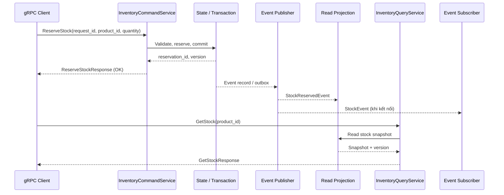

# Tách command, query và event message trong Spring gRPC

Khi xây dựng dịch vụ **Spring gRPC**, một file Protocol Buffers (`.proto`) có thể định nghĩa cả thao tác thay đổi dữ liệu, thao tác truy vấn và dữ liệu sự kiện phát sinh sau thay đổi. Nếu cả ba đều dùng chung một message kiểu `Data` hoặc `Request`, client khó hiểu trường nào cần gửi, server dễ vô tình trả hoặc sửa những thuộc tính không liên quan, và schema khó phát triển khi hệ thống có nhiều bên tiêu thụ.

Trong chương **Schema design** của module **SPRING_GRPC**, cách thiết kế hữu ích là phân biệt rõ:

- **Command**: yêu cầu hệ thống thực hiện một hành động có thể thay đổi trạng thái.
- **Query**: yêu cầu đọc thông tin mà không làm thay đổi trạng thái nghiệp vụ.
- **Event**: ghi nhận một sự việc **đã xảy ra** và có thể được phát cho các bên quan tâm.

Đây là cách tổ chức **hợp đồng thông điệp**. Nó có liên hệ với CQRS (Command Query Responsibility Segregation), nhưng không bắt buộc triển khai hai cơ sở dữ liệu, dùng event sourcing hay tách thành ba microservice. Một ứng dụng Spring có thể áp dụng cách phân biệt này ngay cả khi vẫn dùng cùng một database và một tiến trình server.

Sau bài học, bạn có thể thiết kế message cho từng vai trò, định nghĩa RPC unary/streaming phù hợp, xử lý retry và tính nhất quán, đồng thời đánh giá tác động khi thay đổi hợp đồng Protocol Buffers.

## 1. Ba loại thông điệp trả lời ba câu hỏi khác nhau

Giả sử hệ thống bán hàng có dịch vụ quản lý tồn kho:

| Loại | Câu hỏi cần trả lời | Ví dụ message | Kết quả mong đợi |
| --- | --- | --- | --- |
| **Command** | “Hãy làm gì?” | `ReserveStockRequest` | Đặt giữ 2 sản phẩm nếu đủ hàng; trả thông tin kết quả hoặc lỗi |
| **Query** | “Hiện biết gì?” | `GetStockRequest` | Đọc số lượng khả dụng, số lượng đang giữ và phiên bản dữ liệu |
| **Event** | “Điều gì đã xảy ra?” | `StockReservedEvent` | Thông báo một lượt giữ hàng đã được chấp nhận và ghi nhận |

Tên command thường bắt đầu bằng **động từ mệnh lệnh** (`ReserveStock`, `ReleaseReservation`). Tên query thường bắt đầu bằng **Get/List/Search** (`GetStock`, `ListReservations`). Tên event thường ở **dạng quá khứ** (`StockReservedEvent`, `ReservationReleasedEvent`).

Không nên đổi `StockReservedEvent` thành `ReserveStockEvent`: cách thứ hai dễ bị hiểu là “yêu cầu giữ kho”, trong khi sự kiện là sự thật đã xảy ra. Một event cũng không phải response của một RPC chỉ vì nó chứa một số field giống response; nó có vòng đời, người nhận và yêu cầu tương thích riêng.

### Khác nhau về ý nghĩa và trách nhiệm

| Tiêu chí | Command | Query | Event |
| --- | --- | --- | --- |
| Chủ thể khởi tạo | Client muốn thay đổi trạng thái | Client cần đọc dữ liệu | Thành phần đã xác nhận một sự việc |
| Thời điểm diễn tả | Ý định ở hiện tại/tương lai | Trạng thái được quan sát khi đọc | Sự việc đã xảy ra trong quá khứ |
| Có thể bị từ chối? | Có, bởi validation, quyền, điều kiện nghiệp vụ hoặc xung đột | Có thể lỗi truy vấn, nhưng kết quả rỗng thường vẫn hợp lệ | Event đã ghi nhận không được “từ chối” như một yêu cầu mới; consumer có thể lỗi khi xử lý |
| Dữ liệu cốt lõi | Mục tiêu, tham số thay đổi, idempotency key, điều kiện | Tiêu chí tra cứu, bộ lọc, phân trang | Event ID, aggregate ID, thời điểm, phiên bản, payload sự việc |
| Cơ chế gRPC thường gặp | Unary RPC; đôi khi client streaming | Unary RPC; đôi khi server streaming kết quả | Server streaming để nhận thông báo trực tiếp |
| Lưu ý retry | Có nguy cơ thực thi trùng khi client không biết kết quả | Thường có thể gọi lại nếu là truy vấn thuần | Có thể nhận lại event; cần quy tắc deduplicate nếu nguồn cho phép replay |

**Kiểu RPC không quyết định bản chất nghiệp vụ.** Server streaming có thể dùng cho truy vấn trả nhiều phần tử; unary có thể nhận command. Điều quan trọng là nội dung message và cam kết xử lý của API.

## 2. Một ví dụ xuyên suốt: hợp đồng Inventory

Hãy xây dựng ba nhóm thao tác: giữ hàng, đọc số tồn và theo dõi biến động. File `src/main/proto/inventory/v1/inventory.proto`:

```proto
syntax = "proto3";

package shop.inventory.v1;

option java_package = "com.myshop.grpc.inventory.v1";
option java_multiple_files = true;
option java_outer_classname = "InventoryProto";

import "google/protobuf/timestamp.proto";

// Command: tác động đến trạng thái nghiệp vụ.
service InventoryCommandService {
  rpc ReserveStock(ReserveStockRequest) returns (ReserveStockResponse);
  rpc ReleaseReservation(ReleaseReservationRequest)
      returns (ReleaseReservationResponse);
}

// Query: đọc dữ liệu nghiệp vụ.
service InventoryQueryService {
  rpc GetStock(GetStockRequest) returns (GetStockResponse);
}

// Phát sự kiện đang diễn ra tới client có kết nối.
service InventoryEventService {
  rpc WatchStockEvents(WatchStockEventsRequest) returns (stream StockEvent);
}

message ReserveStockRequest {
  string product_id = 1;
  int64 quantity = 2;
  // Client giữ nguyên ID này khi thử lại cùng một ý định.
  string request_id = 3;
  // Nếu được cung cấp, phải khớp phiên bản tồn kho hiện tại.
  optional int64 expected_version = 4;
}

message ReserveStockResponse {
  string reservation_id = 1;
  int64 resulting_version = 2;
  google.protobuf.Timestamp reserved_at = 3;
}

message ReleaseReservationRequest {
  string reservation_id = 1;
  string request_id = 2;
}

message ReleaseReservationResponse {
  string reservation_id = 1;
  int64 resulting_version = 2;
  google.protobuf.Timestamp released_at = 3;
}

message GetStockRequest {
  string product_id = 1;
}

message StockSnapshot {
  string product_id = 1;
  int64 available_quantity = 2;
  int64 reserved_quantity = 3;
  int64 version = 4;
  google.protobuf.Timestamp observed_at = 5;
}

message GetStockResponse {
  StockSnapshot stock = 1;
}

message WatchStockEventsRequest {
  // Rỗng: chỉ nhận các sự kiện mà client có quyền theo dõi.
  string product_id = 1;
}

// Envelope: thông tin chung cho mọi biến động tồn kho.
message StockEvent {
  string event_id = 1;
  string product_id = 2;
  int64 aggregate_version = 3;
  google.protobuf.Timestamp occurred_at = 4;

  oneof detail {
    StockReservedEvent stock_reserved = 5;
    ReservationReleasedEvent reservation_released = 6;
  }
}

message StockReservedEvent {
  string reservation_id = 1;
  int64 quantity = 2;
  string request_id = 3;
}

message ReservationReleasedEvent {
  string reservation_id = 1;
  int64 quantity = 2;
  string request_id = 3;
}
```

Đoạn trên là **proto đầy đủ về mặt khai báo message/service**, dùng chung một `package shop.inventory.v1` để hợp đồng có namespace ổn định. Các service được tách theo vai trò để dễ đọc và quản lý quyền; đây là một lựa chọn thiết kế. Nếu API nhỏ, một `InventoryService` có các RPC tương ứng vẫn có thể hợp lý, miễn là request, response và event giữ được ngữ nghĩa riêng.

Ba loại thông điệp cùng nhắc tới `product_id`, nhưng có mục đích khác nhau:

- `ReserveStockRequest.product_id`: đối tượng **muốn** giữ hàng; `quantity` là số lượng yêu cầu.
- `GetStockRequest.product_id`: đối tượng **muốn đọc** tồn kho hiện có.
- `StockEvent.product_id`: đối tượng **đã phát sinh** một sự việc, dùng để định tuyến hoặc nhóm sự kiện.

Không có lý do để gửi toàn bộ `StockSnapshot` trong `ReserveStockRequest` hoặc sử dụng `GetStockResponse` làm event: làm vậy buộc client cung cấp dữ liệu server đã biết và làm trộn lẫn ba trách nhiệm.

## 3. Thiết kế command: yêu cầu hành động, có kiểm tra và kết quả

### 3.1. Request chỉ mang thông tin để thực hiện hành động

```proto
message ReserveStockRequest {
  string product_id = 1;
  int64 quantity = 2;
  string request_id = 3;
  optional int64 expected_version = 4;
}
```

Trong hợp đồng ví dụ, server cần kiểm tra:

1. `product_id` khác rỗng và client có quyền giữ hàng tương ứng.
2. `quantity` là số nguyên dương; dữ liệu kiểu `int64` không tự có nghĩa là được phép âm hoặc bằng 0.
3. `request_id` khác rỗng và được tạo mới cho **mỗi ý định nghiệp vụ khác nhau**. Client dùng lại đúng ID khi thử lại cùng một ý định.
4. Nếu `expected_version` hiện diện, giá trị phải khớp phiên bản hiện tại của sản phẩm theo cơ chế kiểm soát cạnh tranh đã công bố.
5. Số lượng có thể giữ phải đủ và không vi phạm quy tắc tồn kho.

Vì proto3 có giá trị mặc định cho số và chuỗi, server vẫn phải validate các điều kiện trên. `optional int64 expected_version` cho phép phân biệt **không cung cấp phiên bản** với **cố ý yêu cầu phiên bản 0**. Không nên dựa vào `getExpectedVersion() == 0` để suy ra field không có mặt; trong Java, kiểm tra `hasExpectedVersion()`.

### 3.2. Response là kết quả được xác nhận, không phải sự kiện

```proto
message ReserveStockResponse {
  string reservation_id = 1;
  int64 resulting_version = 2;
  google.protobuf.Timestamp reserved_at = 3;
}
```

Khi RPC kết thúc thành công, ví dụ này cam kết yêu cầu đã được chấp nhận **và thao tác giữ hàng đã commit**; response trả về mã lượt giữ hàng, phiên bản mới và thời điểm ghi nhận. Nếu server chỉ đưa công việc vào hàng đợi để xử lý sau, hợp đồng phải nói rõ trạng thái `accepted/pending` hoặc trả một operation ID: **được nhận để xử lý** không tương đương **đã hoàn tất**.

Không nên đặt `success = true` trong mọi response rồi dùng gRPC `OK` cho cả thao tác thất bại. gRPC có mã trạng thái riêng (`INVALID_ARGUMENT`, `FAILED_PRECONDITION`, `ABORTED`, v.v.), giúp client, interceptor và metric hiểu kết quả lời gọi.

### 3.3. Tại sao command cần idempotency key?

Giả sử server đã giữ 2 sản phẩm, nhưng kết nối bị ngắt trước khi client nhận response. Client thấy `DEADLINE_EXCEEDED` hoặc `UNAVAILABLE` **không thể suy ra** thao tác chắc chắn chưa xảy ra. Nếu gửi yêu cầu mới với một ID khác, hệ thống có thể giữ hàng lần thứ hai.

`request_id` giải quyết vấn đề này **khi** phía server triển khai cơ chế deduplicate đúng cách:

- Lưu kết quả gắn với ID, người gọi/phạm vi thích hợp và nội dung yêu cầu; hai lần dùng cùng ID cùng nội dung phải cho cùng kết quả theo thời gian lưu đã công bố.
- Nếu cùng ID nhưng payload khác, từ chối theo quy tắc lỗi đã tài liệu hóa.
- Bảo đảm check ID và thay đổi trạng thái diễn ra theo cơ chế nguyên tử/thỏa thuận nhất quán, tránh hai request song song cùng được thực thi.
- Xác định thời hạn lưu key và phạm vi áp dụng; chỉ khai báo `request_id` trong protobuf **không** tự tạo idempotency.

Một hành động như `ReserveStock` thường cần bảo vệ retry. Ngược lại, `GetStock` là thao tác đọc và không cần request ID nếu không có lý do đặc biệt.

### 3.4. Trạng thái lỗi của command

| Tình huống | Status gRPC có thể dùng | Ý nghĩa |
| --- | --- | --- |
| `quantity <= 0` hoặc thiếu `product_id` | `INVALID_ARGUMENT` | Request sai quy tắc đầu vào |
| Không có sản phẩm / lượt giữ tương ứng | `NOT_FOUND` | Đối tượng mục tiêu không tồn tại |
| Không đủ số lượng khả dụng | `FAILED_PRECONDITION` | Trạng thái hiện tại không cho phép thực hiện |
| `expected_version` lỗi thời trong cập nhật cạnh tranh | `ABORTED` (nếu hợp đồng quy định lỗi tranh chấp cần đọc lại và thử lại) | Xung đột đồng thời; client cần lấy state mới trước quyết định tiếp |
| Không được phép giữ hàng | `PERMISSION_DENIED` | Danh tính không đủ quyền |
| Dịch vụ phụ thuộc tạm thời không sẵn sàng | `UNAVAILABLE` | Lỗi hạ tầng; retry phải xét nguy cơ thực thi trùng |

Chọn mã status và chính sách retry **nhất quán** trong API. Với `ABORTED`, client không nên chỉ lặp lại vô hạn cùng `expected_version` đã lỗi thời; cần truy vấn trạng thái mới và quyết định lại. Nếu client không biết command đã commit hay chưa, phải dùng lại `request_id` trong phạm vi idempotency được server cam kết.

## 4. Thiết kế query: mô tả dữ liệu cần đọc

```proto
message GetStockRequest {
  string product_id = 1;
}

message GetStockResponse {
  StockSnapshot stock = 1;
}

message StockSnapshot {
  string product_id = 1;
  int64 available_quantity = 2;
  int64 reserved_quantity = 3;
  int64 version = 4;
  google.protobuf.Timestamp observed_at = 5;
}
```

`GetStock` là truy vấn thuần nghiệp vụ: khi gọi, nó **không** tạo lượt giữ hàng, trừ số lượng hay phát `StockReservedEvent`. Logging, metrics và cache kỹ thuật có thể thay đổi mà không làm nó trở thành command theo nghĩa nghiệp vụ.

Response trả một `StockSnapshot` thay vì `ReserveStockResponse` vì client hỏi số lượng hiện có, không hỏi kết quả của một lần giữ hàng. Các field cũng thể hiện rõ ý nghĩa:

- `available_quantity`: số lượng có thể tiếp tục bán hoặc giữ theo quy tắc hệ thống.
- `reserved_quantity`: số lượng đã được giữ cho các giao dịch khác.
- `version`: phiên bản dữ liệu tồn kho, có thể dùng cùng cơ chế kiểm soát cạnh tranh.
- `observed_at`: thời điểm dữ liệu mà query quan sát, không mặc định là thời điểm server đang gửi response.

**Bài toán tính nhất quán:** nếu command ghi vào write model và query đọc một projection cập nhật bất đồng bộ, `ReserveStock` trả `OK` rồi `GetStock` ngay sau đó có thể vẫn thấy `version` cũ. Đó là **eventual consistency**. Thiết kế phải nói rõ query có đọc mạnh nhất quán hay không và client cần xử lý trạng thái cũ như thế nào.

Một cách để client biết projection đã bắt kịp là so sánh `GetStockResponse.stock.version` với `ReserveStockResponse.resulting_version`, **nếu** hệ thống cam kết hai giá trị dùng cùng bộ đếm phiên bản và projection cập nhật đơn điệu theo sản phẩm. Nếu không có cam kết này, không được tự suy ra hai version có thể so sánh trực tiếp.

Với query dạng danh sách, yêu cầu thường có `page_size`, `page_token` và filter; response nên có `repeated` records cùng `next_page_token`. Khi không có kết quả, trả danh sách rỗng với status `OK` thay vì `NOT_FOUND`. Trả dữ liệu nhiều trang không tự biến truy vấn thành event stream.

## 5. Thiết kế event: ghi lại sự thật đã xảy ra

Event có thể xuất hiện sau khi command thực thi thành công:

```proto
message StockEvent {
  string event_id = 1;
  string product_id = 2;
  int64 aggregate_version = 3;
  google.protobuf.Timestamp occurred_at = 4;

  oneof detail {
    StockReservedEvent stock_reserved = 5;
    ReservationReleasedEvent reservation_released = 6;
  }
}

message StockReservedEvent {
  string reservation_id = 1;
  int64 quantity = 2;
  string request_id = 3;
}
```

**Envelope `StockEvent`** chứa định danh chung của sự kiện, sản phẩm và phiên bản liên quan. Payload `StockReservedEvent` mô tả chi tiết một sự việc: mã lượt giữ hàng, số lượng đã giữ và request ID có thể dùng để tương quan với command gốc.

`oneof detail` biểu diễn tối đa một loại sự kiện trong envelope; server phải bảo đảm **có đúng một** loại trong những bản tin hợp lệ. Trong Java, client có thể kiểm tra `getDetailCase()` để biết payload nào đang hiện diện.

### Tách ý định khỏi sự thật đã ghi nhận

Xét ba thông điệp:

```text
Command:
  ReserveStockRequest(product_id="P-100", quantity=2, request_id="req-789")

Response sau commit:
  ReserveStockResponse(reservation_id="res-456", resulting_version=18)

Event đã xảy ra:
  StockEvent(
    event_id="evt-901",
    product_id="P-100",
    aggregate_version=18,
    stock_reserved={reservation_id:"res-456", quantity:2, request_id:"req-789"}
  )
```

Một command **có thể không tạo event** nếu bị từ chối do thiếu hàng, không hợp lệ hoặc không có quyền. Một command cũng có thể tạo **nhiều event** nếu quy trình nghiệp vụ có nhiều thay đổi độc lập. Đừng mặc định tỷ lệ một request = một event hoặc để client tự tạo `StockReservedEvent` chỉ vì đã gửi `ReserveStockRequest`.

### Các trường nên cân nhắc cho một event

| Trường | Mục đích | Điều cần quyết định |
| --- | --- | --- |
| `event_id` | Dedupe, hỗ trợ theo dõi một sự việc khi phát lại | Cách tạo ID và phạm vi duy nhất |
| `product_id` | Phân nhóm, phân vùng, định tuyến theo aggregate | Một event có thể liên quan nhiều đối tượng không? |
| `aggregate_version` | Nhận biết tiến trình thay đổi của từng sản phẩm | Có liên tục, tăng đơn điệu và không trùng trong một aggregate không? |
| `occurred_at` | Thời điểm sự việc đã được xác nhận | Đồng hồ, múi giờ, thứ tự không tuyệt đối giữa máy |
| `request_id` trong payload | Liên kết sự kiện với command gốc | Có được phép công khai cho mọi consumer? |
| Payload `stock_reserved` | Chi tiết vừa đủ để bên nhận hiểu sự việc | Cần các field nào, tránh lộ dữ liệu nhạy cảm |

Event nên phản ánh **dữ liệu cần thiết cho các consumer** thay vì sao chép toàn bộ entity database. Đối với message lưu giữ dài hạn, tránh phụ thuộc vào tên bảng/cột nội bộ, field mang thông tin cá nhân không cần thiết và kiểu dữ liệu chỉ có nghĩa trong một phiên bản code.

## 6. Luồng xử lý từ command đến query và event

Một kiến trúc phổ biến có thể được hình dung như sau:



Sơ đồ minh họa việc **tách hành vi và thông điệp**, không quy định một stack bắt buộc. Có hệ thống đọc trực tiếp cùng state mà command vừa cập nhật; có hệ thống dùng read projection bất đồng bộ. `InventoryEventService` có thể tiêu thụ từ hệ thống phát sự kiện nội bộ hoặc broker. Chọn cách triển khai theo nhu cầu throughput, độ trễ, độ tin cậy và vận hành.

**Điểm commit và công bố event:** nếu command commit thành công nhưng ứng dụng crash trước khi phát event, các consumer có thể không nhận được thay đổi. Transactional outbox là một giải pháp: cùng transaction ghi state và một bản ghi event/outbox; tiến trình độc lập đọc outbox để phát. Cách này giảm nguy cơ mất event nhưng việc phát lại vẫn có thể dẫn đến **gửi trùng**, nên consumer cần xử lý idempotent. Không nên khẳng định giao hàng “exactly once” chỉ vì có gRPC stream hoặc outbox.

### Tách message không bắt buộc tách hạ tầng

Có thể bắt đầu với một ứng dụng Spring Boot:

```text
Inventory application
├── gRPC command handler -> inventory domain service -> storage
├── gRPC query handler   -> inventory query service  -> storage / read model
└── event dispatcher    -> event source             -> gRPC stream
```

Sau này, khi cần scale đọc độc lập hoặc các nhóm có quyền sở hữu riêng, hệ thống có thể triển khai command/query/event thành các ứng dụng khác nhau. Dù vậy, **độ hạt tách service phải theo nhu cầu thực tế**; thiết kế message rõ nghĩa đã đem lại lợi ích ngay từ phiên bản đầu.

## 7. Server streaming cho event: hợp đồng phải nói rõ giới hạn

```proto
service InventoryEventService {
  rpc WatchStockEvents(WatchStockEventsRequest) returns (stream StockEvent);
}

message WatchStockEventsRequest {
  string product_id = 1;
}
```

Trong **ví dụ này**, ta quy ước `WatchStockEvents` là **live subscription**: client chỉ nhận những sự kiện được công bố sau khi server đăng ký thành công kết nối; RPC không cam kết truy xuất lịch sử hoặc tiếp tục từ điểm ngắt. Trường `product_id` rỗng có nghĩa là quan sát toàn bộ sản phẩm **trong phạm vi client được quyền**. Server cần kiểm tra quyền ngay cả với filter rỗng.

Với stream, các trường hợp sau có ý nghĩa khác nhau:

- **Không có event trong một khoảng thời gian:** stream vẫn có thể hoạt động bình thường; không phải `NOT_FOUND`.
- **Client hủy hoặc hết deadline:** server phải giải phóng subscription và tránh tiếp tục xử lý không cần thiết.
- **Kết nối bị gián đoạn:** client có thể bỏ lỡ event trong mô hình live-only. Tự kết nối lại không có nghĩa các event cũ được phát lại.
- **Consumer xử lý chậm:** có thể làm tăng hàng đợi và bộ nhớ. Ứng dụng phải dùng cơ chế flow control/backpressure hoặc giới hạn bộ đệm, timeout và chính sách cắt kết nối phù hợp.

Nếu cần **replay** hoặc tiếp tục từ sự kiện đã nhận, nên thiết kế một hợp đồng riêng có cursor/resume token, thời gian lưu sự kiện, thứ tự được bảo đảm và cách báo cursor hết hạn. Ví dụ có thể bổ sung `resume_after_event_id` **chỉ khi** backend thật sự lưu đủ lịch sử và hỗ trợ tra cứu điểm bắt đầu. Không nên thêm field đó để tạo cảm giác tin cậy khi hệ thống chỉ phát trực tiếp.

### Thứ tự và trùng lặp

`aggregate_version` hỗ trợ kiểm tra thứ tự của các thay đổi trên **cùng một sản phẩm** nếu server cam kết tăng phiên bản đơn điệu. Nó không tạo thứ tự tổng giữa mọi sản phẩm; timestamp cũng không thay thế một cam kết thứ tự toàn cục. Nếu consumer nhận lại `event_id` cũ, có thể xử lý trùng theo quy tắc idempotency. Với stream live-only, có ID không đồng nghĩa khả năng khôi phục toàn bộ event bị mất.

## 8. Mã Java minh họa client Spring gRPC

Khi cấu hình `protoc` và plugin gRPC Java cho file proto trên, các service tạo ra lớp `InventoryCommandServiceGrpc`, `InventoryQueryServiceGrpc` và `InventoryEventServiceGrpc` trong `com.myshop.grpc.inventory.v1`. Mã sau minh họa **một client Java** gọi unary command, unary query và đăng ký event. Trong ứng dụng Spring, `Channel` được cấp và quản lý bằng cấu hình client phù hợp.

```java
package com.myshop.client.inventory;

import com.myshop.grpc.inventory.v1.GetStockRequest;
import com.myshop.grpc.inventory.v1.GetStockResponse;
import com.myshop.grpc.inventory.v1.InventoryCommandServiceGrpc;
import com.myshop.grpc.inventory.v1.InventoryEventServiceGrpc;
import com.myshop.grpc.inventory.v1.InventoryQueryServiceGrpc;
import com.myshop.grpc.inventory.v1.ReserveStockRequest;
import com.myshop.grpc.inventory.v1.ReserveStockResponse;
import com.myshop.grpc.inventory.v1.StockEvent;
import com.myshop.grpc.inventory.v1.WatchStockEventsRequest;
import io.grpc.Channel;
import io.grpc.stub.StreamObserver;
import java.util.UUID;
import java.util.concurrent.TimeUnit;

public final class InventoryClientExample {

    public static void reserveThenRead(Channel channel) {
        var command = InventoryCommandServiceGrpc.newBlockingStub(channel)
                .withDeadlineAfter(3, TimeUnit.SECONDS);
        var query = InventoryQueryServiceGrpc.newBlockingStub(channel)
                .withDeadlineAfter(3, TimeUnit.SECONDS);

        String requestId = UUID.randomUUID().toString();
        ReserveStockRequest request = ReserveStockRequest.newBuilder()
                .setProductId("P-100")
                .setQuantity(2)
                .setRequestId(requestId)
                .build();

        ReserveStockResponse commandResult = command.reserveStock(request);
        System.out.println("Reservation: " + commandResult.getReservationId());

        GetStockResponse queryResult = query.getStock(GetStockRequest.newBuilder()
                .setProductId("P-100")
                .build());
        System.out.println("Read version: "
                + queryResult.getStock().getVersion());
        System.out.println("Command version: "
                + commandResult.getResultingVersion());
    }

    public static void watchEvents(Channel channel) {
        var events = InventoryEventServiceGrpc.newStub(channel)
                .withDeadlineAfter(30, TimeUnit.SECONDS);

        events.watchStockEvents(
                WatchStockEventsRequest.newBuilder()
                        .setProductId("P-100")
                        .build(),
                new StreamObserver<StockEvent>() {
                    @Override
                    public void onNext(StockEvent event) {
                        if (event.hasStockReserved()) {
                            System.out.println("Reserved: "
                                    + event.getStockReserved().getReservationId());
                        } else if (event.hasReservationReleased()) {
                            System.out.println("Released: "
                                    + event.getReservationReleased().getReservationId());
                        }
                    }

                    @Override
                    public void onError(Throwable error) {
                        System.err.println("Event stream failed: " + error);
                    }

                    @Override
                    public void onCompleted() {
                        System.out.println("Event stream completed");
                    }
                });
    }
}
```

Lưu ý về hành vi của mã:

1. Command stub nhận một `ReserveStockRequest`, query stub nhận một `GetStockRequest`; không tái sử dụng cùng message cho hai việc.
2. `requestId` phải được **giữ lại** để retry cùng thao tác nếu client không biết command đã commit hay chưa; tạo UUID mới trong mỗi lần retry là sai với ý nghĩa idempotency.
3. `ReserveStockResponse.resulting_version` và `GetStockResponse.stock.version` có thể khác nhau nếu query đọc projection cập nhật bất đồng bộ.
4. `watchEvents` gọi async stub và đăng ký callback; việc gọi hàm này không giữ thread hiện tại chờ đủ 30 giây. Ứng dụng chạy thật phải giữ channel còn sống, xử lý hủy subscription và quản lý vòng đời stub.
5. Deadline 3 giây/30 giây chỉ là giá trị ví dụ. Chọn deadline theo yêu cầu vận hành; deadline kết thúc không đảm bảo command chưa thực hiện.

Khi viết server Spring gRPC, mỗi service có thể mở rộng lớp `InventoryCommandServiceGrpc.InventoryCommandServiceImplBase`, `InventoryQueryServiceGrpc.InventoryQueryServiceImplBase` hoặc `InventoryEventServiceGrpc.InventoryEventServiceImplBase` và đăng ký bằng cơ chế mà phiên bản Spring gRPC của dự án hỗ trợ (ví dụ `@GrpcService`). Command handler cần gọi domain service và kiểm tra lỗi; event handler cần quản lý subscriber, cancellation và flow control. Không đặt logic thay đổi tồn kho trong query handler.

## 9. Metadata, deadline, gRPC status và bảo mật thuộc tầng nào?

Phân biệt command/query/event **không** có nghĩa mỗi message phải tự chứa mọi thông tin kỹ thuật của lời gọi.

| Thông tin | Vị trí thường phù hợp | Ví dụ |
| --- | --- | --- |
| Dữ liệu nghiệp vụ để giữ hàng | Command message | `product_id`, `quantity`, `request_id` |
| Tiêu chí đọc dữ liệu | Query message | `product_id`, filter, phân trang |
| Thông tin về sự việc đã xảy ra | Event message | `event_id`, `occurred_at`, `stock_reserved` |
| Token xác thực hoặc trace context | gRPC metadata/interceptor | Authorization header, trace headers |
| Giới hạn thời gian gọi | gRPC deadline/cancellation | Deadline của `ReserveStock` |
| Lỗi kết thúc lời gọi | gRPC status và error details nếu cần | `INVALID_ARGUMENT`, `ABORTED`, `UNAVAILABLE` |
| Bảo mật kênh truyền | TLS/mTLS và cấu hình hạ tầng | Mã hóa client–server |

Trong trường hợp command gây thay đổi trạng thái, một timeout hay lỗi mạng tạo ra **tình trạng chưa biết kết quả**, không tự động là thất bại nghiệp vụ. Idempotency của command và truy vấn kiểm tra kết quả giúp giải quyết tình huống này. Interceptor có thể ghi log, kiểm tra metadata hoặc áp chính sách deadline nhưng không biến event thành một request/response thông thường.

Về độ tin cậy, không nên lưu token xác thực vào event được phát cho nhiều consumer. Nếu cần correlation ID để tracing, hãy cân nhắc rõ ranh giới giữa trace metadata kỹ thuật và identifier nghiệp vụ được phép công bố.

## 10. Quy tắc versioning và tương thích cho ba loại message

Protocol Buffers cho phép một số thay đổi có tính tương thích trên wire nhị phân, nhưng thay đổi tên, kiểu và hành vi có thể phá vỡ client, JSON mapping hoặc consumer event.

| Thay đổi | Rủi ro | Cách làm an toàn |
| --- | --- | --- |
| Thêm field vào command request | Client cũ không gửi field mới; server có thể hiểu giá trị mặc định khác kỳ vọng | Gán ngữ nghĩa mặc định ổn định; không âm thầm bắt buộc client cũ phải gửi field mới |
| Thêm field vào query response | Client cũ thường bỏ qua trường chưa biết ở binary protobuf | Dùng field number mới, giải thích ý nghĩa và kiểm tra client JSON |
| Thêm một nhánh mới vào `StockEvent.oneof` | Consumer cũ có thể không hiểu loại event mới | Đặt yêu cầu consumer chịu được loại chưa hỗ trợ; cân nhắc event type/phiên bản mới khi thay đổi phá vỡ hành vi |
| Đổi tên field nhưng giữ tag | Binary wire có thể còn đọc được, nhưng API Java, ProtoJSON và reflection bị ảnh hưởng | Tránh đổi tên sau phát hành nếu không có kế hoạch migration |
| Đổi số field hoặc tái dùng tag đã xóa | Dễ đọc sai/đánh mất dữ liệu | Giữ field number ổn định; `reserved` cả tag và tên của field đã xóa |
| Đổi proto `package`, tên `service` hoặc `rpc` | Đường dẫn gRPC đổi, client stub cũ có thể nhận `UNIMPLEMENTED` | Triển khai song song phiên bản khi cần thay đổi phá vỡ |
| Đổi nghĩa một event đã phát hành | Consumer lịch sử có thể diễn giải sai bản tin cũ | Tạo event mới hoặc version schema, có kế hoạch nâng cấp các consumer |

Ví dụ nếu trước đây `StockReservedEvent` có field cũ `int64 reserved_count = 4;` và field này được gỡ bỏ, không nên tái sử dụng tag 4:

```proto
message StockReservedEvent {
  reserved 4;
  reserved "reserved_count";

  string reservation_id = 1;
  int64 quantity = 2;
  string request_id = 3;
}
```

**Event thường có tuổi thọ dài hơn lời gọi RPC.** Nếu một hệ thống lưu event để phát lại hoặc phân tích, hãy kiểm tra cả consumer ở phiên bản cũ và các bản ghi lịch sử. Trường hợp stream live-only không lưu lịch sử vẫn cần quan tâm đến client đang chạy với stub cũ.

## 11. Lỗi thiết kế thường gặp và cách sửa

| Thiết kế chưa tốt | Hậu quả | Thiết kế đề xuất |
| --- | --- | --- |
| `InventoryData` dùng làm command, query response và event | Thông điệp chứa field không liên quan; semantics nhập nhằng | `ReserveStockRequest`, `StockSnapshot`, `StockReservedEvent` riêng |
| Command tên `StockReserved` | Dùng thì quá khứ cho một yêu cầu chưa chắc thành công | `ReserveStock` là RPC; `StockReservedEvent` là event sau commit |
| Query `GetStock` tự giảm kho để giữ hàng | Client tưởng đang đọc nhưng thay đổi trạng thái, retry nguy hiểm | Đọc ở `GetStock`, thay đổi ở `ReserveStock` |
| Response command chỉ có `bool ok` | Không biết lượt giữ nào, phiên bản nào, xử lý timeout khó | `reservation_id`, `resulting_version` và status lỗi rõ ràng |
| Phát event trước khi transaction commit | Consumer có thể thấy sự kiện của thao tác cuối cùng bị rollback | Chỉ công bố event của thay đổi đã commit; cân nhắc outbox |
| Đặt tên event là `ReserveStockRequest` và phát trực tiếp cho consumer | Consumer có thể coi ý định là sự thật | Phát sự kiện sau khi domain xác nhận |
| Tự động retry command bằng `request_id` mới | Có thể giữ hàng nhiều lần | Giữ ID cho cùng một ý định, server dedupe theo hợp đồng |
| Coi stream live-only là hệ thống event log bền vững | Mất event khi client mất kết nối | Nêu rõ giới hạn; thêm lưu trữ/replay/cursor nếu nghiệp vụ yêu cầu |
| Cho rằng query trả version cũ đồng nghĩa command lỗi | Dữ liệu read projection có thể đến chậm | Công bố consistency model và cách chờ/kiểm chứng |

## 12. Checklist thiết kế và kiểm thử tích hợp

Trước khi phát hành schema, hãy review theo thứ tự:

1. **Xác định hành vi:** RPC nào thay đổi trạng thái, RPC nào chỉ đọc và event nào mô tả sự việc đã xảy ra? Có command được gắn nhầm tên query hoặc event không?
2. **Thiết kế field:** command có đủ thông tin validation, idempotency và cạnh tranh? Query chỉ yêu cầu tiêu chí đọc? Event có định danh, thời điểm và payload không phụ thuộc vào cài đặt nội bộ?
3. **Chốt tính nhất quán:** response command có nghĩa là đã commit hay chỉ được nhận xử lý? Query sau command được cam kết thấy dữ liệu mới ngay hay có độ trễ?
4. **Chốt chính sách stream:** live-only hay có replay? Có giới hạn bộ nhớ, thứ tự, thời hạn giữ sự kiện và cơ chế dedupe không?
5. **Chốt lỗi và bảo mật:** gRPC status phù hợp, deadline/hủy đúng hành vi, dữ liệu authorization đặt trong metadata, event không làm lộ secret?
6. **Kiểm tra compatibility:** tag field ổn định, nhánh event mới được consumer xử lý, proto/Java package và đường dẫn RPC theo version?
7. **Viết test end-to-end:** dùng stub Java thật để quan sát command, query và event với các tình huống thành công, thất bại, retry và ngắt kết nối.

Một số ca kiểm thử nên có:

| Trường hợp | Kỳ vọng |
| --- | --- |
| `ReserveStock(quantity=0)` | `INVALID_ARGUMENT`, không ghi thay đổi, không phát `StockReservedEvent` |
| Giữ quá số lượng khả dụng | `FAILED_PRECONDITION`, tồn kho không đổi |
| Retry đúng `request_id`/payload | Không giữ thêm lần thứ hai trong phạm vi chính sách idempotency |
| Retry cùng ID nhưng payload khác | Bị từ chối theo quy tắc đã công bố |
| `expected_version` cũ | Trả status xung đột phù hợp, không ghi thay đổi |
| `GetStock` sau command | Trả snapshot hợp lệ; đáp ứng chính sách consistency đã cam kết |
| Một command giữ hàng thành công | Có response chứa reservation ID; bản ghi event được tạo/phát theo chính sách |
| Consumer nhận `StockEvent` trùng | Có khả năng nhận diện trùng bằng event ID và xử lý phù hợp |
| Client hủy `WatchStockEvents` | Server ngừng đẩy và giải phóng subscription |
| Service gặp crash sau commit trước publish | Cơ chế công bố bền vững (nếu được cam kết) có thể phục hồi event |

### Bài tập tự kiểm tra

**Câu 1.** Có ba thông điệp `ConfirmOrderRequest`, `GetOrderResponse` và `OrderConfirmedEvent`. Thông điệp nào thể hiện ý định, thông điệp nào thể hiện dữ liệu đọc và thông điệp nào là sự thật đã xảy ra?

**Đáp án:** `ConfirmOrderRequest` là command; `GetOrderResponse` là kết quả query; `OrderConfirmedEvent` là event sau khi xác nhận đơn hàng đã thành công. Không phát event xác nhận nếu command bị từ chối.

**Câu 2.** Command `ReserveStock` đã commit nhưng client gặp deadline trước khi nhận response. Client gửi lại với `request_id` mới có an toàn không?

**Đáp án:** Không chắc. Server có thể thực thi thêm lần nữa. Nếu hợp đồng hỗ trợ idempotency, client phải giữ nguyên `request_id` và payload của cùng một ý định; server cần thực hiện dedupe đúng cách.

**Câu 3.** Sau `ReserveStockResponse.resulting_version = 18`, query trả `StockSnapshot.version = 17`. Có thể khẳng định command thất bại không?

**Đáp án:** Không. Query có thể đọc projection bất đồng bộ. Cần đối chiếu cam kết về consistency và ý nghĩa của version, không dùng một truy vấn cũ để kết luận command chưa commit.

**Câu 4.** Vì sao `StockReservedEvent` không nên là input của `InventoryCommandService.ReserveStock`?

**Đáp án:** Input là yêu cầu muốn giữ hàng; sự kiện khẳng định giữ hàng đã diễn ra. Để client tự gửi thông điệp “đã giữ thành công” dễ bỏ qua validation, quyền và transaction của server.

**Câu 5.** Client theo dõi stream live-only bị ngắt kết nối trong một phút. Chỉ cần kết nối lại để chắc chắn nhận đủ sự kiện bị lỡ?

**Đáp án:** Không. Live-only không có cam kết replay. Muốn bảo đảm khôi phục, hệ thống cần nguồn sự kiện bền vững và một hợp đồng resume/cursor hoặc cơ chế đối soát trạng thái khác.

Khi đặt tên và thiết kế hợp đồng, hãy giữ rõ ranh giới: **command diễn tả hành động được yêu cầu, query diễn tả dữ liệu cần quan sát, event diễn tả điều đã xảy ra**. Nhờ vậy, ứng dụng Spring gRPC có thể phát triển các RPC unary, streaming, metadata, deadline, trạng thái lỗi và cơ chế giám sát mà không làm lẫn lộn trách nhiệm của từng message.
