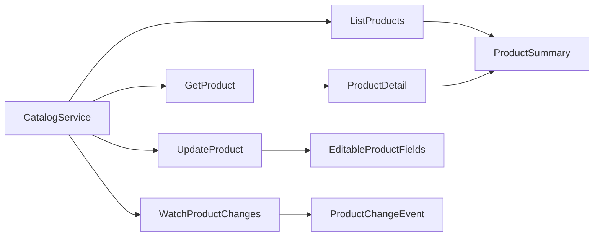

# Không dùng message quá lớn cho mọi RPC trong Spring gRPC

Trong hệ sinh thái **Spring gRPC**, Protocol Buffers (`.proto`) định nghĩa hợp đồng mà client và server cùng sử dụng để sinh mã Java và trao đổi dữ liệu qua gRPC. Khi bắt đầu thiết kế, chúng ta rất dễ tạo một message `Product` có tất cả thông tin về sản phẩm, rồi dùng nguyên message ấy cho mọi RPC: lấy chi tiết, liệt kê, cập nhật, xóa hoặc phát thông báo thay đổi. Cách làm này có vẻ tiện vì giảm số kiểu cần khai báo, nhưng càng nhiều chức năng, hợp đồng càng khó hiểu và dễ phát sinh phụ thuộc không cần thiết.

Bài này thuộc chương **Schema design** của module **SPRING_GRPC**, tập trung vào việc thiết kế message có mục đích rõ, phù hợp cho unary và streaming RPC. Sau bài học, bạn có thể:

- Nhận biết dấu hiệu của một **God Message** (message đa năng chứa quá nhiều trách nhiệm).
- Phân biệt **schema có nhiều trường** với **payload thực tế lớn**; hiểu ảnh hưởng đến tốc độ truyền, bộ nhớ và xử lý.
- Tách request/response và biểu diễn dữ liệu theo từng trường hợp sử dụng: summary, detail, update và event.
- Chọn phân trang hoặc streaming khi phải truyền nhiều bản ghi; tránh áp dụng streaming chỉ vì một message có nhiều field.
- Duy trì khả năng tương thích khi thu gọn hợp đồng, thay đổi field hoặc nâng cấp API.

## 1. “Message quá lớn” thực ra có hai nghĩa

Trong thực tế có hai vấn đề khác nhau nhưng thường bị gọi chung là “message lớn”.

| Khía cạnh | Dấu hiệu | Vấn đề chính | Giải pháp ưu tiên |
| --- | --- | --- | --- |
| **Quá nhiều trách nhiệm trong schema** | Một message có hàng chục field không liên quan và được dùng làm input/output cho mọi RPC | Nghĩa của field mơ hồ, khó validate, khó mở rộng mà không tác động các client | Tách message theo nghiệp vụ và mục đích của từng RPC |
| **Payload lớn tại runtime** | Một response chứa hàng chục nghìn bản ghi, ảnh/video nhị phân hoặc các trường `repeated` quá dài | Mạng, bộ nhớ, thời gian serialize/parse, giới hạn kích thước và deadline | Phân trang, chia lô, streaming, tham chiếu đến dữ liệu lớn hoặc thiết kế lại phạm vi trả về |

**Không được đánh đồng số lượng field khai báo với kích thước byte được gửi.** Trong protobuf binary, các field chưa được gán thường không xuất hiện trong dữ liệu được mã hóa; một message định nghĩa 50 field nhưng chỉ điền hai field có thể có payload nhỏ. Ngược lại, message chỉ có `repeated bytes chunks = 1;` vẫn có thể tạo payload cực lớn nếu mỗi phần tử chứa dữ liệu lớn.

Tuy nhiên, một schema đa năng vẫn có thể tốn chi phí thiết kế: mọi consumer phải biết nhiều field, mã sinh chứa nhiều API truy cập, thay đổi một chức năng kéo theo kiểm thử các chức năng khác và các quy tắc “field nào hợp lệ trong trường hợp nào?” ngày càng phức tạp.

## 2. Phản ví dụ: một ProductEverything dùng cho tất cả

Giả sử nhóm phát triển định nghĩa:

```proto
syntax = "proto3";

package shop.catalog.v1;

message ProductEverything {
  string product_id = 1;
  string display_name = 2;
  string description = 3;
  string category_id = 4;
  int64 price_minor_units = 5;
  string currency_code = 6;
  bool active = 7;
  repeated string image_urls = 8;
  repeated string audit_messages = 9;
  string admin_note = 10;
  string update_action = 11;
  string next_page_token = 12;
  string event_id = 13;
}

service CatalogService {
  rpc GetProduct(ProductEverything) returns (ProductEverything);
  rpc ListProducts(ProductEverything) returns (ProductEverything);
  rpc UpdateProduct(ProductEverything) returns (ProductEverything);
  rpc WatchProductChanges(ProductEverything)
      returns (stream ProductEverything);
}
```

Đây là proto **hợp lệ về cú pháp**, nhưng hợp đồng có nhiều câu hỏi chưa được trả lời:

- `GetProduct` cần field nào của request? Chỉ `product_id`, hay còn `update_action`? Nếu client truyền `admin_note` thì server bỏ qua hay báo lỗi?
- `ListProducts` trả nhiều sản phẩm bằng cách nào? Một `ProductEverything` không diễn đạt được danh sách có phân trang; nhét dữ liệu vào chuỗi hoặc dùng các field lặp không liên quan sẽ khiến API khó sử dụng.
- `UpdateProduct` cập nhật tất cả field hay chỉ field được gửi? Trong proto3, một `bool` không có presence thường đọc thành `false` nếu không được gửi.
- `WatchProductChanges` phát một snapshot, một thao tác cần thực hiện hay một sự kiện đã xảy ra? `event_id` chỉ có nghĩa với event, không phải mọi response.
- `admin_note` có nên được gửi cho client công khai? Nếu dùng chung kiểu, server dễ vô tình đưa dữ liệu nội bộ vào response.

Từ góc nhìn mã Java sinh bởi `protoc`, các stub có thể nhận cùng `ProductEverything` ở mọi thao tác. Trình biên dịch không giúp phát hiện lỗi nghiệp vụ kiểu “client truyền thông tin chỉ dành cho admin vào RPC đọc công khai”. Mỗi RPC lại phải có nhiều nhánh kiểm tra để giải nghĩa một message chung.

Điều cần sửa không đơn thuần là giảm số field của `ProductEverything` xuống một con số tùy ý. Cần **định nghĩa lại ranh giới trách nhiệm**: mỗi request diễn đạt mục tiêu gọi, mỗi response diễn đạt kết quả được hứa và event diễn đạt điều đã xảy ra.

## 3. Phân loại trước khi tách message

Với hệ thống danh mục sản phẩm, hãy viết ra dữ liệu mà từng tác vụ thực sự cần:

| Tác vụ | Input tối thiểu | Output có ý nghĩa | Loại thông điệp phù hợp |
| --- | --- | --- | --- |
| Xem chi tiết một sản phẩm | `product_id` | Tên, mô tả, giá, hình ảnh và trạng thái | `GetProductRequest` / `GetProductResponse` chứa `ProductDetail` |
| Liệt kê sản phẩm | Bộ lọc, `page_size`, `page_token` | Nhiều dòng tóm tắt + token trang tiếp theo | `ListProductsRequest` / `ListProductsResponse` chứa `ProductSummary` |
| Sửa thông tin sản phẩm | ID, dữ liệu muốn sửa, phạm vi cập nhật | Sản phẩm sau cập nhật | `UpdateProductRequest` / `UpdateProductResponse` |
| Theo dõi sản phẩm thay đổi | ID/bộ lọc đăng ký | Một luồng `ProductChangeEvent` | `WatchProductChangesRequest` / `ProductChangeEvent` |

Ý tưởng quan trọng là **tái sử dụng theo nghĩa**, không phải “tái sử dụng mọi thứ ở mọi nơi”. Một kiểu `ProductSummary` có thể được dùng ở nhiều response danh sách nếu cùng mang một khái niệm. Ngược lại, request cập nhật không nên dùng `ProductDetail` chỉ vì chúng có một số field giống nhau: các field như `updated_at`, URL ảnh hoặc giá bán có thể do server quản lý hay không được phép sửa.

Có thể hình dung:



Việc `ProductDetail` chứa `ProductSummary` trong sơ đồ là một **lựa chọn tái sử dụng có chủ đích**: chi tiết sản phẩm bao gồm phần thông tin hiển thị cơ bản. Không phải mọi mô hình đều cần lồng nhau như vậy; có thể dùng field trực tiếp nếu cấu trúc lồng gây khó cho client.

## 4. Thiết kế .proto đầy đủ theo từng RPC

Ví dụ sau đặt trong `src/main/proto/catalog/v1/catalog.proto`. Đây là một hợp đồng minh họa thống nhất để sinh mã Java cho Spring gRPC.

```proto
syntax = "proto3";

package shop.catalog.v1;

option java_package = "com.myshop.grpc.catalog.v1";
option java_multiple_files = true;
option java_outer_classname = "CatalogProto";

import "google/protobuf/field_mask.proto";
import "google/protobuf/timestamp.proto";

service CatalogService {
  rpc GetProduct(GetProductRequest) returns (GetProductResponse);
  rpc ListProducts(ListProductsRequest) returns (ListProductsResponse);
  rpc UpdateProduct(UpdateProductRequest) returns (UpdateProductResponse);
  rpc WatchProductChanges(WatchProductChangesRequest)
      returns (stream ProductChangeEvent);
}

// Chỉ những thuộc tính cần trong một dòng danh sách.
message ProductSummary {
  string product_id = 1;
  string display_name = 2;
  int64 price_minor_units = 3;
  string currency_code = 4;
}

// Chi tiết đầy đủ dùng khi người dùng mở một sản phẩm.
message ProductDetail {
  ProductSummary summary = 1;
  string description = 2;
  repeated string image_urls = 3;
  bool active = 4;
  google.protobuf.Timestamp updated_at = 5;
}

message GetProductRequest {
  string product_id = 1;
}

message GetProductResponse {
  ProductDetail product = 1;
}

message ListProductsRequest {
  // Chuỗi rỗng: không lọc theo danh mục.
  string category_id = 1;
  // 0: server áp dụng kích thước trang mặc định.
  int32 page_size = 2;
  // Rỗng: trang đầu.
  string page_token = 3;
}

message ListProductsResponse {
  repeated ProductSummary products = 1;
  // Rỗng: không còn trang tiếp theo.
  string next_page_token = 2;
}

// Chỉ các thuộc tính client được phép yêu cầu sửa.
message EditableProductFields {
  string display_name = 1;
  string description = 2;
  bool active = 3;
}

message UpdateProductRequest {
  string product_id = 1;
  EditableProductFields changes = 2;
  // Chỉ cập nhật field được liệt kê, kể cả khi giá trị là mặc định.
  google.protobuf.FieldMask update_mask = 3;
  // Phục vụ chống thực thi trùng nếu server triển khai idempotency.
  string request_id = 4;
}

message UpdateProductResponse {
  ProductDetail product = 1;
}

enum ProductChangeKind {
  PRODUCT_CHANGE_KIND_UNSPECIFIED = 0;
  PRODUCT_CHANGE_KIND_CREATED = 1;
  PRODUCT_CHANGE_KIND_UPDATED = 2;
  PRODUCT_CHANGE_KIND_DELETED = 3;
}

message WatchProductChangesRequest {
  // Rỗng: theo dõi các sản phẩm trong phạm vi quyền của client.
  string product_id = 1;
}

// Một sự kiện có payload nhỏ; client có thể GetProduct khi cần chi tiết.
message ProductChangeEvent {
  string event_id = 1;
  string product_id = 2;
  ProductChangeKind change_kind = 3;
  google.protobuf.Timestamp occurred_at = 4;
}
```

File trên minh họa bốn hành vi riêng biệt. Dù số **loại message** tăng, mỗi loại lại có trách nhiệm và quy tắc kiểm tra dễ hiểu hơn. `GetProduct` trả `ProductDetail`, còn `ListProducts` trả `ProductSummary` để không lặp lại các trường mô tả dài và URL ảnh cho mọi phần tử trong danh sách.

### Tại sao vẫn có loại dùng chung?

`ProductSummary` là mô hình tóm tắt ổn định, được dùng bên trong `ProductDetail` và `ListProductsResponse`. Chia sẻ này hợp lý nếu hai nơi cùng định nghĩa ID, tên hiển thị, giá và mã tiền tệ. Nó **khác** với việc tái sử dụng `ProductDetail` làm request cập nhật, vì trường hợp cập nhật có một tập field được phép sửa và quy tắc validation riêng.

Đừng tách mỗi field thành một message riêng hoặc tạo nhiều wrapper rỗng chỉ để đạt “schema nhỏ”. Ưu tiên các nhóm field có cùng ngữ nghĩa, quyền sở hữu và nhịp thay đổi.

## 5. Request và response chuyên biệt làm giảm nhầm lẫn

### 5.1. GetProduct: chỉ nhận ID, trả dữ liệu chi tiết

```proto
message GetProductRequest {
  string product_id = 1;
}

message GetProductResponse {
  ProductDetail product = 1;
}
```

Với API này:

- Request có `product_id` khác rỗng, không cần đính kèm toàn bộ dữ liệu sản phẩm.
- Nếu ID không hợp lệ, server trả `INVALID_ARGUMENT`; nếu không tìm thấy, trả `NOT_FOUND`.
- Response thành công có `product` hiện diện và dữ liệu nhất quán với ID được yêu cầu.
- Các thuộc tính nội bộ như ghi chú admin không thuộc `ProductDetail` công khai, nên không thể vô tình xuất hiện chỉ vì dùng chung kiểu với database.

**Có nên trả thẳng `ProductDetail` thay vì `GetProductResponse`?** Có thể. Wrapper riêng hữu ích khi API muốn biểu thị rõ kết quả từng RPC hoặc dự kiến thêm metadata nghiệp vụ. Tránh lồng nhiều cấp nếu không tạo thêm ý nghĩa.

### 5.2. ListProducts: trả phần đủ để hiển thị danh sách

`ListProducts` thường được gọi nhiều lần khi người dùng cuộn trang hoặc áp dụng bộ lọc. Response không cần lặp lại mọi mô tả dài, URL hình lớn hay dữ liệu không hiển thị.

```proto
message ListProductsResponse {
  repeated ProductSummary products = 1;
  string next_page_token = 2;
}
```

Quy ước ví dụ: `page_size = 0` tương ứng mặc định 20 phần tử/trang, cho phép `1..100`, từ chối số âm hoặc lớn hơn 100 bằng `INVALID_ARGUMENT`. `page_token` là opaque token do server phát; client truyền nguyên vẹn khi lấy trang tiếp theo. `next_page_token` rỗng nghĩa là kết thúc. Khi không tìm thấy sản phẩm phù hợp, trả `OK` với danh sách rỗng.

**Lưu ý:** dùng `ProductSummary` không tự bảo đảm response luôn nhỏ. Một response chứa một triệu `ProductSummary` vẫn có thể quá lớn. Phải có giới hạn trang và kiểm thử kích thước thực tế.

### 5.3. UpdateProduct: chỉ cho sửa field được phép

Request cập nhật không nên là `ProductDetail`, vì một số field chỉ do server quản lý hoặc không được sửa trong RPC này. Ví dụ:

```proto
message EditableProductFields {
  string display_name = 1;
  string description = 2;
  bool active = 3;
}

message UpdateProductRequest {
  string product_id = 1;
  EditableProductFields changes = 2;
  google.protobuf.FieldMask update_mask = 3;
  string request_id = 4;
}
```

Quy tắc nghiệp vụ của thiết kế minh họa:

1. `product_id` không rỗng; `changes` và `update_mask` phải có mặt.
2. `update_mask.paths` không rỗng. Chỉ chấp nhận `display_name`, `description`, `active`; đây là **đường dẫn tương đối bên trong `EditableProductFields`**, nên không viết `changes.display_name`.
3. Server chỉ cập nhật field nằm trong mask; nếu `active` nằm trong mask với giá trị `false`, điều đó có nghĩa **đặt thành false**, không phải “không cập nhật”.
4. Bỏ qua hoặc từ chối field ngoài mask theo hợp đồng đã công bố; trong ví dụ này server từ chối đường dẫn không được phép, còn giá trị của field không nằm trong mask không được dùng để cập nhật.
5. `request_id` chỉ giúp retry an toàn nếu server thực thi cơ chế idempotency (lưu/kiểm tra key và kết quả phù hợp), không có tác dụng tự động chỉ vì xuất hiện trong proto.

Ví dụ request dưới dạng ProtoJSON:

```json
{
  "productId": "P-100",
  "changes": {
    "active": false
  },
  "updateMask": "active",
  "requestId": "cmd-20261119-001"
}
```

`updateMask` dạng JSON là chuỗi field mask theo quy tắc ProtoJSON. Nếu muốn cập nhật đồng thời hai field `display_name` và `active`, giá trị sẽ có dạng `"displayName,active"`. Khác biệt giữa tên proto `display_name` và tên JSON `displayName` là ánh xạ chuẩn, không phải hai field độc lập.

### 5.4. WatchProductChanges: gửi sự kiện, không phát toàn bộ bản ghi

`ProductChangeEvent` chứa ID sự kiện, ID sản phẩm, loại thay đổi và thời điểm. Nó không chứa `description` dài hay danh sách `image_urls`. Consumer cần chi tiết có thể gọi `GetProduct` để đọc trạng thái mới nếu tài nguyên vẫn tồn tại.

Cách này phù hợp khi subscriber chỉ cần biết “sản phẩm nào thay đổi”. Nếu một consumer cần **chính xác giá trị tại thời điểm sự kiện**, gọi `GetProduct` sau đó có thể nhận trạng thái *mới hơn* hoặc gặp `NOT_FOUND` khi sản phẩm đã bị xóa. Trong trường hợp đó, hãy thiết kế payload event chuyên biệt có dữ liệu sự kiện cần thiết hoặc dùng hệ thống lưu snapshot/replay rõ ràng. Không tự giả định “gửi ID là đủ” với mọi nghiệp vụ.

## 6. Schema nhỏ không đồng nghĩa payload nhỏ

Giao thức protobuf là mã hóa nhị phân dựa trên field number và wire type. Kích thước message trên đường truyền còn phụ thuộc vào giá trị thực được gán, cách biểu diễn số, số lượng phần tử `repeated`, chuỗi/byte chứa trong từng trường và mức độ lồng nhau.

So sánh hai tình huống:

```proto
// Nhiều field nhưng thường chỉ điền một số field.
message ProductOptions {
  string product_id = 1;
  string label = 2;
  string description = 3;
  string category_id = 4;
  string supplier_id = 5;
  bool active = 6;
  string notes = 7;
}

// Chỉ một field nhưng payload có thể rất lớn.
message ExportDataResponse {
  bytes content = 1;
}
```

Nếu `ExportDataResponse.content` chứa tệp hàng trăm MB, server và client vẫn phải chịu chi phí bộ nhớ, truyền tải và deserialize tương ứng. Việc field ít không ngăn được quá tải. Ngược lại, `ProductOptions` có nhiều field khai báo nhưng những field không được thiết lập có thể không hiện diện trong binary payload.

Các điểm cần xem xét khi gửi dữ liệu lớn:

- **Serialization/parse:** nhiều byte và nhiều phần tử có thể tăng CPU và cấp phát bộ nhớ.
- **Giới hạn kích thước message:** gRPC có các giới hạn tiếp nhận cấu hình được; payload vượt mức ở một trong hai phía có thể bị từ chối.
- **Deadline:** lời gọi phải kết thúc trong thời hạn client đặt; dữ liệu lớn làm tăng nguy cơ quá hạn.
- **Áp lực bộ nhớ:** một unary RPC trả danh sách khổng lồ có thể buộc server chuẩn bị nhiều dữ liệu và client giữ một response lớn.
- **Compression:** có thể giảm số byte truyền trong một số trường hợp, nhưng tiêu tốn CPU và không thay thế thiết kế phân trang hay chia lô.

Vì vậy, việc tách message giúp giảm sự phụ thuộc về **hợp đồng**, còn kiểm soát kích thước payload giúp cải thiện **hiệu năng và độ tin cậy**. Hai loại tối ưu này bổ sung cho nhau.

## 7. Khi dữ liệu thực tế lớn: phân trang, chia lô hay streaming?

Không phải request nào nhiều dữ liệu cũng cần cùng một cơ chế. Hãy chọn theo cách client tiêu thụ kết quả.

| Trường hợp | Phương án thường phù hợp | Cần công bố trong hợp đồng |
| --- | --- | --- |
| Trang danh sách sản phẩm trên giao diện | Unary `ListProducts` có phân trang | `page_size`, `page_token`, thứ tự sắp xếp, ý nghĩa trang cuối |
| Xuất nhiều bản ghi theo luồng | Server streaming nhiều message nhỏ | Kích thước mỗi message, thứ tự, lỗi khi stream dở dang, hủy và backpressure |
| Client gửi hàng nghìn thay đổi | Client streaming hoặc gửi lô có giới hạn | Cách xác nhận từng bản ghi, xử lý lỗi một phần, retry và idempotency |
| Đồng bộ hai chiều liên tục | Bidirectional streaming | Correlation ID, thứ tự, flow control, deadline và kết thúc từng chiều |
| Truyền file lớn | Luồng các chunk hoặc lưu file ngoài rồi truyền tham chiếu có kiểm soát | Kích thước chunk, checksum, offset/resume, phân quyền |
| Client chỉ muốn biết dữ liệu thay đổi | Event server streaming nhỏ | Event ID, tính chất live/replay, thứ tự, khả năng bỏ lỡ event |

### Phân trang không chỉ là thêm page_size

Một API phân trang tốt cần giới hạn số bản ghi và định nghĩa tính ổn định của thứ tự. Nếu dữ liệu thay đổi giữa các lần lấy trang, client có thể thấy trùng hoặc thiếu phần tử. Có thể cần cursor gắn với bộ lọc/thứ tự hoặc snapshot nhất quán theo yêu cầu nghiệp vụ. `page_token` nên là opaque token, không yêu cầu client tự phân tích offset.

### Streaming không tự động giảm tổng lượng dữ liệu

`returns (stream ProductSummary)` có thể tránh đóng gói toàn bộ danh sách trong một response duy nhất, cho phép client xử lý từng phần tử sớm hơn. Tuy nhiên, nếu server gửi một triệu sản phẩm, tổng byte vẫn lớn. Streaming còn cần quản lý observer, flow control, hủy và lỗi giữa chừng; một client đã nhận một phần stream **không được coi** kết quả đã hoàn tất nếu kết thúc bằng lỗi.

Chỉ dùng streaming khi lợi ích xử lý tăng dần, dữ liệu thời gian thực hoặc số lượng bản ghi rất lớn đủ bù cho độ phức tạp của vòng đời luồng. Với danh sách trang ngắn, unary phân trang thường dễ triển khai và kiểm thử hơn.

## 8. Ví dụ Spring gRPC: handler chỉ tạo đúng response cần trả

Sau khi biên dịch `catalog.proto` bằng `protoc` và plugin gRPC Java, ta có những lớp như `GetProductRequest`, `ProductSummary`, `ProductDetail`, `GetProductResponse` và `CatalogServiceGrpc` trong `com.myshop.grpc.catalog.v1`. Một server Spring gRPC có thể triển khai unary `GetProduct`:

```java
package com.myshop.server.catalog;

import com.myshop.grpc.catalog.v1.CatalogServiceGrpc;
import com.myshop.grpc.catalog.v1.GetProductRequest;
import com.myshop.grpc.catalog.v1.GetProductResponse;
import com.myshop.grpc.catalog.v1.ProductDetail;
import com.myshop.grpc.catalog.v1.ProductSummary;
import io.grpc.Status;
import io.grpc.stub.StreamObserver;
import org.springframework.grpc.server.service.GrpcService;

@GrpcService
public class CatalogGrpcEndpoint
        extends CatalogServiceGrpc.CatalogServiceImplBase {

    @Override
    public void getProduct(
            GetProductRequest request,
            StreamObserver<GetProductResponse> observer) {

        String id = request.getProductId();
        if (id.isBlank()) {
            observer.onError(Status.INVALID_ARGUMENT
                    .withDescription("product_id is required")
                    .asRuntimeException());
            return;
        }

        // Dữ liệu minh họa; ứng dụng thật sẽ đọc từ domain/repository.
        if (!id.equals("P-100")) {
            observer.onError(Status.NOT_FOUND
                    .withDescription("product not found")
                    .asRuntimeException());
            return;
        }

        ProductSummary summary = ProductSummary.newBuilder()
                .setProductId("P-100")
                .setDisplayName("Bàn phím cơ")
                .setPriceMinorUnits(125000L)
                .setCurrencyCode("VND")
                .build();

        ProductDetail detail = ProductDetail.newBuilder()
                .setSummary(summary)
                .setDescription("Bàn phím cơ cho làm việc và học tập")
                .setActive(true)
                .addImageUrls("https://example.com/products/p-100.jpg")
                .build();

        GetProductResponse response = GetProductResponse.newBuilder()
                .setProduct(detail)
                .build();

        observer.onNext(response);
        observer.onCompleted();
    }
}
```

`ProductSummary` chỉ chứa những trường cần cho danh sách; `ProductDetail` lồng summary và bổ sung mô tả/hình ảnh/trạng thái. `GetProductResponse` chỉ xuất hiện khi RPC thành công. Ví dụ cố ý triển khai một phương thức để tập trung vào thiết kế message; các RPC khác của `CatalogService` phải được triển khai riêng trước khi sử dụng trong ứng dụng. Cách đăng ký server qua `@GrpcService` cần phù hợp phiên bản Spring gRPC của dự án.

Client dùng stub Java được sinh có thể gọi hai RPC với hai kiểu kết quả khác nhau:

```java
import com.myshop.grpc.catalog.v1.CatalogServiceGrpc;
import com.myshop.grpc.catalog.v1.GetProductRequest;
import com.myshop.grpc.catalog.v1.ListProductsRequest;
import com.myshop.grpc.catalog.v1.ProductSummary;
import io.grpc.Channel;
import java.util.concurrent.TimeUnit;

public class CatalogClientExample {
    public static void displayCatalog(Channel channel) {
        var stub = CatalogServiceGrpc.newBlockingStub(channel)
                .withDeadlineAfter(3, TimeUnit.SECONDS);

        // Yêu cầu danh sách: client chỉ nhận các ProductSummary.
        var page = stub.listProducts(ListProductsRequest.newBuilder()
                .setCategoryId("CAT-10")
                .setPageSize(20)
                .build());

        for (ProductSummary item : page.getProductsList()) {
            System.out.println(item.getProductId()
                    + " | " + item.getDisplayName());
        }

        // Yêu cầu chi tiết chỉ khi người dùng cần xem một sản phẩm.
        var detail = stub.getProduct(GetProductRequest.newBuilder()
                .setProductId("P-100")
                .build()).getProduct();
        System.out.println(detail.getDescription());
    }
}
```

Client minh họa giả định server thực tế đã triển khai `ListProducts`. `Channel` được truyền vào hàm để mã tập trung vào request/response; ứng dụng Spring nên dùng cơ chế quản lý kết nối/stub thích hợp, TLS khi triển khai thật và deadline theo yêu cầu độ trễ.

**Lợi ích dễ thấy:** client danh sách chỉ phụ thuộc vào `ProductSummary`; client xem chi tiết dùng `ProductDetail`; client sửa sản phẩm dùng `EditableProductFields` và `FieldMask`. Các hợp đồng có thể thay đổi có kiểm soát theo nhu cầu của từng nhóm.

## 9. Nếu một RPC cần nhiều chi tiết thì sao?

Không phải mọi message lớn đều là lỗi thiết kế. Một thao tác thực sự cần đối tượng tổng hợp với nhiều trường có quan hệ chặt chẽ có thể được mô hình hóa bằng một message lớn có cấu trúc tốt.

Ví dụ, một `CreateOrderRequest` có danh sách dòng hàng, địa chỉ giao hàng và phương thức thanh toán được chọn có thể là **một ý định nghiệp vụ** hợp lệ. Việc chia mỗi dòng hàng thành một RPC riêng chỉ để giảm số field có thể làm phát sinh lỗi nhất quán và nhiều round-trip.

Hãy đánh giá theo các câu hỏi:

1. **Cùng vòng đời?** Các field có được đọc/ghi và thay đổi cùng một thao tác không?
2. **Cùng quyền truy cập?** Field công khai có đang nằm chung với field nội bộ/nhạy cảm không?
3. **Cùng người sử dụng?** Những RPC khác nhau có thực sự cần cùng tập field hay chỉ cùng một vài định danh?
4. **Cùng tần suất thay đổi?** Thay đổi cho chức năng A có buộc client của chức năng B cập nhật không?
5. **Kích thước runtime ra sao?** Trường `repeated` có thể tăng không giới hạn không? Có dữ liệu nhị phân cần tách khỏi response không?
6. **Tính nguyên tử?** Một request chứa nhiều thành phần có cần commit đồng bộ không? Nếu có, chia thành nhiều RPC có thể làm khó bảo đảm tính nhất quán.

Tách một kiểu dùng chung không nên gây sao chép vô hạn. Nếu nhiều response cùng dùng một khái niệm ổn định, có thể tái sử dụng một message con hoặc chuyển phần dùng chung thành một schema được quản lý rõ. Điều cần tránh là tạo một mô hình “siêu dữ liệu” duy nhất cho những tác vụ không chia sẻ ngữ nghĩa.

## 10. Thay đổi một schema đã phát hành: cần giữ tương thích

Khi hệ thống đã có client đang chạy, không nên xóa `ProductEverything` ngay lập tức chỉ vì vừa nhận ra thiết kế chưa tốt. Cần xem các thay đổi ảnh hưởng đến **wire format**, **mã Java sinh**, **ProtoJSON** và **đường dẫn RPC** như thế nào.

| Thay đổi | Tác động có thể gặp | Hướng xử lý |
| --- | --- | --- |
| Thêm một field với số mới vào message hiện tại | Client binary cũ thường bỏ qua field không biết; có thể ảnh hưởng ngữ nghĩa | Giữ mặc định an toàn; kiểm thử client và consumer JSON |
| Tạo `ListProductsV2` hoặc RPC phiên bản mới trả `ProductSummary` | API cũ và mới có thể tồn tại song song | Cho client chuyển dần; công bố thời điểm ngừng hỗ trợ rõ ràng |
| Đổi input/output type của RPC cũ sang message mới | Stub Java thay đổi; dù wire có thể tình cờ tương thích, descriptor và consumer bị ảnh hưởng | Ưu tiên RPC mới hoặc phiên bản package mới khi hợp đồng đã công bố |
| Đổi tên field nhưng giữ field number | Dữ liệu binary có thể còn đọc được, song accessor Java và khóa ProtoJSON mặc định đổi | Hạn chế đổi tên; lập kế hoạch migration nếu cần |
| Xóa field rồi dùng lại field number | Nguy cơ giải mã dữ liệu cũ thành ý nghĩa mới | Dùng `reserved` cho số và tên đã xóa |
| Đổi tên service hoặc RPC | Đổi đường dẫn `/package.Service/Method` trên mạng | Giữ endpoint cũ song song khi chuyển client |
| Đổi `java_package` | Các import/lớp Java sinh thay đổi | Sinh lại mã và cập nhật các module Java phụ thuộc; tên RPC protobuf không tự đổi |

Ví dụ một field nội bộ cũ đã bị xóa khỏi một message, hãy bảo vệ tên và tag:

```proto
message ProductSummary {
  reserved 8;
  reserved "legacy_internal_note";

  string product_id = 1;
  string display_name = 2;
  int64 price_minor_units = 3;
  string currency_code = 4;
}
```

Đoạn trên minh họa việc bảo vệ một field số 8 **nếu nó thực sự đã từng được sử dụng**. Không thêm `reserved` tùy tiện cho các số chưa từng tồn tại chỉ để “dọn dẹp” schema.

### Chiến lược chuyển từ God Message

1. Liệt kê các RPC đang dùng message chung và ghi lại field nào là input, field nào là output, field nào được sử dụng thực tế.
2. Định nghĩa message mới theo hành vi, chẳng hạn `ProductSummary`, `ProductDetail`, `UpdateProductRequest`; giữ nguyên message cũ trong thời gian chuyển đổi.
3. Thêm endpoint mới hoặc API `v2` khi thay đổi chữ ký input/output gây ảnh hưởng đến các client đã triển khai.
4. Viết kiểm thử tương thích và thử với client sinh mã cũ/mới; thống kê đường dẫn RPC đang được gọi nếu có metrics/interceptor phù hợp.
5. Di chuyển client theo đợt, đo lỗi/độ trễ/kích thước payload rồi mới xem xét ngừng hỗ trợ endpoint cũ.

Đừng đổi `ProductEverything` thành một tên mới rồi giả định rằng đó chỉ là refactor nội bộ: các tên message có thể được dùng bởi generated API, reflection, dynamic messages và `google.protobuf.Any`.

## 11. Metadata, deadline, status, TLS và quan sát hiệu năng

Thiết kế message gọn không thay thế việc xử lý các khía cạnh vận hành gRPC:

| Mối quan tâm | Vị trí xử lý phù hợp | Liên hệ với việc tránh message đa năng |
| --- | --- | --- |
| Authentication, trace context | gRPC metadata và interceptors | Không lặp token/tracing header thành field của mọi request nếu không cần nghiệp vụ |
| Authorization | Server/interceptor/domain service | Không trả field nội bộ chỉ vì nó nằm trong message chung |
| Deadline/cancellation | Client thiết lập deadline; server xử lý hủy | Tránh xử lý hoặc chuẩn bị payload lớn khi client không còn chờ |
| gRPC status | `INVALID_ARGUMENT`, `NOT_FOUND`, `RESOURCE_EXHAUSTED`, v.v. | Không gói lỗi gọi RPC thành một field `error` trong God Message rồi luôn trả `OK` |
| TLS/mTLS | Cấu hình channel và server | Giữ an toàn đường truyền, độc lập với số field trong message |
| Giám sát | Metrics, traces, logs của method và kích thước payload | Quan sát xem RPC nào thực sự quá lớn/chậm trước khi tối ưu |

Một số phép đo có giá trị:

- **Serialized request/response size** (byte thực tế) theo RPC và theo phân vị; không chỉ đo số field trong schema.
- **Latency** theo phương thức, đặc biệt `ListProducts` có kích thước trang khác nhau và các lời gọi chạm giới hạn deadline.
- **Số lượng phần tử `repeated`** được trả theo mỗi request; dấu hiệu response tăng không giới hạn.
- **CPU, cấp phát bộ nhớ và lỗi `RESOURCE_EXHAUSTED`** khi payload hoặc stream lớn.
- **Tỷ lệ hủy stream và thời gian xử lý** để phát hiện subscriber chậm hoặc công việc tồn đọng.

Cần cân nhắc chi phí lưu trữ và bảo vệ thông tin nhạy cảm trong telemetry: không ghi toàn bộ nội dung request chứa dữ liệu riêng tư chỉ để đo kích thước. Interceptor có thể ghi lại kích thước và tên phương thức mà không cần log mọi field.

### Tình huống vận hành minh họa

Một trang liệt kê 50 sản phẩm chậm bất thường. Đừng vội chuyển toàn bộ `ListProducts` sang streaming. Hãy xác định có phải response đang lặp mỗi sản phẩm với mô tả dài, hàng trăm URL ảnh và metadata không cần cho danh sách. Nếu vậy, trả `ProductSummary` và giới hạn trang có thể giải quyết phần lớn vấn đề với hợp đồng đơn giản hơn. Chỉ khi client cần xử lý rất nhiều kết quả liên tục mới cân nhắc stream hoặc cơ chế xuất dữ liệu riêng.

## 12. Checklist và tình huống kiểm thử

Trước khi đưa schema vào dự án, hãy kiểm tra:

1. **Mỗi RPC có input/output có ý nghĩa riêng?** Có message nào buộc client điền nhiều field “không liên quan” hay không?
2. **Có đúng mức chi tiết?** Danh sách có cần trả đầy đủ chi tiết như RPC xem một sản phẩm không?
3. **Có ranh giới sửa dữ liệu?** Request update chỉ chứa field được phép sửa, có quy tắc rõ cho giá trị mặc định và field mask?
4. **Có dữ liệu cần giữ kín?** Field nội bộ có bị đặt trong kiểu dùng chung cho response công khai không?
5. **Có giới hạn dữ liệu tăng trưởng?** `page_size`, kích thước lô hoặc chunk có bị chặn ở mức phù hợp không?
6. **Có ngữ nghĩa stream?** Event là sự việc đã xảy ra hay snapshot? Có cam kết thứ tự/replay/cancellation không?
7. **Có kế hoạch tương thích?** Client cũ có còn gọi được? Field number và tên đã phát hành có được bảo vệ không?
8. **Có đo thực tế?** Size, latency và lỗi gRPC có chứng minh được lợi ích sau thay đổi không?

Các ca kiểm thử tích hợp tiêu biểu:

| Ca thử | Input | Kỳ vọng |
| --- | --- | --- |
| Get hợp lệ | `GetProductRequest(product_id="P-100")` | `OK`; có `ProductDetail` với `summary.product_id` phù hợp |
| Get thiếu ID | `product_id=""` | `INVALID_ARGUMENT`; không gửi response thành công |
| List trống | Filter không có sản phẩm | `OK`; danh sách rỗng, token tiếp theo rỗng |
| List page quá lớn | `page_size=10000` | `INVALID_ARGUMENT` theo chính sách 1..100 của API ví dụ |
| List có trang tiếp | Dữ liệu nhiều hơn `page_size` | Mỗi trang không quá giới hạn, có token cho đến trang cuối |
| Update riêng `active` | `update_mask="active"`, `active=false` | Đổi đúng `active`, giữ nguyên field khác |
| Update field bị cấm | `update_mask="price_minor_units"` | `INVALID_ARGUMENT` vì đường dẫn không thuộc kiểu cho phép cập nhật |
| Event thay đổi | Có thay đổi được ghi nhận | `ProductChangeEvent` chỉ chứa định danh/loại/thời điểm cần thiết |
| Stream bị hủy | Client hủy `WatchProductChanges` | Server ngừng phát, giải phóng subscriber và bộ đệm |
| Quá giới hạn message | Cố gửi payload vượt giới hạn cấu hình | Nhận lỗi phù hợp thay vì làm cạn bộ nhớ ứng dụng |

### Bài tập tự kiểm tra

**Câu 1.** Một RPC `ListProducts` trả `repeated ProductDetail` với mô tả dài và toàn bộ URL ảnh cho hàng nghìn sản phẩm, trong khi giao diện chỉ hiển thị tên và giá. Bạn sẽ thay đổi hợp đồng thế nào?

*Gợi ý:* Trả `repeated ProductSummary` với ID, tên, giá và mã tiền tệ; thêm phân trang, giới hạn `page_size` và `next_page_token`. Chỉ gọi `GetProduct` khi cần chi tiết.

**Câu 2.** Một message có 40 field nhưng request thực tế chỉ đặt hai field. Có thể kết luận nó luôn chiếm nhiều byte hơn message có một field `bytes content` không?

*Gợi ý:* Không. Binary protobuf thường không mã hóa field không được gán; một field `bytes` có thể chứa payload rất lớn. Cần đo serialized size của dữ liệu thực.

**Câu 3.** Server dùng chung `ProductDetail` cho `UpdateProduct`. Client bỏ qua `active` nhưng server đọc được giá trị mặc định `false` và vô tình tắt sản phẩm. Bạn sẽ khắc phục thế nào?

*Gợi ý:* Dùng request cập nhật riêng và quy định presence/`FieldMask`. Khi mask không chứa `active` thì không cập nhật; khi mask chứa `active` và giá trị `false` thì cập nhật đúng thành false.

**Câu 4.** Một event gọn chỉ gửi `product_id`; sau khi nhận, consumer gọi `GetProduct` và thấy dữ liệu đã được cập nhật thêm lần nữa. Event như vậy có đủ cho bài toán kiểm toán không?

*Gợi ý:* Chưa chắc. Event ID và product ID chỉ đủ để thông báo thay đổi; kiểm toán hoặc replay cần chi tiết sự việc tại thời điểm xảy ra, version/correlation thích hợp và cơ chế lưu giữ sự kiện.

**Câu 5.** Đổi kiểu output của RPC `ListProducts` đã phát hành sang một message hoàn toàn mới có thể coi là thay đổi nội bộ vì server vẫn gửi protobuf binary?

*Gợi ý:* Không. Descriptor, stub sinh mã, cách parse và thậm chí ngữ nghĩa response có thể thay đổi. Cần đánh giá tương thích và cân nhắc endpoint hoặc phiên bản mới để di chuyển client.

Một thiết kế protobuf bền vững không cố sử dụng ít loại message nhất. Mục tiêu là **mỗi RPC nhận đúng dữ liệu cần thiết và trả đúng dữ liệu đã cam kết**, trong khi kích thước thực tế, phân trang, streaming, status, deadline và bảo mật được kiểm soát phù hợp. Cách này làm hợp đồng Spring gRPC dễ hiểu hơn, đồng thời giúp hệ thống mở rộng mà không kéo theo các phụ thuộc không cần thiết giữa client và server.
