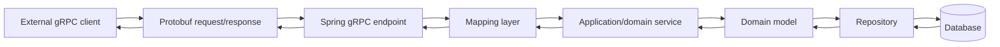

# Tách public contract khỏi model nội bộ

Trong Spring gRPC, message Protocol Buffers là **hợp đồng mà client bên ngoài nhìn thấy**. Entity, aggregate và model persistence lại phục vụ cách ứng dụng tổ chức nghiệp vụ và lưu dữ liệu. Nếu dùng trực tiếp một JPA entity làm nguồn sinh protobuf hoặc trả toàn bộ entity qua RPC, thay đổi database có thể vô tình trở thành thay đổi API; tệ hơn, field nội bộ như giá vốn, ghi chú vận hành hoặc trạng thái kiểm duyệt có thể bị lộ cho client.

Thiết kế an toàn là giữ một ranh giới rõ ràng: **public contract mô tả điều client được phép gửi và nhận; model nội bộ mô tả cách server thực hiện nghiệp vụ**. Hai phía có thể chứa một số dữ liệu giống nhau, nhưng không cần cùng cấu trúc, tên field hay vòng đời.

## 1. Hai mô hình có mục đích khác nhau

Giả sử hệ thống quản lý sản phẩm. Domain aggregate nội bộ có thể cần ID sản phẩm, tên hiển thị, giá bán, giá vốn, nhà cung cấp, biên lợi nhuận, thông tin kiểm toán và trạng thái kiểm duyệt. Client của dịch vụ Catalog chỉ được phép đọc ID, tên, mô tả ngắn và giá bán. Các field còn lại phục vụ nghiệp vụ hoặc vận hành, không thuộc hợp đồng công khai.

| Khía cạnh | Public contract (protobuf) | Model nội bộ (domain/persistence) |
| --- | --- | --- |
| Người sử dụng | Client gRPC, ứng dụng đối tác và consumer đã công bố | Domain service, repository và logic trong server |
| Mục tiêu | Giao tiếp ổn định qua ranh giới tiến trình | Thể hiện quy tắc và trạng thái nghiệp vụ |
| Vòng đời | Được quản lý theo version API và khả năng tương thích | Thay đổi theo nhu cầu refactor/domain/database |
| Field | Chỉ dữ liệu được phép trao đổi | Có thể gồm dữ liệu nội bộ, quan hệ và metadata |
| Validation | Kiểm tra request hợp lệ tại biên API | Bảo vệ invariant của domain trong mọi luồng gọi |
| Kiểu dữ liệu | Protobuf message, enum, timestamp, field mask | Value object, aggregate, entity, kiểu tiền và kiểu nghiệp vụ |

Public contract không nhất thiết có nghĩa API mở Internet. Nó là hợp đồng ở **ranh giới giữa service và consumer khác**, kể cả khi cả hai cùng thuộc một hệ thống nội bộ.

## 2. Anti-pattern: trả thẳng entity qua gRPC

Một entity persistence có thể trông như sau:

```java
@Entity
public class ProductEntity {
    @Id
    private String id;
    private String displayName;
    private long salePriceMinorUnits;
    private long costPriceMinorUnits;
    private String supplierId;
    private String moderationNote;
    private String internalStatus;
    @Version
    private long rowVersion;
}
```

Nếu API trả tất cả các thuộc tính này, client có thể phụ thuộc vào chi tiết không được thiết kế để công khai. Một thay đổi như đổi supplierId thành quan hệ SupplierEntity, chuẩn hóa internalStatus hoặc tách giá vốn sang bảng khác có thể buộc schema API thay đổi theo.

Rủi ro không chỉ là lộ dữ liệu:

1. **Rò rỉ thông tin:** field nội bộ có thể chứa dữ liệu nhạy cảm hoặc thông tin chỉ dành cho nhân viên.
2. **Phụ thuộc persistence:** client bị ảnh hưởng bởi việc đổi bảng, quan hệ lazy loading, tên cột hoặc cách lưu trữ.
3. **Mở rộng khó:** thêm field cho database có thể vô tình thêm vào response nếu mapper tự động copy mọi thuộc tính.
4. **Validation sai tầng:** request protobuf có thể ghi trực tiếp vào entity, bỏ qua quy tắc nghiệp vụ hoặc cập nhật field server phải kiểm soát.
5. **Khó quản lý tương thích:** API có thể thay đổi dù nhu cầu của client không đổi.

Không dùng entity làm public contract. Hãy chuyển đổi qua một model ứng dụng hoặc mapper có danh sách field được cho phép rõ ràng.

## 3. Định nghĩa contract theo nhu cầu của client

Ví dụ file catalog/v1/catalog.proto chỉ công bố dữ liệu cần cho thao tác xem sản phẩm:

```proto
syntax = "proto3";

package shop.catalog.v1;

option java_package = "com.myshop.grpc.catalog.v1";
option java_multiple_files = true;

service CatalogService {
  rpc GetProduct(GetProductRequest) returns (GetProductResponse);
}

message GetProductRequest {
  string product_id = 1;
}

message Product {
  string product_id = 1;
  string display_name = 2;
  string short_description = 3;
  int64 sale_price_minor_units = 4;
  string currency_code = 5;
}

message GetProductResponse {
  Product product = 1;
}
```

Không có cost_price_minor_units, supplier_id, moderation_note, internal_status hay row_version. Đây là quyết định về quyền sở hữu dữ liệu và phạm vi công khai, không phải chỉ để giảm số field.

Contract cũng không cần sao chép cấu trúc database. Ví dụ:

- Database lưu giá bán trong bảng product_price, nhưng API vẫn có thể trả sale_price_minor_units trong message Product.
- Domain biểu diễn trạng thái bằng nhiều value object, nhưng API chỉ cần một enum công khai đã được định nghĩa rõ.
- Nội bộ dùng ID nhà cung cấp để tính giá, nhưng client Catalog không được phép nhìn thấy ID đó.

Hãy thiết kế field theo ngôn ngữ và nhu cầu của consumer, không theo tên cột.

## 4. Đặt mapper tại ranh giới adapter

Luồng xử lý nên có hướng phụ thuộc rõ ràng:



Endpoint nhận protobuf, kiểm tra điều kiện ở biên, chuyển request thành lệnh/truy vấn ứng dụng rồi gọi service. Kết quả domain/application được mapper chuyển thành response protobuf. Domain không cần import generated protobuf class và không nên biết gRPC StreamObserver, metadata hay status.

Ví dụ model ứng dụng có thể là một projection dành cho use case:

```java
package com.myshop.catalog.application;

import com.myshop.catalog.domain.Money;

public record ProductView(
        String id,
        String displayName,
        String shortDescription,
        Money salePrice) {
}
```

ProductView không phải entity database và cũng không phải protobuf message. Nó mô tả dữ liệu use case GetProduct cần trả về. Domain có thể chứa thêm nhiều thuộc tính mà projection này không nhận.

### Mapper tường minh

```java
package com.myshop.catalog.grpc;

import com.myshop.catalog.application.ProductView;
import com.myshop.grpc.catalog.v1.Product;

final class ProductGrpcMapper {
    private ProductGrpcMapper() {
    }

    static Product toPublicMessage(ProductView source) {
        return Product.newBuilder()
                .setProductId(source.id())
                .setDisplayName(source.displayName())
                .setShortDescription(source.shortDescription())
                .setSalePriceMinorUnits(source.salePrice().minorUnits())
                .setCurrencyCode(source.salePrice().currencyCode())
                .build();
    }
}
```

Mapper liệt kê chính xác từng field được công khai. Khi entity nội bộ thêm costPriceMinorUnits hoặc moderationNote, response không tự xuất hiện field mới. Nếu một field công khai cần thay đổi, nhóm có thể review nó như thay đổi hợp đồng API.

Với message lồng nhau hoặc collection, tạo mapper riêng cho từng kiểu hoặc từng use case. Tránh reflection mapper tự động copy tất cả thuộc tính từ entity sang protobuf khi mục tiêu là kiểm soát dữ liệu công khai.

## 5. Endpoint Spring gRPC không để protobuf đi sâu vào domain

Một endpoint unary minh họa:

```java
package com.myshop.catalog.grpc;

import com.myshop.catalog.application.CatalogQueryService;
import com.myshop.catalog.application.ProductView;
import com.myshop.grpc.catalog.v1.CatalogServiceGrpc;
import com.myshop.grpc.catalog.v1.GetProductRequest;
import com.myshop.grpc.catalog.v1.GetProductResponse;
import io.grpc.Status;
import io.grpc.stub.StreamObserver;
import org.springframework.grpc.server.service.GrpcService;

@GrpcService
public class CatalogGrpcEndpoint
        extends CatalogServiceGrpc.CatalogServiceImplBase {

    private final CatalogQueryService catalogQueryService;

    public CatalogGrpcEndpoint(CatalogQueryService catalogQueryService) {
        this.catalogQueryService = catalogQueryService;
    }

    @Override
    public void getProduct(
            GetProductRequest request,
            StreamObserver<GetProductResponse> observer) {
        if (request.getProductId().isBlank()) {
            observer.onError(Status.INVALID_ARGUMENT
                    .withDescription("product_id is required")
                    .asRuntimeException());
            return;
        }

        var result = catalogQueryService.findById(request.getProductId());
        if (result.isEmpty()) {
            observer.onError(Status.NOT_FOUND
                    .withDescription("product not found")
                    .asRuntimeException());
            return;
        }

        ProductView view = result.get();
        GetProductResponse response = GetProductResponse.newBuilder()
                .setProduct(ProductGrpcMapper.toPublicMessage(view))
                .build();
        observer.onNext(response);
        observer.onCompleted();
    }
}
```

Ví dụ giả định CatalogQueryService.findById trả Optional<ProductView>. Annotation và cách đăng ký endpoint cần khớp phiên bản Spring gRPC của dự án. Điểm thiết kế quan trọng là endpoint phụ thuộc application service và mapper; nó không trả ProductEntity trực tiếp, cũng không chuyển protobuf request xuống repository.

Ở chiều request, với thao tác ghi, nên chuyển protobuf request thành một command ứng dụng riêng. Domain service tiếp nhận command/value object và tự kiểm tra invariant. Không bind request protobuf trực tiếp vào entity rồi save vì client có thể gửi field mà họ không được phép thay đổi.

## 6. Bảo vệ dữ liệu và quyền cập nhật

Public contract là một ranh giới bảo mật. Trước khi thêm field vào response, hãy hỏi:

- Consumer nào được phép biết giá trị này?
- Field có chứa giá vốn, thông tin nhà cung cấp, ghi chú nội bộ, dữ liệu cá nhân hoặc tín hiệu chống gian lận không?
- Field có thể bị suy ra từ các field khác hoặc làm lộ quy tắc kinh doanh không?
- Field có cần xuất hiện ở mọi RPC hay chỉ trong một API quản trị có quyền riêng?

Đối với request ghi, phân biệt **field client được phép đặt** và **field do server quản lý**. Ví dụ client có thể gửi display_name và description, nhưng không được gửi created_at, approved_by, cost_price hoặc internal_status. Hãy định nghĩa request update chuyên biệt và validate quyền ở server; không dùng một message Product đầy đủ cho cả đọc lẫn ghi.

Không coi việc ẩn field ở giao diện là kiểm soát truy cập. Nếu field không thuộc hợp đồng của consumer, tốt nhất đừng đưa nó vào response công khai. Nếu có API quản trị cần field đó, định nghĩa contract riêng và áp dụng authorization tương ứng.

## 7. Validation, status và metadata ở đúng tầng

Tách contract khỏi model nội bộ không có nghĩa bỏ validation:

| Loại kiểm tra | Ví dụ | Nơi xử lý |
| --- | --- | --- |
| Cú pháp/đầu vào API | product_id không rỗng, giới hạn độ dài | gRPC endpoint hoặc validator tại adapter |
| Quyền truy cập | Caller được xem sản phẩm thuộc phạm vi nào | Interceptor và/hoặc application authorization |
| Quy tắc nghiệp vụ | Sản phẩm bị khóa không được bán | Domain/application service |
| Ràng buộc lưu trữ | ID duy nhất, khóa ngoại, optimistic locking | Domain/repository/database tùy invariant |
| Lỗi lời gọi | Sai tham số, không tìm thấy, không được phép | Ánh xạ sang gRPC status tại biên |

Ví dụ, INVALID_ARGUMENT phù hợp khi product_id rỗng; NOT_FOUND khi ID hợp lệ nhưng không có sản phẩm; PERMISSION_DENIED khi caller không có quyền xem. Không đưa exception persistence hoặc tên bảng vào public response. Thông báo lỗi nên đủ hữu ích cho client nhưng không tiết lộ stack trace hay dữ liệu nội bộ.

Thông tin xác thực và trace context thường nằm trong gRPC metadata/interceptor, không phải field của Product. Deadline thuộc cấu hình lời gọi; TLS bảo vệ kênh truyền. Không thêm auth_token, trace_id hoặc encrypted vào mọi message nghiệp vụ nếu chúng không phải dữ liệu của use case.

## 8. Khi domain thay đổi, public contract có thể giữ nguyên

Giả sử database hiện có cột sale_price_minor_units. Sau một lần refactor, nhóm chuyển sang value object:

```java
package com.myshop.catalog.domain;

public record Money(long minorUnits, String currencyCode) {
}
```

```java
package com.myshop.catalog.domain;

public class Product {
    private ProductId id;
    private ProductName name;
    private Money salePrice;
    private Money costPrice;
    private SupplierId supplierId;
    private ProductModeration moderation;
}
```

Domain model đã đổi cấu trúc, nhưng client vẫn cần cùng dữ liệu product_id, display_name, sale_price_minor_units và currency_code. Chỉ cần cập nhật mapper:

```java
static com.myshop.grpc.catalog.v1.Product toPublicMessage(ProductView source) {
    return com.myshop.grpc.catalog.v1.Product.newBuilder()
            .setProductId(source.id())
            .setDisplayName(source.displayName())
            .setSalePriceMinorUnits(source.salePrice().minorUnits())
            .setCurrencyCode(source.salePrice().currencyCode())
            .build();
}
```

Public contract không cần đổi vì chi tiết nội bộ thay đổi. Ngược lại, nếu consumer thật sự cần thêm tax_included, đó là một quyết định API riêng: xác định ngữ nghĩa, field number mới, fallback và khả năng tương thích trước khi công bố.

Đây là lợi ích lớn nhất của ranh giới mapping: **refactor domain và schema API có thể diễn ra độc lập**, miễn là mapper tiếp tục đáp ứng hợp đồng đã công bố.

## 9. Kiểm thử ranh giới contract

Đừng chỉ kiểm tra repository trả đúng entity. Cần xác minh response thực sự gửi qua gRPC không chứa field nội bộ và mapping vẫn đúng khi model domain thay đổi.

| Kiểm thử | Điều cần xác minh |
| --- | --- |
| Mapper test | Các field public được ánh xạ đúng; giá trị tiền và currency không bị đảo |
| Contract descriptor test | Message public chỉ chứa các field được phê duyệt |
| Endpoint integration test | Request hợp lệ trả response đúng; ID rỗng là INVALID_ARGUMENT; không tồn tại là NOT_FOUND |
| Authorization test | Caller không đủ quyền không nhận dữ liệu dù biết product ID |
| Regression test | Thêm field nội bộ vào entity không làm response protobuf tự thay đổi |
| Compatibility test | Thay đổi model persistence không buộc client thay đổi khi public contract không đổi |

Một kiểm tra descriptor đơn giản có thể phát hiện field nhạy cảm vô tình lọt vào message:

```java
import static org.junit.jupiter.api.Assertions.assertNull;

import com.myshop.grpc.catalog.v1.Product;
import org.junit.jupiter.api.Test;

class CatalogContractTest {
    @Test
    void publicProductDoesNotExposeInternalFields() {
        assertNull(Product.getDescriptor().findFieldByName("cost_price_minor_units"));
        assertNull(Product.getDescriptor().findFieldByName("supplier_id"));
        assertNull(Product.getDescriptor().findFieldByName("moderation_note"));
    }
}
```

Đây là test minh họa cho danh sách field không được công khai. Trong dự án thật, có thể duy trì allowlist field public và kiểm tra descriptor của nhiều message; test mapper và test quyền truy cập vẫn cần thiết vì descriptor không chứng minh dữ liệu đã được lọc đúng ở runtime.

## 10. Checklist review

- [ ] Protobuf message được thiết kế cho consumer và use case, không sinh trực tiếp từ entity/database.
- [ ] Domain/application layer không phụ thuộc generated protobuf class hoặc StreamObserver.
- [ ] Mapper ánh xạ tường minh các field được phép công khai.
- [ ] Request ghi chỉ chứa field client được phép thay đổi; server tự quản lý audit, giá vốn và trạng thái nội bộ.
- [ ] Authorization được kiểm tra trước khi trả dữ liệu; ẩn field ở UI không được coi là bảo mật.
- [ ] Lỗi nội bộ được ánh xạ sang gRPC status phù hợp, không lộ chi tiết persistence.
- [ ] Refactor entity/value object không làm thay đổi public contract ngoài ý muốn.
- [ ] Có test mapper, descriptor, endpoint và quyền truy cập.

**Tự kiểm tra**

**Câu 1.** Một entity có cost_price_minor_units, nhưng client Catalog chỉ cần giá bán. Có nên đưa cả hai field vào protobuf Product để mapper đơn giản hơn?

*Đáp án:* Không. Public contract chỉ nên chứa dữ liệu consumer được phép nhận. Mapper tường minh giúp ngăn lộ giá vốn.

**Câu 2.** Domain đổi từ một trường giá dạng số sang value object Money. Có bắt buộc đổi protobuf schema không?

*Đáp án:* Không, nếu dữ liệu và semantics mà client nhìn thấy vẫn giữ nguyên. Cập nhật mapper để chuyển Money sang các field public hiện tại.

**Câu 3.** Có thể dùng cùng protobuf Product làm request cập nhật và response đọc chi tiết không?

*Đáp án:* Không nên nếu hai use case có quyền và quy tắc khác nhau. Request update nên chỉ chứa field được phép sửa và cơ chế chỉ rõ field nào được cập nhật.

**Câu 4.** Test descriptor chứng minh response không bao giờ lộ dữ liệu nội bộ đã đủ chưa?

*Đáp án:* Chưa. Nó kiểm tra cấu trúc schema; vẫn cần test mapper, endpoint và authorization để xác minh dữ liệu runtime.

Tách public contract khỏi model nội bộ giúp Spring gRPC giữ API ổn định trong khi domain và persistence tiếp tục phát triển. Hãy để protobuf định nghĩa điều service cam kết với consumer, để domain giữ các invariant nghiệp vụ, và để mapper tại adapter kiểm soát dữ liệu đi qua ranh giới đó.
