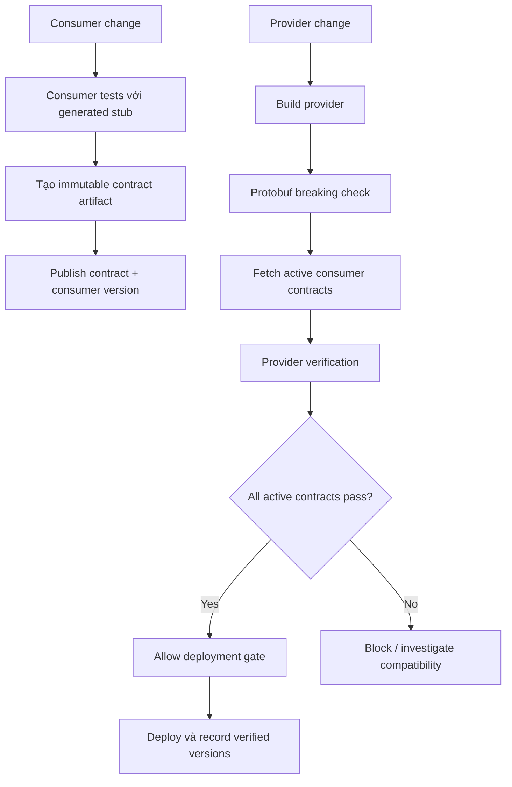

# Consumer-driven contract cho gRPC

## Mục tiêu bài học

Trong **SPRING_GRPC**, một consumer thường chỉ dùng một phần API của provider: một số RPC method, field trong request/response, metadata, status và các quy tắc về deadline hoặc streaming. Khi provider thay đổi implementation hay Protobuf schema, chỉ kiểm tra compile hoặc wire compatibility chưa đủ để biết các consumer đang chạy có còn hoạt động đúng hay không.

**Consumer-driven contract (CDC)** là cách để consumer mô tả những tương tác và hành vi mà nó thực sự cần; provider xác minh các hợp đồng đó bằng implementation của mình. Với gRPC, hợp đồng cần bao phủ cả Protobuf message contract lẫn semantics của RPC: method, status, metadata, authentication, deadline và vòng đời stream.

Sau bài này, bạn có thể:

1. Giải thích vai trò consumer, provider và contract trong CDC.
2. Xây dựng interaction contract cho unary, server-streaming, client-streaming và bidirectional-streaming RPC.
3. Mô tả request/response bằng generated Protobuf types hoặc descriptor-aware fixtures.
4. Đặt expectation cho gRPC status, metadata, trailers, deadline và authorization.
5. Kiểm tra consumer behavior và xác minh contract trên provider thật.
6. Phân biệt CDC với Protobuf wire compatibility và schema breaking checks.
7. Quản lý contract version, consumer matrix và provider verification trong CI/CD.
8. Thiết kế matching rules đủ chặt để bảo vệ consumer nhưng tránh coupling vào chi tiết implementation.

> **Lưu ý công cụ:** gRPC dùng HTTP/2 framing và Protobuf binary payload. Không mặc định một HTTP Pact test hoặc HTTP interaction plugin có thể kiểm thử trực tiếp gRPC. Hãy dùng công cụ có hỗ trợ gRPC thực sự hoặc một executable contract format do tổ chức định nghĩa, rồi xác minh bằng generated gRPC stubs. File YAML trong bài là DSL minh họa, không phải schema chuẩn của Pact hay Protobuf.

## 1. Consumer-driven contract là gì?

CDC chuyển câu hỏi từ “provider có schema gì?” sang “consumer cần provider đảm bảo điều gì để use case của nó hoạt động?”.

- **Consumer:** service hoặc ứng dụng gọi RPC, biết request nào nó gửi và response/status nào nó cần xử lý.
- **Provider:** service triển khai RPC và chịu trách nhiệm đáp ứng các contract đang được consumer sử dụng.
- **Contract:** tập interaction có thể thực thi hoặc kiểm chứng, mô tả method, input, expected outcome và các điều kiện liên quan.
- **Provider verification:** chạy các interaction của consumer trên provider implementation để xác nhận provider đáp ứng chúng.

Ví dụ, Inventory Service có method `GetStock`. Consumer Order Service chỉ cần gửi SKU và nhận quantity cùng availability. Consumer không cần ràng buộc provider dùng database nào, gọi cache ra sao hoặc tạo bao nhiêu internal span.

Contract tốt mô tả hành vi quan sát được ở RPC boundary. Nó không ghi lại toàn bộ implementation hoặc toàn bộ khả năng mà provider có thể hỗ trợ.

### 1.1. CDC bổ sung cho Protobuf schema

Protobuf định nghĩa service, method và cấu trúc message. Nó hỗ trợ code generation và một số quy tắc tương thích wire format. CDC bổ sung những điều schema không mô tả đầy đủ:

- Consumer cần method nào và dùng field nào.
- Field có ý nghĩa gì, giá trị nào được chấp nhận.
- Status nào được trả trong điều kiện nghiệp vụ cụ thể.
- Metadata/trailers nào là một phần của API behavior.
- Consumer cần quyền/credential nào.
- Deadline, cancellation và retry semantics.
- Streaming sequence, completion và error behavior.

Một schema có thể không breaking ở wire level nhưng vẫn breaking về behavior. Ví dụ provider giữ nguyên message type nhưng đổi lỗi “SKU không tồn tại” từ NOT_FOUND sang INVALID_ARGUMENT; consumer đang phân nhánh theo NOT_FOUND có thể hỏng.

Ngược lại, provider có thể thêm một field optional mà mọi consumer cũ không dùng; schema change đó thường tương thích và CDC của consumer không nên fail chỉ vì có field mới.

## 2. Chọn đúng phạm vi contract

Mỗi consumer nên ghi lại các tương tác mà nó thật sự phụ thuộc. Tránh tạo contract khổng lồ bao phủ mọi method của provider nếu consumer chỉ dùng một RPC.

Một interaction thường cần mô tả:

| Thành phần | Nội dung |
| --- | --- |
| Identity | Consumer, provider, contract version |
| RPC | Fully qualified service và method |
| Request | Protobuf message hoặc fixture có kiểu |
| Expected outcome | Response, gRPC status hoặc stream sequence |
| Metadata | Header/trailer mà consumer gửi hoặc cần nhận |
| Security | Authentication/authorization context cần cho call |
| Timing | Deadline tối thiểu/tối đa mà consumer đặt; chỉ assert behavior có ý nghĩa |
| Scenario | Điều kiện nghiệp vụ và trạng thái fixture |
| Matching | Field nào exact, field nào chỉ cần thỏa matcher |

Ví dụ, Order Service có thể cần contract cho ba tình huống: tồn kho đủ, SKU không tồn tại và caller không có quyền. Không cần mô tả mọi trường hợp nội bộ của Inventory Service nếu consumer không phụ thuộc vào chúng.

### 2.1. Contract là consumer-specific

Hai consumer có thể dùng cùng RPC nhưng có kỳ vọng khác nhau. Order Service có thể cần NOT_FOUND để hiển thị lỗi đơn hàng; Analytics Service có thể chỉ cần phân biệt response hợp lệ với lỗi tạm thời.

Không ép một contract dùng chung chứa kỳ vọng của mọi consumer. Tách contract theo consumer giúp provider biết ai phụ thuộc vào behavior nào và giảm false failure khi một use case thay đổi.

## 3. Mô tả interaction cho gRPC

Với gRPC, contract phải định danh method bằng full name, thường theo dạng `package.Service/Method`. Không dùng tên Java implementation class làm định danh vì đó không phải API contract.

Một DSL minh họa cho unary RPC:

```yaml
contract:
  name: order-service-inventory-consumer
  version: 3
  consumer: order-service
  provider: inventory-service
  interactions:
    - description: SKU có tồn kho
      rpc:
        fullMethod: commerce.v1.InventoryService/GetStock
        type: unary
      request:
        sku: SKU-100
      expect:
        status: OK
        response:
          sku: SKU-100
          available: true
          quantity: 12
```

Đây là định dạng minh họa do đội dự án tự định nghĩa. Khi triển khai, cần có parser/runner chuyển fixture sang generated request type và gọi generated stub. Không coi YAML này là định dạng tự động được gRPC runtime hiểu.

### 3.1. Dùng Protobuf types, không so sánh raw bytes tùy tiện

Provider verification nên tạo request bằng generated Protobuf class. Response cũng nên được kiểm tra theo field/semantic value, không so sánh raw serialized bytes trừ khi byte-level encoding thực sự là yêu cầu.

Protobuf có thể serialize cùng một message theo cách không đảm bảo thứ tự byte ổn định cho mọi trường hợp; unknown fields, map ordering và implementation details có thể làm byte comparison quá chặt. Hãy assert message fields và semantics.

Lưu ý presence:

- Với proto3 scalar không có explicit presence, giá trị mặc định có thể giống với “không gửi field”.
- Với `optional`, message fields và `oneof`, presence/selection có ý nghĩa riêng.
- Không viết matcher chỉ kiểm tra giá trị 0/false nếu consumer cần biết field đã được set hay chưa.
- Đối với Timestamp, Duration, enum và Any, xác minh semantics và type URL phù hợp.

## 4. Contract cho request, response và status

Một consumer-driven contract không chỉ mô tả response thành công. Nó cần nêu những lỗi mà consumer dựa vào để quyết định hành vi.

Ví dụ contract outcomes:

```yaml
expectations:
  - scenario: stock exists
    status: OK
    response:
      available: true
  - scenario: unknown sku
    status: NOT_FOUND
  - scenario: invalid sku
    status: INVALID_ARGUMENT
  - scenario: service temporarily unavailable
    status: UNAVAILABLE
```

Các status phải phản ánh semantics nhất quán:

| Điều kiện | Status thường phù hợp | Consumer behavior |
| --- | --- | --- |
| Request sai định dạng | INVALID_ARGUMENT | Sửa request; không retry nguyên input |
| Resource không tồn tại | NOT_FOUND | Xử lý như kết quả nghiệp vụ |
| Chưa xác thực | UNAUTHENTICATED | Cấp credential hợp lệ |
| Không có quyền | PERMISSION_DENIED | Không retry cùng identity |
| Capacity tạm thời cạn | RESOURCE_EXHAUSTED | Chỉ retry nếu policy cho phép |
| Dependency tạm thời unavailable | UNAVAILABLE | Retry có backoff nếu operation an toàn |
| Deadline hết | DEADLINE_EXCEEDED | Điều chỉnh budget hoặc xử lý timeout |
| Lỗi bất ngờ | INTERNAL | Không phụ thuộc message chi tiết nội bộ |

Consumer contract nên assert status code, không assert stack trace hoặc text mô tả nội bộ dễ thay đổi. Description chỉ nên được kiểm tra nếu đó là thông điệp public được cam kết trong API.

### 4.1. Metadata và trailers

Metadata có thể là một phần của contract nếu consumer phụ thuộc vào nó, ví dụ:

- Request correlation ID mà consumer gửi.
- Auth metadata cần thiết để provider chấp nhận call.
- Response metadata/trailers chứa version hoặc retry guidance theo API agreement.
- Binary metadata có key hậu tố `-bin` nếu contract thực sự dùng binary value.

Không assert metadata nội bộ không được consumer dùng. Key ASCII phải tuân theo quy tắc lowercase của gRPC metadata. Không đưa token thật vào contract artifact; dùng placeholder hoặc test credential.

## 5. Contract cho deadline, cancellation và retry

Deadline thường do consumer đặt bằng stub/call options. Contract nên xác minh consumer có gửi RPC với budget hợp lý và provider xử lý cancellation đúng, thay vì assert một thời gian tuyệt đối dễ flaky.

Các điều cần mô tả nếu có ý nghĩa với consumer:

- Consumer đặt deadline hữu hạn theo latency budget.
- Provider không tiếp tục công việc tốn tài nguyên sau khi cancellation được nhận diện, trong phạm vi API/runtime hỗ trợ.
- Status DEADLINE_EXCEEDED/CANCELLED được xử lý đúng.
- Retry chỉ xảy ra với lỗi được policy cho phép.
- Retry có giới hạn attempt, backoff và tổng thời gian.
- Operation không idempotent không bị retry mù.

Không ghi một expectation kiểu “RPC luôn hoàn tất dưới 20 ms” trong CDC nếu thời gian đó không phải guarantee được provider cam kết. Latency SLO nên được kiểm thử hiệu năng/observability riêng; contract chỉ nên ràng buộc timing semantics cần thiết.

## 6. Contract cho streaming RPC

Streaming contract phải mô tả cả sequence và lifecycle, không chỉ một request/response.

### 6.1. Server streaming

Consumer gửi một request rồi nhận nhiều response. Contract nên định nghĩa:

- Request khởi tạo stream.
- Các response tối thiểu/được mong đợi theo scenario.
- Thứ tự response nếu thứ tự là guarantee.
- Điều kiện stream complete.
- Status khi stream lỗi.
- Consumer cancellation behavior.

Ví dụ DSL minh họa:

```yaml
- description: Theo dõi thay đổi tồn kho
  rpc:
    fullMethod: commerce.v1.InventoryService/WatchStock
    type: server_streaming
  request:
    sku: SKU-100
  expect:
    messages:
      - available: true
        quantity: 12
      - available: false
        quantity: 0
    terminalStatus: OK
```

Không assert thứ tự nếu contract không cam kết ordering. Nếu stream là event feed, xác định rõ ordering key hoặc semantics replay/resume.

### 6.2. Client streaming và bidirectional streaming

Với client streaming, contract mô tả chuỗi message consumer gửi, response cuối cùng và behavior nếu client half-close hoặc cancel.

Với bidirectional streaming, mô tả một kịch bản trao đổi có kiểm soát: client message nào được gửi, response nào được mong đợi, có thể interleave ra sao, khi nào stream hoàn tất và status cuối là gì.

Không cố định mọi message timing theo millisecond. Dùng bounded test timeout và đồng bộ bằng latch/observer. Test phải đóng stream và giải phóng channel/server ngay cả khi assertion fail.

### 6.3. Flow control và giới hạn

CDC có thể ghi các guarantee observable như consumer có thể cancel stream, provider không gửi response sau terminal close, hoặc server tôn trọng flow-control behavior theo gRPC API. Buffer capacity và internal thread count thường là implementation detail, trừ khi được công bố thành quota/limit contract.

## 7. Consumer test: kiểm tra cách consumer sử dụng provider

Consumer test cần xác minh consumer code dùng generated stub đúng với contract mà nó publish.

Ví dụ, một test có thể tạo in-process fake provider để ghi nhận request và trả response fixture:

```java
final class InventoryContractStub
        extends InventoryGrpc.InventoryImplBase {

    private final List<GetStockRequest> received =
            new CopyOnWriteArrayList<>();

    @Override
    public void getStock(
            GetStockRequest request,
            StreamObserver<GetStockResponse> observer) {

        received.add(request);

        observer.onNext(
                GetStockResponse.newBuilder()
                        .setSku(request.getSku())
                        .setAvailable(true)
                        .setQuantity(12)
                        .build());
        observer.onCompleted();
    }

    List<GetStockRequest> receivedRequests() {
        return List.copyOf(received);
    }
}
```

Consumer test chạy application gateway/client qua generated stub và fake provider. Sau đó assert consumer gửi đúng method/request fields, áp dụng deadline/metadata cần thiết và xử lý response/status như contract.

Fake provider giúp kiểm tra consumer expectation, nhưng không chứng minh provider thật đáp ứng contract. Đó là nhiệm vụ của provider verification.

### 7.1. Không để mock thay thế toàn bộ provider verification

Nếu chỉ kiểm thử consumer với mock do chính consumer viết, mock có thể lặp lại cùng giả định sai với consumer. Contract cần được publish độc lập để provider chạy trên implementation thật. Provider verification là bước quan trọng giúp phát hiện mismatch giữa hai phía.

## 8. Provider verification bằng generated gRPC stub

Provider verification khởi chạy provider implementation trong test environment và replay từng interaction. Dùng generated client stub để gọi server như consumer thực tế.

Ví dụ test unary bằng in-process server:

```java
@Test
void providerSatisfiesStockContract() throws Exception {
    String serverName = InProcessServerBuilder.generateName();

    Server server = InProcessServerBuilder
            .forName(serverName)
            .directExecutor()
            .addService(inventoryGrpcService)
            .build()
            .start();

    ManagedChannel channel = InProcessChannelBuilder
            .forName(serverName)
            .directExecutor()
            .build();

    try {
        InventoryGrpc.InventoryBlockingStub stub =
                InventoryGrpc.newBlockingStub(channel);

        GetStockResponse response = stub.getStock(
                GetStockRequest.newBuilder()
                        .setSku("SKU-100")
                        .build());

        assertEquals("SKU-100", response.getSku());
        assertTrue(response.getAvailable());
        assertEquals(12, response.getQuantity());
    } finally {
        channel.shutdownNow();
        server.shutdownNow();
    }
}
```

Đây là skeleton; trong test thực tế, service cần được khởi tạo với fixture repository/state phù hợp. Nếu Spring gRPC server registration, interceptors hoặc TLS configuration cũng là một phần cần kiểm chứng, khởi động Spring application context hoặc server factory thật thay vì chỉ addService trực tiếp.

Provider verification phải dùng implementation thật của provider. Có thể thay database/HTTP dependency bằng deterministic fixture nếu contract không nhằm kiểm tra dependency đó; không thay chính gRPC service implementation bằng mock.

### 8.1. Verify mọi contract còn được sử dụng

Provider CI nên tải tất cả contract version đang được consumer công bố là active hoặc deployed. Không chỉ verify contract mới nhất vì consumer cũ có thể vẫn đang chạy.

Kết quả verification nên gắn với:

- Provider build/version.
- Consumer name/version.
- Contract version hoặc immutable artifact digest.
- Environment/test profile.
- Thời điểm verification.
- Interaction nào pass/fail và lý do.

Không dùng mutable “latest” artifact mà không ghi digest; kết quả cần tái lập được khi điều tra release.

## 9. Contract artifact và versioning

Một contract artifact cần có owner, version và lifecycle:

| Metadata | Mục đích |
| --- | --- |
| Consumer name | Ai đưa ra expectation |
| Provider name | Service phải verify |
| Consumer version | Phiên bản code consumer |
| Contract version | Phiên bản interaction schema |
| Proto package/service revision | Liên kết tới API definition |
| Commit/build ID | Truy nguyên nguồn tạo contract |
| Published timestamp | Theo dõi freshness |
| Active/deployed marker | Biết contract nào còn cần provider hỗ trợ |

Consumer publish contract sau khi consumer test tạo ra artifact đã kiểm tra. Provider CI lấy artifact theo version/digest, chạy verification và công bố kết quả.

Khi consumer không còn được deploy, contract có thể được retire sau khi xác minh không còn instance/version nào phụ thuộc. Không xóa contract chỉ vì một pipeline mới publish version khác.

## 10. CDC và Protobuf compatibility checks

Hai loại kiểm tra bổ sung cho nhau:

| Kiểm tra | Bảo vệ điều gì? | Không chứng minh điều gì? |
| --- | --- | --- |
| Protobuf breaking-change check | Wire/schema compatibility theo rule của tool | Business semantics, status mapping, auth, metadata |
| Consumer-driven contract | Interactions mà consumer cụ thể phụ thuộc | Mọi consumer chưa publish contract, mọi tổ hợp input |
| Provider unit/integration tests | Logic provider và behavior nội bộ | Consumer thực tế có dùng API đúng không |
| End-to-end test | Một số đường đi xuyên hệ thống | Toàn bộ contract matrix và mọi release combination |

Dùng Buf breaking checks hoặc descriptor comparison để phát hiện schema change nguy hiểm, đồng thời dùng CDC để kiểm tra behavior. Ví dụ đổi field number hoặc xóa field đang dùng có thể bị schema checker bắt; đổi status code cho một business scenario có thể chỉ CDC mới bắt được.

CDC không thay thế API governance. Provider vẫn cần review Protobuf evolution, deprecation và compatibility window.

## 11. Matching rules: đủ linh hoạt nhưng không mơ hồ

Contract quá chặt sẽ tạo false failure; quá lỏng sẽ không bảo vệ consumer.

Nên exact-match cho:

- Full RPC method name.
- Enum/status code mà consumer phân nhánh.
- Identifier hoặc field quyết định use case.
- Metadata key/value có semantics được công bố.
- Số lượng/thứ tự message nếu contract cam kết.

Có thể dùng matcher cho:

- Timestamp nằm trong khoảng hợp lệ.
- Server-generated ID theo format.
- Field bổ sung mà consumer không sử dụng.
- Giá trị nondeterministic không thuộc business decision.

Không ignore toàn bộ response chỉ để contract pass. Chỉ bỏ qua field nếu consumer thực sự không phụ thuộc vào nó. Với Protobuf default/presence, xác định rõ test đang kiểm tra giá trị hay presence.

### 11.1. Tránh contract phụ thuộc implementation

Không assert:

- Tên database table hoặc cache key.
- Thứ tự gọi internal repository method.
- Thread name hoặc số worker thread.
- Nội dung stack trace.
- Log message nội bộ.
- Thứ tự response nếu API không cam kết ordering.

Những điều này thuộc provider unit/performance/operational tests, không phải consumer contract.

## 12. Bảo mật trong contract verification

Contract artifact là dữ liệu được lưu và truyền giữa pipeline. Không đưa credential thật hoặc dữ liệu khách hàng thật vào fixture.

- Dùng synthetic identifiers và test data.
- Dùng test credential ngắn hạn hoặc fake auth context.
- Không lưu bearer token, private key hoặc cookie trong artifact.
- Kiểm tra metadata auth bằng test identity, không bằng secret production.
- Không ghi payload nhạy cảm vào verification report.
- Phân quyền đọc contract artifact nếu nó chứa topology hoặc schema nội bộ.
- Xác minh provider vẫn enforce authorization; contract không được biến thành đường bỏ qua security interceptor.

Provider verification có thể dùng test-only credential provider nhưng vẫn nên chạy qua authentication/authorization path cần được contract bảo vệ. Nếu contract chỉ test business behavior và bỏ qua auth, cần có security contract/test suite riêng.

## 13. CI/CD workflow

Một workflow phổ biến:



Quy trình chi tiết:

1. Consumer compile generated stubs và chạy consumer tests.
2. Consumer tạo contract artifact từ interactions cần thiết.
3. Artifact được version hóa và publish bất biến.
4. Provider CI chạy Protobuf breaking checks.
5. Provider CI lấy tất cả contract active/deployed.
6. Provider khởi chạy test server/application context và replay interactions.
7. Kết quả được lưu cùng provider build và contract digest.
8. Deployment gate kiểm tra các contract bắt buộc đều pass.
9. Sau deploy, cập nhật trạng thái consumer/provider versions và retire contract khi an toàn.

Nếu contract verification cần external dependency, dùng test environment cô lập và dữ liệu deterministic. Không để test gọi production downstream hoặc sử dụng production credential.

## 14. Lỗi thường gặp và cách xử lý

| Triệu chứng | Nguyên nhân | Cách xử lý |
| --- | --- | --- |
| Protobuf breaking check pass nhưng consumer hỏng | Business/status semantics thay đổi | Thêm interaction contract cho behavior consumer dùng |
| Consumer mock test pass nhưng provider thật fail | Mock lặp lại giả định của consumer | Provider verify contract trên implementation thật |
| Contract fail vì field mới | Matcher exact toàn bộ message | Chỉ assert field consumer phụ thuộc; giữ schema check riêng |
| Contract pass dù response sai | Matcher quá lỏng hoặc ignore toàn bộ field | Siết expectation cho decision fields/status |
| Provider chỉ verify contract mới nhất | Không lấy contract của consumer version cũ | Verify toàn bộ active/deployed contract matrix |
| gRPC không chạy với HTTP Pact plugin | Tool không hỗ trợ HTTP/2 gRPC framing/Protobuf | Dùng gRPC-aware verifier hoặc executable contract runner |
| Stream test flaky | Dùng sleep và timing cố định | Dùng observer/latch, bounded timeout và deterministic sequence |
| Metadata expectation không khớp | Sai lowercase key, ASCII/binary marshaller hoặc interceptor | Kiểm tra metadata definition và actual call |
| Deadline test không ổn định | Assert thời gian hoàn tất tuyệt đối | Assert deadline propagation/cancellation semantics |
| Contract artifact không tái lập | Dùng mutable latest hoặc fixture không version | Ghi immutable digest, consumer build và fixture version |
| Provider test bỏ qua auth | Dùng service trực tiếp, bypass interceptor | Verify qua server pipeline có security path cần thiết |
| Contract chứa secret | Fixture dùng credential thật | Dùng synthetic/test credentials và redaction |

## 15. Bài tập thực hành

1. Chọn một consumer thực tế của InventoryService và liệt kê đúng các RPC method nó dùng.
2. Viết interaction contract cho GetStock với success, NOT_FOUND và INVALID_ARGUMENT.
3. Thêm expectation cho metadata correlation và authentication test identity nếu consumer phụ thuộc.
4. Tạo consumer test dùng generated stub và in-process fake provider; assert request fields, deadline và status handling.
5. Publish contract artifact với consumer name/version và immutable digest.
6. Trong provider test, khởi chạy implementation thật với deterministic repository fixture.
7. Replay các interaction bằng generated blocking stub; assert response và gRPC status.
8. Viết contract cho server-streaming method gồm message sequence, terminal status và cancellation.
9. Viết test client-streaming hoặc bidirectional-streaming nếu API có method tương ứng.
10. Thêm Buf breaking check bên cạnh provider verification; tạo ví dụ schema-compatible nhưng behavior-breaking để chứng minh hai kiểm tra khác nhau.
11. Chạy provider verification với ít nhất hai consumer contract versions còn active.
12. Thêm deployment gate và report provider build, consumer version, contract digest cùng interaction failures.

### Câu hỏi tự kiểm tra

- Consumer-driven contract khác provider-owned API schema như thế nào?
- Vì sao Protobuf wire compatibility chưa đủ để bảo vệ consumer?
- Một gRPC interaction contract cần định danh method bằng gì?
- Khi nào cần assert status code, metadata và trailers?
- Vì sao không nên so sánh raw Protobuf serialized bytes?
- Contract streaming cần mô tả những khía cạnh lifecycle nào?
- Consumer test và provider verification có trách nhiệm khác nhau ra sao?
- Vì sao provider phải verify contract của các consumer version còn deployed?
- Khi nào exact matching phù hợp và khi nào cần matcher?
- CDC khác Buf breaking check và end-to-end test như thế nào?
- Vì sao một HTTP Pact plugin không mặc nhiên kiểm thử được gRPC?
- Cần lưu metadata nào để provider verification có thể tái lập?

## Tài liệu tham khảo

- [Protocol Buffers — Language Guide](https://protobuf.dev/programming-guides/proto3/): field presence, message và schema semantics.
- [Protocol Buffers — Editions / Compatibility](https://protobuf.dev/programming-guides/editions/): evolution và compatibility của Protobuf.
- [Buf — Breaking Change Detection](https://buf.build/docs/breaking/): phát hiện thay đổi schema không tương thích.
- [gRPC — Concepts](https://grpc.io/docs/what-is-grpc/core-concepts/): unary, streaming và RPC lifecycle.
- [gRPC — Metadata](https://grpc.io/docs/guides/metadata/): headers và trailers.
- [gRPC — Deadlines](https://grpc.io/docs/guides/deadlines/): deadline propagation và timeout behavior.
- [gRPC — Status Codes](https://grpc.io/docs/guides/status-codes/): semantics của status code.
- [Pact — Consumer-driven Contracts](https://docs.pact.io/): nguyên tắc consumer/provider contract và provider verification; kiểm tra transport/plugin support trước khi áp dụng cho gRPC.
- [gRPC Java](https://grpc.io/docs/languages/java/): generated stubs, server và client APIs.

**Kết quả mong đợi:** Người học thiết kế và vận hành được consumer-driven contracts cho Spring gRPC, mô tả chính xác các RPC interaction và behavior mà consumer cần, xác minh provider implementation bằng generated stubs, phối hợp CDC với Protobuf compatibility checks, và đưa contract verification vào CI/CD mà vẫn hỗ trợ nhiều consumer versions cùng tồn tại.
