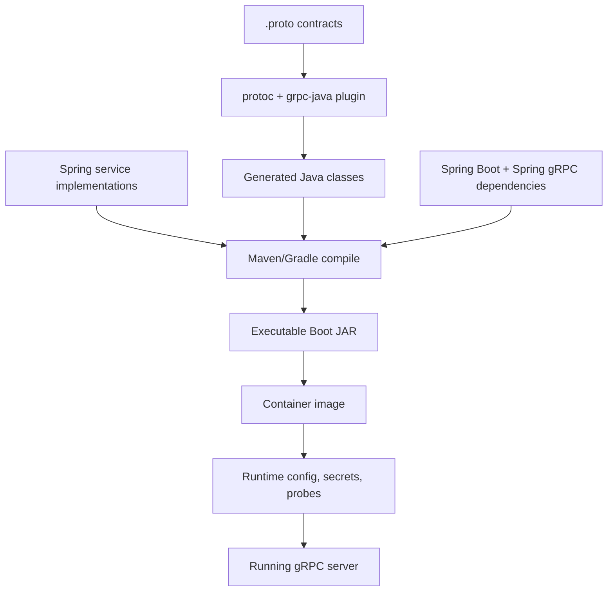

# Đóng gói gRPC server cùng Spring Boot

## 1. Mục tiêu của gói triển khai

Trong module SPRING_GRPC, ứng dụng Spring Boot chứa các service gRPC được triển khai như một đơn vị có thể build, chạy và phát hành độc lập. Gói triển khai cần mang theo application code, protobuf generated classes, gRPC runtime và cấu hình khởi động server tương thích.

Khi dùng Spring gRPC starter, Spring Boot quản lý vòng đời server và phát hiện các service bean được đánh dấu bằng annotation tương ứng. Ứng dụng không cần tự tạo một Netty server khác trong main method. Cách đóng gói phổ biến là tạo executable Boot JAR, sau đó chạy JAR trực tiếp hoặc đặt nó trong container image.

Một artifact triển khai đúng cần bảo đảm:

- Có class ứng dụng và service implementation.
- Có protobuf message classes và generated gRPC stubs cần thiết.
- Có các thư viện runtime tương thích: Spring Boot, Spring gRPC, gRPC Java và Protocol Buffers.
- Có cấu hình cổng, bind address, TLS và môi trường bên ngoài artifact.
- Khởi động được bằng entry point Spring Boot và đóng server đúng lifecycle.
- Có health/readiness, logging, metrics và trace phù hợp với môi trường vận hành.



## 2. Dependency và generated code phải cùng nằm trong build

Một gRPC service thường cần ba nhóm thành phần:

1. Spring Boot và Spring gRPC starter để tạo application context, đăng ký service và quản lý server.
2. gRPC Java runtime và Protocol Buffers runtime để xử lý channel, stub, message và transport.
3. Code được sinh từ file proto, gồm message classes, service descriptors và client/server base classes.

Ví dụ dependency Maven với version được quản lý tập trung:

```xml
<dependency>
    <groupId>org.springframework.grpc</groupId>
    <artifactId>spring-grpc-spring-boot-starter</artifactId>
    <version>SPRING_GRPC_VERSION</version>
</dependency>
```

Tên artifact và version cần khớp release Spring gRPC tương thích với Spring Boot đang dùng. Nếu dự án dùng BOM hoặc dependency management của nền tảng, khai báo version tại nơi quản lý tập trung thay vì để mỗi module tự chọn một version.

Plugin Protocol Buffers phải chạy trong build lifecycle để sinh Java sources trước compile. Với Maven, cấu hình protobuf-maven-plugin cùng protoc và protoc-gen-grpc-java; với Gradle, dùng protobuf plugin và khai báo generator tương ứng. Hai generator phải tương thích với runtime libraries.

Generated source cần được compile vào application artifact. Không chỉ copy file proto vào image rồi kỳ vọng server tự sinh stub lúc khởi động. Quá trình sinh code thuộc build time, giúp artifact có thể tái lập và không cần compiler trong production.

Cần đồng bộ các version sau:

- protoc compiler;
- protoc-gen-grpc-java;
- protobuf-java;
- grpc-api, grpc-stub và transport implementation;
- Spring gRPC starter;
- Spring Boot và Java runtime.

Không nâng riêng một thư viện gRPC hoặc protobuf nếu dependency management của Spring gRPC đang khóa một bộ version khác. Kiểm tra dependency tree khi có lỗi NoSuchMethodError, ClassNotFoundException hoặc lỗi serialization.

## 3. Đăng ký gRPC service trong Spring application

Service implementation phải được Spring quản lý để starter có thể phát hiện và đăng ký nó với server:

```java
import org.springframework.boot.SpringApplication;
import org.springframework.boot.autoconfigure.SpringBootApplication;

@SpringBootApplication
public class CatalogApplication {

    public static void main(String[] args) {
        SpringApplication.run(CatalogApplication.class, args);
    }
}
```

Ví dụ service bean:

```java
import io.grpc.stub.StreamObserver;
import org.springframework.grpc.server.service.GrpcService;

@GrpcService
public class CatalogGrpcService
        extends CatalogServiceGrpc.CatalogServiceImplBase {

    private final GetProductUseCase getProductUseCase;

    public CatalogGrpcService(GetProductUseCase getProductUseCase) {
        this.getProductUseCase = getProductUseCase;
    }

    @Override
    public void getProduct(
            GetProductRequest request,
            StreamObserver<GetProductResponse> responseObserver) {
        ProductView product = getProductUseCase.execute(
                new GetProductQuery(request.getProductId()));

        responseObserver.onNext(toResponse(product));
        responseObserver.onCompleted();
    }
}
```

Annotation GrpcService đăng ký service theo Spring gRPC starter. Package import và cơ chế auto-configuration có thể thay đổi theo phiên bản; dùng API của đúng release trong build. Service phải nằm trong component scan của application hoặc được import rõ ràng. Một class có annotation nhưng nằm ngoài scan boundary sẽ không tự xuất hiện trong server.

Spring Boot main method chỉ khởi tạo application context. Starter quản lý server theo lifecycle của context. Tránh tạo thêm ServerBuilder.forPort trong main nếu không có kiến trúc custom server riêng, vì có thể mở hai server, chiếm cổng hoặc bỏ qua interceptor/configuration do Spring quản lý.

## 4. Tạo executable Spring Boot JAR

Maven cần chạy Spring Boot repackage để biến JAR thường thành executable Boot JAR. Khi dùng Spring Boot parent hoặc dependency management/plugin management tương ứng, plugin có thể đã được cấu hình sẵn; nếu không, khai báo goal repackage:

```xml
<build>
    <plugins>
        <plugin>
            <groupId>org.springframework.boot</groupId>
            <artifactId>spring-boot-maven-plugin</artifactId>
            <executions>
                <execution>
                    <goals>
                        <goal>repackage</goal>
                    </goals>
                </execution>
            </executions>
        </plugin>
    </plugins>
</build>
```

Build tạo artifact có thể chạy bằng lệnh java -jar. Boot JAR thường chứa:

| Thành phần | Vị trí thường thấy |
| --- | --- |
| Application classes và generated classes | BOOT-INF/classes/ |
| Runtime dependencies | BOOT-INF/lib/ |
| Boot launcher | org/springframework/boot/loader/ |

Không cần đóng gói JDK, Maven, protoc hoặc source proto vào executable JAR để server chạy. Có thể lưu proto trong repository hoặc phát hành riêng như API contract artifact nếu client cần dùng để generate code hoặc gọi bằng công cụ reflection-less.

Không dùng shading/uber-jar plugin để gộp tất cả dependency vào một JAR nếu chưa cấu hình tương thích với Spring Boot loader. Executable Boot JAR đã có cơ chế nạp dependency riêng. Hai cách đóng gói không nên chồng lên nhau tùy tiện.

## 5. Cấu hình cổng HTTP và gRPC riêng biệt

Nhiều ứng dụng Spring Boot vừa cung cấp HTTP actuator/management vừa cung cấp gRPC API. Hai listener có thể dùng cổng khác nhau:

```yaml
server:
  port: 8080

spring:
  grpc:
    server:
      address: 0.0.0.0
      port: 9090

management:
  server:
    port: 8081
```

Ví dụ trên dùng HTTP application port 8080, gRPC port 9090 và management port 8081. Các key spring.grpc.server.* cần được xác nhận theo version Spring gRPC starter của dự án. Nếu ứng dụng không có HTTP endpoint, không cần thêm web server chỉ để chạy gRPC.

Trong container, server phải bind vào interface có thể nhận traffic từ network của container, thường là 0.0.0.0. Bind vào 127.0.0.1 chỉ cho phép kết nối nội bộ container và làm Kubernetes Service hoặc reverse proxy không truy cập được.

EXPOSE trong Dockerfile chỉ là metadata mô tả cổng dự kiến. Nó không tự bind server, không publish port trên host và không thay thế cấu hình listener. Cổng thực tế phải thống nhất giữa application config, container port, Kubernetes Service và client.

## 6. Đóng gói thành container image

Container image nên chứa JRE phù hợp và executable Boot JAR. Dùng multi-stage build để Maven/JDK chỉ tồn tại ở build stage:

```dockerfile
FROM maven:3.9-eclipse-temurin-21 AS build
WORKDIR /workspace
COPY pom.xml .
COPY src ./src
RUN mvn -B -DskipTests package

FROM eclipse-temurin:21-jre
WORKDIR /app
COPY --from=build /workspace/target/catalog-service.jar /app/app.jar
USER 10001
EXPOSE 9090
ENTRYPOINT ["java", "-jar", "/app/app.jar"]
```

Đây là ví dụ rút gọn; dự án thực tế có thể cần copy Maven wrapper, parent POM, module sibling, proto files hoặc cấu hình build bổ sung. Tên JAR trong COPY phải khớp finalName thực tế. Pipeline CI nên chạy test và kiểm tra artifact trước khi tạo image phát hành; cờ skip tests trong ví dụ chỉ rút ngắn build stage minh họa và không phải policy release.

Một số nguyên tắc cho image production:

- Dùng JRE tương thích với Java version đã compile.
- Chạy bằng user không có quyền root.
- Pin base image theo version hoặc digest trong quy trình release.
- Không copy source, build cache hoặc secret vào runtime layer.
- Giữ entrypoint đơn giản để process Java nhận tín hiệu SIGTERM.
- Gắn image tag với version ứng dụng và commit/build metadata.

Nếu tổ chức dùng Cloud Native Buildpacks với Spring Boot plugin, có thể tạo image trực tiếp từ executable JAR. Dù chọn Dockerfile hay buildpack, runtime configuration và secret vẫn phải được cấp từ môi trường triển khai.

## 7. Externalize configuration

Không build một JAR riêng cho development, staging và production chỉ vì port hoặc endpoint khác nhau. Giữ artifact bất biến và cung cấp cấu hình qua environment variables, mounted configuration hoặc secret manager.

Ví dụ cấu hình gRPC server port có thể được override bằng environment theo relaxed binding của Spring Boot:

```bash
SPRING_GRPC_SERVER_PORT=9090
SERVER_PORT=8080
```

Tên biến phải tương ứng với property thực tế của version Spring gRPC được sử dụng. Không giả định property tồn tại nếu starter đã đổi namespace giữa các release.

Các giá trị thường externalize:

- gRPC listen address và port;
- HTTP/management port nếu có;
- outbound target và service discovery settings;
- TLS certificate, private key và trust bundle location;
- deadline, keepalive, max inbound message size và connection policy;
- OTLP endpoint, sampling ratio và resource attributes;
- feature flags và business configuration.

Không nhúng credential, private key, database password hoặc API token vào JAR, Dockerfile hay image layer. Secret cần được mount hoặc cấp qua secret manager với quyền đọc tối thiểu. Không in giá trị secret ra startup log.

## 8. TLS và certificate trong môi trường triển khai

Nếu gRPC endpoint được truy cập qua network không hoàn toàn tin cậy, cấu hình TLS. Với mTLS, server xác minh certificate client và client xác minh certificate server theo trust chain.

Các file certificate/private key nên được mount ở runtime hoặc lấy từ secret manager. Artifact chỉ chứa code đọc cấu hình và khởi tạo credentials. Khi certificate rotate, cần có quy trình reload hoặc rollout instance mới theo khả năng của server/starter.

Các điểm cần kiểm tra:

- Server certificate có SAN phù hợp hostname mà client dùng.
- Private key được bảo vệ và file permission hạn chế.
- Client trust store chứa CA cần thiết.
- mTLS policy phân biệt rõ endpoint nội bộ và endpoint công khai.
- Expiry/rotation được theo dõi trước khi certificate hết hạn.
- Health check và diagnostic tool dùng đúng TLS mode.

Cách đặt property TLS cụ thể phụ thuộc phiên bản Spring gRPC và transport implementation. Không tự đoán tên property từ version khác; đối chiếu cấu hình của starter đang dùng. Nếu TLS được terminate ở ingress/proxy, xác định rõ hop nào được mã hóa và proxy có forward HTTP/2 gRPC đúng cách không.

## 9. Health check và readiness

Một process Java đang chạy chưa chắc gRPC server đã sẵn sàng nhận request. Readiness cần phản ánh ít nhất server đã bind listener và các dependency thiết yếu đã ở trạng thái có thể phục vụ.

Có thể dùng gRPC Health Checking Protocol với service grpc.health.v1.Health, nếu ứng dụng/starter đăng ký và cập nhật health service đó. Kubernetes gRPC probe có thể gọi health service trực tiếp. Cần cấu hình health status chuyển sang NOT_SERVING trong giai đoạn shutdown hoặc khi instance không còn nhận traffic.

Actuator HTTP health endpoint và gRPC health protocol là hai giao diện khác nhau. Việc /actuator/health trả UP không tự động chứng minh gRPC listener có thể nhận call. Nếu dùng HTTP probe, hãy kiểm tra riêng gRPC listener; TCP probe chỉ chứng minh cổng mở, không chứng minh service method hoạt động.

Phân biệt:

- **Liveness:** process còn sống và không bị deadlock nghiêm trọng.
- **Readiness:** instance có thể nhận request mới.
- **Startup probe:** cho phép thời gian khởi động dài trước khi áp dụng liveness/readiness.

Không đưa kiểm tra dependency không thiết yếu vào liveness; database chậm không nên khiến orchestrator restart liên tục mọi instance nếu process vẫn khỏe. Readiness có thể phản ánh dependency bắt buộc cho service cụ thể.

## 10. Graceful shutdown và drain gRPC connections

Khi container nhận SIGTERM, ứng dụng cần ngừng nhận traffic mới, cho call đang chạy thời gian hoàn tất theo policy và sau đó đóng server. Đây là vấn đề quan trọng với streaming RPC vì một stream có thể sống lâu hơn thời gian rollout thông thường.

Spring Boot hỗ trợ lifecycle shutdown cho application context; Spring gRPC starter quản lý server theo lifecycle riêng của nó. Xác minh behavior của phiên bản starter đang dùng: server có ngừng nhận call mới, chờ in-flight call và force shutdown sau timeout hay không.

Ví dụ cấu hình thời gian chờ shutdown của Spring lifecycle:

```yaml
spring:
  lifecycle:
    timeout-per-shutdown-phase: 30s
```

Giá trị này phải phù hợp với termination grace period của orchestrator và khả năng graceful stop của gRPC server. Không giả định property HTTP graceful shutdown tự động drain mọi gRPC stream nếu starter/transport không tích hợp cơ chế đó.

Một quy trình deploy an toàn thường gồm:

1. Đánh dấu instance không ready để load balancer ngừng gửi request mới.
2. Gửi tín hiệu shutdown và yêu cầu server graceful stop.
3. Chờ unary/in-flight RPC trong thời gian giới hạn.
4. Thông báo hoặc đóng streaming RPC theo contract để client reconnect.
5. Sau timeout, force close các call còn lại.
6. Ghi log/metric shutdown reason để phân biệt rollout bình thường với sự cố.

Client streaming cần retry/reconnect policy có backoff và deadline mới. Không giả định một stream bị ngắt có thể tiếp tục từ đúng byte/message cuối nếu protocol không định nghĩa resume token hoặc sequence number.

## 11. Resource và transport settings

gRPC server có thể giữ nhiều connection và stream đồng thời. Container cần giới hạn CPU/memory phù hợp với concurrency, message size và workload.

Các thông số cần đánh giá bằng load test:

- Maximum inbound message size để tránh payload quá lớn.
- Số connection và concurrent calls được phép.
- Executor/event-loop và thread pool sizing.
- Keepalive policy phù hợp với proxy/load balancer.
- Flow control cho streaming và giới hạn queue.
- Deadline và timeout cho downstream calls.
- JVM heap so với container memory limit.

Không tăng thread pool hoặc keepalive tùy tiện. Netty sử dụng event loop; blocking database hoặc HTTP call trong event loop có thể làm nghẽn nhiều connection. Nếu use case blocking, chạy trên executor phù hợp và giữ giới hạn concurrency.

JVM hiện đại thường nhận biết container memory/CPU limits, nhưng cần kiểm tra MaxRAMPercentage, heap, direct memory và Netty buffers. Tổng memory của process còn bao gồm metaspace, thread stacks, direct buffers và native allocations, không chỉ Java heap.

## 12. Logging, metrics và tracing sau khi đóng gói

Artifact production cần có observability đủ để biết server đã khởi động, listener bind đúng cổng và xử lý RPC ra sao.

Tối thiểu nên có:

- Startup log ghi service version, environment và port đã bind; không ghi secret.
- Structured logs với trace ID/span ID khi có context.
- Metrics request count, latency, status code, active streams và connection errors.
- OpenTelemetry traces với gRPC server/client instrumentation.
- Exporter endpoint và sampling policy được cấu hình ngoài artifact.

Không dùng port management/actuator để thay thế metrics gRPC. Một HTTP metrics endpoint có thể chạy trên port riêng; bảo vệ endpoint này bằng network policy hoặc authentication phù hợp.

Kiểm tra telemetry trong container sau khi deploy: DNS/egress tới collector, TLS trust, queue/retry và resource attributes như service name/version/environment. Sampling thấp không được làm mất metrics tổng hợp về request/error rate.

## 13. Build reproducible và quản lý artifact

Cùng một source revision và dependency lock nên tạo ra artifact có thể xác định. Điều này giúp rollback và điều tra production dễ hơn.

Các thực hành nên có:

- Khóa version plugin và dependency; dùng BOM có kiểm soát.
- Sinh protobuf code trong build pipeline, không sinh thủ công trên máy developer rồi commit file generated không đồng bộ.
- Lưu checksum hoặc image digest của artifact đã phát hành.
- Đưa service version/build commit vào manifest và telemetry resource attributes.
- Tách build stage khỏi runtime image.
- Quét dependency và image theo pipeline bảo mật của tổ chức.
- Giữ proto contract/version trong source control hoặc artifact repository để client/server tương thích.

Nếu build multi-module, bảo đảm generated classes từ module contract đã được publish hoặc có trong reactor build trước khi build server. Không copy nhầm JAR cũ vào container do cache hoặc target directory không được làm mới.

## 14. Kiểm tra artifact và container trước khi phát hành

Một quy trình xác minh thực tế:

1. Build từ clean workspace bằng đúng JDK và dependency management.
2. Xác nhận generated message/stub classes được compile.
3. Kiểm tra JAR chứa BOOT-INF/classes và các dependency cần thiết trong BOOT-INF/lib.
4. Chạy java -jar với cấu hình test, xác nhận Spring context và gRPC listener khởi động.
5. Gọi RPC qua generated stub hoặc grpcurl.
6. Nếu dùng reflection, xác nhận reflection service được bật có chủ đích; nếu không, gọi bằng proto descriptor.
7. Kiểm tra TLS handshake và mTLS nếu được cấu hình.
8. Kiểm tra readiness, shutdown, in-flight unary call và streaming cancellation.
9. Chạy container với user non-root và giới hạn tài nguyên gần production.
10. Kiểm tra log, metrics và traces được export đúng endpoint.

Ví dụ kiểm tra JAR và server:

```bash
mvn clean package
jar tf target/catalog-service.jar
java -jar target/catalog-service.jar
```

Ví dụ gọi unary RPC bằng proto file khi reflection không bật:

```bash
grpcurl -plaintext \
  -import-path src/main/proto \
  -proto catalog/v1/catalog.proto \
  -d '{"productId":"p-100"}' \
  localhost:9090 catalog.v1.CatalogService/GetProduct
```

Cờ plaintext chỉ dùng cho endpoint test không TLS. Với TLS, bỏ cờ này và cung cấp CA/client certificate phù hợp. Tên package, service, method và field JSON trong lệnh phải khớp proto contract thực tế. Không bật reflection công khai chỉ để công cụ liệt kê service trong production.

## 15. Lỗi thường gặp

1. **Chỉ đóng gói application classes mà thiếu gRPC runtime.** Server không khởi động hoặc thiếu class. Dùng Spring Boot repackage và kiểm tra BOOT-INF/lib.
2. **Generated stubs không được compile vào artifact.** Service base class hoặc message class không tồn tại lúc runtime. Chạy protobuf plugin trong build lifecycle.
3. **Version protoc, grpc-java và runtime lệch nhau.** Sinh code không tương thích. Quản lý version bằng BOM/plugin management và kiểm tra dependency tree.
4. **Service bean ngoài component scan.** JAR chạy nhưng không có RPC service đăng ký. Đặt package đúng hoặc import configuration rõ ràng.
5. **Tạo Netty server thủ công bên cạnh starter.** Hai listener cạnh tranh hoặc cấu hình bị bỏ qua. Để một cơ chế quản lý server sở hữu lifecycle.
6. **Bind vào localhost trong container.** Service không nhận traffic từ bên ngoài container. Bind vào interface phù hợp như 0.0.0.0.
7. **Nhầm EXPOSE với publish port.** Container có metadata cổng nhưng network route chưa được cấu hình. Cấu hình port mapping/Service riêng.
8. **Đưa certificate/private key vào image.** Secret tồn tại trong layer và registry. Mount secret ở runtime.
9. **Chỉ kiểm tra Actuator health.** HTTP health UP nhưng gRPC listener có thể chưa sẵn sàng. Kiểm tra gRPC health/readiness riêng.
10. **Shutdown làm rơi stream đang chạy.** Client mất subscription. Thiết kế drain, timeout và reconnect/resume semantics.
11. **Tăng heap tới sát container memory limit.** Native/direct memory không còn chỗ. Tính cả heap, metaspace, thread và Netty buffers.
12. **Không kiểm tra artifact cuối.** Build local thành công nhưng image thiếu config hoặc generated code. Test chính image đã build trước khi phát hành.

## 16. Bài thực hành

Đóng gói một Catalog gRPC server thành Spring Boot container:

1. Khai báo Spring gRPC starter và dependency management tương thích với Spring Boot.
2. Cấu hình protobuf plugin để sinh message classes và gRPC service base classes trong build.
3. Tạo GrpcService implementation được Spring component scan phát hiện.
4. Cấu hình HTTP/management port và gRPC port riêng; bind gRPC listener vào interface container.
5. Bật Spring Boot repackage và tạo executable JAR.
6. Tạo multi-stage image chạy JAR bằng user non-root.
7. Externalize port, outbound target, TLS certificate và OTLP endpoint; không đưa secret vào artifact.
8. Cấu hình health/readiness và graceful shutdown phù hợp lifecycle của Spring gRPC starter.
9. Chạy container, gọi một unary RPC và một streaming RPC; xác minh TLS, cancellation, logs, metrics và traces theo môi trường.
10. Lưu image digest và build metadata để có thể rollback đúng artifact.

**Tự kiểm tra:** Đóng gói gRPC server cùng Spring Boot nghĩa là build một executable artifact chứa application code, generated protobuf/gRPC classes và runtime dependencies tương thích; Spring gRPC starter đăng ký service bean và quản lý server lifecycle. Artifact nên bất biến giữa các môi trường, còn port, TLS, secret, health và telemetry được cấu hình tại runtime. Trước khi phát hành, kiểm tra chính JAR/container bằng RPC thực tế, readiness, graceful shutdown và observability.

