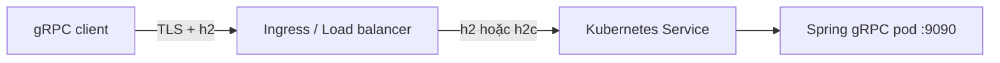

# Expose HTTP/2 và port gRPC

## 1. Mục tiêu

Một Spring gRPC server chỉ có thể được client bên ngoài gọi khi network path tới listener của server được mở đúng cách. Tuy nhiên, mở TCP port mới chỉ giải quyết khả năng kết nối. gRPC yêu cầu HTTP/2, nên container runtime, Kubernetes Service, ingress, reverse proxy, load balancer và firewall phải cho phép đúng giao thức.

**Expose HTTP/2 và port gRPC** là cấu hình listener và hạ tầng mạng để client thiết lập gRPC connection tới Spring service. Công việc gồm chọn port, bind đúng network interface, publish port từ container, định tuyến qua service/proxy, cấu hình TLS hoặc h2c và kiểm tra HTTP/2 được giữ xuyên suốt đường đi.

Sau bài học, bạn có thể:

- Phân biệt port của process, container, Kubernetes Service và load balancer.
- Giải thích vì sao gRPC cần HTTP/2 thay vì chỉ TCP hoặc HTTP/1.1.
- Phân biệt HTTP/2 qua TLS (h2) và HTTP/2 plaintext (h2c).
- Cấu hình listener có thể truy cập từ ngoài container.
- Publish port qua Docker và Kubernetes Service.
- Cấu hình ingress/reverse proxy để chuyển tiếp gRPC bằng HTTP/2.
- Kiểm tra kết nối bằng grpcurl và chẩn đoán lỗi protocol/port.

## 2. gRPC cần HTTP/2, không chỉ cần một TCP port

gRPC dùng HTTP/2 làm transport. Một RPC thường được biểu diễn bằng HTTP/2 request với:

- Method POST.
- Path chứa full service và method name, ví dụ /catalog.v1.ProductCatalog/GetProduct.
- Content-Type bắt đầu bằng application/grpc.
- Message framing riêng của gRPC trong HTTP/2 DATA frames.
- Status cuối cùng được truyền qua gRPC trailers.

HTTP/2 cho phép multiplex nhiều stream trên cùng một TCP connection. Vì vậy, một port gRPC có thể phục vụ nhiều service, nhiều method và nhiều RPC đồng thời. Không cần mở port riêng cho từng method hoặc generated stub.

TCP port chỉ là điểm vào của transport. Nếu proxy nhận TCP rồi chuyển request sang HTTP/1.1, gRPC call không còn được vận chuyển đúng giao thức. Một TCP health check thành công cũng không chứng minh upstream có thể xử lý HTTP/2/gRPC.

| Thành phần | Vai trò |
|---|---|
| TCP | Kết nối mạng tới listener |
| TLS | Mã hóa và xác thực peer khi dùng secure transport |
| ALPN | Thỏa thuận application protocol, thường chọn h2 cho HTTP/2 qua TLS |
| HTTP/2 | Multiplex stream và truyền header/data/trailer |
| gRPC framing | Biểu diễn message và status của RPC |

Khi triển khai, phải xác minh cả port và protocol ở từng hop.

## 3. h2 và h2c

gRPC có thể chạy HTTP/2 theo hai dạng transport:

| Dạng | Mô tả | Sử dụng điển hình |
|---|---|---|
| h2 | HTTP/2 qua TLS; ALPN thương lượng h2 | Client public, traffic qua mạng không tin cậy |
| h2c | HTTP/2 plaintext, không có TLS | Mạng nội bộ được bảo vệ hoặc môi trường local/test |

Với h2, client và server/proxy thực hiện TLS handshake. ALPN phải thương lượng được h2. Nếu endpoint chỉ hỗ trợ HTTP/1.1, client có thể báo lỗi protocol negotiation hoặc không thiết lập được gRPC channel.

Với h2c, client thường dùng HTTP/2 prior knowledge. Đây không đơn giản là gửi HTTP/1.1 rồi yêu cầu server upgrade. Cấu hình proxy phải biết upstream là gRPC/HTTP2 plaintext và chuyển tiếp đúng protocol.

Không bật plaintext chỉ để làm probe pass. Nếu traffic đi qua Internet hoặc mạng không tin cậy, dùng TLS hoặc mTLS theo security architecture. h2c chỉ phù hợp khi trust boundary, network policy và threat model cho phép.

## 4. Chọn port và bind listener

gRPC không bắt buộc dùng một port số cố định. Port 9090, 50051 hoặc một port khác đều có thể dùng nếu client, server và hạ tầng thống nhất.

Điều quan trọng là địa chỉ bind. Trong container, bind vào loopback chỉ cho phép process trong cùng network namespace truy cập:

```java
// Ví dụ server gRPC tự quản lý, không phải property chung cho mọi Spring starter.
Server server = ServerBuilder.forPort(9090)
        .addService(catalogService)
        .build()
        .start();
```

Builder trên minh họa port; server runtime thường bind wildcard interface theo mặc định. Với server hoặc starter có cấu hình bind address riêng, bảo đảm listener bind vào interface có thể nhận traffic từ container network, thường là 0.0.0.0, thay vì 127.0.0.1.

Trong Spring gRPC, tên property cấu hình port và address phụ thuộc starter/version. Dùng đúng cấu hình của starter đang có trong dự án; không sao chép một key từ starter khác rồi giả định nó có hiệu lực. Kiểm tra log startup hoặc socket listener để xác nhận port thực tế.

Một port được cấu hình ở application không tự động được publish ra host hoặc cluster. Listener phải tiếp tục được ánh xạ qua container và network service.

## 5. Phân biệt các lớp port

Trong containerized deployment, cùng một gRPC endpoint có thể xuất hiện dưới nhiều port number:

| Lớp | Ví dụ | Ý nghĩa |
|---|---:|---|
| Application listener | 9090 | Port mà Spring gRPC server bind bên trong process |
| Container port | 9090 | Port được mô tả trong container/deployment spec |
| Host published port | 19090 | Port trên Docker host được map vào container |
| Kubernetes Service port | 9090 hoặc 443 | Port mà client trong cluster gọi |
| Kubernetes targetPort | 9090 | Port container nhận traffic từ Service |
| Ingress/load balancer listener | 443 | Port public hoặc edge nhận TLS/gRPC |

Các port có thể khác nhau. Ví dụ client ngoài cluster kết nối api.example.com:443, ingress chuyển tiếp tới Kubernetes Service port 9090, rồi Service gửi tới container listener 9090.

Khi debug, ghi rõ port ở từng hop. Lỗi connection refused tại host port không nhất thiết có nghĩa application listener sai; có thể Docker chưa publish port. Ngược lại, host port mở nhưng container listener chỉ bind 127.0.0.1 cũng có thể làm forwarding thất bại.

## 6. Expose port với Docker

Dockerfile có thể khai báo port mà ứng dụng sử dụng:

```dockerfile
EXPOSE 9090
```

EXPOSE là metadata mô tả port dự kiến của container. Nó không tự publish port ra host và không mở firewall.

Khi chạy container, cần publish port nếu client truy cập từ host:

```bash
docker run --rm -p 9090:9090 my-spring-grpc-service:latest
```

Trong ví dụ, port bên trái là host port; port bên phải là container port. Nếu host port khác:

```bash
docker run --rm -p 19090:9090 my-spring-grpc-service:latest
```

Client trên host sẽ gọi localhost:19090, còn application bên trong container vẫn lắng nghe 9090.

Nếu ứng dụng bind 127.0.0.1 bên trong container, publish port vẫn không giúp container network truy cập listener đó. Kiểm tra bind address và log startup.

Trong production, tránh publish trực tiếp mọi port gRPC ra Internet nếu traffic phải đi qua ingress/load balancer có TLS, authentication và policy. Chỉ publish theo kiến trúc network đã chọn.

## 7. Expose port trong Kubernetes

Kubernetes Deployment mô tả container port:

```yaml
apiVersion: apps/v1
kind: Deployment
metadata:
  name: catalog-grpc
spec:
  replicas: 2
  selector:
    matchLabels:
      app: catalog-grpc
  template:
    metadata:
      labels:
        app: catalog-grpc
    spec:
      containers:
        - name: catalog
          image: example/catalog-grpc:1.0.0
          ports:
            - name: grpc
              containerPort: 9090
              protocol: TCP
```

Khai báo containerPort giúp mô tả port và cho phép các thành phần tham chiếu tới port name. Nó không tự tạo Service hoặc bảo đảm listener đang mở.

Service tạo địa chỉ ổn định trong cluster:

```yaml
apiVersion: v1
kind: Service
metadata:
  name: catalog-grpc
spec:
  selector:
    app: catalog-grpc
  ports:
    - name: grpc
      port: 9090
      targetPort: grpc
      protocol: TCP
  type: ClusterIP
```

Client trong cluster có thể gọi DNS service name cùng port 9090. Service chuyển traffic tới endpoint pod phù hợp. targetPort có thể tham chiếu tên container port grpc hoặc số port 9090.

Port gRPC là TCP. Không khai báo UDP cho listener gRPC thông thường. NetworkPolicy và firewall phải cho phép TCP từ client/ingress tới Service/pod port cần thiết.

Nếu cần public endpoint, thường dùng Ingress hoặc LoadBalancer Service theo khả năng gRPC của hạ tầng. Không mặc định rằng một HTTP ingress bất kỳ tự động hỗ trợ HTTP/2 upstream.

## 8. Giữ HTTP/2 qua ingress và reverse proxy

Một request gRPC có thể đi qua nhiều hop:



Proxy có thể kết thúc TLS ở edge rồi mở kết nối HTTP/2 plaintext tới backend trong mạng nội bộ tin cậy. Mô hình đó vẫn cần proxy dùng gRPC/HTTP2 upstream. Nếu yêu cầu mã hóa end-to-end hoặc mTLS tới pod, cấu hình TLS cho upstream và trust identity tương ứng.

Kiểm tra các điểm sau:

- Listener public hỗ trợ gRPC qua HTTP/2.
- TLS listener thương lượng ALPN h2 khi dùng TLS.
- Route gRPC giữ nguyên path và HTTP/2 semantics.
- Upstream protocol được cấu hình là gRPC/HTTP2, không phải HTTP/1.1.
- Proxy chuyển tiếp gRPC trailers và status đúng.
- Backend port/targetPort khớp listener thực tế.
- Idle timeout và request timeout phù hợp với RPC dài và streaming.
- Load balancer không đóng connection/stream hợp lệ quá sớm.

Một số ingress controller dùng annotation hoặc backend protocol riêng để bật gRPC. Tên cấu hình phụ thuộc sản phẩm và phiên bản. Hãy xác minh tài liệu của ingress đang triển khai và kiểm tra upstream protocol trong runtime config; không áp dụng annotation của một controller cho controller khác.

## 9. TLS termination và upstream protocol

Hai mô hình phổ biến:

| Mô hình | Client → proxy | Proxy → Spring gRPC | Ghi chú |
|---|---|---|---|
| TLS terminate ở edge | TLS + h2 | h2c trong private network | Đơn giản; bảo vệ hop nội bộ bằng network isolation/policy |
| TLS end-to-end hoặc re-encrypt | TLS + h2 | TLS + h2 | Proxy xác thực certificate backend |

Mô hình thứ nhất chỉ phù hợp khi traffic proxy-to-pod được tin cậy theo threat model. Nếu cluster network không được xem là tin cậy, dùng mTLS hoặc TLS upstream.

Khi dùng TLS upstream:

- Certificate backend phải có SAN khớp DNS/identity mà proxy xác minh.
- Proxy phải trust CA cấp certificate.
- Client certificate cần được cấu hình nếu backend yêu cầu mTLS.
- SNI/authority và hostname verification phải nhất quán.
- Không tắt certificate verification để né lỗi triển khai.

Đừng nhầm TLS ở client với TLS giữa proxy và backend. Client có thể bắt tay TLS thành công với ingress trong khi ingress không kết nối được tới backend hoặc dùng sai protocol upstream.

## 10. Timeout, streaming và connection management

gRPC hỗ trợ RPC dài và streaming. Timeout HTTP mặc định của một reverse proxy có thể cắt stream dù ứng dụng vẫn hoạt động.

Phân biệt:

- **RPC deadline:** thời hạn do client đặt cho một RPC.
- **Proxy request/stream timeout:** thời gian proxy cho phép request/stream tồn tại.
- **Idle timeout:** thời gian stream/connection không có hoạt động trước khi bị đóng.
- **Connection max age:** giới hạn tuổi của một HTTP/2 connection.
- **Keepalive:** frame/probe duy trì hoặc phát hiện connection không còn đáp ứng.

Proxy timeout không nên ngắn hơn workload hợp lệ. Với streaming, cấu hình cần xét thời gian stream, khoảng im lặng hợp lệ và cơ chế reconnect của client. Không đặt timeout vô hạn cho mọi route vì connection treo có thể giữ tài nguyên lâu dài.

HTTP/2 multiplex nhiều RPC trên một connection. Đóng connection có thể ảnh hưởng nhiều stream đang chạy; load balancer cần drain connection có kiểm soát khi rollout hoặc scale down.

Keepalive client/server/proxy phải được phối hợp. Cấu hình ping quá thường xuyên có thể bị server/proxy từ chối hoặc làm tăng tải. Keepalive không thay thế application health check và cũng không chứng minh dependency nghiệp vụ healthy.

## 11. Firewall và NetworkPolicy

Mở port ở application, Docker hoặc Kubernetes Service chưa đảm bảo mọi client đều truy cập được. Network path có thể còn bị giới hạn bởi:

- Host firewall hoặc cloud security group.
- Kubernetes NetworkPolicy.
- Service mesh authorization/network policy.
- Load balancer listener và backend target group.
- NAT, routing table hoặc DNS.
- Proxy egress policy.

Chỉ cho phép nguồn traffic cần thiết tới TCP gRPC port. Nếu client chỉ được phép đi qua ingress, không mở pod port trực tiếp ra các network segment không cần thiết.

Khi nhiều namespace gọi cùng service, NetworkPolicy phải cho phép đúng namespace/pod selector và port. Kiểm tra cả chiều client-to-server và các luồng health/monitoring nếu chúng đi qua policy riêng.

## 12. Kiểm tra bằng grpcurl

grpcurl gửi gRPC request qua HTTP/2 và giúp xác minh endpoint ở mức protocol. Nếu server bật reflection, có thể liệt kê service:

```bash
grpcurl -plaintext localhost:9090 list
```

Nếu server không bật reflection, cung cấp proto file:

```bash
grpcurl -plaintext -proto catalog.proto -d '{"productId":"p-42"}' localhost:9090 catalog.v1.ProductCatalog/GetProduct
```

Với TLS và CA riêng:

```bash
grpcurl -cacert ca.pem -proto catalog.proto -d '{"productId":"p-42"}' catalog.example.internal:443 catalog.v1.ProductCatalog/GetProduct
```

Nếu server yêu cầu mTLS, grpcurl có thể nhận client certificate và private key theo tùy chọn của phiên bản đang dùng. Không đưa private key production vào shell history hoặc log CI.

Kết quả giúp phân loại:

- Connection refused: không có listener tại địa chỉ/port hoặc forwarding sai.
- Deadline exceeded: server/proxy không trả lời trong deadline; cần điều tra từng hop.
- TLS/ALPN error: certificate, hostname, trust hoặc HTTP/2 negotiation sai.
- UNIMPLEMENTED: transport tới server được nhưng method/service không được đăng ký hoặc route sai.
- UNAUTHENTICATED/PERMISSION_DENIED: protocol đã tới handler/security layer nhưng identity/quyền không đáp ứng.

Lệnh list cần server reflection. Nếu reflection tắt, dùng proto descriptor/file và gọi method cụ thể.

## 13. Các kiểm tra mạng bổ sung

Có thể dùng công cụ mạng để kiểm tra từng tầng, nhưng không nhầm kết quả:

```bash
# Kiểm tra TCP reachability
nc -vz catalog.example.internal 443

# Kiểm tra TLS và ALPN h2
openssl s_client -connect catalog.example.internal:443 -servername catalog.example.internal -alpn h2
```

nc chỉ kiểm tra TCP. openssl s_client có thể xác minh TLS handshake và ALPN; nó không gọi gRPC method. grpcurl mới xác minh gRPC request/response ở mức ứng dụng.

curl thông thường hoặc HTTP/1.1 health endpoint không phải bằng chứng gRPC hoạt động. Ngay cả curl hỗ trợ HTTP/2 cũng không tự tạo gRPC message framing, Protobuf payload và gRPC trailers nếu không dùng công cụ chuyên dụng.

Thực hiện kiểm tra từ đúng network location. Lệnh chạy trong laptop có thể thành công trong khi pod-to-pod bị NetworkPolicy chặn; lệnh chạy trong pod có thể thành công trong khi public ingress upstream sai protocol.

## 14. Lỗi thường gặp

| Hiện tượng | Nguyên nhân | Cách xử lý |
|---|---|---|
| TCP port mở nhưng grpcurl không gọi được | Listener/proxy không phục vụ HTTP/2 hoặc gRPC | Kiểm tra ALPN, upstream protocol và service route |
| Container chạy nhưng host không truy cập được | Chỉ khai báo EXPOSE, chưa publish port | Dùng port mapping hoặc Service phù hợp |
| Docker port mapping có nhưng connection refused | App bind loopback hoặc listener dùng port khác | Bind interface container và xác minh port thực tế |
| Kết nối TLS thành công nhưng RPC lỗi protocol | Proxy upstream dùng HTTP/1.1 | Cấu hình gRPC/HTTP2 upstream |
| Ingress trả 502/503 | Backend port, protocol hoặc health target sai | Kiểm tra targetPort, upstream protocol và endpoint |
| TLS báo hostname mismatch | Certificate SAN không khớp endpoint | Cấp certificate đúng DNS name và giữ verification |
| Client không thương lượng được h2 | ALPN hoặc TLS listener không hỗ trợ HTTP/2 | Bật HTTP/2 và xác minh ALPN |
| Unary chạy nhưng stream bị ngắt | Proxy idle/request timeout quá ngắn | Điều chỉnh timeout và connection drain |
| Một số method trả UNIMPLEMENTED | Route/path hoặc service registration sai | Kiểm tra full method path và service descriptor |
| Chỉ pod cùng namespace gọi được | NetworkPolicy/security group giới hạn nguồn | Mở đúng TCP source/destination policy |
| Probe TCP xanh dù app chưa ready | Probe chỉ kiểm tra listener | Dùng gRPC health/readiness probe |

## 15. Bài tập thực hành

**Tình huống:** Spring gRPC Catalog server lắng nghe port 9090 trong container. Client nội bộ cần gọi qua Kubernetes Service; client bên ngoài đi qua ingress với TLS. Một RPC server-streaming có thể kéo dài vài phút.

Hãy thực hiện:

1. Cấu hình Spring gRPC listener ở port 9090 và xác minh bind address có thể nhận traffic từ container network.
2. Khai báo containerPort 9090/TCP và Kubernetes Service port 9090 trỏ tới targetPort grpc.
3. Cấu hình ingress/load balancer listener 443 với TLS và HTTP/2.
4. Cấu hình upstream tới Service bằng gRPC/HTTP2; chọn h2c nội bộ hoặc TLS upstream theo trust boundary.
5. Cho phép đúng TCP path qua firewall và NetworkPolicy.
6. Điều chỉnh timeout/idle timeout cho unary và server-streaming workload.
7. Dùng grpcurl gọi một unary method từ pod nội bộ và qua ingress public.
8. Kiểm tra TLS certificate, hostname và ALPN h2 từ phía client ngoài cluster.
9. Xác minh stream dài không bị proxy đóng sớm; kiểm tra drain behavior khi rollout.
10. Chạy thử một TCP probe và chứng minh nó không thay thế gRPC health/method test.

**Tiêu chí hoàn thành:** client tới đúng port; mọi hop giữ HTTP/2; TLS/h2c phù hợp trust boundary; upstream không downgrade về HTTP/1.1; timeout phù hợp streaming; firewall/policy chỉ mở nguồn cần thiết; grpcurl gọi thành công qua cả đường nội bộ và ingress.

## 16. Ghi nhớ

Expose gRPC không chỉ là mở TCP port. gRPC cần HTTP/2 end-to-end; với TLS, listener và proxy phải thương lượng h2 qua ALPN, còn h2c chỉ dùng khi network boundary cho phép. Phân biệt application port, container port, host mapping, Kubernetes Service port/targetPort và ingress listener. Docker EXPOSE không tự publish port; containerPort cũng không tự tạo Service. Reverse proxy phải dùng gRPC/HTTP2 upstream và giữ trailers, path, stream semantics. Cấu hình TLS, firewall, NetworkPolicy và timeout theo từng hop. Dùng grpcurl để xác minh RPC thực tế; nc chỉ kiểm tra TCP và openssl chỉ kiểm tra TLS/ALPN. Port mở là điều kiện cần cho kết nối, không phải bằng chứng duy nhất rằng gRPC service hoạt động.
