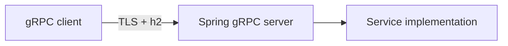
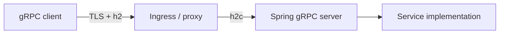
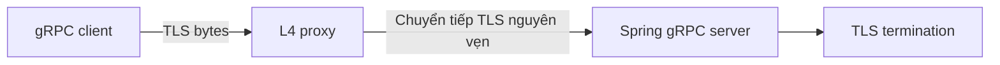
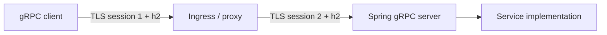

# TLS termination ở ứng dụng hay proxy

## 1. Mục tiêu

gRPC thường chạy trên HTTP/2 và trong môi trường production nên được bảo vệ bằng TLS. Khi triển khai qua ingress hoặc reverse proxy, cần quyết định TLS được kết thúc tại Spring gRPC application, tại proxy, hay tại cả hai chặng. Quyết định này ảnh hưởng tới nơi lưu private key, nơi xác thực client, cách mã hóa traffic nội bộ, khả năng định tuyến và trách nhiệm vận hành certificate.

**TLS termination ở ứng dụng hay proxy** là lựa chọn thành phần thực hiện TLS handshake và giải mã traffic gRPC. Có bốn topology thường gặp:

- Application termination: client TLS trực tiếp tới Spring gRPC server.
- Proxy termination: proxy giải mã TLS từ client rồi chuyển tiếp HTTP/2 plaintext tới application.
- TLS passthrough: proxy chuyển tiếp luồng TLS nguyên vẹn; application là nơi kết thúc TLS.
- Re-encryption: proxy kết thúc TLS phía client, sau đó thiết lập một TLS connection mới tới application.

Không có topology nào luôn đúng cho mọi hệ thống. Chọn theo trust boundary, yêu cầu mTLS, network policy, certificate lifecycle, khả năng của proxy và mức độ cần bảo vệ traffic nội bộ.

Sau bài học, bạn có thể:

- Phân biệt application termination, proxy termination, passthrough và re-encryption.
- Hiểu HTTP/2 ALPN, SNI, hostname verification và upstream protocol.
- Xác định nơi private key và client identity được xác thực.
- Thiết kế mTLS ở edge hoặc giữa proxy và application.
- Cấu hình Spring gRPC theo cơ chế TLS của starter/runtime.
- Kiểm thử từng chặng bằng grpcurl và công cụ TLS.
- Lập kế hoạch rotate certificate mà không làm gián đoạn RPC ngoài dự kiến.

## 2. TLS termination có nghĩa gì?

TLS termination là điểm mà một thành phần nhận TLS connection, thực hiện handshake, xác minh certificate theo policy và giải mã dữ liệu ứng dụng. Sau điểm đó, thành phần có thể đọc HTTP/2 headers, gRPC method path, metadata và message payload.

Nếu TLS kết thúc ở proxy:

1. Client tạo TLS connection tới proxy.
2. Proxy giữ certificate/private key của endpoint public.
3. Proxy giải mã HTTP/2/gRPC request.
4. Proxy tạo kết nối upstream tới Spring gRPC server.
5. Upstream có thể là h2c hoặc một TLS connection mới.

Nếu TLS kết thúc ở Spring application, application giữ certificate/private key và trực tiếp xác thực peer. Proxy ở trước application phải chuyển tiếp TLS nguyên vẹn hoặc hoạt động ở chế độ TCP passthrough.

TLS không phải một thuộc tính tự động kéo dài qua mọi hop. Khi proxy giải mã traffic, connection TLS client-to-proxy kết thúc tại đó. Nếu proxy mở một kết nối TLS mới tới application, đó là một TLS session khác với handshake, certificate và trust decision riêng.

## 3. Bốn topology triển khai phổ biến

| Topology | Client → proxy | Proxy → application | Nơi giữ server private key |
|---|---|---|---|
| Application termination trực tiếp | TLS + HTTP/2 hoặc đi qua TCP passthrough | TLS + HTTP/2 | Spring gRPC application |
| Proxy termination | TLS + HTTP/2 | h2c trong mạng nội bộ tin cậy | Proxy |
| TLS passthrough | TLS được chuyển tiếp nguyên vẹn | Cùng TLS connection tới application | Spring gRPC application |
| Re-encryption | TLS + HTTP/2 | TLS + HTTP/2 mới | Proxy và application |

### Application termination



Client kết nối trực tiếp tới application hoặc qua L4 load balancer chỉ chuyển tiếp TCP. Spring gRPC server thực hiện TLS handshake và có thể yêu cầu client certificate để dùng mTLS.

Ưu điểm là TLS identity của client được application xác thực trực tiếp. Traffic không bị giải mã ở một reverse proxy L7 trung gian. Đổi lại, certificate/private key phải được phân phối và rotate cho các application instance; proxy L7 không thể đọc method path để định tuyến hoặc áp dụng policy gRPC ở mức RPC.

### Proxy termination với h2c upstream



Proxy giữ certificate public, kết thúc TLS từ client rồi chuyển tiếp HTTP/2 plaintext tới application. Đây là mô hình phổ biến khi proxy và application nằm trong private network được bảo vệ.

Ưu điểm:

- Certificate public tập trung tại ingress/proxy.
- Proxy có thể áp dụng routing, rate limit, access policy và observability theo gRPC route.
- Application không phải giữ private key public ở từng replica.

Rủi ro chính là traffic proxy-to-application không được mã hóa. Private network không mặc nhiên là trusted network. Cần đánh giá cluster boundary, node access, multi-tenant isolation, packet capture risk và policy nội bộ trước khi chọn h2c.

### TLS passthrough



Proxy không giải mã TLS. Spring gRPC application thực hiện handshake và giữ server certificate. Proxy thường định tuyến dựa trên địa chỉ/port hoặc SNI ở mức TLS ClientHello, không thể đọc gRPC method path bên trong payload mã hóa.

Passthrough phù hợp khi cần giữ client TLS identity tới application hoặc muốn application sở hữu hoàn toàn TLS. Hạn chế là proxy không thể thực hiện các policy L7 cần đọc gRPC metadata/path; một số ingress/controller không hỗ trợ passthrough theo cách cần thiết hoặc chỉ hỗ trợ routing hạn chế.

### Re-encryption



Proxy kết thúc TLS từ client, sau đó thiết lập TLS mới tới application. Traffic được mã hóa trên cả hai chặng. Proxy có thể xác minh certificate backend; application có thể yêu cầu mTLS và xác thực identity của proxy.

Re-encryption bảo vệ traffic nội bộ khi proxy-to-pod đi qua network không được tin cậy. Tuy nhiên, application thấy proxy là TLS peer, không tự động thấy certificate gốc của client. Nếu cần giữ end-user identity, phải truyền identity qua cơ chế tin cậy riêng.

## 4. HTTP/2 và ALPN trên từng chặng

gRPC yêu cầu HTTP/2. Với TLS, client và server/proxy thường dùng ALPN để thương lượng protocol h2 trong handshake.

Ở mô hình proxy termination:

- Client-to-proxy phải hỗ trợ TLS và ALPN h2.
- Proxy phải nhận gRPC/HTTP2, không downgrade request thành HTTP/1.1.
- Proxy-to-application phải được cấu hình là h2c hoặc TLS+HTTP/2.

Ở mô hình re-encryption, cả hai chặng TLS phải thương lượng HTTP/2 đúng cách. Client-to-proxy thành công không chứng minh proxy-to-application đã hoạt động.

HTTP/2 plaintext h2c không có ALPN vì không có TLS handshake. Client/proxy phải dùng chế độ HTTP/2 prior knowledge phù hợp. Không nhầm HTTP/1.1 Upgrade với cấu hình upstream gRPC h2c.

## 5. SNI, authority và certificate hostname

TLS certificate phải xác thực đúng tên mà client dùng để kết nối. Ba khái niệm cần phân biệt:

- **SNI:** hostname client gửi trong TLS ClientHello để server chọn certificate phù hợp.
- **Certificate SAN:** danh sách DNS name/IP mà certificate xác nhận.
- **HTTP/2 authority:** authority của request, thường tương ứng hostname và port mà client gọi.

Ví dụ client gọi catalog.example.internal:443. Certificate server cần SAN phù hợp với catalog.example.internal; proxy/backend TLS config phải dùng đúng SNI/authority khi chọn và xác minh certificate.

Trong re-encryption, proxy có thể kết nối tới catalog-grpc.default.svc.cluster.local:9090 nhưng certificate backend lại được cấp cho catalog.internal. Cần cấu hình server name/authority và SAN verification nhất quán với identity dự kiến. Không tắt hostname verification để né mismatch.

SNI giúp chọn certificate; nó không thay thế authentication hoặc authorization. Việc certificate hợp lệ chỉ xác nhận peer sở hữu identity được CA tin cậy cấp, không tự động cho phép peer gọi mọi RPC.

## 6. mTLS ở edge và mTLS upstream

mTLS nghĩa là cả hai phía trong một TLS connection đều xác thực certificate của nhau. Nhưng khi có proxy termination, cần xác định mTLS diễn ra trên connection nào:

| Vị trí mTLS | Client certificate được xác thực bởi | Application nhìn thấy TLS peer nào? |
|---|---|---|
| Client ↔ proxy | Proxy | Proxy, nếu upstream có TLS; hoặc không có TLS peer nếu h2c |
| Proxy ↔ application | Application | Proxy |
| Client ↔ application qua passthrough | Application | Client |
| Client ↔ proxy và proxy ↔ application | Proxy ở chặng đầu; application ở chặng sau | Proxy ở chặng upstream |

Nếu application cần xác thực end-user bằng certificate nhưng TLS kết thúc ở proxy, client certificate không tự động đi tiếp qua upstream. Proxy có thể chuyển thông tin identity bằng header/metadata, nhưng chỉ an toàn khi:

1. Proxy xóa các header identity do client tự gửi từ request inbound.
2. Proxy tự tạo header/metadata sau khi xác thực certificate.
3. Upstream chỉ chấp nhận traffic từ proxy được xác thực, tốt nhất qua mTLS hoặc network identity đáng tin.
4. Application chỉ tin header từ proxy đã xác thực.
5. Giá trị identity được giới hạn, kiểm tra và ghi audit phù hợp.

Không tin một header như x-forwarded-client-cert chỉ vì nó xuất hiện trong request. Client có thể tự giả mạo nếu proxy không xóa header đầu vào và application không xác thực nguồn upstream.

Nếu cần application trực tiếp xác minh certificate gốc của client ở tầng TLS, chọn passthrough hoặc termination tại application. Nếu chấp nhận identity assertion từ proxy, hãy thiết kế đó như một trust contract riêng và bảo vệ chặt chẽ.

## 7. Cấu hình TLS ở Spring gRPC application

Khi application là điểm TLS termination, server cần certificate chain và private key. Với gRPC Java Netty server, API nền tảng có thể cấu hình như sau:

```java
NettyServerBuilder.forPort(9090)
        .useTransportSecurity(
                certificateChainFile,
                privateKeyFile)
        .addService(catalogService)
        .build()
        .start();
```

Đây là ví dụ gRPC Java ở mức server builder. Spring gRPC starter có thể cung cấp property, SSL bundle, credential bean hoặc server customizer riêng. Dùng đúng API của starter/version đang cài; không giả định tên property TLS của các starter khác nhau là giống nhau.

Các nguyên tắc triển khai:

- Mount certificate chain và private key từ secret manager hoặc Kubernetes Secret.
- Giới hạn quyền đọc private key cho process cần thiết.
- Không commit private key vào source control hoặc image.
- Dùng certificate có SAN khớp DNS name client gọi.
- Xác định trust root và client-auth policy nếu bật mTLS.
- Bảo đảm TLS listener vẫn phục vụ HTTP/2 qua ALPN.
- Có kế hoạch reload/restart an toàn khi certificate thay đổi.

Không đặt private key hoặc password trong application YAML đã commit. YAML chỉ nên tham chiếu secret/config mount hoặc secret provider theo cơ chế triển khai.

## 8. Cấu hình client tin cậy server

Client gRPC Java dùng TLS channel credentials hoặc transport security builder:

```java
ManagedChannel channel = ManagedChannelBuilder
        .forAddress("catalog.example.internal", 443)
        .useTransportSecurity()
        .build();
```

Với CA riêng hoặc mTLS, cấu hình trust manager và client key manager bằng credential API phù hợp với phiên bản gRPC Java. Ví dụ khái niệm với TLS channel credentials:

```java
ChannelCredentials credentials = TlsChannelCredentials.newBuilder()
        .trustManager(caCertificateFile)
        .keyManager(clientCertificateFile, clientPrivateKeyFile)
        .build();

ManagedChannel channel = Grpc.newChannelBuilder(
        "catalog.example.internal:443",
        credentials)
        .build();
```

Chỉ cung cấp keyManager khi server yêu cầu client certificate. Trust manager phải xác minh CA của server. Không dùng insecure trust manager trong production và không tắt hostname verification.

Nếu proxy kết thúc TLS, client xác thực certificate của proxy. Nếu proxy re-encrypt tới application, proxy phải xác thực certificate backend. Hai trust configuration này độc lập và cần được quản lý riêng.

## 9. Proxy termination và upstream h2c

Khi dùng proxy termination với h2c upstream, cấu hình proxy phải thực hiện đồng thời:

1. Lắng nghe TLS trên public port.
2. Có certificate chain và private key hợp lệ.
3. Thương lượng ALPN h2 với client.
4. Nhận và định tuyến gRPC method path.
5. Mở upstream HTTP/2 plaintext tới Spring gRPC port.
6. Giữ nguyên gRPC trailers, status và streaming semantics.

Mô hình này chỉ phù hợp khi proxy-to-application network được chấp nhận là trust boundary. Nên giới hạn upstream bằng private network, NetworkPolicy và quyền truy cập phù hợp.

Nếu có service mesh hoặc sidecar tự động mã hóa traffic nội bộ, phải hiểu rõ lớp nào đang kết thúc TLS và lớp nào tạo TLS mới. Tránh cấu hình ứng dụng h2c trong khi mesh mong đợi TLS, hoặc cấu hình app TLS trong khi proxy gửi plaintext.

## 10. Re-encryption và xác thực upstream

Với re-encryption, proxy cần cấu hình:

- Upstream scheme/protocol hỗ trợ gRPC qua HTTP/2 TLS.
- CA bundle để xác minh certificate backend.
- Server name/SNI đúng với certificate SAN.
- Client certificate/key nếu backend yêu cầu mTLS.
- Chính sách rotate trust bundle và client identity.
- Timeout và connection drain phù hợp streaming.

Application có thể chỉ trust CA nội bộ và chỉ chấp nhận certificate của proxy/service mesh. Như vậy, application xác thực caller ở chặng upstream là proxy identity; authorization cho end-user cần thông tin identity được proxy chuyển tiếp theo trust contract.

Không chỉ bật TLS mà bỏ qua verification. Mã hóa nhưng không xác minh peer không cung cấp xác thực danh tính cần thiết và có thể tạo cảm giác an toàn sai.

## 11. Certificate lifecycle và rotation

Certificate có thời hạn và cần được rotate trước khi hết hạn. Rotation phải xét cả server certificate, client certificate, CA trust bundle và proxy upstream identity.

Một quy trình an toàn:

1. Phát hành certificate mới và xác minh SAN, chain, key usage và expiry.
2. Phân phối CA/trust bundle mới trước nếu CA thay đổi.
3. Cấu hình proxy/application nhận certificate mới.
4. Reload hoặc rollout instance theo cơ chế được hỗ trợ.
5. Xác minh TLS handshake, ALPN h2 và một RPC thật.
6. Theo dõi lỗi handshake/UNAVAILABLE và connection drain.
7. Chỉ gỡ CA/certificate cũ sau khi mọi client/upstream đã chuyển.

Không giả định mọi gRPC server tự reload file certificate khi file mount thay đổi. Nhiều runtime chỉ đọc certificate lúc server khởi động; cần restart/rollout hoặc custom certificate provider được hỗ trợ. Kiểm tra behavior của server builder/starter thực tế.

Khi rollout application TLS, có thể chạy song song instance dùng certificate cũ và mới trong thời gian chuyển tiếp nếu trust chain cho phép. Với long-lived HTTP/2 connection, connection cũ có thể tiếp tục dùng TLS session đã thiết lập; cần drain theo policy để client tạo connection mới với certificate mới.

## 12. Chọn topology theo yêu cầu

| Yêu cầu | Topology thường phù hợp | Điều cần cân nhắc |
|---|---|---|
| Application phải trực tiếp xác thực client certificate | Application termination hoặc passthrough | App quản lý private key và trust store |
| Muốn tập trung public certificate và L7 routing | Proxy termination | Upstream h2c chỉ khi private network được tin cậy |
| Cần mã hóa cả client-to-edge và edge-to-app | Re-encryption | Hai TLS session và hai trust policy |
| Proxy không được đọc payload gRPC | TLS passthrough | Giới hạn routing L7 và observability tại proxy |
| Nhiều app replica, certificate public do ingress quản lý | Proxy termination hoặc re-encryption | Phải bảo vệ upstream và xác thực identity |
| Service mesh đã quản lý mTLS nội bộ | Proxy/mesh termination theo kiến trúc mesh | Tránh tạo lớp TLS chồng lấn không rõ ownership |

Quyết định cần ghi rõ:

- TLS termination point.
- Protocol ở từng hop: h2, h2c hay TLS+HTTP/2.
- Ai sở hữu certificate/private key.
- Ai xác thực client certificate.
- Application nhận identity nào.
- CA/trust bundle nào được tin cậy.
- Ai chịu trách nhiệm rotate và reload.

## 13. Kiểm thử và chẩn đoán

### Kiểm tra TLS và ALPN

```bash
openssl s_client \
  -connect catalog.example.internal:443 \
  -servername catalog.example.internal \
  -alpn h2
```

Kết quả cần xác minh certificate chain, hostname/SNI và negotiated protocol h2. Lệnh này không chứng minh gRPC method đã được đăng ký.

### Gọi RPC qua TLS

```bash
grpcurl -cacert ca.pem \
  -proto catalog.proto \
  -d '{"productId":"p-42"}' \
  catalog.example.internal:443 \
  catalog.v1.ProductCatalog/GetProduct
```

Với mTLS, cung cấp client certificate/key bằng tùy chọn tương ứng của grpcurl version đang dùng. Không đưa private key production vào command history hoặc log CI.

### Kiểm tra upstream riêng

Thực hiện grpcurl từ network namespace hoặc pod có cùng đường đi tới upstream như proxy. Nếu edge TLS thành công nhưng upstream call lỗi, kiểm tra:

- Proxy có dùng đúng h2c hay TLS+HTTP/2 không.
- Backend port và DNS có đúng không.
- SAN/SNI/authority có khớp không.
- Proxy trust đúng CA backend không.
- Backend có yêu cầu client certificate không.
- NetworkPolicy có cho phép proxy tới application không.

### Ma trận test tối thiểu

| Test | Proxy termination | App termination/passthrough | Re-encryption |
|---|---|---|---|
| Client TLS + ALPN h2 | Bắt buộc | Bắt buộc nếu client TLS trực tiếp | Bắt buộc |
| Upstream protocol | Xác minh h2c hoặc TLS | TLS được chuyển tiếp | TLS+HTTP/2 |
| Server certificate | Certificate proxy | Certificate application | Certificate proxy và application |
| mTLS client identity | Xác minh tại proxy | Xác minh tại application | Xác minh tại proxy; upstream xác minh proxy |
| gRPC unary/streaming | Gọi qua proxy | Gọi qua endpoint app | Gọi qua cả hai TLS hop |
| Rotation | Proxy cert/trust | App cert/trust | Cả hai chặng |

## 14. Lỗi thường gặp

| Hiện tượng | Nguyên nhân | Cách xử lý |
|---|---|---|
| TLS handshake thành công nhưng RPC lỗi | Upstream proxy dùng sai protocol | Cấu hình gRPC/HTTP/2 upstream |
| ALPN không chọn h2 | Listener chỉ hỗ trợ HTTP/1.1 hoặc TLS config sai | Bật HTTP/2 và xác minh ALPN |
| Certificate hostname mismatch | SAN không khớp DNS/SNI/authority | Cấp certificate đúng identity và giữ hostname verification |
| Proxy gọi backend bị UNAVAILABLE | Backend port, route, network hoặc upstream TLS sai | Kiểm tra từng hop từ proxy network |
| Application không thấy client certificate gốc | TLS kết thúc ở proxy | Dùng passthrough/app termination hoặc identity assertion được bảo vệ |
| Header client tự gửi được tin là certificate identity | Proxy không strip header inbound hoặc app không xác thực proxy | Strip và tạo lại metadata sau authentication; bảo vệ upstream |
| h2c bị từ chối | Proxy/backend mong TLS hoặc dùng HTTP/1.1 | Đồng bộ upstream mode và HTTP/2 prior knowledge |
| Re-encryption lỗi trust | Proxy không trust CA backend hoặc SAN sai | Cấu hình CA, SNI và hostname verification |
| Certificate mới không có hiệu lực | Runtime không reload file tự động | Dùng reload mechanism được hỗ trợ hoặc rollout |
| Stream bị ngắt khi rotate | Connection cũ bị đóng đột ngột | Drain HTTP/2 connection và đặt grace period |
| TLS hoạt động ở edge nhưng traffic nội bộ lộ plaintext | Chọn h2c ngoài trust boundary | Re-encrypt hoặc dùng mTLS/service mesh |

## 15. Bài tập thực hành

**Tình huống:** Catalog gRPC được triển khai trên Kubernetes. Client bên ngoài kết nối qua ingress TLS. Security team yêu cầu traffic từ ingress tới application cũng phải mã hóa và application chỉ chấp nhận workload proxy đã xác thực. Ứng dụng cần biết end-user identity đã được xác minh tại edge.

Hãy thực hiện:

1. Chọn topology re-encryption và vẽ rõ hai TLS session.
2. Cấu hình ingress public certificate và ALPN h2.
3. Cấu hình upstream TLS+HTTP/2 tới Spring gRPC server.
4. Cấp certificate backend có SAN phù hợp và cấu hình ingress trust CA.
5. Bật mTLS upstream nếu application cần xác thực proxy workload.
6. Thiết kế cơ chế chuyển end-user identity từ proxy sau khi proxy xác thực client; strip header do client tự gửi.
7. Cấu hình Spring gRPC server chỉ trust CA/identity upstream đã chọn.
8. Xác minh application không coi metadata identity là đáng tin nếu request không đến từ proxy được xác thực.
9. Kiểm thử TLS/ALPN ở edge, TLS trust ở upstream, unary và streaming RPC.
10. Mô phỏng certificate rotation và xác minh connection drain không làm rơi call vượt ngoài policy.

**Tiêu chí hoàn thành:** cả hai hop dùng HTTP/2; certificate được xác minh ở từng chặng; application xác thực proxy identity; end-user identity chỉ được nhận từ assertion đáng tin; certificate/private key có owner và rotation plan; gRPC status/streaming hoạt động qua proxy.

## 16. Ghi nhớ

TLS termination xác định nơi giải mã gRPC traffic và nơi xác thực TLS peer. Application termination hoặc passthrough giữ TLS tới Spring server; proxy termination tập trung certificate và L7 routing nhưng upstream h2c không còn mã hóa; re-encryption tạo TLS session thứ hai để bảo vệ traffic nội bộ. Mỗi hop phải giữ HTTP/2, với ALPN h2 ở TLS connection. SNI, SAN và authority phải khớp. mTLS ở edge không tự động chuyển client certificate tới application; nếu dùng identity assertion qua metadata, chỉ tin sau khi proxy xác thực, strip header inbound và upstream được bảo vệ. Quản lý certificate, trust bundle, rotation và drain connection theo lifecycle. Kiểm thử TLS/ALPN, upstream trust và gRPC RPC riêng biệt; TLS handshake thành công ở edge không chứng minh toàn bộ đường đi healthy.
