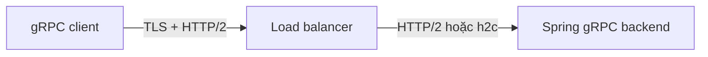
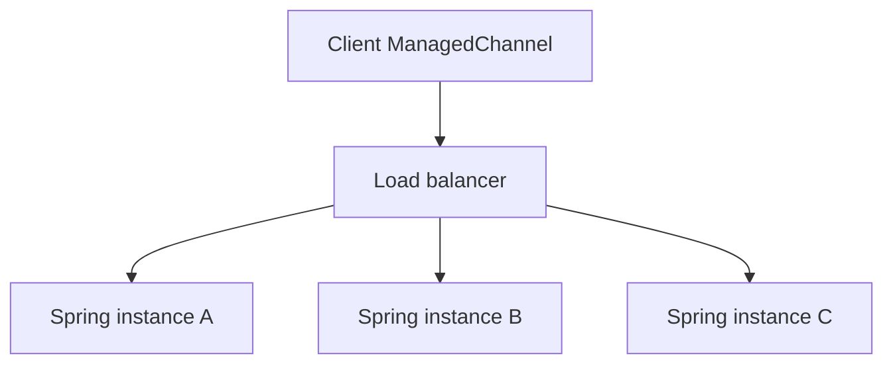
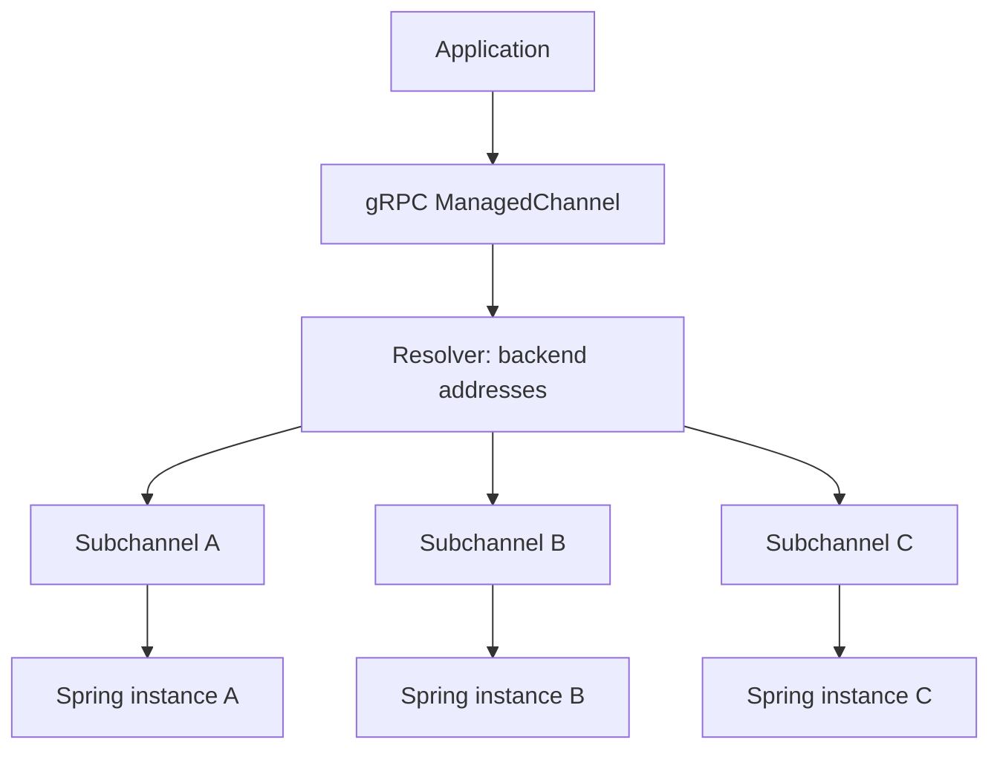

# Load balancer hỗ trợ HTTP/2

## 1. Mục tiêu

gRPC dùng HTTP/2 để truyền RPC. Khi triển khai nhiều Spring gRPC instance, load balancer phải phân phối traffic tới backend mà vẫn giữ đúng HTTP/2, gRPC framing, trailers và streaming semantics. Chỉ bật HTTP/2 ở listener phía client chưa đủ: nếu load balancer kết thúc HTTP/2 rồi kết nối tới backend bằng HTTP/1.1, RPC có thể thất bại.

**Load balancer hỗ trợ HTTP/2** là load balancer có khả năng nhận hoặc chuyển tiếp HTTP/2 theo đúng topology, đồng thời xử lý kết nối và stream gRPC phù hợp. Cần xác định nó làm việc ở Layer 4 (TCP) hay Layer 7 (HTTP/2-aware), HTTP/2 được dùng ở frontend hay cả upstream, và đơn vị cân bằng là connection hay từng RPC stream.

Sau bài học, bạn có thể:

- Phân biệt TCP/L4 load balancing và HTTP/2-aware L7 load balancing.
- Kiểm tra HTTP/2 ở cả client-facing listener và backend upstream.
- Hiểu ảnh hưởng của HTTP/2 multiplexing tới phân phối tải.
- Chọn server-side hoặc client-side gRPC load balancing.
- Cấu hình service discovery phù hợp với DNS, Kubernetes và resolver.
- Thiết kế health check, timeout, streaming và connection draining.
- Kiểm thử load balancer bằng RPC thực tế và quan sát phân phối tải.

## 2. Vì sao load balancer phải hiểu HTTP/2?

Một gRPC call được truyền trong HTTP/2 stream. Request dùng method POST, path chứa service/method, content type gRPC và message framing riêng. Response có thể gồm nhiều DATA frame và kết thúc bằng gRPC status trong trailers.

HTTP/2 multiplex nhiều stream trên một TCP connection. Ví dụ một client tạo một ManagedChannel tới load balancer; channel có thể gửi hàng trăm RPC đồng thời trên cùng connection. Nếu load balancer chỉ cân bằng TCP connection, toàn bộ stream trên connection đó thường đi tới cùng một backend.

Vì vậy cần phân biệt:

- **Connection balancing:** chọn backend khi TCP connection được thiết lập.
- **RPC/stream balancing:** chọn backend cho từng HTTP/2 stream hoặc RPC.

Một TCP load balancer vẫn có thể chuyển tiếp gRPC hợp lệ vì nó chuyển tiếp byte TCP mà không cần hiểu HTTP/2. Nhưng nó không thể đọc method path, gRPC metadata hoặc phân phối từng RPC trong cùng connection. Một L7 proxy hiểu HTTP/2 có thể cân bằng theo stream, tùy sản phẩm và cấu hình.

## 3. L4 TCP và L7 HTTP/2-aware

| Đặc điểm | L4 TCP load balancer | L7 HTTP/2-aware load balancer |
|---|---|---|
| Đơn vị thường cân bằng | TCP connection | HTTP/2 stream/RPC hoặc connection tùy chế độ |
| Hiểu gRPC method path | Không | Có thể |
| Đọc HTTP/2 headers/trailers | Không | Có |
| TLS termination | Thường passthrough; một số sản phẩm hỗ trợ TLS offload | Thường có thể terminate TLS |
| Streaming | Chuyển tiếp TCP stream | Phải hỗ trợ gRPC streaming và flow control |
| Retry theo RPC | Không hiểu semantics RPC | Có thể hỗ trợ, nhưng phải cấu hình an toàn |
| Mức độ can thiệp | Ít thay đổi protocol | Có thể rewrite/routing/timeout theo request |

L4 phù hợp khi muốn passthrough TLS tới application, giữ nguyên end-to-end TLS identity hoặc dùng client-side load balancing. Nó đơn giản và ít can thiệp payload, nhưng phân phối tải có thể lệch khi một số client giữ connection HTTP/2 lâu.

L7 phù hợp khi cần routing theo service/method, health-aware backend selection, observability hoặc cân bằng từng RPC. Đổi lại, proxy trở thành một hop xử lý HTTP/2 và cần cấu hình timeout, buffering, flow control, TLS và connection draining cẩn thận.

Không kết luận load balancer hỗ trợ gRPC chỉ vì tài liệu ghi HTTP/2 enabled. Cần xác minh cả gRPC frontend, upstream protocol và streaming behavior.

## 4. HTTP/2 phải được cấu hình trên cả hai chặng

Khi load balancer terminate TLS, có hai kết nối độc lập:



Frontend có thể dùng TLS và ALPN h2. Upstream có thể dùng:

- HTTP/2 plaintext (h2c) trong network boundary được tin cậy.
- TLS + HTTP/2 khi cần mã hóa hoặc mTLS tới backend.

Nếu frontend dùng HTTP/2 nhưng upstream được cấu hình HTTP/1.1, proxy có thể trả lỗi protocol, 502/503 hoặc gRPC status không mong đợi. gRPC trailers cũng có thể bị mất nếu proxy xử lý upstream như HTTP request thông thường.

Khi TLS passthrough ở L4, load balancer không terminate HTTP/2. Nó chỉ chuyển tiếp TCP; TLS và HTTP/2 được thương lượng trực tiếp giữa client và Spring server. Cách này vẫn phục vụ gRPC nhưng không có L7 routing theo RPC.

Ở mọi topology, xác minh:

1. Client kết nối tới đúng listener.
2. TLS listener thương lượng ALPN h2 nếu dùng TLS.
3. Proxy hiểu frontend là gRPC/HTTP2.
4. Upstream protocol là h2c hoặc TLS+HTTP/2 đúng với backend.
5. gRPC trailers, status và streaming được giữ nguyên.

## 5. HTTP/2 multiplexing có thể gây lệch tải

Giả sử ba backend A, B và C. Có 100 client, mỗi client tạo một HTTP/2 connection tới L4 load balancer và gửi 100 RPC trên connection đó. Nếu L4 chọn backend một lần lúc mở connection, mỗi client sẽ gắn với một backend. Các RPC trên cùng connection không được phân phối lại.

Nếu chỉ có vài client nhưng mỗi client gửi rất nhiều RPC, một backend có thể nhận phần lớn tải dù số connection giữa các backend có vẻ cân bằng.

L7 HTTP/2-aware proxy có thể chọn backend theo từng RPC stream, nhờ đó phân phối tốt hơn với unary RPC ngắn. Tuy nhiên, một stream dài vẫn chiếm backend trong suốt vòng đời RPC; không thể chuyển giữa chừng stream đang chạy sang backend khác.

Với streaming:

- Server-streaming có thể giữ backend trong vài phút hoặc lâu hơn.
- Client-streaming và bidirectional streaming giữ state của call ở backend.
- Retry hoặc chuyển backend giữa stream thường không an toàn nếu đã gửi/nhận message.
- Rollout cần drain stream đang chạy hoặc cho phép chúng kết thúc theo deadline.

Không đánh giá phân phối tải chỉ bằng số TCP connection. Theo dõi số RPC, request rate, active streams, latency và tải CPU/memory theo từng backend.

## 6. Server-side và client-side load balancing

### Server-side load balancing

Client chỉ biết một endpoint của load balancer. Load balancer chọn backend:



Ưu điểm là client đơn giản và backend discovery tập trung. Load balancer có thể áp dụng health check, routing, rate limit và policy chung. Cần kiểm soát connection reuse, stream distribution, timeout và khả năng gRPC của proxy.

### Client-side load balancing

Client nhận nhiều backend address từ name resolver/service discovery. gRPC channel tạo subchannel và chọn backend theo load balancing policy:



Client-side balancing giúp phân phối call trực tiếp tới backend, giảm một L7 proxy hop. Đổi lại, client cần resolver và service discovery đáng tin cậy, chính sách health, xử lý address thay đổi và observability theo từng subchannel.

gRPC Java có các policy như `pick_first` và `round_robin` tùy resolver/runtime/version. `pick_first` thường chọn một address khả dụng; `round_robin` phân phối call qua các address/subchannel ở trạng thái READY. Policy cần được cấu hình và hỗ trợ bởi resolver; không giả định chỉ cần có nhiều pod là client tự biết tất cả pod.

## 7. DNS và Kubernetes service discovery

Trong Kubernetes, DNS của một Service kiểu ClusterIP thường trả về một virtual IP. Client-side resolver nhìn thấy một địa chỉ Service, không phải danh sách pod. Kube-proxy hoặc dataplane chọn pod khi connection được thiết lập; vì HTTP/2 giữ connection lâu, nhiều RPC trên channel có thể tiếp tục tới cùng pod.

Một headless Service có thể trả về các pod IP. Khi DNS resolver và gRPC client được cấu hình phù hợp, client-side load balancing có thể nhìn thấy nhiều địa chỉ backend hơn.

| Kubernetes discovery | Resolver thường thấy | Ảnh hưởng |
|---|---|---|
| ClusterIP Service | Một virtual IP | Cân bằng thường diễn ra ở connection/network layer |
| Headless Service | Danh sách pod IP theo DNS | Có thể hỗ trợ client-side balancing |
| xDS/service mesh control plane | Endpoint và policy do control plane cung cấp | Có thể hỗ trợ health-aware, locality-aware và policy tập trung |

Headless DNS có cache và TTL; address list không nhất thiết cập nhật tức thì khi pod thay đổi. Cần kiểm tra resolver refresh behavior, DNS TTL, readiness và cách gRPC Java xử lý address removal.

Nếu dùng service mesh, xác định rõ mesh sidecar đang cân bằng ở đâu. Tránh đồng thời bật nhiều lớp load balancing với policy xung đột mà không hiểu connection path.

## 8. Cấu hình client-side round_robin trong gRPC Java

Ví dụ service config thể hiện policy:

```json
{
  "loadBalancingConfig": [
    {
      "round_robin": {}
    }
  ]
}
```

Với resolver trả nhiều backend address, có thể cung cấp service config cho channel:

```java
Map<String, Object> serviceConfig = Map.of(
        "loadBalancingConfig",
        List.of(Map.of("round_robin", Map.of())));

ManagedChannel channel = ManagedChannelBuilder
        .forTarget("dns:///catalog-grpc.default.svc.cluster.local:9090")
        .defaultServiceConfig(serviceConfig)
        .build();
```

Đây là ví dụ gRPC Java API; khả năng và policy name cần khớp version runtime. DNS target phải thực sự resolve thành nhiều backend address nếu muốn round_robin phân phối giữa các pod. Nếu target chỉ trả ClusterIP, client không nhìn thấy các pod riêng lẻ.

Service config có thể được resolver trả về và được ưu tiên theo cơ chế của gRPC. Khi cấu hình defaultServiceConfig, kiểm tra hành vi khi resolver cung cấp config khác và chính sách fallback khi policy không khả dụng.

Không tự viết resolver hoặc cập nhật address list từ pod API nếu không có cơ chế xử lý auth, watch, expiry, removal và backoff đầy đủ. Ưu tiên DNS, xDS hoặc service discovery integration được hỗ trợ.

## 9. Health-aware backend selection

Load balancer cần biết backend nào đủ điều kiện nhận traffic. TCP connect thành công chưa chứng minh service đã ready. Với gRPC, có thể dùng gRPC Health Checking protocol hoặc health probe tương đương mà hạ tầng hỗ trợ.

Các nguyên tắc:

- Chỉ đưa backend vào pool sau khi readiness thành công.
- Loại backend NOT_SERVING khỏi traffic mới.
- Phân biệt liveness và readiness; dependency outage không nên tự động gây restart storm.
- Health check phải có timeout và tần suất hợp lý.
- Dùng service name đúng với Protobuf package/service.
- Khi health endpoint không hỗ trợ, khai báo rõ probe thay thế và giới hạn ý nghĩa của nó.

Một L4 load balancer có thể chỉ kiểm tra TCP. Nó sẽ không hiểu gRPC SERVING nếu không có health integration riêng. Một L7 proxy có thể gọi health RPC hoặc dùng endpoint probe, tùy khả năng.

Nếu load balancer dùng health check HTTP riêng, đừng coi kết quả đó là tương đương gRPC Health Check. Cần bảo đảm health signal phản ánh cùng readiness policy với application.

## 10. Timeout, keepalive và streaming

Các timeout phải được phối hợp giữa client, load balancer và server:

| Cấu hình | Phạm vi | Mục đích |
|---|---|---|
| RPC deadline | Một RPC | Giới hạn tổng thời gian call |
| Backend request timeout | Một request/stream tại proxy | Giới hạn thời gian proxy giữ RPC |
| Idle timeout | Connection hoặc stream | Đóng tài nguyên không hoạt động |
| Connection max age | HTTP/2 connection | Xoay connection định kỳ |
| Keepalive | HTTP/2 connection | Phát hiện connection không còn đáp ứng |
| Drain grace period | Backend/connection | Cho RPC hiện tại hoàn tất khi retire backend |

Proxy timeout ngắn hơn deadline hợp lệ sẽ cắt RPC trước khi client deadline hết. Với streaming, khoảng im lặng giữa các message có thể hợp lệ; idle timeout quá thấp sẽ ngắt stream dù application vẫn healthy.

Keepalive ping cần phù hợp policy của server và load balancer. Ping quá thường xuyên có thể bị từ chối hoặc tạo tải. Keepalive không thay thế health check nghiệp vụ.

Không đặt mọi timeout thành vô hạn. Stream không kết thúc có thể giữ connection, memory và backend capacity lâu dài. Thiết kế deadline, cancellation và maximum stream duration theo use case.

## 11. Connection draining và rollout

Khi scale down hoặc rollout, load balancer cần ngừng gửi RPC mới tới backend sắp dừng nhưng cho phép call đang chạy kết thúc trong giới hạn.

Trình tự thường dùng:

1. Backend chuyển readiness sang NOT_SERVING.
2. Load balancer ngừng chọn backend cho RPC mới.
3. Backend hoặc proxy bắt đầu drain connection/stream theo cơ chế hỗ trợ.
4. HTTP/2 server có thể gửi GOAWAY để báo client không tạo stream mới trên connection cũ.
5. Các RPC đang chạy được hoàn tất hoặc bị hủy khi hết grace period.
6. Process dừng sau khi server/channel đã drain hoặc deadline shutdown hết.

GOAWAY là tín hiệu ở HTTP/2 connection level; client có thể tạo connection mới và retry call phù hợp. Nó không bảo đảm mọi RPC đang chạy sẽ tự động được chuyển backend. Streaming đã gửi message thường không thể retry an toàn như unary idempotent call.

Kubernetes termination grace period, preStop hook, readiness propagation và server shutdown timeout phải phối hợp. Nếu pod bị kill ngay sau khi readiness đổi, load balancer có thể chưa kịp cập nhật endpoint và call mới vẫn tới pod.

## 12. Retry và load balancing

Load balancer hoặc gRPC client có thể retry một số RPC theo policy, nhưng retry cần xét:

- RPC có idempotent không.
- Server đã xử lý request hay chưa.
- Deadline còn lại có đủ không.
- Status code có nằm trong retryable set không.
- Có backoff và jitter không.
- Retry có làm backend quá tải thêm không.
- RPC có streaming hoặc side effect một phần không.

Không tự động retry mọi UNAVAILABLE. Với unary read-only, retry có thể phù hợp nếu policy và deadline cho phép. Với create/update hoặc streaming, cần idempotency key, deduplication hoặc semantics rõ ràng trước khi retry.

Load balancer L7 không thể luôn biết operation có side effect hay không. Application contract và client retry policy phải định nghĩa điều đó.

## 13. Bảo mật và observability

Load balancer nằm trên network path nên cần bảo vệ:

- TLS certificate và private key được lưu ở secret store, có owner và rotation plan.
- Upstream TLS/mTLS nếu traffic nội bộ cần mã hóa và xác thực workload.
- SNI, SAN và hostname verification phải đúng.
- Không tin forwarded identity metadata nếu proxy chưa xác thực client và strip header giả mạo.
- Chỉ cho phép nguồn traffic cần thiết tới backend port.
- NetworkPolicy/security group phải cho phép đúng đường đi: client tới load balancer, rồi load balancer tới backend; với client-side balancing, client cần được phép tới các backend address mà resolver công bố.
- Hạn chế quyền quản trị/configuration của load balancer.

Theo dõi cả connection metrics và RPC metrics:

- Số TCP/HTTP2 connection tới mỗi backend.
- Số active HTTP/2 streams và active RPC.
- RPC count theo service/method/status.
- Request rate, error rate và latency percentiles theo backend.
- Số backend healthy/ready.
- TLS handshake failure và upstream protocol error.
- Stream duration, cancellation và connection drain outcome.
- Retry count và retry exhaustion.

Nếu số connection cân bằng nhưng RPC count hoặc CPU lệch, có thể HTTP/2 multiplexing đang gắn nhiều RPC vào một số connection. Nếu frontend thành công nhưng upstream lỗi, xem metric/proxy log ở từng hop.

## 14. Kiểm tra load balancer

### Xác minh HTTP/2 và TLS

```bash
openssl s_client \
  -connect catalog.example.internal:443 \
  -servername catalog.example.internal \
  -alpn h2
```

Kiểm tra negotiated protocol là h2 và certificate hợp lệ. Lệnh này chỉ kiểm tra TLS/ALPN, không chứng minh backend gRPC method hoạt động.

### Gọi RPC thực tế

```bash
grpcurl -cacert ca.pem \
  -proto catalog.proto \
  -d '{"productId":"p-42"}' \
  catalog.example.internal:443 \
  catalog.v1.ProductCatalog/GetProduct
```

Gọi qua load balancer, không chỉ gọi trực tiếp pod. Với streaming, chạy test có thời lượng và khoảng im lặng tương tự workload thật.

### Kiểm tra phân phối backend

Fake/test backend có thể trả instance ID trong response hoặc log request ID ở từng instance. Gửi nhiều RPC từ:

- Một channel duy nhất để quan sát connection affinity.
- Nhiều channel/client để kiểm tra phân phối connection.
- Client-side round_robin với resolver trả nhiều address.
- Streaming dài để kiểm tra backend giữ stream.

Đo số RPC mỗi backend, không chỉ số connection. Chạy đủ lâu để loại ảnh hưởng của warm-up và DNS cache.

## 15. Lỗi thường gặp

| Hiện tượng | Nguyên nhân | Cách xử lý |
|---|---|---|
| Client TLS thành công nhưng gRPC lỗi | Upstream không dùng HTTP/2 | Cấu hình backend protocol h2c hoặc TLS+HTTP/2 |
| Một backend nhận gần hết RPC | L4 cân bằng connection, client multiplex nhiều stream | Dùng L7 stream balancing hoặc client-side LB |
| round_robin không phân phối giữa pod | Resolver chỉ thấy ClusterIP | Dùng headless DNS, xDS hoặc resolver trả nhiều endpoint |
| Unary chạy nhưng streaming bị ngắt | Idle/request timeout quá ngắn | Điều chỉnh timeout và test stream dài |
| Backend vừa shutdown vẫn nhận request | Readiness propagation/drain chậm | Đổi status sớm, cấu hình endpoint removal và grace period |
| Lỗi TLS upstream | CA, SAN, SNI hoặc client identity sai | Kiểm tra trust và hostname verification từng hop |
| Retry tạo bản ghi trùng | Operation không idempotent | Dùng idempotency key/deduplication và retry policy |
| Health xanh nhưng RPC lỗi | Probe chỉ kiểm tra TCP hoặc sai service name | Dùng gRPC health/method probe phù hợp |
| Connection count cân bằng nhưng CPU lệch | RPC count/stream duration không cân bằng | Theo dõi RPC và active stream theo backend |
| Rollout làm rơi stream | Kill backend trước khi drain hoàn tất | GOAWAY, readiness, grace period và cancellation policy |

## 16. Bài tập thực hành

**Tình huống:** Catalog có ba Spring gRPC replica trong Kubernetes. Client tạo một ManagedChannel và gửi nhiều unary RPC cùng một server-streaming RPC kéo dài. L4 load balancer đang phân phối connection nhưng một replica nhận phần lớn request.

Hãy thực hiện:

1. Xác định load balancer đang hoạt động ở L4 hay L7 và đơn vị cân bằng là connection hay RPC.
2. Xác minh frontend TLS/ALPN h2 và backend upstream HTTP/2.
3. Đo connection count, RPC count, active stream và CPU trên từng replica.
4. So sánh L4 connection balancing với HTTP/2-aware stream balancing.
5. Nếu dùng client-side LB, cấu hình resolver trả nhiều pod endpoint và chọn policy phù hợp.
6. Xác minh Kubernetes ClusterIP và headless Service tạo ra address list khác nhau.
7. Cấu hình gRPC health/readiness để loại backend chưa sẵn sàng.
8. Điều chỉnh RPC deadline, proxy timeout và idle timeout cho streaming.
9. Rollout một replica, xác minh readiness removal, GOAWAY/drain và grace period.
10. Kiểm tra retry chỉ áp dụng cho RPC an toàn và có deadline còn lại.

**Tiêu chí hoàn thành:** mọi hop dùng đúng HTTP/2; hiểu rõ connection balancing và RPC balancing; backend selection phản ánh readiness; streaming không bị timeout ngoài policy; rollout drain có kiểm soát; metric chứng minh phân phối RPC chứ không chỉ phân phối TCP connection.

## 17. Ghi nhớ

Load balancer cho gRPC phải giữ HTTP/2 và gRPC semantics trên frontend lẫn upstream. L4 TCP có thể chuyển tiếp gRPC nhưng chỉ cân bằng connection; do HTTP/2 multiplex, một connection lâu dài có thể dồn nhiều RPC vào một backend. L7 HTTP/2-aware có thể cân bằng theo stream nhưng phải hỗ trợ trailers, flow control và streaming. Client-side balancing cần resolver thực sự trả nhiều endpoint; Kubernetes ClusterIP thường chỉ cho client thấy một virtual IP, trong khi headless Service hoặc xDS có thể cung cấp pod addresses. Readiness, timeout, retry và connection draining phải được phối hợp. Đánh giá bằng RPC count, active streams, latency và backend load; TCP connection count riêng lẻ không đủ chứng minh phân phối tải cân bằng.
