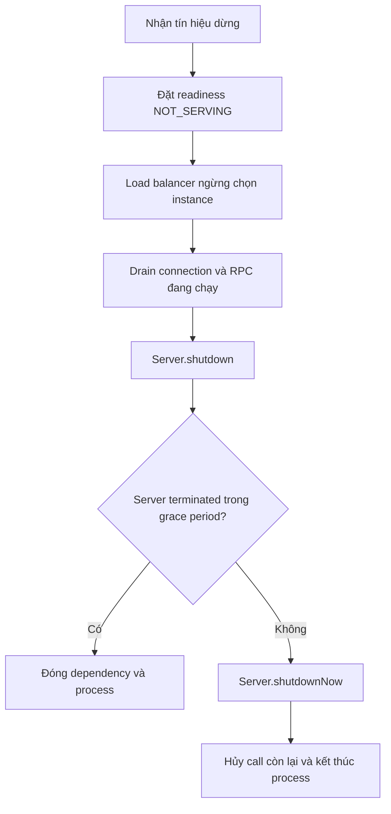

# Graceful shutdown

## 1. Mục tiêu

Khi triển khai Spring gRPC, một instance có thể bị dừng vì rollout, scale down, node drain hoặc application restart. Nếu process kết thúc ngay, các RPC đang chạy có thể bị ngắt, stream mất kết nối và client nhận lỗi dù request đã được xử lý một phần.

**Graceful shutdown** là quy trình ngừng nhận RPC mới, thông báo instance không còn sẵn sàng, cho các call đang chạy có thời gian hoàn tất, sau đó đóng gRPC server và process. Nếu hết thời gian cho phép, hệ thống chuyển sang force shutdown để không vượt quá termination deadline của nền tảng.

Quy trình cần phối hợp application lifecycle, gRPC server, health status, load balancer/orchestrator, HTTP/2 connection và client retry/resume policy. Chỉ gọi shutdown ở cuối process mà không drain traffic trước đó có thể làm rơi request mới trong khoảng thời gian routing chưa cập nhật.

Sau bài học, bạn có thể:

- Phân biệt graceful shutdown và force shutdown.
- Dùng Server.shutdown(), awaitTermination() và shutdownNow() đúng thứ tự.
- Chuyển gRPC health/readiness sang NOT_SERVING trước khi dừng listener.
- Hiểu vai trò của HTTP/2 GOAWAY và connection draining.
- Xử lý unary, server-streaming, client-streaming và bidirectional RPC đang chạy.
- Phối hợp Spring lifecycle với Kubernetes SIGTERM và termination grace period.
- Thiết kế client retry/resume và kiểm thử quá trình shutdown.

## 2. Điều gì xảy ra nếu dừng server ngay lập tức?

Một gRPC server có thể đang phục vụ nhiều RPC đồng thời trên một HTTP/2 connection. Khi process bị kill hoặc server bị force shutdown:

- Unary RPC có thể thất bại dù server đã thực hiện một phần nghiệp vụ.
- Server-streaming có thể bị cắt trước khi gửi message cuối.
- Client-streaming có thể mất phần dữ liệu chưa được xác nhận.
- Bidirectional stream có thể mất cả hai chiều đang hoạt động.
- Client có thể nhận UNAVAILABLE, CANCELLED hoặc lỗi transport tùy thời điểm và nguyên nhân.
- Nếu client retry một operation có side effect, nghiệp vụ có thể bị thực hiện hai lần.

Vì vậy, shutdown phải được xem là một chuyển trạng thái của service. Trước khi đóng listener, hệ thống cần ngừng định tuyến request mới tới instance và cho các call hiện tại có thời gian kết thúc.

## 3. Các giai đoạn của graceful shutdown

Một trình tự tổng quát:



Các giai đoạn chính:

1. **Bắt đầu drain:** nhận SIGTERM, lệnh rollout hoặc tín hiệu đóng application context.
2. **Ngừng nhận traffic mới:** health service công bố NOT_SERVING và readiness endpoint chuyển trạng thái.
3. **Chờ routing cập nhật:** load balancer, Kubernetes EndpointSlice hoặc service discovery loại instance khỏi pool.
4. **Đóng server graceful:** server ngừng nhận call mới và cho call đã được chấp nhận hoàn tất.
5. **Chờ termination:** chờ trong khoảng thời gian hữu hạn.
6. **Force shutdown nếu cần:** hủy call còn lại khi hết grace period.
7. **Giải phóng tài nguyên:** đóng executor, database client và các dependency theo thứ tự ownership.

Thứ tự cụ thể giữa readiness removal và Server.shutdown phụ thuộc kiến trúc. Với server-side load balancer, nên báo NOT_SERVING và cho hệ thống routing thời gian cập nhật trước khi đóng listener. Sau khi server.shutdown() được gọi, server không nhận RPC mới nữa; những request đến trong race window có thể thất bại.

## 4. Graceful shutdown trong gRPC Java

gRPC Java cung cấp ba API quan trọng:

| API | Hành vi |
|---|---|
| Server.shutdown() | Bắt đầu graceful shutdown, ngừng nhận RPC mới và cho call đang chạy cơ hội hoàn tất |
| Server.awaitTermination(timeout, unit) | Chờ server kết thúc trong thời gian hữu hạn |
| Server.shutdownNow() | Yêu cầu hủy call đang hoạt động và dừng server nhanh hơn |

Ví dụ helper:

```java
static void shutdownGracefully(
        Server server,
        Duration gracePeriod) {

    server.shutdown();
    try {
        boolean terminated = server.awaitTermination(
                gracePeriod.toMillis(),
                TimeUnit.MILLISECONDS);

        if (!terminated) {
            server.shutdownNow();
            server.awaitTermination(5, TimeUnit.SECONDS);
        }
    } catch (InterruptedException ex) {
        server.shutdownNow();
        Thread.currentThread().interrupt();
    }
}
```

Đoạn code minh họa cho server do ứng dụng tự quản lý. Trong Spring gRPC starter, server có thể được tạo và sở hữu bởi framework. Khi đó, dùng lifecycle/shutdown hook mà starter cung cấp; không tạo một Server thứ hai hoặc tự gọi shutdown từ gateway.

shutdown() không có nghĩa mọi RPC sẽ hoàn tất trong một khoảng thời gian cố định. Một stream có thể sống rất lâu hoặc handler có thể bị kẹt. Vì vậy cần grace period hữu hạn và phương án force shutdown.

awaitTermination() chỉ chờ server kết thúc; nó không tự tạo thêm thời gian cho Kubernetes. Tổng thời gian chờ phải nằm trong termination grace period còn lại của pod/process.

## 5. Health status và readiness phải đổi trước

Nếu application có gRPC Health Checking service, chuyển status về NOT_SERVING khi bắt đầu drain:

```java
public void beginDrain(HealthStatusManager health) {
    health.setStatus(
            "catalog.v1.CatalogService",
            ServingStatus.NOT_SERVING);
    health.setStatus("", ServingStatus.NOT_SERVING);
}
```

Nếu readiness được công bố qua Spring Boot Actuator hoặc một endpoint riêng, cũng cần cập nhật trạng thái tương ứng. Mọi tín hiệu readiness nên dùng cùng một coordinator để tránh tình trạng gRPC Health báo NOT_SERVING nhưng HTTP readiness vẫn UP.

Khi readiness fail, Kubernetes đánh dấu pod không ready và loại pod khỏi Service endpoints theo quá trình cập nhật control plane. Load balancer ngoài cluster cũng cần nhận cập nhật backend health. Việc này không nhất thiết tức thời; hãy dành thời gian propagation phù hợp.

Không đặt liveness thành NOT_SERVING chỉ vì application đang drain. Readiness phải ngừng nhận traffic; liveness vẫn có thể healthy trong lúc process hoàn tất call hiện tại. Khi process thực sự kết thúc, orchestrator sẽ dừng container theo lifecycle.

## 6. HTTP/2 GOAWAY và connection draining

HTTP/2 connection có thể mang nhiều RPC stream. Trong graceful shutdown, gRPC transport có thể dùng GOAWAY để báo peer rằng connection sẽ không nhận stream mới vượt qua giới hạn được chấp nhận. Client có thể tạo connection mới tới một backend khác nếu resolver/load balancer còn hoạt động.

GOAWAY là tín hiệu ở connection level:

- Nó giúp ngăn client tiếp tục mở stream mới trên connection đang drain.
- Nó không chuyển một stream đang chạy sang backend khác.
- Nó không bảo đảm client có thể retry mọi RPC bị ảnh hưởng.
- Hành vi chi tiết phụ thuộc gRPC transport, proxy và load balancer.

Với L7 proxy, cần cấu hình connection draining và backend removal. Với L4 passthrough, proxy không hiểu RPC nhưng có thể drain TCP connection theo policy. Trong cả hai trường hợp, long-lived stream có thể giữ backend bận cho tới khi hoàn tất, bị hủy hoặc hết grace period.

Không chỉ dựa vào GOAWAY. Readiness, endpoint removal, server shutdown và client behavior phải được phối hợp.

## 7. Xử lý từng loại RPC đang chạy

| Loại RPC | Rủi ro khi shutdown | Thiết kế hỗ trợ drain |
|---|---|---|
| Unary | Request đang xử lý bị ngắt trước response | Deadline hợp lý, xử lý idempotent và grace period đủ |
| Server-streaming | Stream bị cắt trước message cuối | Giới hạn stream lifetime, cursor/resume token nếu cần |
| Client-streaming | Server chưa nhận hết message hoặc chưa commit | Xác nhận tiến độ, commit semantics rõ ràng |
| Bidirectional streaming | Hai chiều đang gửi/nhận đồng thời | Protocol đóng stream, checkpoint và reconnect/resume |

Unary RPC thường dễ drain hơn vì có thời gian xử lý hữu hạn. Tuy vậy, một unary request gọi downstream không có deadline có thể giữ server lâu hơn dự kiến.

Với streaming, cần định nghĩa cách kết thúc bình thường. Ví dụ server có thể gửi event cuối báo stream đang đóng, client lưu sequence number cuối cùng và mở stream mới tới backend khác để tiếp tục từ cursor đó. Đây là application protocol; gRPC không tự di chuyển stream sang server khác.

Không cắt stream đang truyền dữ liệu chỉ để rollout nhanh nếu client không có cơ chế phát hiện và resume. Với stream không thể resume, cần chọn grace period đủ dài hoặc chấp nhận rõ ràng việc client phải khởi tạo lại operation.

## 8. Deadline, cancellation và công việc nền

Deadline của client giới hạn thời gian một RPC có thể tiếp tục. Server nên truyền deadline tới downstream call và không bắt đầu công việc có thể vượt xa thời gian còn lại.

Khi client hủy call hoặc deadline hết:

- Server có thể nhận tín hiệu cancellation qua gRPC Context.
- Handler nên ngừng công việc không còn cần thiết.
- Không tiếp tục ghi side effect sau khi caller đã bỏ request nếu nghiệp vụ không yêu cầu.
- Tài nguyên như cursor, lock, executor task và stream buffer phải được giải phóng.

Ví dụ kiểm tra cancellation:

```java
public void watchCatalog(
        WatchRequest request,
        StreamObserver<CatalogEvent> observer) {

    Context.current().addListener(
            context -> stopSubscription(request),
            Runnable::run);

    // Subscription cần kiểm tra cancellation và đóng tài nguyên.
}
```

Đây là phác thảo: implementation thực tế phải giữ handle subscription và bảo đảm cleanup chỉ chạy một lần khi call kết thúc, bị cancel hoặc server shutdown. Không dùng callback cancellation để bắt đầu một operation mới.

Deadline và cancellation không tự hủy mọi công việc nền đã tách khỏi RPC. Nếu handler đã gửi message vào queue hoặc tạo background task, application cần cơ chế quản lý riêng để task không tiếp tục gây side effect ngoài ý muốn.

## 9. Spring lifecycle và ownership của gRPC server

Trong Spring, gRPC server thường do starter hoặc server factory quản lý. Chỉ một thành phần nên sở hữu lifecycle của server:

- Thành phần tạo/bind server chịu trách nhiệm dừng server.
- Health/readiness coordinator chịu trách nhiệm công bố trạng thái.
- Gateway/client adapter chỉ sử dụng stub/channel, không tự đóng server.
- Application service không tự shutdown listener khi một request kết thúc.

Có thể dùng ContextClosedEvent để báo NOT_SERVING trước khi Spring dừng các bean lifecycle:

```java
@Component
public class GrpcDrainListener {

    private final HealthStatusManager health;

    public GrpcDrainListener(HealthStatusManager health) {
        this.health = health;
    }

    @EventListener(ContextClosedEvent.class)
    public void onContextClosed() {
        health.setStatus(
                "catalog.v1.CatalogService",
                ServingStatus.NOT_SERVING);
        health.setStatus("", ServingStatus.NOT_SERVING);
    }
}
```

Đây là ví dụ đánh dấu health state. Nó không tự drain Server và không thay thế lifecycle của Spring gRPC starter. Server owner phải tiếp tục gọi shutdown theo API mà starter cung cấp.

Nếu tự tích hợp bằng SmartLifecycle, hãy chọn phase và stop callback sao cho readiness coordinator chạy trước server owner, server được drain trước khi dependency cần cho RPC bị đóng. SmartLifecycle.stop(Runnable) phải gọi callback khi quá trình stop hoàn tất; không báo hoàn tất trước khi server đã terminated hoặc force-stopped.

Không giả định property server.shutdown=graceful của embedded HTTP server trong Spring Boot tự động quản lý gRPC server. Kiểm tra starter/version đang dùng và xác minh behavior bằng integration test.

## 10. Kubernetes SIGTERM và termination grace period

Khi pod bị xóa hoặc rollout, Kubernetes bắt đầu termination process. Kubelet chạy preStop hook nếu có, sau đó gửi SIGTERM tới process. Container phải kết thúc trong terminationGracePeriodSeconds; nếu hết thời gian, runtime có thể gửi SIGKILL.

Ví dụ cấu hình:

```yaml
apiVersion: apps/v1
kind: Deployment
metadata:
  name: catalog-grpc
spec:
  template:
    spec:
      terminationGracePeriodSeconds: 60
      containers:
        - name: catalog
          image: example/catalog-grpc:1.0.0
          ports:
            - name: grpc
              containerPort: 9090
          lifecycle:
            preStop:
              httpGet:
                path: /internal/grpc/drain
                port: management
                scheme: HTTP
```

Đường dẫn /internal/grpc/drain trong ví dụ là endpoint quản trị do ứng dụng tự triển khai; nó phải đánh dấu readiness NOT_SERVING và có thể chờ một khoảng propagation hữu hạn. Không phải endpoint mặc định của Spring Boot hoặc gRPC starter.

Khi pod bắt đầu termination, Kubernetes đồng thời cập nhật trạng thái endpoint để ngừng gửi traffic mới. preStop hook chạy trước SIGTERM và thời gian hook cũng được tính trong termination grace period. Vì propagation có độ trễ, drain endpoint có thể chủ động đánh dấu not ready sớm và chờ load balancer cập nhật trước khi hook kết thúc.

Termination grace period phải đủ cho:

1. preStop hook và readiness propagation.
2. Spring context shutdown.
3. gRPC server graceful drain.
4. Cleanup dependency và executor.

Ví dụ 60 giây chỉ là giá trị minh họa. Chọn theo p99 RPC duration, stream lifetime, rollout policy và giới hạn shutdown của nền tảng. Không đặt grace period ngắn hơn thời gian cần để hoàn tất request hợp lệ.

## 11. Tính ngân sách shutdown

Giả sử:

| Giai đoạn | Ngân sách ví dụ |
|---|---:|
| Readiness propagation/load balancer drain | 8 giây |
| Chờ unary và stream ngắn hoàn tất | 25 giây |
| Force cancellation và cleanup | 7 giây |
| Dự phòng scheduler/runtime | 5 giây |
| Tổng | 45 giây |

Termination grace period cần lớn hơn tổng ngân sách dự kiến, ví dụ 60 giây trong tình huống này. Không cộng thời gian một cách tùy tiện; đo RPC duration, stream lifetime và propagation thực tế trong môi trường triển khai.

Client deadline tối đa cũng phải được xét. Nếu client cho phép RPC chạy 2 phút nhưng pod chỉ có 30 giây drain, một số call sẽ bị hủy khi rollout. Có thể đặt maximum RPC duration, giới hạn stream lifetime hoặc chấp nhận client reconnect/resume.

Không thể chờ vô hạn mọi stream. Một bidirectional stream có thể tồn tại hàng giờ; nếu không có protocol đóng/resume, rollout sẽ luôn phải force-stop stream hoặc trì hoãn vô hạn.

## 12. Client cần xử lý server shutdown

Khi backend drain, client có thể nhận UNAVAILABLE hoặc lỗi transport trên call mới/đang chạy tùy thời điểm. Client cần:

- Đặt deadline cho mỗi RPC.
- Retry unary chỉ khi status và operation semantics cho phép.
- Dùng idempotency key cho operation có side effect.
- Không retry vô hạn hoặc retry đồng thời trên toàn bộ fleet.
- Dùng exponential backoff và jitter.
- Với streaming, phát hiện onError/onCompleted và tạo stream mới theo resume protocol.
- Lưu cursor/sequence number nếu cần tiếp tục từ vị trí đã xác nhận.

Ví dụ retry một unary read-only:

```java
Product getProductWithRetry(
        CatalogServiceBlockingStub stub,
        GetProductRequest request) {

    int attempt = 0;
    while (true) {
        try {
            return stub.withDeadlineAfter(
                    800, TimeUnit.MILLISECONDS)
                    .getProduct(request);
        } catch (StatusRuntimeException ex) {
            boolean retryable =
                    ex.getStatus().getCode() == Status.Code.UNAVAILABLE;

            if (!retryable || attempt >= 2) {
                throw ex;
            }

            backoffWithJitter(attempt++);
        }
    }
}
```

Đây là minh họa policy đơn giản; production cần tính deadline tổng xuyên suốt các lần thử, không cấp lại toàn bộ 800 ms cho mỗi attempt nếu caller có deadline ngắn hơn. Dùng retry mechanism của gRPC/service config hoặc application policy đã kiểm soát. Không áp dụng ví dụ này cho create/update hoặc streaming nếu chưa có idempotency/resume semantics.

## 13. Không đóng client channel cùng lúc với server một cách tùy tiện

ManagedChannel ở client và Server ở server là hai tài nguyên có lifecycle khác nhau:

- Server shutdown ngừng nhận RPC mới tại instance.
- Client channel shutdown ngừng tạo call mới từ process client và drain/hủy call của chính client.
- Gateway chỉ mượn channel không được tự đóng channel dùng chung.

Trong một Spring application vừa cung cấp vừa gọi gRPC, cần phối hợp hai lifecycle. Trước tiên dừng nhận request inbound và ngừng tạo downstream call mới; sau đó drain inbound RPC và các downstream call đang chạy; cuối cùng đóng client channel và server theo ownership đã định nghĩa.

Nếu đóng client channel trước khi application service hoàn tất inbound RPC, các call downstream đang cần để hoàn tất request có thể bị lỗi. Nếu đóng server trước khi báo readiness, load balancer có thể tiếp tục gửi request mới vào instance.

## 14. Quan sát quá trình shutdown

Nên ghi nhận và đo:

- Thời điểm nhận SIGTERM hoặc ContextClosedEvent.
- Thời điểm readiness chuyển NOT_SERVING.
- Thời gian endpoint/load balancer loại instance.
- Số RPC đang hoạt động khi bắt đầu drain.
- Số RPC hoàn tất trong grace period.
- Số RPC bị hủy hoặc force-terminated.
- Thời gian Server.shutdown() tới terminated.
- Số stream còn lại khi hết grace period.
- Status code client quan sát trong rollout.

Log cần có instance ID, service/method và request/trace ID nếu có; không ghi payload nhạy cảm. Metric shutdown giúp phân biệt rollout bình thường với việc grace period quá ngắn hoặc stream không có cơ chế kết thúc.

Một deployment khỏe mạnh không nhất thiết có zero retry. Điều quan trọng là retry có giới hạn, không gây side effect trùng và tỷ lệ RPC thất bại nằm trong SLO.

## 15. Kiểm thử graceful shutdown

### Unit test coordinator

Kiểm tra khi bắt đầu drain:

- Readiness và gRPC health chuyển NOT_SERVING.
- Liveness không bị đổi chỉ vì drain bắt đầu.
- Coordinator không phát tín hiệu bắt đầu drain nhiều lần gây side effect.
- Callback hoặc lifecycle owner chỉ hoàn tất sau khi server stop xong.

### In-process server test

Tạo server bằng InProcessServerBuilder và một fake service có thể giữ RPC đang chạy bằng latch:

1. Gửi một unary hoặc streaming RPC và xác nhận handler đã bắt đầu.
2. Gọi server.shutdown().
3. Xác minh call mới không được chấp nhận.
4. Giải phóng latch để call đang chạy hoàn tất.
5. Chờ awaitTermination() và xác minh server terminated.
6. Tạo test riêng cho shutdownNow() để xác minh call đang chạy nhận cancellation/error.

Dùng latch và timeout hữu hạn; không dùng sleep ngắn để đo race. Đóng channel/server trong JUnit lifecycle kể cả khi assertion thất bại.

### Kubernetes integration test

Thực hiện rollout hoặc xóa pod trong khi tạo traffic:

- Xác minh readiness chuyển NOT_SERVING trước khi server đóng.
- Xác minh pod bị loại khỏi Service endpoints.
- Theo dõi RPC mới được định tuyến sang replica còn healthy.
- Đo số unary RPC hoàn tất và số stream bị hủy.
- Xác minh process kết thúc trước termination grace period.
- Mô phỏng stream vượt grace period và xác minh force shutdown có kiểm soát.

Kiểm thử cả trường hợp preStop hook lỗi, application không phản hồi SIGTERM và dependency cleanup chậm.

## 16. Lỗi thường gặp

| Hiện tượng | Nguyên nhân | Cách xử lý |
|---|---|---|
| Rollout làm rơi RPC mới | Server đóng trước khi readiness propagation hoàn tất | Đánh dấu NOT_SERVING và chờ routing cập nhật |
| Server không terminated | Streaming call không bao giờ kết thúc | Giới hạn stream lifetime và đặt grace period hữu hạn |
| RPC đang chạy bị cắt ngay | Gọi shutdownNow() ngay khi nhận SIGTERM | Gọi shutdown(), chờ, rồi force khi hết hạn |
| Pod bị SIGKILL trước khi drain xong | terminationGracePeriodSeconds quá ngắn | Đo và tăng shutdown budget phù hợp |
| Kubernetes probe vẫn xanh khi app đang dừng | Health status không được cập nhật | Chuyển readiness sang NOT_SERVING sớm |
| Spring đóng dependency trước gRPC server | Lifecycle phase/bean ownership sai | Drain server trước khi đóng dependency mà RPC cần |
| Retry tạo dữ liệu trùng | Retry operation không idempotent | Idempotency key, deduplication và retry policy |
| Stream không resume được | Không có cursor/checkpoint protocol | Thiết kế resume semantics ở application layer |
| Gateway đóng server dùng chung | Consumer tự nhận ownership | Chỉ server lifecycle owner được shutdown |
| Graceful shutdown của HTTP server nhưng gRPC vẫn bị kill | Nhầm cấu hình embedded web server với gRPC server | Xác minh starter quản lý gRPC lifecycle riêng |

## 17. Bài tập thực hành

**Tình huống:** Catalog Spring gRPC có ba replica Kubernetes. Mỗi replica phục vụ unary GetProduct và bidirectional WatchCatalog. Deployment rollout làm một replica nhận SIGTERM; một số stream kéo dài nhiều phút.

Hãy thực hiện:

1. Xác định thành phần sở hữu gRPC Server và lifecycle hook của Spring gRPC starter.
2. Khi nhận shutdown signal, đặt Catalog và overall health thành NOT_SERVING.
3. Chờ readiness propagation để load balancer ngừng gửi RPC mới.
4. Gọi Server.shutdown() qua lifecycle owner và chờ trong grace period.
5. Giữ các unary RPC đang chạy có cơ hội hoàn tất.
6. Định nghĩa maximum lifetime hoặc resume cursor cho WatchCatalog.
7. Khi hết grace period, gọi shutdownNow() và giải phóng tài nguyên còn lại.
8. Phối hợp terminationGracePeriodSeconds, preStop và Spring lifecycle timeout.
9. Cấu hình client deadline, retry unary idempotent và reconnect/resume cho stream.
10. Chạy rollout test dưới tải, đo RPC completed, cancelled, UNAVAILABLE và shutdown duration.

**Tiêu chí hoàn thành:** readiness ngừng trước server shutdown; call mới được chuyển sang replica khác; in-flight RPC được drain trong giới hạn; stream có policy kết thúc/resume; force shutdown chỉ chạy khi hết grace; process dừng trước SIGKILL; client retry không tạo side effect trùng.

## 18. Ghi nhớ

Graceful shutdown là quá trình phối hợp giữa application, gRPC server, health/readiness, load balancer và orchestrator. Đầu tiên chuyển readiness sang NOT_SERVING để ngừng traffic mới; sau đó cho routing cập nhật và gọi Server.shutdown() để drain RPC đang chạy. Dùng awaitTermination() với grace period hữu hạn; chỉ gọi shutdownNow() khi hết thời gian hoặc bị interrupt. HTTP/2 GOAWAY hỗ trợ ngừng mở stream mới trên connection cũ nhưng không di chuyển stream đang chạy sang backend khác. Unary và streaming cần deadline, cancellation, idempotency hoặc resume semantics phù hợp. Trong Spring, chỉ lifecycle owner của starter/server được đóng server; không nhầm server.shutdown với client ManagedChannel.shutdown hoặc cấu hình graceful shutdown của embedded HTTP server. Kubernetes preStop, SIGTERM và terminationGracePeriodSeconds phải đủ ngân sách cho readiness propagation, RPC drain và cleanup. Kiểm thử rollout dưới tải để xác minh hành vi thực tế.
