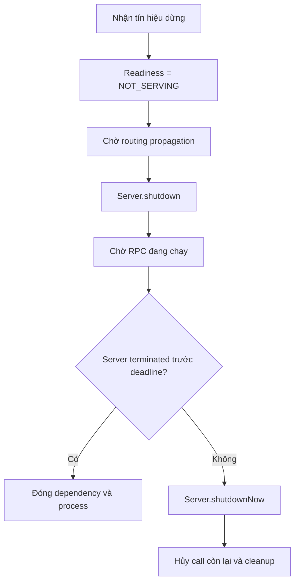

# Chờ RPC đang chạy hoàn tất

## 1. Mục tiêu

Một Spring gRPC server có thể đang xử lý nhiều RPC đồng thời khi nhận yêu cầu dừng do rollout, scale down hoặc restart. Nếu process kết thúc ngay, request đang chạy có thể mất response, stream bị cắt và client không biết server đã thực hiện side effect đến đâu.

**Chờ RPC đang chạy hoàn tất** là phần trọng tâm của graceful shutdown: ngừng nhận call mới, cho những call đã được chấp nhận hoàn tất trong một khoảng thời gian hữu hạn, sau đó mới đóng tài nguyên. Nếu hết thời gian mà vẫn còn call, server phải chuyển sang force shutdown theo policy.

Điểm quan trọng là phải phân biệt ba việc:

- Ngừng định tuyến request mới tới instance.
- Ngừng server nhận RPC mới.
- Chờ các RPC đã bắt đầu đi tới trạng thái terminal: hoàn tất, lỗi hoặc bị hủy.

Chỉ chờ một khoảng sleep không bảo đảm ba việc trên đã xảy ra. Cần dùng readiness, gRPC server lifecycle, deadline và cơ chế quan sát in-flight RPC.

Sau bài học, bạn có thể:

- Dùng Server.shutdown() và awaitTermination() để chờ RPC hiện tại.
- Chọn grace period có giới hạn và force shutdown khi hết hạn.
- Theo dõi số RPC đang chạy bằng server interceptor.
- Xử lý terminal callback đúng một lần cho unary và streaming.
- Phân biệt RPC hoàn tất, client cancellation và server shutdown.
- Phối hợp Spring lifecycle, Kubernetes và load balancer.
- Kiểm thử việc chờ RPC bằng latch và in-process server.

## 2. Một RPC được xem là hoàn tất khi nào?

Một RPC không chỉ kết thúc khi handler trả về khỏi method Java. Với asynchronous và streaming RPC, method triển khai có thể trả về ngay sau khi đăng ký callback, trong khi call vẫn tiếp tục gửi/nhận message.

Một call chỉ được coi là terminal khi một trong các kết quả xảy ra:

- Server hoàn tất response và đóng call.
- Server kết thúc call bằng gRPC status lỗi.
- Client hủy call hoặc deadline hết.
- Transport bị đóng và call bị kết thúc.

Với unary RPC, trạng thái terminal thường đến nhanh sau khi server gửi response hoặc error. Với server-streaming, call còn hoạt động cho tới khi server gửi message cuối và gọi onCompleted(), hoặc gửi onError(). Với client-streaming và bidirectional streaming, call có thể kéo dài trong khi hai phía tiếp tục trao đổi message.

Không dùng thời điểm handler method return làm bộ đếm in-flight. Với async handler, thời điểm đó có thể sớm hơn nhiều so với thời điểm RPC thực sự kết thúc.

## 3. Server.shutdown() và awaitTermination()

gRPC Java cung cấp lifecycle API để drain server:

| API | Hành vi |
|---|---|
| Server.shutdown() | Bắt đầu graceful shutdown, ngừng nhận RPC mới và cho call đã được chấp nhận cơ hội hoàn tất |
| Server.awaitTermination(timeout, unit) | Chờ server kết thúc trong thời gian hữu hạn |
| Server.shutdownNow() | Yêu cầu hủy các call đang hoạt động và dừng server nhanh hơn |
| Server.isShutdown() | Cho biết shutdown đã được khởi tạo |
| Server.isTerminated() | Cho biết server đã kết thúc lifecycle |

Mẫu sử dụng cơ bản:

```java
server.shutdown();

boolean terminated = server.awaitTermination(
        30, TimeUnit.SECONDS);

if (!terminated) {
    server.shutdownNow();
    server.awaitTermination(5, TimeUnit.SECONDS);
}
```

shutdown() không chờ mọi RPC kết thúc ngay trong lời gọi đó. Nó khởi động quá trình dừng nhận call mới. awaitTermination() mới là thao tác chờ server đi tới trạng thái terminated.

Không gọi shutdownNow() ngay khi nhận tín hiệu dừng nếu mục tiêu là bảo toàn call đang chạy. Chỉ force shutdown khi hết grace period, process bị interrupt hoặc có tình huống khẩn cấp cần dừng ngay.

Ở tầng HTTP/2, quá trình drain connection có thể sử dụng frame GOAWAY để báo peer rằng connection sẽ không nhận thêm stream mới. gRPC transport quản lý chi tiết protocol này; application thường điều khiển lifecycle qua Server.shutdown() thay vì tự phát frame GOAWAY. GOAWAY không di chuyển stream đang chạy sang backend khác và không thay thế việc chờ RPC hoàn tất.

## 4. Trình tự đúng để không nhận thêm call mới

Nếu chỉ chờ in-flight counter về zero trong khi server vẫn nhận request mới, số call có thể không bao giờ về zero. Vì vậy, trình tự cần ngăn traffic mới trước khi chờ:

1. Đặt readiness và gRPC health status thành NOT_SERVING.
2. Chờ load balancer/orchestrator loại instance khỏi pool trong một khoảng propagation hữu hạn.
3. Gọi Server.shutdown() để server ngừng nhận RPC mới.
4. Chờ các RPC đã được chấp nhận hoàn tất bằng awaitTermination().
5. Nếu hết grace period, gọi shutdownNow() để hủy call còn lại.
6. Đóng dependency mà các RPC đang chạy cần dùng.



Khoảng propagation không nên là sleep cố định tùy tiện. Chọn theo thời gian cập nhật endpoint/load balancer quan sát được trong môi trường triển khai. Nếu hệ thống có callback hoặc tín hiệu xác nhận backend đã bị loại khỏi pool, ưu tiên dùng tín hiệu đó.

## 5. Dùng một deadline tổng cho toàn bộ quá trình drain

Không cấp toàn bộ grace period riêng cho từng bước. Nếu readiness propagation chờ 10 giây, rồi server drain chờ 30 giây và cleanup chờ thêm 10 giây, tổng thời gian có thể vượt termination grace period của Kubernetes.

Tạo một deadline tổng dựa trên monotonic clock:

```java
static long remainingNanos(long deadlineNanos) {
    return Math.max(0L, deadlineNanos - System.nanoTime());
}

static boolean awaitServer(
        Server server,
        Duration totalBudget) throws InterruptedException {

    long deadline = System.nanoTime() + totalBudget.toNanos();
    server.shutdown();

    long remaining = remainingNanos(deadline);
    boolean terminated = remaining > 0
            && server.awaitTermination(
                    remaining, TimeUnit.NANOSECONDS);

    if (!terminated) {
        server.shutdownNow();
    }
    return terminated;
}
```

Ví dụ này bắt đầu budget tại thời điểm gọi helper. Trong ứng dụng thực tế, deadline tổng nên được tạo ngay khi bắt đầu shutdown để bao gồm cả readiness propagation, server drain và cleanup. Mọi bước lấy phần thời gian còn lại thay vì đặt lại timeout.

Dùng System.nanoTime() để đo khoảng thời gian vì nó không bị thay đổi bởi đồng bộ đồng hồ hệ thống. Không tính deadline bằng LocalDateTime hoặc wall clock.

## 6. Theo dõi số RPC đang chạy

Server.awaitTermination() là cơ chế chờ chính của gRPC server. Tuy nhiên, metric in-flight giúp vận hành hiểu server còn bao nhiêu call, call nào kéo dài và grace period có đủ hay không.

Một server interceptor có thể tăng bộ đếm khi RPC bắt đầu và giảm khi call đi tới terminal callback. Không giảm bộ đếm khi method handler return, vì async/streaming call có thể vẫn đang hoạt động.

Ví dụ tracker có thao tác acquire/release an toàn:

```java
public final class InFlightRpcTracker {

    private final AtomicInteger active = new AtomicInteger();

    public Lease begin() {
        active.incrementAndGet();
        return new Lease();
    }

    public int activeCount() {
        return active.get();
    }

    public final class Lease implements AutoCloseable {
        private final AtomicBoolean closed = new AtomicBoolean();

        @Override
        public void close() {
            if (closed.compareAndSet(false, true)) {
                active.decrementAndGet();
            }
        }
    }
}
```

Lease bảo đảm một call chỉ giảm counter một lần ngay cả khi nhiều terminal path cùng được kích hoạt. Trong production, có thể bổ sung gauge metric, thời điểm bắt đầu call, method name và cảnh báo call vượt ngưỡng.

## 7. Gắn tracker bằng ServerInterceptor

Interceptor bao quanh listener để nhận terminal callback:

```java
public final class InFlightRpcInterceptor
        implements ServerInterceptor {

    private final InFlightRpcTracker tracker;

    public InFlightRpcInterceptor(InFlightRpcTracker tracker) {
        this.tracker = tracker;
    }

    @Override
    public <ReqT, RespT> ServerCall.Listener<ReqT> interceptCall(
            ServerCall<ReqT, RespT> call,
            Metadata headers,
            ServerCallHandler<ReqT, RespT> next) {

        String method = call.getMethodDescriptor()
                .getFullMethodName();

        // Health Watch có thể là stream dài; không tính vào
        // metric in-flight của nghiệp vụ.
        if (method.startsWith("grpc.health.v1.Health/")) {
            return next.startCall(call, headers);
        }

        InFlightRpcTracker.Lease lease = tracker.begin();
        try {
            ServerCall.Listener<ReqT> delegate =
                    next.startCall(call, headers);

            return new ForwardingServerCallListener
                    .SimpleForwardingServerCallListener<>(delegate) {
                @Override
                public void onComplete() {
                    try {
                        super.onComplete();
                    } finally {
                        lease.close();
                    }
                }

                @Override
                public void onCancel() {
                    try {
                        super.onCancel();
                    } finally {
                        lease.close();
                    }
                }
            };
        } catch (RuntimeException | Error ex) {
            lease.close();
            throw ex;
        }
    }
}
```

Đây là mẫu theo dõi call ở server side. Import các forwarding listener và interceptor type từ gRPC Java API tương ứng với version dự án. Đăng ký interceptor trên server hoặc service theo cơ chế của Spring gRPC starter.

Các lưu ý quan trọng:

- onComplete() bao phủ call hoàn tất bình thường.
- onCancel() bao phủ call bị client/transport hủy.
- Lease idempotent tránh decrement hai lần.
- Nếu next.startCall() ném exception, lease được giải phóng.
- Health Watch là stream dài và nên được loại khỏi metric nghiệp vụ hoặc theo dõi riêng.
- Nếu interceptor chỉ được đăng ký cho một số service, metric chỉ phản ánh các service đó.

Không dùng tracker thay cho Server.awaitTermination(). Counter là observability/application coordination; server lifecycle vẫn là nguồn quyết định việc server đã terminated.

## 8. Chờ counter về zero sau khi server ngừng nhận call mới

Trong một số ứng dụng, cần biết chính xác thời điểm tất cả handler nghiệp vụ đã đi tới terminal callback để đóng dependency theo thứ tự. Có thể mở rộng tracker bằng Condition:

```java
public final class DrainTracker {

    private final ReentrantLock lock = new ReentrantLock();
    private final Condition empty = lock.newCondition();
    private int active;

    public Lease begin() {
        lock.lock();
        try {
            active++;
            return new Lease();
        } finally {
            lock.unlock();
        }
    }

    public boolean awaitZero(Duration timeout)
            throws InterruptedException {
        long remaining = timeout.toNanos();
        lock.lockInterruptibly();
        try {
            while (active > 0 && remaining > 0) {
                remaining = empty.awaitNanos(remaining);
            }
            return active == 0;
        } finally {
            lock.unlock();
        }
    }

    private void finish() {
        lock.lock();
        try {
            active--;
            if (active == 0) {
                empty.signalAll();
            }
        } finally {
            lock.unlock();
        }
    }

    public final class Lease implements AutoCloseable {
        private final AtomicBoolean closed = new AtomicBoolean();

        @Override
        public void close() {
            if (closed.compareAndSet(false, true)) {
                finish();
            }
        }
    }
}
```

Chỉ gọi awaitZero() sau khi server đã ngừng nhận call mới, nếu không counter có thể tăng trở lại. Dùng cùng một deadline tổng với server.awaitTermination(); không chờ zero vô hạn.

Nếu counter về zero nhưng server chưa terminated, vẫn phải chờ server lifecycle hoàn tất hoặc force shutdown khi hết budget. Ngược lại, nếu counter không về zero, metric method name và call age giúp tìm stream hoặc handler bị treo.

## 9. Unary RPC và streaming RPC cần policy khác nhau

| Loại RPC | Thời gian thường gặp | Cách drain |
|---|---|---|
| Unary read | Ngắn, hữu hạn | Chờ response hoặc deadline |
| Unary write | Hữu hạn nhưng có side effect | Chờ commit/response; client retry cần idempotency |
| Server-streaming | Có thể dài | Gửi terminal signal hoặc giới hạn lifetime |
| Client-streaming | Phụ thuộc tốc độ upload | Cho client hoàn tất half-close trong grace period |
| Bidirectional streaming | Có thể rất dài | Có protocol đóng, checkpoint hoặc resume |

Server không thể chuyển một stream đang chạy sang backend khác chỉ vì instance đang shutdown. Nếu cần continuity, application protocol phải hỗ trợ reconnect và resume.

Với server-streaming, có thể gửi event cuối báo server đang drain, kèm cursor/sequence number để client tiếp tục trên connection mới. Với client-streaming, cần xác định message nào đã được commit và message nào phải gửi lại. Với bidirectional streaming, hai phía cần thống nhất terminal signal và checkpoint.

Không force-close mọi stream ngay khi rollout bắt đầu nếu contract yêu cầu giao nhận đầy đủ. Ngược lại, cũng không để stream vô hạn ngăn deployment hoàn tất; đặt maximum lifetime hoặc chính sách hủy rõ ràng.

## 10. Deadline và cancellation giúp giới hạn thời gian chờ

Deadline của client là giới hạn tổng thời gian cho một RPC. Server nên truyền deadline tới downstream call và không giữ request vô hạn.

Khi deadline hết hoặc client hủy call:

- Server có thể nhận cancellation signal qua gRPC Context.
- Handler nên dừng công việc không còn cần thiết.
- Subscription, cursor, lock và buffer phải được giải phóng.
- Background task đã tách khỏi RPC cần lifecycle riêng.

Ví dụ kiểm tra cancellation:

```java
Context.current().addListener(
        context -> subscription.cancel(),
        Runnable::run);
```

Đoạn code giả định handler đang giữ subscription tương ứng. Trong implementation thực tế, đăng ký cleanup đúng một lần và bảo đảm callback không giải phóng nhầm tài nguyên đã chuyển ownership.

Deadline không tự hủy side effect đã commit. Nếu server đã ghi database rồi connection bị ngắt trước khi client nhận response, client không thể suy ra operation chưa xảy ra. Dùng idempotency key hoặc operation status query để xử lý kết quả không chắc chắn.

## 11. Phối hợp Spring lifecycle

Trong Spring, server có thể do starter/server factory sở hữu. Thành phần sở hữu server phải thực hiện shutdown; gateway và application service không được tự đóng listener dùng chung.

Một coordinator có thể thực hiện:

1. Nhận tín hiệu application shutdown.
2. Đặt gRPC Health và readiness thành NOT_SERVING.
3. Chờ endpoint propagation theo budget.
4. Gọi lifecycle stop của server owner.
5. Chờ server terminated.
6. Force shutdown nếu hết budget.
7. Đóng dependency mà RPC đang chạy sử dụng.

Nếu dùng SmartLifecycle, chọn phase để drain server trước khi đóng các dependency cần cho handler. Callback stop(Runnable) chỉ được gọi khi quá trình stop của component hoàn tất.

ContextClosedEvent có thể dùng để bắt đầu cập nhật health status, nhưng event handler không tự động thay thế server shutdown API. Kiểm tra lifecycle hook của Spring gRPC starter đang dùng; không giả định cấu hình graceful shutdown của embedded HTTP server cũng điều khiển gRPC server.

Nếu ứng dụng vừa cung cấp vừa gọi gRPC, cần ngừng tạo downstream RPC mới trước khi đóng client ManagedChannel. Inbound RPC đang chạy có thể vẫn cần downstream client để hoàn tất. Vì vậy, đóng client channel quá sớm có thể làm chính các request đang drain thất bại.

## 12. Kubernetes termination budget

Kubernetes gửi SIGTERM khi pod bị terminate và chờ trong terminationGracePeriodSeconds trước khi có thể gửi SIGKILL. preStop hook chạy trong cùng grace period.

Ví dụ:

```yaml
spec:
  terminationGracePeriodSeconds: 60
  containers:
    - name: catalog
      lifecycle:
        preStop:
          httpGet:
            path: /internal/grpc/drain
            port: management
```

Endpoint /internal/grpc/drain là endpoint do ứng dụng tự triển khai; nó có thể đặt readiness NOT_SERVING và chờ propagation. Đây không phải endpoint mặc định của Spring gRPC.

Ngân sách tổng phải bao gồm:

- preStop và readiness propagation.
- Thời gian server ngừng nhận RPC mới.
- Thời gian chờ in-flight RPC.
- Force cancellation nếu hết hạn.
- Đóng dependency và process.

Ví dụ nếu termination grace là 60 giây, không thể dùng 60 giây chỉ để chờ RPC rồi mới bắt đầu cleanup. Hãy dành một phần budget cho propagation và một phần cho cleanup/force-stop.

Đo p95/p99 RPC duration và stream lifetime trong production-like environment để chọn grace period. Nếu stream hợp lệ kéo dài hàng giờ, phải có max stream lifetime hoặc resume protocol; tăng grace period vô hạn không phải giải pháp.

## 13. Quan sát in-flight RPC

Metric và log giúp biết server đang chờ call nào:

- Gauge số RPC đang hoạt động theo service/method.
- Histogram thời gian RPC.
- Số call hoàn tất trong drain window.
- Số call bị cancel hoặc force-terminated.
- Tuổi của call lâu nhất khi bắt đầu shutdown.
- Số stream còn lại tại từng mốc thời gian.
- Thời gian từ readiness NOT_SERVING tới server terminated.
- Số lần grace period hết hạn.

Khi ghi log, gắn instance ID, method name và trace/request ID nếu có. Không log payload hoặc token nhạy cảm.

Nếu counter không giảm, xác định method và age của call trước khi tăng timeout. Nguyên nhân có thể là client giữ stream lâu, handler bỏ quên onCompleted/onError, downstream không có deadline hoặc cleanup callback không chạy.

Không để health Watch hoặc diagnostic stream dài hạn làm metric nghiệp vụ in-flight luôn lớn. Có thể theo dõi chúng ở metric riêng.

## 14. Kiểm thử việc chờ RPC hoàn tất

### In-process test với unary RPC

Dùng InProcessServerBuilder và InProcessChannelBuilder để dựng server/client trong cùng JVM, sau đó dùng fake service giữ handler bằng latch để điều khiển thời điểm hoàn tất:

1. Gửi RPC và chờ đến khi server xác nhận handler đã bắt đầu.
2. Gọi server.shutdown().
3. Gửi một RPC mới và xác minh server không nhận call mới.
4. Xác minh call cũ vẫn đang chạy.
5. Nhả latch để handler hoàn tất response.
6. Chờ awaitTermination() và xác minh server terminated.

Dùng latch có timeout; không dùng Thread.sleep để giả lập thứ tự.

### Test force shutdown

Tạo một call không hoàn tất trong grace period, gọi shutdown(), chờ timeout ngắn có kiểm soát rồi gọi shutdownNow(). Xác minh client nhận cancellation/error và tracker cuối cùng được giải phóng.

### Test streaming

Giữ server-streaming hoặc bidirectional stream mở, bắt đầu shutdown và xác minh:

- Stream hiện tại có thể tiếp tục trong grace period theo policy.
- Không có call mới được nhận sau server.shutdown().
- Client nhận terminal signal hoặc lỗi khi server force-stop.
- Resume cursor hoạt động nếu application contract hỗ trợ.

### Kubernetes integration test

Tạo traffic liên tục trong lúc rollout:

- Readiness đổi trước khi server dừng.
- Endpoint bị loại khỏi Service.
- RPC mới được route sang replica còn healthy.
- Call đang chạy có cơ hội hoàn tất.
- Pod kết thúc trước termination grace deadline.
- Nếu có call vượt hạn, force shutdown được ghi nhận và client xử lý đúng.

## 15. Lỗi thường gặp

| Hiện tượng | Nguyên nhân | Cách xử lý |
|---|---|---|
| Counter không bao giờ về zero | Giảm counter khi handler return hoặc bỏ sót terminal callback | Theo dõi onComplete/onCancel và dùng lease idempotent |
| Chờ zero nhưng vẫn có call mới | Server vẫn nhận request trong lúc chờ | Chuyển readiness, chờ propagation rồi gọi server.shutdown() |
| Server dừng ngay, call hiện tại lỗi | Dùng shutdownNow() quá sớm | Graceful shutdown và awaitTermination() |
| Shutdown vượt termination grace | Chờ vô hạn hoặc đặt lại timeout từng bước | Dùng một deadline tổng |
| Streaming ngăn server terminated | Stream không có maximum lifetime | Thiết kế close/resume hoặc force policy |
| Client retry tạo side effect trùng | Kết quả commit không rõ sau transport failure | Idempotency key và operation status |
| Dependency đóng trước khi RPC hoàn tất | Spring lifecycle phase sai | Drain server trước khi đóng dependency |
| Health Watch làm metric luôn bận | Đếm stream quản trị như RPC nghiệp vụ | Theo dõi riêng hoặc loại khỏi business in-flight gauge |
| Test flaky | Dùng sleep hoặc timeout quá ngắn | Dùng latch, barrier và timeout hữu hạn |

## 16. Bài tập thực hành

**Tình huống:** Catalog có ba Spring gRPC replica. Một replica đang xử lý nhiều unary GetProduct và bidirectional WatchCatalog thì nhận SIGTERM. Một số stream có thể kéo dài vài phút.

Hãy thực hiện:

1. Đăng ký health/readiness coordinator và interceptor theo dõi in-flight RPC.
2. Khi bắt đầu drain, chuyển Catalog readiness sang NOT_SERVING.
3. Chờ load balancer/Kubernetes loại pod khỏi endpoint pool.
4. Gọi Server.shutdown() để ngừng nhận RPC mới.
5. Theo dõi số call đang chạy theo service/method.
6. Chờ các unary RPC và stream ngắn hoàn tất trong một deadline tổng.
7. Định nghĩa maximum lifetime hoặc resume cursor cho WatchCatalog.
8. Nếu hết grace period, gọi shutdownNow() và ghi metric số call bị hủy.
9. Chỉ đóng database/client channel sau khi handler không còn cần chúng.
10. Chạy rollout test dưới tải và xác minh không có RPC mới tới replica đang drain.

**Tiêu chí hoàn thành:** server ngừng nhận call mới trước khi chờ; in-flight count phản ánh terminal lifecycle chứ không phải handler return; grace period hữu hạn; unary và streaming có policy riêng; dependency chỉ đóng sau drain; client xử lý cancellation/retry/resume an toàn.

## 17. Ghi nhớ

Muốn chờ RPC đang chạy hoàn tất, trước tiên phải ngừng traffic mới: cập nhật readiness, chờ routing propagation rồi gọi Server.shutdown(). Sau đó dùng awaitTermination() với một deadline tổng; chỉ gọi shutdownNow() khi hết budget hoặc cần dừng khẩn cấp. Handler async/streaming có thể tiếp tục sau khi method Java return, nên nếu theo dõi in-flight phải giảm counter ở terminal callback onComplete/onCancel và bảo đảm release đúng một lần. Health Watch nên được theo dõi riêng để không làm sai metric nghiệp vụ. Unary thường drain nhanh; streaming cần maximum lifetime, terminal signal hoặc resume protocol. Trong Spring, server owner phải điều phối lifecycle và giữ dependency mở cho tới khi RPC kết thúc. Kubernetes termination grace period phải bao gồm readiness propagation, drain và cleanup. Kiểm thử bằng latch/in-process server và rollout test để xác minh call cũ hoàn tất, call mới bị chặn và force shutdown chỉ xảy ra khi hết hạn.
