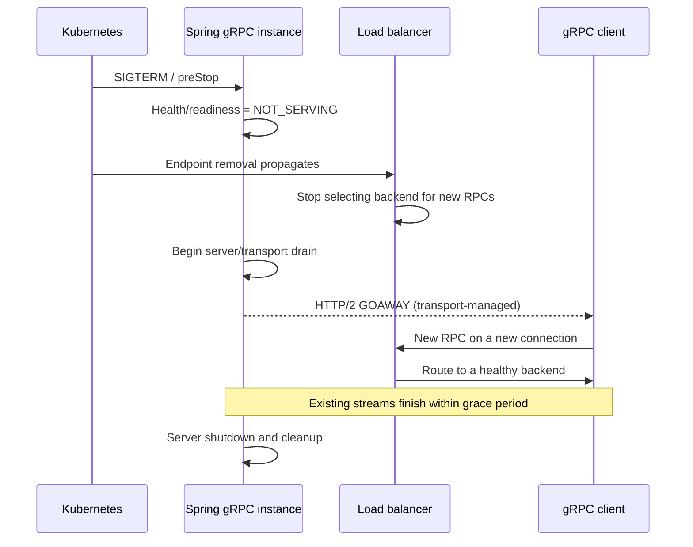

# Draining connection trước khi dừng

## 1. Mục tiêu

Một gRPC client thường giữ HTTP/2 connection lâu dài và gửi nhiều RPC trên cùng connection. Khi rollout hoặc scale down một Spring gRPC instance, chỉ chuyển readiness sang NOT_SERVING chưa chắc đã đóng các connection đang tồn tại. Một connection cũ vẫn có thể giữ nhiều stream đang chạy hoặc tiếp tục được client sử dụng cho tới khi transport phát hiện backend đã rời pool.

**Draining connection trước khi dừng** là quá trình ngừng đưa RPC mới vào connection/backend sắp retire, cho các stream hiện tại hoàn tất theo policy, hướng client tạo connection mới tới backend còn hoạt động, rồi mới đóng server hoặc proxy. Connection draining phối hợp HTTP/2 GOAWAY, readiness, load balancer, gRPC channel và shutdown lifecycle.

Sau bài học, bạn có thể:

- Phân biệt rút backend khỏi pool với đóng connection và chờ RPC hoàn tất.
- Giải thích HTTP/2 GOAWAY và giới hạn của connection draining.
- Phối hợp readiness, endpoint removal và proxy drain.
- Dùng gRPC server shutdown để ngừng nhận call mới.
- Hiểu cách client tạo connection mới sau khi connection cũ được retire.
- Xử lý long-lived streaming RPC và reconnect/resume.
- Kiểm thử drain trong rollout mà không dựa vào sleep tùy tiện.

## 2. Vì sao cần drain connection?

HTTP/2 multiplex nhiều RPC stream trên một TCP connection. Một ManagedChannel có thể duy trì connection tới backend trong thời gian dài. Nếu load balancer chọn backend tại thời điểm mở TCP connection, mọi RPC trên connection đó có thể tiếp tục tới cùng backend.

Khi pod bị đánh dấu not ready, Kubernetes có thể loại pod khỏi endpoint mới, nhưng connection đã thiết lập ở proxy hoặc client có thể vẫn tồn tại. Điều đó tạo ra hai nhóm traffic:

- RPC mới được định tuyến qua connection/backend mới.
- RPC hoặc stream đã gắn với connection cũ vẫn đang hoạt động.

Nếu process bị dừng trước khi connection cũ được drain, các stream có thể nhận lỗi transport hoặc bị hủy. Nếu chờ connection tự đóng vô hạn, rollout có thể không hoàn tất vì một bidirectional stream có thể sống hàng giờ.

Drain connection giúp tạo ranh giới rõ ràng giữa traffic mới và traffic đang chạy:

1. Ngừng chọn backend cho RPC mới.
2. Báo cho peer không tạo stream mới trên connection cũ.
3. Cho stream hiện tại kết thúc trong grace period.
4. Client tạo connection mới tới backend còn phục vụ.
5. Dừng connection/server cũ sau khi drain hoặc khi hết hạn.

## 3. Phân biệt backend removal, GOAWAY và server shutdown

Ba thao tác này có liên quan nhưng không thay thế nhau:

| Thao tác | Phạm vi | Kết quả |
|---|---|---|
| Readiness NOT_SERVING / endpoint removal | Service discovery và routing | Backend không còn được chọn cho traffic mới sau khi cập nhật lan truyền |
| HTTP/2 GOAWAY | Một HTTP/2 connection | Báo peer ngừng tạo stream mới trên connection đó |
| gRPC Server.shutdown() | Server lifecycle | Server ngừng nhận RPC mới và bắt đầu graceful shutdown |

Readiness không tự gửi GOAWAY tới connection đã tồn tại. GOAWAY không tự loại pod khỏi Kubernetes Service. Server.shutdown() không thay thế việc phối hợp với load balancer hoặc service discovery để giảm traffic mới trước khi dừng.

Một quy trình deployment cần dùng các cơ chế đúng vai trò và đúng thứ tự. Nếu chỉ gọi Server.shutdown() ngay khi nhận SIGTERM, call mới đến trong khoảng routing propagation có thể thất bại. Nếu chỉ đặt NOT_SERVING nhưng giữ connection cũ mãi mãi, client có thể tiếp tục dùng backend đã retire tùy loại load balancer.

## 4. HTTP/2 GOAWAY hoạt động thế nào?

GOAWAY là HTTP/2 control frame được gửi trên một connection để thông báo rằng endpoint sẽ không nhận thêm stream mới vượt qua một stream ID nhất định. Nó cho peer biết connection đang được đóng có kiểm soát.

Các điểm cần hiểu:

- GOAWAY áp dụng cho connection, không phải cho toàn bộ service discovery.
- Nó không chuyển một stream đang chạy sang connection hoặc backend khác.
- Stream đã được chấp nhận có thể tiếp tục tùy stream ID và trạng thái xử lý.
- Client cần tạo connection mới nếu còn RPC mới cần gửi.
- Proxy hoặc server có thể dùng một hay nhiều bước GOAWAY trong quá trình graceful close; chi tiết phụ thuộc implementation.

Trong gRPC, transport quản lý HTTP/2 frames. Application thường điều khiển lifecycle qua gRPC server/channel API thay vì tự tạo GOAWAY frame.

Không xem GOAWAY là cam kết mọi RPC thành công. RPC có thể đã được gửi nhưng chưa được server xử lý; client cần xét status, retry policy và tính idempotent trước khi gửi lại.

## 5. Connection draining qua L4 và L7 load balancer

### L4 TCP load balancer

L4 chuyển tiếp TCP byte và thường chọn backend khi TCP connection được thiết lập. Nó không đọc được gRPC method path hoặc HTTP/2 stream state nếu đang passthrough TLS.

Khi backend retire:

- L4 có thể ngừng tạo TCP connection mới tới backend.
- Connection TCP hiện hữu có thể tiếp tục tồn tại.
- Một số sản phẩm hỗ trợ connection draining với timeout.
- L4 không thể chọn riêng một RPC stream bên trong connection TLS multiplex.

Vì vậy, connection cũ có thể tiếp tục gắn nhiều RPC vào backend cũ cho tới khi client hoặc server đóng connection.

### L7 HTTP/2-aware proxy

L7 proxy hiểu HTTP/2 và gRPC. Nó có thể:

- Đánh dấu backend không nhận request mới.
- Chọn backend khác cho HTTP/2 stream mới.
- Giữ stream đang chạy trên backend cũ.
- Drain connection hoặc gửi GOAWAY theo khả năng sản phẩm.
- Theo dõi active streams và timeout.

L7 có khả năng kiểm soát chi tiết hơn, nhưng phải bảo đảm gRPC trailers, flow control và streaming được xử lý đúng. Cấu hình drain timeout phải phù hợp workload thực tế.

| Nhu cầu | L4 | L7 HTTP/2-aware |
|---|---|---|
| Ngừng TCP connection mới tới backend | Có | Có |
| Biết gRPC method/stream | Không | Có thể |
| Chuyển stream mới sang backend khác trên cùng frontend connection | Không | Có thể, tùy proxy |
| Drain stream đang chạy | Theo TCP connection lifetime | Có thể theo stream và backend policy |
| Quan sát gRPC status/trailers | Không khi passthrough TLS | Có thể |

## 6. Trình tự drain cho Spring gRPC deployment

Một trình tự điển hình:



Các bước thực tế:

1. Nhận tín hiệu dừng hoặc rollout.
2. Chuyển gRPC Health và readiness thành NOT_SERVING.
3. Chờ endpoint removal/load balancer propagation trong một budget hữu hạn.
4. Yêu cầu proxy hoặc gRPC transport drain connection theo API hỗ trợ.
5. Gọi Server.shutdown() để server ngừng nhận RPC mới.
6. Theo dõi in-flight RPC và stream đang chạy.
7. Chờ tới khi server terminated hoặc hết grace period.
8. Nếu còn call, force shutdown theo policy rồi đóng dependency.

Thứ tự gọi drain API và Server.shutdown() phụ thuộc server/proxy architecture. Một số proxy cần nhận endpoint removal trước khi bắt đầu drain; một số gRPC server bắt đầu gửi GOAWAY khi shutdown được gọi. Xác minh behavior của implementation đang dùng thay vì giả định mọi thành phần tự phối hợp.

## 7. Điều phối trong Spring lifecycle

Spring gRPC server thường do starter hoặc server factory quản lý. Component sở hữu server lifecycle phải chịu trách nhiệm dừng server. Readiness coordinator và load balancer controller có thể là component riêng, nhưng cần một shutdown coordinator gọi chúng theo thứ tự.

Ví dụ phác thảo:

```java
public final class GrpcDrainCoordinator {

    private final GrpcReadiness readiness;
    private final BackendDrainSignal backendDrain;
    private final GrpcServerLifecycle serverLifecycle;

    public void beginDrain(Duration propagationBudget,
                           Duration serverBudget) {
        readiness.markNotServing();
        backendDrain.stopSelectingThisInstance();
        backendDrain.awaitPropagation(propagationBudget);
        serverLifecycle.shutdownAndAwait(serverBudget);
    }
}
```

Các interface trong ví dụ là application abstraction; không phải class có sẵn trong Spring gRPC. Implementation thật phải nối với HealthStatusManager, readiness endpoint, API của load balancer nếu có, và lifecycle API của starter.

Không đặt logic drain trong gateway xử lý RPC. Gateway chỉ tiêu thụ stub hoặc application service; nó không sở hữu server listener.

Nếu dùng SmartLifecycle, chọn phase để readiness coordinator bắt đầu drain trước server owner và để dependency cần cho in-flight handler được đóng sau cùng. Callback stop(Runnable) chỉ báo hoàn tất khi server đã dừng hoặc force-stopped.

## 8. Client nhận GOAWAY và tạo connection mới

Khi HTTP/2 connection bị drain, gRPC client cần tiếp tục gửi RPC mới qua một connection còn hoạt động. Với ManagedChannel, transport và load balancing policy quản lý subchannel/connection lifecycle. GOAWAY có thể khiến transport ngừng dùng connection cũ và tạo connection mới theo resolver/policy.

Client application vẫn phải xử lý:

- RPC mới có thể tạm thời chờ connection mới READY.
- Call đang chạy có thể hoàn tất hoặc nhận lỗi tùy trạng thái và thời điểm GOAWAY.
- Retry không tự động an toàn cho mọi method.
- DNS/resolver phải còn cung cấp backend healthy.
- Deadline tổng của caller vẫn phải được giữ qua reconnect/retry.

Không tạo ManagedChannel mới cho từng RPC chỉ để tránh connection draining. Channel nên được tái sử dụng; gRPC transport quản lý connection bên dưới.

Nếu client-side load balancing dùng resolver trả nhiều backend, connection mới có thể được mở tới instance khác. Nếu client chỉ thấy một L4 VIP, connection mới có thể vẫn được load balancer chọn backend theo policy của nó.

## 9. Long-lived stream và resume

Connection drain không thể di chuyển stream đang hoạt động sang connection khác. Với stream kéo dài, cần một trong ba chiến lược:

1. **Natural completion:** stream kết thúc trong grace period.
2. **Bounded lifetime:** server định kỳ kết thúc stream có kiểm soát để client reconnect.
3. **Resume protocol:** client lưu cursor/sequence number và mở stream mới từ vị trí đã xác nhận.

Ví dụ response event có sequence:

```proto
message CatalogEvent {
  string event_id = 1;
  int64 sequence = 2;
  string product_id = 3;
  string change_type = 4;
}

message WatchCatalogRequest {
  int64 after_sequence = 1;
}
```

Khi server báo stream đang drain, client giữ sequence cuối cùng đã xử lý và mở stream mới với after_sequence. Server phải định nghĩa rõ sequence có ổn định, có thể replay và không bỏ sót event hay không.

Với client-streaming upload, cần acknowledgement/checkpoint để biết message nào đã được server commit. Với bidirectional stream, hai chiều cần thống nhất cách kết thúc, checkpoint và khôi phục state.

Không retry stream bằng cách gửi lại toàn bộ message nếu server có thể đã commit một phần. Dùng idempotency key hoặc protocol deduplication để tránh side effect trùng.

## 10. Timeout và drain budget

Drain budget phải bao gồm propagation, connection drain, in-flight completion và cleanup:

| Giai đoạn | Nội dung |
|---|---|
| Readiness propagation | Orchestrator/load balancer ngừng chọn backend |
| Connection drain | Ngừng tạo stream mới trên connection cũ |
| In-flight wait | Chờ unary và streaming call đang chạy |
| Force phase | Hủy call vượt thời gian |
| Cleanup | Đóng server, executor và dependency |

Tất cả giai đoạn phải nằm trong terminationGracePeriodSeconds của Kubernetes hoặc shutdown timeout của runtime. Dùng một deadline tổng, không reset timeout cho từng bước.

Ví dụ:

```text
Termination grace period: 60 giây
Readiness propagation:      8 giây
Connection drain:           5 giây
In-flight wait:             35 giây
Force/cleanup reserve:     12 giây
```

Đây là ngân sách minh họa. Hãy đo thời gian endpoint propagation, p99 RPC duration và stream lifetime. Nếu stream hợp lệ kéo dài lâu hơn grace period, cần bounded lifetime hoặc resume protocol thay vì chờ vô hạn.

Proxy idle timeout, max connection age và gRPC deadline có ý nghĩa khác nhau. Idle timeout có thể đóng connection khi không có hoạt động; max connection age xoay connection theo chu kỳ; deadline giới hạn một RPC. Không dùng một giá trị thay thế cho tất cả.

## 11. Kubernetes preStop và endpoint propagation

Kubernetes bắt đầu termination, chạy preStop hook nếu có và gửi SIGTERM theo lifecycle. EndpointSlice và load balancer cần thời gian để cập nhật backend pool.

Ví dụ drain endpoint:

```yaml
lifecycle:
  preStop:
    httpGet:
      path: /internal/grpc/drain
      port: management
      scheme: HTTP
terminationGracePeriodSeconds: 60
```

Endpoint /internal/grpc/drain là endpoint do ứng dụng tự triển khai. Nó cần đánh dấu readiness NOT_SERVING và bắt đầu drain coordinator; đây không phải endpoint mặc định của Spring gRPC.

preStop hook chạy trong termination grace period. Nếu hook chờ 10 giây thì phần thời gian còn lại cho server drain và cleanup giảm tương ứng. Không cấu hình hook chờ lâu hơn budget tổng.

Không giả định pod bị loại khỏi mọi load balancer ngay lập tức khi readiness đổi. Có thể có propagation qua EndpointSlice, kube-proxy, ingress controller, cloud load balancer và service mesh. Đo thời gian thực tế trong cluster.

## 12. Theo dõi connection và stream đang drain

Nên quan sát riêng connection-level và RPC-level:

- Số HTTP/2 connection đang mở tới instance.
- Số connection đang ở trạng thái draining.
- Số active RPC/stream theo service và method.
- Tuổi của stream lâu nhất.
- Thời điểm nhận GOAWAY hoặc transport shutdown nếu metric/log hỗ trợ.
- Số RPC mới bị từ chối sau khi drain bắt đầu.
- Số RPC hoàn tất, bị cancel hoặc force-terminated.
- Thời gian từ NOT_SERVING tới connection count bằng zero.
- Số client reconnect/retry và status code phát sinh.

Connection count về zero không luôn đồng nghĩa mọi application task đã cleanup xong; handler có thể tạo background work tách khỏi RPC. Ngược lại, in-flight RPC count về zero nhưng proxy connection vẫn còn keepalive. Theo dõi cả hai lớp.

Gắn instance ID, connection generation, method name và trace ID vào log khi có thể. Không log payload nhạy cảm hoặc credential.

## 13. Kiểm thử connection draining

### Kiểm thử với in-process server

In-process transport hữu ích để kiểm tra server lifecycle và RPC đang chạy, nhưng không tạo TCP/HTTP2 connection thực. Dùng InProcessServerBuilder và InProcessChannelBuilder để:

1. Tạo fake service giữ một stream bằng latch.
2. Gửi RPC và xác nhận handler bắt đầu.
3. Gọi Server.shutdown().
4. Xác minh call mới không được server nhận.
5. Cho stream hiện tại hoàn tất trong grace period.
6. Chờ awaitTermination() và xác minh server terminated.
7. Tạo test khác cho shutdownNow() khi stream không kết thúc.

Test in-process không chứng minh GOAWAY frame hoặc proxy drain thực tế; cần transport integration test riêng.

### Kiểm thử HTTP/2 thực

Chạy server Netty trên port test, tạo ManagedChannel thật và mở nhiều RPC/stream. Bắt đầu shutdown và quan sát:

- Connection/stream behavior.
- Client status và reconnect.
- RPC mới được gửi qua connection mới nếu resolver/backend còn khả dụng.
- Stream cũ hoàn tất hoặc bị hủy theo grace policy.
- Server terminated trước deadline.

### Kiểm thử qua load balancer/Kubernetes

Rollout một replica dưới tải:

- Readiness chuyển NOT_SERVING.
- Endpoint bị loại khỏi pool.
- Backend không nhận stream mới sau drain.
- Connection cũ được retire theo policy.
- Client tiếp tục gửi RPC tới backend còn healthy.
- Long-lived stream resume từ cursor nếu contract hỗ trợ.
- Pod kết thúc trước termination grace deadline.

Không dùng một test TCP connect đơn lẻ để kết luận draining hoạt động.

## 14. Lỗi thường gặp

| Hiện tượng | Nguyên nhân | Cách xử lý |
|---|---|---|
| Pod not ready nhưng RPC vẫn tới pod cũ | Connection HTTP/2 đã tồn tại | Drain connection và dùng GOAWAY/endpoint removal phù hợp |
| Gọi shutdown làm call mới lỗi trong propagation window | Server dừng trước khi load balancer cập nhật | Đánh dấu readiness và chờ propagation trước |
| L4 load balancer giữ backend cũ | Chỉ cân bằng TCP connection | Cấu hình connection drain timeout hoặc dùng L7/client-side LB |
| Stream bị cắt khi rollout | Stream dài hơn grace period, không có resume | Bounded lifetime và resume cursor |
| Client không tạo connection mới | Resolver không cập nhật hoặc channel không reconnect được | Kiểm tra resolver, DNS, subchannel và channel state |
| GOAWAY bị hiểu là mọi RPC đã hoàn tất | Nhầm connection-level signal với call terminal | Theo dõi RPC/stream completion riêng |
| Drain không kết thúc | Keepalive/connection còn mở hoặc stream vô hạn | Phân biệt connection và RPC; đặt max lifetime/force policy |
| Pod bị SIGKILL giữa drain | Budget propagation + drain vượt grace period | Đo và phân bổ shutdown budget |
| Retry gây side effect trùng | RPC không idempotent | Idempotency key, deduplication và operation status |
| Test in-process pass nhưng production lỗi | In-process không tạo HTTP/2 socket/GOAWAY thực | Bổ sung Netty/proxy/Kubernetes integration test |

## 15. Bài tập thực hành

**Tình huống:** Catalog có ba Spring gRPC replica. Client giữ một ManagedChannel và gửi nhiều unary RPC cùng một bidirectional stream kéo dài. Khi rollout, pod cũ chuyển readiness sang NOT_SERVING nhưng L4 load balancer vẫn giữ connection đã thiết lập.

Hãy thực hiện:

1. Xác định load balancer cân bằng TCP connection hay HTTP/2 stream.
2. Đo số connection và active RPC/stream trên pod sắp retire.
3. Chuyển health/readiness sang NOT_SERVING trước khi dừng server.
4. Chờ endpoint propagation và cấu hình connection draining tại load balancer.
5. Gọi Server.shutdown() qua lifecycle owner để server ngừng nhận call mới.
6. Xác minh transport phát GOAWAY hoặc proxy thực hiện cơ chế drain tương đương.
7. Cho unary RPC và stream ngắn hoàn tất trong grace period.
8. Thiết kế sequence cursor và reconnect cho bidirectional stream.
9. Nếu hết budget, force-stop call còn lại và ghi nhận metric.
10. Chạy rollout test qua TCP/L4 và HTTP/2-aware proxy để so sánh kết quả.

**Tiêu chí hoàn thành:** backend cũ không nhận RPC mới sau drain; client có thể mở connection mới tới backend healthy; stream cũ được hoàn tất hoặc resume theo contract; server dừng trong grace period; metric phân biệt connection count và in-flight RPC.

## 16. Ghi nhớ

Connection draining ngăn RPC mới đi vào connection/backend sắp retire và tạo thời gian cho stream hiện tại kết thúc. Readiness/endpoint removal rút backend khỏi routing; GOAWAY báo peer ngừng tạo stream mới trên một HTTP/2 connection; Server.shutdown() điều khiển gRPC server lifecycle. Các cơ chế này không thay thế nhau. L4 thường drain theo TCP connection, còn L7 HTTP/2-aware có thể kiểm soát stream chi tiết hơn. Client cần resolver và channel hoạt động để tạo connection mới; GOAWAY không tự di chuyển stream đang chạy. Streaming dài cần maximum lifetime, terminal signal hoặc resume cursor. Phối hợp readiness propagation, proxy drain, server shutdown và Kubernetes termination budget bằng một deadline tổng. Kiểm thử cả in-process lifecycle lẫn HTTP/2/proxy rollout thực tế; theo dõi connection và RPC/stream như hai lớp riêng.
