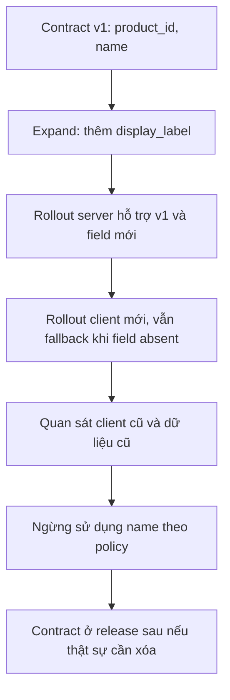

# Rolling deployment tương thích proto

## 1. Mục tiêu

Rolling deployment thay thế từng instance của một service trong khi các instance còn lại vẫn nhận traffic. Với Spring gRPC, trong một khoảng thời gian fleet có thể đồng thời chạy server version cũ và mới, trong khi client cũng được rollout độc lập. Hai phía trao đổi message theo Protobuf contract, vì vậy một thay đổi schema phải hoạt động an toàn trong mọi tổ hợp phiên bản có thể xuất hiện trong quá trình triển khai.

**Rolling deployment tương thích proto** là cách phát hành thay đổi Protobuf và generated stub mà không yêu cầu toàn bộ client/server nâng cấp cùng lúc. Mục tiêu là giữ wire compatibility, giữ semantics của RPC và cho phép các phiên bản cũ/mới cùng tồn tại trong thời gian rollout, rollback hoặc kết nối lại.

Một thay đổi có thể tương thích về wire format nhưng vẫn phá vỡ source API hoặc nghiệp vụ. Ví dụ, thêm field mới thường không làm parser cũ lỗi, nhưng client cũ có thể không hiểu semantics mới; thêm enum value có thể làm generated code cũ nhận `UNRECOGNIZED`. Do đó, rollout phải kiểm tra cả wire compatibility, source compatibility và semantic compatibility.

Sau bài học, bạn có thể:

- Phân biệt wire, source và semantic compatibility.
- Áp dụng chiến lược expand–migrate–contract.
- Chọn thứ tự rollout server và client theo loại thay đổi.
- Tiến hóa field, enum, oneof, service và RPC method an toàn.
- Xử lý mixed-version fleet, long-lived stream và rollback.
- Cấu hình rolling update với readiness và graceful shutdown.
- Kiểm thử ma trận client/server version trước khi phát hành.

## 2. Ba lớp tương thích cần giữ

| Lớp | Câu hỏi | Ví dụ lỗi |
|---|---|---|
| Wire compatibility | Message mới và cũ có parse được bytes của nhau không? | Đổi field number hoặc wire type làm dữ liệu bị hiểu sai |
| Source/API compatibility | Code client/server có tiếp tục compile với generated API không? | Đổi tên field làm accessor Java đổi tên |
| Semantic compatibility | Hai phiên bản có hiểu cùng một giá trị theo cùng ý nghĩa không? | Giá trị enum mới bị code cũ xử lý như trạng thái hợp lệ khác |

Protobuf dùng field number và wire type để mã hóa field. Tên field không nằm trong binary wire representation, nhưng được dùng để sinh accessor, JSON mapping và tooling. Vì vậy, rename field có thể giữ wire compatibility nhưng vẫn phá source compatibility hoặc JSON clients.

gRPC method được định danh bởi full method path có dạng:

```text
/package.Service/Method
```

Đổi Protobuf package, service name hoặc method name làm thay đổi path. Client gọi path cũ có thể nhận `UNIMPLEMENTED` nếu server mới không còn đăng ký method cũ. Đây là thay đổi API cần rollout có kế hoạch, không chỉ là rename class Java.

## 3. Nguyên tắc expand–migrate–contract

Thay đổi schema an toàn thường đi qua ba giai đoạn:

1. **Expand:** thêm khả năng mới theo cách server/client cũ có thể bỏ qua hoặc dùng default an toàn.
2. **Migrate:** triển khai server và client mới, chuyển traffic và dữ liệu sang semantics mới; theo dõi fleet cho tới khi phiên bản cũ không còn sử dụng.
3. **Contract:** chỉ xóa field/method cũ sau khi xác nhận không còn client, server hoặc stream nào phụ thuộc.

Ví dụ thêm `display_label` cho Product:

```proto
message Product {
  string product_id = 1;
  string name = 2;
  optional string display_label = 3;
}
```

Một rollout có thể là:



Không gộp expand và contract vào cùng một rolling release. Trong lúc rollout, một số instance vẫn chạy schema cũ; nếu release mới xóa ngay field mà client cũ cần, request sẽ thất bại khi load balancer chọn instance cũ hoặc mới.

## 4. Thêm field Protobuf

Thêm field mới với field number chưa từng dùng là cách tiến hóa phổ biến:

```proto
message GetProductResponse {
  string product_id = 1;
  string name = 2;
  optional string display_label = 3;
}
```

Thông thường:

- Server mới có thể nhận request cũ không có field mới.
- Client mới có thể nhận response từ server cũ; field mới sẽ absent/default.
- Client cũ thường bỏ qua field chưa biết khi parse message.
- Server cũ thường bỏ qua field request chưa biết.

Nhưng khả năng parse được không đồng nghĩa semantics an toàn. Client mới phải có fallback khi field mới absent. Server mới không được giả định mọi client đều gửi field mới ngay sau khi bắt đầu rollout.

Với proto3 scalar, nếu cần phân biệt absent với giá trị mặc định, dùng `optional` hoặc message wrapper phù hợp. Không suy luận rằng getter trả chuỗi rỗng hoặc số 0 chứng minh client đã gửi field.

### Quy tắc field number

- Không đổi field number của field đã phát hành.
- Không tái sử dụng field number của field đã xóa.
- Đánh dấu field number đã xóa bằng `reserved`.
- Có thể reserve tên field để tránh tái sử dụng trong JSON/text format.
- Không đổi type chỉ vì hai type có vẻ tương tự trong Java.

Ví dụ xóa field cũ:

```proto
message Product {
  reserved 2;
  reserved "legacy_name";

  string product_id = 1;
  optional string display_label = 3;
}
```

Nếu tái sử dụng field number, bytes cũ có thể bị diễn giải thành một field khác và gây lỗi dữ liệu khó phát hiện.

## 5. Thay đổi field type và semantics

Không phải thay đổi type nào cũng an toàn dù generated Java code vẫn compile. Protobuf wire format phân loại field theo wire type; một số type dùng cùng wire type nhưng có cách diễn giải khác.

Ví dụ:

- `int32` và `sint32` đều là varint nhưng dùng cách mã hóa số âm khác nhau.
- `string` và `bytes` có wire type length-delimited nhưng semantics và validation khác.
- `fixed32` và `float` có thể dùng fixed32 wire type nhưng ý nghĩa dữ liệu khác.
- Thay đơn vị của một số nguyên từ milliseconds sang seconds không đổi wire format nhưng phá semantic compatibility.

Không đổi type/meaning của field đã phát hành tại chỗ. Thêm field mới với tag mới, migrate dữ liệu/client, rồi deprecate field cũ. Nếu phải chuyển đổi đơn vị, đặt tên field mới biểu đạt đơn vị và kiểm tra range rõ ràng.

## 6. Field presence và update semantics

Trong proto3, scalar không có explicit presence thường trả default nếu field không được gửi. Điều này đặc biệt nguy hiểm với update request:

```proto
message UpdateProductRequest {
  string product_id = 1;
  optional string display_label = 2;
  optional int32 reorder_level = 3;
}
```

`hasDisplayLabel()` cho biết field có hiện diện; `getDisplayLabel()` trả giá trị. Nếu client mới gửi empty string có nghĩa xóa label, server cũ không biết field này và bỏ qua. Nếu server mới xử lý field absent như xóa, client cũ gửi request không có field sẽ vô tình xóa dữ liệu.

Giữ semantics rõ:

- Absent: không thay đổi field.
- Present với empty/zero: đặt giá trị về empty/zero nếu contract cho phép.
- Explicit clear: dùng field mask hoặc operation riêng nếu cần phân biệt rõ.

Khi thêm field vào update API, server mới phải giữ hành vi cũ cho request không có field đó. Không thay đổi default semantics của field hiện hữu trong một rolling deployment.

## 7. Thêm enum value

Thêm enum value thường giữ wire compatibility vì enum được mã hóa bằng số. Tuy nhiên, client cũ có thể nhận numeric value mà generated enum cũ không biết.

Ví dụ:

```proto
enum ProductStatus {
  PRODUCT_STATUS_UNSPECIFIED = 0;
  PRODUCT_STATUS_ACTIVE = 1;
  PRODUCT_STATUS_DISCONTINUED = 2;
  PRODUCT_STATUS_ARCHIVED = 3;
}
```

Generated Java proto3 có thể trả `UNRECOGNIZED` khi nhận số enum chưa được phiên bản code biết tới. Code client phải có nhánh xử lý:

```java
ProductState toDomain(ProductStatus status) {
    return switch (status) {
        case PRODUCT_STATUS_ACTIVE -> ProductState.ACTIVE;
        case PRODUCT_STATUS_DISCONTINUED ->
                ProductState.DISCONTINUED;
        case PRODUCT_STATUS_UNSPECIFIED, UNRECOGNIZED ->
                ProductState.UNKNOWN;
    };
}
```

Nếu trạng thái không biết ảnh hưởng tới quyền, thanh toán hoặc tính đúng đắn dữ liệu, có thể từ chối xử lý an toàn thay vì map sang trạng thái mặc định có ý nghĩa khác. Nếu cần giữ giá trị số để round-trip hoặc log, dùng accessor numeric value phù hợp.

Thứ tự rollout phụ thuộc việc server có gửi enum mới ngay hay không. Triển khai client có khả năng xử lý unknown trước, sau đó mới bật server phát giá trị mới. Nếu client cũ không thể xử lý unknown value an toàn, không gửi enum mới tới nhóm client đó.

Không đổi số enum đã phát hành và không dùng lại số của enum value đã xóa. Reserve numeric value và tên đã bỏ.

## 8. Thay đổi oneof

`oneof` thể hiện một trong nhiều lựa chọn loại trừ nhau:

```proto
message ProductFilter {
  oneof criterion {
    string category = 1;
    string seller_id = 2;
  }
}
```

Thêm alternative mới có thể được parser cũ xem như unknown field; code cũ có thể thấy `CRITERION_NOT_SET`. Vì vậy, `NOT_SET` không luôn có nghĩa client cố ý không gửi filter: client mới có thể đã gửi alternative mà server cũ không hiểu.

Nếu `NOT_SET` làm query rộng hoặc thay đổi quyền truy cập, xử lý theo hướng fail-safe. Trước khi client gửi alternative mới, rollout server hỗ trợ nó tới toàn bộ backend có thể nhận request. Nếu cần mixed-version compatibility, client phải có fallback hoặc capability negotiation.

Không chuyển field đang tồn tại vào/ra oneof tùy tiện trong cùng một release. Thay đổi presence và mutual-exclusion semantics có thể làm generated API và behavior khác nhau giữa version.

## 9. Thêm RPC method hoặc service

Thêm method mới vào service thường không làm client/server cũ không parse được các message hiện có, nhưng client mới gọi method đó tới server cũ sẽ nhận `UNIMPLEMENTED`.

Thứ tự an toàn:

1. Phát hành server có method mới nhưng chưa yêu cầu client gọi.
2. Chờ rollout hoàn tất và xác minh mọi backend có method mới.
3. Phát hành client bắt đầu gọi method mới.
4. Theo dõi `UNIMPLEMENTED`, `UNAVAILABLE` và fallback.

Khi xóa method cũ:

1. Phát hành client ngừng gọi method cũ.
2. Xác minh metric/log không còn call tới method cũ.
3. Chờ các client cũ và stream liên quan kết thúc.
4. Chỉ sau đó mới xóa method ở server trong release sau.

Không đổi package/service/method name nếu cần giữ path cũ. Có thể tạo service version mới như `catalog.v2.ProductCatalog` và duy trì v1 trong giai đoạn migration.

## 10. Generated stubs và dependency rollout

Generated Java stubs được tạo từ Protobuf contract và plugin/runtime version. Khi schema thay đổi:

- Generate code từ đúng proto source và compiler/plugin version đã được pin.
- Review diff generated source cùng proto diff.
- Build client và server với runtime tương thích.
- Không sửa generated source bằng tay.
- Không nâng runtime/generator đồng thời với breaking schema change nếu không cần thiết.
- Kiểm tra các module dùng chung proto artifact và dependency graph.

Một client build mới không có nghĩa mọi server đã hỗ trợ contract mới. Một server build mới cũng không có nghĩa client đã hiểu response mới. Generated stub chỉ giúp compile; nó không tự bảo đảm runtime compatibility giữa các phiên bản.

Nếu dùng artifact contract riêng, phát hành version contract có kiểm soát và ghi rõ server/client range tương thích. Không publish proto artifact mới rồi giả định mọi consumer đã cập nhật.

## 11. Thứ tự rollout theo loại thay đổi

| Thay đổi | Thứ tự thường an toàn | Điều kiện |
|---|---|---|
| Thêm response field optional | Server trước, client sau | Client mới fallback khi server cũ chưa gửi field |
| Thêm request field optional | Server hỗ trợ trước, client gửi sau | Server cũ không được nhận traffic yêu cầu semantics mới |
| Thêm enum value mà server sẽ phát | Client hiểu unknown trước, server phát sau | Client cũ phải có xử lý unknown hoặc không nhận giá trị mới |
| Thêm RPC method | Server trước, client gọi sau | Tất cả backend đích phải hỗ trợ method |
| Xóa RPC method | Client ngừng gọi trước, server xóa sau | Không còn client/stream dùng method |
| Xóa field | Ngừng đọc/ghi và migrate trước, xóa sau | Không còn consumer cần field cũ |
| Đổi package/service path | Duy trì v1 và triển khai v2 song song | Client migration và routing rõ ràng |

Đây là nguyên tắc chung. Thứ tự cụ thể phải xét cả server request parsing, response generation, client behavior và cách load balancer phân phối request trong giai đoạn mixed fleet.

## 12. Rolling update trên Kubernetes

Deployment có thể dùng rolling update để duy trì số replica phục vụ trong khi thay image:

```yaml
apiVersion: apps/v1
kind: Deployment
metadata:
  name: catalog-grpc
spec:
  replicas: 3
  strategy:
    type: RollingUpdate
    rollingUpdate:
      maxSurge: 1
      maxUnavailable: 0
  selector:
    matchLabels:
      app: catalog-grpc
  template:
    metadata:
      labels:
        app: catalog-grpc
    spec:
      terminationGracePeriodSeconds: 60
      containers:
        - name: catalog
          image: example/catalog-grpc:2.0.0
          ports:
            - name: grpc
              containerPort: 9090
          readinessProbe:
            grpc:
              port: 9090
              service: readiness
```

`maxSurge: 1` cho phép tạo thêm một pod trong lúc rollout; `maxUnavailable: 0` yêu cầu Deployment giữ đủ số replica khả dụng theo điều kiện rollout. Readiness phải phản ánh khả năng phục vụ thật, không chỉ listener bind thành công.

Rolling update của Kubernetes không tự kiểm tra Protobuf compatibility. Nó chỉ thay pod theo readiness và strategy. Tính tương thích phải được xác minh trước bằng schema review và mixed-version tests.

Pod cũ cần graceful shutdown và connection draining. Long-lived stream có thể tiếp tục trên pod cũ trong khi pod mới đã ready. Trong khoảng này, cả hai server version cùng tồn tại và phải hiểu message theo contract tương thích.

## 13. Long-lived streaming trong mixed fleet

Streaming RPC có thể sống lâu hơn thời gian rollout. Một stream được thiết lập với server v1 có thể tiếp tục chạy trên v1 ngay cả khi v2 đã nhận traffic mới.

Không giả định mọi message trong một stream sẽ chuyển sang server version mới. Connection và stream được gắn với transport/backend đã chọn khi call bắt đầu.

Khi tiến hóa streaming message:

- Giữ field cũ trong khi client/server cũ còn hoạt động.
- Thêm field mới theo hướng optional và có default/fallback an toàn.
- Client phải bỏ qua hoặc xử lý field chưa biết.
- Server không được yêu cầu mọi stream peer gửi field mới ngay lập tức.
- Nếu thay đổi protocol state machine, version hóa message hoặc RPC rõ ràng.
- Thiết kế cursor/sequence để client reconnect và resume sau drain.

Nếu server v2 cần semantics mới cho mọi message, không phát message mới tới stream v1 trước khi client tương ứng có thể hiểu nó. Có thể giữ behavior cũ theo stream version/capability hoặc mở RPC v2 riêng.

## 14. Capability negotiation và fallback

Khi client cần biết server có hỗ trợ feature mới hay không, có thể dùng:

- RPC capability/version endpoint.
- Field capability trong response.
- Metadata hoặc service config được kiểm soát.
- Service/RPC version riêng.

Không suy đoán capability chỉ từ server version string nếu load balancer có thể đưa các RPC liên tiếp tới backend khác version. Với mixed fleet, capability cần phản ánh endpoint mà client thực sự đang gọi hoặc phải được rollout đồng nhất trước khi client phụ thuộc.

Fallback phải có semantics an toàn. Nếu server chưa hỗ trợ method mới, client có thể dùng method cũ khi kết quả tương đương. Không fallback bằng cách âm thầm bỏ qua authorization, validation hoặc consistency guarantee.

## 15. Rollback và database/schema compatibility

Rollback application image không tự rollback Protobuf bytes đã gửi hoặc dữ liệu đã ghi. Một server mới có thể đã ghi trạng thái mới vào database hoặc phát enum value mới tới message queue.

Trước rollout, kiểm tra:

- Server cũ có đọc được dữ liệu do server mới ghi không?
- Client cũ có hiểu response/event mới không?
- Có field/enum value mới được persist hoặc replay không?
- Rollback có thể phục hồi semantics cũ mà không mất dữ liệu không?
- Migration database có theo expand–migrate–contract không?

Ưu tiên additive database migration: thêm column/index trước, deploy code tương thích hai schema, migrate dữ liệu, rồi mới bỏ column cũ ở release sau.

Nếu v2 ghi một enum/status mới vào persistent store, v1 đọc lại có thể không hiểu. Giữ mapping unknown an toàn hoặc trì hoãn ghi giá trị mới cho tới khi rollback window kết thúc.

## 16. Kiểm thử tương thích

Không chỉ compile client/server mới với cùng proto source. Cần kiểm tra tổ hợp version:

| Client | Server | Kỳ vọng |
|---|---|---|
| v1 | v1 | Hành vi baseline |
| v1 | v2 | Server mới vẫn nhận request cũ và trả response cũ-compatible |
| v2 | v1 | Client mới fallback khi field/method mới chưa có |
| v2 | v2 | Feature mới hoạt động đầy đủ |

Với enum/oneof/method addition, cần thêm test riêng cho unknown value, `UNIMPLEMENTED` và fallback. Với streaming, giữ stream mở trong lúc rollout và xác minh behavior của message cũ/mới.

Các loại test:

1. **Schema compatibility check:** phát hiện field number/type/reservation và breaking change.
2. **Wire test:** serialize bằng generated v2, parse bằng generated v1 và ngược lại theo trường hợp cần hỗ trợ.
3. **Mixed-version integration test:** client v1 gọi server v2 và client v2 gọi server v1.
4. **Rolling deployment test:** chạy đồng thời nhiều server version sau load balancer.
5. **Streaming/drain test:** giữ stream qua thời điểm rollout và kiểm tra reconnect/resume.
6. **Rollback test:** đưa server về v1 sau khi v2 đã xử lý traffic và dữ liệu.

Ví dụ kiểm tra parser cũ bỏ qua field mới:

```java
ProductV2 newer = ProductV2.newBuilder()
        .setProductId("p-42")
        .setName("Keyboard")
        .setDisplayLabel("Office keyboard")
        .build();

byte[] wire = newer.toByteArray();
ProductV1 older = ProductV1.parseFrom(wire);

assertEquals("p-42", older.getProductId());
assertEquals("Keyboard", older.getName());
```

Test này chỉ chứng minh parser cũ đọc được các field nó biết. Nó không chứng minh client v1 hiểu được semantics của display label hoặc server v1 có xử lý feature mới.

## 17. Quan sát rollout

Trong rollout, theo dõi metric theo server version và method:

- RPC count theo service/method/status và server version.
- Tỷ lệ `UNIMPLEMENTED`, `INVALID_ARGUMENT` và `INTERNAL`.
- Client version hoặc contract capability nếu được thu thập an toàn.
- Tỷ lệ field mới absent/default trong request/response.
- Số client/stream còn dùng method cũ.
- Active stream theo server version và stream age.
- Readiness, restart và rollout progress.
- Retry, reconnect và fallback count.

Không log toàn bộ payload để kiểm tra field presence; dùng metric tổng hợp hoặc sampled diagnostic không chứa dữ liệu nhạy cảm.

Chỉ contract/remove field cũ khi quan sát xác nhận client cũ đã rời fleet và các stream cũ đã kết thúc. Một đợt rollout thành công không đồng nghĩa mọi client bên ngoài đã nâng cấp; client mobile, partner hoặc batch job có thể sống lâu hơn server release cycle.

## 18. Lỗi thường gặp

| Hiện tượng | Nguyên nhân | Cách xử lý |
|---|---|---|
| Client mới nhận UNIMPLEMENTED | Gọi RPC mới khi load balancer còn server cũ | Rollout server trước hoặc dùng fallback |
| Client cũ lỗi khi nhận enum mới | Không xử lý UNRECOGNIZED | Thêm unknown-value policy trước khi server phát enum |
| Field mới luôn absent | Client/server version cũ hoặc field presence chưa được gửi | Kiểm tra rollout matrix và fallback |
| Dữ liệu bị hiểu sai sau schema change | Tái sử dụng field number hoặc đổi type/meaning | Dùng tag mới và migrate expand–contract |
| Java compile lỗi sau rename field | Generated accessor đổi tên | Giữ source compatibility hoặc migrate consumer có kiểm soát |
| JSON client lỗi dù binary gRPC vẫn chạy | Đổi field name/JSON mapping | Kiểm tra cả binary và JSON compatibility |
| Rolling update gây lỗi ngẫu nhiên | Fleet chạy đồng thời version không tương thích | Chỉ deploy additive change và test mixed versions |
| Stream lỗi khi pod cũ bị dừng | Long-lived stream không có drain/resume | Graceful drain và resume protocol |
| Rollback không hoạt động | v2 đã ghi dữ liệu/status v1 không hiểu | Giữ backward-readable data và migration tương thích |
| Xóa field nhưng tag được dùng lại | Không reserve field number/name | Reserve tag/name vĩnh viễn |

## 19. Bài tập thực hành

**Tình huống:** Catalog v1 có Product(product_id, name) và RPC GetProduct. v2 muốn thêm display_label, enum ARCHIVED và RPC ArchiveProduct. Hệ thống có ba server replica và nhiều client v1/v2 cùng hoạt động; một số client giữ bidirectional stream lâu dài.

Hãy thực hiện:

1. Thiết kế proto v2 theo hướng additive, dùng field number mới và giữ nguyên field cũ.
2. Xác định semantics khi display_label absent và khi present với empty string.
3. Bổ sung xử lý enum UNRECOGNIZED trong client cũ hoặc trì hoãn phát ARCHIVED.
4. Triển khai server hỗ trợ field/method mới trước khi client bắt đầu phụ thuộc.
5. Dùng rolling update với readiness và graceful connection drain.
6. Kiểm thử client v1/server v2 và client v2/server v1.
7. Kiểm tra ArchiveProduct không được client gọi khi còn backend chưa hỗ trợ.
8. Giữ stream v1 hoạt động hoặc resume an toàn trong lúc pod v1 bị drain.
9. Theo dõi UNIMPLEMENTED, unknown enum, field absence và stream age theo version.
10. Mô phỏng rollback server v2 về v1 sau khi v2 đã nhận traffic.
11. Chỉ deprecate/xóa field hoặc method cũ ở release sau khi chứng minh không còn consumer.

**Tiêu chí hoàn thành:** wire contract không tái sử dụng tag; client/server cũ và mới cùng hoạt động theo ma trận đã định; method mới chỉ được gọi khi server hỗ trợ; enum unknown được xử lý an toàn; streaming có drain/resume; rollback không làm server cũ đọc sai dữ liệu.

## 20. Ghi nhớ

Rolling deployment tạo giai đoạn mixed-version fleet, vì vậy Protobuf change phải tương thích theo cả wire format, generated source API và semantics. Dùng expand–migrate–contract: thêm field/method trước, triển khai server hỗ trợ, rồi mới cho client phụ thuộc; ngừng sử dụng field/method cũ trước khi xóa ở release sau. Không đổi field number/type/meaning tại chỗ và không tái sử dụng tag đã xóa; reserve số và tên. Client phải xử lý field absent, enum UNRECOGNIZED và oneof chưa biết. Method mới có thể trả UNIMPLEMENTED khi request tới server cũ. Long-lived stream không tự chuyển sang server version mới, nên cần drain và resume protocol. Kubernetes rolling strategy chỉ điều khiển pod replacement, không chứng minh schema compatibility. Kiểm thử client/server version chéo, rollout dưới load, stream và rollback trước khi phát hành.
