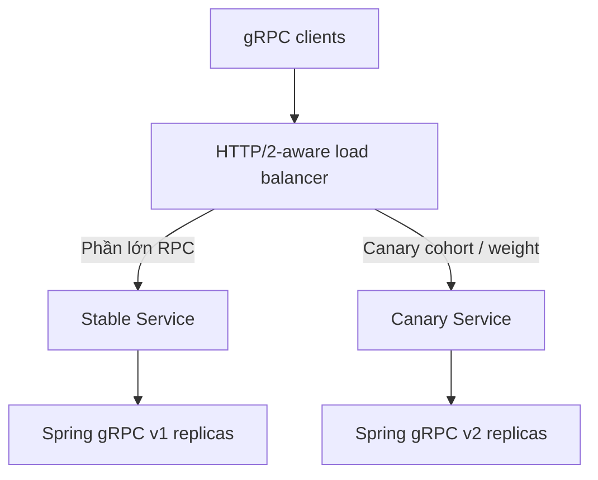

# Canary server và client

## 1. Mục tiêu

Canary deployment đưa một phiên bản mới tới một phần nhỏ traffic hoặc một nhóm client trước khi mở rộng ra toàn hệ thống. Với Spring gRPC, cần kiểm soát cả server version lẫn client version vì hai phía trao đổi Protobuf message qua RPC và thường giữ HTTP/2 connection lâu dài.

**Canary server và client** là chiến lược phát hành có kiểm soát: triển khai một nhóm server mới, định tuyến một phần RPC tới nhóm đó, quan sát chất lượng rồi tăng dần traffic; đồng thời có thể phát hành client mới cho một cohort nhỏ để kiểm tra tương thích và hành vi đầu-cuối.

Canary không thay thế kiểm thử tương thích. Trong thời gian rollout, client cũ có thể gọi server mới và client mới có thể gọi server cũ. Contract phải hỗ trợ các tổ hợp đó hoặc traffic phải được cô lập theo version một cách rõ ràng.

Sau bài học, bạn có thể:

- Phân biệt server canary và client canary.
- Chọn routing theo RPC, theo connection hoặc theo client cohort.
- Hiểu ảnh hưởng của HTTP/2 multiplexing và long-lived stream tới tỷ lệ canary.
- Thiết kế stable/canary deployment cho Spring gRPC.
- Giữ Protobuf contract tương thích trong giai đoạn mixed version.
- Đo SLO, error rate, latency và phân tích canary.
- Dừng, rollback hoặc mở rộng canary dựa trên tiêu chí định lượng.

## 2. Server canary và client canary

**Server canary** thay một phần backend bằng phiên bản mới trong khi server stable vẫn phục vụ phần còn lại. Load balancer, service mesh hoặc client-side resolver quyết định RPC nào tới stable và RPC nào tới canary.

**Client canary** phát hành phiên bản ứng dụng/client mới cho một nhóm nhỏ người dùng, pod hoặc tenant. Client mới có thể dùng generated stub mới, gửi field mới hoặc gọi method mới. Vì client có thể kết nối tới nhiều server version, server fleet phải hỗ trợ hành vi của client mới trước khi client phụ thuộc vào feature mới.

| Khía cạnh | Server canary | Client canary |
|---|---|---|
| Thành phần thay đổi | Spring gRPC server | Ứng dụng dùng gRPC stub |
| Đơn vị phân nhóm | RPC, connection, endpoint hoặc cohort | Người dùng, tenant, pod, region hoặc client instance |
| Tín hiệu chính | Server version, backend load, RPC status/latency | Client version, crash/error, RPC outcome và user impact |
| Rủi ro nổi bật | Mixed server fleet, routing lệch, schema mismatch | Client mới gọi method/field server cũ chưa hỗ trợ |
| Rollback | Rút canary backend khỏi pool | Dừng rollout hoặc quay client về version trước |

Hai chiều có thể triển khai riêng hoặc phối hợp. Ví dụ, trước tiên đưa server mới tương thích ngược vào 5% traffic; sau khi ổn định, phát hành client mới cho 1% cohort. Không nhất thiết tăng cả hai tỷ lệ cùng lúc vì như vậy khó xác định thay đổi nào gây lỗi.

## 3. Vì sao canary gRPC khác HTTP request ngắn?

gRPC thường tái sử dụng ManagedChannel và HTTP/2 connection. Một connection có thể mang nhiều RPC đồng thời. Cần phân biệt:

- **Connection-level routing:** load balancer chọn backend khi TCP connection được thiết lập.
- **RPC-level routing:** HTTP/2-aware proxy chọn backend cho từng RPC stream.
- **Client-side routing:** resolver/load balancing policy trong gRPC client chọn backend.
- **Cohort routing:** một client hoặc nhóm người dùng được gắn vào một release track.

Nếu L4 load balancer chia 5% TCP connection sang canary, một connection có thể mang hàng nghìn RPC trong khi connection khác gần như không có traffic. Vì vậy 5% connection không đảm bảo 5% RPC.

HTTP/2 connection và streaming RPC có thể sống lâu. Một stream đã bắt đầu trên stable thường tiếp tục ở stable; nó không tự chuyển sang canary giữa chừng. Khi đo canary, cần quan sát số RPC, active streams, thời lượng stream và traffic bytes theo backend.

Nếu mục tiêu là canary theo tỷ lệ request, cần L7 proxy hiểu HTTP/2/gRPC và có weighted routing ở cấp stream/RPC, hoặc một thiết kế client-side routing phù hợp. L4 vẫn hữu ích cho TCP/TLS passthrough, nhưng chỉ nên dùng connection distribution khi đã chấp nhận độ lệch do connection affinity.

## 4. Kiến trúc stable và canary server

Một triển khai có thể tách stable và canary thành hai Deployment/Service:



Stable và canary nên có label, metric và log version riêng. Cả hai cần cùng contract tương thích trong thời gian mixed fleet. Readiness probe chỉ đưa instance vào pool sau khi server đã đăng ký service và sẵn sàng xử lý RPC.

Có thể triển khai canary bằng:

- Hai Kubernetes Deployment và hai Service riêng.
- Service mesh hoặc ingress hỗ trợ weighted gRPC route.
- L7 load balancer có khả năng route HTTP/2 stream theo metadata hoặc weight.
- Client-side resolver trả về các endpoint stable/canary theo policy.

Tên cấu hình cụ thể phụ thuộc hạ tầng. Không giả định mọi ingress HTTP đều hỗ trợ gRPC weighted routing; xác minh upstream protocol, HTTP/2 và cách sản phẩm áp dụng weight.

## 5. Chọn cách định tuyến canary

| Cách định tuyến | Đơn vị chọn | Ưu điểm | Hạn chế |
|---|---|---|---|
| Weighted L7 gRPC routing | RPC/stream | Có thể đạt tỷ lệ request gần mục tiêu | Proxy phải hiểu gRPC/HTTP2 |
| L4 TCP balancing | TCP connection | Đơn giản, giữ nguyên TLS passthrough | Tỷ lệ RPC có thể lệch vì multiplexing |
| Metadata/header routing | RPC dựa trên metadata | Nhắm cohort cụ thể, dễ kiểm thử | Cần bảo vệ metadata và proxy phải hỗ trợ |
| Client-side resolver | Subchannel/backend address | Client kiểm soát endpoint selection | Cần discovery và policy ở client |
| Endpoint riêng | Client/channel hoặc cohort | Cô lập rõ ràng | Cần quản lý target và channel lifecycle |

Weighted routing thích hợp cho thử nghiệm tỷ lệ traffic. Header/metadata routing thích hợp cho cohort cố định hoặc nội bộ, ví dụ nhân viên kiểm thử. Endpoint riêng phù hợp khi cần cô lập client canary khỏi server stable, hoặc khi load balancer không hỗ trợ gRPC L7 routing.

Không trộn nhiều cơ chế mà không biết cơ chế nào quyết định backend cuối cùng. Nếu client-side round_robin chọn pod trước rồi proxy tiếp tục weighted route, tỷ lệ thực tế có thể khác dự kiến.

## 6. Routing theo gRPC metadata

gRPC metadata có thể được proxy dùng để định tuyến theo release track. Ví dụ client gửi custom metadata:

```java
Metadata metadata = new Metadata();
Metadata.Key<String> releaseTrack =
        Metadata.Key.of(
                "x-release-track",
                Metadata.ASCII_STRING_MARSHALLER);
metadata.put(releaseTrack, "canary");

CatalogServiceGrpc.CatalogServiceBlockingStub canaryStub =
        MetadataUtils.attachHeaders(baseStub, metadata);
```

Đây là ví dụ gRPC Java minh họa custom metadata. Chỉ dùng khi proxy/LB được cấu hình đọc metadata key đó và route tới đúng backend pool. Metadata key phải là lowercase ASCII; không dùng pseudo-header HTTP/2 hoặc metadata dành riêng cho gRPC transport.

Metadata do client gửi không phải bằng chứng tin cậy về danh tính hoặc quyền. Client có thể tự đặt release track hoặc giả mạo cohort khác. Nếu routing ảnh hưởng quyền truy cập hoặc dữ liệu nhạy cảm:

1. Xác thực client trước tại gateway/proxy.
2. Xóa metadata cohort do client tự gửi nếu không được phép tự chọn.
3. Proxy tạo metadata nội bộ sau khi xác định cohort từ identity/configuration đáng tin.
4. Chỉ tin metadata nội bộ trên upstream được bảo vệ.

Không dùng metadata canary để thay thế authorization. Canary route chỉ chọn phiên bản backend; mọi backend vẫn phải thực thi authentication, authorization và validation.

## 7. Canary ở phía client

Client canary có thể được phát hành theo cohort:

- Một tỷ lệ nhỏ user mobile/desktop.
- Một nhóm tenant nội bộ.
- Một số pod của service gọi downstream gRPC.
- Một region hoặc environment staging.
- Nhóm nhân viên hoặc tester được xác thực.

Client mới nên được build từ generated stub tương ứng với proto version đã kiểm soát. Trước khi bật feature mới, xác minh server stable vẫn xử lý được request mới hoặc client có fallback.

Với backend service-to-service, có thể chạy hai client Deployment hoặc hai release track. Nếu dùng endpoint riêng:

```java
ManagedChannel stableChannel = ManagedChannelBuilder
        .forTarget("dns:///catalog-stable.internal:9090")
        .usePlaintext()
        .build();

ManagedChannel canaryChannel = ManagedChannelBuilder
        .forTarget("dns:///catalog-canary.internal:9090")
        .usePlaintext()
        .build();
```

Đây là ví dụ minh họa target riêng trong mạng tin cậy; production phải cấu hình TLS/mTLS theo trust boundary. Channel là tài nguyên dài hạn, nên tái sử dụng và đóng theo lifecycle. Không tạo channel mới cho mỗi RPC hoặc quên shutdown channel không còn dùng.

Không để một client canary vô tình gửi toàn bộ traffic production tới canary server chỉ vì target config dùng chung bị đổi. Giữ cohort selection rõ ràng, có thể quan sát và rollback độc lập.

## 8. Protobuf compatibility trong canary

Trong canary, client và server versions có thể khác nhau. Mọi thay đổi cần đánh giá bốn tổ hợp:

| Client | Server | Điều cần xác minh |
|---|---|---|
| v1 | stable v1 | Baseline |
| v1 | canary v2 | Server mới nhận request cũ và trả response tương thích |
| v2 | stable v1 | Client mới fallback khi server cũ chưa hỗ trợ feature |
| v2 | canary v2 | Feature mới hoạt động đầy đủ |

Các nguyên tắc:

- Thêm field bằng tag mới; không đổi hoặc tái sử dụng field number.
- Field mới phải có semantics an toàn khi absent.
- Client xử lý enum unknown/UNRECOGNIZED.
- Method mới chỉ được client gọi khi mọi backend có thể nhận request đều hỗ trợ, hoặc client có fallback/route cô lập.
- Không xóa field/method cũ trong cùng release đang migrate client.
- Giữ semantics cũ cho client cũ trong giai đoạn chuyển tiếp.

Nếu client v2 bắt buộc gọi method mới, không route request đó tới stable v1. Có thể dùng endpoint canary riêng hoặc capability-aware routing. Không dựa vào tỷ lệ canary ngẫu nhiên để che một incompatibility chắc chắn.

## 9. Quy trình canary server theo từng bước

Một rollout server có thể chia thành các giai đoạn:

1. **Preflight:** schema compatibility check, unit/integration test, security scan và load test.
2. **Deploy canary:** chạy một hoặc vài replica mới, chưa nhận traffic production.
3. **Smoke test:** gọi health RPC và một tập RPC nghiệp vụ đại diện.
4. **1% traffic:** route một phần RPC tới canary nếu L7 hỗ trợ request-level weighting.
5. **Ramp-up:** tăng dần 5%, 10%, 25%, 50% theo cửa sổ quan sát.
6. **Full rollout:** chuyển toàn bộ traffic khi các gate đạt.
7. **Cleanup:** giữ rollback window rồi mới xóa stable version cũ.

Mỗi bước cần có thời gian quan sát đủ để bao phủ workload thực tế. Với stream dài, cửa sổ quan sát phải xét stream lifetime; một canary chạy vài phút có thể chưa nhận được các loại stream hiếm.

Tỷ lệ phần trăm là ví dụ, không phải giá trị bắt buộc. Nếu traffic thấp, 1% có thể quá ít để đánh giá; dùng số lượng request tối thiểu và volume threshold trước khi quyết định.

## 10. Quy trình canary client

Client rollout thường cần gate riêng:

1. Xác nhận server stable đã hỗ trợ các request/response mà client mới dùng.
2. Phát hành client mới cho internal cohort hoặc 1% user/pod.
3. Gắn client version và release cohort vào telemetry theo policy bảo mật.
4. Theo dõi crash, RPC status, deadline, latency và fallback.
5. Mở rộng cohort theo từng bước khi đạt gate.
6. Dừng rollout nếu client mới gây lỗi hoặc tăng tải bất thường.
7. Chỉ bật feature mới sau khi backend compatibility được xác minh.

Đối với mobile/desktop, rollback có thể không tức thời vì người dùng không cập nhật ngay. Server phải tiếp tục hỗ trợ client cũ trong khoảng thời gian đã cam kết. Với service-to-service client, rollout có thể nhanh hơn nhưng vẫn cần giữ compatibility trong lúc pod cũ và mới cùng chạy.

## 11. Đo SLO và so sánh canary với stable

Không quyết định chỉ dựa trên một metric tổng hợp toàn fleet. Tách telemetry theo release track và server version:

- Request/RPC rate theo service và method.
- Error rate theo gRPC status code.
- p50, p95, p99 latency.
- Deadline exceeded và client cancellation.
- Retry, fallback và reconnect rate.
- CPU, memory, thread/worker saturation.
- Active streams và stream duration.
- Dependency error/latency từ canary.
- Health/readiness transition và restart count.

So sánh canary với stable trong cùng khoảng thời gian và cùng loại workload. Nếu canary chỉ nhận read traffic còn stable nhận write traffic, so sánh raw error rate có thể gây kết luận sai. Phân nhóm theo method, tenant/region và request class khi cần.

Một bảng gate ví dụ:

| Chỉ số | Điều kiện mở rộng minh họa |
|---|---|
| gRPC error rate | Không tăng quá ngưỡng so với stable |
| p99 latency | Không vượt SLO và không lệch đáng kể |
| Deadline exceeded | Không tăng bất thường |
| CPU/memory | Còn headroom cho ramp-up |
| Dependency failures | Không có regression mới |
| Streaming | Không tăng unexpected cancellation |
| Health/readiness | Canary ổn định, không restart loop |

Đặt threshold cụ thể theo SLO và baseline của hệ thống. Không dùng một ngưỡng chung cho mọi method hoặc workload.

## 12. Canary analysis và quyết định

Canary có ba kết quả chính:

- **Promote:** mở rộng traffic/cohort khi mọi gate đạt và volume đủ.
- **Hold:** giữ tỷ lệ hiện tại khi dữ liệu chưa đủ hoặc có metric chưa rõ.
- **Rollback:** ngừng canary và chuyển traffic về stable khi có regression vượt ngưỡng.

Một số nguyên tắc:

- Định nghĩa stop condition trước khi bắt đầu.
- Dùng cùng cửa sổ thời gian cho canary và control group.
- Loại trừ lỗi môi trường chung ảnh hưởng cả hai nhóm.
- Đảm bảo sample size đủ; traffic thấp cần cửa sổ dài hơn.
- Theo dõi leading indicator như latency/dependency saturation và outcome như error rate.
- Ghi lại version, config và thời điểm thay đổi weight để liên hệ metric với rollout.

Không tiếp tục ramp chỉ vì tổng fleet vẫn khỏe nếu canary riêng đang có lỗi. Ngược lại, không rollback chỉ vì một spike ngắn không liên quan; kiểm tra volume, trace và dependency trước khi quyết định nếu chưa vi phạm stop condition.

## 13. Rollback server và client

Rollback server:

1. Đặt canary weight về zero hoặc rút canary endpoint khỏi pool.
2. Ngừng nhận RPC mới trên canary.
3. Drain stream đang chạy theo grace period.
4. Giữ stable server phục vụ traffic.
5. Điều tra log/trace và giữ artifact/config để tái hiện.

Rollback client:

1. Dừng phát hành cho cohort mới.
2. Nếu có thể, chuyển cohort về client version trước.
3. Tắt feature flag hoặc fallback sang method/semantics cũ.
4. Giữ server tương thích với cả client version cũ và client đã phát hành.
5. Theo dõi client cũ còn hoạt động trước khi contract API.

Rollback image không đảo ngược side effect hoặc dữ liệu mà canary đã ghi. Nếu server mới ghi field/status mới vào database hoặc event stream, stable server cũ phải đọc được dữ liệu đó, hoặc rollout phải có migration/compensation plan.

## 14. Bảo mật và tính toàn vẹn của cohort

Canary routing có thể dùng tenant, user cohort hoặc metadata. Không đưa thông tin định danh nhạy cảm trực tiếp vào label/metric cardinality cao.

- Cohort assignment phải ổn định trong thời gian thử nghiệm nếu cần so sánh cùng nhóm.
- Chỉ trusted gateway được phép gán metadata routing nội bộ.
- Không tin release header do client tùy ý gửi.
- Không dùng canary route để bỏ qua authorization hoặc audit.
- Bảo vệ endpoint canary; không để public client truy cập trực tiếp nếu chưa được phép.
- Giữ TLS/mTLS và network policy như stable environment.
- Tách metric labels có giới hạn cardinality, ví dụ release_track và server_version.

Canary không nên chứa dữ liệu production nhạy cảm ngoài phạm vi cần thiết. Nếu cần traffic thật, áp dụng cùng data access policy, audit và retention như stable.

## 15. Kiểm thử canary

### Compatibility test

Kiểm tra client v1/server v2, client v2/server v1 và client v2/server v2. Bao gồm unknown enum, field absent, method mới và fallback.

### Routing test

Gửi RPC với từng cohort và xác minh server version nhận request. Kiểm tra metadata bị strip/overwrite đúng cách và không thể giả mạo cohort.

### HTTP/2 connection test

Giữ một ManagedChannel lâu dài, gửi nhiều RPC rồi thay đổi canary weight. Xác minh weight áp dụng ở cấp connection hay RPC theo đúng khả năng load balancer. Mở nhiều channel và stream để đo độ lệch thực tế.

### Load/streaming test

Gửi unary và streaming traffic đại diện. Theo dõi active stream, stream age, cancellation, latency và resource usage. Kiểm tra long-lived stream không bị giả định chuyển backend giữa chừng.

### Rollback test

Đặt canary weight về zero, drain canary, xác minh stable nhận traffic mới và client fallback hoạt động. Kiểm tra dữ liệu do canary ghi vẫn đọc được sau rollback.

## 16. Lỗi thường gặp

| Hiện tượng | Nguyên nhân | Cách xử lý |
|---|---|---|
| Canary 5% nhưng nhận gần 40% RPC | L4 chia connection, không chia từng RPC | Dùng L7 per-RPC routing hoặc đo theo request |
| Canary không nhận traffic mới sau khi tăng weight | Client giữ HTTP/2 connection cũ hoặc proxy không reload route | Xác minh connection reuse, route propagation và mở connection mới khi cần |
| Client mới nhận UNIMPLEMENTED | Request tới stable server chưa có method mới | Rollout server trước hoặc cô lập route |
| Client cũ lỗi với enum mới | Không xử lý unknown enum | Thêm unknown-value handling trước khi phát giá trị mới |
| Canary metrics tốt nhưng user lỗi | Cohort hoặc workload không đại diện | Phân tầng theo method/tenant/region và mở rộng sample |
| Rollback server nhưng dữ liệu không đọc được | Canary đã ghi schema/enum mới | Backward-readable migration hoặc compensation |
| Metadata route bị giả mạo | Tin header do client tự gửi | Strip inbound value và gán từ trusted gateway |
| Stream canary kéo dài sau rollback | Stream đã gắn backend canary | Drain, giới hạn lifetime hoặc resume |
| Tỷ lệ canary thay đổi khó giải thích | Nhiều lớp LB/client-side policy cùng chọn backend | Xác định một routing authority và quan sát từng hop |

## 17. Bài tập thực hành

**Tình huống:** Catalog có ba stable Spring gRPC replica và một canary replica v2. Client v1 đang hoạt động; client v2 bổ sung field display_label và muốn gọi RPC mới GetDisplayLabel. Hạ tầng có HTTP/2-aware load balancer và một số client giữ channel lâu dài.

Hãy thực hiện:

1. Xác minh schema v2 tương thích với client/server v1 ở các tổ hợp cần hỗ trợ.
2. Triển khai canary server v2 nhưng chưa route traffic production.
3. Chạy smoke test qua grpcurl và generated client.
4. Cấu hình weighted gRPC route ở cấp RPC, bắt đầu bằng tỷ lệ nhỏ.
5. Theo dõi RPC count theo backend/version để xác minh weight thực tế.
6. Chỉ phát hành client v2 sau khi mọi backend có thể nhận GetDisplayLabel đã hỗ trợ method hoặc client có route/fallback an toàn.
7. Phát hành client v2 cho một cohort nhỏ và theo dõi version, status, latency, deadline và fallback.
8. Kiểm thử long-lived stream trong lúc thay weight và rollout.
9. Đặt stop condition và thực hiện rollback canary server/client.
10. Xác minh stable vẫn đọc được dữ liệu mà canary đã ghi.

**Tiêu chí hoàn thành:** canary cohort được xác định đáng tin cậy; tỷ lệ RPC thực tế được đo thay vì suy ra từ connection count; client/server version chéo tương thích; feature mới chỉ được gọi khi backend hỗ trợ; SLO gate có ngưỡng rõ; rollback không làm mất dữ liệu hoặc làm rơi stream ngoài policy.

## 18. Ghi nhớ

Canary server đưa một phần RPC tới backend mới; canary client phát hành phiên bản client mới cho một cohort. gRPC cần chú ý HTTP/2 connection có thể mang nhiều RPC và stream dài, nên L4 connection weight không tương đương request weight. Nếu cần tỷ lệ RPC, dùng L7 gRPC-aware routing hoặc client-side routing có thể quan sát. Giữ Protobuf wire và semantic compatibility trong mixed fleet; triển khai server hỗ trợ trước khi client phụ thuộc vào field/method mới. Đo error rate, latency, deadline, active stream, dependency và resource theo release track; đặt promote/hold/rollback gate trước rollout. Metadata cohort phải đến từ nguồn tin cậy, không được dùng thay authorization. Rollback phải rút canary, drain stream và bảo đảm dữ liệu canary vẫn đọc được bởi version stable. Kiểm thử client/server chéo, routing, HTTP/2 connection reuse và rollback trước khi mở rộng.
