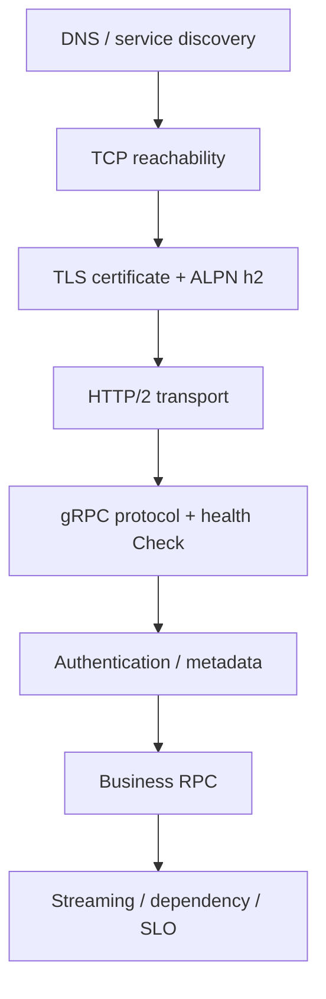

# Kiểm tra endpoint sau deploy

## 1. Mục tiêu

Sau khi triển khai Spring gRPC, trạng thái Deployment thành công hoặc TCP port mở chưa chứng minh client có thể gọi RPC đúng cách. Endpoint có thể phân giải DNS nhưng route sai; TCP connect có thể thành công nhưng TLS/ALPN không thương lượng được HTTP/2; HTTP/2 có thể hoạt động nhưng gRPC health chưa sẵn sàng; health có thể xanh nhưng method nghiệp vụ vẫn lỗi do schema, metadata, authentication hoặc dependency.

**Kiểm tra endpoint sau deploy** là quy trình xác minh endpoint gRPC từ network path mà client thật sẽ sử dụng, đi qua các lớp DNS, TCP, TLS, HTTP/2, gRPC protocol và application behavior. Mục tiêu là phát hiện lỗi sớm sau rollout, xác nhận đúng phiên bản/backend đang nhận traffic và cung cấp bằng chứng đủ rõ để promote hoặc rollback release.

Trong hệ sinh thái Spring gRPC, cần kiểm tra server listener, generated service registration, Protobuf contract, health status, interceptor/security policy, dependency và streaming behavior. Kiểm tra phải dùng đúng hostname, port, TLS trust, metadata và RPC method mà workload production sử dụng.

Sau bài học, bạn có thể:

- Phân biệt kiểm tra deployment, TCP port, gRPC health và RPC nghiệp vụ.
- Xác minh DNS, routing, TLS certificate và ALPN h2.
- Gọi gRPC health Check và method thật bằng grpcurl.
- Kiểm tra authentication, metadata, deadline và status code.
- Xác minh endpoint qua load balancer và từng backend replica.
- Kiểm thử streaming, readiness và behavior trong rollout.
- Thiết kế smoke test, acceptance gate và quy trình rollback.

## 2. Kiểm tra theo từng lớp

Một endpoint gRPC nên được xác minh theo thứ tự từ lớp ngoài vào lớp trong:



Mỗi bước trả lời một câu hỏi khác nhau:

| Lớp | Câu hỏi cần xác minh | Công cụ/tín hiệu |
|---|---|---|
| DNS | Hostname phân giải tới địa chỉ dự kiến? | nslookup, dig, resolver logs |
| TCP | Có kết nối tới đúng port? | nc, Test-NetConnection |
| TLS | Certificate, hostname và trust chain hợp lệ? | openssl s_client |
| ALPN | TLS connection thương lượng HTTP/2 h2? | openssl s_client -alpn h2 |
| HTTP/2/gRPC | Server hiểu gRPC framing và trailers? | grpcurl |
| Health | Service công bố SERVING? | grpc.health.v1.Health/Check |
| Security | Token/client identity và authorization đúng? | grpcurl metadata, test identity |
| Business | Method trả response đúng contract? | grpcurl hoặc generated client |
| Streaming | Stream tồn tại và kết thúc đúng policy? | integration/load test |

Không bỏ qua lớp trước khi điều tra lớp sau. Ví dụ, UNIMPLEMENTED thường cho thấy request đã tới một gRPC server nhưng service/method không được đăng ký hoặc route sai; connection refused thường xảy ra trước gRPC layer.

## 3. Chuẩn bị thông tin endpoint

Trước khi chạy smoke test, ghi lại các giá trị của release:

- Hostname và port public/service.
- Protocol ở từng hop: TLS+h2, h2c hoặc TLS upstream.
- CA bundle và client certificate nếu dùng mTLS.
- Protobuf package, service và method cần gọi.
- Request mẫu không chứa dữ liệu nhạy cảm.
- Metadata bắt buộc như authorization, tenant hoặc correlation ID.
- Deadline dự kiến cho unary và streaming.
- Expected gRPC status và response assertions.
- Server version/revision cần được quan sát.
- Endpoint nội bộ và endpoint qua load balancer.

Ví dụ endpoint:

```text
Public:  catalog.example.internal:443
In-cluster: catalog-grpc.default.svc.cluster.local:9090
Service: catalog.v1.CatalogService
Method:  GetProduct
Health:  grpc.health.v1.Health/Check
```

Các hostname và method trên chỉ là ví dụ. Trong smoke test thực tế, dùng đúng tên được công bố trong contract và cấu hình môi trường. Không đoán method name từ tên Java class.

Nên lưu request mẫu và expected response trong bộ kiểm thử release, nhưng không ghi access token, private key hoặc payload production nhạy cảm vào repository/log.

## 4. Xác minh DNS và service discovery

Kiểm tra hostname phân giải được trong đúng network environment:

```bash
nslookup catalog.example.internal
```

Trên Linux có thể dùng:

```bash
dig +short catalog.example.internal
```

DNS thành công chỉ xác nhận resolver trả địa chỉ. Nó không chứng minh địa chỉ đó trỏ tới load balancer mới, đúng cluster hoặc đúng backend pool.

Với Kubernetes, kiểm tra service DNS từ pod có cùng namespace/network policy với client:

```bash
kubectl get svc catalog-grpc -n default
kubectl get endpointslice -n default -l kubernetes.io/service-name=catalog-grpc
```

EndpointSlice cần có backend ready theo selector. Nếu Service không có endpoint, kiểm tra label selector, readiness probe và pod status. Nếu endpoint vẫn chứa pod đang terminate, kiểm tra readiness propagation và termination lifecycle.

Với client-side load balancing, kiểm tra resolver thực sự nhìn thấy các backend address cần thiết. ClusterIP thường chỉ cho client một virtual IP; headless Service hoặc xDS có thể cung cấp danh sách endpoint. Đừng suy luận client-side balancing hoạt động chỉ từ số replica trong Deployment.

## 5. Xác minh TCP port

Kiểm tra TCP reachability từ vị trí mà client thật chạy:

```bash
nc -vz catalog.example.internal 443
```

Trên Windows PowerShell:

```powershell
Test-NetConnection catalog.example.internal -Port 443
```

TCP connect thành công chứng minh có listener hoặc thiết bị mạng chấp nhận kết nối tại địa chỉ/port. Nó không chứng minh listener hỗ trợ TLS, HTTP/2 hay gRPC.

Nếu TCP thất bại, kiểm tra theo thứ tự:

- Hostname resolve tới IP nào.
- Port public và backend port có khớp mapping không.
- Firewall, security group và Kubernetes NetworkPolicy.
- Load balancer listener/target group có healthy không.
- Container listener bind đúng interface và port không.
- Pod có ready và service selector có chọn đúng pod không.

Không dùng kiểm tra TCP từ laptop để kết luận pod-to-pod network hoạt động. Thực hiện probe từ đúng network vantage point: ngoài cluster, trong namespace client, và từ proxy tới backend nếu cần.

## 6. Xác minh TLS certificate và ALPN h2

Với endpoint TLS, kiểm tra certificate chain, hostname và negotiated ALPN:

```bash
openssl s_client -connect catalog.example.internal:443 -servername catalog.example.internal -alpn h2
```

Xác minh:

- Certificate còn hạn.
- SAN khớp hostname client sử dụng.
- Certificate chain dẫn tới CA được trust.
- SNI được gửi đúng để server/proxy chọn certificate.
- ALPN negotiated protocol là h2.

Nếu ALPN không chọn h2, listener có thể chỉ phục vụ HTTP/1.1 hoặc TLS/proxy configuration chưa bật HTTP/2. gRPC client có thể thất bại ngay cả khi TLS handshake hoàn tất.

Nếu proxy terminate TLS rồi mở upstream mới, kiểm tra riêng cả hai chặng. TLS thành công ở client-to-ingress không chứng minh proxy-to-Spring backend dùng đúng h2c hoặc TLS+HTTP/2.

Với mTLS, xác minh server yêu cầu client certificate đúng như policy và client certificate chain được trust. Không dùng tùy chọn bỏ qua certificate verification để làm smoke test pass; điều đó che lỗi identity và hostname.

## 7. Kiểm tra gRPC bằng grpcurl

grpcurl gửi request gRPC thực qua HTTP/2 và phù hợp cho smoke test endpoint. Nếu server bật reflection, có thể liệt kê service:

```bash
grpcurl catalog.example.internal:443 list
```

Nếu reflection tắt, điều đó không có nghĩa server lỗi. Reflection là service tùy chọn. Cung cấp proto source hoặc descriptor set:

```bash
grpcurl -proto catalog.proto catalog.example.internal:443 catalog.v1.CatalogService
```

Gọi unary method với CA riêng:

```bash
grpcurl -cacert ca.pem -proto catalog.proto -d '{"productId":"p-42"}' catalog.example.internal:443 catalog.v1.CatalogService/GetProduct
```

Với endpoint plaintext nội bộ:

```bash
grpcurl -plaintext -proto catalog.proto -d '{"productId":"p-42"}' catalog-grpc.default.svc.cluster.local:9090 catalog.v1.CatalogService/GetProduct
```

`-plaintext` chỉ phù hợp với endpoint h2c trong network boundary được tin cậy. Không dùng nó để né TLS error ở public endpoint.

Khi reflection bị tắt, dùng `-proto` hoặc `-protoset` để mô tả service. Nếu cần import proto dependencies, truyền thêm đường dẫn import phù hợp. Smoke test không nên phụ thuộc reflection trừ khi reflection là một phần contract vận hành đã chủ động bật.

## 8. Kiểm tra authentication và metadata

Một endpoint có thể trả lời health Check nhưng business method vẫn yêu cầu authentication hoặc authorization. Smoke test cần dùng identity tương đương workload thật.

Ví dụ truyền bearer token:

```bash
grpcurl -cacert ca.pem -H "authorization: Bearer $ACCESS_TOKEN" -proto catalog.proto -d '{"productId":"p-42"}' catalog.example.internal:443 catalog.v1.CatalogService/GetProduct
```

Đây là ví dụ shell; cách lưu và truyền token phụ thuộc CI secret store. Tránh in token ra console, bật shell tracing hoặc lưu trong command history. Trong pipeline, inject secret ở runtime và mask output.

Kiểm tra các trường hợp:

- Identity hợp lệ và có quyền: nhận response mong đợi.
- Token thiếu/hết hạn: nhận UNAUTHENTICATED.
- Identity hợp lệ nhưng thiếu quyền: nhận PERMISSION_DENIED.
- Tenant metadata hợp lệ: chỉ truy cập đúng tenant.
- Metadata thiếu/sai format: nhận lỗi validation/status đã định nghĩa.

Health probe có thể không yêu cầu auth giống business RPC. Đừng dùng health success làm bằng chứng authorization hoạt động. Đồng thời, không mở toàn bộ listener bỏ authentication chỉ để orchestrator probe được; chọn health access policy riêng hoặc probe mechanism phù hợp.

## 9. Kiểm tra deadline và status code

Smoke test cần deadline hữu hạn để không treo pipeline:

```bash
grpcurl -max-time 5 -cacert ca.pem -proto catalog.proto -d '{"productId":"p-42"}' catalog.example.internal:443 catalog.v1.CatalogService/GetProduct
```

Thời gian phù hợp phụ thuộc method. Không dùng một timeout ngắn cho mọi streaming workload.

Một số status thường gặp:

| Status | Ý nghĩa khi kiểm tra endpoint |
|---|---|
| OK | RPC hoàn tất thành công |
| UNAVAILABLE | Server/transport/backend tạm thời không khả dụng |
| DEADLINE_EXCEEDED | RPC vượt deadline; kiểm tra latency và timeout từng hop |
| UNAUTHENTICATED | Thiếu hoặc sai credential |
| PERMISSION_DENIED | Identity không có quyền |
| INVALID_ARGUMENT | Request không đáp ứng validation |
| NOT_FOUND | Resource không tồn tại hoặc service name trong health request không được quản lý |
| UNIMPLEMENTED | Service/method chưa đăng ký hoặc proxy route sai |
| INTERNAL | Lỗi xử lý nội bộ; cần correlation ID và server logs |

Một smoke test không nên chỉ kiểm tra exit code. Cần xác minh status code và response fields quan trọng để tránh endpoint trả lời nhưng nghiệp vụ sai.

## 10. Kiểm tra gRPC Health

gRPC định nghĩa `grpc.health.v1.Health/Check`. Request có trường service name; chuỗi rỗng thường đại diện trạng thái tổng thể, còn tên cụ thể đại diện service cần kiểm tra.

Ví dụ:

```bash
grpcurl -plaintext -d '{"service":"catalog.v1.CatalogService"}' localhost:9090 grpc.health.v1.Health/Check
```

Response cần có status SERVING khi service sẵn sàng. Các trạng thái khác như NOT_SERVING cho biết server chưa nhận traffic nghiệp vụ; UNKNOWN không nên được hiểu là healthy.

Nếu health call trả UNIMPLEMENTED, health service có thể chưa được đăng ký. Nếu service name không được quản lý, server có thể trả NOT_FOUND. Đối chiếu đúng Protobuf package và service name, không dùng Java package name thay thế.

Với Spring gRPC, `HealthStatusManager` từ `grpc-services` có thể quản lý status, nhưng phải đăng ký `getHealthService()` vào server và cập nhật trạng thái theo lifecycle. Chỉ tạo bean không đảm bảo health RPC đã được bind.

Health Check chỉ là một tín hiệu. Sau khi health thành công, vẫn phải gọi ít nhất một RPC nghiệp vụ đại diện để xác minh generated service, interceptor, dependency và response mapping.

## 11. Kiểm tra qua load balancer và từng replica

Smoke test public endpoint xác minh đường đi của client, nhưng có thể chỉ chạm một backend. Trong rolling deployment, một số replica có thể chạy version mới và số khác còn version cũ.

Nên có hai lớp kiểm tra:

1. **Service-level test:** gọi hostname/service VIP mà client production dùng; xác minh routing và user-visible behavior.
2. **Backend-level test:** kiểm tra từng replica hoặc từng endpoint bằng cơ chế nội bộ an toàn; xác minh tất cả backend ready và đúng version.

Trong Kubernetes, có thể dùng port-forward để kiểm tra một pod cụ thể trong môi trường kiểm soát:

```bash
kubectl port-forward pod/catalog-grpc-7d9f8c 19090:9090 -n default
```

Sau đó gọi localhost:19090 bằng grpcurl với đúng TLS/plaintext mode của listener. Nếu port-forward đi vào listener TLS, vẫn cần CA/hostname strategy phù hợp; không tự động chuyển thành h2c.

Không expose pod port công khai chỉ để test. Dùng network path quản trị được bảo vệ và giới hạn quyền truy cập. Nếu có nhiều replica, lặp lại test theo pod/endpoint hoặc dùng telemetry có server version/instance ID để chứng minh phân phối.

Nếu load balancer có sticky routing, gửi nhiều RPC từ cùng ManagedChannel có thể liên tục chạm một backend. Mở nhiều channel hoặc dùng L7 request-level routing test để xác minh pool. Không suy ra mọi replica healthy từ một lần gọi VIP thành công.

## 12. Xác minh đúng version và release

Endpoint có thể healthy nhưng vẫn đang trỏ tới image cũ hoặc một backend ngoài rollout dự kiến. Cần xác minh release identity qua một trong các cách:

- Response field/version RPC dành cho diagnostics.
- Metadata/trailer nội bộ được proxy/server gắn đáng tin cậy.
- Metric label server_version và instance_id.
- Deployment image digest và pod template revision.
- Trace/log có release ID.

Không tin version metadata do client tự gửi để xác định server version. Giá trị phải được tạo từ server hoặc hạ tầng đáng tin cậy.

Nếu canary, kiểm tra tỷ lệ RPC theo server version chứ không chỉ tỷ lệ TCP connection. HTTP/2 multiplexing có thể khiến một connection gửi nhiều RPC tới cùng backend. Với L4 load balancer, connection weight không tương đương request weight.

## 13. Kiểm tra streaming và connection reuse

Một unary smoke test không xác minh streaming. Với server-streaming, client-streaming hoặc bidirectional streaming, cần test riêng:

- Stream mở và gửi/nhận message đầu tiên.
- Message order và sequence/cursor đúng.
- Backpressure/flow control không làm bộ nhớ tăng vô hạn.
- Deadline và idle timeout phù hợp.
- Cancellation giải phóng subscription/resource.
- Stream kết thúc bằng status đúng.
- Reconnect/resume hoạt động nếu contract hỗ trợ.

Một test server-streaming có thể kiểm tra một số message rồi cancel có kiểm soát. Không giữ stream vô hạn trong smoke test ngắn; dùng integration test có duration và stop condition rõ ràng.

Kiểm tra connection reuse bằng một ManagedChannel dài hạn và nhiều RPC. Sau deploy, quan sát client có reconnect đúng khi server/connection bị drain hay không. Không tạo một channel mới cho từng RPC trong production chỉ để tránh stale connection.

## 14. Kiểm tra dependency và readiness

gRPC health SERVING nên phản ánh khả năng phục vụ theo policy đã định nghĩa. Với method phụ thuộc database, cache hoặc downstream gRPC:

- Xác minh dependency connection/pool đã sẵn sàng.
- Thực hiện một kiểm tra nhẹ, có timeout.
- Không chạy truy vấn nặng trên mỗi health request.
- Phân biệt dependency bắt buộc và dependency tùy chọn.
- Tránh đưa mọi dependency vào liveness gây restart storm.
- Đối chiếu readiness state với RPC thực tế.

Health Check xanh nhưng GetProduct trả UNAVAILABLE có thể cho thấy health policy không bao gồm database hoặc downstream cần thiết. Đây là vấn đề về readiness contract, không chỉ là vấn đề grpcurl.

Không biến smoke test thành load test. Smoke test nên dùng request nhẹ, số lượng giới hạn và dữ liệu an toàn. Load/performance test cần môi trường, traffic profile và ngưỡng riêng.

## 15. Smoke test sau deploy trong CI/CD

Một pipeline post-deploy có thể gồm:

1. Chờ Deployment rollout complete và pod Ready.
2. Xác minh DNS từ runner/network zone phù hợp.
3. Kiểm tra TCP port.
4. Kiểm tra TLS certificate và ALPN h2.
5. Gọi gRPC Health Check.
6. Gọi một hoặc vài business RPC đại diện với credential test.
7. Xác minh response fields và status.
8. Kiểm tra server version/revision.
9. Gọi một streaming smoke test nếu service có streaming contract.
10. Thu thập logs/metrics/traces và quyết định promote hoặc rollback.

Ví dụ shell script rút gọn:

```bash
#!/usr/bin/env bash
set -euo pipefail

TARGET="catalog.example.internal:443"
PROTO="catalog.proto"

grpcurl -cacert ca.pem \
  -d '{"service":"catalog.v1.CatalogService"}' \
  "$TARGET" grpc.health.v1.Health/Check

grpcurl -cacert ca.pem \
  -max-time 5 \
  -proto "$PROTO" \
  -d '{"productId":"smoke-test-product"}' \
  "$TARGET" \
  catalog.v1.CatalogService/GetProduct
```

Script chỉ minh họa cấu trúc. Production pipeline cần truyền credential qua secret store, parse response để assert SERVING và business fields, retry health check có giới hạn trong startup window, đồng thời giữ log không chứa token.

Không retry vô hạn một smoke test đang fail. Dùng số lần thử, backoff và tổng deadline hữu hạn để phân biệt startup propagation chậm với endpoint lỗi dai dẳng.

## 16. Tiêu chí pass/fail sau deploy

Định nghĩa gate trước khi triển khai:

| Gate | Pass condition | Hành động khi fail |
|---|---|---|
| DNS | Hostname resolve đúng zone/address | Dừng; kiểm tra DNS/service discovery |
| TCP | Đúng listener/port reachable | Dừng; kiểm tra routing/firewall/listener |
| TLS/ALPN | Certificate trusted, hostname đúng, ALPN h2 | Dừng; sửa certificate/proxy protocol |
| Health | Service status SERVING | Chờ startup trong giới hạn hoặc rollback |
| Auth | Credential hợp lệ được chấp nhận; credential sai bị từ chối | Dừng; kiểm tra security/interceptor |
| Business RPC | Response/status đúng contract | Dừng; kiểm tra service, dependency và mapping |
| Streaming | Message/cancel/complete đúng semantics | Không promote; điều tra stream lifecycle |
| Version | Backend chạy đúng revision dự kiến | Kiểm tra rollout và routing |
| SLO | Error/latency/resource trong ngưỡng | Hold hoặc rollback theo policy |

Có ba quyết định:

- **Pass/promote:** tất cả gate bắt buộc đạt và volume quan sát đủ.
- **Hold:** startup chưa ổn định hoặc dữ liệu chưa đủ; giữ traffic ở mức hiện tại.
- **Fail/rollback:** vi phạm gate nghiêm trọng hoặc regression vượt SLO.

Không đánh dấu deploy thành công chỉ vì Kubernetes rollout complete. Orchestrator xác nhận pod readiness theo probe; smoke test xác nhận endpoint và RPC contract từ góc nhìn client.

## 17. Chẩn đoán theo triệu chứng

| Triệu chứng | Lớp có khả năng lỗi | Kiểm tra tiếp |
|---|---|---|
| DNS lookup thất bại | DNS/service discovery | Record, namespace, resolver, search domain |
| Connection refused | TCP/listener | Port mapping, bind address, pod listener |
| Connection timeout | Network path | Firewall, security group, NetworkPolicy, LB |
| TLS handshake/certificate error | TLS | CA, SAN, expiry, SNI, mTLS |
| ALPN không phải h2 | HTTP/2 negotiation | TLS listener và proxy frontend |
| HTTP/2 connect nhưng UNIMPLEMENTED | gRPC service registration/routing | Full method path, service binding, proxy route |
| Health trả NOT_SERVING | Application readiness | HealthStatusManager và dependency policy |
| Health trả NOT_FOUND | Health service name | Protobuf full service name trong request |
| UNAUTHENTICATED | Authentication | Token, certificate, metadata interceptor |
| PERMISSION_DENIED | Authorization | Role, tenant, method policy |
| DEADLINE_EXCEEDED | Latency/timeout | Client deadline, proxy timeout, downstream |
| UNAVAILABLE sau rollout | Backend/connection lifecycle | Readiness, endpoint pool, GOAWAY, drain |
| Unary pass, stream fail | Streaming/idle timeout | Proxy timeout, flow control, cancellation |

Thu thập correlation ID, method name, server version và trace trước khi kết luận. Tránh log token, private key hoặc payload nhạy cảm.

## 18. Bảo mật khi kiểm tra endpoint

Post-deploy test thường chạy trong CI/CD hoặc môi trường vận hành có quyền cao. Bảo vệ:

- Dùng credential riêng cho smoke test, quyền tối thiểu và thời hạn ngắn.
- Lấy secret từ secret manager, không commit vào script.
- Mask authorization metadata và certificate private key khỏi logs.
- Dùng CA/hostname verification thật; không bỏ qua TLS verification.
- Chỉ gọi endpoint quản trị/health từ network được phép.
- Dùng test resource có thể xóa hoặc dữ liệu được chuẩn bị riêng.
- Giới hạn request rate để smoke test không gây tải production.
- Ghi audit cho test có quyền ghi hoặc thao tác dữ liệu.

Nếu test method tạo side effect, dùng fixture/idempotency key và cleanup có kiểm soát. Ưu tiên RPC read-only hoặc test-specific method được bảo vệ.

## 19. Bài tập thực hành

**Tình huống:** Catalog Spring gRPC vừa được rollout lên Kubernetes. Endpoint public dùng TLS ở ingress, upstream tới pod dùng h2c trong private network. Server có Health Check, GetProduct unary và WatchCatalog server-streaming. Một phần traffic vẫn có thể đi tới pod version cũ trong lúc rollout.

Hãy thực hiện:

1. Ghi lại hostname, port, CA, service/method và server revision mong đợi.
2. Kiểm tra DNS từ runner ngoài cluster và từ pod client nội bộ.
3. Kiểm tra TCP port 443 và backend port 9090 từ đúng network vantage point.
4. Dùng openssl xác minh certificate, SAN và ALPN h2 ở ingress.
5. Xác minh ingress upstream dùng HTTP/2 plaintext đúng trust boundary.
6. Gọi Health/Check cho catalog.v1.CatalogService và assert SERVING.
7. Gọi GetProduct với credential test, deadline và response assertion.
8. Thử token sai và xác minh UNAUTHENTICATED hoặc status đã định nghĩa.
9. Gọi WatchCatalog, nhận message, cancel và xác minh resource được giải phóng.
10. Kiểm tra từng backend revision hoặc telemetry để xác minh stable/canary routing.
11. Đối chiếu error rate, p99 latency, active streams và dependency metrics.
12. Chỉ promote khi mọi gate đạt; nếu fail, rút canary hoặc rollback theo runbook.

**Tiêu chí hoàn thành:** endpoint được kiểm tra từ đúng network path; DNS/TCP/TLS/ALPN/HTTP2/gRPC đều đạt; health và business RPC có assertion; auth được kiểm tra cả positive lẫn negative; streaming lifecycle đúng; version và backend routing được xác minh; quyết định promote/rollback dựa trên gate đo được.

## 20. Ghi nhớ

Kiểm tra endpoint sau deploy phải đi từ DNS và TCP tới TLS/ALPN, HTTP/2, gRPC health rồi RPC nghiệp vụ. TCP port mở không chứng minh HTTP/2 hoặc service đã ready; health SERVING cũng không chứng minh authentication, method mapping, dependency và response semantics đều đúng. Dùng grpcurl với đúng proto/descriptor, CA, metadata và deadline; reflection là tùy chọn. Kiểm tra từ đúng network vantage point, qua load balancer và từng backend khi cần. Với HTTP/2 multiplexing, một lần gọi VIP có thể chỉ chạm một replica; dùng version telemetry hoặc backend-level test để xác minh fleet. Kiểm thử streaming và cancellation riêng. Định nghĩa pass/hold/rollback gate trước rollout, giữ credential an toàn và không biến smoke test thành load test. Chỉ promote khi endpoint, contract và SLO đều đạt.
