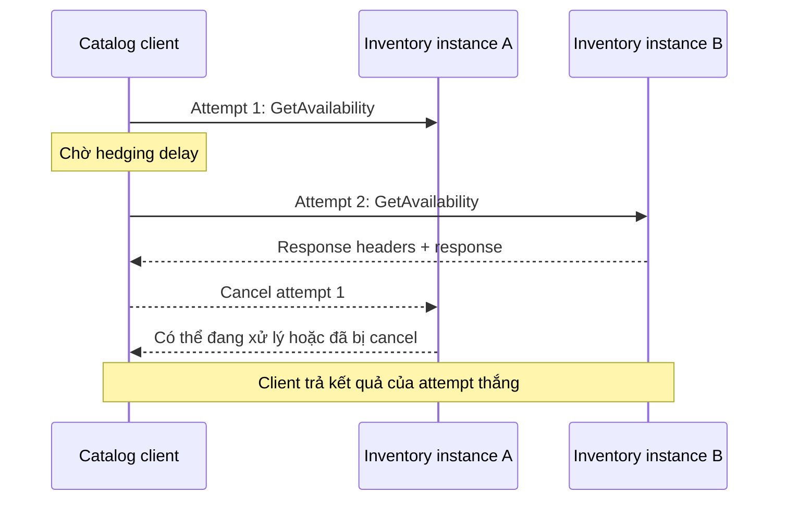
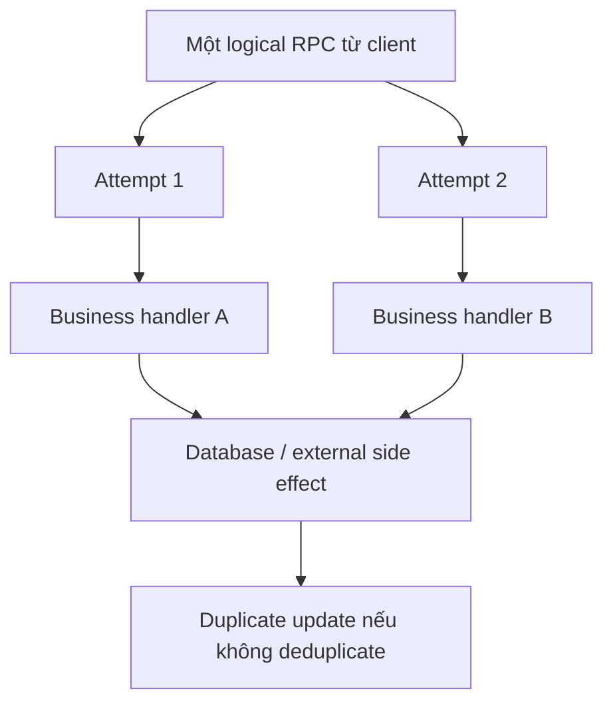

# Hedging và nguy cơ tạo duplicate work

## 1. Hedging giải quyết vấn đề gì?

Trong gRPC, một RPC có thể chậm vì một server instance bị pause, queue tăng, network path bất thường hoặc dependency phản hồi chậm. Client thường chờ attempt hiện tại tới khi nhận response hoặc deadline hết. Với request latency-sensitive, chờ một instance đuôi chậm có thể làm p99 tăng mạnh dù các instance khác vẫn khỏe.

**Hedging** là kỹ thuật client gửi thêm một attempt của cùng logical RPC sau một khoảng chờ ngắn, trong khi attempt trước vẫn đang chạy. Nếu một attempt phản hồi trước, client chọn kết quả đó và hủy các attempt còn lại theo semantics của gRPC.

Hedging có thể giảm tail latency khi một số instance chậm bất thường. Đổi lại, một logical RPC có thể tạo nhiều server attempts đồng thời. Nếu method có side effect, các attempt có thể cùng thực hiện công việc và gây duplicate work.

Hedging chỉ an toàn khi contract của method chịu được nhiều lần thực thi, hoặc server có cơ chế deduplicate đủ bền vững. Client cancellation không tự rollback transaction hoặc undo external side effect đã bắt đầu.

## 2. Diễn tiến của một hedged RPC

Giả sử Catalog gọi Inventory để đọc availability. Client bắt đầu attempt đầu tiên. Nếu chưa nhận response headers sau hedging delay, client có thể gửi attempt thứ hai. Các attempt có thể chạy trên những server instance khác nhau tùy load-balancing policy.



Hedging không tạo hai logical RPC độc lập ở phía caller. Nó tạo nhiều attempts cho cùng một call. Tuy nhiên, server nhận từng attempt như một RPC riêng và có thể bắt đầu xử lý từng request.

Theo semantics của gRPC hedging:

- Attempt đầu tiên được gửi ngay.
- Sau mỗi hedging delay, một attempt khác có thể được gửi nếu chưa có attempt nào gửi response headers và vẫn còn attempts trong giới hạn.
- Một attempt kết thúc bằng status thuộc non-fatal set có thể khiến attempt tiếp theo được khởi chạy sớm.
- Status fatal kết thúc logical call và hủy các attempts còn lại.
- Khi một attempt gửi response headers, hedging dừng; các attempts khác bị cancel và kết quả của attempt đã gửi headers được dùng cho call.

Điểm quan trọng: response headers không nhất thiết đồng nghĩa business operation đã hoàn tất thành công. Nếu server gửi headers sớm rồi sau đó trả lỗi, client đã qua thời điểm tiếp tục hedging theo cơ chế này.

## 3. Hedging khác retry như thế nào?

Retry và hedging đều có thể tạo nhiều attempts, nhưng thời điểm chạy khác nhau:

| Đặc điểm | Retry tuần tự | Hedging |
| --- | --- | --- |
| Khi bắt đầu attempt tiếp theo | Sau khi attempt trước thất bại theo retry policy | Sau hedging delay khi attempt trước vẫn đang chờ, hoặc khi nhận non-fatal status |
| Số attempts đồng thời | Thường một | Có thể nhiều |
| Mục tiêu chính | Phục hồi lỗi tạm thời | Giảm tail latency và né instance chậm |
| Tải bổ sung | Phát sinh sau lỗi | Có thể phát sinh ngay cả khi attempt đầu cuối cùng vẫn thành công |
| Nguy cơ duplicate work | Có | Cao hơn vì attempts có thể chạy đồng thời |
| Phù hợp | Operation có retry semantics | Operation idempotent hoặc có deduplication |

Retry tuần tự thường chờ một attempt trả lỗi rồi mới thử lại. Hedging chủ động tạo overlap để không phải chờ một attempt chậm tới deadline.

Không cấu hình retry policy và hedging policy chồng lấn cho cùng method nếu service config/runtime không hỗ trợ rõ ràng. Cũng cần kiểm tra proxy hoặc service mesh có retry riêng hay không; nhiều tầng retry có thể nhân số attempts.

## 4. Hedging policy trong gRPC service config

gRPC service config cho phép khai báo hedging theo service/method. Ví dụ policy cho một unary read RPC:

```json
{
  "methodConfig": [
    {
      "name": [
        {
          "service": "inventory.v1.InventoryService",
          "method": "GetAvailability"
        }
      ],
      "hedgingPolicy": {
        "maxAttempts": 3,
        "hedgingDelay": "0.050s",
        "nonFatalStatusCodes": [
          "UNAVAILABLE"
        ]
      }
    }
  ]
}
```

Ý nghĩa:

- `maxAttempts` là tổng số attempts tối đa, bao gồm attempt ban đầu.
- `hedgingDelay` là thời gian chờ giữa các lần khởi chạy attempt khi chưa có response headers.
- `nonFatalStatusCodes` xác định status tạm thời cho phép tiếp tục hedging.

Ví dụ có tối đa ba attempts: attempt đầu, attempt thứ hai sau khoảng 50 ms nếu vẫn chưa có response headers, và attempt thứ ba nếu vẫn đủ điều kiện. Giá trị thực tế cần dựa trên latency distribution, capacity và deadline của method.

Service config có thể đến từ name resolver hoặc cấu hình mặc định của channel, tùy client runtime. Với Spring gRPC, áp dụng policy trên channel do Spring quản lý qua cơ chế service config/channel customization được phiên bản starter hỗ trợ. Không tạo channel riêng ngoài lifecycle của Spring chỉ để bật hedging.

Hedging chỉ được thực thi khi gRPC client runtime hỗ trợ và retry/hedging được bật theo cấu hình của channel. Kiểm tra behavior của đúng phiên bản gRPC Java và resolver đang dùng; đừng suy ra rằng JSON hợp lệ đồng nghĩa policy chắc chắn được áp dụng.

## 5. Chọn non-fatal status cẩn thận

Không phải status nào cũng nên kích hoạt attempt khác. Một policy thường chỉ chọn status thể hiện lỗi tạm thời và có khả năng phục hồi, chẳng hạn `UNAVAILABLE` khi backend tạm thời không phục vụ.

Các status như `INVALID_ARGUMENT`, `UNAUTHENTICATED`, `PERMISSION_DENIED` và `NOT_FOUND` thường là kết quả không thể sửa bằng việc gọi lại một instance khác. Hedging chúng chỉ tạo thêm tải mà không cải thiện kết quả.

`RESOURCE_EXHAUSTED` cần đặc biệt thận trọng: nếu server đang quá tải hoặc rate limit, tạo thêm attempts có thể làm tình hình nặng hơn. Không đưa status này vào non-fatal set nếu chưa có retry-after/load-shedding policy phù hợp.

Status code chỉ là tín hiệu kỹ thuật. Một lỗi `UNAVAILABLE` vẫn có thể xuất hiện sau khi server đã thực hiện side effect nhưng response không tới client. Vì vậy, chọn non-fatal status không thay thế idempotency.

## 6. Chỉ bật hedging cho method có semantics phù hợp

Hedging phù hợp nhất với operation đọc không có side effect, ví dụ:

- Đọc availability hiện tại.
- Lấy product detail.
- Đọc cấu hình hoặc metadata.
- Query có thể chạy độc lập trên nhiều replica và chấp nhận consistency model đã chọn.

Cần thận trọng với operation ghi:

- Trừ tồn kho.
- Tạo đơn hàng.
- Thanh toán.
- Gửi thông báo.
- Phát hành coupon.
- Ghi audit hoặc tạo workflow.

Nếu hai attempt cùng trừ tồn kho, kết quả có thể bị trừ hai lần. Nếu hai attempt cùng gọi payment provider, có thể phát sinh hai giao dịch. Nếu cả hai cùng gửi email, cancellation attempt thua không thu hồi được email đã gửi.

Không dựa vào tên method hoặc việc client chỉ nhận một response để kết luận operation chỉ chạy một lần. Server có thể đã thực hiện công việc trên nhiều attempts trước khi client chọn kết quả.

## 7. Duplicate work xảy ra ở đâu?

Duplicate work có thể xuất hiện ở nhiều tầng:

1. **Application handler:** hai server instances cùng vào service method.
2. **Database:** hai transaction cùng insert/update hoặc cùng thực hiện nghiệp vụ.
3. **Downstream RPC:** mỗi attempt lại gọi Payment, Pricing hoặc Notification.
4. **Message broker:** hai attempt cùng publish event.
5. **External provider:** side effect đã được chấp nhận trước khi cancellation tới.
6. **Background worker:** attempt bị cancel nhưng tác vụ đã enqueue vẫn tiếp tục chạy.

gRPC cancellation là tín hiệu dừng công việc tốt nhất có thể; nó không phải distributed rollback. Server handler cần kiểm tra cancellation và dừng phần việc chưa thực hiện khi có thể. Nhưng nếu transaction đã commit hoặc external provider đã nhận request, cancellation không đảo ngược kết quả đó.



## 8. Idempotency key: định danh logical operation

Với RPC ghi dữ liệu cần hedging hoặc retry, client nên gửi một **idempotency key** ổn định cho logical operation. Mọi attempt của cùng một call phải dùng cùng key; không tạo key mới cho mỗi attempt.

Ví dụ protobuf contract:

```protobuf
message ReserveStockRequest {
  string idempotency_key = 1;
  string sku = 2;
  int32 quantity = 3;
}

service InventoryService {
  rpc ReserveStock(ReserveStockRequest)
      returns (ReserveStockResponse);
}
```

Server dùng key để nhận diện cùng một yêu cầu logic. Khi nhận request:

- Key chưa tồn tại: claim key và thực hiện operation.
- Key đã hoàn tất với cùng request: trả lại kết quả đã lưu.
- Key đang được xử lý: chờ trong giới hạn hoặc trả status retryable theo contract.
- Key đã tồn tại nhưng payload khác: từ chối vì caller tái sử dụng key sai cách.

Key cần được scope theo tenant/client identity và method, ví dụ bộ ba (tenant, RPC method, idempotency key). Không dùng key toàn cục không phân biệt caller nếu nhiều client có thể chọn trùng giá trị.

## 9. Deduplication phải bền vững và atomic

Một map trong memory của một pod không đủ cho hedging vì hai attempts có thể đến hai replicas khác nhau. Deduplication cần dùng kho lưu trữ dùng chung hoặc cơ chế partition bảo đảm mọi attempt của cùng key đi tới cùng owner.

Một bảng idempotency có thể lưu:

| Field | Vai trò |
| --- | --- |
| tenant_id | Phạm vi caller |
| rpc_method | Phân biệt operation |
| idempotency_key | Khóa logical request |
| request_hash | Phát hiện key bị dùng với payload khác |
| state | IN_PROGRESS hoặc COMPLETED |
| response_payload | Kết quả có thể replay |
| created_at / expires_at | Thời gian lưu dedup record |

Đặt unique constraint trên (tenant_id, rpc_method, idempotency_key). Việc claim key và thay đổi nghiệp vụ cần có transaction/locking phù hợp để hai attempt không cùng thấy key chưa tồn tại rồi cùng xử lý.

Pseudo-code minh họa:

```java
ReservationResult reserve(ReserveStockRequest request, Caller caller) {
    IdempotencyScope scope = new IdempotencyScope(
            caller.tenantId(),
            "inventory.v1.InventoryService/ReserveStock",
            request.getIdempotencyKey());

    String requestHash = canonicalHash(request);

    return idempotencyStore.executeOnce(
            scope,
            requestHash,
            () -> reservationRepository.reserve(
                    request.getSku(),
                    request.getQuantity()));
}
```

`executeOnce` ở đây là abstraction của repository/service có bảo đảm atomic bằng unique constraint và transaction; không phải một method có sẵn của Spring. Implementation phải xử lý cạnh tranh giữa hai insert cùng key, đọc lại trạng thái sau conflict và chỉ một transaction được thực hiện business mutation.

Nếu cùng key nhưng request hash khác, trả lỗi contract như `INVALID_ARGUMENT` hoặc `FAILED_PRECONDITION`. Không trả kết quả của request cũ cho payload mới.

## 10. Ranh giới transaction và external side effect

Nếu nghiệp vụ chỉ cập nhật database cùng transaction với idempotency record, có thể commit trạng thái operation và kết quả cùng nhau. Khi attempt thứ hai tới, nó đọc record COMPLETED và trả response đã lưu.

External side effect không nằm trong cùng database transaction. Ví dụ reserve stock rồi gọi Payment hoặc publish event; database rollback không thể xóa giao dịch đã được payment provider chấp nhận.

Dùng các mẫu sau:

- **Transactional outbox:** commit business state và outbox record trong cùng transaction; worker publish event sau commit.
- **Downstream idempotency:** truyền cùng logical operation key sang provider/service downstream nếu họ hỗ trợ.
- **Saga/compensation:** nếu workflow nhiều bước không thể atomic, định nghĩa thao tác bù và trạng thái workflow.
- **Durable operation state:** ghi nhận IN_PROGRESS/COMPLETED/FAILED để recovery sau crash.

Không phát event hoặc gọi provider trước khi idempotency claim được bảo đảm. Nếu side effect được thực hiện rồi process crash trước khi lưu kết quả, lần attempt sau cần có cách tra cứu hoặc gửi cùng key xuống downstream để không thực hiện lần hai.

## 11. Cancellation không bảo đảm attempt thua đã dừng

Khi một attempt thắng và gửi response headers, gRPC client hủy các attempts còn lại. Server có thể nhận cancellation qua gRPC Context hoặc callback của streaming call. Tuy nhiên cancellation có thể đến sau khi handler đã chạy một phần công việc.

Với server logic có thể kéo dài, cần:

- Kiểm tra cancellation trước các bước tốn kém hoặc side effect chưa bắt đầu.
- Propagate cancellation tới downstream RPC/future khi API hỗ trợ.
- Hủy background task/queue work nếu chưa được commit.
- Không giả định thread interrupt luôn được phát hoặc mọi thư viện đều phản ứng với interrupt.
- Dùng idempotency/deduplication cho phần side effect không thể hủy an toàn.

Với unary RPC, server handler có thể kiểm tra `Context.current().isCancelled()` tại các ranh giới công việc. Với server streaming, dùng `ServerCallStreamObserver.setOnCancelHandler` để dọn subscription/resource. Cleanup cần idempotent vì cancel, error và completion có thể cạnh tranh nhau.

## 12. Deadline là ngân sách chung của logical call

Hedging không tạo thêm thời gian ngoài deadline. Deadline của logical RPC giới hạn thời gian client chờ kết quả. Hedging delay, queueing và mọi attempts đều tiêu thụ ngân sách đó.

Ví dụ client đặt deadline 300 ms và hedging delay 50 ms. Attempt thứ hai bắt đầu sau khoảng 50 ms nếu đủ điều kiện, nhưng nó chỉ còn phần deadline còn lại. Không được coi mỗi attempt có 300 ms riêng rồi cộng lại thành 900 ms.

Cấu hình deadline theo latency objective của method:

- Đủ thời gian cho một attempt bình thường.
- Có khoảng trống để hedging giúp né tail latency.
- Không dài tới mức giữ nhiều attempts và resource quá lâu.
- Downstream deadline phải không vượt deadline còn lại của caller.

Nếu deadline quá ngắn, nhiều attempts có thể bị hủy trước khi instance nào hoàn tất. Nếu deadline quá dài, hedging có thể giữ tài nguyên và tạo tải dư thừa trong thời gian dài.

## 13. Hedging có thể khuếch đại quá tải

Hedging thường được nghĩ là cách giảm latency, nhưng trong hệ thống đã bão hòa nó có thể làm tăng tải đúng lúc backend yếu nhất.

Nếu logical request rate là R và policy cho phép tối đa N attempts, upper bound lý thuyết có thể tiến gần R × N server attempts/giây khi mọi request cần đủ attempts. Ví dụ 1.000 logical calls/giây và maxAttempts bằng 3 có thể tạo tới 3.000 attempts/giây trong tình huống xấu nhất.

Nếu client, proxy và service mesh đều retry/hedge, số lần thực thi có thể nhân lên theo từng tầng. Ba attempts ở client và ba attempts ở proxy có thể tạo tới chín backend attempts cho một logical request trong cấu hình xấu.

Biện pháp kiểm soát:

- Giới hạn maxAttempts thấp.
- Chỉ bật cho method và traffic class có latency objective rõ.
- Dùng hedging delay dựa trên percentile latency, không chọn tùy ý.
- Không hedge khi backend đang quá tải hoặc đang load-shed.
- Giới hạn concurrent calls và queue.
- Dùng circuit breaker/adaptive concurrency ở tầng phù hợp.
- Tránh cấu hình hedging trùng lặp qua client, proxy và mesh.

Hedging nên được tắt hoặc giảm khi hệ thống thiếu capacity. Một policy làm p99 tốt hơn trong tải bình thường nhưng gây retry storm trong overload là policy chưa hoàn chỉnh.

## 14. Chọn hedging delay và max attempts

Hedging delay quá ngắn làm nhiều request bình thường bị nhân đôi. Delay quá dài khiến attempt thứ hai tới sau khi attempt đầu gần hoàn tất, lợi ích giảm nhưng vẫn tốn tải.

Một cách bắt đầu là quan sát phân phối latency của method và chọn delay gần vùng đuôi mà muốn né. Ví dụ nếu phần lớn request hoàn tất dưới 40 ms nhưng một nhóm nhỏ vượt 200 ms, có thể thử delay trong vùng 40–60 ms, sau đó load test và điều chỉnh.

Không lấy p99 làm delay một cách máy móc. Xem thêm:

- Latency của từng attempt và latency logical call.
- Tỷ lệ attempt thứ hai/thứ ba thực sự được khởi chạy.
- Tỷ lệ request mà attempt phụ thắng.
- Tỷ lệ cancel và lượng công việc đã thực hiện trước cancel.
- Backend utilization, queue depth và error rate.
- Deadline exceeded và overload status.

Bắt đầu với hai attempts nếu đủ lợi ích. Chỉ tăng lên ba khi có bằng chứng đo được và capacity phù hợp. Nhiều attempts không đồng nghĩa xác suất thành công tăng tuyến tính vì các replica có thể chia sẻ dependency hoặc failure domain.

## 15. Load balancing và tính độc lập của attempts

Hedging chỉ có ích nếu attempt phụ có cơ hội chạy trên tài nguyên độc lập hơn attempt đầu. Tuy nhiên, gRPC load balancer có thể chọn cùng endpoint hoặc các endpoint cùng chịu một lỗi chung, tùy resolver và policy.

Đánh giá:

- Endpoint discovery có loại instance unhealthy không.
- Load-balancing policy có phân phối attempts tới nhiều backend không.
- Các replica có dùng chung database, cache hoặc downstream dependency đang nghẽn không.
- Có locality/zone policy để giảm correlated failure không.
- Proxy có retry lại cùng backend hay không.

Không giả định hai attempts chắc chắn chạy trên hai máy khác nhau. Hedging không phải cơ chế failover zone nếu load-balancing topology không hỗ trợ điều đó.

## 16. Tích hợp với Spring gRPC

Trong ứng dụng Spring, giữ một channel owner rõ ràng do Spring gRPC quản lý. Hedging policy được gắn vào service config của channel hoặc được cung cấp bởi name resolver theo cơ chế gRPC Java tương ứng.

Khi cấu hình:

1. Chọn method cụ thể, ưu tiên unary read có semantics an toàn.
2. Đặt hedging policy trong service config cho đúng fully qualified service/method.
3. Bảo đảm gRPC client runtime có retry/hedging enabled theo version đang dùng.
4. Xác minh resolver không ghi đè service config mặc định.
5. Không tạo thêm channel ngoài Spring context chỉ để thử policy.
6. Kiểm tra interceptor, CallCredentials, deadline và tracing vẫn hoạt động trên từng attempt.
7. Tách metrics logical call khỏi metrics attempt nếu instrumentation cung cấp hai cấp.

Tên property Spring gRPC để cấu hình default service config hoặc channel customizer có thể thay đổi theo release. Dùng API/configuration metadata của đúng version dependency; không sao chép tên property từ một version khác mà chưa xác minh.

Hedging là client behavior. Server không cần bật một cờ “hedging” để nhận request, nhưng server phải chịu được duplicate attempts và cancellation đến muộn.

## 17. Quan sát hedging trong production

Chỉ đo logical RPC duration sẽ không cho biết hedging có đang tạo duplicate work hay không. Theo dõi riêng:

| Chỉ số | Ý nghĩa |
| --- | --- |
| Logical RPC count | Số yêu cầu caller thực sự phát ra |
| Attempt count | Tổng server/client attempts |
| Attempts per logical call | Mức khuếch đại tải |
| Hedged attempt started | Số attempt phụ được khởi chạy |
| Winning attempt index | Attempt nào cung cấp response |
| Cancelled attempts | Số attempts bị hủy sau khi có winner |
| Work completed after cancellation | Công việc vẫn hoàn tất sau khi attempt bị cancel |
| Duplicate idempotency hits | Số request được trả từ dedup record |
| Dedup conflict | Cùng key nhưng payload khác |
| p50/p95/p99 latency | So sánh latency logical call và attempt |
| Backend saturation | CPU, queue, connection và downstream utilization |

Trace nên phân biệt logical operation với từng attempt nếu instrumentation hỗ trợ. Không tạo span trùng với gRPC auto instrumentation. Dùng event/attribute có cardinality thấp như attempt index, outcome và hedged flag; không dùng idempotency key, user ID hoặc request payload làm metric label.

Một chỉ số quan trọng là tỷ lệ attempt phụ thắng so với số attempt phụ đã khởi chạy. Nếu rất ít attempt phụ thắng nhưng nhiều công việc bị cancel muộn, hedging đang tốn tài nguyên mà ít lợi ích.

## 18. Kiểm thử duplicate work và cancellation race

Kiểm thử phải mô phỏng hai attempts chạy đồng thời, không chỉ kiểm tra service config parse được.

| Kịch bản | Điều cần xác minh |
| --- | --- |
| Attempt 1 chậm, attempt 2 nhanh | Client nhận response của attempt thắng; attempt còn lại bị cancel |
| Attempt 1 trả non-fatal status | Attempt tiếp theo được khởi chạy theo policy |
| Attempt trả fatal status | Logical call kết thúc và attempts khác bị cancel |
| Attempt gửi response headers sớm | Hedging dừng theo semantics; lỗi sau headers không tạo attempt mới |
| Hai attempts cùng idempotency key | Chỉ một business mutation được commit |
| Cùng key, payload khác | Server từ chối request xung đột |
| Attempt thua bị cancel trước side effect | Công việc chưa cần thiết được dừng |
| Attempt thua bị cancel sau commit | Attempt khác đọc lại kết quả đã lưu, không lặp side effect |
| Deadline hết trong lúc hedge | Tất cả attempts kết thúc theo deadline |
| Backend quá tải | Load shedding và giới hạn attempts ngăn khuếch đại quá mức |
| Proxy cũng retry | Tổng attempts được đo và không nhân vượt ngân sách |
| Streaming method | Không bật hedging nếu runtime/contract không hỗ trợ replay an toàn |

Dùng latch/barrier trong test để buộc hai handler cùng tới điểm cạnh tranh. Kiểm tra số row mutation, số downstream calls và kết quả trả về, không chỉ kiểm tra client nhận một response.

Test idempotency store bằng database thật hoặc Testcontainers nếu correctness phụ thuộc unique constraint/transaction isolation. Mock repository đơn giản không chứng minh được atomicity khi hai request đồng thời.

## 19. Lỗi thường gặp

1. **Cho rằng một response nghĩa là server chỉ chạy một lần.** Nhiều attempts có thể đã xử lý song song. Đếm attempts và deduplicate side effect.
2. **Bật hedging cho mọi method.** Mutation có thể bị thực hiện nhiều lần. Chỉ bật cho method idempotent hoặc có durable idempotency.
3. **Tạo idempotency key mới mỗi attempt.** Server không nhận ra duplicate. Key phải ổn định theo logical operation.
4. **Deduplicate bằng map trong memory của một pod.** Attempts tới replica khác nhau vẫn chạy hai lần. Dùng kho bền vững/shared atomic claim.
5. **Tin cancellation sẽ rollback database hoặc external API.** Side effect có thể đã commit. Thiết kế transaction, outbox và downstream idempotency.
6. **Chọn UNAVAILABLE mà không xét overload.** Hedging có thể làm backend quá tải hơn. Kết hợp load shedding và capacity limits.
7. **Đặt hedging delay quá thấp.** Request bình thường bị nhân đôi. Dựa vào latency distribution và attempt-win metrics.
8. **Cấu hình hedging ở nhiều tầng.** Attempts nhân lên theo client/proxy/mesh. Chỉ định một nơi sở hữu policy và đo tổng.
9. **Không xét response headers.** Server gửi headers sớm có thể làm hedging dừng trước khi business result hoàn tất. Hiểu chính xác thời điểm transport chốt attempt.
10. **Không kiểm tra stream semantics.** Client/bidi stream có thể không replay được. Chỉ dùng trên RPC được runtime hỗ trợ và contract cho phép.

## 20. Bài thực hành

Thiết kế hedging cho Catalog đọc Inventory và bảo vệ một RPC ghi tồn kho:

1. Chọn unary method GetAvailability làm ứng viên hedging; giữ ReserveStock không hedge cho tới khi có idempotency contract.
2. Cấu hình service config cho GetAvailability với maxAttempts 2, hedgingDelay dựa trên latency đo được và non-fatal status phù hợp.
3. Tạo test backend có một instance chậm và một instance nhanh; xác minh attempt phụ thắng khi cần.
4. Thêm metrics logical calls, attempts, hedged attempts, cancellations và p99 latency.
5. Với ReserveStock, thêm idempotency key ổn định vào protobuf request.
6. Tạo unique constraint theo tenant, method và key; lưu request hash, state và response trong transaction.
7. Dùng hai attempts đồng thời với cùng key; xác minh chỉ một mutation commit và cả hai nhận cùng kết quả.
8. Mô phỏng crash sau external side effect; dùng outbox hoặc downstream idempotency để tránh thực hiện lặp.
9. Mô phỏng cancel, non-fatal/fatal status, response headers sớm và deadline expiry.
10. Load test khi backend gần saturation; so sánh latency giảm được với attempt amplification và duplicate-work rate.

**Tự kiểm tra:** Hedging khởi chạy attempt phụ trước khi attempt đầu thất bại hoàn toàn để giảm tail latency; đổi lại, server có thể thực hiện cùng logical request nhiều lần. gRPC cancellation không rollback side effect. Trong Spring gRPC, giới hạn hedging vào method phù hợp, đặt maxAttempts/delay/non-fatal status theo số liệu, truyền cùng idempotency key qua mọi attempt và dùng deduplication atomic, bền vững ở server. Đo cả latency lẫn attempt amplification, cancellation và duplicate-work để quyết định có nên giữ policy trong production.

