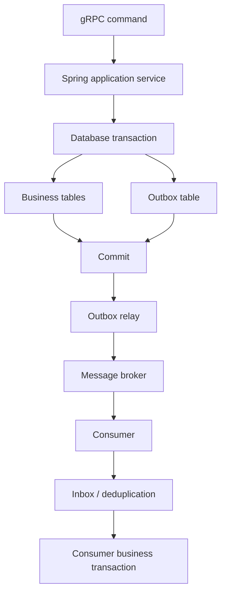
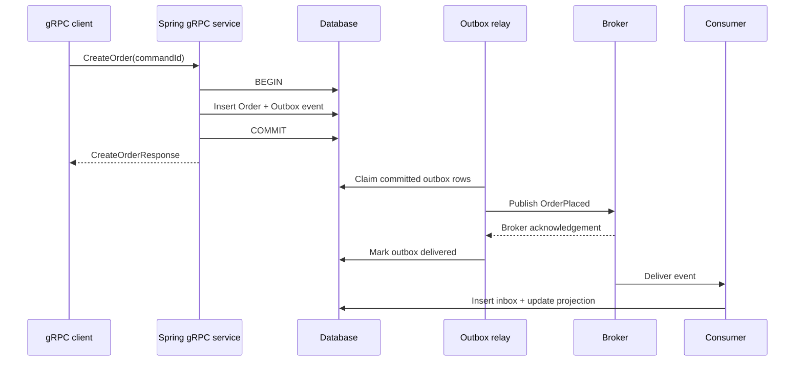

# Outbox khi RPC kích hoạt event

## 1. Vấn đề dual write khi xử lý gRPC command

Một gRPC method thường vừa thay đổi dữ liệu nghiệp vụ vừa phát event để service khác phản ứng. Ví dụ Catalog nhận RPC tạo đơn hàng, lưu Order vào database rồi phát event OrderPlaced để Inventory giữ hàng và Notification gửi xác nhận.

Nếu ứng dụng ghi database và publish message theo hai thao tác độc lập, hệ thống gặp bài toán **dual write**:

- Database commit thành công nhưng publish thất bại: trạng thái nghiệp vụ đã đổi, event không tới consumer.
- Publish thành công nhưng database rollback: consumer thấy event cho một thay đổi chưa tồn tại.
- Publish thành công nhưng process chết trước khi ghi nhận kết quả: ứng dụng có thể publish lại khi khởi động hoặc retry.

Không có transaction phân tán giữa database và message broker thì hai thao tác này không thể được bảo đảm atomic chỉ bằng cách gọi lần lượt. Gửi message trước hay sau commit đều để lại một cửa sổ lỗi.

**Transactional outbox** giải quyết phần ghi kép bằng cách lưu event cần phát vào một bảng outbox trong cùng transaction database với thay đổi nghiệp vụ. Một relay riêng đọc outbox và publish message sau khi transaction đã commit.

## 2. Mô hình transactional outbox

Outbox là bảng lưu các event chờ phát. RPC handler chỉ ghi business state và outbox record; nó không gọi broker trong transaction nghiệp vụ.



Điều kiện quan trọng nhất là business row và outbox row phải nằm trong cùng một transaction trên cùng database transaction manager:

- Nếu transaction commit, cả business state và event record đều tồn tại.
- Nếu transaction rollback, cả hai đều không tồn tại.
- Relay chỉ đọc các outbox row đã commit, nên không phát event cho thay đổi đã rollback.

Outbox không làm database và broker commit cùng lúc. Nó bảo đảm event cần phát được lưu bền vững cùng business change; relay sẽ chuyển event sang broker theo cơ chế giao nhận ít nhất một lần.

## 3. Luồng xử lý từ RPC đến consumer

Ví dụ Catalog nhận RPC CreateOrder:

1. Client gửi CreateOrderRequest với command idempotency key.
2. gRPC service chuyển request thành application command.
3. Application service mở transaction, kiểm tra idempotency key, tạo Order và ghi OrderPlaced vào outbox.
4. Database commit business state cùng outbox record.
5. Application service trả kết quả; gRPC adapter gửi response cho client.
6. Outbox relay đọc record đã commit và publish lên broker.
7. Consumer nhận event, ghi inbox/deduplication record và cập nhật local state trong transaction riêng.

Response gRPC không cần chờ broker publish thành công. Điều kiện hoàn tất command là transaction nghiệp vụ và outbox record đã commit. Event delivery diễn ra bất đồng bộ.



Nếu database commit thành công nhưng response bị mất do network/deadline, client có thể retry RPC. Vì vậy command cần idempotency key ổn định; outbox event ID và command idempotency key giải quyết hai loại duplicate khác nhau.

## 4. Thiết kế outbox table

Một schema cơ bản có thể lưu:

| Field | Ý nghĩa |
| --- | --- |
| event_id | ID duy nhất của event, được tạo một lần và giữ nguyên khi retry publish |
| aggregate_type | Loại aggregate phát sinh event, ví dụ Order |
| aggregate_id | ID aggregate, dùng làm message key và giữ thứ tự theo entity |
| aggregate_version | Phiên bản aggregate tại thời điểm tạo event |
| event_type | Tên contract, ví dụ order.placed.v1 |
| payload | Event payload đã serialize |
| occurred_at | Thời điểm nghiệp vụ tạo event |
| created_at | Thời điểm ghi outbox |
| attempts | Số lần relay thử publish |
| next_attempt_at | Thời điểm sớm nhất được retry |
| lease_owner / lease_until | Worker đang claim record và thời hạn lease |
| published_at | Thời điểm broker xác nhận publish |

Ví dụ DDL minh họa:

```sql
CREATE TABLE outbox_event (
    event_id          UUID PRIMARY KEY,
    aggregate_type    VARCHAR(120) NOT NULL,
    aggregate_id      VARCHAR(160) NOT NULL,
    aggregate_version BIGINT,
    event_type        VARCHAR(200) NOT NULL,
    schema_version    INTEGER NOT NULL,
    payload           BYTEA NOT NULL,
    occurred_at       TIMESTAMP NOT NULL,
    created_at        TIMESTAMP NOT NULL,
    attempts          INTEGER NOT NULL DEFAULT 0,
    next_attempt_at   TIMESTAMP NOT NULL,
    lease_owner       VARCHAR(120),
    lease_until       TIMESTAMP,
    published_at      TIMESTAMP
);

CREATE INDEX idx_outbox_pending
    ON outbox_event (next_attempt_at, created_at)
    WHERE published_at IS NULL;
```

Đây là schema khái niệm; kiểu UUID, binary payload, partial index và cú pháp DDL phụ thuộc database. Với PostgreSQL, BYTEA và partial index là phù hợp; database khác có thể dùng BLOB hoặc kiểu tương ứng.

Không xóa record ngay sau khi publish nếu cần audit, replay hoặc điều tra. Có thể chuyển sang archive/partition rồi dọn theo retention policy. Nếu payload chứa dữ liệu nhạy cảm, giảm thiểu field, mã hóa hoặc áp dụng retention phù hợp.

## 5. Ghi business state và outbox trong cùng Spring transaction

Application service là nơi điều phối use case và ranh giới transaction. Ví dụ sau minh họa tạo đơn hàng và event protobuf:

```java
@Service
public class CreateOrderUseCase {

    private final OrderRepository orders;
    private final OutboxRepository outbox;
    private final Clock clock;

    public CreateOrderUseCase(
            OrderRepository orders,
            OutboxRepository outbox,
            Clock clock) {
        this.orders = orders;
        this.outbox = outbox;
        this.clock = clock;
    }

    @Transactional
    public OrderView execute(CreateOrderCommand command) {
        Order order = Order.create(
                command.customerId(),
                command.lines());

        orders.save(order);

        OrderPlaced event = OrderPlaced.newBuilder()
                .setEventId(UUID.randomUUID().toString())
                .setOrderId(order.getId().toString())
                .setAggregateVersion(order.getVersion())
                .build();

        outbox.save(OutboxRecord.pending(
                UUID.fromString(event.getEventId()),
                "Order",
                order.getId().toString(),
                order.getVersion(),
                "order.placed.v1",
                1,
                event.toByteArray(),
                clock.instant()));

        return OrderView.from(order);
    }
}
```

Ví dụ giả định OrderRepository và OutboxRepository dùng cùng datasource/transaction manager. Phương thức execute được gọi qua Spring proxy để @Transactional có hiệu lực; self-invocation bên trong cùng bean có thể không đi qua proxy và làm transaction không được mở như dự kiến.

Không gọi broker trong phương thức execute. Nếu broker chậm hoặc mất kết nối, transaction database sẽ bị giữ lâu và lock có thể kéo dài. Outbox row là bằng chứng bền vững rằng event phải được phát.

Nếu event chỉ cần phát khi một điều kiện nghiệp vụ đúng, tạo outbox row trong cùng nhánh logic với business mutation. Không suy luận event từ việc method gRPC trả OK sau đó, vì response có thể bị mất và caller có thể retry.

## 6. Trả response gRPC sau khi transaction commit

gRPC adapter nên gọi application service và gửi response sau khi lời gọi transactional method hoàn tất. Với Spring proxy, transaction thường commit khi method trả về qua proxy; khi đó adapter mới gửi response:

```java
@GrpcService
public class OrderGrpcService
        extends OrderServiceGrpc.OrderServiceImplBase {

    private final CreateOrderUseCase createOrder;

    public OrderGrpcService(CreateOrderUseCase createOrder) {
        this.createOrder = createOrder;
    }

    @Override
    public void createOrder(
            CreateOrderRequest request,
            StreamObserver<CreateOrderResponse> observer) {
        try {
            OrderView order = createOrder.execute(toCommand(request));

            observer.onNext(toResponse(order));
            observer.onCompleted();
        } catch (OrderValidationException invalid) {
            observer.onError(
                    Status.INVALID_ARGUMENT
                            .withDescription("Invalid order")
                            .asRuntimeException());
        } catch (RuntimeException failure) {
            observer.onError(
                    Status.INTERNAL
                            .withDescription("Could not create order")
                            .asRuntimeException());
        }
    }
}
```

Không gửi response thành công trước khi transaction commit. Nếu commit thất bại, RPC phải trả lỗi tương ứng; không được trả OK rồi hy vọng outbox hoặc relay sửa lại business transaction.

Ngược lại, không chờ relay publish xong mới trả response nếu contract chỉ yêu cầu ghi nhận command. Nếu API cần xác nhận event đã được broker nhận, đó là một contract khác và cần biểu diễn rõ trạng thái chờ/hoàn tất.

## 7. Command idempotency khác event deduplication

Có hai cấp độ chống trùng lặp:

- **Command idempotency:** ngăn client retry cùng RPC làm nghiệp vụ thực hiện hai lần.
- **Event deduplication:** ngăn relay publish lại hoặc broker redeliver cùng event làm consumer áp dụng hai lần.

Command idempotency key do client tạo cho một logical command và giữ nguyên qua các lần retry. Server lưu key cùng caller/tenant, RPC method, request hash và kết quả đã hoàn tất.

Event ID được tạo khi transaction tạo outbox record. Relay giữ nguyên event ID qua mọi lần publish; consumer dùng event ID để deduplicate. Không tạo event ID mới mỗi lần relay retry.

Ví dụ phạm vi key command:

```text
(tenant_id, rpc_method, idempotency_key)
```

Nếu cùng key nhưng request hash khác, từ chối request vì caller đang tái sử dụng key cho payload khác. Nếu command đã hoàn tất, trả lại kết quả đã lưu thay vì tạo Order và outbox event mới.

Không dùng event ID thay cho command idempotency key: nếu client retry sau khi response bị mất, server có thể tạo một event ID khác cho cùng command nếu không có command-level deduplication.

## 8. Relay polling: đọc và claim event chờ phát

Một relay polling định kỳ truy vấn outbox row chưa publish. Khi có nhiều worker, cần claim record atomic để tránh hai worker đồng thời xử lý cùng row.

Với PostgreSQL, SELECT FOR UPDATE SKIP LOCKED có thể giúp nhiều worker lấy các row khác nhau:

```sql
BEGIN;

SELECT event_id
FROM outbox_event
WHERE published_at IS NULL
  AND next_attempt_at <= CURRENT_TIMESTAMP
  AND (lease_until IS NULL OR lease_until < CURRENT_TIMESTAMP)
ORDER BY created_at
FOR UPDATE SKIP LOCKED
LIMIT 100;

-- Update selected rows with lease_owner and lease_until.
-- Increment attempts, then commit the claim.

COMMIT;
```

Sau khi claim, relay publish bên ngoài transaction database. Không giữ row lock và database transaction mở trong lúc chờ network broker. Khi broker acknowledgement thành công, relay cập nhật published_at và xóa lease. Nếu publish thất bại, relay đặt next_attempt_at theo backoff và giải phóng/để lease hết hạn.

Cú pháp SKIP LOCKED và cách claim batch phụ thuộc database. Có thể dùng atomic UPDATE ... RETURNING, lease table hoặc một cơ chế queue phù hợp. Điều quan trọng là claim phải có tính cạnh tranh an toàn và lease có thể hết hạn nếu worker chết.

## 9. Publish thành công nhưng chưa đánh dấu published

Có một cửa sổ lỗi không thể loại bỏ chỉ bằng polling:

1. Relay publish event thành công.
2. Broker đã acknowledgement.
3. Relay process chết trước khi cập nhật published_at.
4. Lease hết hạn, worker khác claim lại và publish event lần nữa.

Vì vậy transactional outbox thường cung cấp **at-least-once delivery**, không bảo đảm event chỉ được publish đúng một lần. Đây là hành vi mong đợi của thiết kế; consumer phải idempotent.

Không đánh dấu published trước khi broker acknowledgement, vì nếu đánh dấu trước rồi publish thất bại thì event có thể mất vĩnh viễn. Đánh dấu sau acknowledgement có thể tạo duplicate khi crash, nhưng duplicate có thể được xử lý bằng event ID ở consumer.

Nếu broker hỗ trợ producer idempotence hoặc transaction, bật chúng có thể giảm duplicate ở phạm vi broker session/producer; chúng không thay thế deduplication nghiệp vụ end-to-end.

## 10. Consumer inbox và idempotent processing

Consumer nên ghi nhận event ID đã xử lý trong cùng transaction với thay đổi local state. Mẫu này thường gọi là **inbox** hoặc consumer deduplication table.

Ví dụ schema:

```sql
CREATE TABLE inbox_event (
    consumer_name VARCHAR(120) NOT NULL,
    event_id      UUID NOT NULL,
    processed_at  TIMESTAMP NOT NULL,
    PRIMARY KEY (consumer_name, event_id)
);
```

Consumer transaction:

```java
@Transactional
public void handle(OrderPlaced event) {
    boolean firstDelivery = inbox.insertIfAbsent(
            "inventory-projection",
            UUID.fromString(event.getEventId()));

    if (!firstDelivery) {
        return;
    }

    inventoryProjection.applyOrderPlaced(event);
}
```

insertIfAbsent phải dựa trên unique constraint/atomic insert. Inbox row và business mutation phải commit cùng transaction. Nếu consumer crash trước commit, cả hai rollback và broker có thể redeliver. Nếu commit xong nhưng acknowledgement broker bị mất, delivery lặp sẽ gặp inbox record và không áp dụng business change lần nữa.

Nếu consumer cần phát event tiếp theo, chính consumer cũng có thể ghi event mới vào outbox của nó trong cùng transaction. Tránh ghi inbox rồi gọi một external side effect không có idempotency vì crash có thể khiến side effect bị lặp hoặc mất.

## 11. Ordering theo aggregate

Một aggregate có thể phát nhiều event: OrderCreated, OrderPaid, OrderShipped. Nếu relay publish song song không kiểm soát, event version 3 có thể tới broker trước version 2.

Để giữ thứ tự:

- Ghi aggregate_version tăng đơn điệu trong cùng transaction với outbox row.
- Dùng aggregate_id làm broker message key để các event cùng aggregate vào cùng partition nếu broker hỗ trợ partition ordering.
- Relay không claim event sau của một aggregate khi event trước vẫn pending, nếu thứ tự là yêu cầu bắt buộc.
- Consumer kiểm tra version và phát hiện gap hoặc event đến sai thứ tự.
- Nếu event độc lập, cho phép xử lý song song nhưng phải ghi rõ consistency contract.

Message key không tự đảm bảo thứ tự nếu relay gửi event theo thứ tự ngẫu nhiên. Cần kết hợp query/claim ordering, partition strategy và consumer sequencing. Đừng áp đặt global ordering nếu chỉ cần ordering theo từng aggregate; global serialization làm giảm throughput.

## 12. Retry, backoff và dead-letter handling

Relay cần retry lỗi tạm thời như broker unavailable, timeout hoặc connection reset. Dùng exponential backoff có jitter và giới hạn tốc độ retry để tránh dồn tải khi broker phục hồi.

Phân loại lỗi:

| Lỗi | Xử lý |
| --- | --- |
| Broker timeout/unavailable | Retry với backoff; không đánh dấu published |
| Authentication/authorization failure | Cảnh báo cấu hình; retry có giới hạn và báo vận hành |
| Payload/schema không hợp lệ | Đưa vào trạng thái cần xử lý thủ công hoặc dead-letter theo policy |
| Database unavailable | Không claim mới; giữ record để xử lý lại |
| Worker chết khi đang giữ lease | Lease hết hạn để worker khác claim lại |

Không xóa event sau một số lần retry nếu chưa có quy trình bảo toàn và khôi phục. Có thể chuyển sang trạng thái FAILED/DEAD_LETTER, lưu nguyên nhân đã làm sạch, giữ payload theo retention policy và phát cảnh báo. Khi sửa lỗi, operator có thể replay event với cùng event ID.

Một event poison không nên chặn vô hạn toàn bộ queue. Nếu cần ordering theo aggregate, có thể chỉ chặn aggregate đó và tiếp tục các aggregate khác; policy này cần nhất quán với nghiệp vụ.

## 13. CDC thay cho polling

Thay vì polling bảng outbox, có thể dùng Change Data Capture (CDC) đọc transaction log của database, ví dụ Debezium. Connector quan sát các row insert/commit và chuyển chúng thành message.

| Cách phát | Ưu điểm | Chi phí/điều kiện |
| --- | --- | --- |
| Polling relay | Dễ triển khai, kiểm soát batch và retry trong application | Query liên tục, cần lease/claim, dọn record |
| CDC connector | Đọc change log, giảm polling query, tách publisher khỏi application | Cần vận hành connector, schema history, offsets và log retention |

CDC chỉ phát các thay đổi đã commit nếu connector được cấu hình đúng. Cần thiết kế mapping outbox event type, payload, event ID và aggregate key rõ ràng.

Không chạy polling relay và CDC cùng publish một bảng outbox trong production nếu chưa có cơ chế phân quyền ownership; cả hai có thể phát cùng event. Chọn một đường phát chính hoặc xác định rõ cách migrate/dual-run có deduplication.

## 14. Event contract, schema evolution và payload

Outbox payload là contract giữa producer và consumer. Có thể lưu protobuf serialized bytes hoặc JSON/Avro tùy hệ thống, nhưng phải có event type và schema version để consumer biết cách giải mã.

Với protobuf:

- Thêm field mới với field number mới.
- Không tái sử dụng field number đã xóa; reserve number/name khi cần.
- Giữ thay đổi tương thích ngược theo chiến lược rollout consumer/producer.
- Không serialize toàn bộ database entity nếu event chỉ cần một tập dữ liệu nhỏ.
- Gắn event_id, aggregate_id, aggregate_version và occurred_at vào envelope hoặc metadata ổn định.

Không đặt access token, secret, private key hoặc dữ liệu cá nhân không cần thiết vào event payload. Outbox thường được lưu lâu hơn request và có thể được replay; payload cần được xem như dữ liệu bền vững có retention và access control riêng.

Nếu consumer cần dữ liệu hiện tại thay vì snapshot tại thời điểm event, contract phải nói rõ consumer sẽ query source service. Không ngầm giả định event payload là trạng thái mới nhất sau khi có các update tiếp theo.

## 15. Spring gRPC và lifecycle của relay

Spring gRPC adapter nên tập trung vào transport: nhận protobuf request, xác thực/ủy quyền, gọi application use case và map kết quả thành gRPC response/status. Transactional outbox thuộc application/domain persistence boundary, không nằm trong interceptor hoặc transport callback.

Relay có thể là Spring-managed component riêng, ví dụ scheduled worker hoặc message publisher service. Cần có lifecycle rõ ràng:

- Chỉ bắt đầu poll sau khi datasource và cấu hình broker sẵn sàng.
- Dừng claim batch mới khi application shutdown.
- Hoàn tất hoặc để lease hết hạn cho batch đang xử lý.
- Không giữ transaction database mở trong thời gian publish.
- Giới hạn batch size, concurrency và in-flight messages.
- Dùng connection pool/executor riêng phù hợp với tải.
- Cho phép relay scale nhiều replicas qua atomic claim hoặc phân vùng.

Có thể dùng transaction synchronization/AFTER_COMMIT event để đánh thức relay sớm sau khi commit. Đây chỉ là tín hiệu tối ưu latency; polling/CDC vẫn phải là nguồn phục hồi bền vững. Nếu process chết ngay sau commit trước khi phát tín hiệu, outbox row vẫn được relay phát ở lần scan sau.

Không dùng @Async publish broker như giải pháp thay thế outbox. Async task có thể mất khi process chết sau database commit.

## 16. Observability và vận hành

Outbox tạo một queue bền vững bên trong database, vì vậy cần giám sát cả độ trễ và backlog:

| Metric | Ý nghĩa |
| --- | --- |
| outbox_pending_count | Số event chưa publish |
| outbox_oldest_pending_age | Tuổi event pending lâu nhất |
| outbox_publish_attempts_total | Số lần relay thử publish |
| outbox_publish_failures_total | Số lần publish thất bại |
| outbox_publish_latency | Thời gian từ claim tới acknowledgement |
| outbox_delivery_lag | Thời gian từ occurred_at tới published_at |
| outbox_lease_expired_total | Worker chết hoặc lease không được gia hạn |
| consumer_duplicate_events_total | Số event ID đã được xử lý trước đó |
| consumer_processing_failures_total | Lỗi xử lý event phía consumer |

Đặt alert theo oldest pending age và delivery lag, không chỉ pending count. Một queue có ít event nhưng event cũ nhiều phút vẫn có thể là sự cố. Theo dõi database table growth, index bloat, vacuum/partition và retention cleanup.

Log nên có event_id, aggregate_id, event_type, attempt count và correlation/trace context; không log payload nhạy cảm. Không dùng event_id hoặc aggregate_id làm metric label có cardinality cao.

Có thể nối trace từ gRPC command sang outbox event và consumer bằng trace context được lưu cùng record hoặc message headers. Nếu lưu trace context, chỉ lưu các propagation fields cần thiết và tránh lưu baggage nhạy cảm.

## 17. Bảo mật và quyền truy cập outbox

Outbox chứa dữ liệu nghiệp vụ có thể được relay, replay hoặc đọc bởi operator. Áp dụng quyền tối thiểu:

- Application writer chỉ insert outbox record cần thiết.
- Relay chỉ đọc/claim/update trạng thái publish; không cần quyền sửa business tables.
- Consumer chỉ đọc topic/queue được cấp và ghi local inbox.
- Operator replay có audit trail và quyền phê duyệt.
- Secret broker/TLS credentials lấy từ secret manager.
- Payload và archive tuân thủ encryption, retention và data deletion policy.

Không coi outbox là bảng debug công khai. Không expose outbox qua gRPC query API cho caller thông thường. Nếu cần trạng thái event delivery, cung cấp view/API có authorization và chỉ trả metadata cần thiết.

## 18. Kiểm thử transaction và delivery failure

Kiểm thử cần chứng minh cả atomicity lẫn khả năng phục hồi sau crash:

| Kịch bản | Điều cần xác minh |
| --- | --- |
| RPC thành công | Business row và outbox row cùng commit |
| Business validation thất bại | Không có business mutation hoặc outbox event |
| Database rollback | Cả business row và outbox row rollback |
| Broker unavailable | RPC vẫn có thể commit theo contract; outbox còn pending |
| Relay publish thành công | Broker nhận event và record được đánh dấu published |
| Relay chết sau broker ack trước mark published | Event có thể được publish lại với cùng event_id |
| Consumer nhận duplicate | Inbox unique constraint ngăn áp dụng business change lần hai |
| Consumer rollback | Inbox và local mutation cùng rollback |
| Hai relay cùng claim | Một row không bị hai worker xử lý đồng thời trong cùng lease |
| Event cùng aggregate | Ordering/version được giữ theo contract |
| Payload schema mới | Consumer cũ xử lý hoặc từ chối có kiểm soát |
| Shutdown relay | Không mất row; lease hết hạn hoặc batch hoàn tất |

Dùng Testcontainers cho database và broker thật khi correctness phụ thuộc transaction isolation, unique constraint, broker acknowledgement hoặc redelivery. Unit test mock publisher không chứng minh được crash window giữa publish và update published_at.

Kiểm thử gRPC qua generated stub để xác minh response chỉ được gửi sau commit. Mô phỏng client deadline/cancel ngay sau khi server commit; retry cùng command idempotency key phải trả kết quả cũ và không tạo outbox event thứ hai.

## 19. Lỗi thường gặp

1. **Ghi DB rồi publish broker trực tiếp trong cùng method.** Hai thao tác không atomic; process crash tạo event mất hoặc event mồ côi. Ghi outbox trong transaction.
2. **Publish trước DB commit.** Consumer có thể thấy event cho transaction rollback. Chỉ relay row đã commit.
3. **Dùng AFTER_COMMIT callback làm nơi lưu event duy nhất.** Process chết trước callback thì event mất. Persist outbox row trước commit.
4. **Đánh dấu published trước broker acknowledgement.** Broker lỗi có thể làm mất event. Đánh dấu sau acknowledgement và chấp nhận duplicate.
5. **Giả định outbox chỉ giao đúng một lần.** Crash window có thể publish lặp. Dùng event ID và consumer inbox.
6. **Dùng event ID thay command idempotency key.** Client retry có thể tạo event mới. Deduplicate command ở RPC boundary.
7. **Dùng map memory cho inbox.** Restart hoặc replica khác không biết event đã xử lý. Dùng unique constraint bền vững.
8. **Giữ DB transaction mở trong lúc publish.** Broker chậm làm lock và connection bị giữ. Claim bằng lease, commit rồi publish ngoài transaction.
9. **Relay song song làm đảo thứ tự aggregate.** Consumer nhận version sau trước version trước. Dùng aggregate version, partition key và claim ordering.
10. **Không có retention/cleanup.** Outbox table phình và index suy giảm. Archive/partition/dọn theo policy.
11. **Retry poison event vô hạn.** Một payload lỗi làm backlog tăng. Có dead-letter/manual repair và alert.
12. **Dùng @Async thay outbox.** Task trong memory có thể mất khi process chết. Outbox row phải là nguồn dữ liệu bền vững.

## 20. Bài thực hành

Triển khai CreateOrder gRPC command phát OrderPlaced:

1. Định nghĩa protobuf CreateOrderRequest có command idempotency key và response có order ID.
2. Tạo application use case với transaction bao quanh Order, command idempotency record và outbox row.
3. Định nghĩa event envelope gồm event_id, event_type, schema_version, aggregate_id, aggregate_version và payload.
4. Viết polling relay claim batch bằng lease/atomic locking; publish ra broker ngoài DB transaction.
5. Chỉ đánh dấu published sau broker acknowledgement; giữ nguyên event_id khi retry.
6. Viết consumer Inventory dùng inbox table có unique key để deduplicate và cập nhật projection trong cùng transaction.
7. Dùng aggregate_id làm message key và aggregate_version để kiểm soát ordering.
8. Mô phỏng process crash sau broker ack nhưng trước mark published; xác minh consumer không áp dụng hai lần.
9. Mô phỏng client deadline sau DB commit; retry cùng command idempotency key phải trả cùng order và không tạo event mới.
10. Đo pending count, oldest pending age, publish failures, delivery lag và consumer duplicate count; đặt alert và retention policy.

**Tự kiểm tra:** Khi RPC làm thay đổi database và cần phát event, ghi business state cùng outbox row trong một transaction. Relay publish sau commit và đánh dấu delivered sau broker acknowledgement; do crash window, delivery thường là at-least-once. Consumer dùng inbox/event ID để deduplicate, còn client command dùng idempotency key riêng để xử lý RPC retry sau khi response bị mất. Trong Spring gRPC, adapter trả response sau commit, application service sở hữu transaction, relay có lifecycle riêng và broker publish không nằm trong transaction nghiệp vụ.

