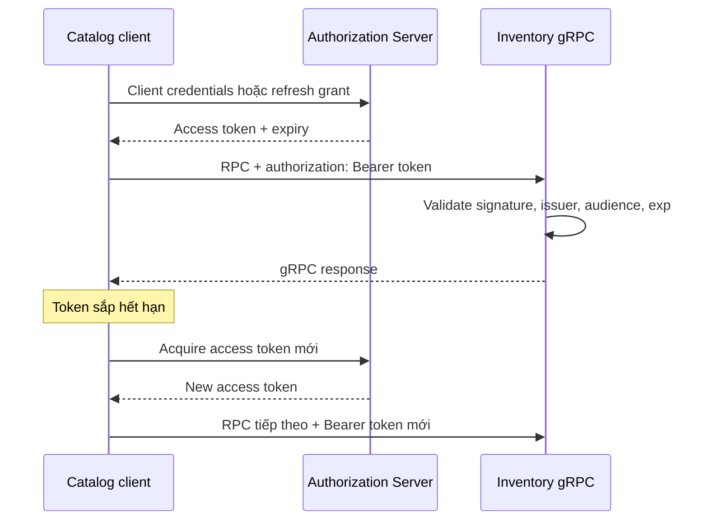

# Rotation access token

## 1. Mục tiêu và phạm vi

Trong hệ thống Spring gRPC, client thường gọi service khác bằng access token được gửi trong gRPC metadata. Access token có thời hạn; khi token sắp hết hạn, client cần lấy token mới và dùng nó cho các RPC tiếp theo. Quá trình này thường được gọi là access-token renewal hoặc token rotation.

Rotation đúng cách giúp giới hạn tác động nếu token bị lộ, hỗ trợ thu hồi quyền truy cập và duy trì kết nối service-to-service mà không cần restart ứng dụng. Nó cần phối hợp với deadline, retry và streaming lifecycle của gRPC.

Cần phân biệt ba hoạt động:

| Hoạt động | Thành phần được thay mới | Mục đích |
| --- | --- | --- |
| Access-token renewal | Access token | Lấy credential ngắn hạn mới để gọi API |
| Refresh-token rotation | Refresh token | Mỗi lần refresh cấp refresh token mới và vô hiệu hóa token cũ theo policy của authorization server |
| Signing-key rotation | Khóa ký JWT | Thay khóa ký; resource server cập nhật public key/JWKS để xác minh token |

Ba hoạt động liên quan nhưng không thay thế nhau. Một JWT access token có thể còn hạn dù signing key mới đã được công bố; resource server cần chấp nhận key cũ trong khoảng chuyển tiếp để xác minh token đã phát hành. Lấy access token mới không đồng nghĩa refresh token hoặc signing key đã được xoay.

## 2. Vòng đời token trong gRPC call

Một luồng service-to-service phổ biến:



Token được gắn vào metadata của từng RPC. Khi token được đổi, các call mới dùng token mới; không cần tạo lại channel nếu endpoint và TLS configuration không đổi.

Không nhúng token vào protobuf request/response, resource name hoặc query string. Không ghi token vào log, trace attribute, exception message hay metric label.

## 3. Access token, refresh token và client credentials

**Access token** là credential mà client trình lên resource server. Nó thường có thời hạn ngắn và mang scope/audience giới hạn.

**Refresh token** được client gửi tới authorization server để xin access token mới. Nó không được gửi tới Inventory hoặc bất kỳ gRPC resource server nào. Với refresh-token rotation, authorization server cấp refresh token mới sau mỗi lần sử dụng và vô hiệu hóa token cũ. Nếu token cũ bị dùng lại, authorization server có thể phát hiện replay và thu hồi cả token family.

**Client credentials** thường phù hợp cho service-to-service machine identity. Client xác thực với authorization server bằng client authentication và xin access token mới khi cần. Grant này thường không cấp refresh token; client chỉ xin access token mới bằng client credentials khi token hết hạn hoặc sắp hết hạn.

Chọn flow theo loại client và authorization server. Không tự xây endpoint cấp token hoặc tự ký JWT trong gRPC client nếu hệ thống đã có OAuth2/OIDC authorization server.

## 4. Thiết kế access token có thời hạn ngắn

Access token nên có thời hạn đủ ngắn để giới hạn thời gian sử dụng nếu bị lộ, audience đúng resource server, scope tối thiểu, issuer rõ ràng và claim cần thiết. Tránh nhúng dữ liệu cá nhân hoặc payload lớn vào token.

Không chọn thời hạn quá ngắn khiến client liên tục xin token và authorization server quá tải. Cũng không chọn thời hạn quá dài chỉ để tránh xử lý renewal. Đánh giá request rate, token endpoint capacity, cache behavior và yêu cầu thu hồi.

Client nên refresh trước expiry một khoảng safety window để tránh request đến server đúng lúc token vừa hết hạn do clock skew hoặc network latency. Dùng đồng bộ thời gian như NTP và không kéo dài acceptance window quá mức để bù đồng hồ sai.

## 5. Cấp access token mới bằng Spring Security OAuth2 Client

Với client credentials, Spring Security OAuth2 Client có thể quản lý authorize và lưu authorized client. Một manager service-side phù hợp cho ứng dụng nền là AuthorizedClientServiceOAuth2AuthorizedClientManager:

```java
@Bean
OAuth2AuthorizedClientManager authorizedClientManager(
        ClientRegistrationRepository registrations,
        OAuth2AuthorizedClientService authorizedClients) {

    ClientCredentialsOAuth2AuthorizedClientProvider provider =
            new ClientCredentialsOAuth2AuthorizedClientProvider();
    provider.setClockSkew(Duration.ofSeconds(60));

    var manager =
            new AuthorizedClientServiceOAuth2AuthorizedClientManager(
                    registrations, authorizedClients);

    manager.setAuthorizedClientProvider(provider);
    return manager;
}
```

Client registration chứa token URI, client ID, client authentication method và scope. Secret client lấy từ secret manager hoặc environment được bảo vệ; không commit vào source control.

Khi cần token:

```java
OAuth2AuthorizeRequest request =
        OAuth2AuthorizeRequest.withClientRegistrationId("inventory")
                .principal("catalog-service")
                .build();

OAuth2AuthorizedClient authorized =
        authorizedClientManager.authorize(request);

if (authorized == null) {
    throw new IllegalStateException("Could not obtain inventory access token");
}

OAuth2AccessToken accessToken = authorized.getAccessToken();
```

Manager/provider kiểm tra trạng thái authorized client và có thể xin token mới khi token cũ đi vào clock-skew window của provider. Ví dụ đặt clock skew 60 giây để khớp safety window minh họa ở cache; điều chỉnh theo latency, độ lệch đồng hồ và Spring Security version đang dùng. Với nhiều thread đồng thời, tránh để mọi request cùng gọi token endpoint khi token hết hạn.

## 6. Cache token và refresh trước expiry

Không gọi authorization server cho mọi gRPC request. Token thường được cache theo client registration và principal. Một token provider nên:

1. Giữ access token hiện tại trong bộ nhớ hoặc authorized-client store phù hợp.
2. Kiểm tra expiresAt trước khi cấp token cho call mới.
3. Refresh trước expiry một khoảng an toàn, ví dụ 30–60 giây tùy clock skew và latency.
4. Dùng single-flight hoặc lock để nhiều thread chỉ kích hoạt một lần refresh.
5. Cập nhật token mới atomic sau khi authorize thành công.
6. Chỉ dùng token cũ khi nó vẫn còn hợp lệ; không gửi token đã hết hạn.
7. Có backoff và giới hạn retry cho token endpoint.

Ví dụ provider tối giản:

```java
public final class CachedAccessTokenProvider {

    private final AtomicReference<OAuth2AccessToken> current =
            new AtomicReference<>();

    public void update(OAuth2AccessToken token) {
        current.set(token);
    }

    public OAuth2AccessToken currentValidToken(Duration safetyWindow) {
        OAuth2AccessToken token = current.get();

        if (token == null || token.getExpiresAt() == null
                || !token.getExpiresAt().isAfter(
                        Instant.now().plus(safetyWindow))) {
            throw new IllegalStateException("Access token requires renewal");
        }

        return token;
    }
}
```

Đây là phần cache tối giản; scheduler hoặc token manager phải cập nhật token trước khi provider được dùng. Production cần xử lý concurrent refresh, authorization server outage, token revocation và process restart. Không persist token vào file cấu hình hoặc image.

Nếu nhiều replica cùng dùng một client identity, cân nhắc cache riêng theo replica hay shared authorized-client store. Shared store cần mã hóa, access control và concurrency semantics; không chia sẻ token qua cache công khai.

## 7. Làm mới token nền và tránh stampede

Một cách vận hành ổn định là refresh nền trước expiry:

- Khi nhận token mới, lên lịch refresh tại expiresAt trừ safety window.
- Chỉ một task được refresh registration/principal tại một thời điểm.
- Nếu refresh thành công, thay token trong cache bằng thao tác atomic và lên lịch lần kế tiếp.
- Nếu refresh thất bại, ghi metric/log không chứa token, thử lại theo exponential backoff và jitter.
- Nếu token hiện tại hết hạn trước khi refresh thành công, fail closed; không gửi token cũ.

Không để token refresh chạy trên Netty event loop hoặc thread xử lý callback gRPC. Token endpoint là network call có thể chậm; thực hiện trên scheduler/executor riêng.

Principal key phải ổn định. Với client credentials, principal catalog-service giúp manager tìm đúng authorized client đã lưu. Nếu mỗi request dùng principal name ngẫu nhiên, cache sẽ phân mảnh và token endpoint có thể bị gọi liên tục.

## 8. Gắn token vào từng gRPC call bằng CallCredentials

gRPC Java cung cấp CallCredentials để thêm metadata theo từng RPC. Cách này phù hợp hơn việc capture token cố định lúc tạo channel, vì token có thể đổi trong khi channel vẫn tồn tại.

Ví dụ credentials đọc token từ cache không blocking:

```java
public final class BearerTokenCallCredentials extends CallCredentials {

    private static final Metadata.Key<String> AUTHORIZATION =
            Metadata.Key.of(
                    "authorization",
                    Metadata.ASCII_STRING_MARSHALLER);

    private final CachedAccessTokenProvider tokenProvider;

    public BearerTokenCallCredentials(
            CachedAccessTokenProvider tokenProvider) {
        this.tokenProvider = tokenProvider;
    }

    @Override
    public void applyRequestMetadata(
            RequestInfo requestInfo,
            Executor appExecutor,
            MetadataApplier applier) {

        try {
            OAuth2AccessToken token =
                    tokenProvider.currentValidToken(Duration.ofSeconds(30));

            Metadata headers = new Metadata();
            headers.put(AUTHORIZATION, "Bearer " + token.getTokenValue());
            applier.apply(headers);

        } catch (RuntimeException unavailable) {
            applier.fail(Status.UNAUTHENTICATED.withDescription(
                    "A valid access token is unavailable"));
        }
    }
}
```

CallCredentials cần trả metadata nhanh. Không gọi token endpoint đồng bộ trong applyRequestMetadata vì callback không nên chặn transport executor. Nếu cần authorize bất đồng bộ, dùng executor riêng rồi gọi applier.apply hoặc applier.fail đúng một lần.

Gắn credentials vào generated stub:

```java
InventoryServiceGrpc.InventoryServiceBlockingStub authenticatedStub =
        inventoryStub.withCallCredentials(bearerTokenCallCredentials);

AvailabilityResponse response =
        authenticatedStub.getAvailability(request);
```

Mỗi RPC mới lấy token hiện tại từ provider. Khi token được refresh, call tiếp theo tự dùng token mới mà không cần rebuild ManagedChannel.

## 9. Xác thực token ở gRPC server

Server phải xác minh access token trên mỗi RPC mới trước khi dispatch service. Với JWT, resource server cần xác minh chữ ký, issuer, thời hạn exp/nbf, audience và policy claim cần thiết.

Spring Security Resource Server cung cấp JwtDecoder. gRPC không tự chạy servlet security filter chain; tích hợp decoder vào gRPC ServerInterceptor hoặc cơ chế auth tương ứng của starter.

Ví dụ interceptor rút gọn:

```java
public final class JwtServerInterceptor implements ServerInterceptor {

    private static final Metadata.Key<String> AUTHORIZATION =
            Metadata.Key.of(
                    "authorization",
                    Metadata.ASCII_STRING_MARSHALLER);

    static final Context.Key<Jwt> CALLER_JWT =
            Context.key("authenticated-jwt");

    private final JwtDecoder jwtDecoder;

    public JwtServerInterceptor(JwtDecoder jwtDecoder) {
        this.jwtDecoder = jwtDecoder;
    }

    @Override
    public <ReqT, RespT> ServerCall.Listener<ReqT> interceptCall(
            ServerCall<ReqT, RespT> call,
            Metadata headers,
            ServerCallHandler<ReqT, RespT> next) {

        String value = headers.get(AUTHORIZATION);
        if (value == null || !value.regionMatches(
                true, 0, "Bearer ", 0, 7)) {
            call.close(Status.UNAUTHENTICATED
                    .withDescription("Missing bearer token"),
                    new Metadata());
            return new ServerCall.Listener<>() {};
        }

        String rawToken = value.substring(7).trim();
        try {
            Jwt jwt = jwtDecoder.decode(rawToken);
            Context context = Context.current()
                    .withValue(CALLER_JWT, jwt);

            return Contexts.interceptCall(
                    context, call, headers, next);

        } catch (JwtException invalidToken) {
            call.close(Status.UNAUTHENTICATED
                    .withDescription("Invalid access token"),
                    new Metadata());
            return new ServerCall.Listener<>() {};
        }
    }
}
```

Đăng ký interceptor toàn cục bằng cơ chế Spring gRPC tương ứng với version starter đang dùng. Contexts.interceptCall khôi phục gRPC Context cho listener callbacks. Ví dụ lưu Jwt vào context để service hoặc authorization layer đọc; nếu dùng Spring method security dựa trên SecurityContextHolder, cần bridge Authentication vào security context cho từng callback/thread. Map scope/scp thành authorities bằng converter/policy được kiểm soát; không coi claim tùy ý do issuer phát hành là quyền truy cập nếu chưa định nghĩa contract. Không giả định servlet filter tự chạy cho gRPC.

## 10. Validate issuer, audience và opaque token

Chỉ decode được JWT chưa đủ. Resource server phải tin đúng issuer và audience. Có thể dùng typed configuration properties để cấp issuer/audience cho decoder:

```java
@ConfigurationProperties(prefix = "security.jwt")
public record SecurityJwtProperties(String issuer, String audience) {}

@Bean
JwtDecoder jwtDecoder(SecurityJwtProperties properties) {
    String issuer = properties.issuer();
    String audience = properties.audience();

    NimbusJwtDecoder decoder =
            NimbusJwtDecoder.withIssuerLocation(issuer).build();

    OAuth2TokenValidator<Jwt> issuerAndTime =
            JwtValidators.createDefaultWithIssuer(issuer);

    OAuth2TokenValidator<Jwt> audienceValidator = jwt -> {
        if (jwt.getAudience().contains(audience)) {
            return OAuth2TokenValidatorResult.success();
        }

        return OAuth2TokenValidatorResult.failure(
                new OAuth2Error("invalid_token"));
    };

    decoder.setJwtValidator(new DelegatingOAuth2TokenValidator<>(
            issuerAndTime, audienceValidator));

    return decoder;
}
```

Đăng ký record cấu hình bằng @EnableConfigurationProperties(SecurityJwtProperties.class) hoặc @ConfigurationPropertiesScan trong application. Issuer validator kiểm tra issuer và timestamp claims theo validator mặc định. Audience validator bảo đảm token được phát hành cho resource server này, không phải API khác. Cần giới hạn thuật toán chữ ký và tin cậy JWKS endpoint/CA theo cấu hình identity provider.

Với opaque access token, dùng token introspection thay vì cố parse như JWT. Introspection response cần xác nhận token còn active, đúng audience/scope theo policy; cache kết quả có giới hạn và không vượt expiry/revocation requirements. JWT tự chứa thường không thể bị thu hồi tức thời ở mọi resource server nếu server chỉ kiểm tra chữ ký và exp; nếu cần thu hồi nhanh, dùng token ngắn hạn kết hợp denylist có kiểm soát hoặc introspection theo yêu cầu bảo mật.

## 11. Access token expiry và gRPC status

Server nên phân biệt authentication failure và authorization failure:

| Tình huống | gRPC status thường dùng |
| --- | --- |
| Thiếu token | UNAUTHENTICATED |
| Token hết hạn, sai chữ ký hoặc issuer | UNAUTHENTICATED |
| Token hợp lệ nhưng thiếu scope/role | PERMISSION_DENIED |
| Authorization server tạm thời không cấp token cho client | Client không gửi RPC hoặc trả lỗi nội bộ phù hợp; không giả thành PERMISSION_DENIED |
| Resource không tồn tại sau khi xác thực thành công | NOT_FOUND |

Không trả chi tiết như nguyên nhân chữ ký hoặc claim sai cho caller. Dùng description tổng quát, log nội bộ có kiểm soát và metric theo loại lỗi không chứa token.

Nếu server trả UNAUTHENTICATED do token hết hạn hoặc stale và client có thể lấy token mới, client có thể refresh rồi retry tối đa một lần khi operation an toàn để retry. Không refresh/retry mù quáng cho token sai issuer, audience hoặc chữ ký; các lỗi cấu hình/credential này cần được sửa. Không retry vô hạn. Không tự refresh/retry PERMISSION_DENIED; token mới không tự cấp thêm quyền. Với mutation RPC, cần idempotency key hoặc contract retry rõ ràng để tránh thực hiện thao tác hai lần.

## 12. Long-lived streaming RPC và token hết hạn

gRPC metadata được gửi khi call bắt đầu. Token không tự thay đổi giữa một streaming RPC đang mở. Nếu token hết hạn sau khi server đã xác thực stream, server thường không tự kiểm tra lại token ở từng message trừ khi ứng dụng triển khai policy riêng.

Với stream kéo dài, chọn policy rõ ràng:

- Giới hạn maximum stream lifetime phù hợp với access-token lifetime.
- Cho phép stream hiện tại hoàn tất sau khi token hết hạn nhưng không cho mở stream mới bằng token cũ, nếu threat model cho phép.
- Đóng stream khi token/session hết hạn hoặc quyền bị thu hồi.
- Client lấy token mới và reconnect bằng resume token/sequence number do protocol định nghĩa.
- Với operation nhạy cảm, kiểm tra authorization lại ở từng message/batch theo policy.

Không gửi refresh token trong stream message để gia hạn call. Nếu protocol cần re-authentication giữa stream, thiết kế message/control flow riêng với credential an toàn, xác minh mỗi lần và kiểm soát replay; thường reconnect bằng access token mới đơn giản hơn.

## 13. Refresh-token rotation và replay detection

Với user-facing client dùng authorization code flow, refresh token có thể được rotate tại authorization server. Mỗi lần refresh thành công, client nhận access token mới và refresh token mới; refresh token cũ bị vô hiệu hóa.

Client phải lưu cặp token mới một cách atomic. Nếu process crash sau khi server đã vô hiệu hóa refresh token cũ nhưng trước khi lưu token mới, session có thể cần đăng nhập lại. Không retry refresh token cũ vô hạn sau lỗi invalid_grant, vì server có thể coi đó là replay.

Refresh token cần được lưu trong secure storage hoặc token vault, mã hóa at rest và giới hạn quyền truy cập. Không lưu refresh token trong gRPC metadata, log, trace hoặc application database không được bảo vệ.

Với service-to-service client credentials, thường không có refresh token. Client lấy access token mới bằng client authentication; rotation của client secret/certificate là quy trình credential riêng.

## 14. Signing-key rotation và JWKS cache

JWT thường có header kid để resource server chọn public key tương ứng từ JWKS. Khi authorization server đổi signing key:

1. Publish public key mới trong JWKS trước khi bắt đầu ký bằng key mới.
2. Bắt đầu phát token mới với kid mới.
3. Giữ public key cũ trong JWKS đủ lâu để xác minh các token cũ còn hạn.
4. Resource server refresh JWKS cache theo policy và xử lý unknown kid.
5. Gỡ key cũ sau thời gian overlap và sau khi token cũ hết hạn theo policy.

Signing-key rotation không phải access-token renewal. Nếu resource server cache JWKS quá lâu, token ký bằng key mới có thể bị từ chối; nếu giữ key cũ quá lâu sau compromise, token cũ có thể tiếp tục được xác minh. Cần có quy trình khẩn cấp để thu hồi key bị lộ và giảm TTL token khi cần.

## 15. Retry, clock skew và availability của token endpoint

Đồng hồ giữa client, authorization server và resource server có thể lệch nhau. Dùng NTP/time synchronization, áp dụng clock skew nhỏ theo policy và refresh trước expiry.

Khi token endpoint lỗi:

- Dùng token cache hiện tại nếu token còn hợp lệ và còn đủ safety window.
- Refresh với exponential backoff và jitter.
- Giới hạn số lần thử và thời gian chờ theo deadline của operation.
- Không gọi token endpoint cho từng RPC trong lúc outage.
- Phát metric cho refresh success/failure, latency và cache age.
- Khi không còn token hợp lệ, fail closed; không gửi token hết hạn hoặc bỏ xác thực.

Không dùng retry policy của gRPC để retry token endpoint vô hạn. Token acquisition và RPC call là hai operation có deadline, error handling và telemetry riêng.

## 16. Bảo vệ token trong vận hành

Access token là bearer credential: ai sở hữu token có thể dùng nó trong phạm vi quyền và thời hạn của token. Bảo vệ ở mọi chặng:

- Chỉ truyền qua TLS; cân nhắc mTLS để xác thực workload ở tầng transport.
- Dùng scope/audience tối thiểu và thời hạn ngắn phù hợp.
- Lấy client secret/private key từ secret manager, không nhúng trong image.
- Không log authorization metadata, token value, refresh token hoặc introspection response nhạy cảm.
- Redact header trong proxy, tracing agent, exception và support bundle.
- Không đưa token vào span attribute, baggage, metric label hoặc protobuf payload.
- Giới hạn quyền đọc token cache và mã hóa nếu lưu bền vững.
- Audit token issuance/renewal/revocation bằng identifier không phải raw token.

TLS bảo vệ dữ liệu trên đường truyền; endpoint, proxy hoặc process có quyền đọc metadata vẫn có thể nhìn thấy bearer token. Vì vậy TLS không phải lý do để log token.

## 17. Kiểm thử access-token rotation

Kiểm thử cần xác minh token mới thực sự được gắn vào call mới và token cũ không tiếp tục được dùng sau expiry:

| Kịch bản | Điều cần xác minh |
| --- | --- |
| Token còn hạn | CallCredentials gửi đúng Bearer token hiện tại |
| Token gần expiry | Provider refresh trước safety window |
| Token hết hạn | Không gửi token cũ; authorize token mới |
| Nhiều RPC đồng thời khi token sắp hết hạn | Chỉ một refresh được thực hiện hoặc được phối hợp |
| Authorization server timeout | Backoff, metric và fail behavior đúng; không log token |
| Token sai issuer/audience/signature | Server trả UNAUTHENTICATED |
| Token hợp lệ thiếu scope | Server trả PERMISSION_DENIED |
| Token refresh thành công | RPC tiếp theo dùng token mới mà không rebuild channel |
| Refresh-token replay | Client không retry token cũ vô hạn; yêu cầu re-auth theo policy |
| Stream vượt expiry | Hành vi tiếp tục/đóng/reconnect đúng policy |
| Signing key đổi | JWKS cache nhận key mới và overlap key cũ |
| Log/trace capture | Không xuất hiện access token hoặc refresh token |

Dùng mock authorization server hoặc test identity provider để điều khiển expiry, refresh, rotation và JWKS. Gọi gRPC qua generated stub/Netty transport để kiểm tra metadata thực tế. Test CallCredentials riêng để xác minh header; test interceptor riêng để xác minh validation và status.

## 18. Lỗi thường gặp

1. **Cache token vô thời hạn.** RPC tiếp tục gửi token đã hết hạn. Kiểm tra expiresAt và refresh trước expiry.
2. **Lấy token cho mọi RPC.** Authorization server bị quá tải. Cache theo registration/principal và phối hợp refresh.
3. **Capture token lúc tạo channel.** Channel sống lâu hơn token. Dùng CallCredentials đọc token hiện tại cho mỗi call.
4. **Gọi token endpoint trên Netty event loop.** Transport bị block. Refresh nền trên executor riêng.
5. **Gửi refresh token tới resource server.** Lộ credential có quyền lớn. Chỉ gửi access token trong Bearer metadata.
6. **Không validate audience.** Token hợp lệ cho API khác bị chấp nhận. Kiểm tra issuer, audience, signature và thời gian.
7. **Coi PERMISSION_DENIED như token hết hạn.** Refresh không sửa được thiếu quyền. Chỉ refresh khi authentication failure phù hợp.
8. **Không định nghĩa stream expiry.** Stream sống lâu hơn session mà không có policy. Giới hạn lifetime hoặc reconnect với token mới.
9. **Nhầm signing-key rotation với access-token rotation.** JWKS cache và token cache có lifecycle khác nhau. Quản lý riêng hai quy trình.
10. **Log token để debug.** Bearer credential bị lộ trong log/trace. Redact từ metadata capture và observability pipeline.
11. **Refresh đồng thời không có coordination.** Token endpoint nhận burst request. Dùng single-flight, lock và jitter.
12. **Retry refresh token cũ sau invalid_grant.** Có thể kích hoạt replay detection. Xử lý theo policy authorization server và yêu cầu re-auth khi cần.

## 19. Bài thực hành

Thiết lập Catalog gọi Inventory bằng OAuth2 client credentials:

1. Đăng ký client catalog-service và resource audience inventory-api tại authorization server.
2. Cấu hình Spring Security OAuth2 Client với client credentials và lưu authorized client theo principal ổn định.
3. Xây token provider có cache, safety window và single-flight refresh.
4. Tạo CallCredentials đọc token hiện tại và gắn Bearer metadata cho từng RPC.
5. Cấu hình Inventory gRPC server interceptor dùng JwtDecoder hoặc introspection để xác thực token, issuer, audience, expiry và scope.
6. Phân biệt UNAUTHENTICATED với PERMISSION_DENIED; chỉ retry authentication failure tối đa một lần khi RPC idempotent.
7. Đặt policy cho stream kéo dài qua expiry: max lifetime, cancellation hoặc reconnect/resume.
8. Mô phỏng authorization server outage, token expiry, signing-key rollover và refresh-token replay nếu flow có refresh token.
9. Kiểm tra logs, traces và metrics không chứa token; đo refresh latency, failure và cache hit.
10. Dùng integration test qua gRPC transport để xác minh token cũ bị từ chối, token mới được dùng cho call kế tiếp và channel không cần rebuild.

**Tự kiểm tra:** Access-token rotation là quá trình client lấy token mới trước khi token hiện tại hết hạn và gắn token mới vào từng gRPC call. Refresh-token rotation là cơ chế riêng của authorization server; signing-key rotation là quy trình cập nhật khóa xác minh JWT/JWKS. Trong Spring gRPC, dùng OAuth2 client manager và cache có expiry/safety window, CallCredentials để cấp Bearer metadata theo call, interceptor để xác minh token ở server, và policy reconnect rõ ràng cho streaming RPC. Bảo vệ token khỏi log/trace, giới hạn retry và kiểm thử cả expiry lẫn rotation.

