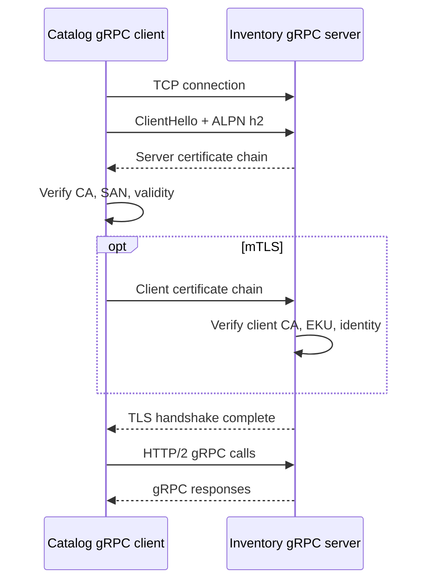

# Rotation server và client certificate

## 1. Vì sao phải xoay certificate?

Trong Spring gRPC, TLS certificate xác thực danh tính server; với mutual TLS (mTLS), client cũng trình certificate để server xác thực workload gọi tới. Certificate X.509 có thời hạn, được ký bởi CA và gắn với public key, subject/SAN cùng các extension xác định mục đích sử dụng.

Certificate rotation là quy trình thay certificate và private key trước khi hết hạn, hoặc ngay khi credential có nguy cơ bị lộ. Mục tiêu là duy trì kết nối an toàn trong lúc thay credential, bảo đảm hai phía vẫn tin đúng CA và tránh downtime khi rollout.

Cần phân biệt các hoạt động:

| Hoạt động | Thay đổi | Tác động |
| --- | --- | --- |
| Server certificate rotation | Leaf certificate và thường cả private key của server | Client xác minh danh tính server mới khi thiết lập TLS connection |
| Client certificate rotation | Leaf certificate và private key của workload client | Server xác minh danh tính client mới trong mTLS handshake |
| CA rotation | CA certificate/public key trong trust bundle | Thay đổi tập issuer mà peer chấp nhận |
| Access-token renewal | OAuth2 access token trong gRPC metadata | Thay credential ở tầng ứng dụng; không thay TLS identity |

Thay leaf certificate do cùng CA ký thường đơn giản hơn thay CA. Khi đổi CA, cả client và server phải có giai đoạn trust overlap để certificate cũ và mới đều được chấp nhận trong thời gian chuyển tiếp.

## 2. Thành phần của một TLS identity

Một TLS identity thường gồm:

- **Private key:** bí mật dùng để chứng minh quyền sở hữu identity; không được gửi cho peer.
- **Leaf certificate:** certificate của server hoặc client, chứa public key và danh tính.
- **Intermediate CA certificates:** chuỗi certificate nối leaf tới trust anchor.
- **Root CA certificate:** trust anchor mà peer cấu hình để xác minh chain.
- **SAN:** Subject Alternative Name, xác định DNS name hoặc IP mà certificate đại diện.
- **Validity:** thời điểm bắt đầu và kết thúc hiệu lực.
- **Key Usage và Extended Key Usage:** giới hạn mục đích sử dụng, ví dụ serverAuth hoặc clientAuth.

Client xác minh server certificate dựa trên trust chain, thời hạn và hostname/SAN. Với mTLS, server cũng xác minh client certificate dựa trên CA được tin cậy và policy identity.

Không chỉ kiểm tra certificate có chữ ký hợp lệ. Cần xác minh SAN khớp hostname client dùng, EKU đúng vai trò, certificate còn hiệu lực và chain kết thúc tại CA được tin cậy.

## 3. TLS handshake trong gRPC

gRPC chạy trên HTTP/2. TLS handshake thiết lập encryption, xác minh certificate và thương lượng ALPN để chọn giao thức HTTP/2. Với mTLS, hai phía đều trình certificate trong handshake.



Certificate được kiểm tra trong TLS handshake khi connection được thiết lập. Các RPC mới chạy trên cùng HTTP/2 connection tiếp tục dùng TLS session/identity đã thương lượng; việc thay file certificate trên disk không tự thay certificate của connection đang mở.

Điểm này đặc biệt quan trọng với channel và streaming RPC sống lâu. Xoay certificate cần tính đến connection pool, reconnect, stream drain và thời điểm tạo TLS connection mới.

## 4. Chuẩn bị certificate cho server và client

Server certificate nên có SAN DNS tương ứng với tên service mà client kết nối, ví dụ inventory.internal.example. Không dựa vào Common Name thay cho SAN. Nếu client kết nối bằng service DNS trong Kubernetes, SAN phải khớp tên DNS mà client thực sự dùng.

Client certificate trong mTLS nên đại diện cho workload identity, không dùng chung một certificate cho mọi ứng dụng nếu cần audit hoặc phân quyền riêng. Identity có thể nằm trong SAN URI, DNS SAN hoặc subject theo policy của tổ chức.

Certificate profile cần xác định:

- Key algorithm và kích thước phù hợp với policy TLS hiện hành.
- EKU serverAuth cho server certificate và clientAuth cho client certificate.
- SAN và identity format thống nhất.
- Validity ngắn phù hợp với quy trình cấp mới tự động.
- CA chain và trust bundle mà peer cần.
- Quy trình thu hồi khi private key bị compromise.

Không tự phát hành certificate production bằng script ad-hoc hoặc CA tự tạo không được quản lý. Dùng PKI/secret manager/certificate authority được tổ chức phê duyệt, có audit và quy trình rotation.

## 5. Cấu hình TLS cho gRPC server bằng Netty

Với transport grpc-netty-shaded, có thể tạo Netty SslContext từ certificate chain và private key:

```java
import io.grpc.netty.shaded.io.netty.handler.ssl.ClientAuth;
import io.grpc.netty.shaded.io.netty.handler.ssl.SslContext;
import io.grpc.netty.shaded.io.netty.handler.ssl.SslContextBuilder;
import io.grpc.netty.shaded.io.grpc.netty.GrpcSslContexts;

import java.io.File;

SslContext serverTls = GrpcSslContexts.configure(
        SslContextBuilder.forServer(
                new File("/run/tls/server-chain.pem"),
                new File("/run/tls/server-key.pem")))
        .trustManager(new File("/run/tls/client-ca-bundle.pem"))
        .clientAuth(ClientAuth.REQUIRE)
        .build();
```

Ví dụ này bật mTLS: server trình certificate của nó và yêu cầu client trình certificate được ký bởi CA trong trust bundle. Nếu chỉ cần TLS một chiều, bỏ cấu hình client trust manager và ClientAuth.REQUIRE; client vẫn xác minh server certificate.

SslContextBuilder thuộc Netty transport. Nếu dự án dùng grpc-netty không shaded, package import khác. Chọn đúng dependency và không trộn class từ shaded với non-shaded Netty.

Trong Spring gRPC, để starter quản lý server lifecycle. Đưa SslContext hoặc certificate material vào extension/customization point mà đúng phiên bản starter hỗ trợ. Không tự tạo thêm một NettyServerBuilder chạy song song với server do Spring quản lý chỉ để cài TLS. Tên property và hook TLS có thể thay đổi theo release; xác minh với version dependency đang khóa trước khi triển khai.

## 6. Cấu hình TLS cho gRPC client

Client cần trust bundle để xác minh server. Với mTLS, client còn trình client certificate và private key:

```java
import io.grpc.ManagedChannel;
import io.grpc.netty.shaded.io.grpc.netty.NettyChannelBuilder;
import io.grpc.netty.shaded.io.grpc.netty.GrpcSslContexts;
import io.grpc.netty.shaded.io.netty.handler.ssl.SslContext;
import io.grpc.netty.shaded.io.netty.handler.ssl.SslContextBuilder;

import java.io.File;

SslContext clientTls = GrpcSslContexts.configure(SslContextBuilder.forClient())
        .trustManager(new File("/run/tls/server-ca-bundle.pem"))
        .keyManager(
                new File("/run/tls/client-chain.pem"),
                new File("/run/tls/client-key.pem"))
        .build();

ManagedChannel channel = NettyChannelBuilder
        .forAddress("inventory.internal.example", 9090)
        .sslContext(clientTls)
        .build();
```

Nếu không dùng mTLS, bỏ keyManager; client vẫn cần trust manager để xác minh server. Không dùng usePlaintext() hoặc trust-all manager trong production.

Hostname verification phải được giữ bật và certificate SAN phải khớp target. Không tắt hostname verification để xử lý lỗi certificate mismatch; sửa SAN hoặc target name cho đúng.

Nếu dùng Spring gRPC client channel factory, cấu hình TLS qua channel customization/configuration mechanism của đúng starter release. Giữ một channel lifecycle do Spring quản lý để shutdown và refresh channel có thể được điều phối thống nhất.

## 7. Leaf certificate rotation khi CA không đổi

Khi CA hiện tại vẫn tin cậy, rotation leaf certificate có thể thực hiện theo quy trình overlap:

1. Tạo private key mới và xin leaf certificate mới cho cùng workload identity.
2. Kiểm tra chain, SAN, EKU, validity và key usage của certificate mới.
3. Đưa certificate/key mới vào secret store hoặc mounted volume theo cơ chế atomic.
4. Tạo TLS context mới hoặc rollout instance mới để listener sử dụng certificate mới.
5. Mở connection mới từ client và xác minh handshake thành công.
6. Drain connection cũ theo policy; giữ instance cũ trong thời gian chuyển tiếp nếu cần.
7. Thu hồi hoặc ngừng sử dụng certificate cũ sau khi xác nhận không còn connection/deployment phụ thuộc.

Không ghi đè từng file certificate và private key theo hai thao tác độc lập nếu process có thể đọc giữa chừng. Có thể tạo một versioned secret directory rồi đổi symlink/mount reference atomically để tránh ghép certificate mới với private key cũ.

Certificate mới phải được kiểm tra bằng chính hostname và trust bundle của client thực tế. Một file PEM parse được chưa chứng minh chain và identity hợp lệ.

## 8. CA rotation và trust overlap

CA rotation phức tạp hơn vì peer phải tin CA mới trước khi certificate do CA mới cấp được sử dụng.

Một quy trình an toàn thường có các giai đoạn:

| Giai đoạn | Trust bundle | Certificate được trình |
| --- | --- | --- |
| 1. Chuẩn bị | Tin CA cũ | Leaf certificate do CA cũ cấp |
| 2. Trust expansion | Tin cả CA cũ và CA mới | Vẫn dùng leaf certificate cũ |
| 3. Leaf migration | Tin cả hai CA | Dần thay leaf certificate sang CA mới |
| 4. Xác minh | Tin cả hai CA | Tất cả workload quan trọng đã dùng CA mới |
| 5. Trust contraction | Chỉ còn CA mới sau khi an toàn | Không còn connection/deployment cần CA cũ |

Không gỡ CA cũ khỏi trust bundle trước khi mọi peer đã chuyển certificate và mọi connection cần thiết đã được drain. Nếu client chưa tin CA mới mà server đã trình certificate mới, handshake sẽ thất bại. Với mTLS, cả client và server trust bundle đều cần được cập nhật theo thứ tự phù hợp.

Trust overlap cần có thời hạn và tiêu chí hoàn tất. Không giữ CA cũ vô thời hạn vì điều đó kéo dài phạm vi tin cậy và có thể duy trì đường xác thực không còn mong muốn.

## 9. Thay certificate trên server đang chạy

Một Netty SslContext thường được tạo từ certificate/key tại thời điểm cấu hình. Thay nội dung file trên disk không bảo đảm context đã tạo sẽ tự đọc lại file hoặc cập nhật certificate cho các handshake sau.

Có ba chiến lược thường gặp:

- **Rolling restart:** tạo instance mới với certificate mới, chờ readiness, chuyển traffic, drain instance cũ rồi dừng. Đây là cách dễ dự đoán và thường phù hợp với Spring Boot.
- **Dynamic certificate provider:** dùng transport/provider hỗ trợ cập nhật TLS material mà không restart. Cần kiểm tra API và semantics của đúng gRPC Netty version, đặc biệt connection mới và session resumption.
- **Controlled server replacement:** đóng server cũ và khởi tạo server mới theo lifecycle được ứng dụng quản lý. Cần tránh hai server tranh chấp cùng port và bảo đảm request drain.

Không giả định Spring gRPC starter tự reload certificate khi Kubernetes Secret được cập nhật. Kiểm tra behavior của phiên bản đang dùng bằng integration test. Nếu không có dynamic reload được hỗ trợ và kiểm chứng, dùng rolling restart.

## 10. Thay client certificate và channel lifecycle

Client certificate thường được đưa vào TLS context của channel. Khi certificate thay đổi, channel hiện tại có thể tiếp tục tạo RPC trên connection đã handshake bằng certificate cũ.

Quy trình client rotation:

1. Nhận certificate/key mới và xác minh chain, SAN, EKU, expiry.
2. Tạo TLS context/channel mới với trust bundle và client identity mới.
3. Gửi một RPC kiểm tra qua channel mới.
4. Chuyển stub/client factory sang channel mới.
5. Ngừng cấp call mới cho channel cũ.
6. Chờ unary calls đang chạy và xử lý streaming calls theo reconnect/resume contract.
7. Shutdown channel cũ sau drain timeout.

Không đóng channel cũ ngay khi thay certificate nếu nó đang phục vụ stream mà protocol yêu cầu duy trì. Ngược lại, không giữ channel cũ vô thời hạn vì nó tiếp tục dùng identity cũ trên các connection hiện tại.

Một factory có thể quản lý channel generation: mỗi lần rotation tạo generation mới, atomically chuyển client reference và drain generation cũ. Mọi channel cần shutdown đúng lifecycle để giải phóng event loop, connection và native buffers.

## 11. Streaming RPC và certificate expiry

TLS certificate được xác minh lúc handshake; certificate không được gửi lại cho từng message. Vì vậy, stream đang mở không tự động đổi client/server certificate khi file certificate được rotate hoặc khi certificate hết hạn.

Cần định nghĩa policy cho long-lived stream:

- Giới hạn stream lifetime để không giữ TLS identity cũ quá lâu.
- Khi rotation, ngừng nhận stream mới trên instance cũ và drain stream hiện tại trong thời gian giới hạn.
- Client reconnect bằng certificate/channel mới.
- Dùng sequence number, resume token hoặc cursor nếu cần tiếp tục từ vị trí đã nhận.
- Với workload nhạy cảm, kiểm tra authorization/session state ở application layer theo chu kỳ hoặc từng message.

Không nhầm certificate rotation với access-token renewal. Token có thể được cấp lại cho RPC mới bằng metadata; certificate identity gắn với TLS connection và cần channel/connection mới để handshake bằng credential mới.

## 12. Certificate rotation trong Kubernetes và container

Certificate thường được cấp vào pod bằng Secret volume, CSI driver hoặc agent. Cần hiểu cách cập nhật file của cơ chế đang dùng:

- Kubernetes Secret volume có thể cập nhật projected content theo eventual consistency.
- subPath mount có thể không nhận bản cập nhật theo cách mong muốn; cần kiểm tra behavior cụ thể.
- Process Java không tự reload certificate chỉ vì file được cập nhật.
- Nếu ứng dụng cần watch file, watcher phải theo dõi đúng file/symlink và xử lý update atomic.
- Secret không nên được copy vào image layer hoặc lưu trong source repository.

Một rollout an toàn có thể dùng versioned Secret hoặc checksum annotation để tạo pod mới khi certificate thay đổi. Readiness chỉ chuyển thành ready sau khi server bind thành công và TLS context được tạo từ đúng certificate version.

Không in private key hoặc nội dung secret trong startup logs. Có thể log fingerprint, serial number, issuer và notAfter để audit, miễn là policy cho phép và không lộ key material.

## 13. Revocation và certificate compromise

Nếu private key bị lộ, chỉ chờ certificate hết hạn là không đủ. Cần quy trình incident:

1. Xác định workload, serial number, issuer và phạm vi certificate bị ảnh hưởng.
2. Ngừng cấp mới và revoke certificate tại CA/PKI.
3. Cấp identity/key mới và triển khai tới workload hợp lệ.
4. Cập nhật trust/revocation policy hoặc denylist theo khả năng của TLS stack.
5. Drain hoặc terminate connection đã được thiết lập bằng credential bị compromise.
6. Kiểm tra audit log, connection logs và hoạt động bất thường.
7. Xác minh tất cả instance đã chuyển sang identity mới.

CRL/OCSP và revocation checking phụ thuộc TLS provider, trust manager và cách cấu hình transport. Không giả định gRPC Java tự động kiểm tra revocation chỉ vì CA đã revoke certificate. Nếu yêu cầu thu hồi tức thời, cần thiết kế enforcement rõ ràng: short-lived certificate, connection termination, denylist/authorization layer hoặc provider hỗ trợ revocation checking.

Với mTLS, xác thực certificate chứng minh workload identity ở tầng transport. Authorization cho từng RPC vẫn cần policy ứng dụng dựa trên identity đã xác minh, method và quyền. Certificate hợp lệ không đồng nghĩa client được phép gọi mọi service method.

## 14. Monitoring certificate expiry và rotation health

Rotation cần được giám sát trước khi certificate sắp hết hạn. Thu thập dữ liệu vận hành không chứa private key:

- Certificate notAfter và số ngày còn lại.
- Serial number, issuer và fingerprint hiện hành.
- TLS handshake success/failure theo reason đã phân loại.
- Tỷ lệ connection mới dùng certificate generation mới.
- Số client/server instance còn dùng certificate cũ.
- Rotation success/failure và thời gian rollout.
- mTLS authentication failures và trust-chain errors.

Đặt alert theo nhiều ngưỡng, ví dụ 30 ngày, 14 ngày, 7 ngày và 24 giờ trước expiry, tùy thời gian cấp phát và rollout thực tế. Cảnh báo cả certificate chưa hết hạn nhưng rotation job thất bại hoặc workload chưa nhận version mới.

Không dùng serial number hoặc fingerprint làm metric label có cardinality không giới hạn. Có thể ghi chúng trong structured audit log hoặc resource metadata có kiểm soát; metrics nên dùng service, environment và trạng thái hữu hạn.

## 15. Cấu hình và vận hành trong Spring gRPC

Spring Boot nên quản lý service beans, gRPC server lifecycle và client channel lifecycle. Certificate path, trust bundle, rotation policy và endpoint phải được externalize; không build một JAR riêng cho mỗi certificate.

Khi triển khai:

1. Pin Spring Boot, Spring gRPC starter và gRPC Netty versions tương thích.
2. Xác định rõ starter đang dùng hỗ trợ TLS property hay customization hook nào.
3. Cấu hình server certificate, client trust bundle và mTLS requirement qua cơ chế được version đó hỗ trợ.
4. Cấu hình outbound channel với server trust bundle và client identity khi cần mTLS.
5. Mount secret bằng quyền đọc tối thiểu và có version/rotation metadata.
6. Dùng lifecycle manager hoặc rolling deployment để thay context/channel.
7. Tích hợp readiness, graceful shutdown và stream drain.
8. Theo dõi certificate expiry, handshake failure và rollout status.

Không tự thêm một Netty server ngoài Spring context chỉ để thử certificate mới trong production. Mọi server/channel phải có một lifecycle owner rõ ràng. Tên property cụ thể thay đổi theo starter release; dùng configuration metadata và tài liệu của dependency đang khóa, sau đó xác minh bằng test.

## 16. Kiểm thử certificate rotation

Kiểm thử nên dùng test CA riêng, không dùng private key production. Cần bao phủ:

| Kịch bản | Kết quả mong đợi |
| --- | --- |
| Server certificate hợp lệ | Client handshake thành công và xác minh đúng SAN |
| Server certificate sai SAN | Client từ chối handshake |
| Certificate hết hạn | Handshake mới thất bại |
| Client certificate hợp lệ trong mTLS | Server xác thực workload thành công |
| Client không trình certificate khi mTLS bắt buộc | Server từ chối handshake |
| Client certificate do CA không tin cậy cấp | Server từ chối handshake |
| Leaf certificate mới cùng CA | Connection mới thành công sau rollout/reload |
| CA trust overlap | Peer chấp nhận certificate cũ và mới trong giai đoạn chuyển tiếp |
| Gỡ CA cũ quá sớm | Test phát hiện handshake với peer cũ thất bại |
| Channel cũ và channel mới cùng tồn tại | Call mới đi qua channel mới; channel cũ drain đúng policy |
| Streaming RPC trong lúc rotation | Stream hoàn tất hoặc reconnect/resume theo contract |
| Certificate bị revoke/compromise | Enforcement theo policy thực tế được kiểm chứng |

Dùng Netty gRPC integration test để kiểm tra handshake HTTP/2/ALPN, SAN, trust chain và mTLS. Unit test SslContext parse được certificate không đủ chứng minh client/server production tin nhau.

Thử rotation theo đúng thứ tự rollout trong staging: cập nhật trust bundle, cập nhật leaf certificate, mở connection mới, drain connection cũ và cuối cùng gỡ CA cũ. Kiểm tra cả pod restart, Secret update và channel replacement.

## 17. Lỗi thường gặp

1. **Chỉ thay file certificate trên disk.** SslContext hoặc connection cũ vẫn giữ credential cũ. Dùng reload mechanism đã kiểm chứng hoặc rolling restart/channel replacement.
2. **Thay server certificate trước khi client tin CA mới.** TLS handshake thất bại. Mở trust overlap trước khi chuyển leaf certificate.
3. **Gỡ CA cũ quá sớm.** Client hoặc server còn dùng certificate cũ bị từ chối. Chỉ contract trust sau khi migration hoàn tất.
4. **Certificate thiếu SAN đúng hostname.** Client hostname verification thất bại. Cấp lại certificate với SAN phù hợp.
5. **Dùng nhầm EKU.** Certificate clientAuth bị dùng cho server hoặc ngược lại. Kiểm tra profile và EKU.
6. **Dùng chung client certificate cho mọi workload.** Khó audit và thu hồi riêng. Cấp identity riêng theo workload hoặc trust domain.
7. **Tin rằng Secret volume update tự reload Java TLS.** File đổi nhưng process không đổi context. Theo dõi version và kích hoạt rollout/reload rõ ràng.
8. **Đóng channel ngay khi rotation.** RPC/stream đang chạy bị ngắt không có kế hoạch. Drain và reconnect theo contract.
9. **Cho rằng revoke CA sẽ ngắt connection hiện tại.** TLS connection đã handshake có thể tiếp tục. Terminate/drain connection bị ảnh hưởng theo incident policy.
10. **Dùng trust-all hoặc tắt hostname verification để sửa lỗi.** Mất xác thực server. Sửa CA chain, SAN và trust bundle.
11. **Đưa private key vào image hoặc log.** Credential có thể bị lộ lâu dài. Dùng secret manager/mounted volume và không xuất key material.
12. **Không có alert trước expiry.** Certificate hết hạn làm toàn bộ handshake mới thất bại. Theo dõi notAfter và rotation completion.

## 18. Bài thực hành

Thiết lập mTLS và xoay certificate cho Catalog gọi Inventory:

1. Tạo test CA, server certificate cho inventory.internal.example và client certificate riêng cho Catalog.
2. Cấu hình Inventory gRPC server trình server chain và yêu cầu client certificate do CA client tin cậy cấp.
3. Cấu hình Catalog trust server CA và trình client certificate qua TLS context của gRPC channel.
4. Xác minh SAN, EKU, issuer, validity và handshake bằng Netty integration test.
5. Phát hành leaf certificate mới cùng CA; rollout server/client theo chiến lược overlap.
6. Tạo channel mới bằng client certificate mới, chuyển call mới sang channel mới và drain channel cũ.
7. Thử CA rotation: thêm CA mới vào trust bundle của cả hai phía trước, sau đó thay leaf certificate, cuối cùng mới gỡ CA cũ.
8. Mô phỏng certificate hết hạn, sai SAN, client thiếu certificate và CA không tin cậy.
9. Mô phỏng stream kéo dài trong lúc rotation; xác minh drain/reconnect/resume.
10. Tạo alert trước expiry và dashboard hiển thị certificate generation, handshake failures và rotation status mà không lộ private key.

**Tự kiểm tra:** Server/client certificate rotation thay TLS identity được xác minh trong handshake; refresh access token thay credential ở tầng gRPC metadata. Khi chỉ thay leaf certificate cùng CA, triển khai certificate mới rồi tạo TLS context/connection mới và drain connection cũ. Khi thay CA, mở trust overlap trên cả hai phía trước khi chuyển leaf certificate, chỉ gỡ CA cũ sau khi migration hoàn tất. Trong Spring gRPC, để starter quản lý server/channel lifecycle, externalize secret, kiểm thử SAN/EKU/mTLS và theo dõi expiry, handshake cùng rotation completion.

