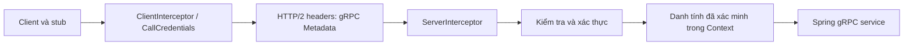

# Metadata injection từ client

Metadata cho phép client gửi thông tin đi kèm một lời gọi gRPC mà không phải thêm các trường đó vào message Protocol Buffers. Cơ chế này hữu ích cho xác thực, truy vết, định tuyến và tương quan log. Tuy nhiên, mọi metadata do client gửi đều là dữ liệu đầu vào do phía gọi kiểm soát. Server phải kiểm tra và xác lập độ tin cậy trước khi dùng chúng cho bảo mật hoặc quyết định nghiệp vụ.

Trong dịch vụ Spring gRPC, điểm xử lý phù hợp cho metadata ở cấp RPC thường là `ServerInterceptor`. Interceptor đọc metadata lúc lời gọi bắt đầu, xác thực thông tin cần thiết, rồi truyền danh tính đã xác minh qua `io.grpc.Context` đến service. Các service dùng danh tính này để kiểm tra quyền truy cập.

## 1. Metadata nằm ở đâu trong một RPC?

gRPC metadata là tập các cặp key-value gắn với một RPC. Nó được truyền qua HTTP/2 headers và trailers, tách khỏi message Protobuf:

- **Request headers** do client gửi khi bắt đầu RPC, trước message đầu tiên.
- **Response headers** do server có thể gửi trước message phản hồi đầu tiên.
- **Trailers** do server gửi khi RPC kết thúc, thường chứa trạng thái RPC và có thể có metadata bổ sung.

Metadata không phải là một phần của schema `.proto`. Server nhận request metadata trong tham số `headers` của `ServerInterceptor.interceptCall`.

Một RPC streaming cũng chỉ có một lần bắt đầu RPC và một bộ metadata ban đầu. Các message tiếp theo đi trong stream; chúng không tạo ra một bộ request metadata mới. Nếu dữ liệu thay đổi theo từng message, hãy đặt dữ liệu đó trong message Protobuf và kiểm tra ở tầng service.

## 2. Vì sao metadata từ client phải được xem là không đáng tin?

Client có thể tự tạo metadata, đổi giá trị, gửi nhiều giá trị cho cùng một key hoặc bỏ qua một key mà server mong đợi. Một client hợp lệ cũng có thể bị cấu hình sai; một client độc hại có thể cố tình giả mạo thông tin để vượt qua kiểm soát truy cập.

Ví dụ, client có thể gửi:

    x-user-id: admin
    x-role: ADMIN
    x-tenant-id: tenant-vip
    x-request-id: mobile-2026-00042

Các chuỗi trên chỉ chứng minh client đã gửi những giá trị đó. Chúng không chứng minh người gọi thực sự là `admin`, có quyền `ADMIN`, hoặc thuộc tenant `tenant-vip`.

Phân biệt ba khái niệm:

| Khái niệm | Câu hỏi cần trả lời | Nguồn tin cậy |
|---|---|---|
| Metadata | RPC đang mang thêm thông tin gì? | Dữ liệu nhận từ client hoặc hạ tầng |
| Authentication | Ai đang gọi RPC? | Token/chứng thư đã được server xác minh |
| Authorization | Người gọi được phép làm gì? | Chính sách quyền dựa trên danh tính đã xác minh |

Không dùng metadata tùy ý để thay thế authentication hoặc authorization.

### Phân loại metadata thường gặp

| Key | Cách xử lý an toàn |
|---|---|
| `authorization` | Xem là credential chưa xác minh; kiểm tra chữ ký, issuer, audience, thời hạn và các điều kiện của token |
| `x-user-id`, `x-role`, `x-permission` | Không lấy làm danh tính hoặc quyền; lấy các thuộc tính này từ principal do server tạo sau authentication |
| `x-tenant-id` | Chỉ xem là tenant mà client muốn truy cập; kiểm tra tenant đó thuộc phạm vi principal được phép |
| `x-request-id` | Có thể dùng để tương quan log sau khi kiểm tra độ dài, ký tự và số lượng giá trị; có thể tạo ID mới nếu giá trị không hợp lệ |
| `traceparent`, `baggage` | Để thư viện tracing phân tích; không dùng làm căn cứ cấp quyền và không đưa dữ liệu nhạy cảm vào baggage |
| `x-forwarded-for` | Chỉ tin khi request đến từ proxy đã được cấu hình tin cậy và proxy loại bỏ hoặc ghi đè giá trị do client gửi |

Nếu gateway xác thực người dùng rồi chèn `x-user-id`, server phía sau chỉ có thể tin giá trị đó khi đường truyền từ gateway được bảo vệ, gateway loại bỏ giá trị cùng tên do client cung cấp và server chỉ nhận lưu lượng từ gateway đáng tin. Nếu client có thể gọi thẳng server, header đó vẫn là đầu vào do client kiểm soát.

## 3. Các dạng giả mạo và lỗi cần phòng ngừa

### Giả mạo danh tính hoặc vai trò

Client gửi `x-user-id: admin` hoặc `x-role: ADMIN` để service hiểu nhầm người gọi là quản trị viên. Nếu service đọc trực tiếp các key này, client có thể tự nâng quyền.

**Cách xử lý:** xác minh credential trước, tạo principal ở phía server, rồi kiểm tra quyền dựa trên principal. Không chấp nhận vai trò do client tự khai báo.

### Chọn tenant ngoài phạm vi được cấp

Một client có thể thay `x-tenant-id` từ tenant của mình sang tenant khác. Nếu service dùng header làm điều kiện truy vấn dữ liệu mà không kiểm tra quyền, đây có thể trở thành lỗi truy cập chéo tenant.

**Cách xử lý:** xác minh token hoặc chứng thư để lấy danh sách tenant được phép. Nếu client gửi tenant đích, đối chiếu tenant đó với phạm vi đã xác minh trước khi truy vấn dữ liệu. Nếu mô hình ứng dụng chỉ cho phép một tenant trên mỗi principal, có thể lấy tenant trực tiếp từ principal và bỏ qua giá trị do client gửi.

### Metadata lặp hoặc không đúng định dạng

Metadata là danh sách các cặp key-value, không nên mặc định rằng một key chỉ xuất hiện đúng một lần. Với các key bảo mật như `authorization`, việc nhận nhiều giá trị cần được xử lý rõ ràng; chọn tùy tiện một giá trị có thể tạo khác biệt giữa các lớp xử lý.

**Cách xử lý:** dùng `Metadata.getAll(key)` để kiểm tra số lượng giá trị. Với credential, từ chối nếu thiếu, rỗng hoặc có nhiều giá trị. Với metadata tùy chọn như request ID, có thể bỏ giá trị không hợp lệ và sinh ID mới theo chính sách của hệ thống.

### Metadata quá lớn hoặc có dữ liệu không cần thiết

Metadata được gửi trong headers và không phải payload có flow control như message streaming. Một tập headers lớn làm tăng chi phí xử lý, bộ nhớ và có thể vượt giới hạn của gRPC server hoặc proxy. Giới hạn cụ thể phụ thuộc implementation và hạ tầng; hướng dẫn gRPC đề xuất giới hạn request headers mặc định khoảng 8 KiB, nhưng không nên coi con số đó là giới hạn đồng nhất của mọi hệ thống.

**Cách xử lý:** giới hạn kích thước metadata ở server và proxy, giới hạn độ dài từng giá trị ở tầng ứng dụng, chỉ cho phép các key cần thiết và tránh nhét dữ liệu nghiệp vụ lớn vào metadata.

### Chuyển tiếp metadata không kiểm soát

Một service nhận request rồi sao chép toàn bộ metadata sang service phía sau có thể vô tình chuyển tiếp token, tenant giả mạo, header nội bộ hoặc dữ liệu nhạy cảm.

**Cách xử lý:** tạo metadata outbound mới theo allowlist. Chỉ chuyển tiếp các trường có mục đích rõ ràng, ví dụ trace context đã được parser chấp nhận và request ID đã được chuẩn hóa. Với credential downstream, dùng credential dành cho audience của service đích hoặc cơ chế token exchange; không tự động chuyển tiếp bearer token của người dùng.

## 4. Gửi metadata từ client Java

Để gửi metadata tùy chỉnh, tạo `Metadata.Key` với kiểu marshaller phù hợp. Ví dụ sau gửi một request ID dạng ASCII:

    import io.grpc.Channel;
    import io.grpc.ClientInterceptors;
    import io.grpc.Metadata;
    import io.grpc.stub.MetadataUtils;

    public final class GrpcClientFactory {

        private static final Metadata.Key<String> REQUEST_ID =
                Metadata.Key.of(
                        "x-request-id",
                        Metadata.ASCII_STRING_MARSHALLER);

        private GrpcClientFactory() {
        }

        public static OrdersGrpc.OrdersBlockingStub createStub(Channel channel) {
            Metadata headers = new Metadata();
            headers.put(REQUEST_ID, "web-req-42");

            Channel channelWithHeaders = ClientInterceptors.intercept(
                    channel,
                    MetadataUtils.newAttachHeadersInterceptor(headers));

            return OrdersGrpc.newBlockingStub(channelWithHeaders);
        }
    }

Interceptor trong ví dụ gắn cùng metadata vào các RPC đi qua channel đã bọc. Cách này phù hợp với giá trị cố định hoặc metadata không nhạy cảm. Với request ID thay đổi theo từng RPC, hãy tạo metadata theo từng lời gọi bằng client interceptor phù hợp. Với bearer token thay đổi theo người dùng hoặc thời điểm, ưu tiên `CallCredentials` hoặc interceptor xác thực của Spring gRPC để lấy credential đúng lúc gửi request; không giữ token của một người dùng trong metadata cố định của channel dùng chung.

Không đưa mật khẩu, access token hoặc dữ liệu cá nhân vào request ID, trace baggage hay các key dùng để log.

### Quy tắc đặt key và kiểu dữ liệu

- Key metadata không phân biệt chữ hoa/chữ thường; nên dùng chữ thường nhất quán.
- Key dùng ký tự ASCII và không được bắt đầu bằng tiền tố `grpc-`, vì tiền tố này dành riêng cho gRPC.
- Key có giá trị ASCII dùng `Metadata.ASCII_STRING_MARSHALLER`.
- Key có giá trị nhị phân phải kết thúc bằng `-bin` và dùng `Metadata.BINARY_BYTE_MARSHALLER`.
- Đừng tự chuyển byte nhị phân thành chuỗi tùy tiện hoặc dùng ASCII marshaller cho dữ liệu nhị phân.

Ví dụ khai báo key nhị phân:

    private static final Metadata.Key<byte[]> CUSTOM_PAYLOAD =
            Metadata.Key.of(
                    "x-custom-payload-bin",
                    Metadata.BINARY_BYTE_MARSHALLER);

Chỉ dùng metadata nhị phân khi thực sự cần dữ liệu nhị phân nhỏ gắn với RPC. Dữ liệu nghiệp vụ nên nằm trong message Protobuf để có schema, khả năng tương thích và kiểm tra kiểu rõ ràng.

## 5. Đọc và chuẩn hóa metadata bằng ServerInterceptor

`ServerInterceptor` là điểm tập trung để xử lý hành vi dùng chung ở cấp RPC như request ID, authentication, logging và policy. Interceptor chạy trước khi logic của service xử lý message.

Ví dụ sau nhận `x-request-id`. Giá trị chỉ được giữ lại nếu có đúng một giá trị và khớp định dạng cho phép. Nếu thiếu hoặc sai, server tạo UUID mới. Chính sách này phù hợp với request ID dùng để tương quan log; không áp dụng cách tự thay thế im lặng cho credential hoặc tenant.

    import io.grpc.Context;
    import io.grpc.Contexts;
    import io.grpc.Metadata;
    import io.grpc.ServerCall;
    import io.grpc.ServerCallHandler;
    import io.grpc.ServerInterceptor;
    import java.util.Iterator;
    import java.util.UUID;

    public final class RequestIdServerInterceptor implements ServerInterceptor {

        private static final Metadata.Key<String> REQUEST_ID =
                Metadata.Key.of(
                        "x-request-id",
                        Metadata.ASCII_STRING_MARSHALLER);

        public static final Context.Key<String> REQUEST_ID_CONTEXT =
                Context.key("requestId");

        @Override
        public <ReqT, RespT> ServerCall.Listener<ReqT> interceptCall(
                ServerCall<ReqT, RespT> call,
                Metadata headers,
                ServerCallHandler<ReqT, RespT> next) {

            String requestId = onlyValue(headers, REQUEST_ID);
            if (!isValidRequestId(requestId)) {
                requestId = UUID.randomUUID().toString();
            }

            Context context = Context.current()
                    .withValue(REQUEST_ID_CONTEXT, requestId);

            return Contexts.interceptCall(context, call, headers, next);
        }

        private static <T> T onlyValue(
                Metadata metadata,
                Metadata.Key<T> key) {
            Iterable<T> values = metadata.getAll(key);
            if (values == null) {
                return null;
            }

            Iterator<T> iterator = values.iterator();
            if (!iterator.hasNext()) {
                return null;
            }

            T value = iterator.next();
            return iterator.hasNext() ? null : value;
        }

        private static boolean isValidRequestId(String value) {
            return value != null
                    && value.matches("[A-Za-z0-9._-]{1,64}");
        }
    }

`Contexts.interceptCall` gắn context cho quá trình xử lý RPC và các callback của listener. Service có thể đọc request ID bằng `RequestIdServerInterceptor.REQUEST_ID_CONTEXT.get()`:

    String requestId =
            RequestIdServerInterceptor.REQUEST_ID_CONTEXT.get();

Không lưu request ID vào field của singleton service hoặc interceptor. Giá trị này thuộc về một RPC; dùng `Context` giúp tránh việc request đồng thời ghi đè dữ liệu của nhau. Khi tự tạo executor hoặc chuyển xử lý sang tác vụ bất đồng bộ, phải bảo đảm context cần thiết được truyền theo cơ chế propagation phù hợp.

## 6. Xác thực credential và tạo principal phía server

Nếu client gửi bearer token trong `authorization`, server phải xác minh token trước khi coi bất kỳ claim nào là danh tính. Quy trình xác minh thường bao gồm:

1. Chỉ chấp nhận đúng một giá trị `authorization` theo định dạng mà hệ thống hỗ trợ.
2. Kiểm tra chữ ký bằng khóa tin cậy và thuật toán nằm trong allowlist.
3. Kiểm tra `issuer`, `audience`, `exp`, `nbf` và các claim bắt buộc.
4. Ánh xạ subject và quyền đã xác minh thành principal nội bộ.
5. Gắn principal vào `io.grpc.Context` trong phạm vi RPC.
6. Trả `UNAUTHENTICATED` khi credential thiếu hoặc không hợp lệ; chỉ tiếp tục đến service sau khi authentication thành công.

Không chỉ decode JWT rồi tin các claim. Decode chỉ đọc nội dung token; nó không chứng minh token do issuer tin cậy phát hành hoặc chưa bị sửa đổi.

Ví dụ dưới đây minh họa cấu trúc interceptor. `TokenVerifier` là adapter của ứng dụng tới thư viện hoặc hệ thống xác minh token; nó phải thực hiện đầy đủ các bước xác minh ở trên. Ví dụ không tự cài đặt thuật toán JWT.

    import io.grpc.Context;
    import io.grpc.Contexts;
    import io.grpc.Metadata;
    import io.grpc.ServerCall;
    import io.grpc.ServerCallHandler;
    import io.grpc.ServerInterceptor;
    import io.grpc.Status;
    import java.util.Iterator;
    import java.util.Set;

    public final class AuthenticationServerInterceptor
            implements ServerInterceptor {

        private static final Metadata.Key<String> AUTHORIZATION =
                Metadata.Key.of(
                        "authorization",
                        Metadata.ASCII_STRING_MARSHALLER);

        public static final Context.Key<AuthenticatedPrincipal> PRINCIPAL =
                Context.key("authenticatedPrincipal");

        private final TokenVerifier tokenVerifier;

        public AuthenticationServerInterceptor(TokenVerifier tokenVerifier) {
            this.tokenVerifier = tokenVerifier;
        }

        @Override
        public <ReqT, RespT> ServerCall.Listener<ReqT> interceptCall(
                ServerCall<ReqT, RespT> call,
                Metadata headers,
                ServerCallHandler<ReqT, RespT> next) {

            String authorization = onlyValue(headers, AUTHORIZATION);
            if (authorization == null
                    || !authorization.regionMatches(
                            true, 0, "Bearer ", 0, 7)) {
                return reject(call);
            }

            String token = authorization.substring(7);
            if (token.isBlank() || token.indexOf(' ') >= 0) {
                return reject(call);
            }

            try {
                AuthenticatedPrincipal principal =
                        tokenVerifier.verify(token);

                Context context = Context.current()
                        .withValue(PRINCIPAL, principal);

                return Contexts.interceptCall(
                        context, call, headers, next);
            }
            catch (InvalidTokenException exception) {
                return reject(call);
            }
        }

        private static <T> T onlyValue(
                Metadata metadata,
                Metadata.Key<T> key) {
            Iterable<T> values = metadata.getAll(key);
            if (values == null) {
                return null;
            }

            Iterator<T> iterator = values.iterator();
            if (!iterator.hasNext()) {
                return null;
            }

            T value = iterator.next();
            return iterator.hasNext() ? null : value;
        }

        private static <ReqT, RespT> ServerCall.Listener<ReqT> reject(
                ServerCall<ReqT, RespT> call) {
            call.close(
                    Status.UNAUTHENTICATED.withDescription(
                            "Missing or invalid credentials"),
                    new Metadata());
            return new ServerCall.Listener<ReqT>() { };
        }
    }

    public record AuthenticatedPrincipal(
            String subject,
            Set<String> authorities,
            Set<String> tenantIds) {
    }

    public interface TokenVerifier {
        AuthenticatedPrincipal verify(String token)
                throws InvalidTokenException;
    }

`InvalidTokenException` ở đây là exception do adapter xác minh token của ứng dụng định nghĩa. Trong triển khai thực tế, không ghi token hoặc nội dung credential vào log. Phản hồi lỗi cũng không nên tiết lộ chi tiết như token sai chữ ký, token hết hạn hay subject nào không tồn tại.

Sau authentication, service đọc principal từ context:

    AuthenticatedPrincipal principal =
            AuthenticationServerInterceptor.PRINCIPAL.get();

    if (principal == null
            || !principal.authorities().contains("orders:read")) {
        responseObserver.onError(
                Status.PERMISSION_DENIED.asRuntimeException());
        return;
    }

Đoạn kiểm tra quyền chỉ minh họa cho service thuần gRPC. Với ứng dụng Spring Security, nên dùng cơ chế authorization tích hợp để chính sách tập trung và dễ kiểm thử. Principal phải được tạo từ credential đã xác minh; không lấy authorities từ `x-role` hoặc một metadata tùy chỉnh khác.

## 7. Đăng ký interceptor trong Spring gRPC

Với Spring gRPC hiện hành, có thể đăng ký `ServerInterceptor` như một Spring bean và đánh dấu `@GlobalServerInterceptor` để áp dụng cho tất cả service. `@Order` xác định thứ tự các global interceptor.

    import io.grpc.ServerInterceptor;
    import org.springframework.context.annotation.Bean;
    import org.springframework.context.annotation.Configuration;
    import org.springframework.core.annotation.Order;
    import org.springframework.grpc.server.GlobalServerInterceptor;

    @Configuration(proxyBeanMethods = false)
    public class GrpcMetadataConfiguration {

        @Bean
        @GlobalServerInterceptor
        @Order(100)
        ServerInterceptor requestIdServerInterceptor() {
            return new RequestIdServerInterceptor();
        }
    }

Nếu chỉ một service cần interceptor, có thể đăng ký bean interceptor rồi khai báo nó trong thuộc tính `interceptors` hoặc `interceptorNames` của `@GrpcService`. Global interceptor được áp dụng theo thứ tự sắp xếp; interceptor riêng của service được áp dụng sau global interceptor theo cấu hình mặc định. Khi kết hợp nhiều interceptor, hãy khai báo thứ tự rõ ràng và kiểm thử hành vi thực tế.

Lưu ý phân biệt thư viện: Spring gRPC dùng `org.springframework.grpc.server.GlobalServerInterceptor`. Một số dự án dùng `grpc-spring-boot-starter` của grpc-ecosystem/net.devh có annotation và extension point riêng, chẳng hạn `@GrpcGlobalServerInterceptor`. Không trộn import hoặc ví dụ cấu hình giữa hai starter; hãy kiểm tra dependency thực tế của dự án.

### Kết hợp với Spring Security

Spring gRPC hỗ trợ tích hợp Spring Security thông qua `AuthenticationManager`, `AuthenticationProcessInterceptor` và `GrpcSecurity`. Với OAuth2 Resource Server, cấu hình xác minh bearer token bằng cơ chế Resource Server của Spring Security. Sau đó dùng `@PreAuthorize` trên phương thức/service để kiểm tra authority đã xác minh.

Một policy nên thể hiện rõ các nhóm RPC:

- Method công khai được cho phép rõ ràng, ví dụ health check nếu thiết kế hệ thống yêu cầu.
- Method cần đăng nhập phải yêu cầu principal đã xác thực.
- Method quản trị cần authority cụ thể.
- Các method còn lại bị từ chối theo nguyên tắc deny-by-default.

Không mở toàn bộ reflection, health hoặc method nội bộ cho mọi client chỉ vì chúng là endpoint hỗ trợ. Chọn chính sách theo môi trường triển khai và yêu cầu vận hành.

## 8. Tenant, proxy và chuyển tiếp metadata

### Kiểm tra tenant

Giả sử principal đã xác minh có danh sách tenant được phép:

    Set<String> allowedTenants = principal.tenantIds();
    String requestedTenant = readRequestedTenant(headers);

    if (requestedTenant == null
            || !allowedTenants.contains(requestedTenant)) {
        return rejectWithPermissionDenied(call);
    }

`readRequestedTenant` phải áp dụng quy tắc số lượng và định dạng tương tự các metadata khác. Chỉ sau khi so khớp thành công, service mới dùng tenant đích trong truy vấn dữ liệu. Nếu tenant là thuộc tính cố định của principal, bỏ qua metadata tenant từ client và lấy trực tiếp từ principal.

Không coi việc client biết một tenant ID là bằng chứng client được phép truy cập tenant đó. Tenant ID thường không phải bí mật; quyền truy cập phải được kiểm tra độc lập.

### Ranh giới tin cậy của proxy

Nếu gateway xác thực request rồi chuyển tiếp identity header, cần bảo vệ ranh giới gateway-server:

1. Gateway loại bỏ các header identity do client gửi trước khi ghi header nội bộ.
2. Gateway chỉ ghi identity sau khi đã xác minh credential.
3. Server phía sau chỉ chấp nhận kết nối từ gateway hoặc workload có danh tính hạ tầng được xác thực.
4. Server không nhận cùng endpoint từ mạng client không tin cậy.
5. Nếu dùng mTLS giữa gateway và service, ánh xạ certificate identity sang service principal theo policy rõ ràng.

TLS bảo vệ dữ liệu trên đường truyền và xác thực server theo cấu hình certificate. mTLS có thể xác thực cả client ở tầng transport. Tuy nhiên, TLS không tự biến mọi custom metadata thành danh tính đáng tin; client vẫn có thể tự chọn giá trị của các key mà ứng dụng cho phép gửi.

### Chuyển tiếp sang service khác

Khi service A gọi service B, hãy tạo outbound metadata từ dữ liệu đã được xác minh:

- Tạo request ID nội bộ nếu cần giữ tương quan giữa các service.
- Propagate trace context qua thư viện tracing đã cấu hình.
- Chỉ truyền tenant sau khi đã kiểm tra tenant thuộc phạm vi principal.
- Dùng credential dành cho service B hoặc token có audience phù hợp.
- Không sao chép nguyên trạng tất cả metadata đầu vào.

Nếu cần giữ thông tin người dùng khi gọi service B, dùng cơ chế delegation hoặc token exchange đã được thiết kế cho luồng đó. Việc chuyển nguyên bearer token đến mọi service có thể mở rộng phạm vi credential quá mức cần thiết.

## 9. Metadata trong unary và streaming RPC

Metadata gắn với vòng đời của RPC, không gắn riêng với từng message:

| Kiểu RPC | Thời điểm nhận metadata | Điểm cần kiểm tra |
|---|---|---|
| Unary | Khi RPC bắt đầu | Xác thực và kiểm tra quyền trước khi xử lý request |
| Server streaming | Khi RPC bắt đầu | Xác thực trước khi phát message đầu tiên; kiểm tra quyền cho dữ liệu stream |
| Client streaming | Khi RPC bắt đầu | Xác thực trước khi nhận/ghi dữ liệu; kiểm tra từng message nếu có quy tắc nghiệp vụ riêng |
| Bidirectional streaming | Khi RPC bắt đầu | Xác thực một lần cho RPC; kiểm tra nội dung và chuyển trạng thái theo từng message |

Không dùng metadata ban đầu để mang giá trị thay đổi theo từng message. Ví dụ, trong một stream xử lý nhiều lệnh, mỗi lệnh có thể có resource ID riêng; service phải kiểm tra quyền trên từng resource. Authentication ở đầu stream không đồng nghĩa mọi thao tác tiếp theo đều được phép.

Với stream kéo dài, cân nhắc thời hạn credential, cancellation, deadline và khả năng thu hồi quyền. Nếu quyền có thể thay đổi trong thời gian stream tồn tại, ứng dụng cần chính sách revalidation hoặc giới hạn thời gian stream phù hợp.

## 10. Logging, tracing và bảo vệ dữ liệu nhạy cảm

Metadata thường chứa thông tin xác thực hoặc dữ liệu định tuyến. Không ghi toàn bộ metadata vào log theo cách tự động.

Nên log các trường đã được chuẩn hóa và có mục đích vận hành:

- Tên method gRPC và status code.
- Request ID do server chấp nhận hoặc tự tạo.
- Subject nội bộ hoặc định danh đã được giảm thiểu theo chính sách riêng tư.
- Tenant đã được xác minh nếu cần điều tra truy cập.
- Thời gian xử lý và kết quả authorization.

Không log:

- Bearer token, refresh token, mật khẩu hoặc cookie.
- Toàn bộ giá trị `authorization`.
- Dữ liệu nhạy cảm trong `baggage`.
- Metadata tùy ý do client gửi mà chưa được lọc.

Với `traceparent` và `baggage`, dùng thư viện tracing để parse và propagate theo chuẩn. Không dùng trace ID để xác thực người gọi. Baggage có thể đi qua nhiều service và nhiều hệ thống quan sát; chỉ đưa vào đó những thuộc tính không nhạy cảm, có kích thước nhỏ và đã được cho phép.

## 11. Kiểm thử metadata injection

Kiểm thử nên bao gồm cả metadata hợp lệ, thiếu, sai định dạng và giả mạo. Với Spring gRPC, có thể dùng in-process server trong integration test để chạy service và interceptor mà không cần mở cổng mạng.

| Tình huống | Kết quả mong đợi |
|---|---|
| Request ID hợp lệ, chỉ có một giá trị | Service và log dùng cùng request ID đã chấp nhận |
| Request ID bị thiếu hoặc sai định dạng | Server tạo ID mới theo policy |
| Request ID xuất hiện nhiều lần | Không chọn tùy tiện một giá trị; áp dụng policy từ chối hoặc tạo ID mới |
| Không có authorization trên RPC cần đăng nhập | `UNAUTHENTICATED` |
| Token sai chữ ký, hết hạn, sai issuer hoặc audience | `UNAUTHENTICATED` |
| Có nhiều giá trị authorization | Từ chối authentication |
| Client gửi `x-user-id: admin` hoặc `x-role: ADMIN` | Principal và quyền không thay đổi |
| Client chọn tenant ngoài phạm vi principal | `PERMISSION_DENIED` |
| Metadata vượt giới hạn cấu hình | Request bị từ chối ở server hoặc proxy theo cấu hình |
| Stream chứa message truy cập resource khác tenant | Từng message được kiểm tra và bị từ chối khi không có quyền |
| Metadata chứa token hoặc dữ liệu nhạy cảm | Log không ghi giá trị nhạy cảm |

Có thể dùng `grpcurl` để thử metadata ở môi trường local hoặc staging:

    grpcurl \
      -H 'authorization: Bearer <access-token>' \
      -H 'x-request-id: demo-42' \
      -H 'x-role: ADMIN' \
      -d '{"orderId":"A-100"}' \
      localhost:9090 \
      orders.v1.OrderService/GetOrder

Trong bài thử này, `x-role: ADMIN` phải không làm thay đổi quyền. Nếu token không cấp authority cần thiết, RPC vẫn phải bị từ chối. Khi dùng endpoint production, kết nối phải được bảo vệ bằng TLS; không dùng chế độ plaintext cho credential thật.

Ngoài test interceptor riêng lẻ, cần có integration test xác nhận:

- Global interceptor thực sự được áp dụng cho các service dự kiến.
- Thứ tự interceptor không làm bỏ qua authentication hoặc ghi đè context.
- Public method và protected method tuân theo policy riêng.
- Cả unary và streaming RPC đều nhận context đúng.
- Không có service nào lấy identity trực tiếp từ metadata do client cung cấp.

## 12. Checklist khi triển khai

- [ ] Dùng TLS cho kết nối production; cân nhắc mTLS cho giao tiếp service-to-service.
- [ ] Xác minh token hoặc certificate ở server trước khi tạo principal.
- [ ] Không tin `x-user-id`, `x-role` hoặc `x-permission` do client gửi.
- [ ] Kiểm tra tenant đích nằm trong phạm vi principal đã xác minh.
- [ ] Xử lý rõ metadata bị lặp bằng `getAll`.
- [ ] Kiểm tra định dạng, độ dài và số lượng giá trị của metadata tùy chỉnh.
- [ ] Đặt giới hạn metadata ở server và các proxy liên quan.
- [ ] Chỉ chuyển tiếp metadata theo allowlist.
- [ ] Không ghi credential hoặc metadata nhạy cảm vào log.
- [ ] Kiểm thử trường hợp giả mạo, thiếu, lặp, quá lớn và stream nhiều message.
- [ ] Kiểm tra cấu hình interceptor theo đúng starter Spring gRPC đang dùng.

## 13. Cách chọn nơi đặt dữ liệu

| Loại dữ liệu | Nơi phù hợp |
|---|---|
| Dữ liệu nghiệp vụ như order ID, amount, filter | Message Protobuf |
| Credential cho toàn bộ RPC | Metadata `authorization` hoặc `CallCredentials`, sau đó xác minh ở server |
| Request ID, trace context | Metadata |
| Danh tính và quyền đã xác minh | Principal trong security context hoặc `io.grpc.Context` |
| Thuộc tính thay đổi theo từng message streaming | Message Protobuf |
| Trạng thái kết thúc và thông tin bổ sung từ server | gRPC status và response trailers khi phù hợp |

Quy tắc thực hành là giữ metadata nhỏ, có schema xử lý rõ ràng ở tầng ứng dụng và luôn coi dữ liệu đến từ client là chưa đáng tin cho đến khi được kiểm tra. Metadata giúp truyền ngữ cảnh của RPC; authentication và authorization ở server mới quyết định ai được phép thực hiện thao tác.

## Tài liệu tham khảo

- [gRPC Metadata](https://grpc.io/docs/guides/metadata/) — cấu trúc key-value, headers, trailers, key nhị phân và giới hạn metadata.
- [gRPC Interceptors](https://grpc.io/docs/guides/interceptors/) — cách dùng interceptor cho metadata, logging, metrics và authentication.
- [gRPC Authentication](https://grpc.io/docs/guides/auth/) — xác thực ở tầng transport và credential gắn với RPC.
- [Spring gRPC Server Reference](https://docs.spring.io/spring-grpc/reference/server.html) — đăng ký global/per-service interceptor, thứ tự interceptor và tích hợp Spring Security.
- [Spring Boot gRPC](https://docs.spring.io/spring-boot/reference/io/grpc.html) — cấu hình server gRPC, TLS/mTLS và bảo mật ứng dụng.
